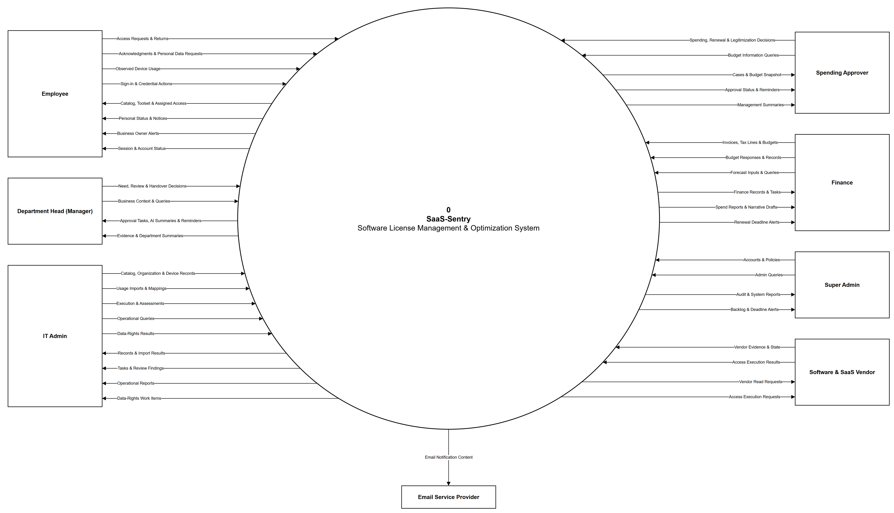

# Context Diagram — SaaS-Sentry (Business DFD Level 0)

> **Loại:** Context Diagram (DFD mức 0, business view) · **Phiên bản:** 3.0 — 08/10/2026 · **Trạng thái:** đã vẽ lại theo BRD v3.30 và `QĐ-49` → `QĐ-62`; chờ Owner/GVHD review.
>
> Sơ đồ là dẫn xuất từ quyết định Owner (`QĐ`) và BRD; quyết định là của Owner, **chưa** phải xác nhận của GVHD/hội đồng.

## 1. Mục đích và phạm vi

Cho thấy **ranh giới hệ thống**: ai và hệ thống ngoài nào trao đổi dữ liệu gì với SaaS-Sentry. Đây là bản *business view*: mỗi mũi tên là một **nhóm dữ liệu** (cụm danh từ), không phải một thao tác hay một bước trình tự; không có kho dữ liệu và không mở bên trong hệ thống (thuộc DFD mức 1).

## 2. Tệp

| Tệp | Vai trò |
| --- | --- |
| [SaaS-Sentry-Context-Diagram.drawio](SaaS-Sentry-Context-Diagram.drawio) | Nguồn draw.io chỉnh sửa được (sinh từ spec) |
| [SaaS-Sentry-Context-Diagram.drawio.png](SaaS-Sentry-Context-Diagram.drawio.png) | Bản xuất PNG, nhúng nguồn draw.io |
| [CTX.json](../specs/CTX.json) | **Nguồn canonical** — sửa rồi chạy `python context-diagram/tools/build_context_diagram.py --png` từ `Docs/Diagrams` |

## 3. Cách đọc

| Ký hiệu | Nghĩa |
| --- | --- |
| Hình tròn `0 SaaS-Sentry` | Toàn bộ hệ thống là **một tiến trình** |
| Hình chữ nhật | Tác nhân ngoài (người hoặc hệ thống) |
| Mũi tên có nhãn | Một nhóm dữ liệu; chiều mũi tên là chiều dữ liệu, **không** phải thứ tự thao tác |

Mỗi tác nhân xếp **luồng vào** (tác nhân → hệ thống) phía trên, **luồng ra** (hệ thống → tác nhân) phía dưới. Mọi dây nằm ngang và không cắt nhau; vị trí hộp không mang nghĩa nghiệp vụ.

**Số đếm:** 1 tiến trình · 8 tác nhân ngoài · 41 luồng (20 vào / 21 ra).

## 4. Tác nhân ngoài

| Mã | Nhãn trên hình | Là ai | Ràng buộc |
| --- | --- | --- | --- |
| `E1` | Employee | Nhân viên — đại diện mọi người dùng có tài khoản cho phần đăng nhập; với cảnh báo Business Owner là nhân viên giữ thuộc tính Business Owner của ứng dụng | Chỉ xem dữ liệu của chính mình (FR-10.1) |
| `E2` | Department Head (Manager) | Trưởng phòng — vai Manager suy ra từ việc đang là trưởng phòng có hiệu lực (QĐ-52a) | SoD-2: không tự cấp/thu hồi, không xem hợp đồng, tài chính toàn công ty, log thô |
| `E4` | IT Admin | Quản trị CNTT — có thể nhiều người, mỗi phòng một IT Admin phụ trách (QĐ-52d, QĐ-58b) | SoD-5: bên duy nhất thay đổi seat, chỉ sau khi đủ phê duyệt |
| `E11` | Spending Approver | Người duyệt chi — một người, mặc định CEO; người thay thế khi xung đột cấu hình trước (QĐ-22, QĐ-28c) | SoD-7, SoD-8 |
| `E3` | Finance | Tài chính — đúng một người, kiểm soát ngân sách, không nằm trên đường duyệt (QĐ-29b, QĐ-52d) | SoD-3: không thao tác kỹ thuật, không quyết chi |
| `E5` | Super Admin | Quản trị hệ thống — đúng một người giữ vai (QĐ-44) | SoD-1: không gán seat, không duyệt nghiệp vụ |
| `E8` | Software & SaaS Vendor | Nhà cung cấp SaaS trả phí và phần mềm thương mại có bản quyền — trang quản trị, API, tệp xuất (QĐ-49a) | Chỉ qua connector đã cấu hình hoặc tệp do IT Admin nhập |
| `E9` | Email Service Provider | Dịch vụ gửi thư điện tử | Chỉ nhận nội dung thư; không phải kênh thông báo mặc định (OI-09b) |

> **Không phải tác nhân:** Automation Service, bộ thu thập trên thiết bị và connector nằm **trong** ranh giới; Business Owner là thuộc tính của ứng dụng (người giữ là Employee/Manager/IT Admin); phần mềm nội bộ là đối tượng được quản lý, dữ liệu của nó đi qua IT Admin và Finance (`QĐ-49b`).

## 5. Luồng dữ liệu

| Mã | Chiều | Tác nhân | Nhãn trên hình | Dữ liệu | Nguồn |
| --- | --- | --- | --- | --- | --- |
| `G01` | vào hệ thống | Employee | Access Requests & Returns | Phiếu BM-01 (cấp mới, đổi gói, gia hạn quyền có thời hạn), phần nhu cầu của BM-02, phiếu hoàn trả BM-03, rút yêu cầu | FR-3.2, FR-3.18, BM-01/02/03 |
| `G02` | vào hệ thống | Employee | Acknowledgments & Personal Data Requests | Xác nhận chủ động chính sách theo dõi trên máy công ty (kèm bản ký BM-06 do IT lưu), yêu cầu xem/xuất/sửa dữ liệu cá nhân, yêu cầu dừng thu thập | FR-4.18, FR-4.21, FR-10.1→10.7, BM-06 |
| `G03` | vào hệ thống | Employee | Observed Device Usage | Dữ liệu sử dụng đã lọc tại nguồn trên thiết bị công ty đã đăng ký và đã xác nhận; bộ thu thập nằm trong ranh giới hệ thống, loại cụ thể chốt ở giai đoạn Tools | FR-4.18, FR-4.14a, ADR-13, QĐ-59a |
| `G41` | vào hệ thống | Employee | Sign-in & Credential Actions | Đăng nhập, kích hoạt qua lời mời, quên/đặt lại/đổi mật khẩu, đăng xuất — của mọi người dùng có tài khoản | FR-8.6, FR-8.11, QĐ-46 |
| `G05` | ra tác nhân | Employee | Catalog, Toolset & Assigned Access | Danh mục có thể xin, bộ công cụ chuẩn của phòng × chức vụ, quyền đang có, trạng thái và lý do của yêu cầu | FR-3.18, FR-3.11, FR-10.1 |
| `G06` | ra tác nhân | Employee | Personal Status & Notices | Thông báo trước khi theo dõi, quyền có thời hạn sắp hết, quyết định thu hồi sắp thực hiện, dữ liệu của chính mình, tệp xuất | FR-10.4, FR-5.14, QĐ-57a |
| `G07` | ra tác nhân | Employee | Business Owner Alerts | Cảnh báo trước hạn chót báo hủy và yêu cầu ý kiến về ứng dụng mình phụ trách; ý kiến trả lời được IT Admin ghi nhận (G14) | FR-1.4, FR-1.7, BRD 4.4, OI-09a |
| `G42` | ra tác nhân | Employee | Session & Account Status | Kết quả đăng nhập, trạng thái kích hoạt/đặt lại, vai hiệu lực của chính mình; không trả mật khẩu | FR-8.11 |
| `G08` | vào hệ thống | Department Head (Manager) | Need, Review & Handover Decisions | Duyệt/từ chối nhu cầu; yêu cầu tạo thay khi onboarding và yêu cầu theo nhóm; Keep/Reclaim/Exempt; rà soát công cụ sau điều chuyển; xác nhận bàn giao dữ liệu; đề xuất bộ công cụ chuẩn | FR-3.3, FR-3.10, FR-3.8, FR-2.12, FR-3.18, QĐ-52, QĐ-56 |
| `G09` | vào hệ thống | Department Head (Manager) | Business Context & Queries | Bối cảnh nghiệp vụ cho phát hiện ngoài danh mục và đánh giá phần mềm nhạy cảm; bộ lọc phòng/kỳ/trạng thái | FR-6.9, BRD 4.4 |
| `G10` | ra tác nhân | Department Head (Manager) | Approval Tasks, AI Summaries & Reminders | Phiếu chờ duyệt, hạn xử lý, nhắc quá hạn, hạn rà soát sau điều chuyển; tóm tắt AI các yêu cầu đang chờ chính trưởng phòng (QĐ-49e, QĐ-61e — chỉ hỗ trợ, có thể không dùng) | FR-3.8, QĐ-49e, QĐ-50b |
| `G11` | ra tác nhân | Department Head (Manager) | Evidence & Department Summaries | Khuyến nghị ghost seat kèm bằng chứng và mức tin cậy; công cụ đang dùng của phòng; thực chi + cam kết đang giữ của phòng | FR-4.14, FR-3.17, BRD 5.5.3 |
| `G12` | vào hệ thống | IT Admin | Catalog, Organization & Device Records | Nhà cung cấp, phần mềm, gói (kiểu cấp K1–K5, mức kiểm soát, lưu ý trước thu hồi), điều khoản nhà cung cấp, kho khóa bản quyền, hợp đồng, thuê bao; phòng ban, chức vụ, nhân sự, điều chuyển, bàn giao/nghỉ việc; sổ thiết bị | FR-1.1→1.10, FR-2.1, FR-2.2, FR-2.10, FR-3.17, FR-4.21 |
| `G13` | vào hệ thống | IT Admin | Usage Imports & Mappings | Tệp hoạt động/danh sách thành viên, mẫu cấu hình nguồn, cửa sổ bao phủ, xác nhận khớp danh tính và bước xem trước | FR-4.1→4.6, FR-7.2 |
| `G14` | vào hệ thống | IT Admin | Execution & Assessments | Kết quả cấp/thu hồi thủ công kèm bằng chứng; đánh giá BM-02 và mức kiểm soát; ý kiến Business Owner do IT ghi; xử lý sai lệch và phát hiện ngoài danh mục | FR-2.5, FR-3.19, FR-6.9, FR-7.7, OI-05a |
| `G15` | vào hệ thống | IT Admin | Operational Queries | Bộ lọc ứng dụng, thuê bao, phòng, nhân viên, tác vụ, kỳ | FR-5.10→5.12 |
| `G40` | vào hệ thống | IT Admin | Data-Rights Results | Người xử lý, thời điểm, kết quả yêu cầu quyền dữ liệu cá nhân | FR-10.5, OI-01 |
| `G16` | ra tác nhân | IT Admin | Records & Import Results | Hồ sơ đã ghi, mẫu tệp, kết quả xem trước, lỗi từng dòng | FR-7.2, FR-7.3, FR-9.3 |
| `G17` | ra tác nhân | IT Admin | Tasks & Review Findings | Hàng đợi cấp/thu hồi của các phòng phụ trách, đổi mật khẩu tài khoản dùng chung, khuyến nghị, hàng đợi chưa khớp, sai lệch, điều khoản cần rà soát, máy chưa xác nhận | FR-3.17, FR-2.11, FR-5.14 |
| `G18` | ra tác nhân | IT Admin | Operational Reports | Hiệu suất sử dụng, tiết kiệm hai con số, hiệu suất quy trình, chất lượng dữ liệu (trừ KPI-5) | FR-5.9→5.12 |
| `G39` | ra tác nhân | IT Admin | Data-Rights Work Items | Yêu cầu dừng thu thập, ngoại lệ xuất, yêu cầu chỉnh sửa cần IT xử lý | FR-10.5, FR-10.7 |
| `G28` | vào hệ thống | Spending Approver | Spending, Renewal & Legitimization Decisions | Duyệt/từ chối khoản chi; quyết bước nhu cầu khi trưởng phòng tự gửi; gia hạn/giảm/hủy; ba kết cục hợp thức hóa; chấp nhận/không chấp nhận khoản chi chưa có căn cứ | FR-3.13, FR-3.4c-1, FR-6.4, QĐ-52c |
| `G29` | vào hệ thống | Spending Approver | Budget Information Queries | Câu hỏi gửi Finance (SLA không dừng); bộ lọc báo cáo | FR-3.14 |
| `G30` | ra tác nhân | Spending Approver | Cases & Budget Snapshot | Hồ sơ cần quyết, mức kiểm soát/rủi ro, snapshot ngân sách theo chi phí thực chịu, phản hồi Finance nếu có | FR-3.14, FR-5.13, QĐ-60a |
| `G31` | ra tác nhân | Spending Approver | Approval Status & Reminders | Trạng thái, hạn, nhắc; thông báo Finance ghi nhận vượt/chưa có ngân sách; cảnh báo trước hạn chót báo hủy | FR-3.8, FR-1.4 |
| `G32` | ra tác nhân | Spending Approver | Management Summaries | Tổng chi, tiết kiệm, tóm tắt sử dụng và quy trình, seat cấp theo nhánh (a) | FR-5.9→5.11, QĐ-29a |
| `G22` | vào hệ thống | Finance | Invoices, Tax Lines & Budgets | Hóa đơn kèm dòng thuế theo chứng từ và cờ được khấu trừ, hồ sơ thuế nhà cung cấp, sao kê/thẻ, ngân sách, danh mục Cost Center, tỷ lệ phân bổ gói dùng chung, khoản chi phí phần mềm nội bộ | FR-5.1→5.4, FR-5.13, FR-3.1, OI-03, OI-04, QĐ-49g, QĐ-60 |
| `G23` | vào hệ thống | Finance | Budget Responses & Records | Trả lời yêu cầu thông tin ngân sách; ghi nhận chính thức trên khoản cam kết | FR-3.14, QĐ-29b |
| `G24` | vào hệ thống | Finance | Forecast Inputs & Queries | Giả định kịch bản L3, tỷ giá nhập tay khi không lấy được tự động, bộ lọc báo cáo | FR-5.5, FR-1.6, GĐ-8 |
| `G25` | ra tác nhân | Finance | Finance Records & Tasks | Kết quả nhập, câu hỏi ngân sách từ Người duyệt chi, khoản cam kết chờ ghi nhận, ngoại lệ đối soát cần bằng chứng | FR-3.14, FR-6.4 |
| `G26` | ra tác nhân | Finance | Spend Reports & Narrative Drafts | Ngân sách · thực chi · cam kết · còn lại theo chi phí thực chịu, GTGT được khấu trừ cột riêng, chênh lệch do thuế/tỷ giá, dòng Chưa phân bổ Cost Center, tiết kiệm; bản nháp diễn giải AI (QĐ-49e) | FR-5.1, FR-5.9, FR-5.13, QĐ-50c |
| `G27` | ra tác nhân | Finance | Renewal Deadline Alerts | Thuê bao sắp tới hạn chót báo hủy (mốc T−15, T−7) | FR-1.4 |
| `G19` | vào hệ thống | Super Admin | Accounts & Policies | Tài khoản và vai trò; Người duyệt chi, người thay thế, approver dự phòng; SLA, ngưỡng, kỳ ngân sách, lưu giữ, nội dung thông báo theo dõi | FR-8.1, FR-8.2, FR-3.6, FR-3.13, FR-3.15 |
| `G20` | vào hệ thống | Super Admin | Admin Queries | Tra cứu tài khoản, Audit Trail, tác vụ nền, nghẽn | FR-8.3, FR-8.4 |
| `G21` | ra tác nhân | Super Admin | Audit & System Reports | Audit Trail, kết quả tác vụ nền, hiệu suất quy trình, chất lượng gồm KPI-5 | FR-8.3, FR-5.11, FR-5.12, FR-0.3 |
| `G38` | ra tác nhân | Super Admin | Backlog & Deadline Alerts | Nghẽn/quá SLA, thiếu người duyệt hợp lệ, phòng thiếu trưởng phòng/IT Admin, mốc T−7 trước hạn báo hủy | FR-3.8, FR-3.12, FR-1.4, FR-3.17 |
| `G35` | vào hệ thống | Software & SaaS Vendor | Vendor Evidence & State | Danh sách thành viên/lời mời, license, bằng chứng hoạt động qua connector | FR-2.6, FR-4.1 |
| `G36` | vào hệ thống | Software & SaaS Vendor | Access Execution Results | Thành công, lời mời đang chờ chấp nhận, thất bại | FR-2.5, BRD 6.2 |
| `G33` | ra tác nhân | Software & SaaS Vendor | Vendor Read Requests | Yêu cầu đọc dữ liệu qua connector đã cấu hình | BRD 6.2 |
| `G34` | ra tác nhân | Software & SaaS Vendor | Access Execution Requests | Lệnh cấp/thu hồi gắn quyết định hợp lệ, chỉ cho tài khoản email công ty | FR-2.5, FR-2.9 |
| `G37` | ra tác nhân | Email Service Provider | Email Notification Content | Cảnh báo trước hạn chót báo hủy, thông báo trước khi theo dõi, thư vòng đời tài khoản; không chứa mật khẩu | FR-3.11, FR-1.4, FR-10.4, QĐ-46 |

**Mã ngừng dùng (không tái sử dụng):**

- `G04` *Business Owner Feedback* — BRD 4.4 và OI-05a: ý kiến/xác nhận của Business Owner do IT Admin ghi nhận trên hệ thống — nay nằm trong G14; không có luồng trực tiếp từ nhân viên. Mã không tái sử dụng.

## 6. Lược có chủ đích — không có trên hình

| Không vẽ | Lý do |
| --- | --- |
| Nhà cung cấp mô hình AI | Hai tính năng AI (`QĐ-49e`, phạm vi cam kết theo `QĐ-61e`) và gợi ý nhà cung cấp chạy trong hệ thống; nhà cung cấp model là tích hợp kỹ thuật, lược như bản v2.7 (Owner). Điều kiện gửi dữ liệu tới model còn mở (`OQ-26`) |
| Ứng dụng mobile | **Không** phải tác nhân ngoài: là kênh giao diện của chính Employee, trưởng phòng và Người duyệt chi cho bốn tác vụ của `QĐ-61b`; luồng dữ liệu nghiệp vụ không đổi nên không thêm thực thể hay luồng (`QĐ-61d`) |
| Nguồn tỷ giá tự động | Giả định `GĐ-8`; tỷ giá nhập tay khi cần nằm trong G24 |
| Hệ thống nhân sự, ngân hàng | Dữ liệu vào qua người tải tệp (IT Admin G12, Finance G22); không có tích hợp trực tiếp (`OQ-04`) |
| Ban giám đốc, kiểm toán | Không có tài khoản; chỉ nhận báo cáo ngoài hệ thống |
| Kho dữ liệu, Automation Service | Thuộc bên trong hệ thống (DFD mức 1) |
| Cổng thanh toán, công cụ chặn ứng dụng, log web/proxy/CASB | Ngoài phạm vi (BRD 3.2, 5.6.1) |
| Khôi phục Super Admin ngoài ứng dụng | Thủ tục của người vận hành hạ tầng, không qua ranh giới ứng dụng (`QĐ-47a`) |

## 7. Thay đổi so với v2.7 (05/10/2026)

- Tác nhân `E2` đổi nhãn thành **Department Head (Manager)** — vai Manager suy ra từ trưởng phòng (`QĐ-52a`).
- `G04` *Business Owner Feedback* **ngừng dùng**: ý kiến Business Owner do IT Admin ghi nhận (BRD 4.4, `OI-05a`), nay trong `G14`.
- Đổi nhãn theo nội dung mới: `G01` (hoàn trả BM-03), `G02` (xác nhận chính sách thiết bị BM-06), `G05` (bộ công cụ chuẩn), `G08` (bàn giao, rà soát sau điều chuyển, yêu cầu theo nhóm), `G11` (tóm tắt theo phòng), `G12` (kiểu cấp, điều khoản, kho khóa, phòng ban), `G22` (dòng thuế, hồ sơ thuế), `G24` (đầu vào dự báo), `G28` (bước nhu cầu khi trưởng phòng tự gửi), `G30` (snapshot theo chi phí thực chịu).
- Bố cục mới: mọi dây nằm ngang, tận cùng trên đường tròn; không còn đoạn chéo. Giữ lựa chọn của Owner: **không** có ô tiêu đề và caption trên hình.

## 8. Liên hệ với sơ đồ khác

- Cấp dưới: [Functional Decomposition](../functional-decomposition-diagram/functional-decomposition-guide.md) phân rã tiến trình `0` thành các chức năng.
- Mỗi nhóm luồng dẫn tới main flow tương ứng: G01/G08/G10/G28/G30/G34 → `MF-2`; G08/G12/G17 → `MF-7`, `MF-5`; G22/G23/G26 → `MF-8`; G07/G27/G28/G31 → `MF-4`. Bảng đầy đủ ở [index](../index.md).

## 9. Giới hạn và vấn đề còn mở

- G-3 (từ v2.7): có cần nộp context đầy đủ mọi tích hợp kỹ thuật (tỷ giá, nhà cung cấp model) không — **Owner/GVHD** quyết; bản này là business view.
- Bộ thu thập cụ thể và nguồn usage chốt ở giai đoạn Tools (`QĐ-59a`); G03 chỉ ở mức nghiệp vụ.
- Bản xuất 2420×1370 (đơn vị draw.io), PNG xuất tỷ lệ 2.
