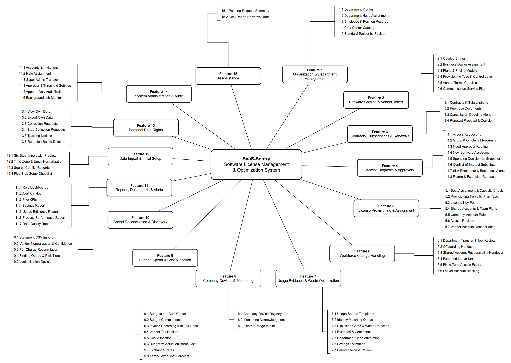

# Functional Decomposition Diagram — SaaS-Sentry

> **Loại:** Sơ đồ phân rã chức năng (FDD) · **Phiên bản:** 3.2 — 09/10/2026 · **Trạng thái:** vẽ lại theo bố cục mẫu của hội đồng và BRD v3.30, `QĐ-49` → `QĐ-62`; chờ Owner/GVHD review.
>
> Ảnh mẫu của hội đồng chỉ là **mẫu trình bày**; mọi chức năng lấy từ BRD và sổ quyết định, không chép chức năng mẫu.

## 1. Mục đích và cách đọc

Sơ đồ trả lời *hệ thống gồm những nhóm chức năng nào và mỗi nhóm làm được gì*. Hộp giữa là toàn hệ thống; mỗi hộp **Feature N** là một nhóm chức năng nối thẳng với hệ thống; danh sách **N.M** bên ngoài là các chức năng của nhóm đó.

Hai tầng dây, theo ảnh mẫu của hội đồng:

- **Hệ thống → Feature:** mỗi Feature một đoạn thẳng từ biên hộp giữa tới biên hộp Feature, tỏa quanh tâm; không gấp khúc, không mũi tên. Feature xếp theo chiều kim đồng hồ: 1 ở trên, 2–6 cột phải, 7–9 hàng dưới, 10–14 cột trái, 15 trên trái.
- **Feature → danh sách:** các dòng N.M là chữ thường (không đóng hộp), gom bằng **một dấu ngoặc vuông** ở phía hướng về Feature; một đường duy nhất từ Feature tới giữa dấu ngoặc, chỉ gồm đoạn ngang/dọc — thẳng ngang khi danh sách nằm ngang hàng Feature, có một bậc khi danh sách lệch lên/xuống, gấp vuông khi danh sách nằm trên/dưới Feature.

- Đây **không** phải sơ đồ luồng: không có thứ tự, không có rẽ nhánh Có/Không. Trình tự nằm ở main flow và workflow.
- Mỗi chức năng xuất hiện **đúng một lần**; chức năng dùng chung được đặt ở nhóm sở hữu nghiệp vụ và dẫn chiếu từ luồng.
- Không tự thêm CRUD, xóa hàng loạt, khôi phục hay import/export mà BRD không có.

## 2. Tệp

| Tệp | Vai trò |
| --- | --- |
| [saas-sentry-functional-decomposition.drawio](saas-sentry-functional-decomposition.drawio) | Nguồn draw.io chỉnh sửa được (sinh từ cây chức năng). Vị trí Owner kéo tay được ghi trong `build_fdd.py` (`FEATURE_XY`, `LIST_XY`, `ROUTE`); sửa tay trên draw.io thì chép tọa độ và nhãn mới về đó và `function-tree.json` rồi chạy lại script, nếu không `--check` báo lệch |
| [saas-sentry-functional-decomposition.drawio.png](saas-sentry-functional-decomposition.drawio.png) | Bản xuất PNG, nhúng nguồn draw.io |
| [function-tree.json](function-tree.json) | **Nguồn canonical** — sửa rồi chạy `python functional-decomposition-diagram/build_fdd.py --png` từ `Docs/Diagrams`; script sinh lại cả hình và tài liệu này |

**Số đếm:** 15 nhóm chức năng · 84 chức năng.

## 3. Nhóm chức năng và chức năng

### Feature 1 — Organization & Department Management

Tổ chức Công ty → Phòng ban → Chức vụ → Nhân sự (QĐ-52a). Dẫn tới: SF-1, MF-7.

| Mã | Chức năng (trên hình) | Ý nghĩa | Nguồn | Dùng trong luồng |
| --- | --- | --- | --- | --- |
| 1.1 | Department Profiles | Mã, tên, chức năng, trưởng phòng, Cost Center Unit, IT Admin phụ trách, dự án chỉ để mô tả; danh sách công cụ đang dùng là giá trị tổng hợp | FR-3.1, FR-3.17, QĐ-52a | WF-01 |
| 1.2 | Department Head Assignment | Mỗi phòng đúng một trưởng phòng có hiệu lực, mỗi người làm trưởng tối đa một phòng; vai Manager suy ra | FR-3.1, INV-19, QĐ-58a | WF-01, WF-07 |
| 1.3 | Employee & Position Records | Nhân viên thuộc đúng một phòng, có chức vụ, lịch sử hiệu lực theo thời gian; kiêm nhiệm không ghi phòng thứ hai | FR-2.1, FR-2.2, INV-20, QĐ-52b | WF-01, WF-05 |
| 1.4 | Cost Center Catalog | Hai loại Unit (1–1 với phòng) và Company; Finance tạo, sửa, ngừng dùng | FR-3.1, OI-04, QĐ-52b | WF-01, WF-20 |
| 1.5 | Standard Toolset by Position | Bộ công cụ chuẩn theo phòng × chức vụ; IT cấu hình theo đề xuất trưởng phòng hoặc chủ động, thông báo trưởng phòng | FR-3.18, QĐ-52e, QĐ-58c | WF-01, WF-04, MF-7 |

### Feature 2 — Software Catalog & Vendor Terms

Danh mục ba loại đối tượng quản lý và điều khoản theo gói. Dẫn tới: SF-1, MF-2, MF-4.

| Mã | Chức năng (trên hình) | Ý nghĩa | Nguồn | Dùng trong luồng |
| --- | --- | --- | --- | --- |
| 2.1 | Catalog Entries | SaaS trả phí, phần mềm có bản quyền, phần mềm nội bộ; nhóm chức năng, mức nhạy cảm; không nhận phần mềm miễn phí bên ngoài | FR-1.1, QĐ-49a, QĐ-49h | WF-02 |
| 2.2 | Business Owner Assignment | Mỗi mục có một Business Owner đang làm việc; người nghỉ được giữ kèm cờ cần thay thế | FR-1.7, BRD 4.4, OI-05c | WF-02, WF-07 |
| 2.3 | Plans & Pricing Models | Gói với mô hình giá per_seat, flat_rate, concurrent, consumption, per_host | FR-1.2, ADR-02 | WF-02 |
| 2.4 | Provisioning Type & Control Level | Kiểu cấp K1–K5, mức kiểm soát mặc định và lưu ý trước khi thu hồi là thuộc tính của gói | FR-1.9, QĐ-54a | WF-02, WF-10 |
| 2.5 | Vendor Terms Checklist | Liên kết điều khoản, ngày rà soát, checklist sáu điểm; cảnh báo tới hạn rà soát và vi phạm | FR-1.10, QĐ-54e | WF-02, WF-15 |
| 2.6 | Communication-Service Flag | Cờ ứng dụng liên lạc: mặc định không thu dữ liệu hoạt động | FR-1.8, ADR-10 | WF-02, WF-12 |

### Feature 3 — Contracts, Subscriptions & Renewals

Hợp đồng, thuê bao/khoản mua và vòng đời gia hạn. Dẫn tới: MF-4.

| Mã | Chức năng (trên hình) | Ý nghĩa | Nguồn | Dùng trong luồng |
| --- | --- | --- | --- | --- |
| 3.1 | Contracts & Subscriptions | Hợp đồng, thuê bao (số seat, đơn giá, chu kỳ, hạn chót báo hủy, tự gia hạn); license vĩnh viễn không có kỳ gia hạn | FR-1.3, ADR-06, QĐ-49c | WF-02 |
| 3.2 | Purchase Documents | Báo giá, hợp đồng, hóa đơn, chứng từ thuế; mở bằng signed URL theo vai | FR-1.5, BM-05, OI-08a | WF-02, WF-16 |
| 3.3 | Cancellation-Deadline Alerts | Cảnh báo T−15/T−7 tính từ hạn chót báo hủy; thiếu dữ liệu thì cảnh báo chất lượng | FR-1.4, OI-09a | MF-4, WF-15 |
| 3.4 | Renewal Proposal & Decision | IT lập đề xuất kèm sử dụng và điều khoản; Người duyệt chi quyết gia hạn, giảm số lượng hoặc hủy | FR-3.13, FR-4.15 | MF-4, WF-15 |

### Feature 4 — Access Requests & Approvals

Yêu cầu, định tuyến và phê duyệt có phân tách trách nhiệm. Dẫn tới: MF-2.

| Mã | Chức năng (trên hình) | Ý nghĩa | Nguồn | Dùng trong luồng |
| --- | --- | --- | --- | --- |
| 4.1 | Access Request Form | Phiếu yêu cầu: bộ chuẩn hiện trước, ngoài bộ chuẩn phải có lý do | FR-3.2, FR-3.18, BM-01 | MF-2, WF-09 |
| 4.2 | Group & On-Behalf Requests | Trưởng phòng tạo thay khi onboarding hoặc gửi yêu cầu theo nhóm cho gói team | FR-3.2, FR-2.11, QĐ-54d | WF-04 |
| 4.3 | Need-Approver Routing | Trưởng phòng duyệt nhu cầu; trưởng phòng tự gửi ⟹ Người duyệt chi; thiếu trưởng phòng ⟹ approver dự phòng | FR-3.3, FR-3.6, QĐ-52c | MF-2, WF-09 |
| 4.4 | New Software Assessment | IT đánh giá và cổng mức kiểm soát; đóng yêu cầu công cụ miễn phí; đăng ký phần mềm nội bộ | FR-3.19, BM-02, QĐ-53c, QĐ-49h, QĐ-50a | MF-2, WF-10 |
| 4.5 | Spending Decision on Snapshot | Người duyệt chi quyết trên snapshot chi phí thực chịu, tùy chọn hỏi Finance | FR-3.13, FR-3.14, QĐ-60a | MF-2, WF-09 |
| 4.6 | Conflict-of-Interest Substitute | Người thay thế cấu hình trước khi Người duyệt chi là người yêu cầu/thụ hưởng | FR-3.15, QĐ-28c | WF-09 |
| 4.7 | SLA Reminders & Bottleneck Alerts | SLA từng bước, nhắc và báo cấp trên; không ủy quyền; chờ có kiểm soát khi hết người duyệt | FR-3.5, FR-3.8, FR-3.12, FR-3.16 | WF-09 |
| 4.8 | Return & Extension Requests | Hoàn trả quyền (BM-03) và gia hạn quyền có thời hạn | FR-3.2, FR-2.8, BM-03 | WF-11 |

### Feature 5 — License Provisioning & Assignment

Ghi nhận quyền và thực thi cấp/thu hồi phía nhà cung cấp. Dẫn tới: MF-2, MF-7, MF-5, MF-4.

| Mã | Chức năng (trên hình) | Ý nghĩa | Nguồn | Dùng trong luồng |
| --- | --- | --- | --- | --- |
| 5.1 | Seat Assignment & Capacity Check | Assignment không vượt số đã mua, không chồng lấn; seat trống là giá trị tính ra | FR-2.3, FR-2.7, ADR-02, INV-01 | WF-09a |
| 5.2 | Provisioning Tasks by Plan Type | Tác vụ cấp qua connector hoặc thủ công; trạng thái chờ chấp nhận lời mời, thất bại, thử lại | FR-2.5, BRD 6.2, ADR-07 | WF-09a |
| 5.3 | License Key Pool | Kho khóa K4 mã hóa, che bớt, mỗi lần xem ghi audit; khóa về kho nếu điều khoản cho chuyển máy | FR-2.10, QĐ-54b | WF-02, WF-09a |
| 5.4 | Shared Accounts & Team Plans | Tài khoản dùng chung chỉ khi điều khoản cho phép, có người chịu trách nhiệm; không lưu mật khẩu | FR-2.11, QĐ-54d | WF-09a, WF-07 |
| 5.5 | Company-Account Rule | Chỉ cấp vào tài khoản email công ty; owner workspace luôn là tài khoản IT | FR-2.9, QĐ-54c | WF-09a |
| 5.6 | Access Reclaim | Thu hồi quyền, seat về kho; thu hồi không tự ghi nhận tiết kiệm | FR-2.4, FR-4.15 | WF-09a |
| 5.7 | Vendor Account Reconciliation | Đối soát hằng ngày với nhà cung cấp có connector; ghi sai lệch hai chiều | FR-2.6, FR-4.8, OI-14h | WF-16 |

### Feature 6 — Workforce Change Handling

Điều chuyển, nghỉ việc và các biến động nhân sự khác. Dẫn tới: MF-7, MF-5, SF-3.

| Mã | Chức năng (trên hình) | Ý nghĩa | Nguồn | Dùng trong luồng |
| --- | --- | --- | --- | --- |
| 6.1 | Department Transfer & Tool Review | Ghi điều chuyển có ngày hiệu lực; công cụ ngoài bộ chuẩn do trưởng phòng mới rà trong 5 ngày làm việc | FR-2.2, FR-3.8, QĐ-50b, QĐ-56a | MF-7, WF-05 |
| 6.2 | Offboarding Handover | Bàn giao dữ liệu trước khi thu hồi, checklist thu hồi, không kế nhiệm license | FR-2.12, BM-04, BM-08, QĐ-56b | MF-5, WF-07 |
| 6.3 | Shared-Account Responsibility Handover | Người chịu trách nhiệm tài khoản dùng chung được thay trước ngày hiệu lực/đóng hồ sơ | FR-2.12, QĐ-56c, QĐ-58d | WF-05, WF-07 |
| 6.4 | Extended Leave Status | IT cập nhật nghỉ dài; loại khỏi đánh giá ghost seat | FR-4.9, OQ-04 | WF-06 |
| 6.5 | Fixed-Term Access Expiry | Nhắc trước 7 ngày cho nhà thầu, thực tập sinh; quá hạn vào hàng đợi | FR-2.8, INV-07 | WF-08 |
| 6.6 | Leaver Account Blocking | Tài khoản của người đã nghỉ việc bị chặn ngay | FR-8.9, QĐ-41a | WF-07 |

### Feature 7 — Usage Evidence & Waste Optimization

Bằng chứng sử dụng và phát hiện ghost seat có kiểm soát. Dẫn tới: SF-4.

| Mã | Chức năng (trên hình) | Ý nghĩa | Nguồn | Dùng trong luồng |
| --- | --- | --- | --- | --- |
| 7.1 | Usage Source Templates | Mẫu cấu hình nguồn, định nghĩa hoạt động, cửa sổ bao phủ, ma trận năng lực | FR-4.1→4.4, FR-4.16, INV-10, INV-11 | WF-12 |
| 7.2 | Identity Matching Queue | Khớp định danh nhà cung cấp về nhân viên; chưa khớp không dùng để kết luận | FR-4.5→4.8, INV-12 | WF-12a |
| 7.3 | Exclusion Gates & Waste Detection | Tám cổng loại trừ rồi rule G1–G4; G5 ngoài phạm vi | FR-4.9→4.12b, G1–G4, BRD 5.4.1 | WF-13, WF-13a |
| 7.4 | Evidence & Confidence | Khuyến nghị kèm căn cứ và mức tin cậy Cao/Trung bình/Thấp | FR-4.14, FR-4.14a, QĐ-35b | WF-13 |
| 7.5 | Department Head Attestation | Trưởng phòng chọn Keep/Reclaim/Exempt có lý do; Exempt có hạn tối đa 12 tháng | FR-3.10, INV-09, OI-02 | WF-13 |
| 7.6 | Savings Estimation | Hai con số tiết kiệm tách riêng: ngay và tại kỳ gia hạn | FR-4.15 | WF-13, MF-4 |
| 7.7 | Periodic Access Review | Rà soát quyền định kỳ — chỉ đặc tả thiết kế | FR-3.10, F-24 | WF-14 |

### Feature 8 — Company Devices & Monitoring

Thiết bị công ty và xác nhận chính sách theo dõi. Dẫn tới: SF-4.

| Mã | Chức năng (trên hình) | Ý nghĩa | Nguồn | Dùng trong luồng |
| --- | --- | --- | --- | --- |
| 8.1 | Company Device Registry | Mã tài sản, hệ điều hành, tên máy, người giữ, hiệu lực; không lưu IP, không đăng ký máy cá nhân | FR-4.21, QĐ-57b | WF-18 |
| 8.2 | Monitoring Acknowledgment | Ký xác nhận đã biết rõ khi nhận máy và xác nhận trong hệ thống trước khi nhận dữ liệu | FR-4.18, FR-4.21, BM-06, INV-17 | WF-18 |
| 8.3 | Filtered Usage Intake | Chỉ nhận dữ liệu đã lọc tại nguồn từ thiết bị đã xác nhận; loại bộ thu thập chốt ở giai đoạn Tools | ADR-13, FR-4.14a, QĐ-59a | WF-18 |

### Feature 9 — Budget, Spend & Cost Allocation

Ngân sách, thực chi, khoản cam kết và phân bổ chi phí. Dẫn tới: MF-8.

| Mã | Chức năng (trên hình) | Ý nghĩa | Nguồn | Dùng trong luồng |
| --- | --- | --- | --- | --- |
| 9.1 | Budgets per Cost Center | Ngân sách theo Cost Center và kỳ (mặc định quý) | FR-5.1, OI-11b | WF-20 |
| 9.2 | Budget Commitments | Khoản cam kết sau duyệt chi, gắn ngược khi ngân sách ra đời; còn lại được phép âm | FR-5.8, FR-5.8a, INV-16, INV-18 | MF-2, WF-20 |
| 9.3 | Invoice Recording with Tax Lines | Hóa đơn ghi từng dòng thuế theo chứng từ, cờ được khấu trừ; đối chiếu với sao kê | FR-5.4, FR-5.13, QĐ-34b | MF-8, WF-16 |
| 9.4 | Vendor Tax Profiles | T1 trong nước, T2 nước ngoài doanh nghiệp nộp thay, T3 thuế đã thu; chỉ ghi nhận | FR-5.13, QĐ-60b | WF-16 |
| 9.5 | Cost Allocation | Theo seat và ngày hiệu lực, chia theo ngày khi điều chuyển, gói dùng chung theo tỷ lệ, nội bộ một Cost Center | FR-5.2, FR-5.3, QĐ-49g, QĐ-55b | MF-8, WF-19 |
| 9.6 | Budget vs Actual on Borne Cost | Ngân sách · thực chi · cam kết · còn lại trên chi phí thực chịu; dòng Chưa phân bổ Cost Center | FR-5.1, FR-5.13, QĐ-50c, QĐ-60a | MF-8, WF-19 |
| 9.7 | Exchange Rates | Tiền tệ gốc, tỷ giá, ngày tỷ giá, giá trị quy đổi | FR-1.6, FR-5.6, ADR-03 | WF-19 |
| 9.8 | Three-Layer Cost Forecast | L1 cam kết, L3 kịch bản; L2 chỉ đặc tả | FR-5.5, FR-5.7, QĐ-25 | WF-19 |

### Feature 10 — Spend Reconciliation & Discovery

Đối soát chi phí phần mềm — tính năng bổ sung (QĐ-33a). Dẫn tới: MF-8.

| Mã | Chức năng (trên hình) | Ý nghĩa | Nguồn | Dùng trong luồng |
| --- | --- | --- | --- | --- |
| 10.1 | Statement CSV Import | Mẫu CSV chuẩn hoặc theo ngân hàng; từ chối tệp không đúng mã hóa/định dạng | FR-6.3, QĐ-31a | WF-17 |
| 10.2 | Vendor Normalization & Confidence | Từ điển nhà cung cấp, khớp chính xác/mẫu/mờ; ca mơ hồ vào hàng đợi review | FR-6.2, FR-6.5, QĐ-38 | WF-17a |
| 10.3 | Per-Charge Reconciliation | Mỗi khoản chi so với căn cứ phê duyệt; ngoại lệ là cần kiểm tra, không phải vi phạm | FR-6.4, QĐ-33b | WF-17 |
| 10.4 | Finding Queue & Risk Tiers | Một bản ghi đang mở mỗi nhà cung cấp; phân tầng rủi ro là mức ưu tiên xem xét | FR-6.6→6.8, INV-13 | WF-17 |
| 10.5 | Legitimization Decision | Người duyệt chi quyết báo nhầm / không duyệt / hợp thức hóa; IT thực thi | FR-6.9, FR-3.4c-1, BM-07 | WF-17 |

### Feature 11 — Reports, Dashboards & Alerts

Dashboard theo vai, danh mục cảnh báo và năm nhóm báo cáo. Dẫn tới: MF-8, MF-4.

| Mã | Chức năng (trên hình) | Ý nghĩa | Nguồn | Dùng trong luồng |
| --- | --- | --- | --- | --- |
| 11.1 | Role Dashboards | Một trang tổng quan cho mỗi vai theo đúng phạm vi xem | FR-5.14, QĐ-57a | UF |
| 11.2 | Alert Catalog | Một danh mục cảnh báo: cảnh báo gì, gửi ai, khi nào; kênh trong ứng dụng, thư điện tử có giới hạn | FR-5.14, FR-3.11, OI-09b | UF |
| 11.3 | Five KPIs | KPI-1 → KPI-5 kèm kỳ tính và thời điểm cập nhật | FR-0.1→0.4 | WF-19 |
| 11.4 | Savings Report | Hai con số tiết kiệm không bao giờ cộng lại | FR-5.9 | WF-19 |
| 11.5 | Usage Efficiency Report | KPI-3, độ bao phủ bằng chứng, G1–G4 theo ứng dụng và phòng | FR-5.10, FR-5.10a | WF-13 |
| 11.6 | Process Performance Report | KPI-2 theo từng bước, quá SLA, bảng nghẽn, seat nhánh (a) | FR-5.11, QĐ-29a | WF-09 |
| 11.7 | Data Quality Report | KPI-5, KPI-1, độ mới nguồn, sai lệch mở, trạng thái bộ thu thập | FR-5.12, FR-0.4 | WF-12 |

### Feature 12 — Data Import & Initial Setup

Khung import chung và khởi tạo năm bước. Dẫn tới: SF-1.

| Mã | Chức năng (trên hình) | Ý nghĩa | Nguồn | Dùng trong luồng |
| --- | --- | --- | --- | --- |
| 12.1 | Six-Step Import with Preview | Tải lên → phân tích → ánh xạ → xem trước bắt buộc → ghi nhận → tổng hợp; lỗi theo dòng, chống import trùng | FR-7.1→7.4 | WF-01, WF-12 |
| 12.2 | Time-Zone & Email Normalization | Chuẩn hóa múi giờ tổ chức và email nhất quán | FR-7.5, FR-7.6 | WF-12a |
| 12.3 | Source Conflict Records | Không nguồn nào tự ghi đè nguồn kia; mâu thuẫn thành bản ghi cần xử lý | FR-7.7 | WF-16 |
| 12.4 | Five-Step Setup Checklist | Phòng ban và nhân sự → danh mục → hợp đồng/thuê bao → hiện trạng seat → usage; file mẫu | FR-9.1→9.7 | WF-01 |

### Feature 13 — Personal Data Rights

Quyền của chủ thể dữ liệu. Dẫn tới: SF-2.

| Mã | Chức năng (trên hình) | Ý nghĩa | Nguồn | Dùng trong luồng |
| --- | --- | --- | --- | --- |
| 13.1 | View Own Data | Nhân viên xem seat, yêu cầu, dữ liệu sử dụng, thiết bị và xác nhận của chính mình | FR-10.1 | UF-03 |
| 13.2 | Export Own Data | Xuất dữ liệu cá nhân ra tệp, ghi thời điểm tiếp nhận và hoàn tất | FR-10.2 | UF-03 |
| 13.3 | Correction Requests | Yêu cầu sửa dữ liệu cá nhân sai; không sửa usage gốc hay Audit Trail | FR-10.7, OI-13 | UF-03 |
| 13.4 | Stop-Collection Requests | Yêu cầu dừng thu thập, xử lý trong 2 ngày làm việc | FR-10.5, OI-01a | UF-03, WF-18 |
| 13.5 | Tracking Notices | Thông báo trước khi theo dõi cho mọi ứng dụng | FR-10.4, QĐ-01 | WF-12, WF-18 |
| 13.6 | Retention-Based Deletion | Xóa dữ liệu hoạt động quá hạn; 30 ngày sau ngày làm việc cuối với người đã nghỉ | FR-10.3, FR-10.6 | WF-07 |

### Feature 14 — System Administration & Audit

Tài khoản, vai trò, cấu hình và nhật ký kiểm toán. Dẫn tới: SF-2.

| Mã | Chức năng (trên hình) | Ý nghĩa | Nguồn | Dùng trong luồng |
| --- | --- | --- | --- | --- |
| 14.1 | Accounts & Invitations | Tài khoản tạo từ hồ sơ nhân viên, kích hoạt qua lời mời một lần; người dùng tự đặt mật khẩu | FR-8.6, FR-8.11, QĐ-46 | WF-03, UF-17 |
| 14.2 | Role Assignment | Gán/thu hồi vai; Super Admin không kiêm vai nghiệp vụ; không tự thay đổi tài khoản của mình | FR-8.1, FR-8.7, FR-8.8 | WF-03 |
| 14.3 | Super Admin Transfer | Một Super Admin; đổi người chỉ qua chuyển giao | FR-8.10, QĐ-44 | WF-03 |
| 14.4 | Approver & Threshold Settings | Người duyệt chi, người thay thế, approver dự phòng, SLA, ngưỡng, lưu giữ | FR-8.2 | WF-03 |
| 14.5 | Append-Only Audit Trail | Nhật ký chỉ ghi thêm; chỉ Super Admin tra cứu | FR-8.3, INV-05, OI-08c | WF-03 |
| 14.6 | Background Job Monitor | Lần chạy, kết quả, số bản ghi, lỗi của tác vụ nền | FR-8.4 | WF-03 |

### Feature 15 — AI Assistance

AI chỉ hỗ trợ; quy trình chạy đủ khi AI tắt (QĐ-49e). Dẫn tới: MF-2, MF-8.

| Mã | Chức năng (trên hình) | Ý nghĩa | Nguồn | Dùng trong luồng |
| --- | --- | --- | --- | --- |
| 15.1 | Pending-Request Summary | Tóm tắt các yêu cầu đang chờ chính trưởng phòng duyệt, mỗi dòng dẫn tới yêu cầu nguồn | QĐ-49e(1), BRD 6.4 | MF-2 |
| 15.2 | Cost Report Narrative Draft | Bản nháp diễn giải báo cáo chi phí từ số liệu backend; Finance xem và sửa | QĐ-49e(2), BRD 6.4 | MF-8 |

## 4. Không đưa vào hình

| Nội dung | Lý do |
| --- | --- |
| Đăng nhập, xem danh sách, CRUD kỹ thuật riêng lẻ | Là thao tác nền, không phải chức năng nghiệp vụ; đăng nhập gộp trong 14.1 |
| Tích hợp HRM, cổng thanh toán, chặn ứng dụng, log web/proxy/CASB | Ngoài phạm vi (BRD 3.2) |
| Hạn mức/quota theo phòng ban | Ngoài phạm vi (`QĐ-57c`) |
| G5 hạ gói theo mức sử dụng, dự báo L2 | Ngoài phạm vi / chỉ đặc tả (BRD 5.4.1, `QĐ-25`) |
| Tính, kê khai, khấu trừ thuế | Hệ thống chỉ ghi nhận (`QĐ-55a`) |
| Chi tiết bộ thu thập, ma trận nhà cung cấp | Chốt ở giai đoạn Tools (`QĐ-59a`) |
| Gợi ý nhà cung cấp bằng AI (`US-15-01`) | Vẫn trong phạm vi nhưng đang ẩn và **không đưa vào phần trình bày** (`QĐ-49e`); vẽ ở mức chi tiết trong `WF-17a` |

## 5. Thay đổi so với bản trước (v2.x, 04/10/2026)

- Bố cục chuyển sang dạng **hộp trung tâm + Feature N + danh sách N.M** theo mẫu hội đồng; đánh số phân cấp.
- Bỏ nhóm *Manager & Cost Center* dựa trên cây quản lý trực tiếp (`QĐ-23` đã bị `QĐ-52` thay); thêm Feature 1 theo phòng ban, trưởng phòng, chức vụ, bộ công cụ chuẩn.
- Thêm chức năng của Review 1: kiểu cấp và mức kiểm soát, điều khoản nhà cung cấp, kho khóa, tài khoản dùng chung, chỉ tài khoản công ty, bàn giao dữ liệu, hồ sơ thuế và dòng thuế, chi phí thực chịu, dashboard theo vai và danh mục cảnh báo, sổ thiết bị và BM-06.
- Tách *Company Devices & Monitoring* và *AI Assistance* thành nhóm riêng để trả lời trực tiếp câu hỏi của hội đồng; AI chỉ có hai tính năng của `QĐ-49e`; `US-15-01` đang ẩn không vẽ trên hình (mục 4).
- **Chỉnh bố cục 09/10/2026 (chỉ hình thức, nội dung giữ nguyên):** danh sách N.M bỏ khung từng dòng và bỏ dây riêng tới từng chức năng, thay bằng một dấu ngoặc và một đường cho mỗi Feature; Feature xếp thành vòng gọn quanh hộp giữa theo mẫu hội đồng. Mã, tên, thứ tự, quan hệ cha–con và nguồn của 15 nhóm / 84 chức năng không đổi — kiểm ở `verification-2026-10-08.md` mục 6.
- **Owner chỉnh tay trên draw.io 09/10/2026 (v3.1):** nhãn Feature 15 bỏ chữ *(Optional)* — chỉ đổi cách ghi trên hình; AI vẫn chỉ hỗ trợ, mọi quy trình chạy đủ khi AI tắt (`QĐ-49e`), không thêm chức năng AI. Mười lăm hộp Feature kéo gần hộp giữa; danh sách 1 và 15 dời chỗ, danh sách 2–14 giữ nguyên nên đường tới dấu ngoặc có một bậc. Feature 9 đặt cao hơn bản kéo tay 14px vì góc hộp chạm Feature 8. Không đổi mã, tên chức năng, thứ tự hay nguồn.
- **Bỏ mã khỏi nhãn hiển thị 09/10/2026 (v3.2, `QĐ-62r`):** Owner bỏ mã biểu mẫu/rule khỏi bảy nhãn trên hình, theo danh sách chữ trong Report 1 — 3.2 *Purchase Documents*, 4.1 *Access Request Form*, 4.4 *New Software Assessment*, 6.2 *Offboarding Handover*, 7.3 *Exclusion Gates & Waste Detection*, 8.2 *Monitoring Acknowledgment*, 10.5 *Legitimization Decision*. Các mã BM-01, BM-02, BM-04, BM-05, BM-06, BM-07, BM-08 và G1–G4 vẫn nằm ở cột *Nguồn* để truy vết; mã `N.M`, thứ tự và bố cục không đổi.

## 6. Liên hệ

- Cấp trên: [Context Diagram](../context-diagram/index.md) — tiến trình `0` được phân rã ở đây.
- Cấp dưới: [5 main flow](../main-workflows-activity-diagram/index.md) và workflow; cột *Dùng trong luồng* cho biết chức năng được dùng ở đâu. Bảng truy vết đầy đủ ở [index](../index.md).

## 7. Giới hạn

- Tên chức năng là tên nghiệp vụ, chưa phải tên màn hình hay API; mã màn hình chốt ở giai đoạn Figma (`QĐ-08`).
- Nhóm 7, 8 phụ thuộc kết quả nghiên cứu phương pháp usage (`QĐ-57d`); hình chỉ ở mức nghiệp vụ.
- Kích thước bản vẽ 1902×1432; PNG xuất tỷ lệ 2.
