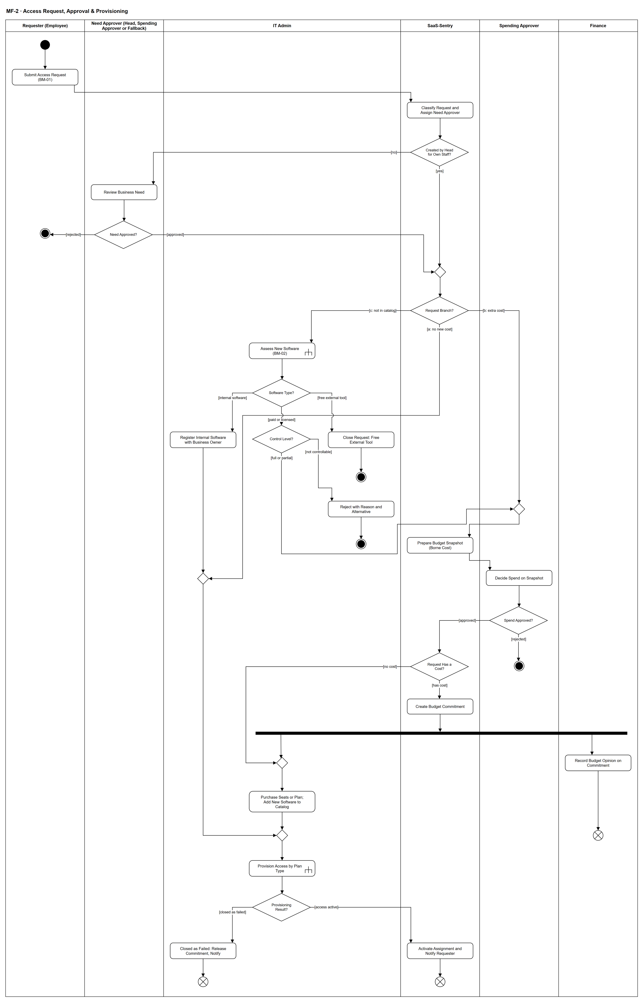

# MF-2 — Access Request, Approval & Provisioning

> **Loại:** Main flow (cấp tổng quan) — 1/5 · **Phiên bản:** 3.4 — 10/10/2026 · **Trạng thái:** Đã vẽ lại theo BRD v3.30 (đồng bộ QĐ-61/QĐ-62) và QĐ-49 → QĐ-60; chờ Owner/GVHD review
>
> Sơ đồ là **dẫn xuất** từ quyết định Owner (`QĐ`) và BRD hiện hành; khi khác nhau, `QĐ` → BRD thắng. Quyết định trong sơ đồ là của Owner, **chưa** phải xác nhận của GVHD/hội đồng.

## 1. Mục đích và phạm vi

Mô tả con đường chính thức để một nhân viên **có được quyền dùng một phần mềm**: từ phiếu yêu cầu, qua quyết định nhu cầu, cổng kiểm soát phần mềm mới và quyết định chi (chỉ khi phát sinh tiền hoặc thêm phần mềm trả phí vào danh mục), tới lúc tài khoản thật được cấp. Đây là biện pháp xử lý **nguyên nhân gốc** của Shadow IT (PP-5): đường chính thức phải nhanh, đo được và có kiểm soát.

**Phạm vi:** Ba nhánh (a)/(b)/(c) của FR-3.4, đường không phí của phần mềm nội bộ, đóng yêu cầu công cụ miễn phí bên ngoài, cổng mức kiểm soát, khoản cam kết và ghi nhận song song của Finance, kết quả cấp phát.

**Không nằm trong sơ đồ này:** Chi tiết định tuyến người duyệt, SLA, hết người duyệt hợp lệ, hỏi Finance và hết seat lúc cấp (→ WF-09); chi tiết đánh giá phần mềm mới (→ WF-10); chi tiết kênh cấp, thử lại, chờ chấp nhận lời mời (→ WF-09a); hoàn trả/gia hạn quyền có thời hạn (→ WF-11).

## 2. Tệp

| Tệp | Vai trò |
| --- | --- |
| [MF-2-access-request-approval-provisioning.drawio](MF-2-access-request-approval-provisioning.drawio) | Nguồn draw.io chỉnh sửa được (sinh từ spec) |
| [MF-2-access-request-approval-provisioning.drawio.png](MF-2-access-request-approval-provisioning.drawio.png) | Bản xuất PNG, nhúng sẵn nguồn draw.io |
| [MF-2.json](../specs/MF-2.json) | **Nguồn canonical** — sửa ở đây rồi chạy `python tools/flowkit.py build` từ `Docs/Diagrams` |

## 3. Nguồn nghiệp vụ

| Mã | Nội dung dùng trong sơ đồ |
| --- | --- |
| `FR-3.2, FR-3.3, FR-3.4` | Tạo yêu cầu, người duyệt bước nhu cầu theo trưởng phòng, ba nhánh (a)/(b)/(c) |
| `FR-3.13 → FR-3.15` | Người duyệt chi, snapshot ngân sách, hỏi Finance tùy chọn, người thay thế khi xung đột |
| `FR-3.18, FR-3.19` | Bộ công cụ chuẩn; cổng mức kiểm soát |
| `FR-5.8, FR-5.8a, FR-5.13` | Khoản cam kết, chưa có ngân sách, chi phí thực chịu |
| `FR-2.3, FR-2.5, FR-2.9 → FR-2.11, FR-1.9` | Cấp phát, kiểu cấp K1–K5, chỉ tài khoản công ty, kho khóa, tài khoản dùng chung |
| `BRD 4.6` | Ma trận trách nhiệm theo loại yêu cầu |
| `BM-01, BM-02, BM-05` | Phiếu yêu cầu, đề xuất mua phần mềm mới + đánh giá IT, chứng từ mua |
| `QĐ-22, QĐ-29a, QĐ-29b` | Người duyệt chi; nhánh (a) không qua Người duyệt chi; Finance ghi nhận sau duyệt |
| `QĐ-49e, QĐ-49h, QĐ-50a` | Tóm tắt AI cho trưởng phòng; đóng yêu cầu công cụ miễn phí; đường không phí của phần mềm nội bộ |
| `QĐ-52c, QĐ-53c, QĐ-54` | Định tuyến theo trưởng phòng; cổng mức kiểm soát; kiểu cấp và tài khoản |
| `QĐ-60a` | Ngân sách so trên chi phí thực chịu |
| `SoD-3, SoD-4, SoD-5, SoD-7, SoD-8` | Phân tách trách nhiệm |
| `EP-05, EP-06, EP-07 (User Stories)` | Story hiện hành chưa đồng bộ QĐ-52 → QĐ-60 — xem mục 12 |

## 4. Tác nhân, kích hoạt, điều kiện

| Làn (tiếng Anh trên hình) | Tác nhân | Trách nhiệm trong sơ đồ |
| --- | --- | --- |
| Requester (Employee) | Employee (hoặc trưởng phòng tạo thay/yêu cầu theo nhóm) | Tạo phiếu BM-01 |
| Need Approver (Head, Spending Approver or Fallback) | Trưởng phòng của người yêu cầu; Người duyệt chi khi trưởng phòng tự gửi; approver dự phòng ở gốc khi phòng chưa có trưởng phòng hoặc khi trưởng phòng tự gửi mà chính là Người duyệt chi | Quyết định nhu cầu |
| IT Admin | IT Admin phụ trách phòng (IT Admin khác được xử lý thay, có Audit Trail) | Đánh giá phần mềm mới, mua, cấp phát |
| SaaS-Sentry | SaaS-Sentry | Định tuyến, snapshot, khoản cam kết, kích hoạt và thông báo |
| Spending Approver | Người duyệt chi (mặc định CEO) hoặc người thay thế khi xung đột | Quyết định chi |
| Finance | Finance (một người) | Ghi nhận ngân sách sau duyệt — không nằm trên đường duyệt |

- **Kích hoạt:** Employee (hoặc trưởng phòng thay mặt) gửi phiếu yêu cầu cấp quyền BM-01.
- **Tiền điều kiện:** Người yêu cầu thuộc đúng một phòng có hiệu lực; phòng có Cost Center `Unit`; danh mục, gói và thuê bao đã khai báo (WF-01, WF-02); chỉ cấp vào tài khoản email công ty.
- **Hậu điều kiện:** Một trong các kết cục: quyền được cấp và Assignment hoạt động · yêu cầu bị từ chối (nhu cầu / mức kiểm soát / chi) · yêu cầu đóng vì là công cụ miễn phí bên ngoài · cấp phát thất bại có dấu vết. Mọi quyết định có bản ghi phê duyệt điện tử và Audit Trail.

## 5. Cách đọc ký hiệu

| Ký hiệu | Nghĩa |
| --- | --- |
| Hình tròn đặc | Bắt đầu hoạt động (initial node) |
| Hình chữ nhật bo góc | Hành động (action) của tác nhân ở làn chứa nó |
| Hình chữ nhật bo góc có ký hiệu cây đinh ba ở góc | Gọi workflow con (call behavior) — mã workflow ghi trong nhãn |
| Hình thoi có chữ | Rẽ nhánh; mỗi cạnh ra mang điều kiện trong ngoặc vuông `[...]` |
| Hình thoi nhỏ không chữ | Hợp nhánh (merge) |
| Thanh đen ngang | Tách hoặc gộp các nhánh chạy song song (fork/join) |
| Vòng tròn kép đặc | Kết thúc toàn bộ hoạt động (activity final) |
| Vòng tròn có dấu nhân | Kết thúc riêng nhánh đó, các nhánh khác vẫn chạy (flow final) |
| Dây có cung nhảy | Hai dây giao nhau nhưng **không** nối với nhau |

Đọc từ trên xuống. Mỗi làn là một vai; hành động nằm ở làn của người thực hiện. Sau thanh tách song song, Finance ghi nhận và IT mua/cấp chạy độc lập, nên các kết cục sau đó dùng **flow final** (kết thúc nhánh) thay vì kết thúc toàn hoạt động — đúng ngữ nghĩa UML: kết cục của IT không được hủy việc ghi nhận của Finance.

## 6. Bảng node

| ID | Loại | Nhãn trên hình | Ý nghĩa | Làn / người thực hiện | Quy tắc |
| --- | --- | --- | --- | --- | --- |
| `st` | Nút bắt đầu | — | — | Requester (Employee) | — |
| `a_req` | Hành động | Submit Access Request (BM-01) | Nhân viên chọn phần mềm/gói (bộ công cụ chuẩn của phòng × chức vụ hiện trước), ghi lý do, thời hạn, cá nhân hay dùng chung; ngoài bộ chuẩn phải có lý do. Trưởng phòng có thể tạo thay khi onboarding hoặc gửi yêu cầu theo nhóm cho gói team. Employee cũng gửi/rút yêu cầu đơn giản trên ứng dụng mobile (QĐ-61b). | Requester (Employee) | `FR-3.2`, `FR-3.18`, `FR-2.11`, `BM-01` |
| `s_route` | Hành động | Classify Request and Assign Need Approver | Hệ thống xác định nhánh (a)/(b)/(c) và người duyệt bước nhu cầu: trưởng phòng của người yêu cầu; trưởng phòng tự gửi ⟹ Người duyệt chi (trưởng phòng chính là Người duyệt chi ⟹ approver dự phòng ở gốc); phòng chưa có trưởng phòng ⟹ approver dự phòng ở gốc. Không ai tự duyệt yêu cầu của mình. | SaaS-Sentry | `FR-3.3`, `FR-3.4`, `FR-3.6`, `QĐ-52c`, `SoD-4` |
| `d_beh` | Rẽ nhánh | Created by Head for Own Staff? | Yêu cầu do **trưởng phòng tạo thay** nhân viên phòng mình (onboarding hoặc yêu cầu theo nhóm — FR-3.2): trưởng phòng là người vốn duyệt nhu cầu của những người này, nên việc tạo thay được ghi nhận là **bước nhu cầu đã xác nhận** (người tạo, người thụ hưởng, thời điểm). Người thụ hưởng phải thuộc phòng của trưởng phòng. Phần mà chính trưởng phòng là người thụ hưởng ⟹ bước nhu cầu theo QĐ-52c (Người duyệt chi; nếu trưởng phòng là Người duyệt chi ⟹ approver dự phòng). Yêu cầu theo nhóm được xét theo **từng người thụ hưởng**: mục của chính trưởng phòng đi nhánh [no]. | SaaS-Sentry | `FR-3.2`, `QĐ-62a`, `QĐ-52c`, `SoD-4` |
| `a_need` | Hành động | Review Business Need | Người duyệt bước nhu cầu xem lý do, cờ ngoài bộ chuẩn và lịch sử quyền; có thể dùng bản tóm tắt AI các yêu cầu đang chờ (chỉ hỗ trợ). Bước có SLA 2 ngày làm việc, quá hạn chỉ nhắc/thông báo. Trên ứng dụng mobile, bước này dùng cùng quy tắc và phân quyền (QĐ-61b). | Need Approver (Head, Spending Approver or Fallback) | `FR-3.7`, `FR-3.8`, `QĐ-49e(1)`, `QĐ-27` |
| `d_need` | Rẽ nhánh | Need Approved? | Người duyệt bước nhu cầu quyết: trưởng phòng; Người duyệt chi khi trưởng phòng là người thụ hưởng (QĐ-52c); approver dự phòng ở gốc khi phòng chưa có trưởng phòng hoặc trưởng phòng chính là Người duyệt chi (FR-3.3, FR-3.6). | Need Approver (Head, Spending Approver or Fallback) | — |
| `end_need` | Kết thúc hoạt động | — | Yêu cầu bị từ chối ở bước nhu cầu; người yêu cầu nhận thông báo kèm lý do. | Requester (Employee) | — |
| `m_nd` | Hợp nhánh | — | — | SaaS-Sentry | — |
| `d_branch` | Rẽ nhánh | Request Branch? | Hệ thống đi theo nhánh đã xác định khi gửi: (a) có trong danh mục, không phát sinh chi phí; (b) có trong danh mục nhưng cần mua thêm/nâng gói/vượt ngân sách; (c) chưa có trong danh mục. | SaaS-Sentry | `FR-3.4`, `QĐ-29a` |
| `c_assess` | Gọi workflow con | Assess New Software (BM-02) | IT Admin hoàn thiện phần đánh giá của BM-02: loại phần mềm, gói, kiểu cấp, trang quản trị, xuất danh sách thành viên, SSO, chính sách chia sẻ và điều khoản, loại dữ liệu, công cụ trùng chức năng. | IT Admin | `FR-3.19`, `BM-02`, `QĐ-53c`, → `WF-10` |
| `d_kind` | Rẽ nhánh | Software Type? | IT phân loại phần mềm được yêu cầu. | IT Admin | `QĐ-49a`, `QĐ-49h`, `QĐ-50a` |
| `a_close` | Hành động | Close Request: Free External Tool | Công cụ miễn phí bên ngoài không phải đối tượng quản lý: IT đóng yêu cầu kèm lý do và hướng dẫn theo chính sách công ty; không qua Người duyệt chi, không thêm vào danh mục. | IT Admin | `QĐ-49h`, `FR-3.4` |
| `end_closed` | Kết thúc hoạt động | — | Yêu cầu đóng — ngoài phạm vi quản lý. | IT Admin | — |
| `a_reg` | Hành động | Register Internal Software with Business Owner | Phần mềm do công ty tự xây dựng: IT Admin đăng ký vào danh mục cùng Business Owner; yêu cầu đi tiếp đường không phí — không qua Người duyệt chi, không kiểm sức chứa seat, không tạo khoản cam kết. | IT Admin | `QĐ-50a`, `FR-1.1`, `FR-1.7` |
| `d_ctrl` | Rẽ nhánh | Control Level? | Cổng mức kiểm soát của phần mềm trả phí/có bản quyền mới: Đầy đủ · Một phần · Không kiểm soát được. | IT Admin | `FR-3.19`, `FR-1.9`, `QĐ-53c` |
| `a_rej` | Hành động | Reject with Reason and Alternative | IT từ chối ngay, thông báo Employee và trưởng phòng kèm lý do bắt buộc và gợi ý phương án thay thế (gói kiểm soát được hoặc công cụ có trong danh mục). Yêu cầu không tới Người duyệt chi; muốn đổi phương án thì gửi yêu cầu mới. | IT Admin | `FR-3.19`, `QĐ-53c` |
| `end_rej_it` | Kết thúc hoạt động | — | Yêu cầu bị IT từ chối ở cổng mức kiểm soát. | IT Admin | — |
| `m_spend` | Hợp nhánh | — | — | Spending Approver | — |
| `s_snap` | Hành động | Prepare Budget Snapshot (Borne Cost) | Hệ thống lập snapshot theo Cost Center và kỳ của yêu cầu: ngân sách · thực chi · cam kết đang giữ · còn lại · tổng yêu cầu có chi phí đang chờ; tính trên chi phí thực chịu (giá + thuế không được khấu trừ), GTGT được khấu trừ hiện riêng. | SaaS-Sentry | `FR-3.14`, `FR-5.13`, `QĐ-60a` |
| `a_spend` | Hành động | Decide Spend on Snapshot | Người duyệt chi xem nhu cầu đã được xác nhận, mức kiểm soát/rủi ro (nhánh c) và snapshot; tùy chọn hỏi Finance (không dừng SLA). Người duyệt chi là người yêu cầu/thụ hưởng ⟹ bước này thuộc người thay thế khi xung đột đã cấu hình trước. Trên ứng dụng mobile, bước này dùng cùng quy tắc và phân quyền (QĐ-61b). | Spending Approver | `FR-3.13`, `FR-3.14`, `FR-3.15`, `SoD-7`, `SoD-8` |
| `d_spend` | Rẽ nhánh | Spend Approved? | Quyết định chi — bản ghi phê duyệt điện tử kèm snapshot là “ký duyệt mua”. | Spending Approver | `QĐ-53a` |
| `d_cost` | Rẽ nhánh | Request Has a Cost? | Yêu cầu có chi phí không. Phần mềm có bản quyền hoặc SaaS mới **không tốn tiền** vẫn qua Người duyệt chi để vào danh mục (FR-3.4c) nhưng **không** tạo khoản cam kết — khoản cam kết chỉ có khi có chi phí (FR-5.8). | SaaS-Sentry | `FR-3.4`, `FR-5.8` |
| `end_spend` | Kết thúc hoạt động | — | Khoản chi bị từ chối; không tạo khoản cam kết; người yêu cầu được thông báo. | Spending Approver | — |
| `s_commit` | Hành động | Create Budget Commitment | Hệ thống tạo đúng một khoản cam kết cho yêu cầu, ghi chi phí ước tính; chưa có ngân sách thì vẫn tạo, mang lý do “Chưa có ngân sách”. | SaaS-Sentry | `FR-5.8`, `FR-5.8a`, `INV-16`, `INV-18` |
| `f_par` | Tách song song | — | — | SaaS-Sentry | — |
| `a_fin` | Hành động | Record Budget Opinion on Commitment | Finance ghi ý kiến chính thức: Trong hạn mức / Vượt hạn mức / Chưa có ngân sách. Vượt hoặc chưa có ⟹ chỉ thông báo Người duyệt chi; không hoàn tác quyết định, không dừng cấp phát. | Finance | `FR-3.14`, `SoD-3`, `QĐ-29b` |
| `ff_fin` | Kết thúc nhánh (flow final) | — | Nhánh ghi nhận của Finance kết thúc độc lập — không nằm trên đường chờ tới lúc có tài khoản. | Finance | — |
| `a_buy` | Hành động | Purchase Seats or Plan; Add New Software to Catalog | IT Admin mua thêm seat/nâng gói (nhánh b) hoặc thêm phần mềm mới vào danh mục và mua gói (nhánh c); lưu chứng từ mua BM-05. | IT Admin | `FR-3.4`, `BM-05`, `SoD-5` |
| `m_buy` | Hợp nhánh | — | — | IT Admin | — |
| `m_free` | Hợp nhánh | — | — | IT Admin | — |
| `m_prov` | Hợp nhánh | — | — | IT Admin | — |
| `c_prov` | Gọi workflow con | Provision Access by Plan Type | IT Admin cấp theo kiểu cấp của gói: K1 gói cá nhân trên tài khoản công ty, K2 thêm vào workspace, K4 gán khóa từ kho, K5 nội bộ thủ công kèm bằng chứng; chỉ tài khoản email công ty. | IT Admin | `FR-2.3`, `FR-2.5`, `FR-1.9`, `FR-2.9`, `FR-2.10`, → `WF-09a` |
| `d_prov` | Rẽ nhánh | Provisioning Result? | Kết quả thực thi cấp phát trả về từ WF-09a. | IT Admin | — |
| `s_done` | Hành động | Activate Assignment and Notify Requester | Assignment chuyển hoạt động, ghi Audit Trail, thông báo người yêu cầu; KPI-2 đo tới mốc này. | SaaS-Sentry | `FR-3.9`, `FR-3.11`, `KPI-2` |
| `ff_ok` | Kết thúc nhánh (flow final) | — | Kết cục: nhân viên có quyền truy cập. | SaaS-Sentry | — |
| `s_fail` | Hành động | Closed as Failed: Release Commitment, Notify | Chỉ sau khi IT Admin **đóng tác vụ là thất bại** kèm lý do ở WF-09a (thử lại, làm tay đều không được): Request/Assignment thất bại, khoản cam kết (nếu có) được giải phóng (FR-5.8), người yêu cầu được báo (QĐ-62i). | IT Admin | `FR-2.5`, `FR-5.8`, `QĐ-62i` |
| `ff_fail` | Kết thúc nhánh (flow final) | — | Kết cục: không cấp được quyền, không mất dấu vết. | IT Admin | — |

## 7. Bảng chuyển tiếp

| Từ → tới | Nhãn điều kiện | Điều kiện | Kết quả |
| --- | --- | --- | --- |
| `st` → `a_req` | — | — | Sang Submit Access Request (BM-01) |
| `a_req` → `s_route` | — | — | Sang Classify Request and Assign Need Approver |
| `s_route` → `d_beh` | — | — | Sang Created by Head for Own Staff? |
| `d_beh` → `a_need` | `[no]` | Nhân viên tự gửi, hoặc phần trưởng phòng là người thụ hưởng | Sang Review Business Need |
| `d_beh` → `m_nd` | `[yes]` | Trưởng phòng tạo thay nhân viên phòng mình | Ghi bản ghi phê duyệt nhu cầu với người xác nhận là trưởng phòng đã tạo thay; không có bước chờ riêng (QĐ-62a). |
| `a_need` → `d_need` | — | — | Sang Need Approved? |
| `d_need` → `end_need` | `[rejected]` | Người duyệt bước nhu cầu từ chối kèm lý do | Kết thúc, không có bước tiếp theo |
| `d_need` → `m_nd` | `[approved]` | Nhu cầu được xác nhận | Đi theo nhánh đã xác định |
| `m_nd` → `d_branch` | — | — | Sang Request Branch? |
| `d_branch` → `c_assess` | `[c: not in catalog]` | Phần mềm chưa có trong danh mục | IT đánh giá phần mềm mới |
| `d_branch` → `m_spend` | `[b: extra cost]` | Có trong danh mục nhưng cần mua thêm seat, nâng gói hoặc vượt ngân sách | Tới bước duyệt chi |
| `d_branch` → `m_free` | `[a: no new cost]` | Có trong danh mục, còn seat (hoặc phần mềm nội bộ không phí) — cấp trên seat đã mua, không phải yêu cầu mua | Đi thẳng tới cấp phát, không qua Người duyệt chi |
| `c_assess` → `d_kind` | — | — | Sang Software Type? |
| `d_kind` → `a_close` | `[free external tool]` | Phần mềm/SaaS miễn phí bên ngoài | IT đóng yêu cầu |
| `d_kind` → `a_reg` | `[internal software]` | Phần mềm do công ty tự xây dựng | IT đăng ký vào danh mục, đi đường không phí |
| `d_kind` → `d_ctrl` | `[paid or licensed]` | SaaS trả phí hoặc phần mềm thương mại có bản quyền | Qua cổng mức kiểm soát |
| `a_close` → `end_closed` | — | — | Sang — |
| `a_reg` → `m_free` | — | — | Sang — |
| `d_ctrl` → `a_rej` | `[not controllable]` | Mức kiểm soát = Không kiểm soát được | IT từ chối ngay |
| `d_ctrl` → `m_spend` | `[full or partial]` | Mức kiểm soát Đầy đủ hoặc Một phần (Người duyệt chi thấy mức và rủi ro) | Tới bước duyệt chi |
| `a_rej` → `end_rej_it` | — | — | Sang — |
| `m_spend` → `s_snap` | — | — | Sang Prepare Budget Snapshot (Borne Cost) |
| `s_snap` → `a_spend` | — | — | Sang Decide Spend on Snapshot |
| `a_spend` → `d_spend` | — | — | Sang Spend Approved? |
| `d_spend` → `d_cost` | `[approved]` | Người duyệt chi duyệt | Sang Request Has a Cost? |
| `d_cost` → `s_commit` | `[has cost]` | Có chi phí | Sang Create Budget Commitment |
| `d_cost` → `m_buy` | `[no cost]` | Không có chi phí: chỉ đưa vào danh mục | Không tạo khoản cam kết |
| `d_spend` → `end_spend` | `[rejected]` | Người duyệt chi từ chối | Kết thúc, không tạo khoản cam kết |
| `s_commit` → `f_par` | — | — | Sang — |
| `f_par` → `a_fin` | — | — | Finance ghi nhận song song |
| `f_par` → `m_buy` | — | — | IT mua/cấp song song |
| `m_buy` → `a_buy` | — | — | Sang Purchase Seats or Plan; Add New Software to Catalog |
| `a_fin` → `ff_fin` | — | — | Sang — |
| `m_free` → `m_prov` | — | — | Sang — |
| `a_buy` → `m_prov` | — | — | Sang — |
| `m_prov` → `c_prov` | — | — | Sang Provision Access by Plan Type |
| `c_prov` → `d_prov` | — | — | Sang Provisioning Result? |
| `d_prov` → `s_done` | `[access active]` | Tài khoản đã tạo/kích hoạt phía nhà cung cấp (hoặc IT xác nhận kèm bằng chứng) | Kích hoạt Assignment |
| `d_prov` → `s_fail` | `[closed as failed]` | IT Admin đóng tác vụ là thất bại kèm lý do (QĐ-62i) | Giải phóng cam kết, báo người yêu cầu |
| `s_done` → `ff_ok` | — | — | Sang — |
| `s_fail` → `ff_fail` | — | — | Sang — |

Số đếm: **37 node · 41 cạnh · 8 rẽ nhánh**; giao cắt dây: **2**.

## 8. Happy path

1. `st` — —
2. `a_req` — Submit Access Request (BM-01): Nhân viên chọn phần mềm/gói (bộ công cụ chuẩn của phòng × chức vụ hiện trước), ghi lý do, thời hạn, cá nhân hay dùng chung; ngoài bộ chuẩn phải có lý do. Trưởng phòng có thể tạo thay khi onboarding hoặc gửi yêu cầu theo nhóm cho gói team. Employee cũng gửi/rút yêu cầu đơn giản trên ứng dụng mobile (QĐ-61b).
3. `s_route` — Classify Request and Assign Need Approver: Hệ thống xác định nhánh (a)/(b)/(c) và người duyệt bước nhu cầu: trưởng phòng của người yêu cầu; trưởng phòng tự gửi ⟹ Người duyệt chi (trưởng phòng chính là Người duyệt chi ⟹ approver dự phòng ở gốc); phòng chưa có trưởng phòng ⟹ approver dự phòng ở gốc. Không ai tự duyệt yêu cầu của mình.
4. `d_beh` — Created by Head for Own Staff?: Yêu cầu do **trưởng phòng tạo thay** nhân viên phòng mình (onboarding hoặc yêu cầu theo nhóm — FR-3.2): trưởng phòng là người vốn duyệt nhu cầu của những người này, nên việc tạo thay được ghi nhận là **bước nhu cầu đã xác nhận** (người tạo, người thụ hưởng, thời điểm). Người thụ hưởng phải thuộc phòng của trưởng phòng. Phần mà chính trưởng phòng là người thụ hưởng ⟹ bước nhu cầu theo QĐ-52c (Người duyệt chi; nếu trưởng phòng là Người duyệt chi ⟹ approver dự phòng). Yêu cầu theo nhóm được xét theo **từng người thụ hưởng**: mục của chính trưởng phòng đi nhánh [no].
5. `a_need` — Review Business Need: Người duyệt bước nhu cầu xem lý do, cờ ngoài bộ chuẩn và lịch sử quyền; có thể dùng bản tóm tắt AI các yêu cầu đang chờ (chỉ hỗ trợ). Bước có SLA 2 ngày làm việc, quá hạn chỉ nhắc/thông báo. Trên ứng dụng mobile, bước này dùng cùng quy tắc và phân quyền (QĐ-61b).
6. `d_need` — Need Approved?: Người duyệt bước nhu cầu quyết: trưởng phòng; Người duyệt chi khi trưởng phòng là người thụ hưởng (QĐ-52c); approver dự phòng ở gốc khi phòng chưa có trưởng phòng hoặc trưởng phòng chính là Người duyệt chi (FR-3.3, FR-3.6).
7. `d_branch` — Request Branch?: Hệ thống đi theo nhánh đã xác định khi gửi: (a) có trong danh mục, không phát sinh chi phí; (b) có trong danh mục nhưng cần mua thêm/nâng gói/vượt ngân sách; (c) chưa có trong danh mục.
8. `s_snap` — Prepare Budget Snapshot (Borne Cost): Hệ thống lập snapshot theo Cost Center và kỳ của yêu cầu: ngân sách · thực chi · cam kết đang giữ · còn lại · tổng yêu cầu có chi phí đang chờ; tính trên chi phí thực chịu (giá + thuế không được khấu trừ), GTGT được khấu trừ hiện riêng.
9. `a_spend` — Decide Spend on Snapshot: Người duyệt chi xem nhu cầu đã được xác nhận, mức kiểm soát/rủi ro (nhánh c) và snapshot; tùy chọn hỏi Finance (không dừng SLA). Người duyệt chi là người yêu cầu/thụ hưởng ⟹ bước này thuộc người thay thế khi xung đột đã cấu hình trước. Trên ứng dụng mobile, bước này dùng cùng quy tắc và phân quyền (QĐ-61b).
10. `d_spend` — Spend Approved?: Quyết định chi — bản ghi phê duyệt điện tử kèm snapshot là “ký duyệt mua”.
11. `d_cost` — Request Has a Cost?: Yêu cầu có chi phí không. Phần mềm có bản quyền hoặc SaaS mới **không tốn tiền** vẫn qua Người duyệt chi để vào danh mục (FR-3.4c) nhưng **không** tạo khoản cam kết — khoản cam kết chỉ có khi có chi phí (FR-5.8).
12. `s_commit` — Create Budget Commitment: Hệ thống tạo đúng một khoản cam kết cho yêu cầu, ghi chi phí ước tính; chưa có ngân sách thì vẫn tạo, mang lý do “Chưa có ngân sách”.
13. `f_par` — —
14. `a_buy` — Purchase Seats or Plan; Add New Software to Catalog: IT Admin mua thêm seat/nâng gói (nhánh b) hoặc thêm phần mềm mới vào danh mục và mua gói (nhánh c); lưu chứng từ mua BM-05.
15. `c_prov` — Provision Access by Plan Type: IT Admin cấp theo kiểu cấp của gói: K1 gói cá nhân trên tài khoản công ty, K2 thêm vào workspace, K4 gán khóa từ kho, K5 nội bộ thủ công kèm bằng chứng; chỉ tài khoản email công ty.
16. `d_prov` — Provisioning Result?: Kết quả thực thi cấp phát trả về từ WF-09a.
17. `s_done` — Activate Assignment and Notify Requester: Assignment chuyển hoạt động, ghi Audit Trail, thông báo người yêu cầu; KPI-2 đo tới mốc này.
18. `ff_ok` — —: Kết cục: nhân viên có quyền truy cập.

## 9. Nhánh thay thế / if-else

- **Nhánh (a) — có sẵn, không phát sinh chi phí** — `d_branch` → `m_free` → `m_prov` → `c_prov` → `d_prov` → `s_done` → `ff_ok`. Không qua Người duyệt chi; Người duyệt chi chỉ thấy tổng hợp trong báo cáo quy trình (FR-5.11).
- **Nhánh (c) — phần mềm trả phí mới, kiểm soát được** — `d_branch` → `c_assess` → `d_kind` → `d_ctrl` → `m_spend` → `s_snap`. Sau đó đi như happy path; mức kiểm soát “Một phần” vẫn đi tiếp và hiện cho Người duyệt chi.
- **Phần mềm nội bộ chưa có trong danh mục** — `d_kind` → `a_reg` → `m_free` → `m_prov` → `c_prov`. IT đăng ký cùng Business Owner rồi cấp thủ công kèm bằng chứng; không kiểm seat, không cam kết.
- **Ghi nhận của Finance** — `f_par` → `a_fin` → `ff_fin`. Chạy song song, không chặn cấp phát.
- **Trưởng phòng tạo thay nhân viên phòng mình** — `s_route` → `d_beh` → `m_nd` → `d_branch`. Bước nhu cầu ghi nhận đã xác nhận bởi người tạo; phần trưởng phòng là người thụ hưởng theo QĐ-52c (QĐ-62a).
- **Đưa phần mềm không tốn tiền vào danh mục** — `d_spend` → `d_cost` → `m_buy` → `a_buy`. Không tạo khoản cam kết (FR-5.8).

## 10. Nhánh lỗi / từ chối và cách kết thúc

- **Nhu cầu bị từ chối** — `d_need` → `end_need`. Kết thúc hoạt động; người yêu cầu nhận lý do.
- **Công cụ miễn phí bên ngoài** — `d_kind` → `a_close` → `end_closed`. Đóng yêu cầu, không phải từ chối nghiệp vụ.
- **Không kiểm soát được** — `d_ctrl` → `a_rej` → `end_rej_it`. Từ chối ngay, có phương án thay thế; muốn dùng phương án đó thì gửi yêu cầu mới.
- **Khoản chi bị từ chối** — `d_spend` → `end_spend`. Không tạo khoản cam kết.
- **Cấp phát thất bại** — `d_prov` → `s_fail` → `ff_fail`. Chỉ sau khi IT Admin đóng tác vụ là thất bại có lý do (WF-09a): cam kết được giải phóng, người yêu cầu được báo (QĐ-62i). Trước khi đóng, thử lại/làm tay thuộc WF-09a.

## 11. Liên hệ với sơ đồ khác

- Cấp trên: Context Diagram (luồng Access Requests / Approval Tasks) và FDD Feature 4–5
- `WF-09` — chi tiết định tuyến, SLA, hết người duyệt hợp lệ, hỏi Finance, hết seat lúc cấp
- `WF-04` — onboarding: trưởng phòng tạo yêu cầu theo bộ công cụ chuẩn
- `WF-11` — hoàn trả quyền và gia hạn quyền có thời hạn
- User flow: `UF-01`, `UF-02`, `UF-04`, `UF-08`, `UF-11`, `UF-15`, `UF-21`
- `WF-10` — gọi/chuyển tại node `c_assess`
- `WF-09a` — gọi/chuyển tại node `c_prov`

## 12. Giới hạn và vấn đề còn mở

- (DEFERRED/OUT · DOI-02, QĐ-59e) Mã màn hình và User Stories EP-05/06/07 chưa đồng bộ QĐ-52 → QĐ-62 — bàn giao ở `handoff-erd-us-2026-10-09.md`.
- (DEFERRED/OUT · DOI-03, QĐ-61e) Tóm tắt AI hàng đợi của trưởng phòng là phạm vi cam kết nhưng chưa hiện thực, chưa kiểm chứng model; chưa gửi dữ liệu thật tới model (`OQ-26`).
- (LIMIT · DOI-04, RB-4, QĐ-54c) Tài khoản công ty và workspace do IT làm owner được mô phỏng trong demo.
