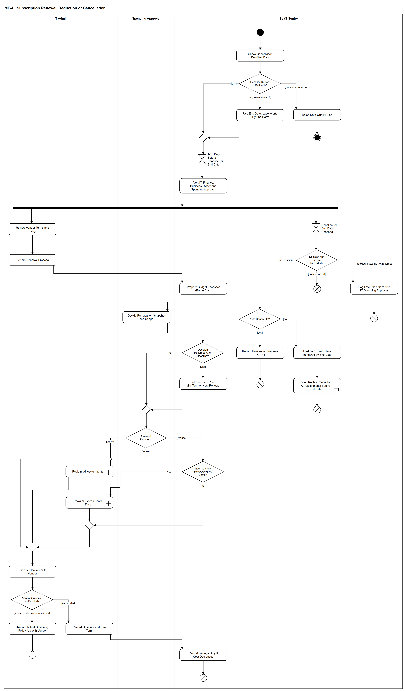

# MF-4 — Subscription Renewal, Reduction or Cancellation

> **Loại:** Main flow (cấp tổng quan) — 5/5 · **Phiên bản:** 3.6 — 12/10/2026 · **Trạng thái:** Vẽ lại theo QĐ-49c, FR-1.10 (QĐ-54e), QĐ-60a; bổ sung QĐ-62k (phối hợp hạn chót, quyết định và thực hiện) và QĐ-62l (mốc theo ngày kết thúc) ngày 09/10/2026; QĐ-63a (người xác nhận bàn giao khi giảm/hủy) và QĐ-64a (seat đã quyết thu hồi ghost seat) ngày 10/10/2026; chờ Owner/GVHD review · 12/10/2026: bổ sung nhánh thu hồi khi thuê bao hết hạn không gia hạn (`QĐ-66v`, DOI-106)
>
> Sơ đồ là **dẫn xuất** từ quyết định Owner (`QĐ`) và BRD hiện hành; khi khác nhau, `QĐ` → BRD thắng. Quyết định trong sơ đồ là của Owner, **chưa** phải xác nhận của GVHD/hội đồng.

## 1. Mục đích và phạm vi

Mô tả **chu kỳ quyết định gia hạn**: cảnh báo đúng mốc (tính từ hạn chót báo hủy), chuẩn bị đề xuất có số liệu sử dụng và điều khoản, để Người duyệt chi quyết gia hạn, giảm số lượng hay hủy **trước** hạn — thời điểm duy nhất khuyến nghị lãng phí thành tiền thật (PP-2, liên kết VS-2 → VS-3).

**Phạm vi:** Kiểm dữ liệu hạn chót (có / suy ra / theo ngày kết thúc / thiếu), cảnh báo T−15, rà điều khoản và sử dụng, đề xuất, snapshot, quyết định ba hướng (kể cả quyết định ghi sau hạn chót), thu hồi phần vượt hoặc toàn bộ, thực hiện với nhà cung cấp và kiểm kết quả, ghi tiết kiệm khi chi phí thực sự giảm; nhánh theo dõi hạn chót với ba kết cục.

**Không nằm trong sơ đồ này:** Mốc T−7 và báo Super Admin, nhắc SLA, hỏi Finance, chi tiết cờ giảm giữa kỳ (→ WF-15); chi tiết thu hồi (→ WF-09a). License vĩnh viễn và phần mềm nội bộ không đi luồng này (`QĐ-49c`).

## 2. Tệp

| Tệp | Vai trò |
| --- | --- |
| [MF-4-subscription-renewal-decision.drawio](MF-4-subscription-renewal-decision.drawio) | Nguồn draw.io chỉnh sửa được (sinh từ spec) |
| [MF-4-subscription-renewal-decision.drawio.png](MF-4-subscription-renewal-decision.drawio.png) | Bản xuất PNG, nhúng sẵn nguồn draw.io |
| [MF-4.json](../specs/MF-4.json) | **Nguồn canonical** — sửa ở đây rồi chạy `python tools/flowkit.py build` từ `Docs/Diagrams` |

## 3. Nguồn nghiệp vụ

| Mã | Nội dung dùng trong sơ đồ |
| --- | --- |
| `FR-1.3, FR-1.4, OI-09a` | Hạn chót báo hủy, cảnh báo T−15/T−7, người nhận |
| `FR-1.10, QĐ-54e` | Rà điều khoản trước kỳ gia hạn |
| `FR-3.13, FR-3.14, QĐ-60a` | Người duyệt chi quyết trên snapshot chi phí thực chịu |
| `FR-4.15, FR-5.9` | Hai con số tiết kiệm; tiết kiệm chỉ thật tại kỳ gia hạn |
| `OI-11c` | Giảm dưới số Assignment ⟹ thu hồi phần vượt trước kỳ mới |
| `DQ-07, KPI-4` | Quá hạn chót không có quyết định: tự gia hạn là sự cố, không tự gia hạn là hết hạn |
| `QĐ-49c` | Chỉ áp cho khoản có thời hạn |
| `QĐ-35c` | Assignment kỳ mới nối chuỗi với kỳ cũ |
| `BRD 4.6 dòng Gia hạn` | Ma trận trách nhiệm |
| `QĐ-62k` | Quyết định muộn không bị hủy; cờ thực hiện trễ không tính KPI-4; ghi kết quả thực tế; tiết kiệm chỉ khi chi phí giảm |
| `QĐ-62l` | Không hạn chót, không số ngày báo trước, không tự gia hạn ⟹ mốc theo ngày kết thúc |

## 4. Tác nhân, kích hoạt, điều kiện

| Làn (tiếng Anh trên hình) | Tác nhân | Trách nhiệm trong sơ đồ |
| --- | --- | --- |
| IT Admin | IT Admin | Rà điều khoản/sử dụng, đề xuất, thu hồi, thực hiện với nhà cung cấp |
| Spending Approver | Người duyệt chi | Quyết gia hạn/giảm/hủy |
| SaaS-Sentry | SaaS-Sentry | Kiểm dữ liệu, cảnh báo, snapshot, theo dõi hạn chót, ghi tiết kiệm |

- **Kích hoạt:** Thuê bao có thời hạn tới gần hạn chót báo hủy (mốc T−15).
- **Tiền điều kiện:** Thuê bao có kỳ, số lượng, đơn giá, cờ tự gia hạn; gói có điều khoản và lưu ý trước khi thu hồi.
- **Hậu điều kiện:** Quyết định được ghi và thực hiện (thuê bao kỳ mới hoặc đã hủy; tiết kiệm chỉ ghi khi chi phí thực sự giảm), hoặc kết quả thực tế khác quyết định được ghi kèm việc theo dõi. Tại hạn chót, nhánh hạn ghi đúng một kết cục: không có gì thêm (đã quyết và đã thực hiện) · cờ thực hiện trễ (đã quyết, chưa ghi kết quả) · sự cố KPI-4 (chưa quyết, tự gia hạn) · đánh dấu hết hạn trừ khi gia hạn được thực hiện trước ngày kết thúc, kèm mở tác vụ thu hồi mọi quyền trước ngày kết thúc như hủy toàn bộ (chưa quyết, không tự gia hạn — `QĐ-66v`; chưa chốt khi một quyết định gia hạn xen vào — xem mục mở).

## 5. Cách đọc ký hiệu

| Ký hiệu | Nghĩa |
| --- | --- |
| Hình tròn đặc | Bắt đầu hoạt động (initial node) |
| Hình chữ nhật bo góc | Hành động (action) của tác nhân ở làn chứa nó |
| Hình chữ nhật bo góc có ký hiệu cây đinh ba ở góc | Gọi workflow con (call behavior) — mã workflow ghi trong nhãn |
| Hình thoi có chữ | Rẽ nhánh; mỗi cạnh ra mang điều kiện trong ngoặc vuông `[...]` |
| Hình thoi nhỏ không chữ | Hợp nhánh (merge) |
| Thanh đen ngang | Tách hoặc gộp các nhánh chạy song song (fork/join) |
| Đồng hồ cát | Chờ một mốc thời gian (time event) |
| Vòng tròn kép đặc | Kết thúc toàn bộ hoạt động (activity final) |
| Vòng tròn có dấu nhân | Kết thúc riêng nhánh đó, các nhánh khác vẫn chạy (flow final) |
| Dây có cung nhảy | Hai dây giao nhau nhưng **không** nối với nhau |

Sau thanh tách: nhánh trái là chuẩn bị, quyết định và thực hiện; nhánh phải chỉ theo dõi hạn chót. Hai nhánh không mâu thuẫn (`QĐ-62k`): nhánh hạn chỉ **ghi nhận** trạng thái (và, khi không tự gia hạn, mở tác vụ thu hồi — `c_exp`) tại hạn chót (sự cố KPI-4, đánh dấu hết hạn hoặc cờ thực hiện trễ), không tự gia hạn hay tự hủy và không hủy quyết định; nhánh quyết định luôn đi tới cùng — quyết định ghi sau hạn chót được thực hiện từ thời điểm còn làm được, và kết quả ghi là kết quả thực tế của nhà cung cấp. KPI-4 chỉ đếm theo `DQ-07`.

## 6. Bảng node

| ID | Loại | Nhãn trên hình | Ý nghĩa | Làn / người thực hiện | Quy tắc |
| --- | --- | --- | --- | --- | --- |
| `st` | Nút bắt đầu | — | — | SaaS-Sentry | — |
| `s_check` | Hành động | Check Cancellation Deadline Data | Chỉ áp cho thuê bao/khoản mua có thời hạn cần gia hạn; license vĩnh viễn và phần mềm nội bộ không đi luồng này. Thiếu hạn chót nhưng có số ngày báo trước ⟹ suy ra và ghi rõ là giá trị suy ra. | SaaS-Sentry | `FR-1.3`, `FR-1.4`, `QĐ-49c` |
| `d_known` | Rẽ nhánh | Deadline Known or Derivable? | Có hạn chót báo hủy (hoặc suy ra được từ số ngày báo trước) không; nếu thiếu cả hai thì xét cờ tự gia hạn: bật ⟹ cảnh báo chất lượng dữ liệu; tắt ⟹ lấy ngày kết thúc làm mốc (QĐ-62l). | SaaS-Sentry | `FR-1.4`, `QĐ-62l` |
| `s_dq` | Hành động | Raise Data-Quality Alert | Thiếu cả hạn chót lẫn số ngày báo trước mà thuê bao tự gia hạn: hệ thống không suy đoán, chỉ cảnh báo chất lượng dữ liệu để IT bổ sung. | SaaS-Sentry | `FR-1.4`, `FR-5.12` |
| `end_dq` | Kết thúc hoạt động | — | Chưa thể chạy chu kỳ gia hạn cho tới khi có dữ liệu. | SaaS-Sentry | — |
| `s_endd` | Hành động | Use End Date; Label Alerts 'By End Date' | Không có hạn chót, không có số ngày báo trước và không tự gia hạn: dùng ngày kết thúc làm mốc; cảnh báo T−15/T−7 tính trước ngày kết thúc và ghi rõ “theo ngày kết thúc” (bổ sung FR-1.4). | SaaS-Sentry | `QĐ-62l`, `FR-1.4` |
| `m_alert` | Hợp nhánh | — | — | SaaS-Sentry | — |
| `t_alert` | Chờ mốc thời gian | T-15 Days Before Deadline (or End Date) | Mốc cảnh báo tính từ hạn chót báo hủy, không tính từ ngày gia hạn (cấu hình được); thuê bao theo ngày kết thúc (QĐ-62l) thì tính từ ngày kết thúc. | SaaS-Sentry | `FR-1.4`, `QĐ-62l` |
| `s_notify` | Hành động | Alert IT, Finance, Business Owner and Spending Approver | Cảnh báo trong ứng dụng và thư điện tử (khi cấu hình). Mốc T−7 báo thêm Super Admin (chi tiết ở WF-15). Cảnh báo kèm khuyến nghị lãng phí đang mở của chính thuê bao; mốc theo ngày kết thúc ghi rõ “theo ngày kết thúc”. | SaaS-Sentry | `FR-1.4`, `FR-3.11`, `OI-09a`, `OI-09b` |
| `f_par` | Tách song song | — | — | SaaS-Sentry | — |
| `a_terms` | Hành động | Review Vendor Terms and Usage | IT rà checklist sáu điểm của điều khoản (hủy, tự gia hạn, hoàn tiền…), số seat đang gán, G1 và khuyến nghị G3/G4; ghi ý kiến Business Owner (không chặn). | IT Admin | `FR-1.10`, `FR-4.15`, `BRD 4.4`, `OI-05a` |
| `t_dead` | Chờ mốc thời gian | Deadline (or End Date) Reached | Tới hạn chót báo hủy (hoặc ngày kết thúc với thuê bao theo ngày kết thúc, QĐ-62l). | SaaS-Sentry | — |
| `a_prop` | Hành động | Prepare Renewal Proposal | Đề xuất gia hạn / giảm số lượng (bao nhiêu seat) / hủy, kèm số liệu sử dụng, điều khoản và hai con số tiết kiệm tách riêng. | IT Admin | `FR-3.13`, `FR-4.15`, `BM-05` |
| `d_decided` | Rẽ nhánh | Decision and Outcome Recorded? | Tại hạn chót, hệ thống xét ba trường hợp: chưa có quyết định · đã quyết nhưng chưa ghi kết quả thực hiện · đã có cả quyết định và kết quả. | SaaS-Sentry | `DQ-07`, `KPI-4`, `QĐ-62k` |
| `s_snap` | Hành động | Prepare Budget Snapshot (Borne Cost) | Snapshot ngân sách theo chi phí thực chịu cho Cost Center liên quan. | SaaS-Sentry | `FR-3.14`, `QĐ-60a` |
| `ff_ok_d` | Kết thúc nhánh (flow final) | — | Đã quyết và đã ghi kết quả trước hạn chót — nhánh hạn kết thúc. | SaaS-Sentry | — |
| `s_late` | Hành động | Flag Late Execution; Alert IT, Spending Approver | Đã quyết nhưng tới hạn chót chưa ghi kết quả thực hiện: cảnh báo IT Admin và Người duyệt chi, ghi cờ **thực hiện trễ** riêng. Không tính KPI-4 (KPI-4 chỉ đếm tự gia hạn không có quyết định, DQ-07). Nhánh quyết định vẫn chạy tiếp tới khi IT ghi kết quả. | SaaS-Sentry | `QĐ-62k`, `DQ-07` |
| `ff_late` | Kết thúc nhánh (flow final) | — | Nhánh hạn kết thúc sau khi gắn cờ thực hiện trễ; quyết định không bị hủy. | SaaS-Sentry | — |
| `d_auto` | Rẽ nhánh | Auto-Renew On? | Thuê bao có bật tự gia hạn không. | SaaS-Sentry | — |
| `a_dec` | Hành động | Decide Renewal on Snapshot and Usage | Người duyệt chi quyết trên snapshot và số liệu sử dụng; tùy chọn hỏi Finance (SLA không dừng). Quá SLA chỉ nhắc, không tự gia hạn. Quyết định có thể được ghi cả sau hạn chót (QĐ-62k). | Spending Approver | `FR-3.13`, `FR-3.14`, `FR-3.8`, `DQ-07` |
| `d_late` | Rẽ nhánh | Decision Recorded After Deadline? | Quyết định ghi sau hạn chót **không** bị hủy; nhánh hạn đã ghi kết cục của hạn chót (sự cố KPI-4 hoặc đánh dấu hết hạn), quyết định vẫn được thực hiện từ thời điểm còn làm được. | SaaS-Sentry | `QĐ-62k` |
| `s_next` | Hành động | Set Execution Point: Mid-Term or Next Renewal | Quyết định muộn được thực hiện từ thời điểm còn làm được: giữa kỳ chỉ khi thuê bao bật cờ cho phép giảm giữa kỳ (FR-1.3); không có cờ thì ở kỳ gia hạn kế tiếp. Không tự tạo khoản hoàn tiền hay tiết kiệm cho kỳ đã gia hạn (chi tiết ở WF-15). | SaaS-Sentry | `QĐ-62k`, `FR-1.3`, `FR-4.15` |
| `m_dec` | Hợp nhánh | — | — | Spending Approver | — |
| `s_incident` | Hành động | Record Unintended Renewal (KPI-4) | Quá hạn chót mà chưa có quyết định và thuê bao tự gia hạn: ghi sự cố gia hạn ngoài ý muốn — đếm vào KPI-4. Quyết định ghi sau đó vẫn được thực hiện từ thời điểm còn làm được (QĐ-62k). | SaaS-Sentry | `KPI-4`, `DQ-07` |
| `s_expire` | Hành động | Mark to Expire Unless Renewed by End Date | Không tự gia hạn, chưa có quyết định: đánh dấu thuê bao hết hạn ở cuối kỳ, **trừ khi** một quyết định gia hạn được thực hiện trước ngày kết thúc — không phải sự cố, không tính KPI-4. Nhánh đi tiếp sang `c_exp`: các quyền đang hiệu lực được thu hồi **như hủy toàn bộ** trước ngày kết thúc (`QĐ-66v`). | SaaS-Sentry | `DQ-07`, `KPI-4`, `QĐ-62k`, `QĐ-66v` |
| `c_exp` | Gọi workflow con | Open Reclaim Tasks for All Assignments Before End Date | Thuê bao hết hạn vì không tự gia hạn và không có quyết định được xử lý **như hủy toàn bộ** (`QĐ-66v`): hệ thống mở tác vụ thu hồi cho mọi Assignment đang hiệu lực với hạn **trước ngày kết thúc** — quyền **không** tự kết thúc mà không có tác vụ. Gọi `WF-09a` như nhánh hủy: gói có *lưu ý trước khi thu hồi* nói dữ liệu sẽ mất thì **IT Admin** ghi xác nhận đã xử lý bàn giao trước khi gỡ ở nhà cung cấp, không chặn sau hạn ngắn (`QĐ-63a`); seat đã có quyết định *Thu hồi* ghost seat của trưởng phòng thì chỉ **một** tác vụ, trưởng phòng đó xác nhận (`QĐ-64a`, `QĐ-66u`). Không sự cố, `KPI-4` không đổi (`US-11-04` AC-11). Kết quả `[success]`/`[failed]` theo hợp đồng chung của `WF-09a` (`QĐ-62i`). *Hết hạn thuê bao* (nhánh này) khác *hết hạn quyền có thời hạn của một người* (`WF-08`: nhà thầu, freelancer, thực tập sinh — không tự thu hồi). | SaaS-Sentry | `QĐ-66v`, `QĐ-63a`, `QĐ-64a`, `QĐ-66u`, `FR-2.12`, → `WF-09a` |
| `d_dec` | Rẽ nhánh | Renewal Decision? | Gia hạn · giảm số lượng · hủy. | Spending Approver | — |
| `ff_inc` | Kết thúc nhánh (flow final) | — | Nhánh hạn kết thúc sau khi ghi sự cố. | SaaS-Sentry | — |
| `ff_exp` | Kết thúc nhánh (flow final) | — | Nhánh hạn kết thúc; thuê bao được đánh dấu hết hạn cuối kỳ và tác vụ thu hồi đã mở, trừ khi gia hạn được thực hiện trước ngày kết thúc. | SaaS-Sentry | — |
| `c_all` | Gọi workflow con | Reclaim All Assignments | Hủy: thu hồi mọi quyền trên thuê bao (bàn giao dữ liệu theo lưu ý trước khi thu hồi) trước khi báo hủy với nhà cung cấp. Thu hồi chạy tại **thời điểm thực hiện** đã xác định (quyết định muộn: giữa kỳ nếu gói cho phép, nếu không thì kỳ kế tiếp) — không thu hồi sớm trong kỳ đã trả tiền. Nếu WF-09a trả *đóng thất bại* (QĐ-62i): quyền còn hiệu lực, vẫn hiện G2/lãng phí theo điều kiện nguồn, seat chưa về kho và IT mở tác vụ thu hồi mới. Việc báo giảm/hủy với nhà cung cấp đi sau thu hồi nên chờ tác vụ mới (suy ra từ thứ tự trên). Gói có lưu ý mất dữ liệu: IT Admin ghi xác nhận đã xử lý bàn giao trước khi gỡ ở nhà cung cấp; không chặn sau hạn ngắn (WF-09a `d_dl`, `s_ask`; QĐ-63a). Seat đã có quyết định *Thu hồi* ghost seat của trưởng phòng: một tác vụ, trưởng phòng đó xác nhận, IT Admin không xác nhận thêm (`QĐ-64a`, `QĐ-66u`). | IT Admin | `FR-2.4`, `FR-1.9`, `QĐ-63a`, → `WF-09a` |
| `d_excess` | Rẽ nhánh | New Quantity Below Assigned Seats? | Số lượng mới có nhỏ hơn số Assignment đang chiếm chỗ không. | SaaS-Sentry | `OI-11c`, `INV-01` |
| `c_excess` | Gọi workflow con | Reclaim Excess Seats First | Thu hồi phần vượt trước khi kỳ mới bắt đầu. Thu hồi chạy tại **thời điểm thực hiện** đã xác định (quyết định muộn: giữa kỳ nếu gói cho phép, nếu không thì kỳ kế tiếp) — không thu hồi sớm trong kỳ đã trả tiền. Nếu WF-09a trả *đóng thất bại* (QĐ-62i): quyền còn hiệu lực, vẫn hiện G2/lãng phí theo điều kiện nguồn, seat chưa về kho và IT mở tác vụ thu hồi mới. Việc báo giảm/hủy với nhà cung cấp đi sau thu hồi nên chờ tác vụ mới (suy ra từ thứ tự trên). Gói có lưu ý mất dữ liệu: IT Admin ghi xác nhận đã xử lý bàn giao trước khi gỡ ở nhà cung cấp; không chặn sau hạn ngắn (WF-09a `d_dl`, `s_ask`; QĐ-63a). Riêng seat đã có quyết định *Thu hồi* ghost seat của trưởng phòng: một tác vụ, trưởng phòng đó xác nhận, IT Admin không xác nhận thêm (`QĐ-64a`, `QĐ-66u`). Người duyệt chi chọn seat vượt từ danh sách xếp sẵn: đã quyết thu hồi → G2 → G3/G4 → hoạt động cuối cũ nhất (`QĐ-66x`). | IT Admin | `OI-11c`, `QĐ-63a`, `QĐ-64a`, → `WF-09a` |
| `m_red` | Hợp nhánh | — | — | IT Admin | — |
| `m_exec` | Hợp nhánh | — | — | IT Admin | — |
| `a_exec` | Hành động | Execute Decision with Vendor | IT thực hiện với nhà cung cấp ngoài hệ thống (gia hạn, giảm, báo hủy) tại thời điểm đã xác định; hệ thống không tự mua hay tự hủy. Tới hạn chót mà chưa ghi kết quả thì nhánh hạn gắn cờ thực hiện trễ (QĐ-62k). | IT Admin | `FR-3.13`, `BRD 3.2`, `QĐ-62k` |
| `d_vout` | Rẽ nhánh | Vendor Outcome as Decided? | Kết quả phía nhà cung cấp có đúng quyết định không. Nhà cung cấp từ chối, kết quả khác quyết định, hoặc chưa xác nhận được (chưa xác nhận không tính là đã ghi kết quả thực hiện). | IT Admin | `QĐ-62k`, `FR-4.15` |
| `a_term` | Hành động | Record Outcome and New Term | IT ghi kết quả và thuê bao kỳ mới (Assignment kỳ mới nối chuỗi với kỳ cũ); lưu chứng từ BM-05. | IT Admin | `FR-3.13`, `QĐ-35c`, `BM-05` |
| `a_act` | Hành động | Record Actual Outcome; Follow Up with Vendor | Nhà cung cấp từ chối, kết quả khác quyết định hoặc chưa xác nhận: IT ghi **kết quả thực tế** (không ghi theo quyết định), không ghi tiết kiệm, mở việc theo dõi tiếp với nhà cung cấp. Việc theo dõi đóng bằng cách ghi kết quả đã xác nhận: nếu sau đó nhà cung cấp xác nhận đúng quyết định thì ghi kết quả và kỳ mới, ghi tiết kiệm nếu chi phí giảm (QĐ-62k). | IT Admin | `QĐ-62k`, `FR-4.15` |
| `ff_act` | Kết thúc nhánh (flow final) | — | Kết quả thực tế đã ghi, không có tiết kiệm; IT còn việc theo dõi với nhà cung cấp. | IT Admin | — |
| `s_save` | Hành động | Record Savings Only If Cost Decreased | Tiết kiệm chỉ ghi khi chi phí thực sự giảm (giảm/hủy đã được nhà cung cấp thực hiện), tại kỳ gia hạn và tách khỏi tiết kiệm ngay, không cộng lại; gia hạn nguyên ⟹ không có tiết kiệm. | SaaS-Sentry | `FR-4.15`, `FR-5.9`, `QĐ-62k` |
| `ff_main` | Kết thúc nhánh (flow final) | — | Kỳ gia hạn đã có quyết định và được thực hiện. | SaaS-Sentry | — |

## 7. Bảng chuyển tiếp

| Từ → tới | Nhãn điều kiện | Điều kiện | Kết quả |
| --- | --- | --- | --- |
| `st` → `s_check` | — | — | Sang Check Cancellation Deadline Data |
| `s_check` → `d_known` | — | — | Sang Deadline Known or Derivable? |
| `d_known` → `m_alert` | `[yes]` | Có hạn chót (hoặc suy ra được) | Chờ mốc cảnh báo |
| `d_known` → `s_dq` | `[no, auto-renew on]` | Thiếu cả hạn chót lẫn số ngày báo trước, thuê bao tự gia hạn | Cảnh báo chất lượng dữ liệu |
| `d_known` → `s_endd` | `[no, auto-renew off]` | Thiếu cả hạn chót lẫn số ngày báo trước, không tự gia hạn | Lấy ngày kết thúc làm mốc (QĐ-62l) |
| `s_dq` → `end_dq` | — | — | Sang — |
| `s_endd` → `m_alert` | — | — | Sang — |
| `m_alert` → `t_alert` | — | — | Sang T-15 Days Before Deadline (or End Date) |
| `t_alert` → `s_notify` | — | — | Sang Alert IT, Finance, Business Owner and Spending Approver |
| `s_notify` → `f_par` | — | — | Sang — |
| `f_par` → `a_terms` | — | — | Nhánh chuẩn bị và quyết định |
| `f_par` → `t_dead` | — | — | Nhánh theo dõi hạn chót |
| `a_terms` → `a_prop` | — | — | Sang Prepare Renewal Proposal |
| `a_prop` → `s_snap` | — | — | Sang Prepare Budget Snapshot (Borne Cost) |
| `s_snap` → `a_dec` | — | — | Sang Decide Renewal on Snapshot and Usage |
| `a_dec` → `d_late` | — | — | Sang Decision Recorded After Deadline? |
| `d_late` → `m_dec` | `[no]` | Quyết định ghi trước hạn chót | Thực hiện theo kế hoạch |
| `d_late` → `s_next` | `[yes]` | Quyết định ghi sau hạn chót | Không hủy; xác định thời điểm thực hiện |
| `s_next` → `m_dec` | — | — | Sang — |
| `m_dec` → `d_dec` | — | — | Sang Renewal Decision? |
| `d_dec` → `m_exec` | `[renew]` | Gia hạn nguyên số lượng | IT thực hiện |
| `d_dec` → `d_excess` | `[reduce]` | Giảm số lượng | Kiểm phần vượt |
| `d_dec` → `c_all` | `[cancel]` | Hủy thuê bao | Thu hồi mọi quyền |
| `d_excess` → `c_excess` | `[yes]` | Số mới nhỏ hơn số seat đang gán | Thu hồi phần vượt trước |
| `d_excess` → `m_red` | `[no]` | Đủ chỗ cho các Assignment hiện có | Thực hiện |
| `c_excess` → `m_red` | — | — | Sang — |
| `m_red` → `m_exec` | — | — | Sang — |
| `c_all` → `m_exec` | — | — | Sang — |
| `m_exec` → `a_exec` | — | — | Sang Execute Decision with Vendor |
| `a_exec` → `d_vout` | — | — | Sang Vendor Outcome as Decided? |
| `d_vout` → `a_term` | `[as decided]` | Nhà cung cấp thực hiện đúng quyết định | Ghi kết quả và kỳ mới |
| `d_vout` → `a_act` | `[refused, differs or unconfirmed]` | Nhà cung cấp từ chối, kết quả khác quyết định hoặc chưa xác nhận | Ghi kết quả thực tế, không tiết kiệm |
| `a_term` → `s_save` | — | — | Sang Record Savings Only If Cost Decreased |
| `a_act` → `ff_act` | — | — | Sang — |
| `s_save` → `ff_main` | — | — | Sang — |
| `t_dead` → `d_decided` | — | — | Sang Decision and Outcome Recorded? |
| `d_decided` → `ff_ok_d` | `[both recorded]` | Đã có quyết định và kết quả thực hiện trước hạn chót | Kết thúc nhánh hạn |
| `d_decided` → `d_auto` | `[no decision]` | Chưa có quyết định nào được ghi nhận | Xét tự gia hạn |
| `d_decided` → `s_late` | `[decided, outcome not recorded]` | Đã quyết nhưng chưa ghi kết quả thực hiện | Cờ thực hiện trễ, cảnh báo (không tính KPI-4) |
| `s_late` → `ff_late` | — | — | Sang — |
| `d_auto` → `s_incident` | `[yes]` | Bật tự gia hạn | Sự cố gia hạn ngoài ý muốn |
| `d_auto` → `s_expire` | `[no]` | Không tự gia hạn | Đánh dấu hết hạn, trừ khi gia hạn được thực hiện trước ngày kết thúc |
| `s_incident` → `ff_inc` | — | — | Sang — |
| `s_expire` → `c_exp` | — | — | Sang Open Reclaim Tasks for All Assignments Before End Date |
| `c_exp` → `ff_exp` | — | — | Sang — |

Số đếm: **41 node · 45 cạnh · 7 rẽ nhánh**; giao cắt dây: **1**.

## 8. Happy path

1. `st` — —
2. `s_check` — Check Cancellation Deadline Data: Chỉ áp cho thuê bao/khoản mua có thời hạn cần gia hạn; license vĩnh viễn và phần mềm nội bộ không đi luồng này. Thiếu hạn chót nhưng có số ngày báo trước ⟹ suy ra và ghi rõ là giá trị suy ra.
3. `d_known` — Deadline Known or Derivable?: Có hạn chót báo hủy (hoặc suy ra được từ số ngày báo trước) không; nếu thiếu cả hai thì xét cờ tự gia hạn: bật ⟹ cảnh báo chất lượng dữ liệu; tắt ⟹ lấy ngày kết thúc làm mốc (QĐ-62l).
4. `t_alert` — T-15 Days Before Deadline (or End Date): Mốc cảnh báo tính từ hạn chót báo hủy, không tính từ ngày gia hạn (cấu hình được); thuê bao theo ngày kết thúc (QĐ-62l) thì tính từ ngày kết thúc.
5. `s_notify` — Alert IT, Finance, Business Owner and Spending Approver: Cảnh báo trong ứng dụng và thư điện tử (khi cấu hình). Mốc T−7 báo thêm Super Admin (chi tiết ở WF-15). Cảnh báo kèm khuyến nghị lãng phí đang mở của chính thuê bao; mốc theo ngày kết thúc ghi rõ “theo ngày kết thúc”.
6. `f_par` — —
7. `a_terms` — Review Vendor Terms and Usage: IT rà checklist sáu điểm của điều khoản (hủy, tự gia hạn, hoàn tiền…), số seat đang gán, G1 và khuyến nghị G3/G4; ghi ý kiến Business Owner (không chặn).
8. `a_prop` — Prepare Renewal Proposal: Đề xuất gia hạn / giảm số lượng (bao nhiêu seat) / hủy, kèm số liệu sử dụng, điều khoản và hai con số tiết kiệm tách riêng.
9. `s_snap` — Prepare Budget Snapshot (Borne Cost): Snapshot ngân sách theo chi phí thực chịu cho Cost Center liên quan.
10. `a_dec` — Decide Renewal on Snapshot and Usage: Người duyệt chi quyết trên snapshot và số liệu sử dụng; tùy chọn hỏi Finance (SLA không dừng). Quá SLA chỉ nhắc, không tự gia hạn. Quyết định có thể được ghi cả sau hạn chót (QĐ-62k).
11. `d_late` — Decision Recorded After Deadline?: Quyết định ghi sau hạn chót **không** bị hủy; nhánh hạn đã ghi kết cục của hạn chót (sự cố KPI-4 hoặc đánh dấu hết hạn), quyết định vẫn được thực hiện từ thời điểm còn làm được.
12. `d_dec` — Renewal Decision?: Gia hạn · giảm số lượng · hủy.
13. `d_excess` — New Quantity Below Assigned Seats?: Số lượng mới có nhỏ hơn số Assignment đang chiếm chỗ không.
14. `a_exec` — Execute Decision with Vendor: IT thực hiện với nhà cung cấp ngoài hệ thống (gia hạn, giảm, báo hủy) tại thời điểm đã xác định; hệ thống không tự mua hay tự hủy. Tới hạn chót mà chưa ghi kết quả thì nhánh hạn gắn cờ thực hiện trễ (QĐ-62k).
15. `d_vout` — Vendor Outcome as Decided?: Kết quả phía nhà cung cấp có đúng quyết định không. Nhà cung cấp từ chối, kết quả khác quyết định, hoặc chưa xác nhận được (chưa xác nhận không tính là đã ghi kết quả thực hiện).
16. `a_term` — Record Outcome and New Term: IT ghi kết quả và thuê bao kỳ mới (Assignment kỳ mới nối chuỗi với kỳ cũ); lưu chứng từ BM-05.
17. `s_save` — Record Savings Only If Cost Decreased: Tiết kiệm chỉ ghi khi chi phí thực sự giảm (giảm/hủy đã được nhà cung cấp thực hiện), tại kỳ gia hạn và tách khỏi tiết kiệm ngay, không cộng lại; gia hạn nguyên ⟹ không có tiết kiệm.
18. `ff_main` — —: Kỳ gia hạn đã có quyết định và được thực hiện.

## 9. Nhánh thay thế / if-else

- **Gia hạn nguyên** — `d_dec` → `m_exec` → `a_exec`. Không có tiết kiệm.
- **Giảm dưới số seat đang gán** — `d_excess` → `c_excess` → `m_red`. Thu hồi phần vượt trước khi kỳ mới bắt đầu.
- **Hủy** — `d_dec` → `c_all` → `m_exec`. Thu hồi mọi quyền, bàn giao dữ liệu theo lưu ý của gói.
- **Mốc theo ngày kết thúc (không hạn chót, không tự gia hạn)** — `d_known` → `s_endd` → `m_alert` → `t_alert`. QĐ-62l: cảnh báo T−15/T−7 trước ngày kết thúc, ghi “theo ngày kết thúc”.
- **(1) Đã quyết và đã thực hiện trước hạn chót** — `f_par` → `t_dead` → `d_decided` → `ff_ok_d`. Nhánh quyết định đi đường chính (`a_dec → d_late [no] → … → a_exec → d_vout [as decided] → a_term → s_save`); tại hạn chót nhánh hạn thấy đủ quyết định và kết quả, kết thúc không ghi gì thêm.
- **(4) Quyết định ghi sau hạn chót** — `a_dec` → `d_late` → `s_next` → `m_dec` → `d_dec`. Nhánh hạn đã ghi sự cố KPI-4 (tự gia hạn) hoặc đánh dấu hết hạn (không tự gia hạn) — xem (2). Quyết định không bị hủy: thực hiện giữa kỳ nếu cờ FR-1.3 cho phép, nếu không thì ở kỳ gia hạn kế tiếp; gia hạn khi thuê bao chỉ đang được đánh dấu hết hạn thì thực hiện trước ngày kết thúc. Sự cố KPI-4 đã ghi không bị xóa.

## 10. Nhánh lỗi / từ chối và cách kết thúc

- **Thiếu dữ liệu hạn chót, thuê bao tự gia hạn** — `d_known` → `s_dq` → `end_dq`. Không suy đoán; cảnh báo chất lượng dữ liệu.
- **(2) Tới hạn chót chưa có quyết định, tự gia hạn** — `f_par` → `t_dead` → `d_decided` → `d_auto` → `s_incident` → `ff_inc`. Sự cố gia hạn ngoài ý muốn — KPI-4. Nhánh quyết định vẫn chờ ở `a_dec` (nhắc SLA ở WF-15); quyết định đến sau đi (4).
- **(2) Tới hạn chót chưa có quyết định, không tự gia hạn** — `d_decided` → `d_auto` → `s_expire` → `c_exp` → `ff_exp`. Đánh dấu hết hạn cuối kỳ, trừ khi gia hạn được thực hiện trước ngày kết thúc; không phải sự cố. Mở tác vụ thu hồi mọi quyền trước ngày kết thúc như hủy toàn bộ (`WF-09a`; `QĐ-66v`).
- **(3) Đã quyết trước hạn chót, IT thực hiện sau hạn chót** — `t_dead` → `d_decided` → `s_late` → `ff_late`. Cảnh báo IT Admin và Người duyệt chi, cờ thực hiện trễ (không tính KPI-4). Nhánh quyết định tiếp tục `m_exec → a_exec → d_vout`; nếu thuê bao đã tự gia hạn trong lúc trễ thì kết quả ghi là kết quả thực tế (5).
- **(5) Nhà cung cấp từ chối hoặc chưa xác nhận kết quả** — `a_exec` → `d_vout` → `a_act` → `ff_act`. Ghi kết quả thực tế, không ghi tiết kiệm, IT theo dõi tiếp. Chưa xác nhận không tính là đã ghi kết quả, nên tới hạn chót vẫn đi (3).

## 11. Liên hệ với sơ đồ khác

- Cấp trên: Context (G07, G27, G28, G31, G38), FDD Feature 3.3, 3.4, 2.5, 7.6
- `WF-15` — chi tiết chu kỳ gia hạn: T−7, nhắc SLA, hỏi Finance
- `SF-4` / `WF-13` — khuyến nghị G1–G4 làm đầu vào của đề xuất
- `MF-8` — tổng chi và báo cáo kỳ
- User flow: `UF-20`, `UF-15`, `UF-11`
- `WF-09a` — gọi/chuyển tại node `c_exp`
- `WF-09a` — gọi/chuyển tại node `c_all`
- `WF-09a` — gọi/chuyển tại node `c_excess`

## 12. Giới hạn và vấn đề còn mở

- (ĐÃ CHỐT · DOI-89, QĐ-62t) Cảnh báo T-7 (WF-15) được bỏ qua khi cả quyết định lẫn kết quả thực hiện đã ghi trước mốc đó; đã quyết mà chưa thực hiện thì vẫn gửi.
- (ĐÃ CHỐT · DOI-19, QĐ-62s) Quyết định gia hạn/giảm/hủy không tạo khoản cam kết ngân sách; chi phí kỳ gia hạn hiện ở dự báo L1 (FR-5.5).
- (DEFERRED/OUT · DOI-16, BRD 3.2, QĐ-34) Hệ thống không thanh toán hay tự hủy ở nhà cung cấp — IT thực hiện ngoài hệ thống rồi ghi nhận.
- (CHƯA CHỐT · DOI-106, QĐ-66v) Đã vẽ nhánh mở tác vụ thu hồi khi thuê bao hết hạn không gia hạn (`c_exp`). Còn lại: nếu sau khi tác vụ thu hồi đã mở mà một quyết định gia hạn được **ghi sau hạn chót** hoặc gia hạn được **thực hiện trước ngày kết thúc** (mệnh đề *trừ khi* ở `s_expire`; nhánh *quyết định ghi sau hạn chót* `d_late → s_next`), QĐ-66v và `US-11-04` AC-11 chỉ nêu ca không có quyết định gia hạn — số phận các tác vụ thu hồi đã mở **chưa được quyết** và hình không vẽ nhánh này.
