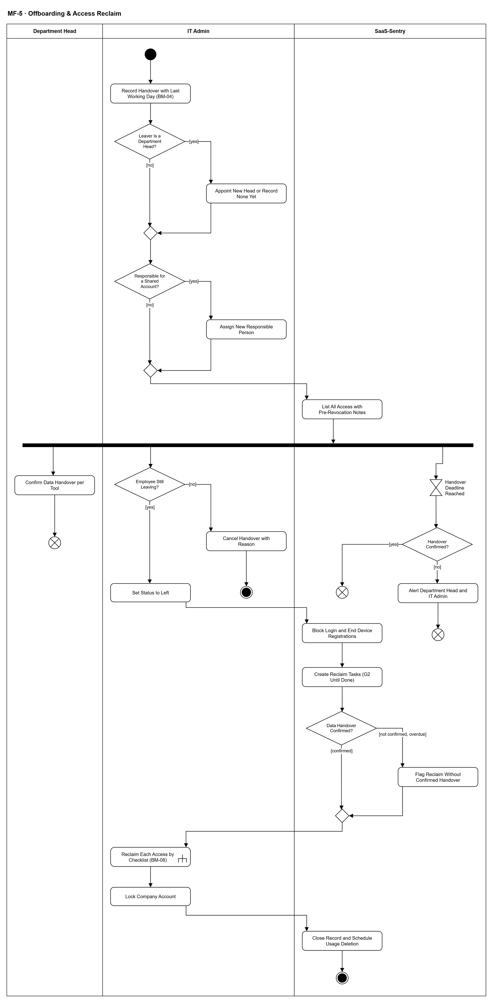

# MF-5 — Offboarding & Access Reclaim

> **Loại:** Main flow (cấp tổng quan) — 3/5 · **Phiên bản:** 3.5 — 10/10/2026 · **Trạng thái:** Vẽ lại theo QĐ-56b/c (bàn giao dữ liệu, không kế nhiệm license, BM-08) và mô hình phòng ban; chờ Owner/GVHD review
>
> Sơ đồ là **dẫn xuất** từ quyết định Owner (`QĐ`) và BRD hiện hành; khi khác nhau, `QĐ` → BRD thắng. Quyết định trong sơ đồ là của Owner, **chưa** phải xác nhận của GVHD/hội đồng.

## 1. Mục đích và phạm vi

Mô tả việc **thu hồi toàn bộ quyền khi nhân viên nghỉ việc** mà không làm mất dữ liệu của công ty. Đây vừa là chi phí (seat của người đã nghỉ — nhóm lãng phí G2) vừa là lỗ hổng bảo mật (người đã nghỉ còn truy cập), và chạy được chỉ với dữ liệu nội bộ — độ tin cậy tuyệt đối. Trả lời câu hỏi của hội đồng (Review 1, Phần 3): *nghỉ việc xử lý thế nào*.

**Phạm vi:** Ghi bàn giao, chỉ định trưởng phòng mới và người chịu trách nhiệm tài khoản dùng chung, liệt kê quyền kèm lưu ý trước khi thu hồi, xác nhận bàn giao dữ liệu có hạn, hủy bàn giao, chuyển đã nghỉ việc, chặn tài khoản, thu hồi theo checklist BM-08, khóa tài khoản công ty, đóng hồ sơ.

**Không nằm trong sơ đồ này:** Đổi ngày làm việc cuối, kiểm phiên bản, mã lỗi và ca nghỉ đột ngột không qua bàn giao (→ WF-07); chi tiết thu hồi từng kiểu cấp (→ WF-09a); chuyển giao vai Super Admin trước khi nghỉ (→ WF-03, FR-8.10e).

## 2. Tệp

| Tệp | Vai trò |
| --- | --- |
| [MF-5-offboarding-access-reclaim.drawio](MF-5-offboarding-access-reclaim.drawio) | Nguồn draw.io chỉnh sửa được (sinh từ spec) |
| [MF-5-offboarding-access-reclaim.drawio.png](MF-5-offboarding-access-reclaim.drawio.png) | Bản xuất PNG, nhúng sẵn nguồn draw.io |
| [MF-5.json](../specs/MF-5.json) | **Nguồn canonical** — sửa ở đây rồi chạy `python tools/flowkit.py build` từ `Docs/Diagrams` |

## 3. Nguồn nghiệp vụ

| Mã | Nội dung dùng trong sơ đồ |
| --- | --- |
| `FR-2.12, QĐ-56b` | Bàn giao dữ liệu trước khi thu hồi; không kế nhiệm license; checklist BM-08 |
| `QĐ-56c, QĐ-58d, FR-2.11` | Tài khoản dùng chung: người chịu trách nhiệm được thay trước; thành viên rời ⟹ đổi mật khẩu |
| `FR-1.9` | Lưu ý trước khi thu hồi theo gói |
| `FR-8.9, QĐ-41a` | Chặn tài khoản theo trạng thái đã nghỉ việc |
| `QĐ-48a → QĐ-48c` | Hủy bàn giao / đổi ngày cuối, lý do bắt buộc |
| `OI-14c` | Hạn bàn giao 1 ngày làm việc trước ngày cuối, không chặn thu hồi |
| `FR-3.6, QĐ-52a, QĐ-58a` | Trưởng phòng nghỉ ⟹ chỉ định trưởng phòng mới hoặc dùng approver dự phòng |
| `FR-4.15, FR-10.6` | Thu hồi không tự ghi tiết kiệm; xóa dữ liệu hoạt động trong 30 ngày |
| `BM-04, BM-08` | Biên bản bàn giao; checklist thu hồi |
| `BRD 5.10 dòng Nhân viên nghỉ việc; BRD 4.6` | Luồng và ma trận trách nhiệm |
| `FR-2.12, BM-08` | Thứ tự: (1) bàn giao dữ liệu → (2) gỡ người dùng; bàn giao không chặn thu hồi quá hạn |

## 4. Tác nhân, kích hoạt, điều kiện

| Làn (tiếng Anh trên hình) | Tác nhân | Trách nhiệm trong sơ đồ |
| --- | --- | --- |
| Department Head | Trưởng phòng của người nghỉ (trưởng phòng mới nếu chính người nghỉ là trưởng phòng) | Xác nhận bàn giao dữ liệu |
| IT Admin | IT Admin phụ trách phòng | Ghi bàn giao, chỉ định người thay, chuyển trạng thái, thu hồi, khóa tài khoản công ty |
| SaaS-Sentry | SaaS-Sentry | Liệt kê quyền, theo dõi hạn, chặn tài khoản, tạo tác vụ, lên lịch xóa dữ liệu |

- **Kích hoạt:** Doanh nghiệp xác định nhân viên nghỉ việc; IT Admin ghi bàn giao kèm ngày làm việc cuối.
- **Tiền điều kiện:** Nhân viên đang làm việc, thuộc một phòng có hiệu lực; danh mục có lưu ý trước khi thu hồi cho từng gói (FR-1.9).
- **Hậu điều kiện:** Nhân viên ở trạng thái đã nghỉ việc; tài khoản đăng nhập bị chặn; mọi quyền đã thu hồi và seat về kho — hoặc, nếu tác vụ thu hồi của một quyền bị đóng thất bại, quyền đó còn hiệu lực và vẫn hiện G2 chờ tác vụ mới (QĐ-62i); dữ liệu được bàn giao hoặc ghi rõ không cần; tài khoản dùng chung có người chịu trách nhiệm mới; dữ liệu hoạt động chi tiết được xóa trong 30 ngày. Hoặc: bàn giao bị hủy, không có thay đổi quyền.

## 5. Cách đọc ký hiệu

| Ký hiệu | Nghĩa |
| --- | --- |
| Hình tròn đặc | Bắt đầu hoạt động (initial node) |
| Hình chữ nhật bo góc | Hành động (action) của tác nhân ở làn chứa nó |
| Hình chữ nhật bo góc có ký hiệu cây đinh ba ở góc | Gọi workflow con (call behavior) — mã workflow ghi trong nhãn |
| Hình thoi có chữ | Rẽ nhánh; mỗi cạnh ra mang điều kiện trong ngoặc vuông `[...]` |
| Hình thoi nhỏ không chữ | Hợp nhánh (merge) |
| Thanh đen ngang | Tách hoặc gộp các nhánh chạy song song (fork/join) |
| Đồng hồ cát | Chờ một mốc thời gian (time event) |
| Vòng tròn kép đặc | Kết thúc toàn bộ hoạt động (activity final) |
| Vòng tròn có dấu nhân | Kết thúc riêng nhánh đó, các nhánh khác vẫn chạy (flow final) |
| Dây có cung nhảy | Hai dây giao nhau nhưng **không** nối với nhau |

Sau thanh tách có ba nhánh song song: trưởng phòng xác nhận bàn giao dữ liệu (trái), IT xử lý chính (giữa), hệ thống theo dõi hạn bàn giao (phải). Nhánh hạn chỉ cảnh báo, **không** chặn thu hồi. Kết thúc của nhánh chính là activity final: khi nhân viên đã nghỉ và quyền đã thu hồi, việc xác nhận còn dở không còn ý nghĩa. **Ngoại lệ biểu diễn (QĐ-62e):** ca nghỉ đột ngột với gói mất dữ liệu, chưa xác nhận và chưa quá hạn không vẽ thành nhánh riêng ở đây — việc gỡ ở nhà cung cấp chờ tới hạn cấu hình (mặc định 1 ngày làm việc) rồi mới vào nhánh *chưa xác nhận, quá hạn*; chi tiết ở WF-07 `d_hold`. Với gói **không** mất dữ liệu, ca nghỉ đột ngột gỡ ngay, không chờ xác nhận bàn giao; ca này đi nhánh *chưa xác nhận* (cờ *thu hồi khi chưa xác nhận bàn giao*), đúng như WF-07 `d_hold` → `s_over` — chữ *overdue* của guard `d_hc` đọc là *không còn lý do chờ*. Quy ước chung cho luồng phụ và activity final: `tools/README.md` mục 7.

## 6. Bảng node

| ID | Loại | Nhãn trên hình | Ý nghĩa | Làn / người thực hiện | Quy tắc |
| --- | --- | --- | --- | --- | --- |
| `st` | Nút bắt đầu | — | — | IT Admin | — |
| `a_hand` | Hành động | Record Handover with Last Working Day (BM-04) | IT Admin ghi bàn giao kèm ngày làm việc cuối; nhân viên chuyển trạng thái đang bàn giao. Tài khoản đăng nhập vẫn dùng được trong giai đoạn này. | IT Admin | `BM-04`, `FR-8.9`, `QĐ-41a` |
| `d_head` | Rẽ nhánh | Leaver Is a Department Head? | Người nghỉ có đang là trưởng phòng có hiệu lực không. | IT Admin | `FR-3.1`, `INV-19` |
| `a_newhead` | Hành động | Appoint New Head or Record None Yet | IT chỉ định trưởng phòng mới; chưa có người ⟹ bước nhu cầu của phòng tới approver dự phòng ở gốc và IT thấy cảnh báo phòng thiếu trưởng phòng. Thành viên phòng không đổi. Chưa có người kế nhiệm ⟹ ghi *chưa có trưởng phòng*: bước nhu cầu đi tới approver dự phòng (FR-3.6) và hệ thống cảnh báo phòng thiếu trưởng phòng. | IT Admin | `FR-3.6`, `FR-3.16`, `QĐ-52a`, `QĐ-58a` |
| `m_head` | Hợp nhánh | — | — | IT Admin | — |
| `d_shared` | Rẽ nhánh | Responsible for a Shared Account? | Người nghỉ có đang chịu trách nhiệm một tài khoản dùng chung không. | IT Admin | `FR-2.12`, `QĐ-56c` |
| `a_resp` | Hành động | Assign New Responsible Person | Phải chỉ định người chịu trách nhiệm mới trước khi đóng hồ sơ nghỉ việc — mặc định trưởng phòng; trưởng phòng nghỉ thì trưởng phòng mới. Owner workspace phía nhà cung cấp luôn là tài khoản IT nên không phải chuyển. | IT Admin | `FR-2.12`, `FR-2.9`, `QĐ-56c`, `QĐ-58d` |
| `m_resp` | Hợp nhánh | — | — | IT Admin | — |
| `s_list` | Hành động | List All Access with Pre-Revocation Notes | Hệ thống liệt kê mọi quyền đang giữ (cá nhân, khóa bản quyền, tài khoản dùng chung là thành viên) kèm lưu ý trước khi thu hồi của từng gói: dữ liệu nào mất, cần chuyển gì. | SaaS-Sentry | `FR-2.12`, `FR-1.9`, `BM-08` |
| `f_par` | Tách song song | — | — | SaaS-Sentry | — |
| `a_data` | Hành động | Confirm Data Handover per Tool | Trưởng phòng xác nhận từng công cụ: đã bàn giao dữ liệu hoặc không cần — bước 1 của checklist BM-08. Không có người kế nhiệm license. Phòng thiếu trưởng phòng (trưởng phòng nghỉ, ghi *chưa có người*): việc xác nhận chờ, không giao ai; trưởng phòng mới nhận việc, hạn không đặt lại (QĐ-62c). | Department Head | `FR-2.12`, `BM-08`, `QĐ-56b` |
| `ff_data` | Kết thúc nhánh (flow final) | — | Nhánh bàn giao dữ liệu kết thúc. | Department Head | — |
| `d_leave` | Rẽ nhánh | Employee Still Leaving? | Trước khi chuyển đã nghỉ việc, bàn giao có thể bị hủy (nhân viên ở lại). Đổi ngày làm việc cuối là một biến thể trong WF-07. | IT Admin | `QĐ-48a`, `QĐ-48c` |
| `a_cancel` | Hành động | Cancel Handover with Reason | IT hủy bàn giao kèm lý do bắt buộc; nhân viên trở lại trạng thái đang làm việc, không thu hồi quyền. | IT Admin | `QĐ-48a`, `QĐ-48c` |
| `end_cancel` | Kết thúc hoạt động | — | Bàn giao bị hủy — không có thu hồi. | IT Admin | — |
| `t_due` | Chờ mốc thời gian | Handover Deadline Reached | Mốc 1 ngày làm việc trước ngày làm việc cuối. | SaaS-Sentry | `OI-14c` |
| `d_conf` | Rẽ nhánh | Handover Confirmed? | Trưởng phòng đã xác nhận bàn giao dữ liệu cho mọi công cụ chưa. | SaaS-Sentry | — |
| `ff_conf` | Kết thúc nhánh (flow final) | — | Đã xác nhận đúng hạn. | SaaS-Sentry | — |
| `s_alert` | Hành động | Alert Department Head and IT Admin | Cảnh báo bàn giao dữ liệu chưa xác nhận. Không chặn việc thu hồi khi đã quá hạn. | SaaS-Sentry | `FR-2.12`, `FR-5.14`, `OI-14c` |
| `ff_alert` | Kết thúc nhánh (flow final) | — | Nhánh hạn kết thúc sau cảnh báo. | SaaS-Sentry | — |
| `a_left` | Hành động | Set Status to Left | IT chuyển nhân viên sang đã nghỉ việc (S0 làm tay; tự động khi tới ngày cuối là lát sau). Điều kiện chặn tài khoản là trạng thái, không phải ngày. | IT Admin | `FR-8.9`, `QĐ-41a` |
| `s_block` | Hành động | Block Login and End Device Registrations | Mọi thao tác của tài khoản đăng nhập liên kết bị từ chối ngay; đăng ký thiết bị hết hiệu lực nên không nhận thêm dữ liệu từ thiết bị đó. | SaaS-Sentry | `FR-8.9`, `FR-4.18` |
| `s_tasks` | Hành động | Create Reclaim Tasks (G2 Until Done) | Hệ thống tạo tác vụ thu hồi cho IT Admin phụ trách; seat còn gán cho người đã nghỉ là lãng phí nhóm G2 cho tới khi thu hồi xong. Đổi mật khẩu/thiết bị xác thực tài khoản dùng chung là tác vụ IT riêng có cảnh báo; hồ sơ nghỉ việc xong khi tác vụ đã được tạo (QĐ-62p). | SaaS-Sentry | `BRD 5.4.1`, `FR-3.17`, `TC-1` |
| `d_hc` | Rẽ nhánh | Data Handover Confirmed? | Trước bước 2 của BM-08 (gỡ khỏi workspace, hủy gia hạn, thu khóa): trưởng phòng đã xác nhận *đã bàn giao* hoặc *không cần* cho từng công cụ chưa. Bàn giao đi trước thu hồi; nhưng bàn giao quá hạn **không** chặn thu hồi. **Nghỉ đột ngột:** đăng nhập bị chặn ngay theo trạng thái; riêng gói có lưu ý *mất dữ liệu khi gỡ*, việc gỡ ở nhà cung cấp chờ trưởng phòng xác nhận bàn giao hoặc tới hạn cấu hình được (mặc định 1 ngày làm việc), seat vẫn tính phí và hiện G2; gói khác gỡ ngay (QĐ-62e — chi tiết ở WF-07 `d_hold`). Phòng thiếu trưởng phòng ⟹ việc xác nhận chờ, không giao ai; hết hạn thì thu hồi tiếp (QĐ-62c). | SaaS-Sentry | `BM-08`, `FR-2.12`, `OI-14c`, `QĐ-56b`, `QĐ-62c`, `QĐ-62e` |
| `s_over` | Hành động | Flag Reclaim Without Confirmed Handover | Hạn bàn giao đã qua mà chưa có xác nhận: thu hồi vẫn tiếp tục; Audit Trail ghi cờ *thu hồi khi chưa xác nhận bàn giao* và trưởng phòng, IT Admin thấy trong danh sách cần xử lý. | SaaS-Sentry | `FR-2.12`, `OI-14c`, `FR-5.14` |
| `m_hc` | Hợp nhánh | — | — | SaaS-Sentry | — |
| `c_reclaim` | Gọi workflow con | Reclaim Each Access by Checklist (BM-08) | Bước 2 của BM-08: gỡ khỏi workspace (K2), hủy gia hạn gói cá nhân (K1), thu khóa về kho (K4), phần mềm nội bộ thu hồi ngoài hệ thống kèm bằng chứng (K5). Thành viên tài khoản dùng chung ⟹ IT đổi mật khẩu/thiết bị xác thực. Nếu một tác vụ bị IT đóng là thất bại (WF-09a, QĐ-62i), quyền đó vẫn hiện là G2 trên danh sách cần xử lý và IT mở tác vụ mới; khóa tài khoản công ty không chờ tác vụ đó. | IT Admin | `FR-2.4`, `FR-2.12`, `FR-2.11`, `BM-08`, → `WF-09a` |
| `a_lock` | Hành động | Lock Company Account | Bước 3 của BM-08: khóa tài khoản email công ty. Khóa tài khoản không tự dừng tính tiền — vì vậy bước 2 phải gỡ seat ở từng nhà cung cấp. | IT Admin | `FR-2.9`, `BM-08` |
| `s_close` | Hành động | Close Record and Schedule Usage Deletion | Bước 4: seat trống về kho; tiết kiệm chỉ ghi khi hợp đồng thực sự giảm (FR-4.15). Hệ thống lên lịch xóa dữ liệu hoạt động chi tiết trong 30 ngày sau ngày làm việc cuối; giữ dữ liệu tổng hợp phi định danh và Audit Trail. | SaaS-Sentry | `FR-4.15`, `FR-10.6`, `BM-08` |
| `end_ok` | Kết thúc hoạt động | — | Nghỉ việc hoàn tất: tài khoản đăng nhập đã bị chặn và các quyền đã được xử lý — quyền có tác vụ thu hồi bị đóng thất bại vẫn còn, hiện G2 chờ tác vụ mới (QĐ-62i). | SaaS-Sentry | — |

## 7. Bảng chuyển tiếp

| Từ → tới | Nhãn điều kiện | Điều kiện | Kết quả |
| --- | --- | --- | --- |
| `st` → `a_hand` | — | — | Sang Record Handover with Last Working Day (BM-04) |
| `a_hand` → `d_head` | — | — | Sang Leaver Is a Department Head? |
| `d_head` → `a_newhead` | `[yes]` | Người nghỉ đang là trưởng phòng | Chỉ định trưởng phòng mới |
| `d_head` → `m_head` | `[no]` | Không phải trưởng phòng | Đi tiếp |
| `a_newhead` → `m_head` | — | — | Sang — |
| `m_head` → `d_shared` | — | — | Sang Responsible for a Shared Account? |
| `d_shared` → `a_resp` | `[yes]` | Đang chịu trách nhiệm tài khoản dùng chung | Chỉ định người mới |
| `d_shared` → `m_resp` | `[no]` | Không | Đi tiếp |
| `a_resp` → `m_resp` | — | — | Sang — |
| `m_resp` → `s_list` | — | — | Sang List All Access with Pre-Revocation Notes |
| `s_list` → `f_par` | — | — | Sang — |
| `f_par` → `a_data` | — | — | Nhánh bàn giao dữ liệu |
| `f_par` → `d_leave` | — | — | Nhánh chính của IT |
| `f_par` → `t_due` | — | — | Nhánh theo dõi hạn bàn giao |
| `a_data` → `ff_data` | — | — | Sang — |
| `d_leave` → `a_cancel` | `[no]` | Nhân viên ở lại — hủy trước khi chuyển đã nghỉ việc | Hủy bàn giao |
| `d_leave` → `a_left` | `[yes]` | Nhân viên nghỉ như kế hoạch | Chuyển đã nghỉ việc |
| `a_cancel` → `end_cancel` | — | — | Sang — |
| `t_due` → `d_conf` | — | — | Sang Handover Confirmed? |
| `d_conf` → `ff_conf` | `[yes]` | Đã xác nhận mọi công cụ | Kết thúc nhánh hạn |
| `d_conf` → `s_alert` | `[no]` | Còn công cụ chưa xác nhận bàn giao | Cảnh báo |
| `s_alert` → `ff_alert` | — | — | Sang — |
| `a_left` → `s_block` | — | — | Sang Block Login and End Device Registrations |
| `s_block` → `s_tasks` | — | — | Sang Create Reclaim Tasks (G2 Until Done) |
| `s_tasks` → `d_hc` | — | — | Sang Data Handover Confirmed? |
| `c_reclaim` → `a_lock` | — | — | Sang Lock Company Account |
| `a_lock` → `s_close` | — | — | Sang Close Record and Schedule Usage Deletion |
| `s_close` → `end_ok` | — | — | Sang — |
| `d_hc` → `m_hc` | `[confirmed]` | Trưởng phòng đã xác nhận bàn giao hoặc không cần | Thu hồi theo checklist |
| `d_hc` → `s_over` | `[not confirmed, overdue]` | Hạn bàn giao đã qua, chưa xác nhận | Ghi cờ, thu hồi vẫn tiếp tục |
| `s_over` → `m_hc` | — | — | Sang — |
| `m_hc` → `c_reclaim` | — | — | Sang Reclaim Each Access by Checklist (BM-08) |

Số đếm: **30 node · 32 cạnh · 5 rẽ nhánh**; giao cắt dây: **0**.

## 8. Happy path

1. `st` — —
2. `a_hand` — Record Handover with Last Working Day (BM-04): IT Admin ghi bàn giao kèm ngày làm việc cuối; nhân viên chuyển trạng thái đang bàn giao. Tài khoản đăng nhập vẫn dùng được trong giai đoạn này.
3. `d_head` — Leaver Is a Department Head?: Người nghỉ có đang là trưởng phòng có hiệu lực không.
4. `d_shared` — Responsible for a Shared Account?: Người nghỉ có đang chịu trách nhiệm một tài khoản dùng chung không.
5. `s_list` — List All Access with Pre-Revocation Notes: Hệ thống liệt kê mọi quyền đang giữ (cá nhân, khóa bản quyền, tài khoản dùng chung là thành viên) kèm lưu ý trước khi thu hồi của từng gói: dữ liệu nào mất, cần chuyển gì.
6. `f_par` — —
7. `d_leave` — Employee Still Leaving?: Trước khi chuyển đã nghỉ việc, bàn giao có thể bị hủy (nhân viên ở lại). Đổi ngày làm việc cuối là một biến thể trong WF-07.
8. `a_left` — Set Status to Left: IT chuyển nhân viên sang đã nghỉ việc (S0 làm tay; tự động khi tới ngày cuối là lát sau). Điều kiện chặn tài khoản là trạng thái, không phải ngày.
9. `s_block` — Block Login and End Device Registrations: Mọi thao tác của tài khoản đăng nhập liên kết bị từ chối ngay; đăng ký thiết bị hết hiệu lực nên không nhận thêm dữ liệu từ thiết bị đó.
10. `s_tasks` — Create Reclaim Tasks (G2 Until Done): Hệ thống tạo tác vụ thu hồi cho IT Admin phụ trách; seat còn gán cho người đã nghỉ là lãng phí nhóm G2 cho tới khi thu hồi xong. Đổi mật khẩu/thiết bị xác thực tài khoản dùng chung là tác vụ IT riêng có cảnh báo; hồ sơ nghỉ việc xong khi tác vụ đã được tạo (QĐ-62p).
11. `d_hc` — Data Handover Confirmed?: Trước bước 2 của BM-08 (gỡ khỏi workspace, hủy gia hạn, thu khóa): trưởng phòng đã xác nhận *đã bàn giao* hoặc *không cần* cho từng công cụ chưa. Bàn giao đi trước thu hồi; nhưng bàn giao quá hạn **không** chặn thu hồi. **Nghỉ đột ngột:** đăng nhập bị chặn ngay theo trạng thái; riêng gói có lưu ý *mất dữ liệu khi gỡ*, việc gỡ ở nhà cung cấp chờ trưởng phòng xác nhận bàn giao hoặc tới hạn cấu hình được (mặc định 1 ngày làm việc), seat vẫn tính phí và hiện G2; gói khác gỡ ngay (QĐ-62e — chi tiết ở WF-07 `d_hold`). Phòng thiếu trưởng phòng ⟹ việc xác nhận chờ, không giao ai; hết hạn thì thu hồi tiếp (QĐ-62c).
12. `c_reclaim` — Reclaim Each Access by Checklist (BM-08): Bước 2 của BM-08: gỡ khỏi workspace (K2), hủy gia hạn gói cá nhân (K1), thu khóa về kho (K4), phần mềm nội bộ thu hồi ngoài hệ thống kèm bằng chứng (K5). Thành viên tài khoản dùng chung ⟹ IT đổi mật khẩu/thiết bị xác thực. Nếu một tác vụ bị IT đóng là thất bại (WF-09a, QĐ-62i), quyền đó vẫn hiện là G2 trên danh sách cần xử lý và IT mở tác vụ mới; khóa tài khoản công ty không chờ tác vụ đó.
13. `a_lock` — Lock Company Account: Bước 3 của BM-08: khóa tài khoản email công ty. Khóa tài khoản không tự dừng tính tiền — vì vậy bước 2 phải gỡ seat ở từng nhà cung cấp.
14. `s_close` — Close Record and Schedule Usage Deletion: Bước 4: seat trống về kho; tiết kiệm chỉ ghi khi hợp đồng thực sự giảm (FR-4.15). Hệ thống lên lịch xóa dữ liệu hoạt động chi tiết trong 30 ngày sau ngày làm việc cuối; giữ dữ liệu tổng hợp phi định danh và Audit Trail.
15. `end_ok` — —: Nghỉ việc hoàn tất: tài khoản đăng nhập đã bị chặn và các quyền đã được xử lý — quyền có tác vụ thu hồi bị đóng thất bại vẫn còn, hiện G2 chờ tác vụ mới (QĐ-62i).

## 9. Nhánh thay thế / if-else

- **Người nghỉ là trưởng phòng** — `d_head` → `a_newhead` → `m_head`. Thành viên phòng giữ nguyên; bước nhu cầu đang chờ được xác định lại theo FR-3.16.
- **Người nghỉ chịu trách nhiệm tài khoản dùng chung** — `d_shared` → `a_resp` → `m_resp`. Phải xong trước khi đóng hồ sơ.
- **Xác nhận bàn giao dữ liệu** — `f_par` → `a_data` → `ff_data`. Song song với nhánh chính.
- **Bàn giao xác nhận đúng hạn** — `t_due` → `d_conf` → `ff_conf`. Không có cảnh báo.

## 10. Nhánh lỗi / từ chối và cách kết thúc

- **Nhân viên ở lại** — `d_leave` → `a_cancel` → `end_cancel`. Hủy bàn giao kèm lý do; kết thúc toàn hoạt động.
- **Chưa xác nhận bàn giao tới hạn** — `t_due` → `d_conf` → `s_alert` → `ff_alert`. Cảnh báo trưởng phòng và IT; thu hồi vẫn tiếp tục khi nhân viên đã nghỉ.
- **Thu hồi khi bàn giao chưa được xác nhận** — `d_hc` → `s_over` → `m_hc`. Bàn giao quá hạn không chặn thu hồi (FR-2.12, OI-14c); có cờ audit.

## 11. Liên hệ với sơ đồ khác

- Cấp trên: Context (G08, G12, G17), FDD Feature 6.2, 6.3, 6.6, 5.6
- `WF-07` — chi tiết bàn giao, đổi ngày cuối, nghỉ đột ngột, mã từ chối
- `SF-4` / `WF-13` — seat chưa thu hồi của người đã nghỉ là nhóm G2
- User flow: `UF-09`
- `WF-09a` — gọi/chuyển tại node `c_reclaim`

## 12. Giới hạn và vấn đề còn mở

- (DEFERRED/OUT · DOI-06, QĐ-41a) Tự động chuyển đã nghỉ việc khi tới ngày cuối là lát sau; ở S0 IT làm tay.
- (LIMIT · DOI-04, RB-4) Khóa tài khoản email công ty diễn ra ở hệ thống của doanh nghiệp (Google Workspace/Microsoft 365) — hệ thống chỉ ghi nhận; demo mô phỏng vì không có tenant công ty.
- (ĐÃ CHỐT · DOI-37, QĐ-62e) Nghỉ đột ngột: chỉ gói mất dữ liệu mới giữ việc gỡ ở nhà cung cấp tối đa hạn cấu hình (mặc định 1 ngày làm việc); main flow ghi ở `d_hc`, chi tiết ở WF-07.
