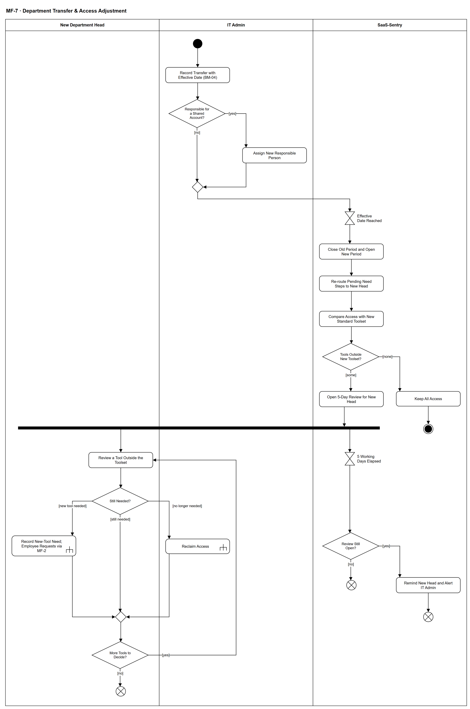

# MF-7 — Department Transfer & Access Adjustment

> **Loại:** Main flow (cấp tổng quan) — 2/5 · **Phiên bản:** 2.2 — 10/10/2026 · **Trạng thái:** Vẽ lại theo mô hình phòng ban (QĐ-52) và QĐ-55b, QĐ-56a, QĐ-58d; chờ Owner/GVHD review
>
> Sơ đồ là **dẫn xuất** từ quyết định Owner (`QĐ`) và BRD hiện hành; khi khác nhau, `QĐ` → BRD thắng. Quyết định trong sơ đồ là của Owner, **chưa** phải xác nhận của GVHD/hội đồng.

## 1. Mục đích và phạm vi

Mô tả việc **điều chỉnh quyền khi nhân viên chuyển phòng ban**: giữ lịch sử tổ chức, chuyển chi phí sang phòng mới đúng ngày, chuyển trách nhiệm tài khoản dùng chung, và để trưởng phòng mới quyết những công cụ nằm ngoài bộ chuẩn của phòng mới. Trả lời trực tiếp câu hỏi của hội đồng (Review 1, Phần 3): *điều chuyển xử lý thế nào*. Điểm cốt lõi: **điều chuyển không phải thu hồi** — hệ thống không tự thu hồi quyền nào.

**Phạm vi:** Ghi điều chuyển có ngày hiệu lực, người chịu trách nhiệm tài khoản dùng chung, đổi kỳ tổ chức và Cost Center, xác định lại bước nhu cầu đang chờ, so với bộ công cụ chuẩn, rà soát 5 ngày làm việc có nhắc/cảnh báo, thu hồi hoặc yêu cầu công cụ mới.

**Không nằm trong sơ đồ này:** Chi tiết thu hồi theo kiểu cấp (→ WF-09a); chi tiết điều chuyển ở mức thao tác, ca trưởng phòng là người được điều chuyển và giải thể/gộp phòng (→ WF-05); chi phí chia theo ngày khi lập báo cáo kỳ (→ MF-8, WF-19).

## 2. Tệp

| Tệp | Vai trò |
| --- | --- |
| [MF-7-department-transfer-access-adjustment.drawio](MF-7-department-transfer-access-adjustment.drawio) | Nguồn draw.io chỉnh sửa được (sinh từ spec) |
| [MF-7-department-transfer-access-adjustment.drawio.png](MF-7-department-transfer-access-adjustment.drawio.png) | Bản xuất PNG, nhúng sẵn nguồn draw.io |
| [MF-7.json](../specs/MF-7.json) | **Nguồn canonical** — sửa ở đây rồi chạy `python tools/flowkit.py build` từ `Docs/Diagrams` |

## 3. Nguồn nghiệp vụ

| Mã | Nội dung dùng trong sơ đồ |
| --- | --- |
| `FR-2.2, ADR-04, INV-20` | Quan hệ nhân viên–phòng có lịch sử, không ghi đè; đúng một phòng mỗi thời điểm |
| `FR-3.16, QĐ-28d` | Chỉ xác định lại bước nhu cầu đang chờ khi phòng của người yêu cầu đổi; SLA không đặt lại |
| `FR-3.8, FR-8.2, QĐ-50b` | Hạn rà soát 5 ngày làm việc, quá hạn chỉ nhắc/cảnh báo |
| `FR-3.18, QĐ-56a` | Bộ công cụ chuẩn phòng × chức vụ; công cụ trong bộ chuẩn mặc định giữ |
| `FR-2.12, QĐ-58d` | Người chịu trách nhiệm tài khoản dùng chung phải được thay trước ngày hiệu lực |
| `FR-5.3, QĐ-55b` | Chi phí theo kỳ chia theo ngày; không viết lại chi phí đã phát sinh |
| `FR-2.4, FR-4.15` | Thu hồi không tự ghi nhận tiết kiệm |
| `BM-04` | Biên bản bàn giao khi điều chuyển |
| `BRD 5.10 dòng Điều chuyển phòng; BRD 4.6` | Luồng và ma trận trách nhiệm |

## 4. Tác nhân, kích hoạt, điều kiện

| Làn (tiếng Anh trên hình) | Tác nhân | Trách nhiệm trong sơ đồ |
| --- | --- | --- |
| New Department Head | Trưởng phòng của phòng mới (vai Manager suy ra) | Quyết từng công cụ ngoài bộ chuẩn |
| IT Admin | IT Admin phụ trách phòng | Ghi điều chuyển, chỉ định người chịu trách nhiệm, thu hồi |
| SaaS-Sentry | SaaS-Sentry | Đổi kỳ tổ chức, định tuyến lại, so bộ chuẩn, theo dõi hạn |

- **Kích hoạt:** Doanh nghiệp quyết định chuyển một nhân viên sang phòng khác; IT Admin ghi nhận kèm ngày hiệu lực.
- **Tiền điều kiện:** Phòng mới đã có trưởng phòng và Cost Center Unit (thiếu trưởng phòng ⟹ cảnh báo, bước nhu cầu tới approver dự phòng — FR-3.6); bộ công cụ chuẩn của phòng mới đã cấu hình (nếu chưa, mọi công cụ được coi là ngoài bộ chuẩn).
- **Hậu điều kiện:** Nhân viên thuộc đúng một phòng mới từ ngày hiệu lực; chi phí từ ngày đó vào Cost Center mới, quá khứ giữ nguyên; tài khoản dùng chung có người chịu trách nhiệm mới; mỗi công cụ ngoài bộ chuẩn đã được giữ, thu hồi, hoặc thay bằng yêu cầu mới — hoặc vẫn giữ nguyên khi chưa có quyết định.

## 5. Cách đọc ký hiệu

| Ký hiệu | Nghĩa |
| --- | --- |
| Hình tròn đặc | Bắt đầu hoạt động (initial node) |
| Hình chữ nhật bo góc | Hành động (action) của tác nhân ở làn chứa nó |
| Hình chữ nhật bo góc có ký hiệu cây đinh ba ở góc | Gọi workflow con (call behavior) — mã workflow ghi trong nhãn |
| Hình thoi có chữ | Rẽ nhánh; mỗi cạnh ra mang điều kiện trong ngoặc vuông `[...]` |
| Hình thoi nhỏ không chữ | Hợp nhánh (merge) |
| Thanh đen ngang | Tách hoặc gộp các nhánh chạy song song (fork/join) |
| Đồng hồ cát | Chờ một mốc thời gian (time event) |
| Vòng tròn kép đặc | Kết thúc toàn bộ hoạt động (activity final) |
| Vòng tròn có dấu nhân | Kết thúc riêng nhánh đó, các nhánh khác vẫn chạy (flow final) |
| Dây có cung nhảy | Hai dây giao nhau nhưng **không** nối với nhau |

Đọc từ trên xuống. Sau thanh tách, hai nhánh chạy song song: nhánh trái là trưởng phòng mới quyết từng công cụ (vòng lặp tới khi hết công cụ), nhánh phải chỉ theo dõi hạn 5 ngày làm việc. Nhánh hạn **chỉ nhắc và cảnh báo**, không có cạnh nào dẫn tới thu hồi — đúng QĐ-50b. Vì hai nhánh song song, kết cục của từng nhánh là flow final.

## 6. Bảng node

| ID | Loại | Nhãn trên hình | Ý nghĩa | Làn / người thực hiện | Quy tắc |
| --- | --- | --- | --- | --- | --- |
| `st` | Nút bắt đầu | — | — | IT Admin | — |
| `a_rec` | Hành động | Record Transfer with Effective Date (BM-04) | IT Admin ghi phòng mới (kèm chức vụ nếu đổi) và ngày hiệu lực; lập biên bản BM-04 liệt kê quyền đang giữ. Không ghi đè dữ liệu tổ chức cũ. | IT Admin | `FR-2.2`, `ADR-04`, `BM-04`, `QĐ-52a` |
| `d_shared` | Rẽ nhánh | Responsible for a Shared Account? | Người được điều chuyển có đang là người chịu trách nhiệm một tài khoản dùng chung của phòng cũ không. | IT Admin | `FR-2.12`, `QĐ-58d` |
| `a_resp` | Hành động | Assign New Responsible Person | Chỉ định người chịu trách nhiệm mới trước ngày hiệu lực — mặc định trưởng phòng của phòng sở hữu tài khoản; đổi mật khẩu/thiết bị xác thực nếu người rời là thành viên. Người chỉ là **thành viên** tài khoản dùng chung của phòng cũ: tư cách thành viên kết thúc tại ngày hiệu lực, IT đổi mật khẩu (QĐ-62g; chi tiết ở WF-05 `d_member`). | IT Admin | `FR-2.11`, `FR-2.12`, `QĐ-56a`, `QĐ-58d`, `QĐ-62g` |
| `m_sh` | Hợp nhánh | — | — | IT Admin | — |
| `t_eff` | Chờ mốc thời gian | Effective Date Reached | Chờ tới ngày hiệu lực của điều chuyển. | SaaS-Sentry | — |
| `s_period` | Hành động | Close Old Period and Open New Period | Đóng kỳ quan hệ nhân viên–phòng cũ, mở kỳ mới; Cost Center Unit của phòng mới áp từ ngày hiệu lực. Chi phí theo kỳ chia theo ngày; chi phí đã phát sinh không bị viết lại. | SaaS-Sentry | `FR-2.2`, `FR-5.3`, `INV-20`, `QĐ-55b` |
| `s_reroute` | Hành động | Re-route Pending Need Steps to New Head | Chỉ các bước duyệt nhu cầu đang chờ được xác định lại cho trưởng phòng mới; SLA không đặt lại. Bước duyệt chi và bước thực thi giữ người xử lý. | SaaS-Sentry | `FR-3.16`, `QĐ-28d` |
| `s_compare` | Hành động | Compare Access with New Standard Toolset | So quyền đang giữ (cá nhân, khóa bản quyền) với bộ công cụ chuẩn của phòng × chức vụ mới. Công cụ thuộc bộ chuẩn mặc định giữ. Đổi chức vụ trong cùng phòng không mở rà soát (QĐ-62p). | SaaS-Sentry | `FR-3.18`, `QĐ-56a` |
| `d_out` | Rẽ nhánh | Tools Outside New Toolset? | Còn công cụ nào ngoài bộ chuẩn của phòng mới không. | SaaS-Sentry | — |
| `s_keepall` | Hành động | Keep All Access | Mọi công cụ thuộc bộ chuẩn: giữ nguyên, không cần trưởng phòng quyết. | SaaS-Sentry | `QĐ-56a` |
| `end_keep` | Kết thúc hoạt động | — | Điều chuyển hoàn tất, không có quyền nào phải rà soát. | SaaS-Sentry | — |
| `s_task` | Hành động | Open 5-Day Review for New Head | Tạo việc rà soát cho trưởng phòng mới, hạn 5 ngày làm việc kể từ ngày hiệu lực (Super Admin cấu hình được). Đây không phải một bước phê duyệt của request. Phòng mới **chưa có trưởng phòng**: việc rà soát **chờ, không giao ai** (approver dự phòng chỉ thay ở bước nhu cầu); quyền giữ nguyên; IT Admin và Super Admin thấy cảnh báo phòng thiếu trưởng phòng; khi có trưởng phòng mới, việc chuyển sang người đó, hạn không đặt lại (QĐ-62c). | SaaS-Sentry | `FR-3.8`, `FR-8.2`, `QĐ-50b`, `QĐ-62c` |
| `f_rev` | Tách song song | — | — | SaaS-Sentry | — |
| `a_review` | Hành động | Review a Tool Outside the Toolset | Trưởng phòng mới xem từng công cụ ngoài bộ chuẩn cùng lý do cấp ban đầu và tình trạng sử dụng (dạng tổng hợp). | New Department Head | `FR-3.7`, `SoD-2` |
| `t_due` | Chờ mốc thời gian | 5 Working Days Elapsed | Hết hạn 5 ngày làm việc tính theo lịch làm việc của tổ chức. | SaaS-Sentry | — |
| `d_choice` | Rẽ nhánh | Still Needed? | Quyết định cho từng công cụ: còn cần · không còn cần · cần công cụ mới. | New Department Head | — |
| `d_open` | Rẽ nhánh | Review Still Open? | Còn công cụ chưa có quyết định khi hết hạn không. | SaaS-Sentry | — |
| `c_revoke` | Gọi workflow con | Reclaim Access | IT Admin thu hồi quyền không còn cần (phần mềm nội bộ: ngoài hệ thống kèm bằng chứng); seat về kho. Thu hồi không tự ghi nhận tiết kiệm. Gói có lưu ý mất dữ liệu: hiện lưu ý và **trưởng phòng mới** (người quyết thu hồi) xác nhận bàn giao trước khi gỡ ở nhà cung cấp; không chặn sau hạn ngắn (QĐ-62f, WF-09a `d_dl`). Nếu WF-09a trả *đóng thất bại* (QĐ-62i): quyền còn hiệu lực, vẫn hiện G2/lãng phí theo điều kiện nguồn, seat chưa về kho và IT mở tác vụ thu hồi mới. | IT Admin | `FR-2.4`, `FR-4.15`, `SoD-5`, → `WF-09a` |
| `c_req` | Gọi workflow con | Record New-Tool Need; Employee Requests via MF-2 | Trưởng phòng mới ghi nhu cầu công cụ khác; **nhân viên** tự gửi yêu cầu qua luồng thường (MF-2, UF-01) — FR-3.2 chỉ cho trưởng phòng tạo thay khi onboarding hoặc yêu cầu theo nhóm. Hệ thống hiện bộ công cụ chuẩn của phòng mới trước. | New Department Head | `FR-3.2`, → `MF-2` |
| `s_remind` | Hành động | Remind New Head and Alert IT Admin | Quá hạn: chỉ nhắc trưởng phòng mới và cảnh báo IT Admin. Không tự thu hồi, không giao người khác, không tự quyết; quyền giữ nguyên tới khi có quyết định. | SaaS-Sentry | `FR-3.8`, `QĐ-50b` |
| `ff_t1` | Kết thúc nhánh (flow final) | — | Nhánh hạn kết thúc — mọi công cụ đã có quyết định. | SaaS-Sentry | — |
| `ff_t2` | Kết thúc nhánh (flow final) | — | Nhánh hạn kết thúc sau khi nhắc; việc rà soát vẫn mở ở nhánh trưởng phòng. | SaaS-Sentry | — |
| `m_done` | Hợp nhánh | — | — | New Department Head | — |
| `d_more` | Rẽ nhánh | More Tools to Decide? | Còn công cụ ngoài bộ chuẩn chưa quyết không. | New Department Head | — |
| `ff_rev` | Kết thúc nhánh (flow final) | — | Rà soát xong — quyền của nhân viên khớp nhu cầu ở phòng mới. | New Department Head | — |

## 7. Bảng chuyển tiếp

| Từ → tới | Nhãn điều kiện | Điều kiện | Kết quả |
| --- | --- | --- | --- |
| `st` → `a_rec` | — | — | Sang Record Transfer with Effective Date (BM-04) |
| `a_rec` → `d_shared` | — | — | Sang Responsible for a Shared Account? |
| `d_shared` → `a_resp` | `[yes]` | Người được điều chuyển đang chịu trách nhiệm tài khoản dùng chung của phòng cũ | Chỉ định người mới trước ngày hiệu lực |
| `d_shared` → `m_sh` | `[no]` | Không giữ trách nhiệm tài khoản dùng chung | Chờ ngày hiệu lực |
| `a_resp` → `m_sh` | — | — | Sang — |
| `m_sh` → `t_eff` | — | — | Sang Effective Date Reached |
| `t_eff` → `s_period` | — | — | Sang Close Old Period and Open New Period |
| `s_period` → `s_reroute` | — | — | Sang Re-route Pending Need Steps to New Head |
| `s_reroute` → `s_compare` | — | — | Sang Compare Access with New Standard Toolset |
| `s_compare` → `d_out` | — | — | Sang Tools Outside New Toolset? |
| `d_out` → `s_keepall` | `[none]` | Mọi quyền đều thuộc bộ chuẩn của phòng mới | Giữ toàn bộ |
| `d_out` → `s_task` | `[some]` | Có ít nhất một công cụ ngoài bộ chuẩn | Mở việc rà soát 5 ngày |
| `s_keepall` → `end_keep` | — | — | Sang — |
| `s_task` → `f_rev` | — | — | Sang — |
| `f_rev` → `a_review` | — | — | Nhánh rà soát của trưởng phòng mới |
| `f_rev` → `t_due` | — | — | Nhánh theo dõi hạn |
| `a_review` → `d_choice` | — | — | Sang Still Needed? |
| `d_choice` → `m_done` | `[still needed]` | Còn cần cho công việc ở phòng mới | Giữ quyền; chi phí vào phòng mới từ ngày hiệu lực |
| `d_choice` → `c_revoke` | `[no longer needed]` | Không còn cần | IT thu hồi |
| `d_choice` → `c_req` | `[new tool needed]` | Cần một công cụ khác cho công việc mới | Tạo yêu cầu mới theo MF-2 |
| `c_revoke` → `m_done` | — | — | Sang — |
| `c_req` → `m_done` | — | — | Sang — |
| `m_done` → `d_more` | — | — | Sang More Tools to Decide? |
| `d_more` → `a_review` | `[yes]` | Còn công cụ chưa quyết | Rà công cụ kế tiếp |
| `d_more` → `ff_rev` | `[no]` | Đã quyết hết | Kết thúc nhánh rà soát |
| `t_due` → `d_open` | — | — | Sang Review Still Open? |
| `d_open` → `ff_t1` | `[no]` | Mọi công cụ đã có quyết định trước hạn | Kết thúc nhánh hạn |
| `d_open` → `s_remind` | `[yes]` | Còn công cụ chưa quyết khi hết hạn | Nhắc và cảnh báo |
| `s_remind` → `ff_t2` | — | — | Sang — |

Số đếm: **26 node · 29 cạnh · 5 rẽ nhánh**; giao cắt dây: **0**.

## 8. Happy path

1. `st` — —
2. `a_rec` — Record Transfer with Effective Date (BM-04): IT Admin ghi phòng mới (kèm chức vụ nếu đổi) và ngày hiệu lực; lập biên bản BM-04 liệt kê quyền đang giữ. Không ghi đè dữ liệu tổ chức cũ.
3. `d_shared` — Responsible for a Shared Account?: Người được điều chuyển có đang là người chịu trách nhiệm một tài khoản dùng chung của phòng cũ không.
4. `t_eff` — Effective Date Reached: Chờ tới ngày hiệu lực của điều chuyển.
5. `s_period` — Close Old Period and Open New Period: Đóng kỳ quan hệ nhân viên–phòng cũ, mở kỳ mới; Cost Center Unit của phòng mới áp từ ngày hiệu lực. Chi phí theo kỳ chia theo ngày; chi phí đã phát sinh không bị viết lại.
6. `s_reroute` — Re-route Pending Need Steps to New Head: Chỉ các bước duyệt nhu cầu đang chờ được xác định lại cho trưởng phòng mới; SLA không đặt lại. Bước duyệt chi và bước thực thi giữ người xử lý.
7. `s_compare` — Compare Access with New Standard Toolset: So quyền đang giữ (cá nhân, khóa bản quyền) với bộ công cụ chuẩn của phòng × chức vụ mới. Công cụ thuộc bộ chuẩn mặc định giữ. Đổi chức vụ trong cùng phòng không mở rà soát (QĐ-62p).
8. `d_out` — Tools Outside New Toolset?: Còn công cụ nào ngoài bộ chuẩn của phòng mới không.
9. `s_task` — Open 5-Day Review for New Head: Tạo việc rà soát cho trưởng phòng mới, hạn 5 ngày làm việc kể từ ngày hiệu lực (Super Admin cấu hình được). Đây không phải một bước phê duyệt của request. Phòng mới **chưa có trưởng phòng**: việc rà soát **chờ, không giao ai** (approver dự phòng chỉ thay ở bước nhu cầu); quyền giữ nguyên; IT Admin và Super Admin thấy cảnh báo phòng thiếu trưởng phòng; khi có trưởng phòng mới, việc chuyển sang người đó, hạn không đặt lại (QĐ-62c).
10. `f_rev` — —
11. `a_review` — Review a Tool Outside the Toolset: Trưởng phòng mới xem từng công cụ ngoài bộ chuẩn cùng lý do cấp ban đầu và tình trạng sử dụng (dạng tổng hợp).
12. `d_choice` — Still Needed?: Quyết định cho từng công cụ: còn cần · không còn cần · cần công cụ mới.
13. `d_more` — More Tools to Decide?: Còn công cụ ngoài bộ chuẩn chưa quyết không.
14. `ff_rev` — —: Rà soát xong — quyền của nhân viên khớp nhu cầu ở phòng mới.

## 9. Nhánh thay thế / if-else

- **Mọi công cụ thuộc bộ chuẩn** — `d_out` → `s_keepall` → `end_keep`. Không mở việc rà soát.
- **Người được điều chuyển giữ tài khoản dùng chung** — `d_shared` → `a_resp` → `m_sh`. Phải xong trước ngày hiệu lực; cảnh báo trưởng phòng và IT Admin nếu chưa.
- **Không còn cần một công cụ** — `d_choice` → `c_revoke` → `m_done`. Thu hồi qua WF-09a; seat về kho, tiết kiệm chỉ ghi theo FR-4.15.
- **Cần công cụ mới** — `d_choice` → `c_req` → `m_done`. Đi MF-2 như mọi yêu cầu khác.
- **Lặp qua từng công cụ** — `d_more` → `a_review`. Mỗi công cụ ngoài bộ chuẩn một quyết định.

## 10. Nhánh lỗi / từ chối và cách kết thúc

- **Quá hạn 5 ngày làm việc** — `t_due` → `d_open` → `s_remind` → `ff_t2`. Chỉ nhắc trưởng phòng mới và cảnh báo IT Admin; quyền giữ nguyên; nhánh rà soát vẫn mở cho tới khi trưởng phòng quyết.

## 11. Liên hệ với sơ đồ khác

- Cấp trên: Context (G08, G12, G17), FDD Feature 6.1, 6.3, 1.5
- `WF-05` — chi tiết điều chuyển, ca trưởng phòng được điều chuyển, phòng giải thể/gộp
- `MF-8` / `WF-19` — chi phí theo kỳ chia theo ngày khi lập báo cáo
- User flow: `UF-18`
- `WF-09a` — gọi/chuyển tại node `c_revoke`
- `MF-2` — gọi/chuyển tại node `c_req`

## 12. Giới hạn và vấn đề còn mở

- (ĐÃ CHỐT · DOI-43, QĐ-62p) Đổi chức vụ trong cùng phòng không mở rà soát; bộ chuẩn mới áp cho yêu cầu mới.
- (DEFERRED/OUT · DOI-05) Module tổ chức ở BE vẫn dựa trên `manager_id` (`QĐ-51`) — thiết kế chuyển đổi sau ERD (QĐ-59e).
