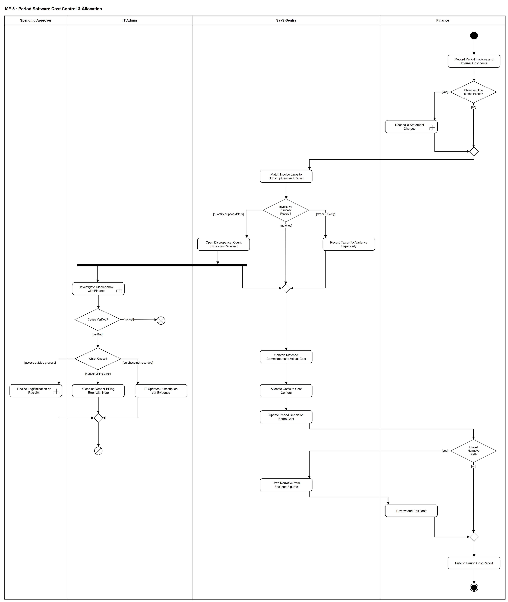

# MF-8 — Period Software Cost Control & Allocation

> **Loại:** Main flow (cấp tổng quan) — 4/5 · **Phiên bản:** 2.2 — 10/10/2026 · **Trạng thái:** Vẽ lại theo QĐ-55, QĐ-60 (thuế ghi nhận, chi phí thực chịu), QĐ-49f/g, QĐ-50c; chờ Owner/GVHD review
>
> Sơ đồ là **dẫn xuất** từ quyết định Owner (`QĐ`) và BRD hiện hành; khi khác nhau, `QĐ` → BRD thắng. Quyết định trong sơ đồ là của Owner, **chưa** phải xác nhận của GVHD/hội đồng.

## 1. Mục đích và phạm vi

Mô tả việc **khép chi phí phần mềm của một kỳ**: ghi nhận hóa đơn đúng chứng từ (kể cả dòng thuế), đối soát với bản ghi mua và sao kê, xử lý sai lệch mà không xóa bằng chứng, quy chi phí về đúng Cost Center theo ngày và phát hành báo cáo theo **chi phí thực chịu**. Xử lý PP-3 (Tài chính và CNTT không cùng ngôn ngữ) và trả lời câu hỏi thuế của hội đồng: hệ thống **ghi nhận** thuế, **không** tính hay kê khai.

**Phạm vi:** Hóa đơn và khoản chi phí nội bộ, gọi đối soát sao kê, ghép hóa đơn với thuê bao, ba kết quả so (khớp / chỉ lệch thuế-tỷ giá / lệch số lượng-đơn giá), điều tra sai lệch song song, chuyển cam kết thành chi phí, phân bổ, báo cáo kỳ, bản nháp AI tùy chọn.

**Không nằm trong sơ đồ này:** Đối soát từng khoản chi trên sao kê và hợp thức hóa (→ WF-17, WF-17a); chi tiết điều tra sai lệch và đối soát nhà cung cấp (→ WF-16); quy tắc phân bổ và báo cáo chi tiết (→ WF-19); lập ngân sách và gắn ngược khoản cam kết (→ WF-20). Không có thanh toán, sổ cái, kết nối ngân hàng, tính/kê khai thuế (`QĐ-34`, `QĐ-55a`).

## 2. Tệp

| Tệp | Vai trò |
| --- | --- |
| [MF-8-period-software-cost-control.drawio](MF-8-period-software-cost-control.drawio) | Nguồn draw.io chỉnh sửa được (sinh từ spec) |
| [MF-8-period-software-cost-control.drawio.png](MF-8-period-software-cost-control.drawio.png) | Bản xuất PNG, nhúng sẵn nguồn draw.io |
| [MF-8.json](../specs/MF-8.json) | **Nguồn canonical** — sửa ở đây rồi chạy `python tools/flowkit.py build` từ `Docs/Diagrams` |

## 3. Nguồn nghiệp vụ

| Mã | Nội dung dùng trong sơ đồ |
| --- | --- |
| `FR-5.4, QĐ-34b, QĐ-49f` | Hóa đơn là khoản chi đã ghi nhận; lệch vì nhà cung cấp tính sai |
| `FR-5.13, QĐ-55a, QĐ-60a, QĐ-60b` | Ghi nhận thuế theo chứng từ, chi phí thực chịu, hồ sơ thuế T1/T2/T3 |
| `FR-5.2, FR-5.3, INV-03, QĐ-55b` | Phân bổ theo Cost Center, chia theo ngày khi điều chuyển, tỷ lệ gói dùng chung |
| `QĐ-49g, QĐ-50c` | Chi phí nội bộ một Cost Center; dòng Chưa phân bổ Cost Center |
| `FR-5.8, OI-11a` | Chuyển khoản cam kết thành chi phí theo số tiền |
| `FR-6.4, QĐ-33a, QĐ-33b, FR-3.4c-1` | Đối soát khoản chi và hợp thức hóa — luồng con WF-17 |
| `FR-7.7` | Không nguồn nào tự ghi đè nguồn kia |
| `QĐ-49e, BRD 6.4` | Bản nháp diễn giải AI chỉ hỗ trợ |
| `BRD 5.10 dòng MF-8` | Diễn tiến luồng |

## 4. Tác nhân, kích hoạt, điều kiện

| Làn (tiếng Anh trên hình) | Tác nhân | Trách nhiệm trong sơ đồ |
| --- | --- | --- |
| Spending Approver | Người duyệt chi | Quyết hợp thức hóa khi có quyền ngoài quy trình |
| IT Admin | IT Admin | Điều tra sai lệch cùng Finance, cập nhật thuê bao theo căn cứ (QĐ-62b), đóng hồ sơ nhà cung cấp tính sai |
| SaaS-Sentry | SaaS-Sentry | Ghép, so, chuyển cam kết, phân bổ, báo cáo, soạn nháp AI |
| Finance | Finance (một người) | Nhập chứng từ, đính chứng từ/căn cứ cho việc cập nhật thuê bao, sửa bản nháp, phát hành báo cáo |

- **Kích hoạt:** Kết thúc kỳ hoặc khi hóa đơn/chứng từ của kỳ về tới Finance.
- **Tiền điều kiện:** Danh mục, thuê bao và hồ sơ thuế nhà cung cấp đã khai (FR-5.13); Cost Center và quan hệ nhân viên–phòng có hiệu lực theo thời gian; ngân sách của kỳ có thể chưa lập (FR-5.8a).
- **Hậu điều kiện:** Mọi hóa đơn của kỳ là thực chi như đã nhận; chi phí thuộc đúng Cost Center tại ngày phát sinh; khoản cam kết khớp đã thành chi phí; sai lệch đang mở hoặc đã đóng bằng quyết định; báo cáo kỳ phát hành trên chi phí thực chịu.

## 5. Cách đọc ký hiệu

| Ký hiệu | Nghĩa |
| --- | --- |
| Hình tròn đặc | Bắt đầu hoạt động (initial node) |
| Hình chữ nhật bo góc | Hành động (action) của tác nhân ở làn chứa nó |
| Hình chữ nhật bo góc có ký hiệu cây đinh ba ở góc | Gọi workflow con (call behavior) — mã workflow ghi trong nhãn |
| Hình thoi có chữ | Rẽ nhánh; mỗi cạnh ra mang điều kiện trong ngoặc vuông `[...]` |
| Hình thoi nhỏ không chữ | Hợp nhánh (merge) |
| Thanh đen ngang | Tách hoặc gộp các nhánh chạy song song (fork/join) |
| Vòng tròn kép đặc | Kết thúc toàn bộ hoạt động (activity final) |
| Vòng tròn có dấu nhân | Kết thúc riêng nhánh đó, các nhánh khác vẫn chạy (flow final) |
| Dây có cung nhảy | Hai dây giao nhau nhưng **không** nối với nhau |

Sau rẽ nhánh *Invoice vs Purchase Record?*, nhánh lệch số lượng/đơn giá tách đôi: một nhánh điều tra sai lệch (kết thúc bằng flow final khi có quyết định), nhánh kia đưa hóa đơn đi tiếp — vì hóa đơn **vẫn** là thực chi trong lúc điều tra (QĐ-34b, QĐ-49f).

## 6. Bảng node

| ID | Loại | Nhãn trên hình | Ý nghĩa | Làn / người thực hiện | Quy tắc |
| --- | --- | --- | --- | --- | --- |
| `st` | Nút bắt đầu | — | — | Finance | — |
| `a_inv` | Hành động | Record Period Invoices and Internal Cost Items | Finance nhập hoặc import hóa đơn của kỳ kèm từng dòng thuế đúng chứng từ (loại, tỷ lệ, số tiền, nhà cung cấp thu hay doanh nghiệp nộp thay, được khấu trừ có/không); hoặc ghi khoản chi phí phần mềm nội bộ vào đúng một Cost Center, không cần hóa đơn/thuê bao/nhà cung cấp. | Finance | `FR-5.4`, `FR-5.13`, `QĐ-49g`, `QĐ-60a`, `QĐ-60b`, `BM-05` |
| `d_stmt` | Rẽ nhánh | Statement File for the Period? | Có tệp CSV sao kê/thẻ của kỳ để đối soát không (nguồn tùy chọn). | Finance | — |
| `c_stmt` | Gọi workflow con | Reconcile Statement Charges | Đối soát từng khoản chi trên sao kê với căn cứ phê duyệt; khoản chưa có căn cứ là ngoại lệ chỉ Người duyệt chi chấp nhận/không chấp nhận; phần mềm ngoài danh mục đi hợp thức hóa (tính năng bổ sung, MF-6 cũ). | Finance | `FR-6.4`, `QĐ-33a`, `QĐ-33b`, `QĐ-31a`, → `WF-17` |
| `m_stmt` | Hợp nhánh | — | — | Finance | — |
| `s_match` | Hành động | Match Invoice Lines to Subscriptions and Period | Hệ thống ghép từng dòng hóa đơn với thuê bao/phần mềm và kỳ, so với bản ghi mua (số lượng, đơn giá, tổng tiền phải trả ước tính). | SaaS-Sentry | `FR-5.4`, `ADR-06` |
| `d_var` | Rẽ nhánh | Invoice vs Purchase Record? | Kết quả so hóa đơn với bản ghi mua. | SaaS-Sentry | — |
| `s_disc` | Hành động | Open Discrepancy; Count Invoice as Received | Lệch số lượng/đơn giá: hóa đơn vẫn tính vào thực chi như đã nhận; song song mở hồ sơ sai lệch giữ cả hai giá trị. Không tự sửa thuê bao hay hóa đơn. | SaaS-Sentry | `FR-5.4`, `FR-7.7`, `QĐ-34b`, `QĐ-49f` |
| `s_tax` | Hành động | Record Tax or FX Variance Separately | Chênh lệch chỉ do thuế, tỷ giá hoặc phí: ghi nhận, tách vào chênh lệch do thuế/tỷ giá; không mở hồ sơ sai lệch. | SaaS-Sentry | `FR-5.13`, `QĐ-55a` |
| `f_disc` | Tách song song | — | — | SaaS-Sentry | — |
| `c_inv` | Gọi workflow con | Investigate Discrepancy with Finance | IT điều tra cùng Finance nguyên nhân lệch. | IT Admin | `FR-7.7`, `SoD-3`, → `WF-16` |
| `d_ver` | Rẽ nhánh | Cause Verified? | Đã xác minh được nguyên nhân sai lệch chưa (chi tiết ở WF-16). Chưa xác minh thì không ép chọn nguyên nhân. | IT Admin | `FR-7.7`, `QĐ-15` |
| `ff_open` | Kết thúc nhánh (flow final) | — | Hồ sơ sai lệch vẫn mở, chờ chứng từ; giữ cả hai giá trị, không tự sửa thuê bao hay tự đóng. Hóa đơn vẫn nằm trong thực chi như đã nhận, nên việc khép kỳ không phải chờ nhánh này; hồ sơ mở hiện trong báo cáo kỳ dưới dạng ngoại lệ đang mở. | IT Admin | — |
| `m_ok` | Hợp nhánh | — | — | SaaS-Sentry | — |
| `d_cause` | Rẽ nhánh | Which Cause? | Nguyên nhân đã xác minh. Hồ sơ chỉ đóng bằng quyết định, không tự đóng theo thời gian. | IT Admin | — |
| `s_commit` | Hành động | Convert Matched Commitments to Actual Cost | Khoản cam kết khớp hóa đơn chuyển thành chi phí theo đúng số tiền; khớp một phần thì phần còn lại vẫn đang giữ. | SaaS-Sentry | `FR-5.8`, `OI-11a` |
| `a_updsub` | Hành động | IT Updates Subscription per Evidence | Mua đã duyệt nhưng thuê bao chưa ghi: **IT Admin** cập nhật thuê bao theo căn cứ (quyết định duyệt chi, chứng từ Finance đính kèm); Finance giữ hóa đơn, dòng thuế và cờ được khấu trừ. Hệ thống không tự sửa (QĐ-62b). | IT Admin | `FR-5.4`, `FR-7.7`, `QĐ-62b` |
| `a_billerr` | Hành động | Close as Vendor Billing Error with Note | Nhà cung cấp tính sai: IT Admin đóng hồ sơ với quyết định “nhà cung cấp tính sai” kèm ghi chú xác minh bắt buộc của Finance; điều chỉnh (nếu có) đến sau bằng hóa đơn/điều chỉnh mới (QĐ-49f, QĐ-62b). | IT Admin | `QĐ-49f`, `FR-5.4` |
| `c_leg` | Gọi workflow con | Decide Legitimization or Reclaim | Quyền được cấp ngoài quy trình: chỉ Người duyệt chi quyết hợp thức hóa; không duyệt thì IT thu hồi (WF-09a). | Spending Approver | `FR-3.4c-1`, `DQ-06`, `BM-07`, → `WF-17` |
| `s_alloc` | Hành động | Allocate Costs to Cost Centers | Theo seat ⟹ Cost Center của phòng có hiệu lực tại ngày chi phí, chia theo ngày khi điều chuyển; tài khoản dịch vụ/dùng chung toàn công ty ⟹ Company; dùng chung của phòng ⟹ Unit của phòng; gói dùng chung ⟹ tỷ lệ Finance khai (tổng 100%); nội bộ ⟹ một Cost Center; khoản chi sao kê chưa có căn cứ ⟹ dòng Chưa phân bổ Cost Center. | SaaS-Sentry | `FR-5.2`, `FR-5.3`, `INV-03`, `QĐ-49g`, `QĐ-50c`, `QĐ-55b` |
| `m_disc` | Hợp nhánh | — | — | IT Admin | — |
| `s_report` | Hành động | Update Period Report on Borne Cost | Báo cáo kỳ trên chi phí thực chịu: ngân sách · thực chi · cam kết đang giữ · còn lại · dòng Chưa phân bổ Cost Center · ngoại lệ đang mở; GTGT được khấu trừ ở cột riêng; chênh lệch thuế/tỷ giá tách riêng. | SaaS-Sentry | `FR-5.1`, `FR-5.13`, `QĐ-60a` |
| `ff_disc` | Kết thúc nhánh (flow final) | — | Nhánh sai lệch kết thúc bằng một quyết định. | IT Admin | — |
| `d_ai` | Rẽ nhánh | Use AI Narrative Draft? | Finance chọn dùng bản nháp diễn giải do AI soạn hay không (AI tắt/lỗi thì không có lựa chọn này). | Finance | — |
| `s_ai` | Hành động | Draft Narrative from Backend Figures | AI chỉ diễn giải số liệu backend đã tính, mỗi con số truy được nguồn; không tính tiền, không kết luận vi phạm; chỉ dùng dữ liệu Finance được thấy. | SaaS-Sentry | `QĐ-49e(2)`, `BRD 6.4` |
| `a_edit` | Hành động | Review and Edit Draft | Finance xem và sửa bản nháp trước khi dùng. | Finance | `QĐ-49e(2)` |
| `m_pub` | Hợp nhánh | — | — | Finance | — |
| `a_pub` | Hành động | Publish Period Cost Report | Finance phát hành báo cáo kỳ cho Người duyệt chi; trưởng phòng thấy thực chi + cam kết của phòng mình. Finance không phải người duyệt. | Finance | `BRD 5.5.3`, `SoD-3` |
| `end_ok` | Kết thúc hoạt động | — | Kỳ đã khép: chi phí về đúng Cost Center, báo cáo phát hành. | Finance | — |

## 7. Bảng chuyển tiếp

| Từ → tới | Nhãn điều kiện | Điều kiện | Kết quả |
| --- | --- | --- | --- |
| `st` → `a_inv` | — | — | Sang Record Period Invoices and Internal Cost Items |
| `a_inv` → `d_stmt` | — | — | Sang Statement File for the Period? |
| `d_stmt` → `c_stmt` | `[yes]` | Có tệp sao kê/thẻ của kỳ | Đối soát từng khoản chi |
| `d_stmt` → `m_stmt` | `[no]` | Không có tệp (nguồn tùy chọn) | Đi tiếp với hóa đơn |
| `c_stmt` → `m_stmt` | — | — | Sang — |
| `m_stmt` → `s_match` | — | — | Sang Match Invoice Lines to Subscriptions and Period |
| `s_match` → `d_var` | — | — | Sang Invoice vs Purchase Record? |
| `d_var` → `m_ok` | `[matches]` | Hóa đơn khớp bản ghi mua | Ghi nhận |
| `d_var` → `s_tax` | `[tax or FX only]` | Chỉ lệch do thuế, tỷ giá hoặc phí | Ghi nhận, tách chênh lệch thuế/tỷ giá |
| `d_var` → `s_disc` | `[quantity or price differs]` | Lệch số lượng hoặc đơn giá | Mở hồ sơ sai lệch |
| `s_tax` → `m_ok` | — | — | Sang — |
| `s_disc` → `f_disc` | — | — | Sang — |
| `f_disc` → `c_inv` | — | — | Nhánh điều tra sai lệch |
| `f_disc` → `m_ok` | — | — | Hóa đơn vẫn đi tiếp vào thực chi |
| `c_inv` → `d_ver` | — | — | Sang Cause Verified? |
| `d_ver` → `d_cause` | `[verified]` | Đã xác minh nguyên nhân | Sang Which Cause? |
| `d_ver` → `ff_open` | `[not yet]` | Chưa xác minh được nguyên nhân — hồ sơ vẫn mở | Sang — |
| `d_cause` → `a_updsub` | `[purchase not recorded]` | Mua đã duyệt nhưng chưa ghi thuê bao | IT Admin cập nhật thuê bao theo căn cứ; Finance đính chứng từ (QĐ-62b) |
| `d_cause` → `a_billerr` | `[vendor billing error]` | Nhà cung cấp tính sai | Đóng hồ sơ kèm ghi chú |
| `d_cause` → `c_leg` | `[access outside process]` | Có quyền được cấp ngoài quy trình | Người duyệt chi quyết hợp thức hóa hoặc IT thu hồi |
| `a_updsub` → `m_disc` | — | — | Sang — |
| `a_billerr` → `m_disc` | — | — | Sang — |
| `c_leg` → `m_disc` | — | — | Sang — |
| `m_disc` → `ff_disc` | — | — | Sang — |
| `m_ok` → `s_commit` | — | — | Sang Convert Matched Commitments to Actual Cost |
| `s_commit` → `s_alloc` | — | — | Sang Allocate Costs to Cost Centers |
| `s_alloc` → `s_report` | — | — | Sang Update Period Report on Borne Cost |
| `s_report` → `d_ai` | — | — | Sang Use AI Narrative Draft? |
| `d_ai` → `s_ai` | `[yes]` | Finance chọn dùng bản nháp AI | AI soạn bản nháp |
| `d_ai` → `m_pub` | `[no]` | Không dùng, hoặc AI tắt/lỗi | Viết tay hoặc phát hành như cũ |
| `s_ai` → `a_edit` | — | — | Sang Review and Edit Draft |
| `a_edit` → `m_pub` | — | — | Sang — |
| `m_pub` → `a_pub` | — | — | Sang Publish Period Cost Report |
| `a_pub` → `end_ok` | — | — | Sang — |

Số đếm: **29 node · 34 cạnh · 5 rẽ nhánh**; giao cắt dây: **0**.

## 8. Happy path

1. `st` — —
2. `a_inv` — Record Period Invoices and Internal Cost Items: Finance nhập hoặc import hóa đơn của kỳ kèm từng dòng thuế đúng chứng từ (loại, tỷ lệ, số tiền, nhà cung cấp thu hay doanh nghiệp nộp thay, được khấu trừ có/không); hoặc ghi khoản chi phí phần mềm nội bộ vào đúng một Cost Center, không cần hóa đơn/thuê bao/nhà cung cấp.
3. `d_stmt` — Statement File for the Period?: Có tệp CSV sao kê/thẻ của kỳ để đối soát không (nguồn tùy chọn).
4. `s_match` — Match Invoice Lines to Subscriptions and Period: Hệ thống ghép từng dòng hóa đơn với thuê bao/phần mềm và kỳ, so với bản ghi mua (số lượng, đơn giá, tổng tiền phải trả ước tính).
5. `d_var` — Invoice vs Purchase Record?: Kết quả so hóa đơn với bản ghi mua.
6. `s_commit` — Convert Matched Commitments to Actual Cost: Khoản cam kết khớp hóa đơn chuyển thành chi phí theo đúng số tiền; khớp một phần thì phần còn lại vẫn đang giữ.
7. `s_alloc` — Allocate Costs to Cost Centers: Theo seat ⟹ Cost Center của phòng có hiệu lực tại ngày chi phí, chia theo ngày khi điều chuyển; tài khoản dịch vụ/dùng chung toàn công ty ⟹ Company; dùng chung của phòng ⟹ Unit của phòng; gói dùng chung ⟹ tỷ lệ Finance khai (tổng 100%); nội bộ ⟹ một Cost Center; khoản chi sao kê chưa có căn cứ ⟹ dòng Chưa phân bổ Cost Center.
8. `s_report` — Update Period Report on Borne Cost: Báo cáo kỳ trên chi phí thực chịu: ngân sách · thực chi · cam kết đang giữ · còn lại · dòng Chưa phân bổ Cost Center · ngoại lệ đang mở; GTGT được khấu trừ ở cột riêng; chênh lệch thuế/tỷ giá tách riêng.
9. `d_ai` — Use AI Narrative Draft?: Finance chọn dùng bản nháp diễn giải do AI soạn hay không (AI tắt/lỗi thì không có lựa chọn này).
10. `a_pub` — Publish Period Cost Report: Finance phát hành báo cáo kỳ cho Người duyệt chi; trưởng phòng thấy thực chi + cam kết của phòng mình. Finance không phải người duyệt.
11. `end_ok` — —: Kỳ đã khép: chi phí về đúng Cost Center, báo cáo phát hành.

## 9. Nhánh thay thế / if-else

- **Có sao kê của kỳ** — `d_stmt` → `c_stmt` → `m_stmt`. Đối soát từng khoản chi trước khi ghép hóa đơn.
- **Chỉ lệch do thuế/tỷ giá/phí** — `d_var` → `s_tax` → `m_ok`. Ghi nhận bình thường, chênh lệch tách riêng.
- **Dùng bản nháp AI** — `d_ai` → `s_ai` → `a_edit` → `m_pub`. Finance sửa trước khi phát hành.

## 10. Nhánh lỗi / từ chối và cách kết thúc

- **Lệch số lượng/đơn giá — mua đã duyệt chưa ghi** — `d_var` → `s_disc` → `f_disc` → `c_inv` → `d_ver` → `d_cause` → `a_updsub` → `m_disc` → `ff_disc`. IT Admin cập nhật thuê bao theo căn cứ; Finance đính chứng từ (QĐ-62b).
- **Nhà cung cấp tính sai** — `d_cause` → `a_billerr` → `m_disc` → `ff_disc`. Hóa đơn vẫn tính như đã nhận; điều chỉnh đến sau bằng hóa đơn mới.
- **Quyền cấp ngoài quy trình** — `d_cause` → `c_leg` → `m_disc` → `ff_disc`. Người duyệt chi quyết hợp thức hóa; không duyệt thì IT thu hồi.
- **Chưa xác minh được nguyên nhân sai lệch** — `c_inv` → `d_ver` → `ff_open`. Hồ sơ vẫn mở chờ chứng từ (WF-16, UF-14); kỳ vẫn khép vì hóa đơn đã tính như đã nhận, hồ sơ hiện là ngoại lệ đang mở.

## 11. Liên hệ với sơ đồ khác

- Cấp trên: Context (G22, G23, G25, G26), FDD Feature 9, 10, 15.2
- `WF-16` — điều tra sai lệch hóa đơn và đối soát nhà cung cấp
- `WF-17`, `WF-17a` — đối soát khoản chi trên sao kê, hợp thức hóa (MF-6 cũ)
- `WF-19` — phân bổ và báo cáo kỳ; `WF-20` — ngân sách và gắn ngược cam kết
- `MF-2` — nơi khoản cam kết được tạo; `MF-4` — dùng tổng chi khi quyết gia hạn
- User flow: `UF-19`, `UF-12`, `UF-14`, `UF-11`
- `WF-17` — gọi/chuyển tại node `c_stmt`
- `WF-16` — gọi/chuyển tại node `c_inv`
- `WF-17` — gọi/chuyển tại node `c_leg`

## 12. Giới hạn và vấn đề còn mở

- (DEFERRED/OUT · DOI-03, QĐ-49e, QĐ-61e) Hai tính năng AI là phạm vi cam kết nhưng chưa hiện thực, chưa kiểm chứng model; chưa gửi dữ liệu thật tới model (`OQ-26`).
- (DEFERRED/OUT · DOI-07, QĐ-59e) ERD chưa có hồ sơ thuế và dòng thuế có cờ được khấu trừ (`QĐ-60`) — giai đoạn ERD.
- (LIMIT · DOI-08, QĐ-32c) Không có dữ liệu ngân hàng thật để kiểm mẫu CSV.
