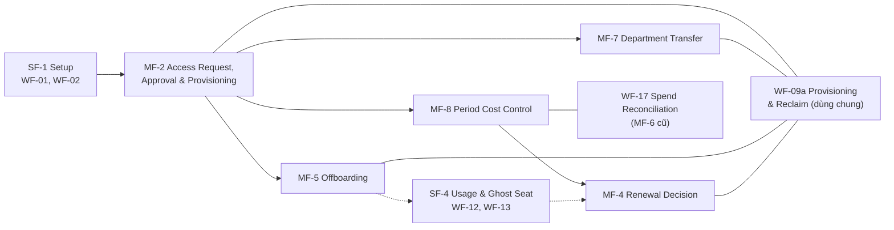

# Phân tích và chọn 5 main flow — sau Review 1

> **Phiên bản:** 1.1 — 09/10/2026 · **Người lập:** trợ lý (coordinator) theo yêu cầu của Owner · **Trạng thái:** phân tích xác nhận lại bộ `QĐ-49d` — Owner **không** đổi bộ năm main flow, nên giữ theo `QĐ-49d` mà không cần quyết định mới (mục 7); chưa phải xác nhận của GVHD/hội đồng. Mobile (`QĐ-61`) là kênh sử dụng, **không** thêm main flow.
>
> **Nguồn đọc:** BRD v3.29 (mục 2.2–2.4, 3, 4.1–4.6, 5.1–5.13), Định nghĩa phạm vi & nghiệp vụ v1.22 (Phần II–V), sổ quyết định `QĐ-49` → `QĐ-60`, `Requiments/REVIEW 1/Review 1.txt`. Thứ tự căn cứ: `QĐ` → BRD → sơ đồ.
>
> **Kết luận ngắn:** sau khi đánh giá lại từ đầu, bộ năm main flow của `QĐ-49d` **vẫn là bộ đúng nhất** theo nguồn hiện hành: **MF-2 → MF-7 → MF-5 → MF-8 → MF-4**. Phân tích dưới đây không giả định điều đó trước; nó chấm 18 ứng viên theo cùng tiêu chí và ghi rõ đánh đổi lớn nhất (PP-1/ghost seat không có main flow riêng).

## 1. Thế nào là một main flow

Một luồng được chọn làm main flow khi thỏa **cả năm** điều kiện:

| # | Điều kiện | Vì sao |
| --- | --- | --- |
| K1 | Có **kết quả nghiệp vụ riêng, quan sát/đo được** (một trạng thái của tổ chức thay đổi) | Phân biệt quy trình với chức năng CRUD hay màn hình xem |
| K2 | Có **trigger nghiệp vụ** từ sự kiện thật (nhu cầu, thay đổi nhân sự, lịch hợp đồng, kỳ kế toán) | Login, dashboard, cấu hình không có trigger nghiệp vụ |
| K3 | Có **chuyển giao giữa ít nhất hai vai** và ít nhất một **quyết định nghiệp vụ** | Main flow phải cho thấy phân tách trách nhiệm `SoD` |
| K4 | **Không phải bước con** của một ứng viên khác cùng danh sách | Tránh nâng một bước con thành main flow |
| K5 | Gắn với một **pain point** hoặc một **câu hỏi trực tiếp của hội đồng Review 1** | Main flow phải trả lời được "hệ thống giải quyết vấn đề gì" |

Ngoài ra bộ năm main flow phải **cùng cấp trừu tượng** và **phủ được phần lớn vòng đời** *xin → dùng → đổi → thôi → trả tiền → gia hạn*.

## 2. Danh sách ứng viên và đánh giá

| # | Ứng viên | Actor khởi phát → chịu trách nhiệm | Trigger | Kết quả cuối | Nguồn | K1 | K2 | K3 | K4 | K5 | Kết luận |
| --- | --- | --- | --- | --- | --- | --- | --- | --- | --- | --- | --- |
| C1 | Yêu cầu, phê duyệt và cấp quyền | Employee → trưởng phòng, IT Admin, Người duyệt chi | Nhân viên cần công cụ | Quyền được cấp / bị từ chối có lý do | FR-3.2→3.19, BRD 4.6, QĐ-52c, QĐ-53c | ✅ | ✅ | ✅ | ✅ | PP-5, P1-2, P2-4 | **Main flow — MF-2** |
| C2 | Điều chuyển phòng và điều chỉnh quyền | IT Admin → trưởng phòng mới | Nhân viên đổi phòng (ngày hiệu lực) | Quyền khớp nhu cầu phòng mới; chi phí chia theo ngày | FR-2.2, FR-3.8, FR-5.3, QĐ-50b, QĐ-55b, QĐ-56a | ✅ | ✅ | ✅ | ✅ | Review 1 Phần 3 | **Main flow — MF-7** |
| C3 | Nghỉ việc và thu hồi quyền | IT Admin → trưởng phòng | Bàn giao/nghỉ việc | Mọi quyền thu hồi, dữ liệu bàn giao, tài khoản khóa | FR-2.12, FR-8.9, BM-08, QĐ-56b/c | ✅ | ✅ | ✅ | ✅ | PP-1 (G2), Review 1 Phần 3 | **Main flow — MF-5** |
| C4 | Kiểm soát và phân bổ chi phí phần mềm theo kỳ | Finance → IT Admin, Người duyệt chi | Kỳ kế toán, hóa đơn/sao kê | Báo cáo kỳ theo chi phí thực chịu, chi phí về đúng Cost Center | FR-5.1→5.13, QĐ-49f/g, QĐ-50c, QĐ-55, QĐ-60 | ✅ | ✅ | ✅ | ✅ | PP-3, Review 1 Phần 2 (thuế) | **Main flow — MF-8** |
| C5 | Gia hạn, giảm số lượng hoặc hủy thuê bao | Hệ thống → IT Admin, Người duyệt chi | Mốc trước hạn chót báo hủy | Quyết định gia hạn/giảm/hủy trước hạn | FR-1.3, FR-1.4, FR-1.10, FR-3.13, FR-4.15, QĐ-49c | ✅ | ✅ | ✅ | ✅ | PP-2, Review 1 Phần 2 | **Main flow — MF-4** |
| C6 | Bằng chứng sử dụng và rà soát ghost seat | Automation → trưởng phòng, IT Admin | Rule định kỳ | Keep/Reclaim/Exempt có bằng chứng | FR-4.x, FR-3.10, OI-02 | ✅ | ✅ | ✅ | ✅ | PP-1, Review 1 Phần 4 | Đủ điều kiện nhưng **không chọn** — xem mục 3 → luồng hỗ trợ `SF-4` |
| C7 | Đối soát khoản chi và hợp thức hóa phần mềm ngoài danh mục | Finance/IT → Người duyệt chi | Nhập sao kê/hóa đơn | Ngoại lệ được quyết; phần mềm được hợp thức hóa hoặc thu hồi | FR-6.x, FR-3.4c-1, QĐ-31a, QĐ-33a | ✅ | ✅ | ✅ | ❌ — nhánh sao kê **của** C4 | PP-4 | **Luồng con của MF-8** (`QĐ-33a`, `QĐ-49d`) |
| C8 | Khởi tạo tổ chức và dữ liệu ban đầu | IT Admin, Finance | Triển khai hệ thống | Hệ thống có dữ liệu nền | FR-9.x, QĐ-52 | ✅ | ❌ chạy một lần | ⚠️ | ✅ | Không gắn pain point | **Chức năng nền `SF-1`** (`QĐ-49d`) |
| C9 | Khai báo danh mục, gói, thuê bao, điều khoản, kho khóa | IT Admin | Có phần mềm mới vào danh mục | Mục danh mục đầy đủ | FR-1.1→1.10, FR-2.10 | ⚠️ CRUD | ❌ | ❌ | ❌ — một bước của C1 (nhánh c) và C8 | — | Chức năng hỗ trợ `SF-1` |
| C10 | Đánh giá phần mềm mới (cổng mức kiểm soát) | IT Admin | Yêu cầu nhánh (c) | Đi tiếp / từ chối / đóng | FR-3.19, QĐ-53c | ✅ | — | ✅ | ❌ — bước của C1 | — | **Luồng con của MF-2** (WF-10) |
| C11 | Onboarding nhân viên mới | Trưởng phòng | Có người mới | Yêu cầu theo bộ công cụ chuẩn | FR-3.18, FR-2.11 | ⚠️ | ✅ | ✅ | ❌ — tạo yêu cầu của C1 | — | Hỗ trợ MF-2 (WF-04) |
| C12 | Hoàn trả quyền, gia hạn quyền có thời hạn | Employee/trưởng phòng | Hết nhu cầu, sắp hết hạn | Quyền thu hồi hoặc kéo dài | FR-3.2, FR-2.8 | ✅ | ✅ | ⚠️ | ❌ — loại yêu cầu của C1 | — | Hỗ trợ MF-2 (WF-11) |
| C13 | Đối soát nhà cung cấp và xử lý sai lệch | Automation → IT Admin | Job hằng ngày, hóa đơn lệch | Sai lệch được xử lý | FR-2.6, FR-7.7, QĐ-49f | ✅ | ✅ | ✅ | ❌ — bước của C4 (hóa đơn) và C1/C3 (tài khoản ngoài quy trình) | — | Workflow chi tiết của MF-8 (WF-16) |
| C14 | Đăng ký thiết bị và xác nhận theo dõi | IT Admin → Employee | Bàn giao máy | Thiết bị được nhận dữ liệu | FR-4.18, FR-4.21, BM-06 | ⚠️ | ✅ | ✅ | ❌ — điều kiện đầu vào của C6 | — | Hỗ trợ `SF-4` (WF-18); chi tiết bộ thu thập chờ giai đoạn Tools (`QĐ-59a`) |
| C15 | Lập ngân sách và gắn ngược khoản cam kết | Finance | Đầu kỳ ngân sách | Ngân sách có hiệu lực | FR-5.8a, INV-18 | ⚠️ | ✅ | ❌ một vai | ❌ — đầu vào của C4 | — | Hỗ trợ MF-8 (WF-20) |
| C16 | Quản trị tài khoản, vai trò, cấu hình | Super Admin | Nhu cầu quản trị | Cấu hình đổi | FR-8.x | ❌ CRUD kỹ thuật | ❌ | ❌ | — | — | Chức năng hỗ trợ `SF-2` (WF-03) |
| C17 | Quyền của chủ thể dữ liệu (xem, xuất, sửa, dừng) | Employee → IT Admin | Nhân viên gửi yêu cầu | Yêu cầu được xử lý đúng hạn | FR-10.x | ✅ | ✅ | ⚠️ | ✅ | Pháp lý, không phải pain point | Chức năng hỗ trợ (UF-03); không đủ trọng số main flow |
| C18 | Đăng nhập, xem dashboard, cảnh báo | Mọi vai | — | — | FR-8.6, FR-5.14 | ❌ | ❌ | ❌ | — | — | **Không** là luồng — chức năng nền |

`✅` đạt · `⚠️` đạt một phần · `❌` không đạt.

## 3. Vì sao chọn đúng năm luồng này, và đánh đổi lớn nhất

**Năm luồng được chọn phủ đủ vòng đời một quyền và một khoản chi**, cùng cấp trừu tượng (mỗi luồng là một quy trình nhiều vai có kết quả riêng):

1. **MF-2** — có quyền: con đường chính thức, xử lý nguyên nhân gốc của Shadow IT (PP-5).
2. **MF-7** — đổi phòng: hội đồng hỏi trực tiếp (Review 1 Phần 3); điều chuyển **không** phải thu hồi.
3. **MF-5** — thôi việc: vừa là chi phí vừa là lỗ hổng bảo mật; chạy chỉ bằng dữ liệu nội bộ (G2).
4. **MF-8** — trả tiền đúng chỗ: chi phí thực chịu, thuế ghi nhận, Cost Center đúng ngày (PP-3, câu hỏi thuế của hội đồng).
5. **MF-4** — gia hạn: thời điểm duy nhất tiết kiệm thành tiền thật (PP-2).

**Đánh đổi lớn nhất — PP-1 không có main flow riêng.** Ứng viên C6 (ghost seat, MF-3 cũ) đạt cả năm điều kiện và là điểm khác biệt của đề tài (TC-2: không báo động giả). Không chọn vì:

- `QĐ-49d` (Owner, 05/10/2026) đã đặt MF-3 ở phụ lục và chưa có quyết định thay;
- phương pháp thu thập usage **đang nghiên cứu lại** theo GVHD (`QĐ-57d`) và `QĐ-59a` chỉ cho vẽ nguồn usage ở mức nghiệp vụ — một main flow phụ thuộc phần chưa chốt sẽ phải vẽ lại sau giai đoạn Tools;
- hội đồng hỏi trực tiếp về điều chuyển và nghỉ việc (Phần 3) nhưng xếp usage là phần nghiên cứu sau.

PP-1 vẫn được thể hiện: nhóm G2 ngay trong **MF-5**, G1 và tiết kiệm tại kỳ gia hạn trong **MF-4**, chi tiết G1–G4 ở `WF-13` (`SF-4`). **Nếu Owner muốn đổi:** phương án thay thế duy nhất hợp lý là thay MF-7 bằng MF-3, vì MF-7 dùng lại nhiều bước của MF-2/MF-5. Đổi như vậy là **quyết định Owner mới** (sửa `QĐ-49d`), không tự áp dụng ở lượt này.

## 4. Quan hệ giữa main flow, luồng con và chức năng hỗ trợ

`WF-09a` (thực thi cấp/thu hồi) là **luồng con dùng chung** của MF-2, MF-7, MF-5, MF-4 — logic cấp/thu hồi chỉ vẽ một lần, các main flow gọi tới nó, không sao chép.

## 5. Ánh xạ mã cũ → mới

### 5.1. Main Business Flows (thư mục này)

| Mã cũ | Tên cũ | Vị trí mới | Ghi chú |
| --- | --- | --- | --- |
| MF-1 | Organization Setup | **SF-1** — chức năng nền; chi tiết `WF-01`, `WF-02` | `QĐ-49d`; mã MF-1 **ngừng dùng** cho main flow, không tái sử dụng |
| MF-2 | Access Request, Approval & Provisioning | **MF-2** (giữ mã) | Vẽ lại theo QĐ-52c, QĐ-53c, QĐ-54, QĐ-60a |
| MF-3 | Usage Evidence & Ghost Seat Review | **SF-4** — luồng hỗ trợ; chi tiết `WF-12`, `WF-12a`, `WF-13`, `WF-13a`, `WF-18` | Mã MF-3 vẫn được nhắc trong BRD/US như tên luồng nghiệp vụ; **không** còn hình main flow riêng |
| MF-4 | Contract Renewal & Savings | **MF-4** (giữ mã) | Vẽ lại; thêm rà điều khoản (FR-1.10), loại trừ license vĩnh viễn/nội bộ (QĐ-49c) |
| MF-5 | Offboarding & Access Reclaim | **MF-5** (giữ mã) | Vẽ lại theo QĐ-56b/c, BM-08 |
| MF-6 | Shadow IT Discovery & Legitimization | **Luồng con của MF-8** — `WF-17`, `WF-17a` | `QĐ-33a`: tính năng bổ sung *Đối soát chi phí phần mềm* |
| MF-7 | Employee Transfer & Access Adjustment | **MF-7** (giữ mã) | Vẽ lại theo phòng ban, bộ công cụ chuẩn, QĐ-55b, QĐ-56a |
| MF-8 | Period Software Cost Control | **MF-8** (giữ mã) | Vẽ lại theo QĐ-55, QĐ-60 (thuế ghi nhận, chi phí thực chịu) |

### 5.2. Bảng `MF-0` → `MF-5` cũ trong tài liệu User Flows nghiệp vụ

Tài liệu F-xx (nay là [business-flow-catalog.md](../user-flows/business-flow-catalog.md)) từng dùng **cùng ký hiệu `MF`** cho một bộ khác. Hai bộ **không cùng nghĩa**; bảng dưới tránh nhầm khi đọc tài liệu cũ.

| Mã trong F-xx | Nghĩa trong F-xx | Tương ứng hiện hành |
| --- | --- | --- |
| `MF-0` | Nền móng và quản trị | SF-1, SF-2 |
| `MF-1` | Vòng đời nhân sự | MF-7, MF-5, SF-3 |
| `MF-2` | Cấp quyền có kiểm soát | MF-2 |
| `MF-3` | Thu hồi lãng phí có bằng chứng | SF-4 |
| `MF-4` | Kiểm soát hợp đồng và kỳ gia hạn | MF-4 |
| `MF-5` | Minh bạch chi tiêu và phát hiện ngoài danh mục | MF-8 (+ WF-17) |

### 5.3. Nhóm chức năng hỗ trợ (mã mới, chỉ dùng trong bộ sơ đồ)

| Mã | Nhóm | Workflow |
| --- | --- | --- |
| SF-1 | Khởi tạo tổ chức, danh mục và dữ liệu ban đầu | WF-01, WF-02 |
| SF-2 | Quản trị hệ thống và audit | WF-03 |
| SF-3 | Biến động nhân sự khác (nghỉ dài, hết hạn hợp đồng có thời hạn) | WF-06, WF-08 |
| SF-4 | Bằng chứng sử dụng và tối ưu ghost seat | WF-12, WF-12a, WF-13, WF-13a, WF-14, WF-18 |

## 6. Phần không được nâng thành main flow, và lý do

- **Login, dashboard, cấu hình, CRUD danh mục** — không có kết quả nghiệp vụ riêng (K1, K2).
- **Đánh giá phần mềm mới, onboarding, hoàn trả** — là bước hoặc loại yêu cầu của MF-2 (K4).
- **Đối soát khoản chi / Shadow IT** — luồng con của MF-8 theo `QĐ-33a`; nguồn mới **không** nâng nó lên.
- **Không** thêm luồng rà soát/thanh lý phần mềm nội bộ (`QĐ-49d`), luồng thuế (hệ thống chỉ ghi nhận — `QĐ-55a`), luồng ngân hàng/kế toán (`QĐ-34`).

## 7. Điểm từng chờ Owner — đã đóng 09/10/2026

| # | Điểm | Đề xuất | Tác động nếu đổi |
| --- | --- | --- | --- |
| O-1 | Xác nhận giữ bộ `QĐ-49d` sau Review 1 | **Đóng — giữ `QĐ-49d`** (quyết định đang có hiệu lực; không cần hỏi lại chỉ để xác nhận) | Chỉ đổi khi có `QĐ` mới: thay MF-7 bằng MF-3 thì vẽ MF-3 ở mức nghiệp vụ, MF-7 thành workflow hỗ trợ |
| O-2 | Mã nhóm hỗ trợ `SF-1` → `SF-4` | **Đóng — nhãn nhóm trình bày của bộ sơ đồ**, giữ ánh xạ `MF-1`→`SF-1`, `MF-3`→`SF-4`, `MF-6`→`WF-17`/`WF-17a` (mục 5); **không** phải mã nghiệp vụ mới, BRD không đổi | Nếu Owner muốn BRD dùng cùng mã: sửa BRD 5.10 ở lượt riêng |
