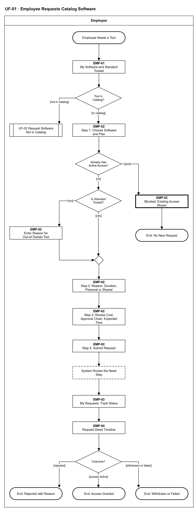

# UF-01 — Employee Requests Catalog Software

> **Loại:** User flow (mức màn hình) — Employee · **Phiên bản:** 1.2 — 10/10/2026 · **Trạng thái:** Vẽ lại theo BRD v3.30 (đồng bộ QĐ-61/QĐ-62) (bộ công cụ chuẩn, định tuyến theo trưởng phòng, Finance không nằm trên đường duyệt); mã màn hình là đề xuất — UI Spec hoãn tới giai đoạn Figma (QĐ-08)
>
> Sơ đồ là **dẫn xuất** từ quyết định Owner (`QĐ`) và BRD hiện hành; khi khác nhau, `QĐ` → BRD thắng. Quyết định trong sơ đồ là của Owner, **chưa** phải xác nhận của GVHD/hội đồng.

## 1. Mục đích và phạm vi

Hành trình của nhân viên khi xin một phần mềm **đã có trong danh mục**: thấy bộ công cụ chuẩn trước, điền phiếu BM-01, xem lại chi phí và chuỗi duyệt trước khi gửi, rồi theo dõi tới kết cục. Đây là phía người dùng của MF-2 (chuỗi demo D-1).

**Phạm vi:** Màn hình EMP-01 → EMP-04 và phản hồi hệ thống mà nhân viên nhìn thấy. Kênh: web và **ứng dụng mobile native** (QĐ-61b) với cùng quy tắc và phân quyền. Khác biệt thật trên mobile: chỉ hộp thông báo trong ứng dụng (không push, không offline — QĐ-61c), không tải tệp; các bước khác của luồng này chỉ trên web. Employee xem phần mềm và yêu cầu của mình, gửi hoặc rút yêu cầu đơn giản trên mobile.

**Không nằm trong sơ đồ này:** Các bước của trưởng phòng, IT, Người duyệt chi (→ UF-04, UF-08, UF-15); phần mềm chưa có trong danh mục (→ UF-02).

## 2. Tệp

| Tệp | Vai trò |
| --- | --- |
| [UF-01-employee-requests-catalog-software.drawio](UF-01-employee-requests-catalog-software.drawio) | Nguồn draw.io chỉnh sửa được (sinh từ spec) |
| [UF-01-employee-requests-catalog-software.drawio.png](UF-01-employee-requests-catalog-software.drawio.png) | Bản xuất PNG, nhúng sẵn nguồn draw.io |
| [UF-01.json](../specs/UF-01.json) | **Nguồn canonical** — sửa ở đây rồi chạy `python tools/flowkit.py build` từ `Docs/Diagrams` |

## 3. Nguồn nghiệp vụ

| Mã | Nội dung dùng trong sơ đồ |
| --- | --- |
| `FR-3.2, BM-01` | Nội dung phiếu yêu cầu |
| `FR-3.18, QĐ-52e` | Bộ công cụ chuẩn hiện trước; ngoài bộ chuẩn phải có lý do |
| `FR-3.3, FR-3.6, FR-3.12` | Định tuyến bước nhu cầu, chờ có kiểm soát |
| `FR-3.11, QĐ-29b, OI-06` | Thông báo trạng thái; Finance không có mốc chờ; rút yêu cầu |
| `FR-2.7, INV-02` | Không hai quyền chồng lấn trên cùng thuê bao |

## 4. Tác nhân, kích hoạt, điều kiện

| Làn (tiếng Anh trên hình) | Tác nhân | Trách nhiệm trong sơ đồ |
| --- | --- | --- |
| Employee | Employee | Thao tác trên các màn hình EMP-xx; bước hệ thống chỉ hiện kết quả |

- **Kích hoạt:** Nhân viên cần một công cụ.
- **Tiền điều kiện:** Nhân viên có tài khoản đã kích hoạt (UF-17) và thuộc một phòng.
- **Hậu điều kiện:** Một yêu cầu BM-01 được gửi và kết thúc bằng: có quyền · bị từ chối · rút · cấp phát thất bại; hoặc không tạo yêu cầu vì đã có quyền.

## 5. Cách đọc ký hiệu

| Ký hiệu | Nghĩa |
| --- | --- |
| Hình chữ nhật bo tròn hai đầu, viền đậm | Điểm bắt đầu hoặc kết cục của hành trình |
| Hình chữ nhật viền liền, dòng đầu in đậm | Màn hình người dùng thao tác; dòng đầu là mã màn hình đề xuất |
| Hình chữ nhật viền nét đứt | Hệ thống tự xử lý; người dùng chỉ thấy kết quả |
| Hình chữ nhật viền rất đậm | Màn hình chặn hoặc trạng thái lỗi |
| Hình thoi | Rẽ nhánh; cạnh ra mang điều kiện `[...]` |
| Hình chữ nhật hai vạch đứng | Gọi user flow khác (mã `UF-xx` trong nhãn); có cạnh ra thì hành trình quay lại và đi tiếp, không có cạnh ra thì sơ đồ này dừng tại đó |
| Dây có cung nhảy | Hai dây giao nhau nhưng **không** nối với nhau |

Đọc từ trên xuống. Mỗi hình chữ nhật viền liền là một màn hình (dòng đầu là mã màn hình đề xuất), nét đứt là bước hệ thống tự xử lý, viền rất đậm là màn hình chặn.

## 6. Bảng node

| ID | Loại | Nhãn trên hình | Ý nghĩa | Làn / người thực hiện | Quy tắc |
| --- | --- | --- | --- | --- | --- |
| `t_start` | Điểm đầu/cuối | Employee Needs a Tool | Nhân viên cần một công cụ cho công việc. | Employee | — |
| `s_mine` | Màn hình | EMP-01 — My Software and Standard Toolset | Danh sách phần mềm đang được cấp và bộ công cụ chuẩn của phòng × chức vụ (hiện trước). | Employee | `FR-10.1`, `FR-3.18` |
| `d_cat` | Rẽ nhánh | Tool in Catalog? | Phần mềm cần dùng có trong danh mục không. | Employee | — |
| `r_uf02` | Chuyển sang user flow khác | UF-02 Request Software Not in Catalog | Chuyển sang luồng xin phần mềm chưa có trong danh mục. | Employee | → `UF-02` |
| `s_pick` | Màn hình | EMP-02 — Step 1: Choose Software and Plan | Chọn phần mềm và gói; nhãn tình trạng seat hiện ngay. | Employee | `FR-3.2`, `BM-01` |
| `d_has` | Rẽ nhánh | Already Has Active Access? | Nhân viên đã có quyền đang hiệu lực cho phần mềm này chưa. | Employee | `FR-2.7` |
| `b_has` | Màn hình chặn/lỗi | EMP-02 — Blocked: Existing Access Shown | Chặn tạo yêu cầu trùng; hiện quyền đang có và ngày cấp. | Employee | `FR-2.7`, `INV-02` |
| `t_none` | Điểm đầu/cuối | End: No New Request | Không tạo yêu cầu mới. | Employee | — |
| `d_set` | Rẽ nhánh | In Standard Toolset? | Phần mềm có thuộc bộ công cụ chuẩn của phòng × chức vụ không. | Employee | `FR-3.18` |
| `s_why` | Màn hình | EMP-02 — Enter Reason for Out-of-Toolset Tool | Ngoài bộ chuẩn bắt buộc ghi lý do; yêu cầu được gắn cờ cho trưởng phòng. | Employee | `FR-3.18`, `QĐ-52e` |
| `m_set` | Hợp nhánh | — | — | Employee | — |
| `s_detail` | Màn hình | EMP-02 — Step 2: Reason, Duration, Personal or Shared | Lý do nghiệp vụ, thời hạn cần dùng, dùng cá nhân hay tài khoản dùng chung, dự án liên quan (chỉ ngữ cảnh). Cost Center lấy theo phòng của nhân viên. Gói cấm chia sẻ tài khoản thì không xin được kiểu dùng chung — yêu cầu bị từ chối ở bước đánh giá của IT (FR-2.11); chuyển sang cấp cá nhân là yêu cầu mới, định tuyến lại theo FR-3.4. | Employee | `FR-3.2`, `BM-01`, `FR-2.11` |
| `s_review` | Màn hình | EMP-02 — Step 3: Review Cost, Approval Chain, Expected Time | Xem lại trước khi gửi: chi phí ước tính (nếu phải mua thêm), chuỗi người duyệt dự kiến (trưởng phòng; thêm Người duyệt chi khi phát sinh chi phí) và thời gian dự kiến theo SLA. | Employee | `FR-3.4`, `FR-3.8`, `FR-5.13` |
| `s_submit` | Màn hình | EMP-02 — Step 4: Submit Request | Gửi phiếu BM-01. | Employee | `BM-01` |
| `y_route` | Hệ thống xử lý | System Routes the Need Step | Hệ thống gán bước nhu cầu cho trưởng phòng (hoặc theo FR-3.3/FR-3.6); hết người duyệt hợp lệ ⟹ yêu cầu chờ có kiểm soát, nhân viên thấy trạng thái chờ. | Employee | `FR-3.3`, `FR-3.6`, `FR-3.12` |
| `s_track` | Màn hình | EMP-03 — My Requests: Track Status | Danh sách yêu cầu và trạng thái. | Employee | `FR-3.11` |
| `s_time` | Màn hình | EMP-04 — Request Detail Timeline | Mốc theo tuyến thực tế: chờ trưởng phòng · chờ Người duyệt chi (chỉ khi có chi phí) · đang cấp phát · hoàn tất. Finance không có mốc chờ vì không nằm trên đường duyệt. Rút được tới khi tác vụ cấp phát còn chờ. | Employee | `FR-3.11`, `QĐ-29b`, `OI-06` |
| `d_res` | Rẽ nhánh | Outcome? | Kết cục của yêu cầu. | Employee | — |
| `t_ok` | Điểm đầu/cuối | End: Access Granted | Đã có quyền truy cập trên tài khoản công ty. | Employee | — |
| `t_rej` | Điểm đầu/cuối | End: Rejected with Reason | Bị từ chối ở bước nhu cầu hoặc bước chi, kèm lý do. | Employee | — |
| `t_wd` | Điểm đầu/cuối | End: Withdrawn or Failed | Nhân viên tự rút yêu cầu, hoặc cấp phát thất bại — nhân viên vẫn được báo. | Employee | — |

## 7. Bảng chuyển tiếp

| Từ → tới | Nhãn điều kiện | Điều kiện | Kết quả |
| --- | --- | --- | --- |
| `t_start` → `s_mine` | — | — | Sang EMP-01 — My Software and Standard Toolset |
| `s_mine` → `d_cat` | — | — | Sang Tool in Catalog? |
| `d_cat` → `r_uf02` | `[not in catalog]` | Không tìm thấy trong danh mục | Sang UF-02 |
| `d_cat` → `s_pick` | `[in catalog]` | Có trong danh mục | Chọn phần mềm |
| `s_pick` → `d_has` | — | — | Sang Already Has Active Access? |
| `d_has` → `b_has` | `[yes]` | Đã có quyền đang hiệu lực | Chặn |
| `d_has` → `d_set` | `[no]` | Chưa có | Kiểm bộ chuẩn |
| `b_has` → `t_none` | — | — | Sang End: No New Request |
| `d_set` → `s_why` | `[no]` | Ngoài bộ chuẩn | Nhập lý do |
| `d_set` → `m_set` | `[yes]` | Trong bộ chuẩn | Đi tiếp |
| `s_why` → `m_set` | — | — | Sang — |
| `m_set` → `s_detail` | — | — | Sang EMP-02 — Step 2: Reason, Duration, Personal or Shared |
| `s_detail` → `s_review` | — | — | Sang EMP-02 — Step 3: Review Cost, Approval Chain, Expected Time |
| `s_review` → `s_submit` | — | — | Sang EMP-02 — Step 4: Submit Request |
| `s_submit` → `y_route` | — | — | Sang System Routes the Need Step |
| `y_route` → `s_track` | — | — | Sang EMP-03 — My Requests: Track Status |
| `s_track` → `s_time` | — | — | Sang EMP-04 — Request Detail Timeline |
| `s_time` → `d_res` | — | — | Sang Outcome? |
| `d_res` → `t_ok` | `[access active]` | Cấp phát hoàn tất | Có quyền |
| `d_res` → `t_rej` | `[rejected]` | Bị từ chối | Kết thúc kèm lý do |
| `d_res` → `t_wd` | `[withdrawn or failed]` | Nhân viên rút, hoặc cấp phát thất bại | Kết thúc, có thông báo |

Số đếm: **21 node · 21 cạnh · 4 rẽ nhánh**; giao cắt dây: **0**.

## 8. Happy path

1. `t_start` — Employee Needs a Tool: Nhân viên cần một công cụ cho công việc.
2. `s_mine` — EMP-01 — My Software and Standard Toolset: Danh sách phần mềm đang được cấp và bộ công cụ chuẩn của phòng × chức vụ (hiện trước).
3. `d_cat` — Tool in Catalog?: Phần mềm cần dùng có trong danh mục không.
4. `s_pick` — EMP-02 — Step 1: Choose Software and Plan: Chọn phần mềm và gói; nhãn tình trạng seat hiện ngay.
5. `d_has` — Already Has Active Access?: Nhân viên đã có quyền đang hiệu lực cho phần mềm này chưa.
6. `d_set` — In Standard Toolset?: Phần mềm có thuộc bộ công cụ chuẩn của phòng × chức vụ không.
7. `s_detail` — EMP-02 — Step 2: Reason, Duration, Personal or Shared: Lý do nghiệp vụ, thời hạn cần dùng, dùng cá nhân hay tài khoản dùng chung, dự án liên quan (chỉ ngữ cảnh). Cost Center lấy theo phòng của nhân viên. Gói cấm chia sẻ tài khoản thì không xin được kiểu dùng chung — yêu cầu bị từ chối ở bước đánh giá của IT (FR-2.11); chuyển sang cấp cá nhân là yêu cầu mới, định tuyến lại theo FR-3.4.
8. `s_review` — EMP-02 — Step 3: Review Cost, Approval Chain, Expected Time: Xem lại trước khi gửi: chi phí ước tính (nếu phải mua thêm), chuỗi người duyệt dự kiến (trưởng phòng; thêm Người duyệt chi khi phát sinh chi phí) và thời gian dự kiến theo SLA.
9. `s_submit` — EMP-02 — Step 4: Submit Request: Gửi phiếu BM-01.
10. `y_route` — System Routes the Need Step: Hệ thống gán bước nhu cầu cho trưởng phòng (hoặc theo FR-3.3/FR-3.6); hết người duyệt hợp lệ ⟹ yêu cầu chờ có kiểm soát, nhân viên thấy trạng thái chờ.
11. `s_track` — EMP-03 — My Requests: Track Status: Danh sách yêu cầu và trạng thái.
12. `s_time` — EMP-04 — Request Detail Timeline: Mốc theo tuyến thực tế: chờ trưởng phòng · chờ Người duyệt chi (chỉ khi có chi phí) · đang cấp phát · hoàn tất. Finance không có mốc chờ vì không nằm trên đường duyệt. Rút được tới khi tác vụ cấp phát còn chờ.
13. `d_res` — Outcome?: Kết cục của yêu cầu.
14. `t_ok` — End: Access Granted: Đã có quyền truy cập trên tài khoản công ty.

## 9. Nhánh thay thế / if-else

- **Ngoài bộ công cụ chuẩn** — `d_set` → `s_why` → `m_set`. Lý do bắt buộc; trưởng phòng thấy cờ.
- **Chưa có trong danh mục** — `d_cat` → `r_uf02`. Phạm vi sơ đồ dừng ở đây.

## 10. Nhánh lỗi / từ chối và cách kết thúc

- **Đã có quyền** — `d_has` → `b_has` → `t_none`. Không tạo yêu cầu trùng.
- **Bị từ chối** — `d_res` → `t_rej`. Lý do hiện ở chi tiết yêu cầu.
- **Rút hoặc cấp phát lỗi** — `d_res` → `t_wd`. Cấp phát lỗi vẫn báo người yêu cầu.

## 11. Liên hệ với sơ đồ khác

- Workflow: `MF-2`, `WF-09`
- `UF-02` (chưa có trong danh mục), `UF-04` (trưởng phòng duyệt), `UF-08` (IT cấp phát), `UF-15` (Người duyệt chi)
- `UF-02` — gọi/chuyển tại node `r_uf02`

## 12. Giới hạn và vấn đề còn mở

- (LATER-TECH/UI · DOI-01, QĐ-08) Mã màn hình EMP-xx là đề xuất, chưa có UI Spec hiện hành.
