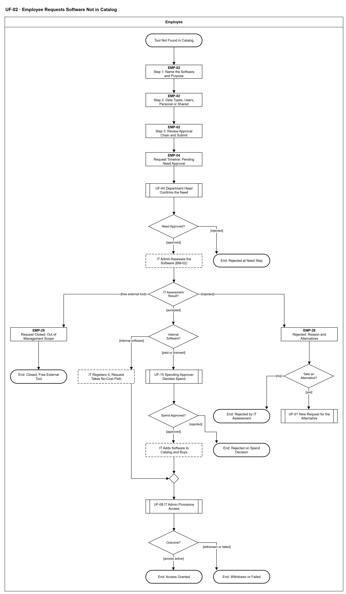

# UF-02 — Employee Requests Software Not in Catalog

> **Loại:** User flow (mức màn hình) — Employee · **Phiên bản:** 1.1 — 09/10/2026 · **Trạng thái:** Vẽ lại theo BRD v3.30 (đồng bộ QĐ-61/QĐ-62) và QĐ-49h, QĐ-50a, QĐ-53c, QĐ-54d (đánh giá phần mềm mới, cổng mức kiểm soát, phần mềm nội bộ, tài khoản dùng chung); mã màn hình là đề xuất — UI Spec hoãn tới giai đoạn Figma (QĐ-08); chờ Owner/GVHD review
>
> Sơ đồ là **dẫn xuất** từ quyết định Owner (`QĐ`) và BRD hiện hành; khi khác nhau, `QĐ` → BRD thắng. Quyết định trong sơ đồ là của Owner, **chưa** phải xác nhận của GVHD/hội đồng.

## 1. Mục đích và phạm vi

Hành trình của nhân viên khi cần một phần mềm **chưa có trong danh mục** (nhánh (c) của FR-3.4): khai nhu cầu trong BM-02, chờ trưởng phòng xác nhận, rồi thấy kết quả đánh giá của IT — đóng vì là công cụ miễn phí bên ngoài, bị từ chối ở cổng mức kiểm soát hoặc chính sách chia sẻ, đăng ký là phần mềm nội bộ, hoặc đi tiếp tới Người duyệt chi. Đây là phía người dùng của WF-09 (nhánh c) và WF-10, thuộc MF-2.

**Phạm vi:** Màn hình EMP-02 (phiếu), EMP-04 (dòng thời gian), EMP-25 và EMP-26 (kết quả đánh giá) cùng phản hồi hệ thống mà nhân viên nhìn thấy, từ lúc không tìm thấy công cụ tới khi có quyền, bị từ chối, bị đóng hoặc rút.

**Không nằm trong sơ đồ này:** Việc của trưởng phòng (→ UF-04), IT đánh giá chi tiết và cấp phát (→ WF-10, UF-08), Người duyệt chi (→ UF-15), Finance ghi nhận ngân sách (→ UF-11); hợp thức hóa phần mềm phát hiện từ sao kê (→ WF-17, UF-12, không có cổng từ chối mức kiểm soát); bước mua chi tiết.

## 2. Tệp

| Tệp | Vai trò |
| --- | --- |
| [UF-02-employee-requests-software-not-in-catalog.drawio](UF-02-employee-requests-software-not-in-catalog.drawio) | Nguồn draw.io chỉnh sửa được (sinh từ spec) |
| [UF-02-employee-requests-software-not-in-catalog.drawio.png](UF-02-employee-requests-software-not-in-catalog.drawio.png) | Bản xuất PNG, nhúng sẵn nguồn draw.io |
| [UF-02.json](../specs/UF-02.json) | **Nguồn canonical** — sửa ở đây rồi chạy `python tools/flowkit.py build` từ `Docs/Diagrams` |

## 3. Nguồn nghiệp vụ

| Mã | Nội dung dùng trong sơ đồ |
| --- | --- |
| `FR-3.4 (c), các đường đặc biệt 1–4` | Nhánh phần mềm chưa có trong danh mục; công cụ miễn phí; phần mềm nội bộ; cổng mức kiểm soát; tài khoản dùng chung |
| `FR-3.19, QĐ-53c, QĐ-58d` | Cổng mức kiểm soát: không kiểm soát được thì IT từ chối ngay, báo Employee và trưởng phòng kèm lý do và phương án thay thế |
| `QĐ-49a, QĐ-49h` | Phần mềm miễn phí bên ngoài không phải đối tượng quản lý; IT đóng yêu cầu |
| `QĐ-50a, FR-1.1, FR-1.7` | Phần mềm nội bộ do IT đăng ký cùng Business Owner, không qua Người duyệt chi |
| `FR-2.11, QĐ-54d` | Tài khoản dùng chung chỉ khi chính sách chia sẻ của gói cho phép |
| `FR-3.3, FR-3.5, QĐ-52c` | Bước nhu cầu do trưởng phòng, không ủy quyền duyệt |
| `FR-3.11, FR-3.12, OI-06` | Thông báo trạng thái, chờ có kiểm soát, rút yêu cầu |
| `BM-02` | Đề xuất mua phần mềm mới: nhân viên khai nhu cầu, IT hoàn thiện đánh giá |

## 4. Tác nhân, kích hoạt, điều kiện

| Làn (tiếng Anh trên hình) | Tác nhân | Trách nhiệm trong sơ đồ |
| --- | --- | --- |
| Employee | Employee | Thao tác trên các màn hình EMP-xx; bước của trưởng phòng, IT, Người duyệt chi chỉ hiện dưới dạng trạng thái hoặc tham chiếu sang UF khác |

- **Kích hoạt:** Nhân viên không thấy công cụ cần dùng trong danh mục (đường 'không có trong danh mục' của UF-01).
- **Tiền điều kiện:** Nhân viên có tài khoản đã kích hoạt (UF-17), thuộc một phòng; đã tìm trong danh mục và không thấy.
- **Hậu điều kiện:** Một yêu cầu kết thúc bằng: có quyền · bị từ chối ở bước nhu cầu · bị đóng (công cụ miễn phí bên ngoài) · bị IT từ chối kèm phương án thay thế · bị Người duyệt chi từ chối · rút hoặc cấp phát thất bại.

## 5. Cách đọc ký hiệu

| Ký hiệu | Nghĩa |
| --- | --- |
| Hình chữ nhật bo tròn hai đầu, viền đậm | Điểm bắt đầu hoặc kết cục của hành trình |
| Hình chữ nhật viền liền, dòng đầu in đậm | Màn hình người dùng thao tác; dòng đầu là mã màn hình đề xuất |
| Hình chữ nhật viền nét đứt | Hệ thống tự xử lý; người dùng chỉ thấy kết quả |
| Hình thoi | Rẽ nhánh; cạnh ra mang điều kiện `[...]` |
| Hình chữ nhật hai vạch đứng | Gọi user flow khác (mã `UF-xx` trong nhãn); có cạnh ra thì hành trình quay lại và đi tiếp, không có cạnh ra thì sơ đồ này dừng tại đó |
| Dây có cung nhảy | Hai dây giao nhau nhưng **không** nối với nhau |

Đọc từ trên xuống. Hình chữ nhật viền liền là màn hình (dòng đầu là mã màn hình đề xuất), nét đứt là bước hệ thống hoặc vai khác mà nhân viên chỉ thấy trạng thái, hai vạch đứng là chuyển sang user flow khác. Nhánh trái là đóng yêu cầu, nhánh phải là từ chối của IT; đường đi tiếp nằm ở giữa.

## 6. Bảng node

| ID | Loại | Nhãn trên hình | Ý nghĩa | Làn / người thực hiện | Quy tắc |
| --- | --- | --- | --- | --- | --- |
| `t_start` | Điểm đầu/cuối | Tool Not Found in Catalog | Nhân viên tìm công cụ cần dùng trong danh mục (UF-01) nhưng không thấy. | Employee | — |
| `s_form` | Màn hình | EMP-02 — Step 1: Name the Software and Purpose | Khai tên phần mềm, trang chủ nhà cung cấp, lý do nghiệp vụ và thời hạn cần dùng. Phần của nhân viên trong phiếu BM-02; phần còn lại do IT hoàn thiện ở bước đánh giá. | Employee | `FR-3.2`, `BM-01`, `BM-02` |
| `s_data` | Màn hình | EMP-02 — Step 2: Data Types, Users, Personal or Shared | Loại dữ liệu sẽ đưa vào phần mềm, số người dùng, dùng tài khoản cá nhân hay tài khoản dùng chung (chỉ được chấp nhận khi chính sách chia sẻ của gói cho phép — IT kiểm ở bước đánh giá). | Employee | `BM-02`, `FR-2.11`, `QĐ-54d` |
| `s_review` | Màn hình | EMP-02 — Step 3: Review Approval Chain and Submit | Xem lại trước khi gửi: chuỗi duyệt dự kiến của nhánh (c) — trưởng phòng, IT đánh giá, và Người duyệt chi nếu là phần mềm trả phí/có bản quyền. Chi phí ước tính do IT điền ở bước đánh giá, nhân viên không phải khai giá. Gửi phiếu. | Employee | `FR-3.4`, `FR-3.8`, `FR-3.11` |
| `s_time` | Màn hình | EMP-04 — Request Timeline: Pending Need Approval | Chi tiết yêu cầu với mốc theo tuyến thực tế; thông báo trạng thái trong ứng dụng. Hết người duyệt hợp lệ thì yêu cầu chờ có kiểm soát và nhân viên thấy trạng thái chờ. Rút được tới khi tác vụ cấp phát còn chờ thực thi. Finance không có mốc chờ. | Employee | `FR-3.11`, `FR-3.12`, `QĐ-29b`, `OI-06` |
| `r_uf04` | Chuyển sang user flow khác | UF-04 Department Head Confirms the Need | Trưởng phòng xác nhận nhu cầu nghiệp vụ trước khi IT đánh giá (không ủy quyền duyệt). | Employee | `FR-3.3`, `QĐ-52c`, `FR-3.5`, → `UF-04` |
| `d_need` | Rẽ nhánh | Need Approved? | Trưởng phòng xác nhận hay từ chối nhu cầu. | Employee | — |
| `t_rneed` | Điểm đầu/cuối | End: Rejected at Need Step | Bị từ chối ở bước nhu cầu, nhân viên được báo kèm lý do. | Employee | — |
| `y_it` | Hệ thống xử lý | IT Admin Assesses the Software (BM-02) | IT Admin hoàn thiện BM-02: phân loại phần mềm, mức kiểm soát, chính sách chia sẻ. Nhân viên chỉ thấy trạng thái đang đánh giá trên EMP-04. Bước của IT thuộc WF-10. | Employee | `FR-3.19`, `BM-02`, `FR-1.9`, `FR-1.10` |
| `d_ass` | Rẽ nhánh | IT Assessment Result? | Kết quả đánh giá của IT trả về WF-09: đóng vì công cụ miễn phí bên ngoài, từ chối (không kiểm soát được hoặc gói cấm chia sẻ), hoặc chấp nhận đi tiếp. | Employee | `QĐ-49h`, `FR-3.19`, `FR-2.11` |
| `s_closed` | Màn hình | EMP-25 — Request Closed: Out of Management Scope | Hiện lý do đóng: phần mềm miễn phí bên ngoài, ngoài phạm vi quản lý, kèm hướng dẫn theo chính sách công ty. Đây là đóng yêu cầu, không phải từ chối nghiệp vụ. | Employee | `QĐ-49a`, `QĐ-49h`, `FR-3.4` |
| `t_closed` | Điểm đầu/cuối | End: Closed, Free External Tool | Yêu cầu đóng; không qua Người duyệt chi, không thêm vào danh mục. | Employee | — |
| `s_rej` | Màn hình | EMP-26 — Rejected: Reason and Alternatives | Nhân viên và trưởng phòng nhận thông báo từ chối của IT: lý do bắt buộc và gợi ý phương án thay thế (gói kiểm soát được, gói cho phép chia sẻ, hoặc công cụ có trong danh mục). | Employee | `FR-3.19`, `QĐ-53c`, `FR-2.11` |
| `d_alt` | Rẽ nhánh | Take an Alternative? | Nhân viên có chọn phương án thay thế để gửi yêu cầu mới hay không. | Employee | — |
| `r_uf01` | Chuyển sang user flow khác | UF-01 New Request for the Alternative | Gửi yêu cầu mới cho phương án thay thế. | Employee | `FR-3.19`, → `UF-01` |
| `t_rej` | Điểm đầu/cuối | End: Rejected by IT Assessment | Kết thúc, không tới Người duyệt chi; nhân viên đã nhận lý do. | Employee | — |
| `d_path` | Rẽ nhánh | Internal Software? | Phần mềm do công ty tự xây dựng hay là SaaS trả phí/phần mềm thương mại có bản quyền. | Employee | `QĐ-49a`, `QĐ-50a` |
| `y_int` | Hệ thống xử lý | IT Registers It; Request Takes No-Cost Path | IT đăng ký phần mềm nội bộ vào danh mục cùng Business Owner; không có Người duyệt chi, không khoản cam kết; IT cấp thủ công kèm bằng chứng. | Employee | `QĐ-50a`, `FR-1.1`, `FR-1.7`, `FR-3.4` |
| `r_uf15` | Chuyển sang user flow khác | UF-15 Spending Approver Decides Spend | Phần mềm trả phí/có bản quyền mới luôn cần Người duyệt chi; người này thấy mức kiểm soát, rủi ro và chi phí ước tính. | Employee | `FR-3.4`, `FR-3.13`, `FR-3.14`, `QĐ-22`, → `UF-15` |
| `d_spend` | Rẽ nhánh | Spend Approved? | Người duyệt chi duyệt hay từ chối khoản chi và việc đưa phần mềm vào danh mục. | Employee | — |
| `t_spend` | Điểm đầu/cuối | End: Rejected on Spend Decision | Bị từ chối ở bước duyệt chi, nhân viên được báo; không có khoản cam kết. | Employee | — |
| `y_buy` | Hệ thống xử lý | IT Adds Software to Catalog and Buys | Sau khi được duyệt, IT thêm phần mềm vào danh mục và mua; khoản cam kết và Finance ghi nhận chạy song song, không chặn cấp quyền. | Employee | `FR-3.4`, `BM-05`, `FR-5.8`, `QĐ-29b` |
| `m_exec` | Hợp nhánh | — | — | Employee | — |
| `r_uf08` | Chuyển sang user flow khác | UF-08 IT Admin Provisions Access | IT cấp quyền theo kiểu cấp của gói, chỉ trên tài khoản email công ty. | Employee | `FR-2.5`, `FR-2.9`, → `UF-08` |
| `d_res` | Rẽ nhánh | Outcome? | Kết cục của yêu cầu sau khi cấp phát. | Employee | — |
| `t_ok` | Điểm đầu/cuối | End: Access Granted | Phần mềm đã vào danh mục (hoặc đã đăng ký là nội bộ) và nhân viên có quyền trên tài khoản công ty. | Employee | — |
| `t_fail` | Điểm đầu/cuối | End: Withdrawn or Failed | Nhân viên tự rút (tới khi tác vụ cấp phát còn chờ), hoặc cấp phát thất bại; nhân viên vẫn được báo. | Employee | `OI-06` |

## 7. Bảng chuyển tiếp

| Từ → tới | Nhãn điều kiện | Điều kiện | Kết quả |
| --- | --- | --- | --- |
| `t_start` → `s_form` | — | — | Sang EMP-02 — Step 1: Name the Software and Purpose |
| `s_form` → `s_data` | — | — | Sang EMP-02 — Step 2: Data Types, Users, Personal or Shared |
| `s_data` → `s_review` | — | — | Sang EMP-02 — Step 3: Review Approval Chain and Submit |
| `s_review` → `s_time` | — | — | Sang EMP-04 — Request Timeline: Pending Need Approval |
| `s_time` → `r_uf04` | — | — | Sang UF-04 Department Head Confirms the Need |
| `r_uf04` → `d_need` | — | — | Sang Need Approved? |
| `d_need` → `y_it` | `[approved]` | Trưởng phòng xác nhận nhu cầu | IT đánh giá |
| `d_need` → `t_rneed` | `[rejected]` | Trưởng phòng từ chối nhu cầu | Kết thúc kèm lý do |
| `y_it` → `d_ass` | — | — | Sang IT Assessment Result? |
| `d_ass` → `s_closed` | `[free external tool]` | Phần mềm miễn phí bên ngoài | IT đóng yêu cầu |
| `d_ass` → `s_rej` | `[rejected]` | Không kiểm soát được, hoặc gói cấm chia sẻ mà yêu cầu dùng chung | IT từ chối kèm phương án thay thế |
| `d_ass` → `d_path` | `[accepted]` | Kiểm soát Đầy đủ hoặc Một phần, chia sẻ hợp lệ | Phân loại nội bộ hay trả phí |
| `s_closed` → `t_closed` | — | — | Sang End: Closed, Free External Tool |
| `s_rej` → `d_alt` | — | — | Sang Take an Alternative? |
| `d_alt` → `r_uf01` | `[yes]` | Chọn phương án thay thế | Gửi yêu cầu mới |
| `d_alt` → `t_rej` | `[no]` | Không chọn phương án nào | Kết thúc |
| `d_path` → `y_int` | `[internal software]` | Phần mềm do công ty tự xây dựng | Đường không phí |
| `d_path` → `r_uf15` | `[paid or licensed]` | SaaS trả phí hoặc phần mềm có bản quyền | Tới Người duyệt chi |
| `r_uf15` → `d_spend` | — | — | Sang Spend Approved? |
| `d_spend` → `y_buy` | `[approved]` | Người duyệt chi duyệt | IT mua và thêm vào danh mục |
| `d_spend` → `t_spend` | `[rejected]` | Người duyệt chi từ chối | Kết thúc kèm lý do |
| `y_buy` → `m_exec` | — | — | Sang — |
| `y_int` → `m_exec` | — | — | Sang — |
| `m_exec` → `r_uf08` | — | — | Sang UF-08 IT Admin Provisions Access |
| `r_uf08` → `d_res` | — | — | Sang Outcome? |
| `d_res` → `t_ok` | `[access active]` | Cấp phát hoàn tất | Có quyền |
| `d_res` → `t_fail` | `[withdrawn or failed]` | Nhân viên rút, hoặc cấp phát thất bại | Kết thúc, có thông báo |

Số đếm: **27 node · 27 cạnh · 6 rẽ nhánh**; giao cắt dây: **0**.

## 8. Happy path

1. `t_start` — Tool Not Found in Catalog: Nhân viên tìm công cụ cần dùng trong danh mục (UF-01) nhưng không thấy.
2. `s_form` — EMP-02 — Step 1: Name the Software and Purpose: Khai tên phần mềm, trang chủ nhà cung cấp, lý do nghiệp vụ và thời hạn cần dùng. Phần của nhân viên trong phiếu BM-02; phần còn lại do IT hoàn thiện ở bước đánh giá.
3. `s_data` — EMP-02 — Step 2: Data Types, Users, Personal or Shared: Loại dữ liệu sẽ đưa vào phần mềm, số người dùng, dùng tài khoản cá nhân hay tài khoản dùng chung (chỉ được chấp nhận khi chính sách chia sẻ của gói cho phép — IT kiểm ở bước đánh giá).
4. `s_review` — EMP-02 — Step 3: Review Approval Chain and Submit: Xem lại trước khi gửi: chuỗi duyệt dự kiến của nhánh (c) — trưởng phòng, IT đánh giá, và Người duyệt chi nếu là phần mềm trả phí/có bản quyền. Chi phí ước tính do IT điền ở bước đánh giá, nhân viên không phải khai giá. Gửi phiếu.
5. `s_time` — EMP-04 — Request Timeline: Pending Need Approval: Chi tiết yêu cầu với mốc theo tuyến thực tế; thông báo trạng thái trong ứng dụng. Hết người duyệt hợp lệ thì yêu cầu chờ có kiểm soát và nhân viên thấy trạng thái chờ. Rút được tới khi tác vụ cấp phát còn chờ thực thi. Finance không có mốc chờ.
6. `r_uf04` — UF-04 Department Head Confirms the Need: Trưởng phòng xác nhận nhu cầu nghiệp vụ trước khi IT đánh giá (không ủy quyền duyệt).
7. `d_need` — Need Approved?: Trưởng phòng xác nhận hay từ chối nhu cầu.
8. `y_it` — IT Admin Assesses the Software (BM-02): IT Admin hoàn thiện BM-02: phân loại phần mềm, mức kiểm soát, chính sách chia sẻ. Nhân viên chỉ thấy trạng thái đang đánh giá trên EMP-04. Bước của IT thuộc WF-10.
9. `d_ass` — IT Assessment Result?: Kết quả đánh giá của IT trả về WF-09: đóng vì công cụ miễn phí bên ngoài, từ chối (không kiểm soát được hoặc gói cấm chia sẻ), hoặc chấp nhận đi tiếp.
10. `d_path` — Internal Software?: Phần mềm do công ty tự xây dựng hay là SaaS trả phí/phần mềm thương mại có bản quyền.
11. `r_uf15` — UF-15 Spending Approver Decides Spend: Phần mềm trả phí/có bản quyền mới luôn cần Người duyệt chi; người này thấy mức kiểm soát, rủi ro và chi phí ước tính.
12. `d_spend` — Spend Approved?: Người duyệt chi duyệt hay từ chối khoản chi và việc đưa phần mềm vào danh mục.
13. `y_buy` — IT Adds Software to Catalog and Buys: Sau khi được duyệt, IT thêm phần mềm vào danh mục và mua; khoản cam kết và Finance ghi nhận chạy song song, không chặn cấp quyền.
14. `r_uf08` — UF-08 IT Admin Provisions Access: IT cấp quyền theo kiểu cấp của gói, chỉ trên tài khoản email công ty.
15. `d_res` — Outcome?: Kết cục của yêu cầu sau khi cấp phát.
16. `t_ok` — End: Access Granted: Phần mềm đã vào danh mục (hoặc đã đăng ký là nội bộ) và nhân viên có quyền trên tài khoản công ty.

## 9. Nhánh thay thế / if-else

- **Phần mềm nội bộ** — `d_path` → `y_int` → `m_exec`. IT đăng ký cùng Business Owner; không Người duyệt chi, không khoản cam kết; đi tiếp cấp phát.
- **Chọn phương án thay thế sau khi bị từ chối** — `d_alt` → `r_uf01`. Nhân viên gửi yêu cầu mới ở UF-01 (FR-3.19).

## 10. Nhánh lỗi / từ chối và cách kết thúc

- **Trưởng phòng từ chối nhu cầu** — `d_need` → `t_rneed`. Kết thúc kèm lý do.
- **Công cụ miễn phí bên ngoài** — `d_ass` → `s_closed` → `t_closed`. IT đóng yêu cầu vì ngoài phạm vi quản lý; không thêm vào danh mục.
- **IT từ chối ở cổng đánh giá** — `d_ass` → `s_rej` → `d_alt` → `t_rej`. Không kiểm soát được, hoặc yêu cầu dùng chung nhưng gói cấm chia sẻ.
- **Người duyệt chi từ chối** — `d_spend` → `t_spend`. Không có khoản cam kết.
- **Rút hoặc cấp phát lỗi** — `d_res` → `t_fail`. Cấp phát lỗi vẫn báo người yêu cầu.

## 11. Liên hệ với sơ đồ khác

- Workflow: `MF-2`, `WF-09` (nhánh c), `WF-10`
- `UF-01` (yêu cầu phần mềm có trong danh mục; nơi nhân viên đi tới UF-02 và quay lại khi chọn phương án thay thế)
- `UF-04` (trưởng phòng xác nhận nhu cầu), `UF-15` (Người duyệt chi), `UF-08` (IT cấp phát)
- `UF-04` — gọi/chuyển tại node `r_uf04`
- `UF-01` — gọi/chuyển tại node `r_uf01`
- `UF-15` — gọi/chuyển tại node `r_uf15`
- `UF-08` — gọi/chuyển tại node `r_uf08`

## 12. Giới hạn và vấn đề còn mở

- (LATER-TECH/UI · DOI-01, QĐ-08) Mã màn hình EMP-xx là đề xuất, chưa có UI Spec hiện hành; EMP-25 và EMP-26 là màn hình mới của UF này.
- (ĐÃ CÓ NGUỒN · DOI-23) Phần mềm có bản quyền không tốn tiền: vẫn qua Người duyệt chi để vào danh mục, không tạo khoản cam kết (WF-09 `d_cost`).
- (ĐÃ CÓ NGUỒN · DOI-22) Bước đánh giá IT có SLA theo FR-3.8 (loại bước *đánh giá IT*); nhắc quá hạn ở WF-09.
- (LATER-TECH/UI · DOI-31) Thứ tự phân loại đối tượng trước, cổng mức kiểm soát sau như WF-10; kết quả phía nhân viên gộp thành ba kết cục (đóng · từ chối · chấp nhận).
