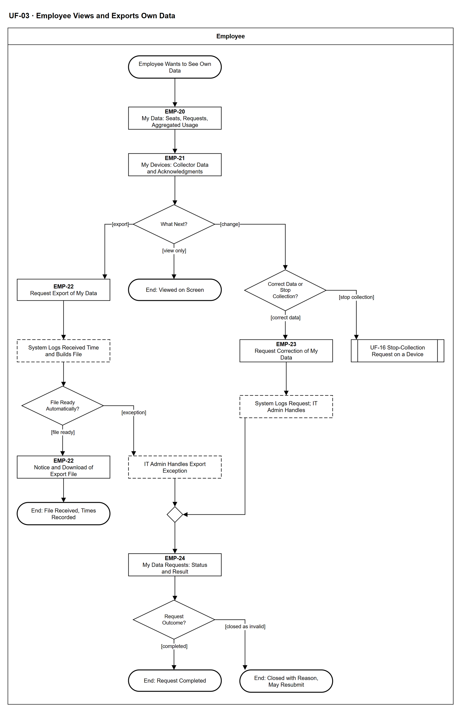

# UF-03 — Employee Views and Exports Own Data

> **Loại:** User flow (mức màn hình) — Employee · **Phiên bản:** 1.1 — 09/10/2026 · **Trạng thái:** Vẽ lại theo BRD v3.30 (đồng bộ QĐ-61/QĐ-62) (FR-10.1, FR-10.2, FR-10.5, FR-10.7, FR-4.18); mã màn hình là đề xuất — UI Spec hoãn tới giai đoạn Figma (QĐ-08); chờ Owner/GVHD review
>
> Sơ đồ là **dẫn xuất** từ quyết định Owner (`QĐ`) và BRD hiện hành; khi khác nhau, `QĐ` → BRD thắng. Quyết định trong sơ đồ là của Owner, **chưa** phải xác nhận của GVHD/hội đồng.

## 1. Mục đích và phạm vi

Hành trình của nhân viên thực hiện quyền của chủ thể dữ liệu đối với chính mình: xem mọi dữ liệu hệ thống lưu về mình (kể cả dữ liệu từ bộ thu thập trên thiết bị và các lần xác nhận), xuất file, yêu cầu chỉnh sửa, và đi sang yêu cầu dừng thu thập. Đây là phía người dùng của tính năng Quyền dữ liệu cá nhân (FDD feature 13).

**Phạm vi:** Màn hình EMP-20 → EMP-24 và phản hồi hệ thống mà nhân viên nhìn thấy; yêu cầu dừng thu thập chỉ tới điểm chuyển sang UF-16.

**Không nằm trong sơ đồ này:** Xử lý yêu cầu dừng thu thập và đăng ký thiết bị (→ UF-16, WF-18); xóa dữ liệu quá hạn và xóa khi nghỉ việc (FR-10.3, FR-10.6, chạy tự động); thông báo theo dõi trước khi thu (FR-10.4, → UF-16); hệ quả của việc dừng thu thập theo nội quy lao động (ngoài phạm vi hệ thống).

## 2. Tệp

| Tệp | Vai trò |
| --- | --- |
| [UF-03-employee-views-and-exports-own-data.drawio](UF-03-employee-views-and-exports-own-data.drawio) | Nguồn draw.io chỉnh sửa được (sinh từ spec) |
| [UF-03-employee-views-and-exports-own-data.drawio.png](UF-03-employee-views-and-exports-own-data.drawio.png) | Bản xuất PNG, nhúng sẵn nguồn draw.io |
| [UF-03.json](../specs/UF-03.json) | **Nguồn canonical** — sửa ở đây rồi chạy `python tools/flowkit.py build` từ `Docs/Diagrams` |

## 3. Nguồn nghiệp vụ

| Mã | Nội dung dùng trong sơ đồ |
| --- | --- |
| `FR-10.1` | Nhân viên xem toàn bộ dữ liệu hệ thống lưu về mình, gồm dữ liệu bộ thu thập, thiết bị đã đăng ký và các lần xác nhận |
| `FR-10.2` | Yêu cầu xuất dữ liệu cá nhân; ghi thời điểm tiếp nhận và hoàn tất |
| `FR-10.5, OI-01a, OI-01b, OI-01c` | Ghi nhận yêu cầu; IT Admin xử lý ngoại lệ xuất, chỉnh sửa (10 ngày) và dừng thu thập (2 ngày làm việc); yêu cầu hợp lệ luôn được thực hiện; đóng kèm lý do, gửi lại được |
| `FR-10.7` | Yêu cầu chỉnh sửa dữ liệu cá nhân sai; không sửa dữ liệu usage gốc hay Audit Trail |
| `FR-4.18, FR-10.4` | Nút yêu cầu dừng thu thập; xác nhận chủ động theo phiên bản |

## 4. Tác nhân, kích hoạt, điều kiện

| Làn (tiếng Anh trên hình) | Tác nhân | Trách nhiệm trong sơ đồ |
| --- | --- | --- |
| Employee | Employee | Thao tác trên các màn hình EMP-xx; bước của IT Admin chỉ hiện dưới dạng trạng thái hoặc tham chiếu sang UF khác |

- **Kích hoạt:** Nhân viên muốn biết hệ thống lưu gì về mình hoặc muốn thực hiện quyền chủ thể dữ liệu.
- **Tiền điều kiện:** Nhân viên có tài khoản đã kích hoạt (UF-17) và đang đăng nhập.
- **Hậu điều kiện:** Nhân viên đã xem dữ liệu của mình; hoặc một yêu cầu quyền chủ thể dữ liệu được ghi nhận kèm thời điểm tiếp nhận và kết thúc ở: hoàn tất · bị đóng kèm lý do (gửi lại được); yêu cầu dừng thu thập được xử lý tiếp ở UF-16.

## 5. Cách đọc ký hiệu

| Ký hiệu | Nghĩa |
| --- | --- |
| Hình chữ nhật bo tròn hai đầu, viền đậm | Điểm bắt đầu hoặc kết cục của hành trình |
| Hình chữ nhật viền liền, dòng đầu in đậm | Màn hình người dùng thao tác; dòng đầu là mã màn hình đề xuất |
| Hình chữ nhật viền nét đứt | Hệ thống tự xử lý; người dùng chỉ thấy kết quả |
| Hình thoi | Rẽ nhánh; cạnh ra mang điều kiện `[...]` |
| Hình chữ nhật hai vạch đứng | Gọi user flow khác (mã `UF-xx` trong nhãn); có cạnh ra thì hành trình quay lại và đi tiếp, không có cạnh ra thì sơ đồ này dừng tại đó |
| Dây có cung nhảy | Hai dây giao nhau nhưng **không** nối với nhau |

Đọc từ trên xuống. Hình chữ nhật viền liền là màn hình (dòng đầu là mã màn hình đề xuất), nét đứt là bước hệ thống hoặc IT Admin mà nhân viên chỉ thấy trạng thái, hai vạch đứng là chuyển sang user flow khác. Nhánh trái là xuất file; nhánh phải là sửa dữ liệu hoặc dừng thu thập.

## 6. Bảng node

| ID | Loại | Nhãn trên hình | Ý nghĩa | Làn / người thực hiện | Quy tắc |
| --- | --- | --- | --- | --- | --- |
| `t_start` | Điểm đầu/cuối | Employee Wants to See Own Data | Nhân viên muốn biết hệ thống đang lưu gì về mình, hoặc muốn thực hiện quyền của chủ thể dữ liệu. | Employee | — |
| `s_my` | Màn hình | EMP-20 — My Data: Seats, Requests, Aggregated Usage | Trang Dữ liệu của tôi: danh sách seat được cấp, lịch sử yêu cầu, dữ liệu sử dụng đã tổng hợp của chính mình. Chỉ hiện dữ liệu của chính nhân viên. | Employee | `FR-10.1` |
| `s_dev` | Màn hình | EMP-21 — My Devices: Collector Data and Acknowledgments | Thiết bị đã đăng ký, các lần xác nhận (phiên bản thông báo và thời điểm) và dữ liệu từ bộ thu thập trên thiết bị — là tổng hợp theo ngày đã lọc tại nguồn, không có nội dung, URL đầy đủ hay địa chỉ IP. | Employee | `FR-10.1`, `FR-4.18`, `FR-10.4`, `ĐK-05` |
| `d_act` | Rẽ nhánh | What Next? | Nhân viên chỉ xem, hay muốn xuất file, hay muốn yêu cầu sửa dữ liệu hoặc dừng thu thập. | Employee | — |
| `t_view` | Điểm đầu/cuối | End: Viewed on Screen | Chỉ xem trên màn hình; không phát sinh yêu cầu. | Employee | — |
| `s_exp` | Màn hình | EMP-22 — Request Export of My Data | Nhân viên bấm yêu cầu xuất dữ liệu cá nhân ra file. | Employee | `FR-10.2` |
| `y_exp` | Hệ thống xử lý | System Logs Received Time and Builds File | Hệ thống ghi thời điểm tiếp nhận rồi sinh file ở định dạng đọc được. Happy path xuất file tự động, không cần ai duyệt. | Employee | `FR-10.2`, `FR-10.5` |
| `d_auto` | Rẽ nhánh | File Ready Automatically? | File sinh được tự động, hay thuộc ngoại lệ xuất dữ liệu phải để IT Admin xử lý. | Employee | `FR-10.5`, `OI-01` |
| `s_dl` | Màn hình | EMP-22 — Notice and Download of Export File | Thông báo trong ứng dụng file đã sẵn sàng; nhân viên tải về. Thời điểm hoàn tất được ghi. | Employee | `FR-10.2`, `FR-10.5`, `FR-3.11` |
| `t_exp` | Điểm đầu/cuối | End: File Received, Times Recorded | Nhân viên nhận file; thời điểm tiếp nhận và hoàn tất được lưu để chứng minh đáp ứng đúng thời hạn. | Employee | — |
| `y_exc` | Hệ thống xử lý | IT Admin Handles Export Exception | IT Admin tiếp nhận và xử lý ngoại lệ xuất dữ liệu, mặc định trong 10 ngày (cấu hình được); quá hạn thì nhắc và cảnh báo nghẽn. Nhân viên chỉ thấy trạng thái. | Employee | `FR-10.5`, `OI-01a` |
| `d_chg` | Rẽ nhánh | Correct Data or Stop Collection? | Sửa dữ liệu cá nhân sai, hay dừng thu thập trên thiết bị công ty. | Employee | `FR-10.5`, `FR-10.7` |
| `s_corr` | Màn hình | EMP-23 — Request Correction of My Data | Nhân viên nêu dữ liệu cá nhân sai (ví dụ email, liên kết thiết bị). Không sửa được dữ liệu sử dụng gốc hay Audit Trail; dữ liệu nhân sự sai được sửa theo nguồn nhân sự. | Employee | `FR-10.7`, `FR-2.1`, `OI-13` |
| `y_corr` | Hệ thống xử lý | System Logs Request; IT Admin Handles | Hệ thống ghi thời điểm tiếp nhận; IT Admin xử lý trong 10 ngày (cấu hình được), ghi người xử lý và thời điểm hoàn tất. IT Admin được tự xử lý yêu cầu của chính mình, Audit Trail gắn cờ tự xử lý. | Employee | `FR-10.5`, `FR-10.7`, `OI-01c` |
| `r_uf16` | Chuyển sang user flow khác | UF-16 Stop-Collection Request on a Device | Yêu cầu dừng thu thập được gửi từ màn hình thiết bị đã đăng ký; IT Admin xử lý trong 2 ngày làm việc. Chi tiết ở UF-16. | Employee | `FR-4.18`, `FR-10.5`, `OI-01a`, → `UF-16` |
| `m_stat` | Hợp nhánh | — | — | Employee | — |
| `s_stat` | Màn hình | EMP-24 — My Data Requests: Status and Result | Danh sách yêu cầu quyền chủ thể dữ liệu của tôi với thời điểm tiếp nhận, trạng thái và kết quả; thông báo trong ứng dụng. | Employee | `FR-10.5`, `FR-3.11` |
| `d_out` | Rẽ nhánh | Request Outcome? | Kết quả xử lý của IT Admin. | Employee | — |
| `t_done` | Điểm đầu/cuối | End: Request Completed | Yêu cầu hợp lệ được thực hiện: file xuất đã được cung cấp hoặc dữ liệu đã được chỉnh sửa. | Employee | — |
| `t_closed` | Điểm đầu/cuối | End: Closed with Reason, May Resubmit | Yêu cầu không hợp lệ (không phải dữ liệu của mình, trùng, đã xử lý) bị đóng kèm lý do; nhân viên gửi lại được. MVP không có luồng kháng nghị. | Employee | `FR-10.5`, `OI-01b` |

## 7. Bảng chuyển tiếp

| Từ → tới | Nhãn điều kiện | Điều kiện | Kết quả |
| --- | --- | --- | --- |
| `t_start` → `s_my` | — | — | Sang EMP-20 — My Data: Seats, Requests, Aggregated Usage |
| `s_my` → `s_dev` | — | — | Sang EMP-21 — My Devices: Collector Data and Acknowledgments |
| `s_dev` → `d_act` | — | — | Sang What Next? |
| `d_act` → `t_view` | `[view only]` | Chỉ xem | Kết thúc |
| `d_act` → `s_exp` | `[export]` | Muốn xuất file dữ liệu của mình | Yêu cầu xuất |
| `d_act` → `d_chg` | `[change]` | Muốn sửa dữ liệu hoặc dừng thu thập | Chọn loại yêu cầu |
| `s_exp` → `y_exp` | — | — | Sang System Logs Received Time and Builds File |
| `y_exp` → `d_auto` | — | — | Sang File Ready Automatically? |
| `d_auto` → `s_dl` | `[file ready]` | File sinh tự động | Thông báo và tải về |
| `d_auto` → `y_exc` | `[exception]` | Ngoại lệ xuất dữ liệu | IT Admin xử lý |
| `s_dl` → `t_exp` | — | — | Sang End: File Received, Times Recorded |
| `y_exc` → `m_stat` | — | — | Sang — |
| `d_chg` → `s_corr` | `[correct data]` | Dữ liệu cá nhân sai | Yêu cầu chỉnh sửa |
| `d_chg` → `r_uf16` | `[stop collection]` | Dừng thu thập trên thiết bị công ty | Sang UF-16 |
| `s_corr` → `y_corr` | — | — | Sang System Logs Request; IT Admin Handles |
| `y_corr` → `m_stat` | — | — | Sang — |
| `m_stat` → `s_stat` | — | — | Sang EMP-24 — My Data Requests: Status and Result |
| `s_stat` → `d_out` | — | — | Sang Request Outcome? |
| `d_out` → `t_done` | `[completed]` | Yêu cầu hợp lệ, đã thực hiện | Kết thúc |
| `d_out` → `t_closed` | `[closed as invalid]` | Yêu cầu không hợp lệ | Đóng kèm lý do, gửi lại được |

Số đếm: **20 node · 20 cạnh · 4 rẽ nhánh**; giao cắt dây: **0**.

## 8. Happy path

1. `t_start` — Employee Wants to See Own Data: Nhân viên muốn biết hệ thống đang lưu gì về mình, hoặc muốn thực hiện quyền của chủ thể dữ liệu.
2. `s_my` — EMP-20 — My Data: Seats, Requests, Aggregated Usage: Trang Dữ liệu của tôi: danh sách seat được cấp, lịch sử yêu cầu, dữ liệu sử dụng đã tổng hợp của chính mình. Chỉ hiện dữ liệu của chính nhân viên.
3. `s_dev` — EMP-21 — My Devices: Collector Data and Acknowledgments: Thiết bị đã đăng ký, các lần xác nhận (phiên bản thông báo và thời điểm) và dữ liệu từ bộ thu thập trên thiết bị — là tổng hợp theo ngày đã lọc tại nguồn, không có nội dung, URL đầy đủ hay địa chỉ IP.
4. `d_act` — What Next?: Nhân viên chỉ xem, hay muốn xuất file, hay muốn yêu cầu sửa dữ liệu hoặc dừng thu thập.
5. `s_exp` — EMP-22 — Request Export of My Data: Nhân viên bấm yêu cầu xuất dữ liệu cá nhân ra file.
6. `y_exp` — System Logs Received Time and Builds File: Hệ thống ghi thời điểm tiếp nhận rồi sinh file ở định dạng đọc được. Happy path xuất file tự động, không cần ai duyệt.
7. `d_auto` — File Ready Automatically?: File sinh được tự động, hay thuộc ngoại lệ xuất dữ liệu phải để IT Admin xử lý.
8. `s_dl` — EMP-22 — Notice and Download of Export File: Thông báo trong ứng dụng file đã sẵn sàng; nhân viên tải về. Thời điểm hoàn tất được ghi.
9. `t_exp` — End: File Received, Times Recorded: Nhân viên nhận file; thời điểm tiếp nhận và hoàn tất được lưu để chứng minh đáp ứng đúng thời hạn.

## 9. Nhánh thay thế / if-else

- **Chỉ xem** — `d_act` → `t_view`. Không phát sinh yêu cầu.
- **Ngoại lệ xuất dữ liệu** — `d_auto` → `y_exc` → `m_stat` → `s_stat` → `d_out` → `t_done`. IT Admin xử lý trong 10 ngày; nhân viên theo dõi ở EMP-24.
- **Yêu cầu chỉnh sửa dữ liệu** — `d_act` → `d_chg` → `s_corr` → `y_corr` → `m_stat` → `s_stat` → `d_out` → `t_done`. IT Admin xử lý trong 10 ngày.
- **Dừng thu thập** — `d_act` → `d_chg` → `r_uf16`. Phạm vi sơ đồ dừng ở đây; xử lý 2 ngày làm việc ở UF-16.

## 10. Nhánh lỗi / từ chối và cách kết thúc

- **Yêu cầu không hợp lệ** — `d_out` → `t_closed`. Đóng kèm lý do; nhân viên gửi lại được, MVP không có kháng nghị.

## 11. Liên hệ với sơ đồ khác

- Workflow: `WF-18` (yêu cầu dừng thu thập), `WF-12` (dữ liệu bộ thu thập là nguồn của EMP-21)
- `UF-16` (đăng ký thiết bị, xác nhận theo dõi và dừng thu thập)
- `UF-17` (tài khoản và đăng nhập)
- `UF-16` — gọi/chuyển tại node `r_uf16`

## 12. Giới hạn và vấn đề còn mở

- (LATER-TECH/UI · DOI-01, QĐ-08) Mã màn hình EMP-xx là đề xuất, chưa có UI Spec hiện hành.
- (LATER-TECH/UI · DOI-76) *Ngoại lệ xuất dữ liệu* là các ca lỗi kỹ thuật (kích thước, quá thời gian, thiếu nguồn) — chốt ở thiết kế BE; nhân viên thấy qua trạng thái.
- (LIMIT · DOI-77) Thời hạn 10 ngày và 2 ngày làm việc là mặc định cấu hình được; bảng thời hạn tham chiếu Nghị định 356/2025/NĐ-CP cần kiểm lại tại văn bản gốc (ghi trong BRD).
- (LIMIT · DOI-78, FR-10.5) Yêu cầu chỉnh sửa dữ liệu chỉ có hai kết cục: thực hiện, hoặc đóng vì không hợp lệ — không có *từ chối một phần*.
