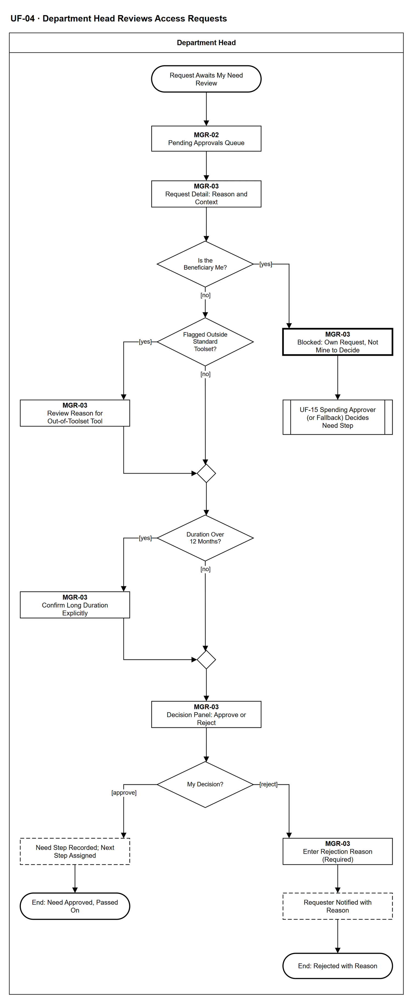

# UF-04 — Department Head Reviews Access Requests

> **Loại:** User flow (mức màn hình) — Department Head (vai Manager suy ra) · **Phiên bản:** 1.4 — 10/10/2026 · **Trạng thái:** Vẽ lại theo BRD v3.30 (đồng bộ QĐ-61/QĐ-62) và QĐ-52…QĐ-60: người duyệt bước nhu cầu là trưởng phòng; trưởng phòng tự gửi thì bước nhu cầu do Người duyệt chi đảm nhận (trưởng phòng chính là Người duyệt chi thì approver dự phòng ở gốc); không ủy quyền; mã màn hình là đề xuất — UI Spec hoãn tới giai đoạn Figma (QĐ-08)
>
> Sơ đồ là **dẫn xuất** từ quyết định Owner (`QĐ`) và BRD hiện hành; khi khác nhau, `QĐ` → BRD thắng. Quyết định trong sơ đồ là của Owner, **chưa** phải xác nhận của GVHD/hội đồng.

## 1. Mục đích và phạm vi

Hành trình của trưởng phòng khi xét **bước nhu cầu** của một yêu cầu cấp quyền trong phòng mình: mở hàng đợi, đọc chi tiết, thấy cờ ngoài bộ công cụ chuẩn và thời hạn quá 12 tháng, rồi duyệt hoặc từ chối kèm lý do. Đây là phía trưởng phòng của bước *Review Need* trong WF-09 (MF-2, chuỗi demo D-1).

**Phạm vi:** Màn hình MGR-02 và MGR-03 cùng phản hồi hệ thống mà trưởng phòng nhìn thấy, từ lúc yêu cầu được gán tới khi bước nhu cầu có kết cục. Kênh: web và **ứng dụng mobile native** (QĐ-61b) với cùng quy tắc và phân quyền. Khác biệt thật trên mobile: chỉ hộp thông báo trong ứng dụng (không push, không offline — QĐ-61c), không tải tệp, snapshot ngân sách chỉ đọc; các bước khác của luồng này chỉ trên web.

**Không nằm trong sơ đồ này:** Việc gửi yêu cầu (→ UF-01, UF-02, UF-21); duyệt chi và hỏi Finance (→ UF-15, UF-11); IT đánh giá và cấp phát (→ UF-08); định tuyến lại khi dữ liệu tổ chức đổi, hết người duyệt hợp lệ, SLA quá hạn (hệ thống tự xử lý, WF-09); ủy quyền duyệt (không có — QĐ-27).

## 2. Tệp

| Tệp | Vai trò |
| --- | --- |
| [UF-04-department-head-reviews-access-requests.drawio](UF-04-department-head-reviews-access-requests.drawio) | Nguồn draw.io chỉnh sửa được (sinh từ spec) |
| [UF-04-department-head-reviews-access-requests.drawio.png](UF-04-department-head-reviews-access-requests.drawio.png) | Bản xuất PNG, nhúng sẵn nguồn draw.io |
| [UF-04.json](../specs/UF-04.json) | **Nguồn canonical** — sửa ở đây rồi chạy `python tools/flowkit.py build` từ `Docs/Diagrams` |

## 3. Nguồn nghiệp vụ

| Mã | Nội dung dùng trong sơ đồ |
| --- | --- |
| `FR-3.3, FR-3.6, QĐ-52c` | Bước nhu cầu do trưởng phòng; trưởng phòng tự gửi ⟹ Người duyệt chi; trùng thì approver dự phòng ở gốc |
| `SoD-4, INV-08` | Người yêu cầu không tự phê duyệt yêu cầu của mình |
| `FR-3.5, QĐ-27` | Không ủy quyền, không chuyển quyền duyệt thủ công |
| `FR-3.7, SoD-2` | Chỉ thấy tổng hợp trong phòng; không log thô, hợp đồng, tài chính toàn công ty |
| `FR-3.8, QĐ-28d` | SLA 2 ngày làm việc; quá hạn chỉ nhắc và thông báo cấp trên |
| `FR-3.18, QĐ-52e` | Cờ ngoài bộ công cụ chuẩn kèm lý do bắt buộc |
| `OI-07a` | Thời hạn quá 12 tháng: xác nhận tường minh kèm lý do ngay trong bước xét nhu cầu |
| `QĐ-49e` | Tóm tắt AI hàng đợi của chính mình — chỉ hỗ trợ |
| `QĐ-53a, FR-3.11` | Bản ghi phê duyệt điện tử; lý do và trạng thái được lưu và báo người yêu cầu |

## 4. Tác nhân, kích hoạt, điều kiện

| Làn (tiếng Anh trên hình) | Tác nhân | Trách nhiệm trong sơ đồ |
| --- | --- | --- |
| Department Head | Department Head | Trưởng phòng — vai Manager suy ra từ việc đang là trưởng phòng có hiệu lực; thao tác trên MGR-02, MGR-03; bước của vai khác chỉ hiện dưới dạng trạng thái |

- **Kích hoạt:** Một yêu cầu của nhân viên trong phòng đến bước nhu cầu của trưởng phòng.
- **Tiền điều kiện:** Phòng có đúng một trưởng phòng có hiệu lực; yêu cầu đã được gửi và nhánh (a)/(b)/(c) đã chốt khi gửi.
- **Hậu điều kiện:** Bước nhu cầu kết thúc bằng: duyệt (chuyển bước kế) · từ chối kèm lý do; hoặc trưởng phòng bị chặn vì đó là yêu cầu của chính mình và người duyệt khác xử lý.

## 5. Cách đọc ký hiệu

| Ký hiệu | Nghĩa |
| --- | --- |
| Hình chữ nhật bo tròn hai đầu, viền đậm | Điểm bắt đầu hoặc kết cục của hành trình |
| Hình chữ nhật viền liền, dòng đầu in đậm | Màn hình người dùng thao tác; dòng đầu là mã màn hình đề xuất |
| Hình chữ nhật viền nét đứt | Hệ thống tự xử lý; người dùng chỉ thấy kết quả |
| Hình chữ nhật viền rất đậm | Màn hình chặn hoặc trạng thái lỗi |
| Hình thoi | Rẽ nhánh; cạnh ra mang điều kiện `[...]` |
| Hình chữ nhật hai vạch đứng | Gọi user flow khác (mã `UF-xx` trong nhãn); có cạnh ra thì hành trình quay lại và đi tiếp, không có cạnh ra thì sơ đồ này dừng tại đó |
| Dây có cung nhảy | Hai dây giao nhau nhưng **không** nối với nhau |

Đọc từ trên xuống. Chữ nhật viền liền là màn hình (dòng đầu là mã màn hình đề xuất), nét đứt là hệ thống tự xử lý, viền rất đậm là màn hình chặn, hai vạch đứng là sang user flow khác. Hai điểm rẽ nhánh giữa (cờ ngoài bộ chuẩn, quá 12 tháng) chỉ thêm một thao tác xem hoặc xác nhận rồi nhập lại luồng chính.

## 6. Bảng node

| ID | Loại | Nhãn trên hình | Ý nghĩa | Làn / người thực hiện | Quy tắc |
| --- | --- | --- | --- | --- | --- |
| `t_start` | Điểm đầu/cuối | Request Awaits My Need Review | Một yêu cầu của nhân viên trong phòng đã được gán bước nhu cầu cho trưởng phòng; trưởng phòng nhận thông báo trong ứng dụng. | Department Head | `FR-3.3`, `FR-3.11` |
| `s_queue` | Màn hình | MGR-02 — Pending Approvals Queue | Hàng đợi yêu cầu chờ tôi xét nhu cầu, kèm thời gian còn lại theo SLA (mặc định 2 ngày làm việc). Có thể bật tóm tắt AI của chính hàng đợi này (chỉ hỗ trợ, có liên kết về yêu cầu gốc, không quyết thay). Quá hạn thì hệ thống chỉ nhắc tôi và thông báo cấp trên (Người duyệt chi) — không đổi người, không tự duyệt, không ủy quyền. | Department Head | `FR-3.8`, `FR-3.5`, `QĐ-27`, `QĐ-28d`, `QĐ-49e(1)` |
| `s_detail` | Màn hình | MGR-03 — Request Detail: Reason and Context | Chi tiết phiếu BM-01: phần mềm và gói, lý do nghiệp vụ, thời hạn cần dùng, cá nhân hay dùng chung. Bối cảnh chỉ ở dạng tổng hợp trong phòng mình (quyền đang có, mức dùng tổng hợp); không có log hoạt động thô, hợp đồng hay dữ liệu tài chính toàn công ty. | Department Head | `BM-01`, `FR-3.7`, `SoD-2` |
| `d_own` | Rẽ nhánh | Is the Beneficiary Me? | Người thụ hưởng (cả yêu cầu, hoặc phần của tôi trong yêu cầu nhóm) có phải chính tôi không. Yêu cầu tôi tạo thay cho nhân viên phòng mình không vào đây vì bước nhu cầu đã được ghi nhận khi tạo (QĐ-62a, FR-3.2). | Department Head | `SoD-4`, `INV-08` |
| `b_own` | Màn hình chặn/lỗi | MGR-03 — Blocked: Own Request, Not Mine to Decide | Yêu cầu do chính trưởng phòng gửi: nút quyết định bị vô hiệu kèm lý do; chỉ xem trạng thái. Bước nhu cầu của yêu cầu này do Người duyệt chi đảm nhận (nếu trưởng phòng chính là Người duyệt chi thì approver dự phòng ở gốc). | Department Head | `QĐ-52c`, `FR-3.3`, `FR-3.6`, `SoD-4`, `INV-08` |
| `r_uf15` | Chuyển sang user flow khác | UF-15 Spending Approver (or Fallback) Decides Need Step | Phạm vi sơ đồ này dừng ở đây; người duyệt khác xử lý bước nhu cầu của yêu cầu mà trưởng phòng là người thụ hưởng: Người duyệt chi (UF-15), hoặc approver dự phòng ở gốc nếu trưởng phòng chính là Người duyệt chi (FR-3.3, FR-3.6). | Department Head | → `UF-15` |
| `d_flag` | Rẽ nhánh | Flagged Outside Standard Toolset? | Yêu cầu có mang cờ ngoài bộ công cụ chuẩn của phòng × chức vụ không. | Department Head | `FR-3.18`, `QĐ-52e` |
| `s_flag` | Màn hình | MGR-03 — Review Reason for Out-of-Toolset Tool | Hiện cờ ngoài bộ chuẩn và lý do bắt buộc mà người yêu cầu đã nhập; trưởng phòng cân nhắc trước khi quyết. | Department Head | `FR-3.18`, `QĐ-52e` |
| `m_flag` | Hợp nhánh | — | — | Department Head | — |
| `d_dur` | Rẽ nhánh | Duration Over 12 Months? | Thời hạn cần dùng vượt 12 tháng không. | Department Head | `OI-07a` |
| `s_dur` | Màn hình | MGR-03 — Confirm Long Duration Explicitly | Thời hạn quá 12 tháng: trưởng phòng xác nhận tường minh kèm lý do ngay trong bước xét nhu cầu, không thêm bước mới. Không xác nhận thì không duyệt được (chỉ có thể từ chối). | Department Head | `OI-07a` |
| `m_dur` | Hợp nhánh | — | — | Department Head | — |
| `s_decide` | Màn hình | MGR-03 — Decision Panel: Approve or Reject | Hai lựa chọn: Duyệt hoặc Từ chối. Không có nút chuyển người duyệt hay ủy quyền; mọi quyết định lưu thành bản ghi phê duyệt điện tử. | Department Head | `FR-3.5`, `QĐ-53a` |
| `d_dec` | Rẽ nhánh | My Decision? | Quyết định nhu cầu của trưởng phòng. | Department Head | `QĐ-53a` |
| `y_next` | Hệ thống xử lý | Need Step Recorded; Next Step Assigned | Hệ thống ghi bản ghi phê duyệt và Audit Trail, rồi chuyển bước kế theo nhánh đã chốt khi gửi: Người duyệt chi (nhánh có chi phí), đánh giá của IT (phần mềm chưa có trong danh mục) hoặc IT thực hiện (nhánh không phí). Trưởng phòng chỉ thấy trạng thái. | Department Head | `FR-3.4`, `FR-3.11`, `QĐ-53a` |
| `t_ok` | Điểm đầu/cuối | End: Need Approved, Passed On | Bước nhu cầu hoàn tất; trách nhiệm chuyển sang người duyệt hoặc người thực hiện kế tiếp. | Department Head | — |
| `s_rej` | Màn hình | MGR-03 — Enter Rejection Reason (Required) | Từ chối bắt buộc nhập lý do; lý do hiện cho người yêu cầu ở chi tiết yêu cầu. | Department Head | `FR-3.11`, `QĐ-53a` |
| `y_rej` | Hệ thống xử lý | Requester Notified with Reason | Hệ thống đóng yêu cầu ở trạng thái từ chối nhu cầu và báo người yêu cầu kèm lý do. | Department Head | `FR-3.11` |
| `t_rej` | Điểm đầu/cuối | End: Rejected with Reason | Yêu cầu bị từ chối ở bước nhu cầu, có lý do. | Department Head | — |

## 7. Bảng chuyển tiếp

| Từ → tới | Nhãn điều kiện | Điều kiện | Kết quả |
| --- | --- | --- | --- |
| `t_start` → `s_queue` | — | — | Sang MGR-02 — Pending Approvals Queue |
| `s_queue` → `s_detail` | — | — | Sang MGR-03 — Request Detail: Reason and Context |
| `s_detail` → `d_own` | — | — | Sang Is the Beneficiary Me? |
| `d_own` → `b_own` | `[yes]` | Yêu cầu mà tôi là người thụ hưởng (tự gửi, hoặc phần của tôi trong yêu cầu nhóm) | Chặn, chuyển người duyệt khác |
| `d_own` → `d_flag` | `[no]` | Yêu cầu của người khác trong phòng | Xem cờ ngoài bộ chuẩn |
| `b_own` → `r_uf15` | — | — | Sang UF-15 Spending Approver (or Fallback) Decides Need Step |
| `d_flag` → `s_flag` | `[yes]` | Có cờ ngoài bộ chuẩn | Xem lý do |
| `d_flag` → `m_flag` | `[no]` | Trong bộ chuẩn | Đi tiếp |
| `s_flag` → `m_flag` | — | — | Sang — |
| `m_flag` → `d_dur` | — | — | Sang Duration Over 12 Months? |
| `d_dur` → `s_dur` | `[yes]` | Thời hạn quá 12 tháng | Xác nhận tường minh |
| `d_dur` → `m_dur` | `[no]` | Trong 12 tháng | Đi tiếp |
| `s_dur` → `m_dur` | — | — | Sang — |
| `m_dur` → `s_decide` | — | — | Sang MGR-03 — Decision Panel: Approve or Reject |
| `s_decide` → `d_dec` | — | — | Sang My Decision? |
| `d_dec` → `y_next` | `[approve]` | Duyệt nhu cầu | Chuyển bước kế |
| `d_dec` → `s_rej` | `[reject]` | Từ chối nhu cầu | Nhập lý do |
| `y_next` → `t_ok` | — | — | Sang End: Need Approved, Passed On |
| `s_rej` → `y_rej` | — | — | Sang Requester Notified with Reason |
| `y_rej` → `t_rej` | — | — | Sang End: Rejected with Reason |

Số đếm: **19 node · 20 cạnh · 4 rẽ nhánh**; giao cắt dây: **0**.

## 8. Happy path

1. `t_start` — Request Awaits My Need Review: Một yêu cầu của nhân viên trong phòng đã được gán bước nhu cầu cho trưởng phòng; trưởng phòng nhận thông báo trong ứng dụng.
2. `s_queue` — MGR-02 — Pending Approvals Queue: Hàng đợi yêu cầu chờ tôi xét nhu cầu, kèm thời gian còn lại theo SLA (mặc định 2 ngày làm việc). Có thể bật tóm tắt AI của chính hàng đợi này (chỉ hỗ trợ, có liên kết về yêu cầu gốc, không quyết thay). Quá hạn thì hệ thống chỉ nhắc tôi và thông báo cấp trên (Người duyệt chi) — không đổi người, không tự duyệt, không ủy quyền.
3. `s_detail` — MGR-03 — Request Detail: Reason and Context: Chi tiết phiếu BM-01: phần mềm và gói, lý do nghiệp vụ, thời hạn cần dùng, cá nhân hay dùng chung. Bối cảnh chỉ ở dạng tổng hợp trong phòng mình (quyền đang có, mức dùng tổng hợp); không có log hoạt động thô, hợp đồng hay dữ liệu tài chính toàn công ty.
4. `d_own` — Is the Beneficiary Me?: Người thụ hưởng (cả yêu cầu, hoặc phần của tôi trong yêu cầu nhóm) có phải chính tôi không. Yêu cầu tôi tạo thay cho nhân viên phòng mình không vào đây vì bước nhu cầu đã được ghi nhận khi tạo (QĐ-62a, FR-3.2).
5. `d_flag` — Flagged Outside Standard Toolset?: Yêu cầu có mang cờ ngoài bộ công cụ chuẩn của phòng × chức vụ không.
6. `d_dur` — Duration Over 12 Months?: Thời hạn cần dùng vượt 12 tháng không.
7. `s_decide` — MGR-03 — Decision Panel: Approve or Reject: Hai lựa chọn: Duyệt hoặc Từ chối. Không có nút chuyển người duyệt hay ủy quyền; mọi quyết định lưu thành bản ghi phê duyệt điện tử.
8. `d_dec` — My Decision?: Quyết định nhu cầu của trưởng phòng.
9. `y_next` — Need Step Recorded; Next Step Assigned: Hệ thống ghi bản ghi phê duyệt và Audit Trail, rồi chuyển bước kế theo nhánh đã chốt khi gửi: Người duyệt chi (nhánh có chi phí), đánh giá của IT (phần mềm chưa có trong danh mục) hoặc IT thực hiện (nhánh không phí). Trưởng phòng chỉ thấy trạng thái.
10. `t_ok` — End: Need Approved, Passed On: Bước nhu cầu hoàn tất; trách nhiệm chuyển sang người duyệt hoặc người thực hiện kế tiếp.

## 9. Nhánh thay thế / if-else

- **Có cờ ngoài bộ công cụ chuẩn** — `d_flag` → `s_flag` → `m_flag`. Trưởng phòng đọc lý do của người yêu cầu rồi quyết như thường.
- **Thời hạn quá 12 tháng** — `d_dur` → `s_dur` → `m_dur`. Phải xác nhận tường minh kèm lý do mới duyệt được; không thêm bước phê duyệt.

## 10. Nhánh lỗi / từ chối và cách kết thúc

- **Yêu cầu của chính trưởng phòng** — `d_own` → `b_own` → `r_uf15`. Màn hình chặn; bước nhu cầu do Người duyệt chi đảm nhận (trưởng phòng chính là Người duyệt chi thì approver dự phòng ở gốc — FR-3.6). Trên mobile, Người duyệt chi duyệt được bước này (QĐ-61h).
- **Từ chối nhu cầu** — `d_dec` → `s_rej` → `y_rej` → `t_rej`. Lý do bắt buộc; người yêu cầu được báo.

## 11. Liên hệ với sơ đồ khác

- Workflow: `MF-2`, `WF-09`
- `UF-01` / `UF-02` (người yêu cầu gửi), `UF-21` (trưởng phòng tạo yêu cầu thay), `UF-15` (Người duyệt chi), `UF-08` (IT thực hiện)
- `UF-15` — gọi/chuyển tại node `r_uf15`

## 12. Giới hạn và vấn đề còn mở

- (LATER-TECH/UI · DOI-01, QĐ-08) Mã màn hình MGR-xx là đề xuất, chưa có UI Spec hiện hành.
- (LATER-TECH/UI · DOI-26) Yêu cầu của chính trưởng phòng trong MGR-02/MGR-03: hình vẽ hướng an toàn — xem được trạng thái, không có nút quyết (SoD-4).
- (ĐÃ CÓ NGUỒN · DOI-21) Người duyệt chi không có cấp trên: FR-3.8 chỉ thông báo cấp trên *nếu có*; quá SLA ⟹ nhắc và cảnh báo Super Admin (FR-5.14).
- (LATER-TECH/UI · DOI-28) Thời hạn quá 12 tháng phải xác nhận tường minh mới duyệt được (OI-07a) — hình vẽ hướng an toàn; giao diện chặn chốt ở UI Spec.
