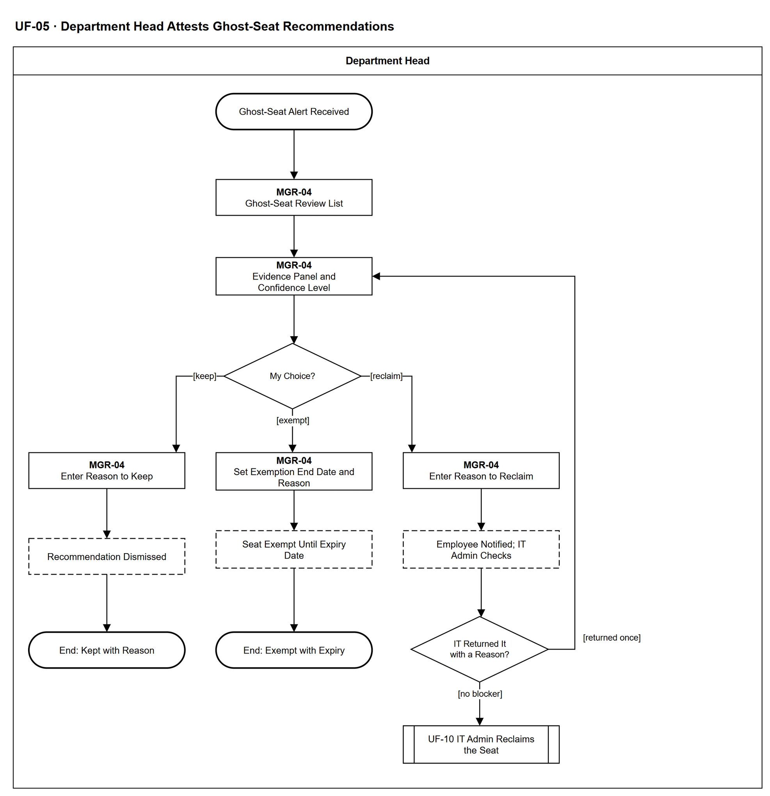

# UF-05 — Department Head Attests Ghost-Seat Recommendations

> **Loại:** User flow (mức màn hình) — Department Head (vai Manager suy ra) · **Phiên bản:** 1.1 — 09/10/2026 · **Trạng thái:** Vẽ lại theo BRD v3.30 (đồng bộ QĐ-61/QĐ-62), WF-13 v3.0 và QĐ-52…QĐ-60; mã màn hình là đề xuất — UI Spec hoãn tới giai đoạn Figma (QĐ-08)
>
> Sơ đồ là **dẫn xuất** từ quyết định Owner (`QĐ`) và BRD hiện hành; khi khác nhau, `QĐ` → BRD thắng. Quyết định trong sơ đồ là của Owner, **chưa** phải xác nhận của GVHD/hội đồng.

## 1. Mục đích và phạm vi

Hành trình của trưởng phòng khi xác nhận khuyến nghị seat lãng phí (G3/G4): xem bằng chứng tổng hợp và giới hạn dữ liệu, rồi chọn Keep, Reclaim hoặc Exempt (tối đa 12 tháng) kèm lý do. Không bao giờ có kết luận khi bằng chứng không đủ. Đây là phía trưởng phòng của WF-13 (chuỗi demo D-2).

**Phạm vi:** Màn hình MGR-04 và phản hồi hệ thống mà trưởng phòng nhìn thấy, tới khi khuyến nghị bị bác bỏ, được miễn trừ có hạn, hoặc chuyển sang IT thu hồi.

**Không nằm trong sơ đồ này:** G1 (seat mua chưa gán — quyết ở kỳ gia hạn, MF-4) và G2 (seat của người đã nghỉ việc — đi thẳng tới thu hồi, trưởng phòng không xác nhận); tầng Theo dõi (chỉ IT Admin); tám cổng loại trừ và việc tính ngày (WF-13a, WF-13); thực hiện thu hồi (→ UF-10, WF-09a); rà soát truy cập định kỳ (WF-14, chỉ thiết kế).

## 2. Tệp

| Tệp | Vai trò |
| --- | --- |
| [UF-05-department-head-attests-ghost-seat-recommendations.drawio](UF-05-department-head-attests-ghost-seat-recommendations.drawio) | Nguồn draw.io chỉnh sửa được (sinh từ spec) |
| [UF-05-department-head-attests-ghost-seat-recommendations.drawio.png](UF-05-department-head-attests-ghost-seat-recommendations.drawio.png) | Bản xuất PNG, nhúng sẵn nguồn draw.io |
| [UF-05.json](../specs/UF-05.json) | **Nguồn canonical** — sửa ở đây rồi chạy `python tools/flowkit.py build` từ `Docs/Diagrams` |

## 3. Nguồn nghiệp vụ

| Mã | Nội dung dùng trong sơ đồ |
| --- | --- |
| `FR-4.12, QĐ-09` | Ba tầng; Theo dõi chỉ IT Admin thấy; trưởng phòng chỉ nhận từ Cần xem xét |
| `FR-4.14, QĐ-35b` | Khuyến nghị kèm căn cứ đầy đủ và mức tin cậy, không phần trăm |
| `FR-4.14a, DQ-03, DQ-04` | Bộ thu thập là bằng chứng có điều kiện; INSUFFICIENT EVIDENCE không có kết luận |
| `FR-3.7, SoD-2` | Chỉ số liệu tổng hợp trong phòng; không log thô |
| `FR-3.10, INV-09` | Keep/Reclaim/Exempt kèm lý do; Exempt tối đa 12 tháng rồi quay lại hàng đợi |
| `OI-02` | IT trả lại tối đa một lần; trưởng phòng quyết cuối |
| `FR-5.14, QĐ-57a` | Cảnh báo khuyến nghị mới cho trưởng phòng; cảnh báo thu hồi sắp thực hiện cho nhân viên |
| `FR-4.15, KPI-5` | Hai con số tiết kiệm tách biệt; thu hồi không tự ghi tiết kiệm; vòng đời khuyến nghị |

## 4. Tác nhân, kích hoạt, điều kiện

| Làn (tiếng Anh trên hình) | Tác nhân | Trách nhiệm trong sơ đồ |
| --- | --- | --- |
| Department Head | Department Head | Trưởng phòng — thao tác trên MGR-04; bước của IT Admin và hệ thống chỉ hiện dưới dạng trạng thái |

- **Kích hoạt:** Cảnh báo khuyến nghị ghost seat mới cho trưởng phòng.
- **Tiền điều kiện:** Nguồn usage đã nhập và danh tính đã khớp (WF-12, WF-12a); khuyến nghị đã qua cổng loại trừ và đủ bao phủ, thuộc tầng Cần xem xét hoặc Cần xử lý.
- **Hậu điều kiện:** Một kết cục: không kết luận (bằng chứng không đủ) · giữ lại có lý do (khuyến nghị bị bác bỏ) · miễn trừ có hạn · chuyển IT thu hồi (không ghi tiết kiệm tự động).

## 5. Cách đọc ký hiệu

| Ký hiệu | Nghĩa |
| --- | --- |
| Hình chữ nhật bo tròn hai đầu, viền đậm | Điểm bắt đầu hoặc kết cục của hành trình |
| Hình chữ nhật viền liền, dòng đầu in đậm | Màn hình người dùng thao tác; dòng đầu là mã màn hình đề xuất |
| Hình chữ nhật viền nét đứt | Hệ thống tự xử lý; người dùng chỉ thấy kết quả |
| Hình thoi | Rẽ nhánh; cạnh ra mang điều kiện `[...]` |
| Hình chữ nhật hai vạch đứng | Gọi user flow khác (mã `UF-xx` trong nhãn); có cạnh ra thì hành trình quay lại và đi tiếp, không có cạnh ra thì sơ đồ này dừng tại đó |
| Dây có cung nhảy | Hai dây giao nhau nhưng **không** nối với nhau |

Đọc từ trên xuống. Chữ nhật viền liền là màn hình MGR-04 (mã đề xuất), nét đứt là hệ thống tự xử lý, viền rất đậm là màn hình chặn, hai vạch đứng là sang user flow khác. Cạnh quay lại Evidence Panel là trường hợp IT trả lại một lần, khi trưởng phòng quyết lần cuối.

## 6. Bảng node

| ID | Loại | Nhãn trên hình | Ý nghĩa | Làn / người thực hiện | Quy tắc |
| --- | --- | --- | --- | --- | --- |
| `t_start` | Điểm đầu/cuối | Ghost-Seat Alert Received | Hệ thống sinh khuyến nghị seat lãng phí (G3/G4) từ tầng Cần xem xét trở lên và gửi cảnh báo cho trưởng phòng. | Department Head | `FR-4.12`, `FR-5.14`, `QĐ-09` |
| `s_list` | Màn hình | MGR-04 — Ghost-Seat Review List | Danh sách theo nhân viên trong phòng mình, chỉ số liệu tổng hợp (có hoạt động hay không, số ngày); không log thô, không nút xem log (SoD-2). Tầng Theo dõi không bao giờ hiện ở đây. Seat chưa đủ bằng chứng chỉ hiện nhãn trạng thái, không có nút quyết. Chỉ gồm seat đã có khuyến nghị; seat INSUFFICIENT EVIDENCE, không có dữ liệu hoặc chưa khớp danh tính không tới trưởng phòng (WF-13). Phòng chưa có trưởng phòng: việc xác nhận chờ, không giao ai; trưởng phòng mới nhận việc (QĐ-62c). | Department Head | `FR-3.7`, `SoD-2`, `FR-4.12`, `QĐ-09` |
| `s_ev` | Màn hình | MGR-04 — Evidence Panel and Confidence Level | Mỗi khuyến nghị kèm đủ căn cứ để quyết ngay: số ngày không hoạt động, tên nguồn, ngày import, cửa sổ bao phủ, phương pháp khớp danh tính, định nghĩa 'hoạt động' của nguồn, mức tin cậy Cao/Trung bình/Thấp (không phần trăm), hai con số tiết kiệm ước tính tách riêng. Bằng chứng từ bộ thu thập mang nhãn 'quan sát trên thiết bị công ty — không xác định tài khoản SaaS'. Nếu IT đã trả lại thì hiện cả lý do kỹ thuật hoặc hợp đồng. | Department Head | `FR-4.14`, `FR-4.14a`, `FR-4.15`, `FR-4.16`, `QĐ-35b`, `OI-02` |
| `d_choice` | Rẽ nhánh | My Choice? | Lựa chọn của trưởng phòng; khuyến nghị chỉ là đề xuất, không đường nào tự thu hồi. | Department Head | `FR-3.10`, `INV-09` |
| `s_keep` | Màn hình | MGR-04 — Enter Reason to Keep | Giữ lại: nhập lý do. | Department Head | `FR-3.10` |
| `y_keep` | Hệ thống xử lý | Recommendation Dismissed | Khuyến nghị chuyển sang bị bác bỏ (tính vào KPI-5); lần chạy sau vẫn có thể sinh khuyến nghị mới nếu điều kiện còn thỏa. | Department Head | `KPI-5`, `FR-3.10` |
| `t_keep` | Điểm đầu/cuối | End: Kept with Reason | Seat được giữ, lý do được ghi. Nếu trước đó trưởng phòng đã chọn Reclaim (nhân viên đã được báo) và IT trả lại, đổi sang Keep/Exempt ⟹ báo nhân viên *thu hồi đã hủy* (QĐ-62p). | Department Head | — |
| `s_ex` | Màn hình | MGR-04 — Set Exemption End Date and Reason | Miễn trừ: ngày hết hạn bắt buộc, tối đa 12 tháng kể từ hôm nay, kèm lý do; không có miễn trừ vô thời hạn. | Department Head | `FR-3.10`, `INV-09` |
| `y_ex` | Hệ thống xử lý | Seat Exempt Until Expiry Date | Seat bị loại khỏi đánh giá tới ngày hết hạn (cổng miễn trừ), rồi tự quay lại hàng đợi review. | Department Head | `FR-4.9`, `INV-09` |
| `t_ex` | Điểm đầu/cuối | End: Exempt with Expiry | Miễn trừ có thời hạn đã được ghi. Nếu trước đó trưởng phòng đã chọn Reclaim (nhân viên đã được báo) và IT trả lại, đổi sang Keep/Exempt ⟹ báo nhân viên *thu hồi đã hủy* (QĐ-62p). | Department Head | — |
| `s_rec` | Màn hình | MGR-04 — Enter Reason to Reclaim | Thu hồi: nhập lý do. | Department Head | `FR-3.10` |
| `y_notify` | Hệ thống xử lý | Employee Notified; IT Admin Checks | Nhân viên giữ seat được báo quyền sắp bị thu hồi. IT Admin kiểm lý do kỹ thuật hoặc hợp đồng chặn việc thu hồi; trưởng phòng chỉ thấy trạng thái. | Department Head | `FR-5.14`, `QĐ-57a`, `OI-02`, `SoD-5` |
| `d_ret` | Rẽ nhánh | IT Returned It with a Reason? | IT có trả quyết định lại kèm lý do kỹ thuật hoặc hợp đồng không (tối đa một lần). | Department Head | `OI-02` |
| `r_uf10` | Chuyển sang user flow khác | UF-10 IT Admin Reclaims the Seat | Phạm vi sơ đồ này dừng ở đây; IT thu hồi seat, khuyến nghị chuyển sang đã chấp nhận, chưa ghi tiết kiệm. Gói có lưu ý mất dữ liệu: hiện lưu ý và trưởng phòng — người quyết Reclaim — xác nhận bàn giao trước khi gỡ ở nhà cung cấp; không chặn sau hạn ngắn (QĐ-62f, WF-09a `d_dl`). | Department Head | → `UF-10` |

## 7. Bảng chuyển tiếp

| Từ → tới | Nhãn điều kiện | Điều kiện | Kết quả |
| --- | --- | --- | --- |
| `t_start` → `s_list` | — | — | Sang MGR-04 — Ghost-Seat Review List |
| `s_list` → `s_ev` | — | — | Sang MGR-04 — Evidence Panel and Confidence Level |
| `s_ev` → `d_choice` | — | — | Sang My Choice? |
| `d_choice` → `s_keep` | `[keep]` | Giữ lại | Nhập lý do giữ |
| `d_choice` → `s_ex` | `[exempt]` | Miễn trừ có thời hạn | Đặt ngày hết hạn |
| `d_choice` → `s_rec` | `[reclaim]` | Thu hồi | Nhập lý do thu hồi |
| `s_keep` → `y_keep` | — | — | Sang Recommendation Dismissed |
| `y_keep` → `t_keep` | — | — | Sang End: Kept with Reason |
| `s_ex` → `y_ex` | — | — | Sang Seat Exempt Until Expiry Date |
| `y_ex` → `t_ex` | — | — | Sang End: Exempt with Expiry |
| `s_rec` → `y_notify` | — | — | Sang Employee Notified; IT Admin Checks |
| `y_notify` → `d_ret` | — | — | Sang IT Returned It with a Reason? |
| `d_ret` → `s_ev` | `[returned once]` | IT trả lại kèm lý do kỹ thuật hoặc hợp đồng | Trưởng phòng xem lại và quyết lần cuối |
| `d_ret` → `r_uf10` | `[no blocker]` | IT không có lý do chặn | Sang UF-10 thu hồi |

Số đếm: **14 node · 14 cạnh · 2 rẽ nhánh**; giao cắt dây: **0**.

## 8. Happy path

1. `t_start` — Ghost-Seat Alert Received: Hệ thống sinh khuyến nghị seat lãng phí (G3/G4) từ tầng Cần xem xét trở lên và gửi cảnh báo cho trưởng phòng.
2. `s_list` — MGR-04 — Ghost-Seat Review List: Danh sách theo nhân viên trong phòng mình, chỉ số liệu tổng hợp (có hoạt động hay không, số ngày); không log thô, không nút xem log (SoD-2). Tầng Theo dõi không bao giờ hiện ở đây. Seat chưa đủ bằng chứng chỉ hiện nhãn trạng thái, không có nút quyết. Chỉ gồm seat đã có khuyến nghị; seat INSUFFICIENT EVIDENCE, không có dữ liệu hoặc chưa khớp danh tính không tới trưởng phòng (WF-13). Phòng chưa có trưởng phòng: việc xác nhận chờ, không giao ai; trưởng phòng mới nhận việc (QĐ-62c).
3. `s_ev` — MGR-04 — Evidence Panel and Confidence Level: Mỗi khuyến nghị kèm đủ căn cứ để quyết ngay: số ngày không hoạt động, tên nguồn, ngày import, cửa sổ bao phủ, phương pháp khớp danh tính, định nghĩa 'hoạt động' của nguồn, mức tin cậy Cao/Trung bình/Thấp (không phần trăm), hai con số tiết kiệm ước tính tách riêng. Bằng chứng từ bộ thu thập mang nhãn 'quan sát trên thiết bị công ty — không xác định tài khoản SaaS'. Nếu IT đã trả lại thì hiện cả lý do kỹ thuật hoặc hợp đồng.
4. `d_choice` — My Choice?: Lựa chọn của trưởng phòng; khuyến nghị chỉ là đề xuất, không đường nào tự thu hồi.
5. `s_rec` — MGR-04 — Enter Reason to Reclaim: Thu hồi: nhập lý do.
6. `y_notify` — Employee Notified; IT Admin Checks: Nhân viên giữ seat được báo quyền sắp bị thu hồi. IT Admin kiểm lý do kỹ thuật hoặc hợp đồng chặn việc thu hồi; trưởng phòng chỉ thấy trạng thái.
7. `d_ret` — IT Returned It with a Reason?: IT có trả quyết định lại kèm lý do kỹ thuật hoặc hợp đồng không (tối đa một lần).
8. `r_uf10` — UF-10 IT Admin Reclaims the Seat: Phạm vi sơ đồ này dừng ở đây; IT thu hồi seat, khuyến nghị chuyển sang đã chấp nhận, chưa ghi tiết kiệm. Gói có lưu ý mất dữ liệu: hiện lưu ý và trưởng phòng — người quyết Reclaim — xác nhận bàn giao trước khi gỡ ở nhà cung cấp; không chặn sau hạn ngắn (QĐ-62f, WF-09a `d_dl`).

## 9. Nhánh thay thế / if-else

- **Giữ lại** — `d_choice` → `s_keep` → `y_keep` → `t_keep`. Khuyến nghị bị bác bỏ, tính vào KPI-5; lần chạy sau có thể sinh khuyến nghị mới.
- **Miễn trừ có thời hạn** — `d_choice` → `s_ex` → `y_ex` → `t_ex`. Ngày hết hạn bắt buộc, tối đa 12 tháng; hết hạn thì quay lại hàng đợi.

## 10. Nhánh lỗi / từ chối và cách kết thúc

- **IT Admin trả lại một lần vì vướng kỹ thuật/hợp đồng** — `d_ret` → `s_ev` → `d_choice`. Trưởng phòng quyết lại với lý do của IT; lần trả thứ hai không được phép (WF-13).

## 11. Liên hệ với sơ đồ khác

- Workflow: `WF-13`, `WF-13a`, `WF-14`
- `UF-10` (IT Admin thu hồi và quản bảng tối ưu), `MF-4` (G1 ở kỳ gia hạn), `MF-5` (G2 seat người nghỉ việc)
- `UF-10` — gọi/chuyển tại node `r_uf10`

## 12. Giới hạn và vấn đề còn mở

- (LATER-TECH/UI · DOI-01, QĐ-08) Mã màn hình MGR-xx là đề xuất, chưa có UI Spec hiện hành.
- (ĐÃ CÓ NGUỒN · DOI-68) Trưởng phòng chỉ nhận thứ cần quyết, từ tầng *Cần xem xét* (FR-4.12); seat *bằng chứng không đủ*, *không có dữ liệu*, *chưa khớp danh tính* không tới trưởng phòng mà hiện ở báo cáo hiệu quả sử dụng (FR-5.10).
- (LIMIT · DOI-63, OI-02) IT chỉ được trả lại một lần: hình vẽ bằng cạnh quay lại, không biểu diễn bộ đếm — lần trả thứ hai phải bị từ chối bằng test.
- (ĐÃ CHỐT · DOI-64, QĐ-62p) Đổi Reclaim thành Keep/Exempt sau khi IT trả lại ⟹ báo nhân viên *thu hồi đã hủy*.
