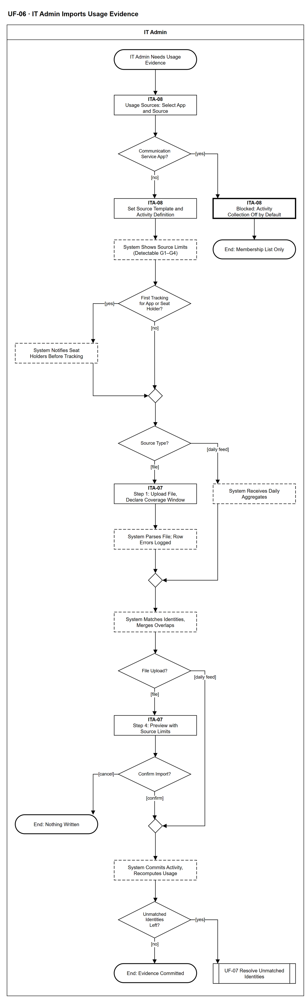

# UF-06 — IT Admin Imports Usage Evidence

> **Loại:** User flow (mức màn hình) — IT Admin · **Phiên bản:** 1.1 — 09/10/2026 · **Trạng thái:** Vẽ theo WF-12 v3.0 (QĐ-59a, QĐ-57d) và BRD v3.30 (đồng bộ QĐ-61/QĐ-62); cách thu dữ liệu (loại bộ thu thập, ma trận nhà cung cấp) chốt ở giai đoạn Tools; mã màn hình là đề xuất — UI Spec hoãn (QĐ-08); chưa phải xác nhận của GVHD/hội đồng
>
> Sơ đồ là **dẫn xuất** từ quyết định Owner (`QĐ`) và BRD hiện hành; khi khác nhau, `QĐ` → BRD thắng. Quyết định trong sơ đồ là của Owner, **chưa** phải xác nhận của GVHD/hội đồng.

## 1. Mục đích và phạm vi

Hành trình của IT Admin khi đưa bằng chứng sử dụng vào hệ thống có kiểm soát: chọn ứng dụng và nguồn, bị chặn nếu là ứng dụng liên lạc, khai mẫu và định nghĩa hoạt động, thấy giới hạn của nguồn, xem trước, rồi xác nhận hoặc hủy. Không dòng dữ liệu thật nào được ghi trước khi IT xác nhận bản xem trước.

**Phạm vi:** Màn hình ITA-08 (nguồn và mẫu) và ITA-07 (các bước import), thông báo hệ thống mà IT Admin nhìn thấy.

**Không nằm trong sơ đồ này:** Chi tiết khớp danh tính (→ UF-07 / WF-12a); phát hiện lãng phí và xác nhận của trưởng phòng (→ UF-10, UF-05); đăng ký thiết bị và xác nhận theo dõi (→ UF-16); loại bộ thu thập cụ thể (Tools, QĐ-59a); bật thu thập có chủ đích cho ứng dụng liên lạc (Super Admin).

## 2. Tệp

| Tệp | Vai trò |
| --- | --- |
| [UF-06-it-admin-imports-usage-evidence.drawio](UF-06-it-admin-imports-usage-evidence.drawio) | Nguồn draw.io chỉnh sửa được (sinh từ spec) |
| [UF-06-it-admin-imports-usage-evidence.drawio.png](UF-06-it-admin-imports-usage-evidence.drawio.png) | Bản xuất PNG, nhúng sẵn nguồn draw.io |
| [UF-06.json](../specs/UF-06.json) | **Nguồn canonical** — sửa ở đây rồi chạy `python tools/flowkit.py build` từ `Docs/Diagrams` |

## 3. Nguồn nghiệp vụ

| Mã | Nội dung dùng trong sơ đồ |
| --- | --- |
| `FR-4.1, QĐ-59a` | Hai dạng file; nguồn kết nối và bộ thu thập; một ứng dụng nhiều nguồn |
| `FR-4.2, FR-4.16, INV-11` | Mẫu cấu hình nguồn và định nghĩa hoạt động bắt buộc |
| `FR-4.3, INV-10` | Cửa sổ bao phủ bắt buộc |
| `FR-4.4` | Ma trận năng lực: nhóm lãng phí phát hiện được từ nguồn |
| `FR-7.1 → FR-7.7` | Khung import, xem trước bắt buộc, lỗi từng dòng, mã băm, hợp nhất cửa sổ chồng lấn |
| `FR-10.4, QĐ-01` | Thông báo trước cho người giữ seat, mọi ứng dụng |
| `FR-1.8, ADR-10, ĐK-06` | Ứng dụng liên lạc mặc định không thu dữ liệu hoạt động |

## 4. Tác nhân, kích hoạt, điều kiện

| Làn (tiếng Anh trên hình) | Tác nhân | Trách nhiệm trong sơ đồ |
| --- | --- | --- |
| IT Admin | IT Admin | Thao tác trên các màn hình ITA-xx; bước hệ thống chỉ hiện kết quả hoặc trạng thái |

- **Kích hoạt:** IT Admin cần bằng chứng sử dụng cho một ứng dụng.
- **Tiền điều kiện:** Ứng dụng đã có trong danh mục (WF-02). Với nguồn từ thiết bị: thiết bị đã đăng ký và nhân viên đã xác nhận (UF-16).
- **Hậu điều kiện:** Một trong ba kết cục: dữ liệu đã ghi và trạng thái sử dụng tính lại · không ghi gì (IT hủy) · ứng dụng liên lạc bị chặn, chỉ dùng danh sách thành viên. Nếu còn định danh chưa khớp thì chuyển sang UF-07.

## 5. Cách đọc ký hiệu

| Ký hiệu | Nghĩa |
| --- | --- |
| Hình chữ nhật bo tròn hai đầu, viền đậm | Điểm bắt đầu hoặc kết cục của hành trình |
| Hình chữ nhật viền liền, dòng đầu in đậm | Màn hình người dùng thao tác; dòng đầu là mã màn hình đề xuất |
| Hình chữ nhật viền nét đứt | Hệ thống tự xử lý; người dùng chỉ thấy kết quả |
| Hình chữ nhật viền rất đậm | Màn hình chặn hoặc trạng thái lỗi |
| Hình thoi | Rẽ nhánh; cạnh ra mang điều kiện `[...]` |
| Hình chữ nhật hai vạch đứng | Gọi user flow khác (mã `UF-xx` trong nhãn); có cạnh ra thì hành trình quay lại và đi tiếp, không có cạnh ra thì sơ đồ này dừng tại đó |
| Dây có cung nhảy | Hai dây giao nhau nhưng **không** nối với nhau |

Đọc từ trên xuống. Hình chữ nhật viền liền là màn hình (dòng đầu là mã màn hình đề xuất), nét đứt là bước hệ thống tự xử lý, viền rất đậm là màn hình chặn, hai vạch đứng là chuyển sang user flow khác.

## 6. Bảng node

| ID | Loại | Nhãn trên hình | Ý nghĩa | Làn / người thực hiện | Quy tắc |
| --- | --- | --- | --- | --- | --- |
| `t_start` | Điểm đầu/cuối | IT Admin Needs Usage Evidence | IT Admin cần bằng chứng sử dụng cho một ứng dụng (file xuất từ nhà cung cấp, kết nối nhà cung cấp hoặc bộ thu thập trên thiết bị công ty). | IT Admin | — |
| `s_pick` | Màn hình | ITA-08 — Usage Sources: Select App and Source | Chọn ứng dụng và nguồn dữ liệu sử dụng. Một ứng dụng được có nhiều nguồn; nguồn chỉ cho bằng chứng dương không dùng để kết luận không hoạt động. | IT Admin | `FR-4.1`, `QĐ-59a` |
| `d_comm` | Rẽ nhánh | Communication Service App? | Ứng dụng có cờ nhóm dịch vụ liên lạc (nhắn tin, họp trực tuyến, thư điện tử) không. | IT Admin | `FR-1.8`, `ADR-10` |
| `b_comm` | Màn hình chặn/lỗi | ITA-08 — Blocked: Activity Collection Off by Default | Chặn có chủ ý: ứng dụng liên lạc mặc định không thu dữ liệu hoạt động, chỉ dùng danh sách thành viên cho G1/G2. Bật thu thập có chủ đích do Super Admin xác nhận, nằm ngoài luồng này. | IT Admin | `FR-1.8`, `ADR-10`, `ĐK-06` |
| `t_comm` | Điểm đầu/cuối | End: Membership List Only | Không import dữ liệu hoạt động; ứng dụng chỉ dùng danh sách thành viên. | IT Admin | — |
| `s_tpl` | Màn hình | ITA-08 — Set Source Template and Activity Definition | Khai mẫu cấu hình nguồn: ánh xạ cột, loại định danh (email / username / ID), định dạng ngày, múi giờ nguồn, bảng phân loại loại sự kiện. Bắt buộc khai nguồn này hiểu hoạt động là gì. | IT Admin | `FR-4.2`, `FR-4.16`, `INV-11` |
| `y_cap` | Hệ thống xử lý | System Shows Source Limits (Detectable G1–G4) | Hệ thống suy ra và hiển thị nhóm lãng phí nào phát hiện được từ năng lực của nguồn: chỉ danh sách thành viên ⟹ G1, G2; thêm ngày hoạt động cuối ⟹ G1–G4. | IT Admin | `FR-4.4` |
| `d_first` | Rẽ nhánh | First Tracking for App or Seat Holder? | Ứng dụng bắt đầu được theo dõi lần đầu, hoặc có người mới được cấp seat của ứng dụng đang được theo dõi, mà chưa nhận thông báo. | IT Admin | `FR-10.4`, `QĐ-01` |
| `y_notice` | Hệ thống xử lý | System Notifies Seat Holders Before Tracking | Hệ thống thông báo cho mọi nhân viên đang giữ seat: loại dữ liệu thu thập và mục đích (phát hiện license không dùng, không đánh giá năng suất). Gửi trước khi thu dữ liệu, cho mọi ứng dụng. Người **mới được cấp seat** của một ứng dụng đang được theo dõi cũng nhận thông báo FR-10.4 trước khi dữ liệu của họ được ghi (QĐ-01). | IT Admin | `FR-10.4`, `QĐ-01`, `ND-3` |
| `m_first` | Hợp nhánh | — | — | IT Admin | — |
| `d_type` | Rẽ nhánh | Source Type? | Nguồn là file IT tải lên, hay nguồn tự đẩy tổng hợp theo ngày (kết nối nhà cung cấp, bộ thu thập trên thiết bị công ty). | IT Admin | `FR-4.1` |
| `s_up` | Màn hình | ITA-07 — Step 1: Upload File, Declare Coverage Window | Tải file dạng tổng hợp (mỗi người một dòng) hoặc dạng sự kiện (mỗi dòng một sự kiện). Bắt buộc khai cửa sổ bao phủ (từ ngày – đến ngày) khi file không tự chứa; hệ thống tính mã băm và cảnh báo nếu file đã import (không chặn cứng). | IT Admin | `FR-4.1`, `FR-4.3`, `INV-10`, `FR-7.1` |
| `y_feed` | Hệ thống xử lý | System Receives Daily Aggregates | Kết nối nhà cung cấp hoặc bộ thu thập gửi tổng hợp theo ngày đã lọc tại nguồn. Dữ liệu từ thiết bị chỉ được nhận khi thiết bị đã đăng ký và nhân viên đã xác nhận (UF-16). IT Admin chỉ thấy trạng thái nhận. | IT Admin | `FR-4.1`, `FR-4.3a`, `INV-17`, `ADR-13` |
| `y_parse` | Hệ thống xử lý | System Parses File; Row Errors Logged | Phân tích theo mẫu, chuẩn hóa múi giờ về múi giờ tổ chức, loại sự kiện chỉ xác thực khỏi hoạt động. Lỗi một dòng không làm hỏng cả file: ghi riêng dòng, cột, mã lỗi để tải về. | IT Admin | `FR-7.1`, `FR-7.3`, `FR-7.4`, `FR-7.5`, `FR-4.11` |
| `m_in` | Hợp nhánh | — | — | IT Admin | — |
| `y_match` | Hệ thống xử lý | System Matches Identities, Merges Overlaps | Khớp định danh nhà cung cấp với nhân viên (WF-12a); bản ghi chưa khớp vào hàng đợi và không dùng để kết luận. Cửa sổ chồng lấn hợp nhất theo (danh tính, ngày): nguồn kết thúc muộn hơn thắng, không ghi đè im lặng. | IT Admin | `FR-4.5`, `FR-4.6`, `FR-7.7`, `INV-12` |
| `d_src2` | Rẽ nhánh | File Upload? | Tệp IT tải lên thì xem trước và xác nhận; nguồn tự đẩy theo ngày thì hệ thống tự ghi. | IT Admin | `FR-7.1`, `FR-4.1` |
| `s_prev` | Màn hình | ITA-07 — Step 4: Preview with Source Limits | Xem trước bắt buộc, chưa ghi dữ liệu thật: số dòng hợp lệ, dòng lỗi kèm lý do, dòng đã tồn tại sẽ bỏ qua, định danh chưa khớp, cửa sổ dữ liệu, số bản ghi bị ảnh hưởng; kèm giới hạn của nguồn (nhóm lãng phí phát hiện được, định nghĩa hoạt động). | IT Admin | `FR-7.2`, `FR-4.4`, `FR-4.16` |
| `d_conf` | Rẽ nhánh | Confirm Import? | IT Admin xác nhận ghi dữ liệu hay hủy sau khi xem bản xem trước. | IT Admin | `FR-7.2` |
| `m_cm` | Hợp nhánh | — | — | IT Admin | — |
| `t_cancel` | Điểm đầu/cuối | End: Nothing Written | IT hủy ở bước xem trước: không dòng nào được ghi. | IT Admin | — |
| `y_commit` | Hệ thống xử lý | System Commits Activity, Recomputes Usage | Ghi dữ liệu và tổng hợp lại: hoạt động gắn vào Assignment đúng thời điểm sự kiện, không gắn trực tiếp vào nhân viên; trạng thái sử dụng từng seat tính lại (đang hoạt động · không hoạt động · không có dữ liệu · chưa khớp danh tính). Nguồn tự đẩy tổng hợp theo ngày (kết nối nhà cung cấp, bộ thu thập trên thiết bị) **không** qua xem trước và xác nhận thủ công từng đợt: hệ thống tự ghi, vẫn ghi lỗi theo dòng (FR-7.3), độ mới và bao phủ (FR-4.3a, cổng 6 của FR-4.9) và báo cáo chất lượng (FR-5.12); thiết bị chưa xác nhận thì không nhận (INV-17). IT chỉ cấu hình nguồn một lần (`a_tpl`). *Suy ra* từ FR-7.1 (khung tải tệp) và FR-4.1 (nguồn ngoài tệp). | IT Admin | `FR-7.1`, `FR-4.7`, `FR-5.10` |
| `d_unm` | Rẽ nhánh | Unmatched Identities Left? | Sau khi ghi, còn định danh chưa khớp trong hàng đợi không. | IT Admin | `FR-4.6`, `FR-4.10` |
| `r_uf07` | Chuyển sang user flow khác | UF-07 Resolve Unmatched Identities | Chuyển sang luồng xử lý hàng đợi chưa khớp danh tính. | IT Admin | → `UF-07` |
| `t_ok` | Điểm đầu/cuối | End: Evidence Committed | Dữ liệu đã ghi; trạng thái sử dụng đã tính lại; phát hiện lãng phí chạy theo lịch (WF-13). | IT Admin | — |

## 7. Bảng chuyển tiếp

| Từ → tới | Nhãn điều kiện | Điều kiện | Kết quả |
| --- | --- | --- | --- |
| `t_start` → `s_pick` | — | — | Sang ITA-08 — Usage Sources: Select App and Source |
| `s_pick` → `d_comm` | — | — | Sang Communication Service App? |
| `d_comm` → `b_comm` | `[yes]` | Ứng dụng nhóm liên lạc | Chặn, không thu dữ liệu hoạt động |
| `d_comm` → `s_tpl` | `[no]` | Ứng dụng thường | Khai mẫu cấu hình |
| `b_comm` → `t_comm` | — | — | Sang End: Membership List Only |
| `s_tpl` → `y_cap` | — | — | Sang System Shows Source Limits (Detectable G1–G4) |
| `y_cap` → `d_first` | — | — | Sang First Tracking for App or Seat Holder? |
| `d_first` → `y_notice` | `[yes]` | Lần đầu theo dõi ứng dụng | Thông báo người giữ seat |
| `d_first` → `m_first` | `[no]` | Đã theo dõi trước đó | Đi tiếp |
| `y_notice` → `m_first` | — | — | Sang — |
| `m_first` → `d_type` | — | — | Sang Source Type? |
| `d_type` → `s_up` | `[file]` | IT tải file lên | Đường import file |
| `d_type` → `y_feed` | `[daily feed]` | Nguồn tự đẩy tổng hợp theo ngày | Nhận tổng hợp |
| `s_up` → `y_parse` | — | — | Sang System Parses File; Row Errors Logged |
| `y_parse` → `m_in` | — | — | Sang — |
| `y_feed` → `m_in` | — | — | Sang — |
| `m_in` → `y_match` | — | — | Sang System Matches Identities, Merges Overlaps |
| `y_match` → `d_src2` | — | — | Sang File Upload? |
| `d_src2` → `s_prev` | `[file]` | — | Sang ITA-07 — Step 4: Preview with Source Limits |
| `d_src2` → `m_cm` | `[daily feed]` | — | Sang — |
| `s_prev` → `d_conf` | — | — | Sang Confirm Import? |
| `d_conf` → `m_cm` | `[confirm]` | IT xác nhận ghi | Ghi và tổng hợp lại |
| `d_conf` → `t_cancel` | `[cancel]` | IT hủy | Không ghi gì |
| `m_cm` → `y_commit` | — | — | Sang System Commits Activity, Recomputes Usage |
| `y_commit` → `d_unm` | — | — | Sang Unmatched Identities Left? |
| `d_unm` → `r_uf07` | `[yes]` | Còn định danh chưa khớp | Sang UF-07 |
| `d_unm` → `t_ok` | `[no]` | Khớp hết | Hoàn tất |

Số đếm: **25 node · 27 cạnh · 6 rẽ nhánh**; giao cắt dây: **0**.

## 8. Happy path

1. `t_start` — IT Admin Needs Usage Evidence: IT Admin cần bằng chứng sử dụng cho một ứng dụng (file xuất từ nhà cung cấp, kết nối nhà cung cấp hoặc bộ thu thập trên thiết bị công ty).
2. `s_pick` — ITA-08 — Usage Sources: Select App and Source: Chọn ứng dụng và nguồn dữ liệu sử dụng. Một ứng dụng được có nhiều nguồn; nguồn chỉ cho bằng chứng dương không dùng để kết luận không hoạt động.
3. `d_comm` — Communication Service App?: Ứng dụng có cờ nhóm dịch vụ liên lạc (nhắn tin, họp trực tuyến, thư điện tử) không.
4. `s_tpl` — ITA-08 — Set Source Template and Activity Definition: Khai mẫu cấu hình nguồn: ánh xạ cột, loại định danh (email / username / ID), định dạng ngày, múi giờ nguồn, bảng phân loại loại sự kiện. Bắt buộc khai nguồn này hiểu hoạt động là gì.
5. `y_cap` — System Shows Source Limits (Detectable G1–G4): Hệ thống suy ra và hiển thị nhóm lãng phí nào phát hiện được từ năng lực của nguồn: chỉ danh sách thành viên ⟹ G1, G2; thêm ngày hoạt động cuối ⟹ G1–G4.
6. `d_first` — First Tracking for App or Seat Holder?: Ứng dụng bắt đầu được theo dõi lần đầu, hoặc có người mới được cấp seat của ứng dụng đang được theo dõi, mà chưa nhận thông báo.
7. `d_type` — Source Type?: Nguồn là file IT tải lên, hay nguồn tự đẩy tổng hợp theo ngày (kết nối nhà cung cấp, bộ thu thập trên thiết bị công ty).
8. `s_up` — ITA-07 — Step 1: Upload File, Declare Coverage Window: Tải file dạng tổng hợp (mỗi người một dòng) hoặc dạng sự kiện (mỗi dòng một sự kiện). Bắt buộc khai cửa sổ bao phủ (từ ngày – đến ngày) khi file không tự chứa; hệ thống tính mã băm và cảnh báo nếu file đã import (không chặn cứng).
9. `y_parse` — System Parses File; Row Errors Logged: Phân tích theo mẫu, chuẩn hóa múi giờ về múi giờ tổ chức, loại sự kiện chỉ xác thực khỏi hoạt động. Lỗi một dòng không làm hỏng cả file: ghi riêng dòng, cột, mã lỗi để tải về.
10. `y_match` — System Matches Identities, Merges Overlaps: Khớp định danh nhà cung cấp với nhân viên (WF-12a); bản ghi chưa khớp vào hàng đợi và không dùng để kết luận. Cửa sổ chồng lấn hợp nhất theo (danh tính, ngày): nguồn kết thúc muộn hơn thắng, không ghi đè im lặng.
11. `d_src2` — File Upload?: Tệp IT tải lên thì xem trước và xác nhận; nguồn tự đẩy theo ngày thì hệ thống tự ghi.
12. `s_prev` — ITA-07 — Step 4: Preview with Source Limits: Xem trước bắt buộc, chưa ghi dữ liệu thật: số dòng hợp lệ, dòng lỗi kèm lý do, dòng đã tồn tại sẽ bỏ qua, định danh chưa khớp, cửa sổ dữ liệu, số bản ghi bị ảnh hưởng; kèm giới hạn của nguồn (nhóm lãng phí phát hiện được, định nghĩa hoạt động).
13. `d_conf` — Confirm Import?: IT Admin xác nhận ghi dữ liệu hay hủy sau khi xem bản xem trước.
14. `y_commit` — System Commits Activity, Recomputes Usage: Ghi dữ liệu và tổng hợp lại: hoạt động gắn vào Assignment đúng thời điểm sự kiện, không gắn trực tiếp vào nhân viên; trạng thái sử dụng từng seat tính lại (đang hoạt động · không hoạt động · không có dữ liệu · chưa khớp danh tính). Nguồn tự đẩy tổng hợp theo ngày (kết nối nhà cung cấp, bộ thu thập trên thiết bị) **không** qua xem trước và xác nhận thủ công từng đợt: hệ thống tự ghi, vẫn ghi lỗi theo dòng (FR-7.3), độ mới và bao phủ (FR-4.3a, cổng 6 của FR-4.9) và báo cáo chất lượng (FR-5.12); thiết bị chưa xác nhận thì không nhận (INV-17). IT chỉ cấu hình nguồn một lần (`a_tpl`). *Suy ra* từ FR-7.1 (khung tải tệp) và FR-4.1 (nguồn ngoài tệp).
15. `d_unm` — Unmatched Identities Left?: Sau khi ghi, còn định danh chưa khớp trong hàng đợi không.
16. `t_ok` — End: Evidence Committed: Dữ liệu đã ghi; trạng thái sử dụng đã tính lại; phát hiện lãng phí chạy theo lịch (WF-13).

## 9. Nhánh thay thế / if-else

- **Lần đầu theo dõi ứng dụng** — `d_first` → `y_notice` → `m_first`. Người giữ seat được thông báo trước khi thu dữ liệu.
- **Nguồn tự đẩy tổng hợp theo ngày** — `d_type` → `y_feed` → `m_in` → `y_match` → `d_src2` → `m_cm` → `y_commit`. Tự ghi, không xem trước/xác nhận từng đợt (suy ra từ FR-7.1, FR-4.1).
- **Còn định danh chưa khớp** — `d_unm` → `r_uf07`. Phạm vi sơ đồ dừng ở đây; bản ghi chưa khớp không dùng để kết luận.

## 10. Nhánh lỗi / từ chối và cách kết thúc

- **Ứng dụng nhóm liên lạc** — `d_comm` → `b_comm` → `t_comm`. Chặn có chủ ý, mặc định không thu dữ liệu hoạt động.
- **IT hủy ở bước xem trước** — `d_conf` → `t_cancel`. Không dòng nào được ghi.

## 11. Liên hệ với sơ đồ khác

- Workflow: `WF-12`, `WF-12a`, `WF-13`, `WF-18`
- `UF-07` (xử lý chưa khớp), `UF-10` (bảng tối ưu license dùng kết quả), `UF-16` (đăng ký thiết bị và xác nhận)
- `UF-07` — gọi/chuyển tại node `r_uf07`

## 12. Giới hạn và vấn đề còn mở

- (ĐÃ CÓ NGUỒN · DOI-59, suy ra) Xem trước và xác nhận chỉ áp cho tệp tải lên; nguồn tự đẩy theo ngày tự ghi — vẽ ở `d_src2`.
- (ĐÃ CÓ NGUỒN · DOI-60, QĐ-01) Người mới được cấp seat của ứng dụng đang được theo dõi nhận thông báo FR-10.4 trước khi dữ liệu của họ được ghi.
- (DEFERRED/OUT · DOI-09, QĐ-59a, QĐ-57d) Loại bộ thu thập, cách báo bao phủ và quy tắc hợp nhất nhiều bộ thu thập do giai đoạn Tools chốt.
- (LATER-TECH/UI · DOI-31) Nhãn bước 1 và bước 4 theo khung import 6 bước của FR-7; các bước 2, 3, 5, 6 là bước hệ thống nên không có mã màn hình riêng.
- (LATER-TECH/UI · DOI-01, QĐ-08) Mã màn hình ITA-07, ITA-08 dùng lại từ bản cũ (v0.7); chưa có UI Spec hiện hành.
