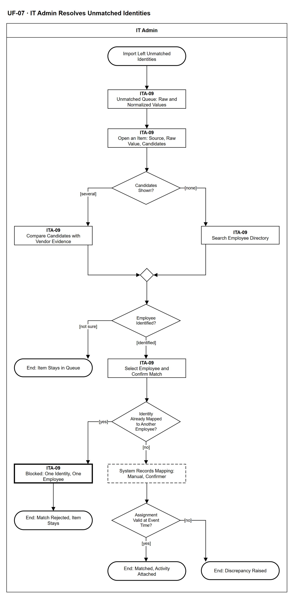

# UF-07 — IT Admin Resolves Unmatched Identities

> **Loại:** User flow (mức màn hình) — IT Admin · **Phiên bản:** 1.1 — 09/10/2026 · **Trạng thái:** Vẽ theo WF-12a v3.0 và BRD v3.30 (đồng bộ QĐ-61/QĐ-62) (FR-4.5, FR-4.6, FR-7.6, FR-7.7); mã màn hình là đề xuất — UI Spec hoãn (QĐ-08); chưa phải xác nhận của GVHD/hội đồng
>
> Sơ đồ là **dẫn xuất** từ quyết định Owner (`QĐ`) và BRD hiện hành; khi khác nhau, `QĐ` → BRD thắng. Quyết định trong sơ đồ là của Owner, **chưa** phải xác nhận của GVHD/hội đồng.

## 1. Mục đích và phạm vi

Hành trình của IT Admin xử lý hàng đợi chưa khớp danh tính sau import: xem giá trị thô cạnh giá trị chuẩn hóa, so sánh ứng viên (không có hoặc nhiều), xác nhận khớp thủ công kèm tên người xác nhận, hoặc để mục lại hàng đợi. Bản ghi chưa khớp không bao giờ được dùng để kết luận.

**Phạm vi:** Màn hình ITA-09 (hàng đợi và chi tiết mục) và kết quả hệ thống IT Admin nhìn thấy.

**Không nằm trong sơ đồ này:** Chuẩn hóa tự động và khớp tự động (bước hệ thống của WF-12a, tầng ánh xạ chốt ở Tools — QĐ-59c); xử lý sai lệch (→ UF-14); nhập file (→ UF-06).

## 2. Tệp

| Tệp | Vai trò |
| --- | --- |
| [UF-07-it-admin-resolves-unmatched-identities.drawio](UF-07-it-admin-resolves-unmatched-identities.drawio) | Nguồn draw.io chỉnh sửa được (sinh từ spec) |
| [UF-07-it-admin-resolves-unmatched-identities.drawio.png](UF-07-it-admin-resolves-unmatched-identities.drawio.png) | Bản xuất PNG, nhúng sẵn nguồn draw.io |
| [UF-07.json](../specs/UF-07.json) | **Nguồn canonical** — sửa ở đây rồi chạy `python tools/flowkit.py build` từ `Docs/Diagrams` |

## 3. Nguồn nghiệp vụ

| Mã | Nội dung dùng trong sơ đồ |
| --- | --- |
| `FR-4.5` | Bảng ánh xạ: nhà cung cấp, khóa ngoài, phương pháp, mức tin cậy, người xác nhận |
| `FR-4.6, INV-12` | Chưa khớp vào hàng đợi, không bỏ qua im lặng, không dùng để kết luận |
| `FR-7.6` | Chuẩn hóa email dùng nhất quán khi tạo ánh xạ và khi đối chiếu |
| `FR-7.7` | Một định danh khớp hai nhân viên: không nguồn nào thắng, vào hàng đợi; không gán một định danh cho hai người |
| `FR-4.7, QĐ-35c` | Gắn hoạt động vào Assignment tại thời điểm sự kiện |
| `FR-4.8, FR-2.6` | Hoạt động không có Assignment thành sai lệch |

## 4. Tác nhân, kích hoạt, điều kiện

| Làn (tiếng Anh trên hình) | Tác nhân | Trách nhiệm trong sơ đồ |
| --- | --- | --- |
| IT Admin | IT Admin | Thao tác trên màn hình ITA-09; bước hệ thống chỉ hiện kết quả |

- **Kích hoạt:** Một lần import (UF-06) để lại định danh chưa khớp hoặc khớp mơ hồ.
- **Tiền điều kiện:** Hàng đợi chưa khớp có ít nhất một mục.
- **Hậu điều kiện:** Mục được khớp thủ công và hoạt động gắn vào Assignment, hoặc ghi sai lệch; hoặc mục ở lại hàng đợi (kể cả khi phép khớp bị chặn vì trùng).

## 5. Cách đọc ký hiệu

| Ký hiệu | Nghĩa |
| --- | --- |
| Hình chữ nhật bo tròn hai đầu, viền đậm | Điểm bắt đầu hoặc kết cục của hành trình |
| Hình chữ nhật viền liền, dòng đầu in đậm | Màn hình người dùng thao tác; dòng đầu là mã màn hình đề xuất |
| Hình chữ nhật viền nét đứt | Hệ thống tự xử lý; người dùng chỉ thấy kết quả |
| Hình chữ nhật viền rất đậm | Màn hình chặn hoặc trạng thái lỗi |
| Hình thoi | Rẽ nhánh; cạnh ra mang điều kiện `[...]` |
| Dây có cung nhảy | Hai dây giao nhau nhưng **không** nối với nhau |

Đọc từ trên xuống. Hình chữ nhật viền liền là màn hình (dòng đầu là mã màn hình đề xuất), nét đứt là bước hệ thống, viền rất đậm là màn hình chặn.

## 6. Bảng node

| ID | Loại | Nhãn trên hình | Ý nghĩa | Làn / người thực hiện | Quy tắc |
| --- | --- | --- | --- | --- | --- |
| `t_start` | Điểm đầu/cuối | Import Left Unmatched Identities | Sau một lần import (UF-06) còn định danh phía nhà cung cấp chưa khớp được nhân viên nào, hoặc khớp mơ hồ. | IT Admin | — |
| `s_queue` | Màn hình | ITA-09 — Unmatched Queue: Raw and Normalized Values | Hàng đợi chưa khớp: giá trị thô nguyên văn bên cạnh giá trị đã chuẩn hóa, nhà cung cấp, số bản ghi. Không bản ghi nào bị bỏ qua im lặng. | IT Admin | `FR-4.6`, `FR-7.6`, `INV-12` |
| `s_item` | Màn hình | ITA-09 — Open an Item: Source, Raw Value, Candidates | Mở một mục: hệ thống hiện các nhân viên ứng viên theo luật đối chiếu. Hệ thống không tự chọn một trong hai người khi khớp mơ hồ. | IT Admin | `FR-4.5`, `FR-7.7`, `QĐ-35b` |
| `d_cand` | Rẽ nhánh | Candidates Shown? | Hệ thống gợi ý được nhiều ứng viên, hay không có ứng viên nào. | IT Admin | `FR-4.6`, `FR-7.7` |
| `s_cmp` | Màn hình | ITA-09 — Compare Candidates with Vendor Evidence | Có từ hai ứng viên trở lên: IT so sánh với thông tin nhà cung cấp (email, tên, thời điểm hoạt động) để xác định đúng người. | IT Admin | `FR-7.7`, `FR-4.5` |
| `s_search` | Màn hình | ITA-09 — Search Employee Directory | Không có ứng viên: IT tìm trong danh sách nhân viên theo tên, email hoặc bí danh đã biết. | IT Admin | `FR-4.5` |
| `m_cmp` | Hợp nhánh | — | — | IT Admin | — |
| `d_know` | Rẽ nhánh | Employee Identified? | IT xác định được đúng nhân viên hay để mục lại trong hàng đợi. | IT Admin | `FR-4.5`, `FR-4.6` |
| `t_left` | Điểm đầu/cuối | End: Item Stays in Queue | Mục ở lại hàng đợi, không dùng để kết luận về bất kỳ ai; hàng đợi giảm dần sau mỗi lần import. | IT Admin | — |
| `s_conf` | Màn hình | ITA-09 — Select Employee and Confirm Match | IT chọn đúng nhân viên và xác nhận; hệ thống ghi phương pháp khớp là thủ công và tên người xác nhận. | IT Admin | `FR-4.5`, `FR-7.7` |
| `d_dup` | Rẽ nhánh | Identity Already Mapped to Another Employee? | Định danh này đã được ánh xạ cho một nhân viên khác chưa. | IT Admin | `FR-7.7`, `INV-12` |
| `b_dup` | Màn hình chặn/lỗi | ITA-09 — Blocked: One Identity, One Employee | Chặn: một định danh không được gán cho hai nhân viên; không nguồn nào thắng, mục vẫn ở hàng đợi. | IT Admin | `FR-7.7`, `INV-12` |
| `t_dup` | Điểm đầu/cuối | End: Match Rejected, Item Stays | Phép khớp bị từ chối, mục ở lại hàng đợi. | IT Admin | — |
| `y_rec` | Hệ thống xử lý | System Records Mapping: Manual, Confirmer | Lưu ánh xạ: nhà cung cấp, khóa định danh ngoài, phương pháp khớp (thủ công), mức tin cậy, người xác nhận; lưu cả giá trị thô lẫn chuẩn hóa. | IT Admin | `FR-4.5` |
| `d_asg` | Rẽ nhánh | Assignment Valid at Event Time? | Nhân viên vừa khớp có Assignment đang hiệu lực tại thời điểm sự kiện không (gia hạn nối chuỗi Assignment). | IT Admin | `FR-4.7`, `QĐ-35c` |
| `t_ok` | Điểm đầu/cuối | End: Matched, Activity Attached | Hoạt động gắn vào Assignment tại thời điểm sự kiện, không gắn trực tiếp vào nhân viên; seat được tính lại trạng thái sử dụng. | IT Admin | — |
| `t_disc` | Điểm đầu/cuối | End: Discrepancy Raised | Có hoạt động nhưng không có Assignment: ghi sai lệch loại có ở nhà cung cấp nhưng không có trong hệ thống; hệ thống không tự tạo Assignment (xử lý ở UF-14). | IT Admin | — |

## 7. Bảng chuyển tiếp

| Từ → tới | Nhãn điều kiện | Điều kiện | Kết quả |
| --- | --- | --- | --- |
| `t_start` → `s_queue` | — | — | Sang ITA-09 — Unmatched Queue: Raw and Normalized Values |
| `s_queue` → `s_item` | — | — | Sang ITA-09 — Open an Item: Source, Raw Value, Candidates |
| `s_item` → `d_cand` | — | — | Sang Candidates Shown? |
| `d_cand` → `s_cmp` | `[several]` | Khớp hai nhân viên trở lên | So sánh ứng viên |
| `d_cand` → `s_search` | `[none]` | Không có ứng viên | Tìm trong danh sách nhân viên |
| `s_cmp` → `m_cmp` | — | — | Sang — |
| `s_search` → `m_cmp` | — | — | Sang — |
| `m_cmp` → `d_know` | — | — | Sang Employee Identified? |
| `d_know` → `s_conf` | `[identified]` | IT xác định được nhân viên | Xác nhận khớp |
| `d_know` → `t_left` | `[not sure]` | IT chưa chắc | Để lại hàng đợi |
| `s_conf` → `d_dup` | — | — | Sang Identity Already Mapped to Another Employee? |
| `d_dup` → `b_dup` | `[yes]` | Đã gán cho nhân viên khác | Chặn |
| `d_dup` → `y_rec` | `[no]` | Chưa gán cho ai khác | Ghi ánh xạ |
| `b_dup` → `t_dup` | — | — | Sang End: Match Rejected, Item Stays |
| `y_rec` → `d_asg` | — | — | Sang Assignment Valid at Event Time? |
| `d_asg` → `t_ok` | `[yes]` | Có Assignment hiệu lực | Gắn hoạt động |
| `d_asg` → `t_disc` | `[no]` | Không có Assignment tương ứng | Ghi sai lệch |

Số đếm: **17 node · 17 cạnh · 4 rẽ nhánh**; giao cắt dây: **0**.

## 8. Happy path

1. `t_start` — Import Left Unmatched Identities: Sau một lần import (UF-06) còn định danh phía nhà cung cấp chưa khớp được nhân viên nào, hoặc khớp mơ hồ.
2. `s_queue` — ITA-09 — Unmatched Queue: Raw and Normalized Values: Hàng đợi chưa khớp: giá trị thô nguyên văn bên cạnh giá trị đã chuẩn hóa, nhà cung cấp, số bản ghi. Không bản ghi nào bị bỏ qua im lặng.
3. `s_item` — ITA-09 — Open an Item: Source, Raw Value, Candidates: Mở một mục: hệ thống hiện các nhân viên ứng viên theo luật đối chiếu. Hệ thống không tự chọn một trong hai người khi khớp mơ hồ.
4. `d_cand` — Candidates Shown?: Hệ thống gợi ý được nhiều ứng viên, hay không có ứng viên nào.
5. `s_cmp` — ITA-09 — Compare Candidates with Vendor Evidence: Có từ hai ứng viên trở lên: IT so sánh với thông tin nhà cung cấp (email, tên, thời điểm hoạt động) để xác định đúng người.
6. `d_know` — Employee Identified?: IT xác định được đúng nhân viên hay để mục lại trong hàng đợi.
7. `s_conf` — ITA-09 — Select Employee and Confirm Match: IT chọn đúng nhân viên và xác nhận; hệ thống ghi phương pháp khớp là thủ công và tên người xác nhận.
8. `d_dup` — Identity Already Mapped to Another Employee?: Định danh này đã được ánh xạ cho một nhân viên khác chưa.
9. `y_rec` — System Records Mapping: Manual, Confirmer: Lưu ánh xạ: nhà cung cấp, khóa định danh ngoài, phương pháp khớp (thủ công), mức tin cậy, người xác nhận; lưu cả giá trị thô lẫn chuẩn hóa.
10. `d_asg` — Assignment Valid at Event Time?: Nhân viên vừa khớp có Assignment đang hiệu lực tại thời điểm sự kiện không (gia hạn nối chuỗi Assignment).
11. `t_ok` — End: Matched, Activity Attached: Hoạt động gắn vào Assignment tại thời điểm sự kiện, không gắn trực tiếp vào nhân viên; seat được tính lại trạng thái sử dụng.

## 9. Nhánh thay thế / if-else

- **Không có ứng viên** — `d_cand` → `s_search` → `m_cmp`. IT tìm trong danh sách nhân viên rồi quay về nhánh chung.
- **Hoạt động không có Assignment** — `d_asg` → `t_disc`. Ghi sai lệch; hệ thống không tự tạo Assignment.

## 10. Nhánh lỗi / từ chối và cách kết thúc

- **IT chưa xác định được** — `d_know` → `t_left`. Mục ở lại hàng đợi, không dùng để kết luận.
- **Định danh đã gán cho nhân viên khác** — `d_dup` → `b_dup` → `t_dup`. Phép khớp bị chặn; mục ở lại hàng đợi.

## 11. Liên hệ với sơ đồ khác

- Workflow: `WF-12a`, `WF-12`
- `UF-06` (import dẫn tới luồng này), `UF-14` (sai lệch), `UF-10` (trạng thái sử dụng tính lại)

## 12. Giới hạn và vấn đề còn mở

- (LATER-TECH/UI · DOI-61) Người xác nhận của phép khớp tự động ghi là hệ thống/mã luật; khớp thủ công ghi tên IT Admin (WF-12a).
- (LATER-TECH/UI · DOI-61) Thời điểm tổng hợp lại sau khi IT khớp thủ công chốt ở thiết kế kỹ thuật; sơ đồ chỉ nêu kết quả gắn Assignment hoặc sai lệch như WF-12a.
- (LIMIT · DOI-62, FR-4.6) Nguồn hiện hành chỉ có *để lại hàng đợi*; không có thao tác *bỏ qua kèm lý do* như bản cũ v0.7.
- (LATER-TECH/UI · DOI-31, QĐ-08) Chuyển từ *nhiều ứng viên* sang *không ai* ở màn ITA-09 là cách trình bày giao diện.
- (DEFERRED/OUT · DOI-10, QĐ-59c) Luật bí danh và ngưỡng khớp chốt ở giai đoạn Tools.
