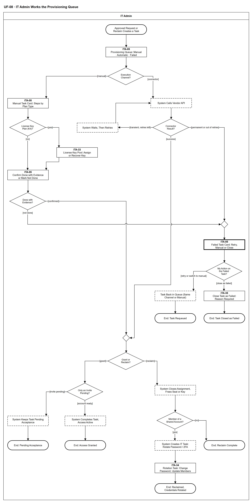

# UF-08 — IT Admin Works the Provisioning Queue

> **Loại:** User flow (mức màn hình) — IT Admin · **Phiên bản:** 1.6 — 10/10/2026 · **Trạng thái:** Vẽ theo WF-09a, BRD v3.32 (đồng bộ QĐ-61 → QĐ-64) (FR-1.9, FR-2.3 → FR-2.11) và QĐ-54; mã màn hình là đề xuất — UI Spec hoãn (QĐ-08); chưa phải xác nhận của GVHD/hội đồng
>
> Sơ đồ là **dẫn xuất** từ quyết định Owner (`QĐ`) và BRD hiện hành; khi khác nhau, `QĐ` → BRD thắng. Quyết định trong sơ đồ là của Owner, **chưa** phải xác nhận của GVHD/hội đồng.

## 1. Mục đích và phạm vi

Hành trình của IT Admin khi xử lý hàng đợi tác vụ cấp và thu hồi: chọn kênh theo kiểu cấp của gói (K1–K5), làm tay kèm bằng chứng hoặc theo dõi connector tự chạy và thử lại, xử lý khóa bản quyền từ kho, giữ trạng thái chờ chấp nhận, xử lý thất bại, và việc đổi mật khẩu khi thành viên tài khoản dùng chung rời. Mọi quyền chỉ cấp trên tài khoản công ty.

**Phạm vi:** Màn hình ITA-05 (hàng đợi và thẻ tác vụ), ITA-33 (kho khóa), ITA-34 (việc đổi mật khẩu/2FA) và phản hồi hệ thống IT Admin nhìn thấy.

**Không nằm trong sơ đồ này:** Quyết định có cấp hay thu hồi (WF-09, WF-11, WF-07, WF-08); bàn giao dữ liệu trước thu hồi khi nghỉ việc (→ UF-09); bước chờ người kích hoạt thu hồi (hoặc IT Admin ở bốn ca của QĐ-63a, trừ seat đã quyết Thu hồi ghost seat nằm trong phần vượt khi giảm thuê bao — trưởng phòng đó, QĐ-64a — HO-136) xác nhận bàn giao bản nhẹ trước khi gỡ (WF-09a `s_ask`; màn hình xác nhận thuộc giai đoạn UI — DOI-41); job đối soát chờ chấp nhận (FR-2.6); ghi nhận tiết kiệm (FR-4.15, MF-4); K3 SSO/SCIM (chỉ đặc tả).

## 2. Tệp

| Tệp | Vai trò |
| --- | --- |
| [UF-08-it-admin-works-the-provisioning-queue.drawio](UF-08-it-admin-works-the-provisioning-queue.drawio) | Nguồn draw.io chỉnh sửa được (sinh từ spec) |
| [UF-08-it-admin-works-the-provisioning-queue.drawio.png](UF-08-it-admin-works-the-provisioning-queue.drawio.png) | Bản xuất PNG, nhúng sẵn nguồn draw.io |
| [UF-08.json](../specs/UF-08.json) | **Nguồn canonical** — sửa ở đây rồi chạy `python tools/flowkit.py build` từ `Docs/Diagrams` |

## 3. Nguồn nghiệp vụ

| Mã | Nội dung dùng trong sơ đồ |
| --- | --- |
| `FR-2.3, FR-2.5, ADR-07` | Assignment tách khỏi Provisioning Task; kênh Connector/Manual; số lần thử và lỗi gần nhất |
| `BRD 6.2, 5.12.3` | Connector: chống gọi trùng, thử lại có giãn cách; trạng thái chờ chấp nhận |
| `FR-1.9, QĐ-54a` | Kiểu cấp K1–K5 là thuộc tính của gói; K3 chỉ đặc tả |
| `FR-2.9, QĐ-54c` | Chỉ tài khoản công ty; owner workspace luôn là tài khoản IT |
| `FR-2.10, QĐ-54b` | Kho khóa K4: mã hóa, che bớt, Audit Trail khi xem; khóa về kho nếu cho chuyển máy |
| `FR-2.11, QĐ-54d, QĐ-56c` | Thành viên tài khoản dùng chung rời ⟹ việc đổi mật khẩu/2FA cho IT |
| `FR-2.4, FR-4.15` | Thu hồi đưa seat về trống, không tự ghi tiết kiệm |
| `QĐ-49b, QĐ-50a` | Phần mềm nội bộ K5: làm ngoài hệ thống, xác nhận kèm bằng chứng |
| `FR-3.17, QĐ-58b` | IT Admin phụ trách phòng; IT Admin khác xử lý thay, có Audit Trail |

## 4. Tác nhân, kích hoạt, điều kiện

| Làn (tiếng Anh trên hình) | Tác nhân | Trách nhiệm trong sơ đồ |
| --- | --- | --- |
| IT Admin | IT Admin | Thao tác trên các màn hình ITA-xx; bước hệ thống chỉ hiện kết quả hoặc trạng thái |

- **Kích hoạt:** Một yêu cầu đã đủ phê duyệt (UF-01) hoặc một quyết định thu hồi sinh Provisioning Task.
- **Tiền điều kiện:** Assignment đã được tạo ở bước nghiệp vụ; tài khoản đích là email công việc thuộc tên miền công ty (hệ thống không ghi nhận Assignment trả phí cho tài khoản cá nhân — FR-2.9).
- **Hậu điều kiện:** Một trong các kết cục: cấp xong · chờ chấp nhận · thu hồi xong (có hoặc không việc đổi mật khẩu) · trả lại hàng đợi để thử lại hoặc làm tay (chưa phải kết cục cuối) · đóng thất bại có lý do (QĐ-62i).

## 5. Cách đọc ký hiệu

| Ký hiệu | Nghĩa |
| --- | --- |
| Hình chữ nhật bo tròn hai đầu, viền đậm | Điểm bắt đầu hoặc kết cục của hành trình |
| Hình chữ nhật viền liền, dòng đầu in đậm | Màn hình người dùng thao tác; dòng đầu là mã màn hình đề xuất |
| Hình chữ nhật viền nét đứt | Hệ thống tự xử lý; người dùng chỉ thấy kết quả |
| Hình chữ nhật viền rất đậm | Màn hình chặn hoặc trạng thái lỗi |
| Hình thoi | Rẽ nhánh; cạnh ra mang điều kiện `[...]` |
| Dây có cung nhảy | Hai dây giao nhau nhưng **không** nối với nhau |

Đọc từ trên xuống. Nhánh trái là kênh thủ công, nhánh phải là kênh connector; hai nhánh gặp nhau ở điểm hợp khi thành công. Hình chữ nhật viền liền là màn hình, nét đứt là bước hệ thống, viền rất đậm là màn hình lỗi.

## 6. Bảng node

| ID | Loại | Nhãn trên hình | Ý nghĩa | Làn / người thực hiện | Quy tắc |
| --- | --- | --- | --- | --- | --- |
| `t_start` | Điểm đầu/cuối | Approved Request or Reclaim Creates a Task | Yêu cầu đã đủ phê duyệt (cấp) hoặc có quyết định thu hồi: hệ thống sinh Provisioning Task ở trạng thái chờ thực thi, chỉ cho tài khoản công ty. | IT Admin | — |
| `s_queue` | Màn hình | ITA-05 — Provisioning Queue: Manual · Automatic · Failed | Hàng đợi tác vụ của phòng IT Admin phụ trách (IT Admin khác xử lý thay được, có Audit Trail). Ba tab dùng chung một vòng đời: cần làm tay, đang chạy tự động, thất bại. Quyền vẫn chiếm chỗ trong lúc thực thi. | IT Admin | `FR-2.5`, `FR-3.17`, `QĐ-58b` |
| `d_ch` | Rẽ nhánh | Execution Channel? | Kiểu cấp của gói (K1–K5) quyết định kênh: Connector khi nhà cung cấp có API được hỗ trợ; Manual cho K1, K2 không có connector, K4, K5. K3 SSO/SCIM chỉ đặc tả. | IT Admin | `FR-1.9`, `FR-2.5`, `QĐ-54a`, `RB-4` |
| `s_card` | Màn hình | ITA-05 — Manual Task Card: Steps by Plan Type | Thẻ việc làm tay hiện hướng dẫn theo kiểu cấp, chỉ trên tài khoản email công ty. Cấp: K1 mua gói trên tài khoản công ty của nhân viên · K2 thêm email công ty vào workspace do IT làm owner · K4 gán khóa từ kho · K5 cấp ngoài hệ thống. Thu hồi: K2 gỡ khỏi workspace · K1 thôi gia hạn · K4 gỡ kích hoạt · K5 thu hồi ngoài hệ thống kèm bằng chứng. | IT Admin | `FR-1.9`, `FR-2.9`, `QĐ-54a`, `QĐ-54c`, `QĐ-49b` |
| `d_k4` | Rẽ nhánh | License Key Plan (K4)? | Gói là khóa bản quyền K4 hay không. | IT Admin | `FR-2.10`, `QĐ-54b` |
| `s_key` | Màn hình | ITA-33 — License Key Pool: Assign or Recover Key | Kho khóa: khóa lưu mã hóa, hiển thị che bớt; chỉ IT Admin xem đầy đủ khi cấp và mỗi lần xem ghi Audit Trail. Mỗi khóa gắn tối đa một Assignment đang hiệu lực kèm thiết bị công ty. Thu hồi: gỡ kích hoạt, khóa về kho nếu điều khoản cho chuyển máy, nếu không thì ngừng dùng. Kho hết khóa là hết sức chứa (FR-2.10, INV-01): bên gọi (WF-09 `d_seat`) quay về nhánh mua thêm, không phải lỗi thực thi. | IT Admin | `FR-2.10`, `QĐ-54b`, `INV-01`, `SoD-5` |
| `s_done` | Màn hình | ITA-05 — Confirm Done with Evidence or Mark Not Done | IT Admin thực hiện ngoài hệ thống rồi xác nhận kèm bằng chứng và tên người làm, hoặc ghi lại là không làm được. Kênh thủ công không bao giờ tự chuyển sang hoàn tất. | IT Admin | `FR-2.3`, `FR-2.5`, `QĐ-49b` |
| `d_man` | Rẽ nhánh | Done with Evidence? | IT Admin xác nhận đã làm kèm bằng chứng, hay không hoàn tất được. | IT Admin | `FR-2.3`, `FR-2.5` |
| `m_err` | Hợp nhánh | — | — | IT Admin | — |
| `y_api` | Hệ thống xử lý | System Calls Vendor API | Hệ thống gọi cấp hoặc thu hồi qua connector với khóa chống gọi trùng và giới hạn tần suất; ghi số lần thử và lỗi gần nhất trên tác vụ. Tab Đang chạy tự động hiển thị trạng thái. | IT Admin | `FR-2.5`, `BRD 6.2` |
| `d_api` | Rẽ nhánh | Connector Result? | Phân loại kết quả gọi API: thành công, lỗi tạm thời, hoặc lỗi vĩnh viễn / hết lượt thử. | IT Admin | `FR-2.5`, `BRD 6.2` |
| `y_retry` | Hệ thống xử lý | System Waits, Then Retries | Lỗi tạm thời: thử lại có giãn cách, tăng số lần thử trên tác vụ. Lỗi vĩnh viễn không thử lại. | IT Admin | `FR-2.5`, `BRD 6.2` |
| `b_err` | Màn hình chặn/lỗi | ITA-05 — Failed Task Card: Retry, Manual or Close | Thẻ lỗi hiện số lần thử và lỗi gần nhất (lỗi vĩnh viễn hoặc đã hết lượt thử theo cấu hình). IT Admin chọn một trong ba việc; tác vụ chưa phải thất bại cuối cùng cho tới khi IT đóng (QĐ-62i). | IT Admin | `BRD 5.3 bảng ngoại lệ`, `FR-2.5`, `QĐ-62i` |
| `d_fix` | Rẽ nhánh | My Action on the Failed Task? | Thử lại cùng kênh · chuyển làm tay kèm bằng chứng · đóng là thất bại với lý do bắt buộc (QĐ-62i). | IT Admin | `QĐ-62i` |
| `y_req` | Hệ thống xử lý | Task Back in Queue (Same Channel or Manual) | Thử lại cùng kênh, hoặc chuyển sang làm tay kèm bằng chứng: tác vụ trở lại hàng đợi ở kênh đã chọn; IT xử lý lại từ đầu sơ đồ này (QĐ-62i). | IT Admin | `QĐ-62i` |
| `t_req` | Điểm đầu/cuối | End: Task Requeued | Tác vụ chờ xử lý lại; chưa phải thất bại. | IT Admin | — |
| `s_close` | Màn hình | ITA-35 — Close Task as Failed: Reason Required | Đóng tác vụ là thất bại, lý do bắt buộc, ghi Audit Trail. Bên gọi nhận kết quả thất bại: Request/Assignment thất bại, khoản cam kết (nếu có) giải phóng, người yêu cầu được báo (QĐ-62i, FR-5.8). Với thu hồi, lãng phí/G2 vẫn hiện tới khi xong. | IT Admin | `QĐ-62i`, `FR-5.8` |
| `t_fail` | Điểm đầu/cuối | End: Task Closed as Failed | Thất bại cuối cùng, có lý do và dấu vết. | IT Admin | — |
| `m_ok` | Hợp nhánh | — | — | IT Admin | — |
| `d_op` | Rẽ nhánh | Grant or Reclaim? | Thao tác của tác vụ đã thực thi thành công: cấp quyền hay thu hồi. | IT Admin | — |
| `d_pend` | Rẽ nhánh | Only an Invite Pending? | Nhà cung cấp mới tạo lời mời chờ chấp nhận, hay tài khoản đã sẵn sàng. | IT Admin | `BRD 5.12.3` |
| `y_pend` | Hệ thống xử lý | System Keeps Task Pending Acceptance | Tác vụ ở trạng thái chờ chấp nhận, không chuyển hoàn tất chỉ vì API trả thành công; seat vẫn bị chiếm; đối soát hằng ngày tiếp tục kiểm. Sau N ngày hệ thống nhắc nhân viên và IT Admin; sau M ngày IT được thu lại lời mời và đóng tác vụ thất bại có lý do (QĐ-62j; N, M cấu hình được). | IT Admin | `BRD 5.12.3`, `FR-2.6`, `QĐ-62j` |
| `t_pend` | Điểm đầu/cuối | End: Pending Acceptance | Tác vụ chờ chấp nhận; đối soát chuyển sang hoàn tất khi thành viên đã vào, hoặc IT đóng thất bại sau M ngày (QĐ-62j). | IT Admin | — |
| `y_act` | Hệ thống xử lý | System Completes Task; Access Active | Tác vụ hoàn tất, Assignment hoạt động, ghi Audit Trail; người yêu cầu được báo. Với K4, khóa gắn đúng một Assignment kèm thiết bị công ty. | IT Admin | `FR-2.3`, `FR-2.10`, `INV-01` |
| `t_grant` | Điểm đầu/cuối | End: Access Granted | Đã có quyền trên tài khoản công ty. | IT Admin | — |
| `y_free` | Hệ thống xử lý | System Closes Assignment, Frees Seat or Key | Assignment kết thúc; seat về trống (K2); khóa K4 về kho chỉ khi điều khoản cho chuyển máy, nếu không thì ngừng dùng; K1 thôi gia hạn; K5 không có seat. Thu hồi không tự ghi nhận tiền tiết kiệm. | IT Admin | `FR-2.4`, `FR-2.10`, `FR-4.15`, `QĐ-54b` |
| `d_shr` | Rẽ nhánh | Member of a Shared Account? | Người bị thu hồi có là thành viên một tài khoản dùng chung không. | IT Admin | `FR-2.11`, `QĐ-54d` |
| `t_rec` | Điểm đầu/cuối | End: Reclaim Complete | Thu hồi hoàn tất; kết quả thành công trả cho bên gọi. | IT Admin | — |
| `y_rot` | Hệ thống xử lý | System Creates IT Task: Rotate Password / 2FA | Hệ thống tạo việc cho IT Admin phụ trách đổi mật khẩu hoặc thiết bị xác thực hai lớp và cập nhật danh sách người dùng. Hệ thống không lưu mật khẩu dùng chung. Đây là tác vụ IT riêng có cảnh báo; thu hồi được coi là xong khi tác vụ đã được tạo (QĐ-62p). | IT Admin | `FR-2.11`, `QĐ-54d`, `QĐ-56c`, `FR-5.14` |
| `s_rot` | Màn hình | ITA-34 — Rotation Task: Change Password, Update Members | IT Admin đổi mật khẩu hoặc thiết bị xác thực ngoài hệ thống, cập nhật danh sách thành viên tài khoản dùng chung rồi đóng việc. | IT Admin | `FR-2.11`, `QĐ-54d` |
| `t_rec2` | Điểm đầu/cuối | End: Reclaimed, Credentials Rotated | Thu hồi hoàn tất và việc đổi mật khẩu / xác thực hai lớp đã đóng. | IT Admin | — |

## 7. Bảng chuyển tiếp

| Từ → tới | Nhãn điều kiện | Điều kiện | Kết quả |
| --- | --- | --- | --- |
| `t_start` → `s_queue` | — | — | Sang ITA-05 — Provisioning Queue: Manual · Automatic · Failed |
| `s_queue` → `d_ch` | — | — | Sang Execution Channel? |
| `d_ch` → `s_card` | `[manual]` | Kênh thủ công (K1, K2 không connector, K4, K5) | Sang ITA-05 — Manual Task Card: Steps by Plan Type |
| `d_ch` → `y_api` | `[connector]` | Nhà cung cấp có API được hỗ trợ | Hệ thống gọi API |
| `s_card` → `d_k4` | — | — | Sang License Key Plan (K4)? |
| `d_k4` → `s_key` | `[yes]` | Gói khóa bản quyền | Mở kho khóa |
| `d_k4` → `s_done` | `[no]` | Kiểu cấp khác | Thực hiện rồi xác nhận |
| `s_key` → `s_done` | — | — | Sang ITA-05 — Confirm Done with Evidence or Mark Not Done |
| `s_done` → `d_man` | — | — | Sang Done with Evidence? |
| `d_man` → `m_ok` | `[confirmed]` | Đã làm kèm bằng chứng | Ghi kết quả |
| `d_man` → `m_err` | `[not done]` | Không làm được | Sang — |
| `y_api` → `d_api` | — | — | Sang Connector Result? |
| `d_api` → `m_ok` | `[success]` | API trả thành công | Ghi kết quả |
| `d_api` → `y_retry` | `[transient, retries left]` | Lỗi tạm thời (còn lượt thử lại theo cấu hình) | Chờ rồi thử lại |
| `d_api` → `m_err` | `[permanent or out of retries]` | Lỗi vĩnh viễn/xác thực, hoặc đã hết lượt thử theo cấu hình | Ghi thất bại |
| `m_err` → `b_err` | — | — | Sang ITA-05 — Failed Task Card: Retry, Manual or Close |
| `b_err` → `d_fix` | — | — | Sang My Action on the Failed Task? |
| `d_fix` → `y_req` | `[retry or switch to manual]` | Thử lại cùng kênh, hoặc chuyển làm tay | Sang Task Back in Queue (Same Channel or Manual) |
| `y_req` → `t_req` | — | — | Sang End: Task Requeued |
| `d_fix` → `s_close` | `[close as failed]` | Đóng là thất bại, lý do bắt buộc | Sang ITA-35 — Close Task as Failed: Reason Required |
| `s_close` → `t_fail` | — | — | Sang End: Task Closed as Failed |
| `y_retry` → `y_api` | — | — | Sang System Calls Vendor API |
| `m_ok` → `d_op` | — | — | Sang Grant or Reclaim? |
| `d_op` → `d_pend` | `[grant]` | Thao tác cấp quyền | Kiểm lời mời đang chờ |
| `d_op` → `y_free` | `[reclaim]` | Thao tác thu hồi | Đóng Assignment |
| `d_pend` → `y_pend` | `[invite pending]` | Chỉ mới có lời mời | Giữ chờ chấp nhận |
| `d_pend` → `y_act` | `[account ready]` | Tài khoản đã sẵn sàng | Hoàn tất |
| `y_pend` → `t_pend` | — | — | Sang End: Pending Acceptance |
| `y_act` → `t_grant` | — | — | Sang End: Access Granted |
| `y_free` → `d_shr` | — | — | Sang Member of a Shared Account? |
| `d_shr` → `y_rot` | `[yes]` | Là thành viên tài khoản dùng chung | Tạo việc đổi mật khẩu/2FA |
| `d_shr` → `t_rec` | `[no]` | Không phải | Kết thúc thu hồi |
| `y_rot` → `s_rot` | — | — | Sang ITA-34 — Rotation Task: Change Password, Update Members |
| `s_rot` → `t_rec2` | — | — | Sang End: Reclaimed, Credentials Rotated |

Số đếm: **31 node · 34 cạnh · 8 rẽ nhánh**; giao cắt dây: **2**.

## 8. Happy path

1. `t_start` — Approved Request or Reclaim Creates a Task: Yêu cầu đã đủ phê duyệt (cấp) hoặc có quyết định thu hồi: hệ thống sinh Provisioning Task ở trạng thái chờ thực thi, chỉ cho tài khoản công ty.
2. `s_queue` — ITA-05 — Provisioning Queue: Manual · Automatic · Failed: Hàng đợi tác vụ của phòng IT Admin phụ trách (IT Admin khác xử lý thay được, có Audit Trail). Ba tab dùng chung một vòng đời: cần làm tay, đang chạy tự động, thất bại. Quyền vẫn chiếm chỗ trong lúc thực thi.
3. `d_ch` — Execution Channel?: Kiểu cấp của gói (K1–K5) quyết định kênh: Connector khi nhà cung cấp có API được hỗ trợ; Manual cho K1, K2 không có connector, K4, K5. K3 SSO/SCIM chỉ đặc tả.
4. `s_card` — ITA-05 — Manual Task Card: Steps by Plan Type: Thẻ việc làm tay hiện hướng dẫn theo kiểu cấp, chỉ trên tài khoản email công ty. Cấp: K1 mua gói trên tài khoản công ty của nhân viên · K2 thêm email công ty vào workspace do IT làm owner · K4 gán khóa từ kho · K5 cấp ngoài hệ thống. Thu hồi: K2 gỡ khỏi workspace · K1 thôi gia hạn · K4 gỡ kích hoạt · K5 thu hồi ngoài hệ thống kèm bằng chứng.
5. `d_k4` — License Key Plan (K4)?: Gói là khóa bản quyền K4 hay không.
6. `s_done` — ITA-05 — Confirm Done with Evidence or Mark Not Done: IT Admin thực hiện ngoài hệ thống rồi xác nhận kèm bằng chứng và tên người làm, hoặc ghi lại là không làm được. Kênh thủ công không bao giờ tự chuyển sang hoàn tất.
7. `d_man` — Done with Evidence?: IT Admin xác nhận đã làm kèm bằng chứng, hay không hoàn tất được.
8. `d_op` — Grant or Reclaim?: Thao tác của tác vụ đã thực thi thành công: cấp quyền hay thu hồi.
9. `d_pend` — Only an Invite Pending?: Nhà cung cấp mới tạo lời mời chờ chấp nhận, hay tài khoản đã sẵn sàng.
10. `y_act` — System Completes Task; Access Active: Tác vụ hoàn tất, Assignment hoạt động, ghi Audit Trail; người yêu cầu được báo. Với K4, khóa gắn đúng một Assignment kèm thiết bị công ty.
11. `t_grant` — End: Access Granted: Đã có quyền trên tài khoản công ty.

## 9. Nhánh thay thế / if-else

- **Khóa bản quyền K4** — `d_k4` → `s_key` → `s_done`. Gán khóa từ kho; mỗi lần xem khóa đầy đủ ghi Audit Trail.
- **Kênh connector, thử lại** — `d_ch` → `y_api` → `d_api` → `y_retry` → `y_api`. Lỗi tạm thời thử lại có giãn cách.
- **Chỉ có lời mời chờ chấp nhận** — `d_pend` → `y_pend` → `t_pend`. Không chuyển hoàn tất chỉ vì API trả thành công.
- **Thu hồi tài khoản không dùng chung** — `d_op` → `y_free` → `d_shr` → `t_rec`. Seat hoặc khóa về kho, không ghi tiết kiệm.
- **Thu hồi thành viên tài khoản dùng chung** — `d_shr` → `y_rot` → `s_rot` → `t_rec2`. Việc đổi mật khẩu/2FA cho IT Admin.
- **Thử lại hoặc chuyển làm tay sau lỗi** — `b_err` → `d_fix` → `y_req` → `t_req`. Tác vụ về lại hàng đợi ở kênh đã chọn (QĐ-62i).

## 10. Nhánh lỗi / từ chối và cách kết thúc

- **Kênh thủ công không hoàn tất** — `d_man` → `m_err` → `b_err` → `d_fix`. IT chọn thử lại, làm tay hoặc đóng (QĐ-62i).
- **Connector lỗi vĩnh viễn hoặc hết lượt thử** — `d_api` → `m_err` → `b_err` → `d_fix`. Không tự thử lại; IT chọn việc tiếp theo.
- **Đóng tác vụ là thất bại** — `d_fix` → `s_close` → `t_fail`. Chỉ khi đóng mới là thất bại cuối cùng (QĐ-62i).

## 11. Liên hệ với sơ đồ khác

- Workflow: `WF-09a`, `WF-09`, `MF-2`
- `UF-01` (yêu cầu của nhân viên dẫn tới tác vụ), `UF-09` (nghỉ việc sinh tác vụ thu hồi), `UF-14` (đối soát sai lệch)

## 12. Giới hạn và vấn đề còn mở

- (LATER-TECH/UI · DOI-32) Số lần thử lại tối đa của connector và số ngày N/M của lời mời chờ là tham số cấu hình ở thiết kế kỹ thuật (FR-2.5 chỉ yêu cầu ghi số lần thử).
- (ĐÃ CHỐT · DOI-33, QĐ-62i) Tác vụ lỗi: IT chọn thử lại, làm tay kèm bằng chứng hoặc đóng là thất bại có lý do; chỉ khi đóng mới là kết cục cuối.
- (ĐÃ CHỐT · DOI-34, QĐ-62j) Lời mời chưa được chấp nhận: nhắc sau N ngày, IT được thu lại và đóng thất bại sau M ngày.
- (ĐÃ CHỐT · DOI-36, QĐ-62p) Đổi mật khẩu/2FA tài khoản dùng chung là tác vụ IT riêng; màn ITA-34 cho thấy IT làm việc đó, không chặn kết quả thu hồi.
- (ĐÃ CÓ NGUỒN · DOI-35) Kho K4 hết khóa = hết sức chứa (FR-2.10, INV-01): WF-09 `d_seat` quay về nhánh mua thêm.
- (LIMIT · DOI-04, RB-4, QĐ-54c) Tài khoản công ty và workspace do IT làm owner được mô phỏng trong demo; K3 SSO/SCIM chỉ đặc tả.
- (LATER-TECH/UI · DOI-01, QĐ-08) Mã ITA-33 (kho khóa), ITA-34 (đổi mật khẩu), ITA-35 (đóng tác vụ lỗi) là mã mới đề xuất; ITA-05 dùng lại từ bản cũ.
- (ĐÃ CHỐT · HO-136, DOI-46, FR-2.12, QĐ-63a, QĐ-64a) Thu hồi gói mất dữ liệu ở bốn ca hết hạn, hủy/giảm thuê bao, không hợp thức hóa, thực thi lại: IT Admin ghi xác nhận bàn giao trước khi gỡ — trừ seat đã quyết Thu hồi ghost seat nằm trong phần vượt khi giảm thuê bao: trưởng phòng đó xác nhận; màn hình xác nhận thuộc giai đoạn UI (DOI-41).
