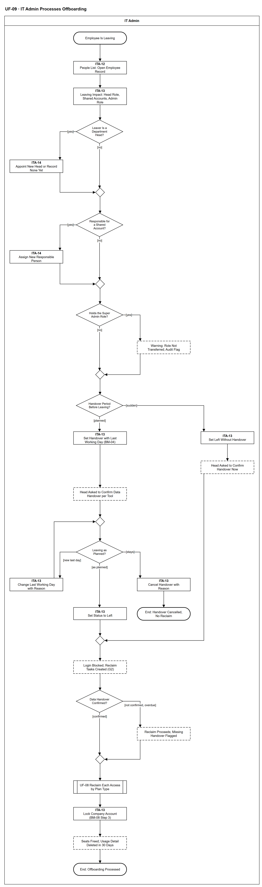

# UF-09 — IT Admin Processes Offboarding

> **Loại:** User flow (mức màn hình) — IT Admin · **Phiên bản:** 1.5 — 10/10/2026 · **Trạng thái:** Vẽ lại theo BRD v3.30 (đồng bộ QĐ-61/QĐ-62) và QĐ-56 (bàn giao dữ liệu trước khi thu hồi, không có người kế nhiệm license), QĐ-58 (trưởng phòng mới), QĐ-48 (đổi ngày/hủy bàn giao); mã màn hình là đề xuất (QĐ-08)
>
> Sơ đồ là **dẫn xuất** từ quyết định Owner (`QĐ`) và BRD hiện hành; khi khác nhau, `QĐ` → BRD thắng. Quyết định trong sơ đồ là của Owner, **chưa** phải xác nhận của GVHD/hội đồng.

## 1. Mục đích và phạm vi

Hành trình của IT Admin khi một nhân viên nghỉ việc: xử lý các vai người nghỉ đang giữ (trưởng phòng, người chịu trách nhiệm tài khoản dùng chung, Super Admin), ghi bàn giao hoặc nghỉ đột ngột, chờ trưởng phòng xác nhận bàn giao dữ liệu, rồi thu hồi toàn bộ quyền theo checklist BM-08. Đây là phía màn hình của MF-5 / WF-07.

**Phạm vi:** Màn hình ITA-12, ITA-13, ITA-14 và phản hồi hệ thống IT Admin nhìn thấy; bước thu hồi từng quyền chuyển sang UF-08.

**Không nằm trong sơ đồ này:** Trưởng phòng xác nhận bàn giao dữ liệu từng công cụ (chỉ hiện như bước hệ thống); chuyển giao vai Super Admin (UF-13); thực thi thu hồi theo kiểu cấp (UF-08, WF-09a).

## 2. Tệp

| Tệp | Vai trò |
| --- | --- |
| [UF-09-it-admin-processes-offboarding.drawio](UF-09-it-admin-processes-offboarding.drawio) | Nguồn draw.io chỉnh sửa được (sinh từ spec) |
| [UF-09-it-admin-processes-offboarding.drawio.png](UF-09-it-admin-processes-offboarding.drawio.png) | Bản xuất PNG, nhúng sẵn nguồn draw.io |
| [UF-09.json](../specs/UF-09.json) | **Nguồn canonical** — sửa ở đây rồi chạy `python tools/flowkit.py build` từ `Docs/Diagrams` |

## 3. Nguồn nghiệp vụ

| Mã | Nội dung dùng trong sơ đồ |
| --- | --- |
| `FR-2.12, BM-08, QĐ-56b` | Bàn giao dữ liệu trước khi thu hồi; không có người kế nhiệm license; quá hạn chỉ cảnh báo |
| `FR-2.12, QĐ-56c` | Người chịu trách nhiệm mới cho tài khoản dùng chung trước khi đóng hồ sơ |
| `FR-3.6, FR-3.16, QĐ-52a, QĐ-58a, INV-19` | Trưởng phòng mới; mỗi phòng đúng một trưởng phòng |
| `FR-8.10, QĐ-47b` | Người giữ vai Super Admin nghỉ: cảnh báo, không chặn |
| `QĐ-40a, QĐ-41a, QĐ-48a–c` | Nghỉ có kế hoạch / đột ngột; đổi ngày làm việc cuối; hủy bàn giao |
| `FR-8.9, FR-2.9, QĐ-54c` | Từ chối đăng nhập khi đã nghỉ việc; khóa tài khoản công ty không tự dừng tính tiền |
| `FR-4.15, FR-10.6` | Tiết kiệm chỉ khi chi phí thực giảm; xóa dữ liệu hoạt động chi tiết trong 30 ngày |
| `FR-2.12, BM-08` | Thứ tự: (1) bàn giao dữ liệu → (2) gỡ người dùng; bàn giao không chặn thu hồi quá hạn |

## 4. Tác nhân, kích hoạt, điều kiện

| Làn (tiếng Anh trên hình) | Tác nhân | Trách nhiệm trong sơ đồ |
| --- | --- | --- |
| IT Admin | IT Admin | Thao tác trên màn hình ITA-xx; bước của trưởng phòng và hệ thống hiện dưới dạng trạng thái |

- **Kích hoạt:** Một nhân viên sắp nghỉ hoặc đã nghỉ đột ngột.
- **Tiền điều kiện:** Nhân viên có hồ sơ đang làm việc; IT Admin phụ trách phòng của nhân viên (QĐ-58).
- **Hậu điều kiện:** Nhân viên đã nghỉ việc, các quyền đã được thu hồi — quyền có tác vụ thu hồi bị đóng thất bại vẫn còn, hiện G2 chờ tác vụ mới (QĐ-62i) — và tài khoản đăng nhập đã bị chặn; hoặc bàn giao bị hủy và nhân viên ở lại.

## 5. Cách đọc ký hiệu

| Ký hiệu | Nghĩa |
| --- | --- |
| Hình chữ nhật bo tròn hai đầu, viền đậm | Điểm bắt đầu hoặc kết cục của hành trình |
| Hình chữ nhật viền liền, dòng đầu in đậm | Màn hình người dùng thao tác; dòng đầu là mã màn hình đề xuất |
| Hình chữ nhật viền nét đứt | Hệ thống tự xử lý; người dùng chỉ thấy kết quả |
| Hình thoi | Rẽ nhánh; cạnh ra mang điều kiện `[...]` |
| Hình chữ nhật hai vạch đứng | Gọi user flow khác (mã `UF-xx` trong nhãn); có cạnh ra thì hành trình quay lại và đi tiếp, không có cạnh ra thì sơ đồ này dừng tại đó |
| Dây có cung nhảy | Hai dây giao nhau nhưng **không** nối với nhau |

Đọc từ trên xuống. Ba điểm rẽ đầu là ba việc phải xử lý trước khi cho nghỉ; nhánh nghỉ đột ngột (bên phải) nhập lại ở bước chuyển đã nghỉ việc. **Ngoại lệ biểu diễn (QĐ-62e):** ca nghỉ đột ngột với gói mất dữ liệu, chưa xác nhận và chưa quá hạn không vẽ thành nhánh riêng ở đây — việc gỡ ở nhà cung cấp chờ tới hạn cấu hình (mặc định 1 ngày làm việc) rồi mới vào nhánh *chưa xác nhận, quá hạn*; chi tiết ở WF-07 `d_hold`. Với gói **không** mất dữ liệu, ca nghỉ đột ngột gỡ ngay, không chờ xác nhận bàn giao; ca này đi nhánh *chưa xác nhận* (cờ *thu hồi khi chưa xác nhận bàn giao*), đúng như WF-07 `d_hold` → `s_over` — chữ *overdue* của guard `d_hc` đọc là *không còn lý do chờ*. Quy ước chung cho luồng phụ và activity final: `tools/README.md` mục 7.

## 6. Bảng node

| ID | Loại | Nhãn trên hình | Ý nghĩa | Làn / người thực hiện | Quy tắc |
| --- | --- | --- | --- | --- | --- |
| `t_start` | Điểm đầu/cuối | Employee Is Leaving | IT Admin nhận thông tin một nhân viên sắp nghỉ (nghỉ có kế hoạch) hoặc đã nghỉ đột ngột. | IT Admin | — |
| `s_people` | Màn hình | ITA-12 — People List: Open Employee Record | Danh sách nhân sự; mở hồ sơ nhân viên sắp nghỉ. | IT Admin | `FR-8.9` |
| `s_impact` | Màn hình | ITA-13 — Leaving Impact: Head Role, Shared Accounts, Admin Role | Trước khi ghi nghỉ việc, màn hình cho thấy người này có đang là trưởng phòng, người chịu trách nhiệm tài khoản dùng chung, hay người giữ vai Super Admin không. | IT Admin | `FR-3.1`, `FR-2.12`, `FR-8.10` |
| `d_head` | Rẽ nhánh | Leaver Is a Department Head? | Người nghỉ có đang là trưởng phòng có hiệu lực không. | IT Admin | `INV-19`, `QĐ-58a` |
| `s_newhead` | Màn hình | ITA-14 — Appoint New Head or Record None Yet | Chọn trưởng phòng mới, hiệu lực từ ngày sau ngày làm việc cuối; người này không được đang là trưởng phòng khác. Chưa có người thì ghi tường minh để bước nhu cầu đi tới người duyệt dự phòng. | IT Admin | `FR-3.6`, `FR-3.16`, `QĐ-52a`, `QĐ-58a` |
| `m_head` | Hợp nhánh | — | — | IT Admin | — |
| `d_shared` | Rẽ nhánh | Responsible for a Shared Account? | Người nghỉ có đang chịu trách nhiệm một tài khoản dùng chung hoặc tài khoản dịch vụ không. | IT Admin | `FR-2.12`, `QĐ-56c` |
| `s_resp` | Màn hình | ITA-14 — Assign New Responsible Person | Chỉ định người chịu trách nhiệm mới trước ngày hiệu lực (lúc chuyển *đã nghỉ việc*); ghi nghỉ việc không bị chặn, chỉ nhắc; tới ngày đó chưa có thì hồ sơ không đóng được (`QĐ-66i`) — mặc định là trưởng phòng (trưởng phòng nghỉ thì trưởng phòng mới). | IT Admin | `FR-2.12`, `QĐ-56c`, `QĐ-58d` |
| `m_resp` | Hợp nhánh | — | — | IT Admin | — |
| `d_sa` | Rẽ nhánh | Holds the Super Admin Role? | Người nghỉ có đang giữ vai Super Admin duy nhất không. | IT Admin | `FR-8.10`, `QĐ-44` |
| `y_sawarn` | Hệ thống xử lý | Warning: Role Not Transferred; Audit Flag | Cảnh báo, không chặn: vai Super Admin chưa được chuyển giao (người giữ vai làm ở UF-13); audit ghi cờ. | IT Admin | `FR-8.10`, `QĐ-47b` |
| `m_sa` | Hợp nhánh | — | — | IT Admin | — |
| `d_notice` | Rẽ nhánh | Handover Period Before Leaving? | Nghỉ có kế hoạch (có thời gian bàn giao) hay nghỉ đột ngột. | IT Admin | `QĐ-40a` |
| `s_hand` | Màn hình | ITA-13 — Set Handover with Last Working Day (BM-04) | Ghi trạng thái đang bàn giao kèm ngày làm việc cuối, lập biên bản BM-04. Tài khoản đăng nhập vẫn dùng được trong thời gian bàn giao. | IT Admin | `BM-04`, `FR-8.9`, `QĐ-41a` |
| `s_sudden` | Màn hình | ITA-13 — Set Left Without Handover | Nghỉ đột ngột: chuyển thẳng sang đã nghỉ việc; các chỉ định thay thế ở trên ghi trong cùng thao tác. Không có thời gian bàn giao trước, nhưng trưởng phòng vẫn được đề nghị xác nhận bàn giao ngay. Đăng nhập SaaS-Sentry bị chặn ngay (FR-8.9). | IT Admin | `FR-8.9`, `FR-2.12` |
| `y_ask2` | Hệ thống xử lý | Head Asked to Confirm Handover Now | Liệt kê quyền kèm lưu ý trước khi thu hồi; đề nghị trưởng phòng xác nhận bàn giao ngay. Gói có lưu ý mất dữ liệu: việc gỡ ở nhà cung cấp chờ xác nhận tối đa hạn cấu hình (mặc định 1 ngày làm việc), gói khác gỡ ngay (QĐ-62e). | IT Admin | `FR-2.12`, `OI-14c` |
| `y_ask` | Hệ thống xử lý | Head Asked to Confirm Data Handover per Tool | Hệ thống liệt kê mọi quyền kèm lưu ý trước khi thu hồi và đề nghị trưởng phòng xác nhận bàn giao dữ liệu từng công cụ (BM-08 bước 1). Không có người kế nhiệm license. Tới hạn chưa xác nhận ⟹ chỉ cảnh báo trưởng phòng và IT, không chặn. | IT Admin | `FR-2.12`, `BM-08`, `QĐ-56b`, `OI-14c` |
| `m_wait` | Hợp nhánh | — | — | IT Admin | — |
| `d_plan` | Rẽ nhánh | Leaving as Planned? | Trước khi chuyển đã nghỉ việc: đúng ngày, đổi ngày làm việc cuối, hay nhân viên ở lại. | IT Admin | `QĐ-48a` |
| `s_change` | Màn hình | ITA-13 — Change Last Working Day with Reason | Chỉ khi hôm nay ≤ ngày làm việc cuối hiện tại; lý do bắt buộc; Audit Trail ghi giá trị trước/sau. | IT Admin | `QĐ-48a`, `QĐ-48b`, `QĐ-48c` |
| `s_cancel` | Màn hình | ITA-13 — Cancel Handover with Reason | Hủy bàn giao bất kỳ lúc nào trước đã nghỉ việc; nhân viên trở lại đang làm việc, không thu hồi quyền. | IT Admin | `QĐ-48a`, `QĐ-48c` |
| `t_cancel` | Điểm đầu/cuối | End: Handover Cancelled, No Reclaim | Nhân viên ở lại; quyền giữ nguyên. | IT Admin | — |
| `s_left` | Màn hình | ITA-13 — Set Status to Left | IT chuyển nhân viên sang đã nghỉ việc (S0 làm tay). | IT Admin | `FR-8.9`, `QĐ-41a` |
| `m_left` | Hợp nhánh | — | — | IT Admin | — |
| `y_block` | Hệ thống xử lý | Login Blocked; Reclaim Tasks Created (G2) | Mọi thao tác của tài khoản liên kết bị từ chối ngay; nhắc Super Admin khóa tài khoản chính thức; kết thúc đăng ký thiết bị; tạo tác vụ thu hồi cho IT Admin phụ trách phòng. | IT Admin | `FR-8.9`, `FR-4.18`, `BRD 5.12.3` |
| `d_hc` | Rẽ nhánh | Data Handover Confirmed? | Trước bước 2 của BM-08 (gỡ khỏi workspace, hủy gia hạn, thu khóa): trưởng phòng đã xác nhận *đã bàn giao* hoặc *không cần* cho từng công cụ chưa. Bàn giao đi trước thu hồi; nhưng bàn giao quá hạn **không** chặn thu hồi. **Nghỉ đột ngột:** đăng nhập bị chặn ngay theo trạng thái; riêng gói có lưu ý *mất dữ liệu khi gỡ*, việc gỡ ở nhà cung cấp chờ trưởng phòng xác nhận bàn giao hoặc tới hạn cấu hình được (mặc định 1 ngày làm việc), seat vẫn tính phí và hiện G2; gói khác gỡ ngay (QĐ-62e — chi tiết ở WF-07 `d_hold`). Phòng thiếu trưởng phòng ⟹ việc xác nhận chờ, không giao ai; hết hạn thì thu hồi tiếp (QĐ-62c). | IT Admin | `FR-2.12`, `BM-08`, `QĐ-56b`, `OI-14c` |
| `s_over` | Hệ thống xử lý | Reclaim Proceeds; Missing Handover Flagged | Hạn bàn giao đã qua mà chưa có xác nhận: thu hồi vẫn tiếp tục; Audit Trail ghi cờ *thu hồi khi chưa xác nhận bàn giao* và trưởng phòng, IT Admin thấy trong danh sách cần xử lý. | IT Admin | `FR-2.12`, `OI-14c`, `FR-5.14` |
| `m_hc` | Hợp nhánh | — | — | IT Admin | — |
| `r_uf08` | Chuyển sang user flow khác | UF-08 Reclaim Each Access by Plan Type | Bước 2 BM-08 cho từng quyền theo kiểu cấp K1–K5 (gỡ seat, hủy gia hạn gói cá nhân, thu khóa về kho, đổi mật khẩu tài khoản dùng chung...) qua hàng đợi cấp phát. Nếu WF-09a trả *đóng thất bại* (QĐ-62i): quyền còn hiệu lực, vẫn hiện G2/lãng phí theo điều kiện nguồn, seat chưa về kho và IT mở tác vụ thu hồi mới. | IT Admin | `FR-2.10`, `FR-2.11`, `BM-08`, `QĐ-54`, → `UF-08` |
| `s_lock` | Màn hình | ITA-13 — Lock Company Account (BM-08 Step 3) | Khóa tài khoản email công ty sau khi đã gỡ seat — khóa tài khoản không tự dừng tính tiền. | IT Admin | `FR-2.9`, `BM-08`, `QĐ-54c` |
| `y_close` | Hệ thống xử lý | Seats Freed; Usage Detail Deleted in 30 Days | Seat trống về kho; tiết kiệm chỉ ghi khi hợp đồng/khoản chi thực sự giảm; bản ghi hoạt động chi tiết xóa trong 30 ngày. | IT Admin | `FR-4.15`, `FR-10.6`, `BM-08` |
| `t_done` | Điểm đầu/cuối | End: Offboarding Processed | Nghỉ việc đã xử lý: tài khoản đăng nhập đã bị chặn, các quyền đã thu hồi; quyền có tác vụ thu hồi bị đóng thất bại vẫn còn, hiện G2 chờ tác vụ mới (QĐ-62i). | IT Admin | — |

## 7. Bảng chuyển tiếp

| Từ → tới | Nhãn điều kiện | Điều kiện | Kết quả |
| --- | --- | --- | --- |
| `t_start` → `s_people` | — | — | Sang ITA-12 — People List: Open Employee Record |
| `s_people` → `s_impact` | — | — | Sang ITA-13 — Leaving Impact: Head Role, Shared Accounts, Admin Role |
| `s_impact` → `d_head` | — | — | Sang Leaver Is a Department Head? |
| `d_head` → `s_newhead` | `[yes]` | Đang là trưởng phòng | Chỉ định trưởng phòng mới |
| `d_head` → `m_head` | `[no]` | Không phải trưởng phòng | Đi tiếp |
| `s_newhead` → `m_head` | — | — | Sang — |
| `m_head` → `d_shared` | — | — | Sang Responsible for a Shared Account? |
| `d_shared` → `s_resp` | `[yes]` | Đang chịu trách nhiệm tài khoản dùng chung/dịch vụ | Chỉ định người mới |
| `d_shared` → `m_resp` | `[no]` | Không | Đi tiếp |
| `s_resp` → `m_resp` | — | — | Sang — |
| `m_resp` → `d_sa` | — | — | Sang Holds the Super Admin Role? |
| `d_sa` → `y_sawarn` | `[yes]` | Đang giữ vai Super Admin | Cảnh báo, không chặn |
| `d_sa` → `m_sa` | `[no]` | Không | Đi tiếp |
| `y_sawarn` → `m_sa` | — | — | Sang — |
| `m_sa` → `d_notice` | — | — | Sang Handover Period Before Leaving? |
| `d_notice` → `s_hand` | `[planned]` | Có thời gian bàn giao | Ghi đang bàn giao |
| `d_notice` → `s_sudden` | `[sudden]` | Nghỉ đột ngột | Ghi thẳng đã nghỉ việc |
| `s_hand` → `y_ask` | — | — | Sang Head Asked to Confirm Data Handover per Tool |
| `y_ask` → `m_wait` | — | — | Sang — |
| `m_wait` → `d_plan` | — | — | Sang Leaving as Planned? |
| `d_plan` → `s_left` | `[as planned]` | Nghỉ đúng ngày đã ghi | Chuyển đã nghỉ việc |
| `d_plan` → `s_change` | `[new last day]` | Cần đổi ngày làm việc cuối | Đổi ngày, chờ tiếp |
| `d_plan` → `s_cancel` | `[stays]` | Nhân viên ở lại | Hủy bàn giao |
| `s_change` → `m_wait` | — | — | Sang — |
| `s_cancel` → `t_cancel` | — | — | Sang End: Handover Cancelled, No Reclaim |
| `s_left` → `m_left` | — | — | Sang — |
| `s_sudden` → `y_ask2` | — | — | Sang Head Asked to Confirm Handover Now |
| `m_left` → `y_block` | — | — | Sang Login Blocked; Reclaim Tasks Created (G2) |
| `y_block` → `d_hc` | — | — | Sang Data Handover Confirmed? |
| `r_uf08` → `s_lock` | — | — | Sang ITA-13 — Lock Company Account (BM-08 Step 3) |
| `s_lock` → `y_close` | — | — | Sang Seats Freed; Usage Detail Deleted in 30 Days |
| `y_close` → `t_done` | — | — | Sang End: Offboarding Processed |
| `d_hc` → `m_hc` | `[confirmed]` | Trưởng phòng đã xác nhận bàn giao hoặc không cần | Thu hồi theo checklist |
| `d_hc` → `s_over` | `[not confirmed, overdue]` | Hạn bàn giao đã qua, chưa xác nhận | Ghi cờ, thu hồi vẫn tiếp tục |
| `s_over` → `m_hc` | — | — | Sang — |
| `m_hc` → `r_uf08` | — | — | Sang UF-08 Reclaim Each Access by Plan Type |
| `y_ask2` → `m_left` | — | — | Sang — |

Số đếm: **32 node · 37 cạnh · 6 rẽ nhánh**; giao cắt dây: **0**.

## 8. Happy path

1. `t_start` — Employee Is Leaving: IT Admin nhận thông tin một nhân viên sắp nghỉ (nghỉ có kế hoạch) hoặc đã nghỉ đột ngột.
2. `s_people` — ITA-12 — People List: Open Employee Record: Danh sách nhân sự; mở hồ sơ nhân viên sắp nghỉ.
3. `s_impact` — ITA-13 — Leaving Impact: Head Role, Shared Accounts, Admin Role: Trước khi ghi nghỉ việc, màn hình cho thấy người này có đang là trưởng phòng, người chịu trách nhiệm tài khoản dùng chung, hay người giữ vai Super Admin không.
4. `d_head` — Leaver Is a Department Head?: Người nghỉ có đang là trưởng phòng có hiệu lực không.
5. `d_shared` — Responsible for a Shared Account?: Người nghỉ có đang chịu trách nhiệm một tài khoản dùng chung hoặc tài khoản dịch vụ không.
6. `d_sa` — Holds the Super Admin Role?: Người nghỉ có đang giữ vai Super Admin duy nhất không.
7. `d_notice` — Handover Period Before Leaving?: Nghỉ có kế hoạch (có thời gian bàn giao) hay nghỉ đột ngột.
8. `s_hand` — ITA-13 — Set Handover with Last Working Day (BM-04): Ghi trạng thái đang bàn giao kèm ngày làm việc cuối, lập biên bản BM-04. Tài khoản đăng nhập vẫn dùng được trong thời gian bàn giao.
9. `y_ask` — Head Asked to Confirm Data Handover per Tool: Hệ thống liệt kê mọi quyền kèm lưu ý trước khi thu hồi và đề nghị trưởng phòng xác nhận bàn giao dữ liệu từng công cụ (BM-08 bước 1). Không có người kế nhiệm license. Tới hạn chưa xác nhận ⟹ chỉ cảnh báo trưởng phòng và IT, không chặn.
10. `d_plan` — Leaving as Planned?: Trước khi chuyển đã nghỉ việc: đúng ngày, đổi ngày làm việc cuối, hay nhân viên ở lại.
11. `s_left` — ITA-13 — Set Status to Left: IT chuyển nhân viên sang đã nghỉ việc (S0 làm tay).
12. `y_block` — Login Blocked; Reclaim Tasks Created (G2): Mọi thao tác của tài khoản liên kết bị từ chối ngay; nhắc Super Admin khóa tài khoản chính thức; kết thúc đăng ký thiết bị; tạo tác vụ thu hồi cho IT Admin phụ trách phòng.
13. `d_hc` — Data Handover Confirmed?: Trước bước 2 của BM-08 (gỡ khỏi workspace, hủy gia hạn, thu khóa): trưởng phòng đã xác nhận *đã bàn giao* hoặc *không cần* cho từng công cụ chưa. Bàn giao đi trước thu hồi; nhưng bàn giao quá hạn **không** chặn thu hồi. **Nghỉ đột ngột:** đăng nhập bị chặn ngay theo trạng thái; riêng gói có lưu ý *mất dữ liệu khi gỡ*, việc gỡ ở nhà cung cấp chờ trưởng phòng xác nhận bàn giao hoặc tới hạn cấu hình được (mặc định 1 ngày làm việc), seat vẫn tính phí và hiện G2; gói khác gỡ ngay (QĐ-62e — chi tiết ở WF-07 `d_hold`). Phòng thiếu trưởng phòng ⟹ việc xác nhận chờ, không giao ai; hết hạn thì thu hồi tiếp (QĐ-62c).
14. `r_uf08` — UF-08 Reclaim Each Access by Plan Type: Bước 2 BM-08 cho từng quyền theo kiểu cấp K1–K5 (gỡ seat, hủy gia hạn gói cá nhân, thu khóa về kho, đổi mật khẩu tài khoản dùng chung...) qua hàng đợi cấp phát. Nếu WF-09a trả *đóng thất bại* (QĐ-62i): quyền còn hiệu lực, vẫn hiện G2/lãng phí theo điều kiện nguồn, seat chưa về kho và IT mở tác vụ thu hồi mới.
15. `s_lock` — ITA-13 — Lock Company Account (BM-08 Step 3): Khóa tài khoản email công ty sau khi đã gỡ seat — khóa tài khoản không tự dừng tính tiền.
16. `y_close` — Seats Freed; Usage Detail Deleted in 30 Days: Seat trống về kho; tiết kiệm chỉ ghi khi hợp đồng/khoản chi thực sự giảm; bản ghi hoạt động chi tiết xóa trong 30 ngày.
17. `t_done` — End: Offboarding Processed: Nghỉ việc đã xử lý: tài khoản đăng nhập đã bị chặn, các quyền đã thu hồi; quyền có tác vụ thu hồi bị đóng thất bại vẫn còn, hiện G2 chờ tác vụ mới (QĐ-62i).

## 9. Nhánh thay thế / if-else

- **Người nghỉ là trưởng phòng** — `d_head` → `s_newhead` → `m_head`. Trưởng phòng mới hiệu lực từ ngày sau ngày làm việc cuối.
- **Người chịu trách nhiệm tài khoản dùng chung** — `d_shared` → `s_resp` → `m_resp`. Mặc định trưởng phòng.
- **Người giữ vai Super Admin** — `d_sa` → `y_sawarn` → `m_sa`. Cảnh báo và cờ audit; chuyển giao vai làm ở UF-13.
- **Nghỉ đột ngột** — `d_notice` → `s_sudden` → `y_ask2` → `m_left`. Trưởng phòng vẫn được đề nghị xác nhận bàn giao ngay; đăng nhập bị chặn ngay; gói có lưu ý mất dữ liệu giữ việc gỡ ở nhà cung cấp tối đa hạn cấu hình (mặc định 1 ngày làm việc), gói khác gỡ ngay (QĐ-62e).
- **Đổi ngày làm việc cuối** — `d_plan` → `s_change` → `m_wait`. Lý do bắt buộc; quay lại chờ.

## 10. Nhánh lỗi / từ chối và cách kết thúc

- **Nhân viên ở lại — hủy bàn giao** — `d_plan` → `s_cancel` → `t_cancel`. Không thu hồi quyền.
- **Thu hồi khi bàn giao chưa được xác nhận** — `d_hc` → `s_over` → `m_hc`. Bàn giao quá hạn không chặn thu hồi (FR-2.12, OI-14c); có cờ audit.

## 11. Liên hệ với sơ đồ khác

- Main flow: `MF-5`; workflow: `WF-07`, `WF-09a`, `WF-18` (kết thúc đăng ký thiết bị)
- `UF-08` (thu hồi từng quyền), `UF-13` (chuyển giao vai Super Admin), `UF-17` (tài khoản bị từ chối đăng nhập)
- `UF-08` — gọi/chuyển tại node `r_uf08`

## 12. Giới hạn và vấn đề còn mở

- (LATER-TECH/UI · DOI-01, QĐ-08) Mã màn hình ITA-12/13/14 giữ từ bản cũ, là đề xuất.
- (LATER-TECH/UI · DOI-41) Màn hình xác nhận bàn giao của trưởng phòng chưa có user flow riêng — chỉ hiện ở đây như bước hệ thống (WF-07 vẽ đầy đủ).
- (ĐÃ CHỐT · DOI-37, QĐ-62e) Nghỉ đột ngột: chặn đăng nhập ngay; chỉ gói mất dữ liệu giữ việc gỡ ở nhà cung cấp tối đa hạn cấu hình; phòng thiếu trưởng phòng thì hết hạn gỡ (QĐ-62c).
