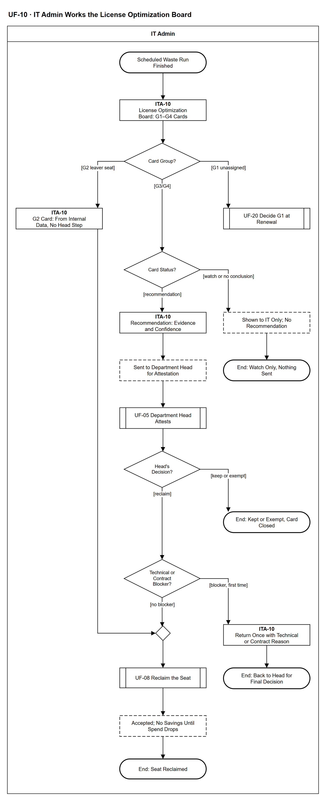

# UF-10 — IT Admin Works the License Optimization Board

> **Loại:** User flow (mức màn hình) — IT Admin · **Phiên bản:** 1.2 — 10/10/2026 · **Trạng thái:** Vẽ lại theo BRD v3.30 (đồng bộ QĐ-61/QĐ-62) và WF-13/WF-13a (QĐ-09, QĐ-35b, OI-02); usage chỉ ở mức nghiệp vụ (QĐ-59a); mã màn hình là đề xuất (QĐ-08)
>
> Sơ đồ là **dẫn xuất** từ quyết định Owner (`QĐ`) và BRD hiện hành; khi khác nhau, `QĐ` → BRD thắng. Quyết định trong sơ đồ là của Owner, **chưa** phải xác nhận của GVHD/hội đồng.

## 1. Mục đích và phạm vi

Hành trình của IT Admin trên **bảng tối ưu license**: phân loại thẻ G1 · G2 · G3/G4, chỉ gửi trưởng phòng những khuyến nghị đủ bằng chứng, thu hồi khi trưởng phòng chọn Reclaim (được trả lại một lần nếu vướng kỹ thuật/hợp đồng). Đây là phía IT của nhóm hỗ trợ SF-4 (MF-3 cũ).

**Phạm vi:** Màn hình ITA-10 và phản hồi hệ thống IT Admin nhìn thấy; quyết định của trưởng phòng ở UF-05, thực thi thu hồi ở UF-08, G1 ở UF-20.

**Không nằm trong sơ đồ này:** Cách tính ngưỡng, cổng loại trừ và mức tin cậy chi tiết (WF-13, WF-13a); nhập dữ liệu sử dụng (UF-06); khớp danh tính (UF-07).

## 2. Tệp

| Tệp | Vai trò |
| --- | --- |
| [UF-10-it-admin-works-the-license-optimization-board.drawio](UF-10-it-admin-works-the-license-optimization-board.drawio) | Nguồn draw.io chỉnh sửa được (sinh từ spec) |
| [UF-10-it-admin-works-the-license-optimization-board.drawio.png](UF-10-it-admin-works-the-license-optimization-board.drawio.png) | Bản xuất PNG, nhúng sẵn nguồn draw.io |
| [UF-10.json](../specs/UF-10.json) | **Nguồn canonical** — sửa ở đây rồi chạy `python tools/flowkit.py build` từ `Docs/Diagrams` |

## 3. Nguồn nghiệp vụ

| Mã | Nội dung dùng trong sơ đồ |
| --- | --- |
| `BRD 5.4.1` | Bốn nhóm lãng phí G1–G4 |
| `FR-4.12, QĐ-09` | Ngưỡng 30–59 chỉ theo dõi, từ 60 ngày cần xem xét; theo dõi không gửi thông báo |
| `FR-4.10, FR-4.14a, INV-12` | Không có dữ liệu / chưa khớp / bằng chứng không đủ thì không kết luận |
| `FR-4.14, QĐ-35b` | Khuyến nghị kèm căn cứ và mức tin cậy; G2 xác định từ dữ liệu nội bộ |
| `FR-3.7, FR-3.10, INV-09, SoD-2` | Trưởng phòng xác nhận Keep/Reclaim/Exempt, miễn trừ có hạn |
| `OI-02, SoD-5` | IT trả lại tối đa một lần; chỉ IT thay đổi seat |
| `FR-4.15, KPI-5` | Thu hồi không tự ghi tiết kiệm; hai con số ước tính tách riêng |

## 4. Tác nhân, kích hoạt, điều kiện

| Làn (tiếng Anh trên hình) | Tác nhân | Trách nhiệm trong sơ đồ |
| --- | --- | --- |
| IT Admin | IT Admin | Thao tác trên bảng ITA-10; bước của trưởng phòng hiện qua tham chiếu UF-05 |

- **Kích hoạt:** Tác vụ nền tìm lãng phí chạy xong và bảng có thẻ mới.
- **Tiền điều kiện:** Đã có dữ liệu Assignment; với G3/G4, đã nhập bằng chứng sử dụng theo nguồn có khai định nghĩa hoạt động (UF-06).
- **Hậu điều kiện:** Thẻ được đóng bằng một trong các kết cục: chỉ theo dõi · chuyển G1 vào kỳ gia hạn · giữ/miễn trừ · trả lại trưởng phòng một lần · đã thu hồi (chưa ghi tiết kiệm).

## 5. Cách đọc ký hiệu

| Ký hiệu | Nghĩa |
| --- | --- |
| Hình chữ nhật bo tròn hai đầu, viền đậm | Điểm bắt đầu hoặc kết cục của hành trình |
| Hình chữ nhật viền liền, dòng đầu in đậm | Màn hình người dùng thao tác; dòng đầu là mã màn hình đề xuất |
| Hình chữ nhật viền nét đứt | Hệ thống tự xử lý; người dùng chỉ thấy kết quả |
| Hình thoi | Rẽ nhánh; cạnh ra mang điều kiện `[...]` |
| Hình chữ nhật hai vạch đứng | Gọi user flow khác (mã `UF-xx` trong nhãn); có cạnh ra thì hành trình quay lại và đi tiếp, không có cạnh ra thì sơ đồ này dừng tại đó |
| Dây có cung nhảy | Hai dây giao nhau nhưng **không** nối với nhau |

Đọc từ trên xuống. Ba nhánh đầu theo nhóm thẻ; nhánh G2 (trái) nhập thẳng vào bước thu hồi, không qua trưởng phòng.

## 6. Bảng node

| ID | Loại | Nhãn trên hình | Ý nghĩa | Làn / người thực hiện | Quy tắc |
| --- | --- | --- | --- | --- | --- |
| `t_start` | Điểm đầu/cuối | Scheduled Waste Run Finished | Tác vụ nền đã chạy (G1/G2 hằng ngày, G3/G4 hằng tuần) sau khi áp tám cổng loại trừ (WF-13a). | IT Admin | `FR-4.12b`, `FR-4.9` |
| `s_board` | Màn hình | ITA-10 — License Optimization Board: G1–G4 Cards | Bảng bốn nhóm thẻ G1 · G2 · G3 · G4; mỗi thẻ có căn cứ, giới hạn dữ liệu và trạng thái. Hai con số tiết kiệm ước tính hiển thị tách riêng, không cộng. | IT Admin | `BRD 5.4.1`, `FR-4.15` |
| `d_grp` | Rẽ nhánh | Card Group? | Thẻ thuộc nhóm nào: G1 seat mua chưa gán, G2 seat của người đã nghỉ việc, G3/G4 seat đã gán nhưng chưa dùng hoặc đã ngừng. | IT Admin | `BRD 5.4.1` |
| `s_g2` | Màn hình | ITA-10 — G2 Card: From Internal Data, No Head Step | Seat còn gán cho người đã nghỉ việc: xác định từ dữ liệu nội bộ, không xếp mức tin cậy, bỏ qua ngưỡng ngày; đi thẳng tới thu hồi, không qua xác nhận của trưởng phòng. Khuyến nghị G2 kèm thông báo IT Admin (FR-4.12). | IT Admin | `FR-4.14`, `OI-02`, `QĐ-35b` |
| `r_uf20` | Chuyển sang user flow khác | UF-20 Decide G1 at Renewal | G1 nhắm vào thuê bao, không nhắm vào người: giảm số lượng chỉ có tiền thật khi gia hạn — đưa vào đề xuất gia hạn. | IT Admin | `FR-4.15`, `FR-3.13`, → `UF-20` |
| `d_ev` | Rẽ nhánh | Card Status? | Trạng thái thẻ G3/G4: chỉ theo dõi (30–59 ngày), không có dữ liệu / chưa khớp / bằng chứng không đủ, hay đã có khuyến nghị (từ 60 ngày). | IT Admin | `FR-4.10`, `FR-4.12`, `FR-4.14a`, `INV-12` |
| `y_watch` | Hệ thống xử lý | Shown to IT Only; No Recommendation | Thẻ chỉ hiện cho IT Admin: Theo dõi (không gửi thông báo, không tới trưởng phòng), Không có dữ liệu (không phải 0), Chưa khớp danh tính (hàng đợi UF-07) hoặc INSUFFICIENT EVIDENCE kèm lý do — không có con số trông như đã kết luận. | IT Admin | `FR-4.12`, `FR-4.10`, `FR-4.14a`, `QĐ-09` |
| `t_watch` | Điểm đầu/cuối | End: Watch Only, Nothing Sent | Không có khuyến nghị, không gửi ai. | IT Admin | — |
| `s_rec` | Màn hình | ITA-10 — Recommendation: Evidence and Confidence | Khuyến nghị chờ xác nhận kèm bản chụp căn cứ: số ngày, nguồn, cửa sổ bao phủ, phương pháp khớp, định nghĩa hoạt động, mức tin cậy. | IT Admin | `FR-4.14`, `QĐ-35b`, `TC-3` |
| `y_sent` | Hệ thống xử lý | Sent to Department Head for Attestation | Khuyến nghị gửi trưởng phòng của nhân viên; IT không tự thu hồi seat G3/G4 trước khi trưởng phòng quyết. | IT Admin | `FR-3.7`, `SoD-2`, `FR-5.14` |
| `r_uf05` | Chuyển sang user flow khác | UF-05 Department Head Attests | Trưởng phòng chọn Keep, Reclaim hoặc Exempt kèm lý do. | IT Admin | → `UF-05` |
| `d_att` | Rẽ nhánh | Head's Decision? | Kết quả xác nhận của trưởng phòng hiện lại trên thẻ. | IT Admin | `FR-3.10`, `INV-09` |
| `t_kept` | Điểm đầu/cuối | End: Kept or Exempt, Card Closed | Keep ⟹ khuyến nghị bị bác bỏ (tính KPI-5); Exempt ⟹ seat bị loại tới ngày hết hạn (tối đa 12 tháng). | IT Admin | — |
| `d_block` | Rẽ nhánh | Technical or Contract Blocker? | IT kiểm tra có lý do kỹ thuật hoặc hợp đồng chặn việc thu hồi không. IT chỉ được trả lại tối đa một lần. | IT Admin | `OI-02`, `SoD-5` |
| `s_ret` | Màn hình | ITA-10 — Return Once with Technical or Contract Reason | Trả quyết định lại cho trưởng phòng kèm lý do bắt buộc; trưởng phòng quyết cuối, IT không phủ quyết lần hai. | IT Admin | `OI-02` |
| `t_ret` | Điểm đầu/cuối | End: Back to Head for Final Decision | Thẻ chờ trưởng phòng quyết lại ở UF-05. | IT Admin | — |
| `m_rc` | Hợp nhánh | — | — | IT Admin | — |
| `r_uf08` | Chuyển sang user flow khác | UF-08 Reclaim the Seat | Thu hồi qua hàng đợi cấp phát theo kiểu cấp; lỗi thực thi xử lý ở UF-08, không thành vòng phủ quyết. Nếu WF-09a trả *đóng thất bại* (QĐ-62i): quyền còn hiệu lực, vẫn hiện G2/lãng phí theo điều kiện nguồn, seat chưa về kho và IT mở tác vụ thu hồi mới. | IT Admin | `SoD-5`, `FR-2.4`, → `UF-08` |
| `y_acc` | Hệ thống xử lý | Accepted; No Savings Until Spend Drops | Khuyến nghị được chấp nhận. Thu hồi không tự ghi tiền tiết kiệm — tiết kiệm chỉ ghi khi hợp đồng/khoản chi thực sự giảm (thường tại kỳ gia hạn). | IT Admin | `FR-4.15`, `KPI-5` |
| `t_done` | Điểm đầu/cuối | End: Seat Reclaimed | Seat đã thu hồi, về kho (nếu tác vụ bị đóng thất bại thì quyền còn, xem UF-08 — QĐ-62i). | IT Admin | — |

## 7. Bảng chuyển tiếp

| Từ → tới | Nhãn điều kiện | Điều kiện | Kết quả |
| --- | --- | --- | --- |
| `t_start` → `s_board` | — | — | Sang ITA-10 — License Optimization Board: G1–G4 Cards |
| `s_board` → `d_grp` | — | — | Sang Card Group? |
| `d_grp` → `s_g2` | `[G2 leaver seat]` | Seat của người đã nghỉ việc | Thu hồi thẳng |
| `d_grp` → `r_uf20` | `[G1 unassigned]` | Seat mua chưa gán | Quyết tại kỳ gia hạn |
| `d_grp` → `d_ev` | `[G3/G4]` | Seat đã gán, cần bằng chứng sử dụng | Xem trạng thái thẻ |
| `s_g2` → `m_rc` | — | — | Sang — |
| `d_ev` → `y_watch` | `[watch or no conclusion]` | 30–59 ngày, không có dữ liệu, chưa khớp hoặc bằng chứng không đủ | Chỉ hiển thị |
| `d_ev` → `s_rec` | `[recommendation]` | Từ 60 ngày, đủ bằng chứng | Mở khuyến nghị |
| `y_watch` → `t_watch` | — | — | Sang End: Watch Only, Nothing Sent |
| `s_rec` → `y_sent` | — | — | Sang Sent to Department Head for Attestation |
| `y_sent` → `r_uf05` | — | — | Sang UF-05 Department Head Attests |
| `r_uf05` → `d_att` | — | — | Sang Head's Decision? |
| `d_att` → `t_kept` | `[keep or exempt]` | Trưởng phòng giữ lại hoặc miễn trừ | Đóng thẻ |
| `d_att` → `d_block` | `[reclaim]` | Trưởng phòng chọn thu hồi | IT kiểm vướng mắc |
| `d_block` → `s_ret` | `[blocker, first time]` | Có vướng kỹ thuật/hợp đồng, chưa trả lần nào | Trả lại một lần |
| `d_block` → `m_rc` | `[no blocker]` | Không vướng, hoặc đã trả một lần | Thu hồi |
| `s_ret` → `t_ret` | — | — | Sang End: Back to Head for Final Decision |
| `m_rc` → `r_uf08` | — | — | Sang UF-08 Reclaim the Seat |
| `r_uf08` → `y_acc` | — | — | Sang Accepted; No Savings Until Spend Drops |
| `y_acc` → `t_done` | — | — | Sang End: Seat Reclaimed |

Số đếm: **20 node · 20 cạnh · 4 rẽ nhánh**; giao cắt dây: **0**.

## 8. Happy path

1. `t_start` — Scheduled Waste Run Finished: Tác vụ nền đã chạy (G1/G2 hằng ngày, G3/G4 hằng tuần) sau khi áp tám cổng loại trừ (WF-13a).
2. `s_board` — ITA-10 — License Optimization Board: G1–G4 Cards: Bảng bốn nhóm thẻ G1 · G2 · G3 · G4; mỗi thẻ có căn cứ, giới hạn dữ liệu và trạng thái. Hai con số tiết kiệm ước tính hiển thị tách riêng, không cộng.
3. `d_grp` — Card Group?: Thẻ thuộc nhóm nào: G1 seat mua chưa gán, G2 seat của người đã nghỉ việc, G3/G4 seat đã gán nhưng chưa dùng hoặc đã ngừng.
4. `d_ev` — Card Status?: Trạng thái thẻ G3/G4: chỉ theo dõi (30–59 ngày), không có dữ liệu / chưa khớp / bằng chứng không đủ, hay đã có khuyến nghị (từ 60 ngày).
5. `s_rec` — ITA-10 — Recommendation: Evidence and Confidence: Khuyến nghị chờ xác nhận kèm bản chụp căn cứ: số ngày, nguồn, cửa sổ bao phủ, phương pháp khớp, định nghĩa hoạt động, mức tin cậy.
6. `y_sent` — Sent to Department Head for Attestation: Khuyến nghị gửi trưởng phòng của nhân viên; IT không tự thu hồi seat G3/G4 trước khi trưởng phòng quyết.
7. `r_uf05` — UF-05 Department Head Attests: Trưởng phòng chọn Keep, Reclaim hoặc Exempt kèm lý do.
8. `d_att` — Head's Decision?: Kết quả xác nhận của trưởng phòng hiện lại trên thẻ.
9. `d_block` — Technical or Contract Blocker?: IT kiểm tra có lý do kỹ thuật hoặc hợp đồng chặn việc thu hồi không. IT chỉ được trả lại tối đa một lần.
10. `r_uf08` — UF-08 Reclaim the Seat: Thu hồi qua hàng đợi cấp phát theo kiểu cấp; lỗi thực thi xử lý ở UF-08, không thành vòng phủ quyết. Nếu WF-09a trả *đóng thất bại* (QĐ-62i): quyền còn hiệu lực, vẫn hiện G2/lãng phí theo điều kiện nguồn, seat chưa về kho và IT mở tác vụ thu hồi mới.
11. `y_acc` — Accepted; No Savings Until Spend Drops: Khuyến nghị được chấp nhận. Thu hồi không tự ghi tiền tiết kiệm — tiết kiệm chỉ ghi khi hợp đồng/khoản chi thực sự giảm (thường tại kỳ gia hạn).
12. `t_done` — End: Seat Reclaimed: Seat đã thu hồi, về kho (nếu tác vụ bị đóng thất bại thì quyền còn, xem UF-08 — QĐ-62i).

## 9. Nhánh thay thế / if-else

- **G2 — seat của người đã nghỉ việc** — `d_grp` → `s_g2` → `m_rc` → `r_uf08`. Không qua trưởng phòng.
- **G1 — seat mua chưa gán** — `d_grp` → `r_uf20`. Quyết tại kỳ gia hạn.
- **Chỉ theo dõi / chưa kết luận được** — `d_ev` → `y_watch` → `t_watch`. Không gửi trưởng phòng.
- **Trưởng phòng giữ lại hoặc miễn trừ** — `d_att` → `t_kept`. Đóng thẻ.

## 10. Nhánh lỗi / từ chối và cách kết thúc

- **Vướng kỹ thuật hoặc hợp đồng** — `d_block` → `s_ret` → `t_ret`. Trả lại một lần; trưởng phòng quyết cuối ở UF-05.

## 11. Liên hệ với sơ đồ khác

- Workflow: `WF-13`, `WF-13a`, `WF-14`; nhóm hỗ trợ `SF-4`
- `UF-05` (trưởng phòng xác nhận), `UF-08` (thu hồi), `UF-20` (G1 tại kỳ gia hạn), `UF-06`/`UF-07` (bằng chứng và danh tính)
- `UF-20` — gọi/chuyển tại node `r_uf20`
- `UF-05` — gọi/chuyển tại node `r_uf05`
- `UF-08` — gọi/chuyển tại node `r_uf08`

## 12. Giới hạn và vấn đề còn mở

- (LATER-TECH/UI · DOI-01, QĐ-08) Mã màn hình ITA-10 giữ từ bản cũ, là đề xuất.
- (LIMIT · DOI-63, OI-02) IT chỉ được trả lại một lần: hình vẽ bằng cạnh quay lại, không biểu diễn bộ đếm — lần trả thứ hai phải bị từ chối bằng test.
