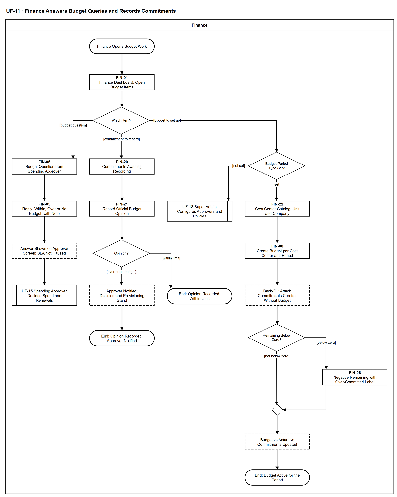

# UF-11 — Finance Answers Budget Queries and Records Commitments

> **Loại:** User flow (mức màn hình) — Finance · **Phiên bản:** 1.2 — 10/10/2026 · **Trạng thái:** Vẽ lại theo BRD v3.30 (đồng bộ QĐ-61/QĐ-62), QĐ-29b/QĐ-30a/QĐ-30b, QĐ-60a: Finance không nằm trên đường duyệt chi; ngân sách so trên chi phí thực chịu; mã màn hình là đề xuất — UI Spec hoãn tới giai đoạn Figma (QĐ-08)
>
> Sơ đồ là **dẫn xuất** từ quyết định Owner (`QĐ`) và BRD hiện hành; khi khác nhau, `QĐ` → BRD thắng. Quyết định trong sơ đồ là của Owner, **chưa** phải xác nhận của GVHD/hội đồng.

## 1. Mục đích và phạm vi

Ba việc của Finance quanh ngân sách: (1) trả lời yêu cầu thông tin ngân sách khi Người duyệt chi hỏi — ý kiến tham khảo, không duyệt, không chặn; (2) ghi ý kiến chính thức trên khoản cam kết sau khi Người duyệt chi duyệt chi; (3) lập ngân sách theo Cost Center và kỳ, kéo theo gắn ngược các khoản cam kết đã tạo trước khi có ngân sách và hiển thị còn lại âm. Đây là phía màn hình Finance của WF-09 (luồng phụ) và WF-20.

**Phạm vi:** Màn hình FIN-01, FIN-05, FIN-06, FIN-20, FIN-21, FIN-22 và các phản hồi hệ thống mà Finance nhìn thấy. Thuế chỉ được ghi nhận đúng chứng từ; ngân sách tính trên chi phí thực chịu, GTGT được khấu trừ ở cột riêng (QĐ-55a, QĐ-60a).

**Không nằm trong sơ đồ này:** Quyết định duyệt chi và quyết định kỳ gia hạn (→ UF-15); việc tạo khoản cam kết khi duyệt (hệ thống, MF-2/WF-09); chuyển cam kết thành chi phí theo hóa đơn, phân bổ và phát hành báo cáo kỳ (→ UF-19, WF-19); đặt loại kỳ ngân sách (→ UF-13). Giải phóng phần dư khoản cam kết khi không còn hóa đơn (FR-5.8) thuộc đóng kỳ (UF-19).

## 2. Tệp

| Tệp | Vai trò |
| --- | --- |
| [UF-11-finance-answers-budget-queries-and-records-commitments.drawio](UF-11-finance-answers-budget-queries-and-records-commitments.drawio) | Nguồn draw.io chỉnh sửa được (sinh từ spec) |
| [UF-11-finance-answers-budget-queries-and-records-commitments.drawio.png](UF-11-finance-answers-budget-queries-and-records-commitments.drawio.png) | Bản xuất PNG, nhúng sẵn nguồn draw.io |
| [UF-11.json](../specs/UF-11.json) | **Nguồn canonical** — sửa ở đây rồi chạy `python tools/flowkit.py build` từ `Docs/Diagrams` |

## 3. Nguồn nghiệp vụ

| Mã | Nội dung dùng trong sơ đồ |
| --- | --- |
| `FR-3.14, QĐ-29b, QĐ-30a` | Hỏi Finance tùy chọn, SLA không dừng; Finance ghi nhận ý kiến chính thức sau duyệt; vượt/chưa có ngân sách chỉ thông báo |
| `FR-5.8, FR-5.8a, INV-16, INV-18, QĐ-30b` | Khoản cam kết gắn đúng một Request; khi chưa có ngân sách vẫn tạo, vào hàng đợi ghi nhận, gắn ngược khi có Budget, còn lại được phép âm |
| `FR-5.1, OI-11b, FR-3.1, OI-04` | Kỳ ngân sách một loại cho toàn tổ chức; danh mục Cost Center do Finance quản lý |
| `FR-5.13, QĐ-55a, QĐ-60a, QĐ-60b` | Chỉ ghi nhận thuế; ngân sách và cam kết trên chi phí thực chịu, GTGT được khấu trừ ở cột riêng |
| `SoD-3, SoD-8` | Finance không quyết chi; người trả lời/ghi nhận khác Người duyệt chi của cùng Request |

## 4. Tác nhân, kích hoạt, điều kiện

| Làn (tiếng Anh trên hình) | Tác nhân | Trách nhiệm trong sơ đồ |
| --- | --- | --- |
| Finance | Finance (một người giữ vai) | Thao tác trên các màn hình FIN-xx; bước của Người duyệt chi và Super Admin chỉ hiện dưới dạng tham chiếu sang UF khác |

- **Kích hoạt:** Người duyệt chi gửi câu hỏi ngân sách; hoặc có khoản cam kết mới chờ ghi nhận sau duyệt chi; hoặc đầu kỳ ngân sách cần lập ngân sách cho một Cost Center.
- **Tiền điều kiện:** Tài khoản Finance đã kích hoạt (UF-17); phòng ban và Cost Center Unit 1–1 với phòng đã có (WF-01); với việc ghi nhận, Request có chi phí đã được Người duyệt chi duyệt và hệ thống đã tạo khoản cam kết.
- **Hậu điều kiện:** Câu hỏi có câu trả lời hiện trên màn hình của Người duyệt chi; hoặc khoản cam kết có ý kiến chính thức của Finance (Vượt hạn mức hoặc Chưa có ngân sách thì Người duyệt chi được báo, quyết định và cấp phát giữ nguyên); hoặc Budget của Cost Center và kỳ có hiệu lực, mọi cam kết của kỳ đã gắn vào Budget.

## 5. Cách đọc ký hiệu

| Ký hiệu | Nghĩa |
| --- | --- |
| Hình chữ nhật bo tròn hai đầu, viền đậm | Điểm bắt đầu hoặc kết cục của hành trình |
| Hình chữ nhật viền liền, dòng đầu in đậm | Màn hình người dùng thao tác; dòng đầu là mã màn hình đề xuất |
| Hình chữ nhật viền nét đứt | Hệ thống tự xử lý; người dùng chỉ thấy kết quả |
| Hình thoi | Rẽ nhánh; cạnh ra mang điều kiện `[...]` |
| Hình chữ nhật hai vạch đứng | Gọi user flow khác (mã `UF-xx` trong nhãn); có cạnh ra thì hành trình quay lại và đi tiếp, không có cạnh ra thì sơ đồ này dừng tại đó |
| Dây có cung nhảy | Hai dây giao nhau nhưng **không** nối với nhau |

Đọc từ trên xuống. Từ hình thoi Which Item? đi ba hướng: trái là câu hỏi của Người duyệt chi, giữa là ghi nhận cam kết (đường chính), phải là lập ngân sách. Hình chữ nhật viền liền là màn hình (dòng đầu là mã đề xuất), nét đứt là bước hệ thống tự xử lý, hai vạch đứng là chuyển sang user flow khác.

## 6. Bảng node

| ID | Loại | Nhãn trên hình | Ý nghĩa | Làn / người thực hiện | Quy tắc |
| --- | --- | --- | --- | --- | --- |
| `t_start` | Điểm đầu/cuối | Finance Opens Budget Work | Finance mở hệ thống để xử lý việc ngân sách: câu hỏi từ Người duyệt chi, khoản cam kết chờ ghi nhận, hoặc lập ngân sách cho kỳ. | Finance | — |
| `s_home` | Màn hình | FIN-01 — Finance Dashboard: Open Budget Items | Bảng điều khiển của Finance: số câu hỏi ngân sách đang mở, số khoản cam kết chờ ghi nhận, các Cost Center chưa có ngân sách. Mỗi ô là điểm vào của một việc bên dưới. | Finance | `FR-3.14`, `FR-5.8a`, `FR-5.1` |
| `d_item` | Rẽ nhánh | Which Item? | Finance chọn việc cần xử lý. Ba việc độc lập, không có thứ tự bắt buộc giữa chúng. | Finance | — |
| `s_ask` | Màn hình | FIN-05 — Budget Question from Spending Approver | Yêu cầu thông tin ngân sách do Người duyệt chi gửi (tùy chọn). Hiện snapshot của Cost Center và kỳ: ngân sách, thực chi, cam kết đang giữ, còn lại, tổng giá trị Request có chi phí đang chờ, thời điểm dữ liệu. Mọi số tiền trên chi phí thực chịu; GTGT được khấu trừ ở cột riêng. Chưa có ngân sách thì hiện Chưa có ngân sách, không hiện 0. Yêu cầu bị hủy thì câu hỏi đóng theo. | Finance | `FR-3.14`, `QĐ-30a`, `FR-5.13`, `QĐ-60a`, `FR-5.11` |
| `s_reply` | Màn hình | FIN-05 — Reply: Within, Over or No Budget, with Note | Finance chọn Trong hạn mức, Vượt hạn mức hoặc Chưa có ngân sách và ghi chú. Đây không phải phê duyệt và không chặn; người trả lời không được là Người duyệt chi của cùng Request. | Finance | `FR-3.14`, `SoD-3`, `SoD-8`, `QĐ-29b` |
| `y_note` | Hệ thống xử lý | Answer Shown on Approver Screen; SLA Not Paused | Câu trả lời hiện trên màn hình quyết định của Người duyệt chi. Đồng hồ SLA của bước duyệt chi không dừng, không đặt lại; Người duyệt chi quyết được cả khi Finance chưa trả lời. Thời gian Finance phản hồi đo riêng. | Finance | `FR-3.14`, `FR-3.8`, `FR-5.11` |
| `r_uf15` | Chuyển sang user flow khác | UF-15 Spending Approver Decides Spend and Renewals | Người duyệt chi quyết định trên snapshot (và câu trả lời nếu đã có). Phần quyết định nằm ở UF-15. | Finance | → `UF-15` |
| `s_cq` | Màn hình | FIN-20 — Commitments Awaiting Recording | Hàng đợi ghi nhận: mỗi dòng là một khoản cam kết Đang giữ do hệ thống tạo khi Người duyệt chi duyệt Request có chi phí; hiện Request, Cost Center, kỳ, chi phí ước tính (giá cộng thuế không được khấu trừ) và nhãn Chưa có ngân sách nếu chưa có Budget. Khoản đã giải phóng vì Request hủy hoặc cấp phát thất bại không còn trong hàng đợi. | Finance | `FR-5.8`, `FR-5.8a`, `INV-16`, `INV-18`, `QĐ-60a` |
| `s_op` | Màn hình | FIN-21 — Record Official Budget Opinion | Chi tiết khoản cam kết kèm ngân sách, thực chi, cam kết đang giữ, còn lại; thuế đúng chứng từ với cột GTGT được khấu trừ riêng. Finance ghi ý kiến chính thức Trong hạn mức, Vượt hạn mức hoặc Chưa có ngân sách. Bước có SLA riêng, không nằm trên đường chờ cấp phát; người ghi không được là Người duyệt chi của cùng Request. | Finance | `FR-3.14`, `FR-5.13`, `QĐ-60a`, `QĐ-29b`, `SoD-8` |
| `d_op` | Rẽ nhánh | Opinion? | Ý kiến chính thức mà Finance vừa ghi. | Finance | — |
| `y_ntf` | Hệ thống xử lý | Approver Notified; Decision and Provisioning Stand | Hệ thống thông báo Người duyệt chi. Không hoàn tác quyết định, không dừng cấp phát; khoản cam kết vẫn Đang giữ. Khoản chưa có ngân sách ở lại hàng đợi gắn ngược cho tới khi Budget được lập. | Finance | `FR-3.14`, `FR-5.8a`, `FR-5.14` |
| `t_in` | Điểm đầu/cuối | End: Opinion Recorded, Within Limit | Đã ghi nhận ý kiến Trong hạn mức; không có thông báo thêm. | Finance | — |
| `t_over` | Điểm đầu/cuối | End: Opinion Recorded, Approver Notified | Đã ghi nhận ý kiến Vượt hạn mức hoặc Chưa có ngân sách; Người duyệt chi đã được báo, quyết định giữ nguyên. | Finance | — |
| `d_period` | Rẽ nhánh | Budget Period Type Set? | Loại kỳ ngân sách (tháng, quý hoặc năm) là một loại cho toàn tổ chức, Super Admin đặt một lần, mặc định quý. | Finance | `FR-5.1`, `OI-11b` |
| `r_uf13` | Chuyển sang user flow khác | UF-13 Super Admin Configures Approvers and Policies | Finance chưa lập được ngân sách khi chưa có loại kỳ; Super Admin đặt loại kỳ một lần ở UF-13 (cấu hình, không phải phê duyệt). Đặt xong, Finance quay lại luồng này. | Finance | `FR-8.2`, `SoD-1`, → `UF-13` |
| `s_cc` | Màn hình | FIN-22 — Cost Center Catalog: Unit and Company | Finance tạo, sửa, ngừng dùng Cost Center: Unit (1–1 với phòng) và Company. Tách hoặc gộp phòng ⟹ Cost Center mới, cái cũ ngừng dùng, lịch sử giữ nguyên. Không tạo Cost Center giữ chỗ. | Finance | `FR-3.1`, `OI-04`, `QĐ-52b`, `FR-9.7` |
| `s_bud` | Màn hình | FIN-06 — Create Budget per Cost Center and Period | Finance lập hạn mức ngân sách cho một Cost Center và kỳ, tính trên chi phí thực chịu. Không tạo ngân sách hạn mức 0 để giữ chỗ. | Finance | `FR-5.1`, `FR-5.13`, `QĐ-60a` |
| `y_back` | Hệ thống xử lý | Back-Fill: Attach Commitments Created Without Budget | Hệ thống tự gắn mọi khoản cam kết Chưa có ngân sách của đúng Cost Center và kỳ vào Budget vừa lập, ghi Audit Trail; từ đây chúng tính vào cam kết đang giữ. | Finance | `FR-5.8a`, `INV-18`, `QĐ-30b` |
| `d_neg` | Rẽ nhánh | Remaining Below Zero? | Còn lại = ngân sách − thực chi − cam kết đang giữ có âm không. | Finance | `FR-5.8a` |
| `s_neg` | Màn hình | FIN-06 — Negative Remaining with Over-Committed Label | Số còn lại hiển thị âm kèm nhãn đã cam kết vượt hạn mức; không làm tròn về 0, không ẩn. Báo cáo nêu phần vượt đến từ cam kết tạo trước khi có ngân sách. | Finance | `FR-5.8a`, `INV-18` |
| `m_neg` | Hợp nhánh | — | — | Finance | — |
| `y_upd` | Hệ thống xử lý | Budget vs Actual vs Commitments Updated | Snapshot và báo cáo dùng ngay ngân sách mới: ngân sách · thực chi · cam kết đang giữ · còn lại. | Finance | `FR-5.1`, `FR-3.14` |
| `t_bud` | Điểm đầu/cuối | End: Budget Active for the Period | Budget của Cost Center và kỳ có hiệu lực; mọi cam kết của kỳ đã gắn vào Budget. | Finance | — |

## 7. Bảng chuyển tiếp

| Từ → tới | Nhãn điều kiện | Điều kiện | Kết quả |
| --- | --- | --- | --- |
| `t_start` → `s_home` | — | — | Sang FIN-01 — Finance Dashboard: Open Budget Items |
| `s_home` → `d_item` | — | — | Sang Which Item? |
| `d_item` → `s_ask` | `[budget question]` | Người duyệt chi hỏi ngân sách | Mở snapshot để trả lời |
| `d_item` → `s_cq` | `[commitment to record]` | Có khoản cam kết chờ ghi nhận sau duyệt chi | Mở hàng đợi ghi nhận |
| `d_item` → `d_period` | `[budget to set up]` | Cần lập ngân sách cho Cost Center và kỳ | Kiểm loại kỳ ngân sách |
| `s_ask` → `s_reply` | — | — | Sang FIN-05 — Reply: Within, Over or No Budget, with Note |
| `s_reply` → `y_note` | — | — | Sang Answer Shown on Approver Screen; SLA Not Paused |
| `y_note` → `r_uf15` | — | — | Sang UF-15 Spending Approver Decides Spend and Renewals |
| `s_cq` → `s_op` | — | — | Sang FIN-21 — Record Official Budget Opinion |
| `s_op` → `d_op` | — | — | Sang Opinion? |
| `d_op` → `t_in` | `[within limit]` | Ý kiến Trong hạn mức | Kết thúc, không thông báo thêm |
| `d_op` → `y_ntf` | `[over or no budget]` | Ý kiến Vượt hạn mức hoặc Chưa có ngân sách | Thông báo Người duyệt chi |
| `y_ntf` → `t_over` | — | — | Sang End: Opinion Recorded, Approver Notified |
| `d_period` → `r_uf13` | `[not set]` | Chưa đặt loại kỳ ngân sách | Super Admin đặt một lần ở UF-13 |
| `d_period` → `s_cc` | `[set]` | Đã đặt loại kỳ | Kiểm danh mục Cost Center |
| `s_cc` → `s_bud` | — | — | Sang FIN-06 — Create Budget per Cost Center and Period |
| `s_bud` → `y_back` | — | — | Sang Back-Fill: Attach Commitments Created Without Budget |
| `y_back` → `d_neg` | — | — | Sang Remaining Below Zero? |
| `d_neg` → `s_neg` | `[below zero]` | Cam kết gắn ngược vượt hạn mức vừa lập | Hiện số âm kèm nhãn vượt hạn mức |
| `d_neg` → `m_neg` | `[not below zero]` | Còn lại không âm | Đi tiếp |
| `s_neg` → `m_neg` | — | — | Sang — |
| `m_neg` → `y_upd` | — | — | Sang Budget vs Actual vs Commitments Updated |
| `y_upd` → `t_bud` | — | — | Sang End: Budget Active for the Period |

Số đếm: **23 node · 23 cạnh · 4 rẽ nhánh**; giao cắt dây: **0**.

## 8. Happy path

1. `t_start` — Finance Opens Budget Work: Finance mở hệ thống để xử lý việc ngân sách: câu hỏi từ Người duyệt chi, khoản cam kết chờ ghi nhận, hoặc lập ngân sách cho kỳ.
2. `s_home` — FIN-01 — Finance Dashboard: Open Budget Items: Bảng điều khiển của Finance: số câu hỏi ngân sách đang mở, số khoản cam kết chờ ghi nhận, các Cost Center chưa có ngân sách. Mỗi ô là điểm vào của một việc bên dưới.
3. `d_item` — Which Item?: Finance chọn việc cần xử lý. Ba việc độc lập, không có thứ tự bắt buộc giữa chúng.
4. `s_cq` — FIN-20 — Commitments Awaiting Recording: Hàng đợi ghi nhận: mỗi dòng là một khoản cam kết Đang giữ do hệ thống tạo khi Người duyệt chi duyệt Request có chi phí; hiện Request, Cost Center, kỳ, chi phí ước tính (giá cộng thuế không được khấu trừ) và nhãn Chưa có ngân sách nếu chưa có Budget. Khoản đã giải phóng vì Request hủy hoặc cấp phát thất bại không còn trong hàng đợi.
5. `s_op` — FIN-21 — Record Official Budget Opinion: Chi tiết khoản cam kết kèm ngân sách, thực chi, cam kết đang giữ, còn lại; thuế đúng chứng từ với cột GTGT được khấu trừ riêng. Finance ghi ý kiến chính thức Trong hạn mức, Vượt hạn mức hoặc Chưa có ngân sách. Bước có SLA riêng, không nằm trên đường chờ cấp phát; người ghi không được là Người duyệt chi của cùng Request.
6. `d_op` — Opinion?: Ý kiến chính thức mà Finance vừa ghi.
7. `t_in` — End: Opinion Recorded, Within Limit: Đã ghi nhận ý kiến Trong hạn mức; không có thông báo thêm.

## 9. Nhánh thay thế / if-else

- **Trả lời câu hỏi ngân sách của Người duyệt chi** — `d_item` → `s_ask` → `s_reply` → `y_note` → `r_uf15`. Câu trả lời không duyệt, không chặn; SLA của Người duyệt chi không dừng.
- **Lập ngân sách, còn lại không âm** — `d_item` → `d_period` → `s_cc` → `s_bud` → `y_back` → `d_neg` → `m_neg` → `y_upd` → `t_bud`. Cam kết tạo trước đó được gắn ngược vào Budget mới.

## 10. Nhánh lỗi / từ chối và cách kết thúc

- **Ghi nhận Vượt hạn mức hoặc Chưa có ngân sách** — `d_op` → `y_ntf` → `t_over`. Chỉ thông báo Người duyệt chi; không hoàn tác quyết định, không dừng cấp phát.
- **Chưa đặt loại kỳ ngân sách** — `d_period` → `r_uf13`. Finance không lập được ngân sách; Super Admin đặt một lần ở UF-13.
- **Gắn ngược làm còn lại âm** — `d_neg` → `s_neg` → `m_neg`. Hiển thị số âm kèm nhãn đã cam kết vượt hạn mức, không làm tròn về 0.

## 11. Liên hệ với sơ đồ khác

- Workflow: `WF-09` (luồng phụ hỏi Finance, nhánh ghi nhận), `WF-20`; main flow `MF-8`, `MF-2`
- `UF-15` (Người duyệt chi quyết định), `UF-13` (đặt loại kỳ ngân sách), `UF-19` (đóng kỳ, báo cáo)
- `UF-15` — gọi/chuyển tại node `r_uf15`
- `UF-13` — gọi/chuyển tại node `r_uf13`

## 12. Giới hạn và vấn đề còn mở

- (LATER-TECH/UI · DOI-01, QĐ-08) Mã màn hình FIN-xx là đề xuất, chưa có UI Spec hiện hành; FIN-20 → FIN-22 là mã mới của bản vẽ này.
- (ĐÃ CHỐT · DOI-102, QĐ-62m) Finance được sửa ngân sách giữa kỳ kèm lý do (lịch sử giữ, snapshot cũ không đổi, báo Người duyệt chi) — chi tiết ở WF-20.
- (ĐÃ CÓ NGUỒN · DOI-103, FR-5.8a, INV-18) Mỗi (Cost Center, kỳ) tối đa một ngân sách — suy ra từ việc khoản cam kết chưa gắn ngân sách được gắn ngược vào ngân sách *của đúng Cost Center và kỳ đó*; BRD không có câu nói thẳng. Chi tiết ở WF-20.
