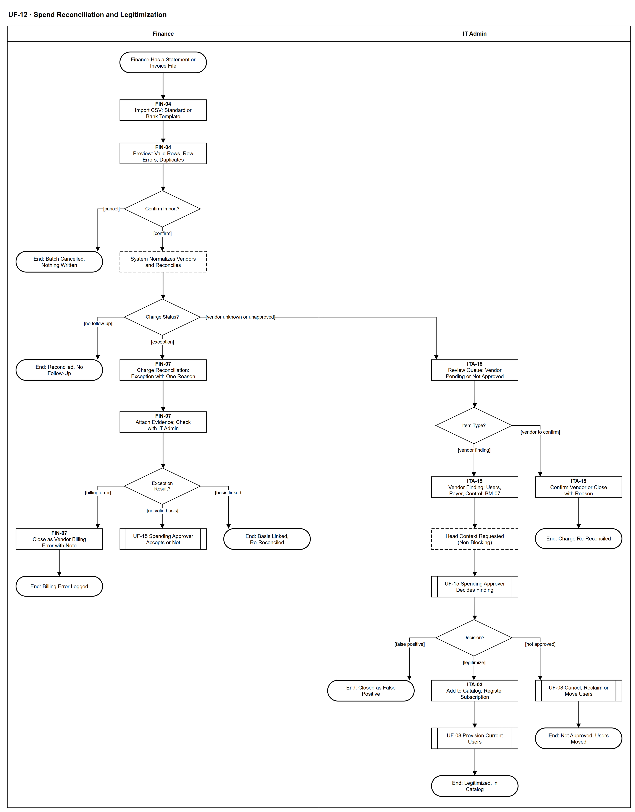

# UF-12 — Spend Reconciliation and Legitimization

> **Loại:** User flow (mức màn hình) — Finance và IT Admin · **Phiên bản:** 1.4 — 10/10/2026 · **Trạng thái:** Vẽ lại theo BRD v3.31 (đồng bộ QĐ-61 → QĐ-63); *Đối soát chi phí phần mềm* là tính năng bổ sung nối từ MF-8 (QĐ-33a, QĐ-49d); mã màn hình là đề xuất (QĐ-08)
>
> Sơ đồ là **dẫn xuất** từ quyết định Owner (`QĐ`) và BRD hiện hành; khi khác nhau, `QĐ` → BRD thắng. Quyết định trong sơ đồ là của Owner, **chưa** phải xác nhận của GVHD/hội đồng.

## 1. Mục đích và phạm vi

Hành trình màn hình của **Finance** (nhập sao kê/hóa đơn, xử lý ngoại lệ) và **IT Admin** (hàng đợi review nhà cung cấp, hồ sơ hợp thức hóa) khi đối soát khoản chi phần mềm với căn cứ phê duyệt. Người duyệt chi quyết ở UF-15. Đây là phía màn hình của WF-17 / WF-17a.

**Phạm vi:** Màn hình FIN-04, FIN-07, ITA-15, ITA-03 và phản hồi hệ thống.

**Không nằm trong sơ đồ này:** Quyết định của Người duyệt chi (UF-15); phân bổ chi phí kỳ và báo cáo (UF-19, WF-19); đối soát hóa đơn với thuê bao do IT xử lý (UF-14, WF-16); nguồn IdP/bộ thu thập cho phát hiện (giai đoạn sau, QĐ-31a).

## 2. Tệp

| Tệp | Vai trò |
| --- | --- |
| [UF-12-spend-reconciliation-and-legitimization.drawio](UF-12-spend-reconciliation-and-legitimization.drawio) | Nguồn draw.io chỉnh sửa được (sinh từ spec) |
| [UF-12-spend-reconciliation-and-legitimization.drawio.png](UF-12-spend-reconciliation-and-legitimization.drawio.png) | Bản xuất PNG, nhúng sẵn nguồn draw.io |
| [UF-12.json](../specs/UF-12.json) | **Nguồn canonical** — sửa ở đây rồi chạy `python tools/flowkit.py build` từ `Docs/Diagrams` |

## 3. Nguồn nghiệp vụ

| Mã | Nội dung dùng trong sơ đồ |
| --- | --- |
| `FR-6.3, FR-7.1 → FR-7.4, QĐ-31a` | Nhập CSV, xem trước bắt buộc, lỗi một dòng không hỏng cả tệp |
| `FR-6.4, QĐ-33b, QĐ-34a` | Đối soát với căn cứ; ngoại lệ một lý do; lỗi tính tiền của nhà cung cấp |
| `FR-6.5, FR-6.6, QĐ-31d, QĐ-37` | Chuẩn hóa nhà cung cấp; hàng đợi review; gợi ý AI tin cậy Thấp |
| `FR-6.7, FR-6.9, INV-13, QĐ-33c` | Một bản ghi phát hiện đang mở mỗi nhà cung cấp; hồ sơ BM-07; ba kết cục |
| `FR-3.4c-1, SoD-3, SoD-7, DQ-06` | Chỉ Người duyệt chi quyết; Finance không quyết; hợp thức hóa không duyệt chi lần hai |
| `QĐ-50c` | Phần không giải thích được vẫn là thực chi kỳ, dòng Chưa phân bổ |

## 4. Tác nhân, kích hoạt, điều kiện

| Làn (tiếng Anh trên hình) | Tác nhân | Trách nhiệm trong sơ đồ |
| --- | --- | --- |
| Finance | Finance | Nhập tệp, xem trước, xử lý ngoại lệ; không quyết chấp nhận khoản chi (SoD-3) |
| IT Admin | IT Admin | Hàng đợi review nhà cung cấp, hồ sơ BM-07, thực thi kết quả hợp thức hóa |

- **Kích hoạt:** Finance có tệp sao kê/hóa đơn của kỳ.
- **Tiền điều kiện:** Danh mục, thuê bao và hóa đơn đã nhập là căn cứ để đối soát.
- **Hậu điều kiện:** Mỗi khoản chi có một trạng thái; mỗi ngoại lệ hoặc bản ghi phát hiện kết thúc bằng: đối soát lại · lỗi tính tiền · quyết định của Người duyệt chi · hợp thức hóa · không duyệt · báo nhầm.

## 5. Cách đọc ký hiệu

| Ký hiệu | Nghĩa |
| --- | --- |
| Hình chữ nhật bo tròn hai đầu, viền đậm | Điểm bắt đầu hoặc kết cục của hành trình |
| Hình chữ nhật viền liền, dòng đầu in đậm | Màn hình người dùng thao tác; dòng đầu là mã màn hình đề xuất |
| Hình chữ nhật viền nét đứt | Hệ thống tự xử lý; người dùng chỉ thấy kết quả |
| Hình thoi | Rẽ nhánh; cạnh ra mang điều kiện `[...]` |
| Hình chữ nhật hai vạch đứng | Gọi user flow khác (mã `UF-xx` trong nhãn); có cạnh ra thì hành trình quay lại và đi tiếp, không có cạnh ra thì sơ đồ này dừng tại đó |
| Dây có cung nhảy | Hai dây giao nhau nhưng **không** nối với nhau |

Làn Finance bên trái, IT Admin bên phải. Nhánh phải của *Charge Status?* chuyển dòng sang hàng đợi IT.

## 6. Bảng node

| ID | Loại | Nhãn trên hình | Ý nghĩa | Làn / người thực hiện | Quy tắc |
| --- | --- | --- | --- | --- | --- |
| `t_start` | Điểm đầu/cuối | Finance Has a Statement or Invoice File | Finance có tệp CSV sao kê/thẻ hoặc danh sách hóa đơn chi phí của kỳ. | Finance | — |
| `s_imp` | Màn hình | FIN-04 — Import CSV: Standard or Bank Template | Tải tệp CSV theo mẫu chuẩn hoặc mẫu cấu hình theo ngân hàng — nguồn bằng chứng duy nhất được hiện thực đợt này. XLSX, PDF, mã hóa khác bị từ chối cả tệp. | Finance | `FR-6.3`, `FR-7.1`, `QĐ-31a`, `QĐ-33a` |
| `s_prev` | Màn hình | FIN-04 — Preview: Valid Rows, Row Errors, Duplicates | Xem trước bắt buộc: số dòng hợp lệ, dòng lỗi kèm lý do (lỗi một dòng không hỏng cả tệp), dòng đã import trước đó; cảnh báo tệp đã import. | Finance | `FR-7.2`, `FR-7.3`, `FR-7.4` |
| `d_prev` | Rẽ nhánh | Confirm Import? | Finance xác nhận ghi hoặc hủy lô. | Finance | `FR-7.2` |
| `t_cancel` | Điểm đầu/cuối | End: Batch Cancelled, Nothing Written | Không dòng nào được ghi. | Finance | — |
| `y_rec` | Hệ thống xử lý | System Normalizes Vendors and Reconciles | Chuẩn hóa nhà cung cấp kèm mức tin cậy (WF-17a), liên kết khoản chi với hóa đơn đã nhập, rồi so với căn cứ phê duyệt (thuê bao, yêu cầu đã duyệt, quyết định chi) lũy kế trong kỳ. | Finance | `FR-6.4`, `FR-6.5`, `FR-5.4`, `QĐ-34b` |
| `d_stat` | Rẽ nhánh | Charge Status? | Mỗi khoản chi đúng một trạng thái: không cần xử lý (khớp căn cứ, đã ghi nhận, hoàn tiền, không phải phần mềm) · ngoại lệ · nhà cung cấp chưa nhận diện hoặc chưa được duyệt. | Finance | `FR-6.4`, `QĐ-33b`, `QĐ-33c` |
| `t_ok` | Điểm đầu/cuối | End: Reconciled, No Follow-Up | Khoản chi đã có trạng thái không cần xử lý. | Finance | — |
| `s_exc` | Màn hình | FIN-07 — Charge Reconciliation: Exception with One Reason | Ngoại lệ là *cần kiểm tra*, không phải vi phạm: không có căn cứ · ngoài thời hạn · vượt số tiền được duyệt · nhiều căn cứ cùng khớp. Phần không giải thích được vẫn tính vào thực chi kỳ (dòng Chưa phân bổ). | Finance | `FR-6.4`, `QĐ-33b`, `QĐ-34a`, `QĐ-50c` |
| `s_attach` | Màn hình | FIN-07 — Attach Evidence; Check with IT Admin | Finance đính kèm chứng từ; IT Admin điều tra phần mềm đứng sau và liên kết căn cứ nếu có. Finance không quyết chấp nhận khoản chi. | Finance | `QĐ-33b`, `SoD-3`, `BM-05`, `FR-6.9` |
| `d_exr` | Rẽ nhánh | Exception Result? | Kết quả kiểm tra chung của Finance và IT. | Finance | `QĐ-33b`, `QĐ-34a` |
| `s_berr` | Màn hình | FIN-07 — Close as Vendor Billing Error with Note | Đóng mục với ghi chú bắt buộc; Finance tự theo dõi với nhà cung cấp; không có bước quyết của Người duyệt chi. | Finance | `QĐ-34a` |
| `t_berr` | Điểm đầu/cuối | End: Billing Error Logged | Điều chỉnh (nếu có) đến sau bằng chứng từ mới. | Finance | — |
| `r_uf15a` | Chuyển sang user flow khác | UF-15 Spending Approver Accepts or Not | Chỉ Người duyệt chi chấp nhận hoặc không chấp nhận khoản chi không có căn cứ hợp lệ. | Finance | `FR-3.4c-1`, `SoD-7`, → `UF-15` |
| `t_linked` | Điểm đầu/cuối | End: Basis Linked, Re-Reconciled | IT đã liên kết căn cứ; hệ thống đối soát lại dòng đó (phần vượt số tiền được duyệt vẫn là ngoại lệ). | Finance | — |
| `s_queue` | Màn hình | ITA-15 — Review Queue: Vendor Pending or Not Approved | Hàng đợi review của IT: dòng chưa nhận diện nhà cung cấp (một lý do chính) và bản ghi phát hiện cho nhà cung cấp chưa được duyệt (mỗi nhà cung cấp một bản ghi đang mở). | IT Admin | `FR-6.6`, `FR-6.7`, `INV-13`, `QĐ-33c` |
| `d_v` | Rẽ nhánh | Item Type? | Mục cần xác nhận nhà cung cấp, hay bản ghi phát hiện nhà cung cấp chưa được duyệt. | IT Admin | — |
| `s_conf` | Màn hình | ITA-15 — Confirm Vendor or Close with Reason | IT xác nhận nhà cung cấp (gợi ý AI nếu bật chỉ ở mức tin cậy Thấp, IT quyết) hoặc đóng là không nhận diện được; hệ thống đối soát lại chỉ dòng đó. | IT Admin | `FR-6.5`, `FR-6.6`, `QĐ-31d`, `QĐ-49e` |
| `t_conf` | Điểm đầu/cuối | End: Charge Re-Reconciled | Dòng đã có nhà cung cấp và được đối soát lại. | IT Admin | — |
| `s_find` | Màn hình | ITA-15 — Vendor Finding: Users, Payer, Control; BM-07 | IT xác minh ai dùng, ai trả, gán người chịu trách nhiệm, đánh giá kỹ thuật/rủi ro/mức kiểm soát (chỉ là đầu vào) và lập hồ sơ BM-07. | IT Admin | `FR-6.9`, `BM-07`, `QĐ-58d` |
| `y_ctx` | Hệ thống xử lý | Head Context Requested (Non-Blocking) | Chỉ khi khoản chi gắn được với nhân viên của một phòng: hệ thống hỏi trưởng phòng bối cảnh nghiệp vụ và nhắc; có thì hiện trên BM-07. Không chặn — Người duyệt chi quyết được khi chưa có (QĐ-62d). Phòng chưa có trưởng phòng ⟹ yêu cầu treo, chuyển cho trưởng phòng mới (QĐ-62c); không gắn được phòng ⟹ không hỏi. | IT Admin | `FR-6.9`, `QĐ-62d`, `QĐ-62c` |
| `r_uf15b` | Chuyển sang user flow khác | UF-15 Spending Approver Decides Finding | Người duyệt chi quyết trên BM-07: báo nhầm · không duyệt · duyệt hợp thức hóa. | IT Admin | `FR-3.4c-1`, `OI-14g`, → `UF-15` |
| `d_out` | Rẽ nhánh | Decision? | Kết quả quyết định hiện trên bản ghi phát hiện; ghi vào từng khoản chi của bản ghi. | IT Admin | `QĐ-33c`, `DQ-06` |
| `t_fp` | Điểm đầu/cuối | End: Closed as False Positive | Đóng với lý do; xuất hiện lại thì mở lại (FR-6.7). | IT Admin | — |
| `s_cat` | Màn hình | ITA-03 — Add to Catalog; Register Subscription | Duyệt hợp thức hóa: IT đưa ứng dụng vào danh mục (chỉ sau quyết định) và ghi thuê bao theo chứng từ đã có. | IT Admin | `DQ-06`, `BM-07` |
| `r_prov` | Chuyển sang user flow khác | UF-08 Provision Current Users | Cấp quyền cho người đang dùng — không duyệt chi lần thứ hai. Nếu tác vụ cấp bị IT đóng là thất bại (UF-08, QĐ-62i): Assignment thất bại, người dùng chưa có quyền hợp lệ; IT mở tác vụ mới nếu vẫn cần. | IT Admin | `FR-3.4c-1`, → `UF-08` |
| `t_leg` | Điểm đầu/cuối | End: Legitimized, in Catalog | Hợp thức hóa là kết cục bình thường, tích cực. | IT Admin | — |
| `r_recl` | Chuyển sang user flow khác | UF-08 Cancel, Reclaim or Move Users | Không duyệt: hủy gói, thu hồi quyền hoặc chuyển người dùng sang công cụ đã có. Nếu WF-09a trả *đóng thất bại* (QĐ-62i): quyền còn hiệu lực, vẫn hiện G2/lãng phí theo điều kiện nguồn, seat chưa về kho và IT mở tác vụ thu hồi mới. Gói có lưu ý mất dữ liệu: IT Admin ghi xác nhận đã xử lý bàn giao trước khi gỡ ở nhà cung cấp; không chặn sau hạn ngắn (WF-09a `d_dl`, `s_ask`; QĐ-63a). | IT Admin | `FR-6.9`, `BM-07`, `QĐ-63a`, → `UF-08` |
| `t_na` | Điểm đầu/cuối | End: Not Approved, Users Moved | Quyết định ghi Audit Trail. | IT Admin | — |

## 7. Bảng chuyển tiếp

| Từ → tới | Nhãn điều kiện | Điều kiện | Kết quả |
| --- | --- | --- | --- |
| `t_start` → `s_imp` | — | — | Sang FIN-04 — Import CSV: Standard or Bank Template |
| `s_imp` → `s_prev` | — | — | Sang FIN-04 — Preview: Valid Rows, Row Errors, Duplicates |
| `s_prev` → `d_prev` | — | — | Sang Confirm Import? |
| `d_prev` → `t_cancel` | `[cancel]` | Hủy lô | Không ghi gì |
| `d_prev` → `y_rec` | `[confirm]` | Xác nhận ghi | Đối soát |
| `y_rec` → `d_stat` | — | — | Sang Charge Status? |
| `d_stat` → `t_ok` | `[no follow-up]` | Khớp căn cứ, đã ghi nhận, hoàn tiền hoặc không phải phần mềm | Xong |
| `d_stat` → `s_exc` | `[exception]` | Cần kiểm tra | Mở ngoại lệ |
| `d_stat` → `s_queue` | `[vendor unknown or unapproved]` | Chưa nhận diện nhà cung cấp hoặc nhà cung cấp chưa được duyệt | Sang hàng đợi IT |
| `s_exc` → `s_attach` | — | — | Sang FIN-07 — Attach Evidence; Check with IT Admin |
| `s_attach` → `d_exr` | — | — | Sang Exception Result? |
| `d_exr` → `s_berr` | `[billing error]` | Nhà cung cấp tính sai | Đóng có ghi chú |
| `d_exr` → `r_uf15a` | `[no valid basis]` | Vẫn không có căn cứ hợp lệ | Người duyệt chi quyết |
| `d_exr` → `t_linked` | `[basis linked]` | IT liên kết được căn cứ | Đối soát lại |
| `s_berr` → `t_berr` | — | — | Sang End: Billing Error Logged |
| `s_queue` → `d_v` | — | — | Sang Item Type? |
| `d_v` → `s_conf` | `[vendor to confirm]` | Dòng chưa nhận diện nhà cung cấp | Xác nhận hoặc đóng |
| `d_v` → `s_find` | `[vendor finding]` | Nhà cung cấp chưa được duyệt | Lập hồ sơ BM-07 |
| `s_conf` → `t_conf` | — | — | Sang End: Charge Re-Reconciled |
| `s_find` → `y_ctx` | — | — | Sang Head Context Requested (Non-Blocking) |
| `y_ctx` → `r_uf15b` | — | — | Sang UF-15 Spending Approver Decides Finding |
| `r_uf15b` → `d_out` | — | — | Sang Decision? |
| `d_out` → `t_fp` | `[false positive]` | Báo nhầm, có lý do | Đóng |
| `d_out` → `s_cat` | `[legitimize]` | Duyệt hợp thức hóa | Vào danh mục |
| `d_out` → `r_recl` | `[not approved]` | Không duyệt, có lý do | Hủy/thu hồi/chuyển |
| `s_cat` → `r_prov` | — | — | Sang UF-08 Provision Current Users |
| `r_prov` → `t_leg` | — | — | Sang End: Legitimized, in Catalog |
| `r_recl` → `t_na` | — | — | Sang End: Not Approved, Users Moved |

Số đếm: **29 node · 28 cạnh · 5 rẽ nhánh**; giao cắt dây: **0**.

## 8. Happy path

1. `t_start` — Finance Has a Statement or Invoice File: Finance có tệp CSV sao kê/thẻ hoặc danh sách hóa đơn chi phí của kỳ.
2. `s_imp` — FIN-04 — Import CSV: Standard or Bank Template: Tải tệp CSV theo mẫu chuẩn hoặc mẫu cấu hình theo ngân hàng — nguồn bằng chứng duy nhất được hiện thực đợt này. XLSX, PDF, mã hóa khác bị từ chối cả tệp.
3. `s_prev` — FIN-04 — Preview: Valid Rows, Row Errors, Duplicates: Xem trước bắt buộc: số dòng hợp lệ, dòng lỗi kèm lý do (lỗi một dòng không hỏng cả tệp), dòng đã import trước đó; cảnh báo tệp đã import.
4. `d_prev` — Confirm Import?: Finance xác nhận ghi hoặc hủy lô.
5. `y_rec` — System Normalizes Vendors and Reconciles: Chuẩn hóa nhà cung cấp kèm mức tin cậy (WF-17a), liên kết khoản chi với hóa đơn đã nhập, rồi so với căn cứ phê duyệt (thuê bao, yêu cầu đã duyệt, quyết định chi) lũy kế trong kỳ.
6. `d_stat` — Charge Status?: Mỗi khoản chi đúng một trạng thái: không cần xử lý (khớp căn cứ, đã ghi nhận, hoàn tiền, không phải phần mềm) · ngoại lệ · nhà cung cấp chưa nhận diện hoặc chưa được duyệt.
7. `t_ok` — End: Reconciled, No Follow-Up: Khoản chi đã có trạng thái không cần xử lý.

## 9. Nhánh thay thế / if-else

- **Ngoại lệ — liên kết được căn cứ** — `d_stat` → `s_exc` → `s_attach` → `d_exr` → `t_linked`. Đối soát lại.
- **Ngoại lệ — không có căn cứ hợp lệ** — `d_exr` → `r_uf15a`. Người duyệt chi chấp nhận hoặc không.
- **Xác nhận nhà cung cấp** — `d_stat` → `s_queue` → `d_v` → `s_conf` → `t_conf`. Đối soát lại chỉ dòng đó.
- **Hợp thức hóa** — `d_v` → `s_find` → `y_ctx` → `r_uf15b` → `d_out` → `s_cat` → `r_prov` → `t_leg`. Kết cục bình thường, tích cực.

## 10. Nhánh lỗi / từ chối và cách kết thúc

- **Hủy lô ở xem trước** — `d_prev` → `t_cancel`. Không ghi dữ liệu.
- **Lỗi tính tiền của nhà cung cấp** — `d_exr` → `s_berr` → `t_berr`. Ghi chú bắt buộc.
- **Không duyệt** — `d_out` → `r_recl` → `t_na`. Lý do bắt buộc.
- **Báo nhầm** — `d_out` → `t_fp`. Mở lại nếu xuất hiện lại.

## 11. Liên hệ với sơ đồ khác

- Main flow: `MF-8` (luồng con); workflow: `WF-17`, `WF-17a`, `WF-19`
- `UF-15` (Người duyệt chi quyết), `UF-08` (cấp/thu hồi), `UF-14` (sai lệch hóa đơn – thuê bao), `UF-19` (đóng kỳ)
- `UF-15` — gọi/chuyển tại node `r_uf15a`
- `UF-15` — gọi/chuyển tại node `r_uf15b`
- `UF-08` — gọi/chuyển tại node `r_prov`
- `UF-08` — gọi/chuyển tại node `r_recl`

## 12. Giới hạn và vấn đề còn mở

- (LATER-TECH/UI · DOI-01, QĐ-08) Mã màn hình FIN-04, FIN-07, ITA-15, ITA-03 giữ từ bản cũ, là đề xuất.
- (LATER-TECH/UI · DOI-41, QĐ-62d) Bối cảnh của trưởng phòng là luồng phụ không chặn (WF-17 `e_ctx`), chưa có màn hình riêng của trưởng phòng — ở đây là bước hệ thống.
