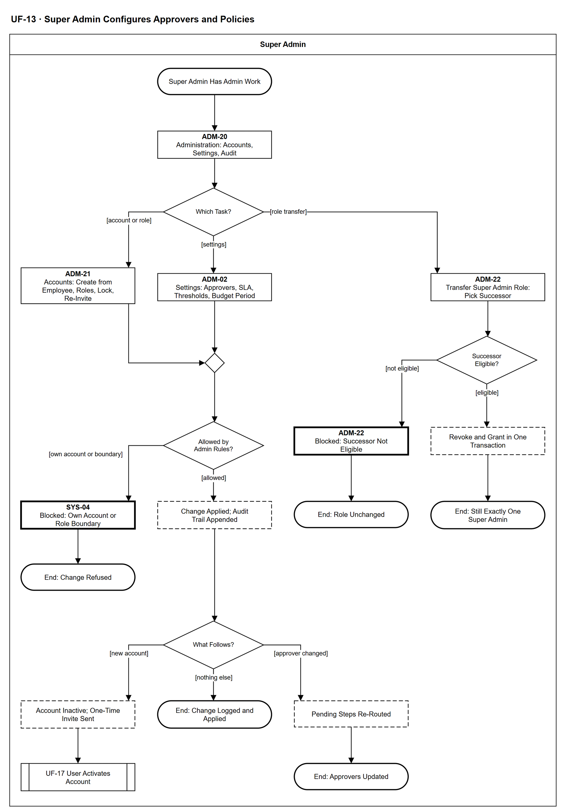

# UF-13 — Super Admin Configures Approvers and Policies

> **Loại:** User flow (mức màn hình) — Super Admin · **Phiên bản:** 1.1 — 09/10/2026 · **Trạng thái:** Vẽ lại theo BRD v3.30 (đồng bộ QĐ-61/QĐ-62) (một Super Admin — QĐ-44; tài khoản nội bộ — QĐ-46/47); mã màn hình là đề xuất (QĐ-08)
>
> Sơ đồ là **dẫn xuất** từ quyết định Owner (`QĐ`) và BRD hiện hành; khi khác nhau, `QĐ` → BRD thắng. Quyết định trong sơ đồ là của Owner, **chưa** phải xác nhận của GVHD/hội đồng.

## 1. Mục đích và phạm vi

Hành trình của **Super Admin** khi quản trị tài khoản và vai, cấu hình người duyệt và tham số, hoặc chuyển giao vai Super Admin. Mọi thay đổi qua cùng một cổng kiểm *không tự sửa tài khoản của mình, không vượt ranh giới vai* và được ghi Audit Trail. Đây là phía màn hình của WF-03 (nhóm hỗ trợ SF-2).

**Phạm vi:** Màn hình ADM-20 → ADM-22, ADM-02, SYS-04 và phản hồi hệ thống.

**Không nằm trong sơ đồ này:** Khởi tạo tổ chức, phòng ban, trưởng phòng và IT phụ trách phòng (WF-01); kích hoạt tài khoản phía người dùng (UF-17); khôi phục vai Super Admin ngoài ứng dụng theo phiếu (FR-8.10(d2)).

## 2. Tệp

| Tệp | Vai trò |
| --- | --- |
| [UF-13-super-admin-configures-approvers-and-policies.drawio](UF-13-super-admin-configures-approvers-and-policies.drawio) | Nguồn draw.io chỉnh sửa được (sinh từ spec) |
| [UF-13-super-admin-configures-approvers-and-policies.drawio.png](UF-13-super-admin-configures-approvers-and-policies.drawio.png) | Bản xuất PNG, nhúng sẵn nguồn draw.io |
| [UF-13.json](../specs/UF-13.json) | **Nguồn canonical** — sửa ở đây rồi chạy `python tools/flowkit.py build` từ `Docs/Diagrams` |

## 3. Nguồn nghiệp vụ

| Mã | Nội dung dùng trong sơ đồ |
| --- | --- |
| `FR-8.1, FR-8.2, SoD-1` | Super Admin quản trị tài khoản và cấu hình; cấu hình không phải phê duyệt |
| `FR-8.6, FR-8.11, QĐ-46, QĐ-47c` | Tạo tài khoản từ hồ sơ nhân viên; lời mời dùng một lần; vai chưa có hiệu lực trước khi kích hoạt |
| `FR-8.7, FR-8.8, FR-3.15, OI-17` | Không tự sửa tài khoản của mình; ranh giới vai của Super Admin |
| `FR-8.3, OI-08c` | Audit Trail chỉ ghi thêm |
| `FR-3.16, QĐ-28d` | Đổi người duyệt ⟹ xác định lại bước đang chờ |
| `FR-8.10, QĐ-44` | Một Super Admin; chuyển giao trong một giao dịch |

## 4. Tác nhân, kích hoạt, điều kiện

| Làn (tiếng Anh trên hình) | Tác nhân | Trách nhiệm trong sơ đồ |
| --- | --- | --- |
| Super Admin | Super Admin | Thao tác trên màn hình ADM-xx; cổng kiểm và hệ quả hiện dưới dạng bước hệ thống |

- **Kích hoạt:** Super Admin cần quản trị tài khoản, cấu hình hoặc chuyển giao vai.
- **Tiền điều kiện:** Super Admin có tài khoản đã kích hoạt và đang dùng được.
- **Hậu điều kiện:** Thay đổi được áp dụng và ghi vết; hoặc bị từ chối không thay đổi gì; vẫn đúng một Super Admin.

## 5. Cách đọc ký hiệu

| Ký hiệu | Nghĩa |
| --- | --- |
| Hình chữ nhật bo tròn hai đầu, viền đậm | Điểm bắt đầu hoặc kết cục của hành trình |
| Hình chữ nhật viền liền, dòng đầu in đậm | Màn hình người dùng thao tác; dòng đầu là mã màn hình đề xuất |
| Hình chữ nhật viền nét đứt | Hệ thống tự xử lý; người dùng chỉ thấy kết quả |
| Hình chữ nhật viền rất đậm | Màn hình chặn hoặc trạng thái lỗi |
| Hình thoi | Rẽ nhánh; cạnh ra mang điều kiện `[...]` |
| Hình chữ nhật hai vạch đứng | Gọi user flow khác (mã `UF-xx` trong nhãn); có cạnh ra thì hành trình quay lại và đi tiếp, không có cạnh ra thì sơ đồ này dừng tại đó |
| Dây có cung nhảy | Hai dây giao nhau nhưng **không** nối với nhau |

Đọc từ trên xuống. Hai nhánh trái (tài khoản, cấu hình) đi qua cùng cổng kiểm; nhánh phải là chuyển giao vai Super Admin.

## 6. Bảng node

| ID | Loại | Nhãn trên hình | Ý nghĩa | Làn / người thực hiện | Quy tắc |
| --- | --- | --- | --- | --- | --- |
| `t_start` | Điểm đầu/cuối | Super Admin Has Admin Work | Super Admin duy nhất của tổ chức (QĐ-44) cần quản trị tài khoản, cấu hình hoặc chuyển giao vai. | Super Admin | — |
| `s_home` | Màn hình | ADM-20 — Administration: Accounts, Settings, Audit | Trang quản trị: tài khoản và vai, cấu hình, chuyển giao vai, tra cứu Audit Trail và trạng thái tác vụ nền (chỉ đọc, không đổi dữ liệu). | Super Admin | `FR-8.1`, `FR-8.2`, `FR-8.3`, `FR-8.4` |
| `d_act` | Rẽ nhánh | Which Task? | Ba việc làm thay đổi: tài khoản/vai, cấu hình, chuyển giao vai Super Admin. Cấu hình không phải phê duyệt. | Super Admin | `SoD-1` |
| `s_acct` | Màn hình | ADM-21 — Accounts: Create from Employee, Roles, Lock, Re-Invite | Tạo tài khoản chỉ từ hồ sơ nhân viên đã có (không tự đăng ký, không lấy vai từ email/tên miền); gán/thu hồi vai; khóa/mở khóa; gửi lại lời mời. | Super Admin | `FR-8.1`, `FR-8.6`, `FR-8.11`, `QĐ-46`, `QĐ-47c` |
| `s_cfg` | Màn hình | ADM-02 — Settings: Approvers, SLA, Thresholds, Budget Period | Người duyệt chi, người thay thế khi xung đột, approver dự phòng; SLA phê duyệt; ngưỡng cảnh báo và phát hiện; chính sách lưu giữ; loại kỳ ngân sách (đặt một lần). Giá trị trước/sau được ghi. | Super Admin | `FR-8.2`, `FR-3.6`, `FR-3.13`, `FR-3.15`, `OI-11b` |
| `m_gate` | Hợp nhánh | — | — | Super Admin | — |
| `d_gate` | Rẽ nhánh | Allowed by Admin Rules? | Cổng của hệ thống: không ai đổi vai, khóa/mở hay kích hoạt tài khoản của chính mình; Super Admin không giữ IT_ADMIN, FINANCE hay vai duyệt. | Super Admin | `FR-8.7`, `FR-8.8`, `FR-3.15`, `OI-17`, `SoD-1` |
| `b_gate` | Màn hình chặn/lỗi | SYS-04 — Blocked: Own Account or Role Boundary | Từ chối kèm lý do; hệ thống vẫn chạy bình thường. | Super Admin | `FR-8.7`, `FR-8.8` |
| `t_block` | Điểm đầu/cuối | End: Change Refused | Không thay đổi gì. | Super Admin | — |
| `y_apply` | Hệ thống xử lý | Change Applied; Audit Trail Appended | Ghi thay đổi và một dòng Audit Trail (người làm, vai, hành động, đối tượng, giá trị trước/sau); nhật ký chỉ ghi thêm. | Super Admin | `FR-8.3`, `FR-8.6`, `OI-08c` |
| `d_post` | Rẽ nhánh | What Follows? | Hệ quả đi kèm: tài khoản mới cần lời mời; đổi người duyệt phải xác định lại bước đang chờ; còn lại kết thúc. | Super Admin | `FR-8.6`, `FR-3.16` |
| `y_inv` | Hệ thống xử lý | Account Inactive; One-Time Invite Sent | Vai gán được lưu nhưng chưa có hiệu lực tới khi kích hoạt; gửi lại làm vô hiệu lời mời cũ. Không ai đặt hay biết mật khẩu hộ. | Super Admin | `FR-8.6`, `FR-8.11` |
| `r_uf17` | Chuyển sang user flow khác | UF-17 User Activates Account | Người dùng tự đặt mật khẩu và kích hoạt; vai có hiệu lực từ lúc đó. | Super Admin | → `UF-17` |
| `t_done` | Điểm đầu/cuối | End: Change Logged and Applied | Thay đổi quản trị đã ghi vết và áp dụng. | Super Admin | — |
| `y_redet` | Hệ thống xử lý | Pending Steps Re-Routed | Chạy lại quy tắc định tuyến cho các bước đang chờ khi đổi Người duyệt chi, người thay thế hoặc approver dự phòng; chỉ người giữ bước đổi. | Super Admin | `FR-3.16`, `QĐ-28d` |
| `t_redet` | Điểm đầu/cuối | End: Approvers Updated | Bước đang chờ đã có người duyệt mới; ghi Audit Trail. | Super Admin | — |
| `s_xf` | Màn hình | ADM-22 — Transfer Super Admin Role: Pick Successor | Cách duy nhất đổi người giữ vai trong ứng dụng; Super Admin đang giữ vai nhập lại mật khẩu và chọn người kế nhiệm. | Super Admin | `FR-8.10`, `QĐ-44a` |
| `d_succ` | Rẽ nhánh | Successor Eligible? | Người kế nhiệm có tài khoản đã kích hoạt, nhân viên đang làm việc, không giữ IT_ADMIN, FINANCE hay vai duyệt. | Super Admin | `FR-8.10`, `FR-8.7` |
| `b_succ` | Màn hình chặn/lỗi | ADM-22 — Blocked: Successor Not Eligible | Chuyển giao bị từ chối kèm lý do; người đang giữ vai vẫn giữ nguyên. | Super Admin | `FR-8.10` |
| `t_succ` | Điểm đầu/cuối | End: Role Unchanged | Không chuyển giao. | Super Admin | — |
| `y_xf` | Hệ thống xử lý | Revoke and Grant in One Transaction | Thu hồi vai người cũ và cấp vai người mới trong một giao dịch; lỗi thì hoàn tác toàn bộ; Audit Trail ghi cả hai. | Super Admin | `FR-8.10`, `FR-8.8`, `QĐ-44e` |
| `t_xf` | Điểm đầu/cuối | End: Still Exactly One Super Admin | Chuyển giao hoàn tất. | Super Admin | — |

## 7. Bảng chuyển tiếp

| Từ → tới | Nhãn điều kiện | Điều kiện | Kết quả |
| --- | --- | --- | --- |
| `t_start` → `s_home` | — | — | Sang ADM-20 — Administration: Accounts, Settings, Audit |
| `s_home` → `d_act` | — | — | Sang Which Task? |
| `d_act` → `s_acct` | `[account or role]` | Tạo tài khoản, đổi vai, khóa/mở, gửi lại lời mời | Mở quản lý tài khoản |
| `d_act` → `s_cfg` | `[settings]` | Cấu hình người duyệt và tham số | Mở cấu hình |
| `d_act` → `s_xf` | `[role transfer]` | Chuyển giao vai Super Admin | Chọn người kế nhiệm |
| `s_acct` → `m_gate` | — | — | Sang — |
| `s_cfg` → `m_gate` | — | — | Sang — |
| `m_gate` → `d_gate` | — | — | Sang Allowed by Admin Rules? |
| `d_gate` → `b_gate` | `[own account or boundary]` | Thao tác trên tài khoản của chính mình hoặc vượt ranh giới vai | Từ chối |
| `d_gate` → `y_apply` | `[allowed]` | Hợp lệ | Áp dụng |
| `b_gate` → `t_block` | — | — | Sang End: Change Refused |
| `y_apply` → `d_post` | — | — | Sang What Follows? |
| `d_post` → `y_inv` | `[new account]` | Tài khoản mới | Gửi lời mời |
| `d_post` → `t_done` | `[nothing else]` | Không có hệ quả thêm | Kết thúc |
| `d_post` → `y_redet` | `[approver changed]` | Đổi Người duyệt chi, người thay thế hoặc approver dự phòng | Định tuyến lại |
| `y_inv` → `r_uf17` | — | — | Sang UF-17 User Activates Account |
| `y_redet` → `t_redet` | — | — | Sang End: Approvers Updated |
| `s_xf` → `d_succ` | — | — | Sang Successor Eligible? |
| `d_succ` → `b_succ` | `[not eligible]` | Người kế nhiệm không đủ điều kiện | Từ chối |
| `d_succ` → `y_xf` | `[eligible]` | Đủ điều kiện | Chuyển giao |
| `b_succ` → `t_succ` | — | — | Sang End: Role Unchanged |
| `y_xf` → `t_xf` | — | — | Sang End: Still Exactly One Super Admin |

Số đếm: **22 node · 22 cạnh · 4 rẽ nhánh**; giao cắt dây: **0**.

## 8. Happy path

1. `t_start` — Super Admin Has Admin Work: Super Admin duy nhất của tổ chức (QĐ-44) cần quản trị tài khoản, cấu hình hoặc chuyển giao vai.
2. `s_home` — ADM-20 — Administration: Accounts, Settings, Audit: Trang quản trị: tài khoản và vai, cấu hình, chuyển giao vai, tra cứu Audit Trail và trạng thái tác vụ nền (chỉ đọc, không đổi dữ liệu).
3. `d_act` — Which Task?: Ba việc làm thay đổi: tài khoản/vai, cấu hình, chuyển giao vai Super Admin. Cấu hình không phải phê duyệt.
4. `s_cfg` — ADM-02 — Settings: Approvers, SLA, Thresholds, Budget Period: Người duyệt chi, người thay thế khi xung đột, approver dự phòng; SLA phê duyệt; ngưỡng cảnh báo và phát hiện; chính sách lưu giữ; loại kỳ ngân sách (đặt một lần). Giá trị trước/sau được ghi.
5. `d_gate` — Allowed by Admin Rules?: Cổng của hệ thống: không ai đổi vai, khóa/mở hay kích hoạt tài khoản của chính mình; Super Admin không giữ IT_ADMIN, FINANCE hay vai duyệt.
6. `y_apply` — Change Applied; Audit Trail Appended: Ghi thay đổi và một dòng Audit Trail (người làm, vai, hành động, đối tượng, giá trị trước/sau); nhật ký chỉ ghi thêm.
7. `d_post` — What Follows?: Hệ quả đi kèm: tài khoản mới cần lời mời; đổi người duyệt phải xác định lại bước đang chờ; còn lại kết thúc.
8. `y_redet` — Pending Steps Re-Routed: Chạy lại quy tắc định tuyến cho các bước đang chờ khi đổi Người duyệt chi, người thay thế hoặc approver dự phòng; chỉ người giữ bước đổi.
9. `t_redet` — End: Approvers Updated: Bước đang chờ đã có người duyệt mới; ghi Audit Trail.

## 9. Nhánh thay thế / if-else

- **Tạo tài khoản mới** — `d_act` → `s_acct` → `m_gate` → `d_gate` → `y_apply` → `d_post` → `y_inv` → `r_uf17`. Người dùng tự kích hoạt.
- **Thay đổi không có hệ quả thêm** — `d_post` → `t_done`. Ví dụ: đổi ngưỡng cảnh báo.
- **Chuyển giao vai Super Admin** — `d_act` → `s_xf` → `d_succ` → `y_xf` → `t_xf`. Một giao dịch; hoàn tác nếu lỗi.

## 10. Nhánh lỗi / từ chối và cách kết thúc

- **Tự sửa tài khoản của mình hoặc vượt ranh giới vai** — `d_gate` → `b_gate` → `t_block`. Từ chối, không thay đổi.
- **Người kế nhiệm không đủ điều kiện** — `d_succ` → `b_succ` → `t_succ`. Người đang giữ vai giữ nguyên.

## 11. Liên hệ với sơ đồ khác

- Workflow: `WF-03`, `WF-01`; nhóm hỗ trợ `SF-2`
- `UF-17` (kích hoạt tài khoản), `UF-11` (loại kỳ ngân sách đặt một lần), `UF-15` (Người duyệt chi được cấu hình ở đây)
- `UF-17` — gọi/chuyển tại node `r_uf17`

## 12. Giới hạn và vấn đề còn mở

- (LATER-TECH/UI · DOI-01, QĐ-08) Mã ADM-02, SYS-04 giữ từ bản cũ; ADM-20 → ADM-22 mới; tất cả là đề xuất.
- (LATER-TECH/UI · DOI-41) Màn hình cấu hình phòng ban (trưởng phòng, IT phụ trách phòng — QĐ-58) thuộc khởi tạo tổ chức (WF-01); chưa có user flow riêng.
