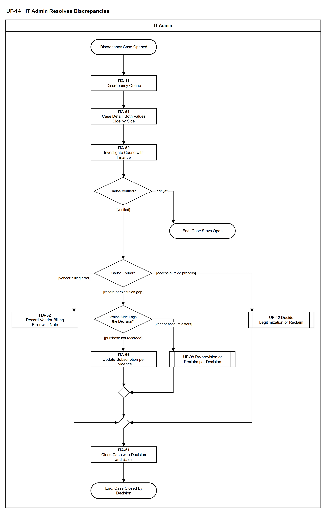

# UF-14 — IT Admin Resolves Discrepancies

> **Loại:** User flow (mức màn hình) — IT Admin · **Phiên bản:** 1.2 — 10/10/2026 · **Trạng thái:** Vẽ lại theo BRD v3.30 (đồng bộ QĐ-61/QĐ-62), QĐ-49f, QĐ-34a/b, QĐ-60a/b; khớp WF-16; mã màn hình là đề xuất — UI Spec hoãn tới giai đoạn Figma (QĐ-08)
>
> Sơ đồ là **dẫn xuất** từ quyết định Owner (`QĐ`) và BRD hiện hành; khi khác nhau, `QĐ` → BRD thắng. Quyết định trong sơ đồ là của Owner, **chưa** phải xác nhận của GVHD/hội đồng.

## 1. Mục đích và phạm vi

Hành trình của IT Admin khi hai nguồn dữ liệu nói khác nhau: hóa đơn so với thuê bao, hoặc danh sách thành viên phía nhà cung cấp so với Assignment. Hệ thống không tự đồng bộ cho khớp vì như vậy xóa bằng chứng; IT Admin điều tra cùng Finance, xác định nguyên nhân, xử lý đúng hướng (nhà cung cấp tính sai, quyền ngoài quy trình, thuê bao chưa ghi, tài khoản chưa đúng quyết định) rồi đóng hồ sơ bằng một quyết định.

**Phạm vi:** Màn hình ITA-11, ITA-51, ITA-52 và phản hồi hệ thống IT Admin nhìn thấy, từ lúc hồ sơ sai lệch được mở tới khi đóng.

**Không nằm trong sơ đồ này:** Phần Finance nhập hóa đơn kèm dòng thuế và hệ thống ghép hóa đơn với thuê bao (→ WF-16, UF-19); ngoại lệ khoản chi trên sao kê (→ UF-12); thao tác trong hàng đợi cấp phát (→ UF-08); chênh lệch chỉ do thuế, tỷ giá hoặc phí (ghi riêng, không mở hồ sơ).

## 2. Tệp

| Tệp | Vai trò |
| --- | --- |
| [UF-14-it-admin-resolves-discrepancies.drawio](UF-14-it-admin-resolves-discrepancies.drawio) | Nguồn draw.io chỉnh sửa được (sinh từ spec) |
| [UF-14-it-admin-resolves-discrepancies.drawio.png](UF-14-it-admin-resolves-discrepancies.drawio.png) | Bản xuất PNG, nhúng sẵn nguồn draw.io |
| [UF-14.json](../specs/UF-14.json) | **Nguồn canonical** — sửa ở đây rồi chạy `python tools/flowkit.py build` từ `Docs/Diagrams` |

## 3. Nguồn nghiệp vụ

| Mã | Nội dung dùng trong sơ đồ |
| --- | --- |
| `FR-2.6, OI-14h` | Job đối soát hằng ngày cho app có connector; hai loại sai lệch tài khoản |
| `FR-7.7, QĐ-15` | Không nguồn nào tự ghi đè; hồ sơ giữ cả hai giá trị, mức hồ sơ |
| `FR-5.4, QĐ-34b, QĐ-49f` | Hóa đơn là thực chi như đã nhận; nhà cung cấp tính sai đóng kèm ghi chú bắt buộc, điều chỉnh bằng hóa đơn mới |
| `QĐ-34a` | Ngoại lệ khoản chi sao kê tách khỏi Discrepancy |
| `FR-5.13, QĐ-55a, QĐ-60a` | Chênh lệch thuế, tỷ giá hoặc phí ghi riêng, không mở hồ sơ |
| `FR-3.4c-1, DQ-06, BM-07` | Chỉ Người duyệt chi quyết hợp thức hóa |
| `FR-2.5, QĐ-03` | Tách ý định khỏi thực thi; lời mời chờ chấp nhận chưa phải thành viên kích hoạt |

## 4. Tác nhân, kích hoạt, điều kiện

| Làn (tiếng Anh trên hình) | Tác nhân | Trách nhiệm trong sơ đồ |
| --- | --- | --- |
| IT Admin | IT Admin | Thao tác trên các màn hình ITA-xx; bước của Finance chỉ hiện dưới dạng trạng thái hệ thống, bước của Người duyệt chi và hàng đợi cấp phát là tham chiếu sang UF khác |

- **Kích hoạt:** Hệ thống mở hồ sơ sai lệch: hóa đơn lệch số lượng hoặc đơn giá, hoặc job đối soát connector (mặc định hằng ngày) thấy tài khoản chỉ có ở một phía.
- **Tiền điều kiện:** Thuê bao và Assignment đã ghi; hồ sơ thuế nhà cung cấp đã khai (FR-5.13); với loại tài khoản, ứng dụng có connector.
- **Hậu điều kiện:** Hồ sơ được đóng bằng một quyết định kèm căn cứ, cả hai giá trị gốc được giữ; hoặc hồ sơ vẫn mở khi chưa xác minh được nguyên nhân.

## 5. Cách đọc ký hiệu

| Ký hiệu | Nghĩa |
| --- | --- |
| Hình chữ nhật bo tròn hai đầu, viền đậm | Điểm bắt đầu hoặc kết cục của hành trình |
| Hình chữ nhật viền liền, dòng đầu in đậm | Màn hình người dùng thao tác; dòng đầu là mã màn hình đề xuất |
| Hình thoi | Rẽ nhánh; cạnh ra mang điều kiện `[...]` |
| Hình chữ nhật hai vạch đứng | Gọi user flow khác (mã `UF-xx` trong nhãn); có cạnh ra thì hành trình quay lại và đi tiếp, không có cạnh ra thì sơ đồ này dừng tại đó |
| Dây có cung nhảy | Hai dây giao nhau nhưng **không** nối với nhau |

Đọc từ trên xuống. Hình chữ nhật viền liền là màn hình (dòng đầu là mã đề xuất), nét đứt là bước hệ thống hoặc vai khác tự xử lý, hai vạch đứng là chuyển sang user flow khác. Ba nhánh từ Cause Found? gặp nhau ở bước đóng hồ sơ.

## 6. Bảng node

| ID | Loại | Nhãn trên hình | Ý nghĩa | Làn / người thực hiện | Quy tắc |
| --- | --- | --- | --- | --- | --- |
| `t_start` | Điểm đầu/cuối | Discrepancy Case Opened | Hệ thống đã mở một hồ sơ sai lệch: hóa đơn lệch số lượng hoặc đơn giá so với thuê bao, hoặc job đối soát hằng ngày thấy tài khoản chỉ có ở một phía (hệ thống hoặc nhà cung cấp). IT Admin được báo. | IT Admin | — |
| `s_queue` | Màn hình | ITA-11 — Discrepancy Queue | Hàng đợi hồ sơ sai lệch (case-level) theo loại: hóa đơn lệch số lượng hoặc đơn giá · có trong hệ thống nhưng không có ở nhà cung cấp · có ở nhà cung cấp nhưng không có trong hệ thống. Chỉ ứng dụng có connector mới có hai loại sau, nên không sinh sai lệch giả. Chênh lệch chỉ do thuế, tỷ giá hoặc phí không mở hồ sơ. | IT Admin | `FR-2.6`, `OI-14h`, `QĐ-15`, `FR-5.13` |
| `s_case` | Màn hình | ITA-51 — Case Detail: Both Values Side by Side | Hồ sơ giữ cả hai giá trị (hóa đơn và thuê bao; hoặc danh sách thành viên phía nhà cung cấp và Assignment đang hiệu lực), không nguồn nào tự ghi đè. Hóa đơn lệch vẫn nằm trong thực chi như đã nhận. Lời mời đang chờ chấp nhận chưa phải thành viên đã kích hoạt. Thuê bao 100 seat so với 80 Assignment là seat chưa gán, không phải sai lệch hóa đơn. Ngoại lệ của một khoản chi trên sao kê không phải Discrepancy (→ UF-12). | IT Admin | `FR-7.7`, `QĐ-34a`, `QĐ-34b`, `QĐ-03`, `FR-5.4` |
| `s_inv` | Màn hình | ITA-52 — Investigate Cause with Finance | IT Admin điều tra nguyên nhân cùng Finance; Finance cung cấp chứng từ và căn cứ mua (quyết định duyệt chi, hóa đơn). Ghi lại điều đã xác minh vào hồ sơ. Hồ sơ không tự đóng theo thời gian. | IT Admin | `FR-7.7`, `FR-5.4`, `SoD-3` |
| `d_ver` | Rẽ nhánh | Cause Verified? | Đã xác minh được nguyên nhân chưa. Chưa xác minh thì hồ sơ vẫn mở. | IT Admin | — |
| `t_open` | Điểm đầu/cuối | End: Case Stays Open | Hồ sơ vẫn mở, giữ cả hai giá trị; không có đóng tự động theo thời gian. IT Admin quay lại khi có thêm chứng từ. | IT Admin | — |
| `d_cause` | Rẽ nhánh | Cause Found? | Ba nhóm nguyên nhân sau xác minh: nhà cung cấp tính sai (chỉ ca hóa đơn) · quyền được cấp ngoài quy trình · bản ghi nội bộ hoặc việc thực thi chưa theo kịp quyết định. | IT Admin | `FR-5.4`, `FR-7.7`, `QĐ-49f` |
| `s_berr` | Màn hình | ITA-52 — Record Vendor Billing Error with Note | Quyết định nhà cung cấp tính sai kèm ghi chú xác minh bắt buộc. Hóa đơn vẫn tính như đã nhận; điều chỉnh (nếu có) đến sau bằng hóa đơn mới. Không có quy trình tranh chấp, hoàn tiền hay thanh toán; hệ thống không tự sửa hóa đơn hay thuê bao. | IT Admin | `QĐ-49f`, `FR-5.4`, `QĐ-34` |
| `r_leg` | Chuyển sang user flow khác | UF-12 Decide Legitimization or Reclaim | Tài khoản hoặc quyền ngoài quy trình: chỉ Người duyệt chi quyết hợp thức hóa (hồ sơ BM-07, không duyệt chi lần hai); không duyệt thì IT thu hồi hoặc chuyển người dùng. | IT Admin | `FR-3.4c-1`, `DQ-06`, `BM-07`, → `UF-12` |
| `d_gap` | Rẽ nhánh | Which Side Lags the Decision? | Phân biệt: mua đã duyệt nhưng thuê bao chưa ghi theo căn cứ, hay tài khoản phía nhà cung cấp chưa đúng với Assignment đã quyết (chưa cấp xong hoặc đã mất). | IT Admin | `FR-5.4`, `FR-2.5` |
| `y_upd` | Màn hình | ITA-66 — Update Subscription per Evidence | Mua đã duyệt nhưng thuê bao chưa ghi: **IT Admin** cập nhật thuê bao theo căn cứ (quyết định duyệt chi, chứng từ Finance đính kèm); Finance giữ hóa đơn, dòng thuế và cờ được khấu trừ. Hệ thống không tự sửa (QĐ-62b). | IT Admin | `FR-5.4`, `FR-7.7`, `QĐ-62b` |
| `r_exec` | Chuyển sang user flow khác | UF-08 Re-provision or Reclaim per Decision | IT thực thi lại cấp phát hoặc thu hồi theo quyết định đã có, qua connector hoặc thủ công, trong hàng đợi cấp phát. Nếu WF-09a/UF-08 trả *đóng thất bại* (QĐ-62i): sai lệch chưa được giải quyết; hồ sơ không tự đóng (chỉ đóng bằng quyết định) và IT mở tác vụ mới. | IT Admin | `FR-2.5`, `FR-2.4`, → `UF-08` |
| `m_gap` | Hợp nhánh | — | — | IT Admin | — |
| `m_res` | Hợp nhánh | — | — | IT Admin | — |
| `s_close` | Màn hình | ITA-51 — Close Case with Decision and Basis | IT Admin đóng hồ sơ kèm quyết định và căn cứ; ghi Audit Trail. Cả hai giá trị gốc vẫn được giữ làm bằng chứng. Không có đóng tự động theo thời gian. | IT Admin | `FR-7.7`, `FR-8.3` |
| `t_end` | Điểm đầu/cuối | End: Case Closed by Decision | Sai lệch đã đóng bằng một quyết định của người thật; cả hai giá trị gốc được giữ. | IT Admin | — |

## 7. Bảng chuyển tiếp

| Từ → tới | Nhãn điều kiện | Điều kiện | Kết quả |
| --- | --- | --- | --- |
| `t_start` → `s_queue` | — | — | Sang ITA-11 — Discrepancy Queue |
| `s_queue` → `s_case` | — | — | Sang ITA-51 — Case Detail: Both Values Side by Side |
| `s_case` → `s_inv` | — | — | Sang ITA-52 — Investigate Cause with Finance |
| `s_inv` → `d_ver` | — | — | Sang Cause Verified? |
| `d_ver` → `t_open` | `[not yet]` | Chưa xác minh được nguyên nhân | Hồ sơ vẫn mở |
| `d_ver` → `d_cause` | `[verified]` | Đã xác minh nguyên nhân | Phân loại nguyên nhân |
| `d_cause` → `s_berr` | `[vendor billing error]` | Xác minh cho thấy nhà cung cấp tính sai | Ghi quyết định kèm ghi chú bắt buộc |
| `d_cause` → `r_leg` | `[access outside process]` | Có tài khoản ở nhà cung cấp mà không có quyết định cấp | Người duyệt chi quyết hợp thức hóa hoặc IT thu hồi |
| `d_cause` → `d_gap` | `[record or execution gap]` | Bản ghi nội bộ hoặc việc thực thi chưa theo kịp quyết định | Xác định phía cần sửa |
| `d_gap` → `y_upd` | `[purchase not recorded]` | Mua đã duyệt nhưng thuê bao chưa ghi | IT Admin cập nhật thuê bao theo căn cứ; Finance đính chứng từ (QĐ-62b) |
| `d_gap` → `r_exec` | `[vendor account differs]` | Tài khoản phía nhà cung cấp khác Assignment đã quyết | IT thực thi lại cấp phát hoặc thu hồi |
| `y_upd` → `m_gap` | — | — | Sang — |
| `r_exec` → `m_gap` | — | — | Sang — |
| `m_gap` → `m_res` | — | — | Sang — |
| `s_berr` → `m_res` | — | — | Sang — |
| `r_leg` → `m_res` | — | — | Sang — |
| `m_res` → `s_close` | — | — | Sang ITA-51 — Close Case with Decision and Basis |
| `s_close` → `t_end` | — | — | Sang End: Case Closed by Decision |

Số đếm: **16 node · 18 cạnh · 3 rẽ nhánh**; giao cắt dây: **0**.

## 8. Happy path

1. `t_start` — Discrepancy Case Opened: Hệ thống đã mở một hồ sơ sai lệch: hóa đơn lệch số lượng hoặc đơn giá so với thuê bao, hoặc job đối soát hằng ngày thấy tài khoản chỉ có ở một phía (hệ thống hoặc nhà cung cấp). IT Admin được báo.
2. `s_queue` — ITA-11 — Discrepancy Queue: Hàng đợi hồ sơ sai lệch (case-level) theo loại: hóa đơn lệch số lượng hoặc đơn giá · có trong hệ thống nhưng không có ở nhà cung cấp · có ở nhà cung cấp nhưng không có trong hệ thống. Chỉ ứng dụng có connector mới có hai loại sau, nên không sinh sai lệch giả. Chênh lệch chỉ do thuế, tỷ giá hoặc phí không mở hồ sơ.
3. `s_case` — ITA-51 — Case Detail: Both Values Side by Side: Hồ sơ giữ cả hai giá trị (hóa đơn và thuê bao; hoặc danh sách thành viên phía nhà cung cấp và Assignment đang hiệu lực), không nguồn nào tự ghi đè. Hóa đơn lệch vẫn nằm trong thực chi như đã nhận. Lời mời đang chờ chấp nhận chưa phải thành viên đã kích hoạt. Thuê bao 100 seat so với 80 Assignment là seat chưa gán, không phải sai lệch hóa đơn. Ngoại lệ của một khoản chi trên sao kê không phải Discrepancy (→ UF-12).
4. `s_inv` — ITA-52 — Investigate Cause with Finance: IT Admin điều tra nguyên nhân cùng Finance; Finance cung cấp chứng từ và căn cứ mua (quyết định duyệt chi, hóa đơn). Ghi lại điều đã xác minh vào hồ sơ. Hồ sơ không tự đóng theo thời gian.
5. `d_ver` — Cause Verified?: Đã xác minh được nguyên nhân chưa. Chưa xác minh thì hồ sơ vẫn mở.
6. `d_cause` — Cause Found?: Ba nhóm nguyên nhân sau xác minh: nhà cung cấp tính sai (chỉ ca hóa đơn) · quyền được cấp ngoài quy trình · bản ghi nội bộ hoặc việc thực thi chưa theo kịp quyết định.
7. `d_gap` — Which Side Lags the Decision?: Phân biệt: mua đã duyệt nhưng thuê bao chưa ghi theo căn cứ, hay tài khoản phía nhà cung cấp chưa đúng với Assignment đã quyết (chưa cấp xong hoặc đã mất).
8. `y_upd` — ITA-66 — Update Subscription per Evidence: Mua đã duyệt nhưng thuê bao chưa ghi: **IT Admin** cập nhật thuê bao theo căn cứ (quyết định duyệt chi, chứng từ Finance đính kèm); Finance giữ hóa đơn, dòng thuế và cờ được khấu trừ. Hệ thống không tự sửa (QĐ-62b).
9. `s_close` — ITA-51 — Close Case with Decision and Basis: IT Admin đóng hồ sơ kèm quyết định và căn cứ; ghi Audit Trail. Cả hai giá trị gốc vẫn được giữ làm bằng chứng. Không có đóng tự động theo thời gian.
10. `t_end` — End: Case Closed by Decision: Sai lệch đã đóng bằng một quyết định của người thật; cả hai giá trị gốc được giữ.

## 9. Nhánh thay thế / if-else

- **Tài khoản phía nhà cung cấp khác Assignment đã quyết** — `d_gap` → `r_exec` → `m_gap`. IT thực thi lại cấp phát hoặc thu hồi theo quyết định đã có.
- **Quyền được cấp ngoài quy trình** — `d_cause` → `r_leg` → `m_res`. Người duyệt chi quyết hợp thức hóa; không duyệt thì IT thu hồi hoặc chuyển người dùng.

## 10. Nhánh lỗi / từ chối và cách kết thúc

- **Nhà cung cấp tính sai** — `d_cause` → `s_berr` → `m_res` → `s_close` → `t_end`. Hóa đơn vẫn là thực chi như đã nhận; ghi chú xác minh bắt buộc.
- **Chưa xác minh được nguyên nhân** — `d_ver` → `t_open`. Hồ sơ vẫn mở, không tự đóng theo thời gian.

## 11. Liên hệ với sơ đồ khác

- Workflow: `WF-16`, `WF-09a` (thực thi lại cấp phát/thu hồi); main flow `MF-8`
- `UF-12` (hợp thức hóa hoặc thu hồi), `UF-08` (hàng đợi cấp phát), `UF-19` (hóa đơn đi vào thực chi và báo cáo kỳ)
- `UF-12` — gọi/chuyển tại node `r_leg`
- `UF-08` — gọi/chuyển tại node `r_exec`

## 12. Giới hạn và vấn đề còn mở

- (ĐÃ CÓ NGUỒN · DOI-93, QĐ-62b) IT Admin đóng hồ sơ sai lệch kèm quyết định và căn cứ — BRD 5.10 dòng *Đối soát nhà cung cấp* (*IT Admin xử lý*); ca *nhà cung cấp tính sai* kèm ghi chú xác minh của Finance.
- (ĐÃ CÓ NGUỒN · DOI-95) Phân biệt *phía nào chưa theo kịp quyết định* theo nguyên tắc BRD 5.7.1: dữ liệu nội bộ là nguồn về ý định đã được duyệt, nhà cung cấp là nguồn về thực tế quan sát được; sai lệch được xử lý theo quyết định đã có, không nguồn nào tự ghi đè nguồn kia (FR-7.7).
- (DEFERRED/OUT · DOI-11, QĐ-59c) Quyền ghi Members của connector GitHub chưa kiểm (TE-11b): thực thi lại cấp phát qua connector chưa kiểm.
- (LATER-TECH/UI · DOI-01, QĐ-08) Mã màn hình ITA-51, ITA-52, ITA-66 là mã mới của bản vẽ này; ITA-11 dùng lại mã cũ (đối soát thành viên phía nhà cung cấp); UI Spec chưa chốt.
