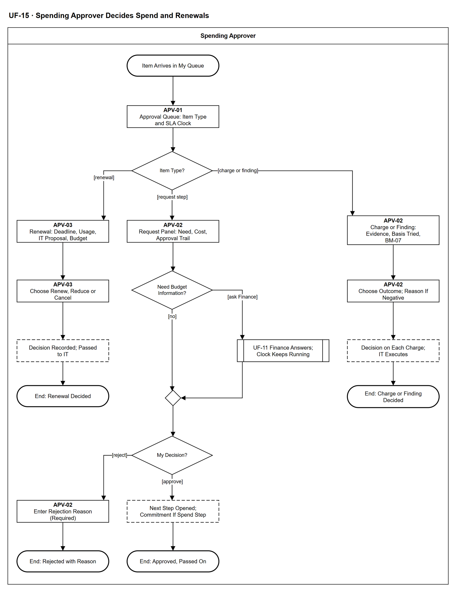

# UF-15 — Spending Approver Decides Spend and Renewals

> **Loại:** User flow (mức màn hình) — Spending Approver · **Phiên bản:** 1.3 — 10/10/2026 · **Trạng thái:** Vẽ lại theo BRD v3.30 (đồng bộ QĐ-61/QĐ-62) (QĐ-52c: bước nhu cầu của trưởng phòng do Người duyệt chi giữ; QĐ-29b: Finance không nằm trên đường duyệt; QĐ-55/60: chi phí thực chịu); mã màn hình APV-01 → APV-03 là đề xuất (QĐ-08)
>
> Sơ đồ là **dẫn xuất** từ quyết định Owner (`QĐ`) và BRD hiện hành; khi khác nhau, `QĐ` → BRD thắng. Quyết định trong sơ đồ là của Owner, **chưa** phải xác nhận của GVHD/hội đồng.

## 1. Mục đích và phạm vi

Hành trình của **Người duyệt chi** trên hàng đợi APV-01: quyết bước chi của yêu cầu (và bước nhu cầu khi trưởng phòng là người thụ hưởng), quyết kỳ gia hạn, và quyết khoản chi chưa có căn cứ hoặc hồ sơ hợp thức hóa. Finance chỉ cung cấp ý kiến ngân sách để tham khảo.

**Phạm vi:** Màn hình APV-01 → APV-03 và phản hồi hệ thống. Kênh: web và **ứng dụng mobile native** (QĐ-61b) với cùng quy tắc và phân quyền. Khác biệt thật trên mobile: chỉ hộp thông báo trong ứng dụng (không push, không offline — QĐ-61c), không tải tệp, snapshot ngân sách chỉ đọc; các bước khác của luồng này chỉ trên web. Trên mobile, Người duyệt chi duyệt cả **bước nhu cầu** của yêu cầu do trưởng phòng tự gửi, cùng hàng đợi với bước duyệt chi (QĐ-61h).

**Không nằm trong sơ đồ này:** Chuẩn bị đề xuất gia hạn và ghi kết quả (UF-20); Finance trả lời và ghi khoản cam kết (UF-11); IT thực thi kết quả đối soát (UF-12) và cấp phát (UF-08).

## 2. Tệp

| Tệp | Vai trò |
| --- | --- |
| [UF-15-spending-approver-decides-spend-and-renewals.drawio](UF-15-spending-approver-decides-spend-and-renewals.drawio) | Nguồn draw.io chỉnh sửa được (sinh từ spec) |
| [UF-15-spending-approver-decides-spend-and-renewals.drawio.png](UF-15-spending-approver-decides-spend-and-renewals.drawio.png) | Bản xuất PNG, nhúng sẵn nguồn draw.io |
| [UF-15.json](../specs/UF-15.json) | **Nguồn canonical** — sửa ở đây rồi chạy `python tools/flowkit.py build` từ `Docs/Diagrams` |

## 3. Nguồn nghiệp vụ

| Mã | Nội dung dùng trong sơ đồ |
| --- | --- |
| `FR-3.4, FR-3.8, QĐ-28d` | Bước chi; SLA nhắc người được giao, quá SLA hoặc backlog thì cảnh báo Super Admin (không có cấp trên), không đổi người, không tự quyết |
| `QĐ-52c, SoD-4, INV-08` | Yêu cầu của trưởng phòng: bước nhu cầu do Người duyệt chi giữ; không ai duyệt yêu cầu của chính mình |
| `QĐ-29b` | Finance không nằm trên đường duyệt; hỏi Finance không dừng SLA; Finance ghi khoản cam kết sau |
| `FR-3.13, QĐ-55, QĐ-60` | Quyết kỳ gia hạn; ngân sách theo chi phí thực chịu |
| `FR-3.4c-1, FR-6.9, OI-14g, DQ-06, BM-07` | Khoản chi chưa có căn cứ và hồ sơ hợp thức hóa |

## 4. Tác nhân, kích hoạt, điều kiện

| Làn (tiếng Anh trên hình) | Tác nhân | Trách nhiệm trong sơ đồ |
| --- | --- | --- |
| Spending Approver | Spending Approver | Một nhân viên cụ thể do Super Admin cấu hình (UF-13); quyết trên APV-xx |

- **Kích hoạt:** Một việc cần Người duyệt chi quyết được chuyển tới hàng đợi.
- **Tiền điều kiện:** Người duyệt chi đã được cấu hình; mục đã qua các bước trước (nhu cầu, đánh giá của IT, đối soát của Finance).
- **Hậu điều kiện:** Mục có quyết định ghi Audit Trail: duyệt/từ chối yêu cầu · gia hạn/giảm/hủy · chấp nhận/không chấp nhận khoản chi · hợp thức hóa/không duyệt/báo nhầm.

## 5. Cách đọc ký hiệu

| Ký hiệu | Nghĩa |
| --- | --- |
| Hình chữ nhật bo tròn hai đầu, viền đậm | Điểm bắt đầu hoặc kết cục của hành trình |
| Hình chữ nhật viền liền, dòng đầu in đậm | Màn hình người dùng thao tác; dòng đầu là mã màn hình đề xuất |
| Hình chữ nhật viền nét đứt | Hệ thống tự xử lý; người dùng chỉ thấy kết quả |
| Hình thoi | Rẽ nhánh; cạnh ra mang điều kiện `[...]` |
| Hình chữ nhật hai vạch đứng | Gọi user flow khác (mã `UF-xx` trong nhãn); có cạnh ra thì hành trình quay lại và đi tiếp, không có cạnh ra thì sơ đồ này dừng tại đó |
| Dây có cung nhảy | Hai dây giao nhau nhưng **không** nối với nhau |

Đọc từ trên xuống: ba nhánh theo loại việc — gia hạn (trái), yêu cầu (giữa, có nhánh hỏi Finance), đối soát (phải).

## 6. Bảng node

| ID | Loại | Nhãn trên hình | Ý nghĩa | Làn / người thực hiện | Quy tắc |
| --- | --- | --- | --- | --- | --- |
| `t_start` | Điểm đầu/cuối | Item Arrives in My Queue | Một việc cần Người duyệt chi quyết được chuyển tới (thông báo theo danh mục cảnh báo). | Spending Approver | `FR-5.14` |
| `s_queue` | Màn hình | APV-01 — Approval Queue: Item Type and SLA Clock | Hàng đợi bốn loại việc: bước chi của yêu cầu có chi phí/SaaS mới · bước nhu cầu khi trưởng phòng là người thụ hưởng · kỳ gia hạn · khoản chi chưa có căn cứ hoặc bản ghi hợp thức hóa. Mỗi việc có đồng hồ SLA; quá hạn thì nhắc tôi; bước quá SLA hoặc backlog vượt ngưỡng thì cảnh báo Super Admin (Người duyệt chi không có cấp trên), không đổi người và không bao giờ tự quyết (FR-3.8, FR-5.14). | Spending Approver | `FR-3.4`, `FR-3.8`, `QĐ-28d`, `QĐ-52c` |
| `d_type` | Rẽ nhánh | Item Type? | Loại việc của mục đang mở. | Spending Approver | — |
| `s_ren` | Màn hình | APV-03 — Renewal: Deadline, Usage, IT Proposal, Budget | Kỳ gia hạn: hạn chót báo hủy, bằng chứng sử dụng và phát hiện lãng phí, đề xuất của IT (gia hạn/giảm/hủy), snapshot ngân sách theo chi phí thực chịu. | Spending Approver | `FR-3.13`, `FR-2.5`, `QĐ-55`, `QĐ-60` |
| `s_rdec` | Màn hình | APV-03 — Choose Renew, Reduce or Cancel | Người duyệt chi quyết gia hạn, giảm số lượng hoặc hủy; lý do bắt buộc khi khác đề xuất của IT. | Spending Approver | `FR-3.13`, `SoD-7` |
| `y_ren` | Hệ thống xử lý | Decision Recorded; Passed to IT | Quyết định ghi Audit Trail rồi chuyển IT Admin thực hiện và ghi kết quả ở UF-20. Quyết định có thể được ghi trước hoặc sau hạn chót báo hủy; thời điểm thực hiện hợp lệ và ca quyết/thực hiện muộn do WF-15 và UF-20 xử lý, quyết định muộn không bị hủy (QĐ-62k). | Spending Approver | `FR-3.13`, `QĐ-62k` |
| `t_ren` | Điểm đầu/cuối | End: Renewal Decided | Kỳ gia hạn có quyết định, chuyển IT thực hiện (xem UF-20/WF-15 cho ca muộn). | Spending Approver | — |
| `s_req` | Màn hình | APV-02 — Request Panel: Need, Cost, Approval Trail | Hồ sơ yêu cầu: nhu cầu và lý do, chi phí ước tính theo chi phí thực chịu, kết quả bước nhu cầu (hoặc bước nhu cầu do chính Người duyệt chi giữ khi trưởng phòng là người thụ hưởng), ý kiến ngân sách của Finance chỉ để tham khảo. | Spending Approver | `FR-3.4`, `QĐ-52c`, `QĐ-29b`, `QĐ-60` |
| `d_ask` | Rẽ nhánh | Need Budget Information? | Người duyệt chi có cần hỏi Finance thông tin ngân sách không. | Spending Approver | `QĐ-29b` |
| `r_uf11` | Chuyển sang user flow khác | UF-11 Finance Answers; Clock Keeps Running | Finance trả lời trong hạn mức / vượt / chưa có ngân sách kèm ghi chú; SLA không dừng khi hỏi Finance. | Spending Approver | `QĐ-29b`, `FR-3.8`, → `UF-11` |
| `m_ask` | Hợp nhánh | — | — | Spending Approver | — |
| `d_dec` | Rẽ nhánh | My Decision? | Duyệt hoặc từ chối. Không ai duyệt yêu cầu của chính mình. | Spending Approver | `INV-08`, `SoD-4` |
| `s_rej` | Màn hình | APV-02 — Enter Rejection Reason (Required) | Lý do từ chối bắt buộc; người yêu cầu được báo kèm lý do; không tạo khoản cam kết. | Spending Approver | `FR-3.4`, `FR-5.14` |
| `t_rej` | Điểm đầu/cuối | End: Rejected with Reason | Yêu cầu kết thúc. | Spending Approver | — |
| `y_app` | Hệ thống xử lý | Next Step Opened; Commitment If Spend Step | Duyệt chi tạo khoản cam kết (Finance ghi nhận sau ở UF-11) và tác vụ cấp phát cho IT Admin; với bước nhu cầu của trưởng phòng, yêu cầu đi tiếp tới bước chi nếu có chi phí. | Spending Approver | `FR-5.13`, `QĐ-29b`, `FR-3.4` |
| `t_app` | Điểm đầu/cuối | End: Approved, Passed On | Yêu cầu chuyển bước kế tiếp hoặc sang cấp phát. | Spending Approver | — |
| `s_rc` | Màn hình | APV-02 — Charge or Finding: Evidence, Basis Tried, BM-07 | Khoản chi chưa có căn cứ hợp lệ (căn cứ đã thử, chứng từ Finance) hoặc bản ghi phát hiện nhà cung cấp chưa được duyệt kèm hồ sơ BM-07 của IT và bối cảnh của trưởng phòng. | Spending Approver | `FR-3.4c-1`, `FR-6.9`, `BM-07`, `QĐ-33b` |
| `s_rcdec` | Màn hình | APV-02 — Choose Outcome; Reason If Negative | Khoản chi: chấp nhận / không chấp nhận. Bản ghi phát hiện: duyệt hợp thức hóa / không duyệt / báo nhầm. Không chấp nhận, không duyệt, báo nhầm bắt buộc có lý do. | Spending Approver | `FR-3.4c-1`, `FR-6.9`, `OI-14g`, `DQ-06` |
| `y_rc` | Hệ thống xử lý | Decision on Each Charge; IT Executes | Quyết định ghi vào từng khoản chi của bản ghi, Audit Trail; IT thực thi (đưa vào danh mục, cấp quyền, hủy, thu hồi, chuyển người dùng) ở UF-12. | Spending Approver | `QĐ-33c`, `FR-6.9` |
| `t_rc` | Điểm đầu/cuối | End: Charge or Finding Decided | Mục đóng bằng quyết định của Người duyệt chi. | Spending Approver | — |

## 7. Bảng chuyển tiếp

| Từ → tới | Nhãn điều kiện | Điều kiện | Kết quả |
| --- | --- | --- | --- |
| `t_start` → `s_queue` | — | — | Sang APV-01 — Approval Queue: Item Type and SLA Clock |
| `s_queue` → `d_type` | — | — | Sang Item Type? |
| `d_type` → `s_ren` | `[renewal]` | Kỳ gia hạn | Mở kỳ gia hạn |
| `d_type` → `s_req` | `[request step]` | Bước chi, hoặc bước nhu cầu của yêu cầu mà trưởng phòng là người thụ hưởng | Mở hồ sơ yêu cầu |
| `d_type` → `s_rc` | `[charge or finding]` | Khoản chi chưa có căn cứ hoặc bản ghi hợp thức hóa | Mở hồ sơ đối soát |
| `s_ren` → `s_rdec` | — | — | Sang APV-03 — Choose Renew, Reduce or Cancel |
| `s_rdec` → `y_ren` | — | — | Sang Decision Recorded; Passed to IT |
| `y_ren` → `t_ren` | — | — | Sang End: Renewal Decided |
| `s_req` → `d_ask` | — | — | Sang Need Budget Information? |
| `d_ask` → `r_uf11` | `[ask Finance]` | Cần thông tin ngân sách | Hỏi Finance |
| `d_ask` → `m_ask` | `[no]` | Đủ thông tin | Quyết |
| `r_uf11` → `m_ask` | — | — | Sang — |
| `m_ask` → `d_dec` | — | — | Sang My Decision? |
| `d_dec` → `s_rej` | `[reject]` | Từ chối | Nhập lý do |
| `d_dec` → `y_app` | `[approve]` | Duyệt | Đi tiếp |
| `s_rej` → `t_rej` | — | — | Sang End: Rejected with Reason |
| `y_app` → `t_app` | — | — | Sang End: Approved, Passed On |
| `s_rc` → `s_rcdec` | — | — | Sang APV-02 — Choose Outcome; Reason If Negative |
| `s_rcdec` → `y_rc` | — | — | Sang Decision on Each Charge; IT Executes |
| `y_rc` → `t_rc` | — | — | Sang End: Charge or Finding Decided |

Số đếm: **20 node · 20 cạnh · 3 rẽ nhánh**; giao cắt dây: **0**.

## 8. Happy path

1. `t_start` — Item Arrives in My Queue: Một việc cần Người duyệt chi quyết được chuyển tới (thông báo theo danh mục cảnh báo).
2. `s_queue` — APV-01 — Approval Queue: Item Type and SLA Clock: Hàng đợi bốn loại việc: bước chi của yêu cầu có chi phí/SaaS mới · bước nhu cầu khi trưởng phòng là người thụ hưởng · kỳ gia hạn · khoản chi chưa có căn cứ hoặc bản ghi hợp thức hóa. Mỗi việc có đồng hồ SLA; quá hạn thì nhắc tôi; bước quá SLA hoặc backlog vượt ngưỡng thì cảnh báo Super Admin (Người duyệt chi không có cấp trên), không đổi người và không bao giờ tự quyết (FR-3.8, FR-5.14).
3. `d_type` — Item Type?: Loại việc của mục đang mở.
4. `s_req` — APV-02 — Request Panel: Need, Cost, Approval Trail: Hồ sơ yêu cầu: nhu cầu và lý do, chi phí ước tính theo chi phí thực chịu, kết quả bước nhu cầu (hoặc bước nhu cầu do chính Người duyệt chi giữ khi trưởng phòng là người thụ hưởng), ý kiến ngân sách của Finance chỉ để tham khảo.
5. `d_ask` — Need Budget Information?: Người duyệt chi có cần hỏi Finance thông tin ngân sách không.
6. `d_dec` — My Decision?: Duyệt hoặc từ chối. Không ai duyệt yêu cầu của chính mình.
7. `y_app` — Next Step Opened; Commitment If Spend Step: Duyệt chi tạo khoản cam kết (Finance ghi nhận sau ở UF-11) và tác vụ cấp phát cho IT Admin; với bước nhu cầu của trưởng phòng, yêu cầu đi tiếp tới bước chi nếu có chi phí.
8. `t_app` — End: Approved, Passed On: Yêu cầu chuyển bước kế tiếp hoặc sang cấp phát.

## 9. Nhánh thay thế / if-else

- **Hỏi Finance trước khi quyết** — `d_ask` → `r_uf11` → `m_ask`. SLA không dừng.
- **Kỳ gia hạn** — `d_type` → `s_ren` → `s_rdec` → `y_ren` → `t_ren`. Quyết định có thể ghi trước hoặc sau hạn chót báo hủy; IT thực hiện ở UF-20, thời điểm hợp lệ theo WF-15 (QĐ-62k).
- **Khoản chi hoặc bản ghi hợp thức hóa** — `d_type` → `s_rc` → `s_rcdec` → `y_rc` → `t_rc`. IT thực thi ở UF-12.

## 10. Nhánh lỗi / từ chối và cách kết thúc

- **Từ chối yêu cầu** — `d_dec` → `s_rej` → `t_rej`. Lý do bắt buộc; không tạo khoản cam kết.

## 11. Liên hệ với sơ đồ khác

- Main flow: `MF-2`, `MF-4`, `MF-8`; workflow: `WF-09`, `WF-15`, `WF-17`
- `UF-11` (Finance trả lời), `UF-20` (IT gia hạn), `UF-12` (đối soát), `UF-04` (trưởng phòng — yêu cầu của chính trưởng phòng chuyển sang đây)
- `UF-11` — gọi/chuyển tại node `r_uf11`

## 12. Giới hạn và vấn đề còn mở

- (LATER-TECH/UI · DOI-01, QĐ-08) Mã APV-01 → APV-03 giữ từ bản cũ, là đề xuất.
- (LATER-TECH/UI · DOI-31) Kết cục đối soát gộp vào một màn hình chọn kết cục; nhánh chi tiết vẽ ở UF-12 và WF-17.
- (ĐÃ CHỐT · QĐ-61b, QĐ-61h) Trên mobile Người duyệt chi duyệt bước chi và bước nhu cầu của yêu cầu do trưởng phòng tự gửi; gia hạn và đối soát chỉ trên web.
