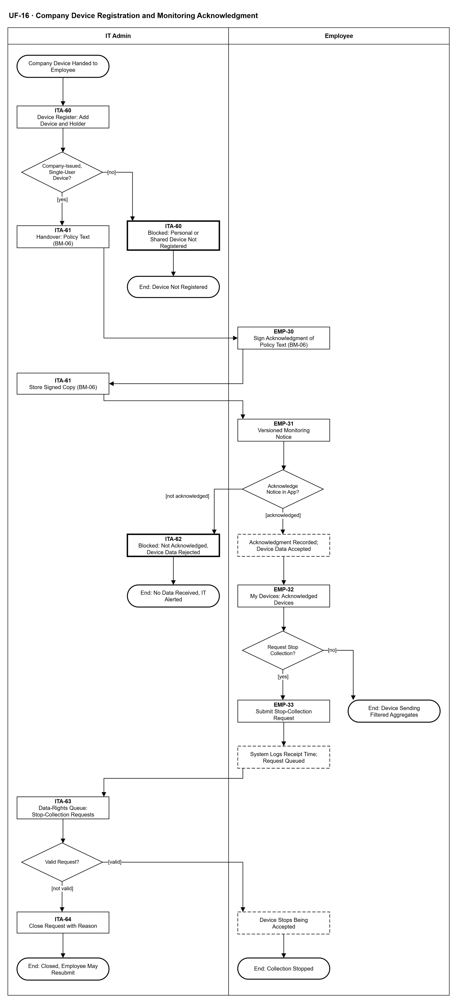

# UF-16 — Company Device Registration and Monitoring Acknowledgment

> **Loại:** User flow (mức màn hình) — IT Admin và Employee · **Phiên bản:** 1.1 — 09/10/2026 · **Trạng thái:** Vẽ lại theo BRD v3.30 (đồng bộ QĐ-61/QĐ-62) (FR-4.18, FR-4.21, FR-10.4, FR-10.5) và QĐ-57b, QĐ-58f, QĐ-59a, khớp WF-18; tính đủ pháp lý của chữ ký xác nhận còn mở (OQ-16, OQ-23, hoãn có điều kiện theo QĐ-59b) — sơ đồ không khẳng định tuân thủ; mã màn hình là đề xuất (QĐ-08); chờ Owner/GVHD review
>
> Sơ đồ là **dẫn xuất** từ quyết định Owner (`QĐ`) và BRD hiện hành; khi khác nhau, `QĐ` → BRD thắng. Quyết định trong sơ đồ là của Owner, **chưa** phải xác nhận của GVHD/hội đồng.

## 1. Mục đích và phạm vi

Hai vai cùng thao tác trong một hành trình: IT Admin đăng ký máy công ty và bàn giao kèm văn bản BM-06; nhân viên ký xác nhận đã biết rõ, xem thông báo theo dõi có phiên bản và bấm xác nhận chủ động trong ứng dụng — chưa xác nhận thì không có dữ liệu từ máy. Sau đó nhân viên có thể gửi yêu cầu dừng thu thập và IT Admin xử lý. Đây là phía màn hình của WF-18.

**Phạm vi:** Màn hình ITA-60 → ITA-64 và EMP-30 → EMP-33, từ lúc đăng ký thiết bị tới khi dữ liệu được nhận, bị từ chối, hoặc yêu cầu dừng thu thập được thực hiện hay đóng.

**Không nằm trong sơ đồ này:** Cách thu và loại bộ thu thập cụ thể (giai đoạn Tools, QĐ-59a); nhập và khớp dữ liệu từ thiết bị (→ WF-12, UF-06, UF-07); đăng ký thiết bị hết hiệu lực khi nhân viên nghỉ việc (nhánh của WF-18, chạy từ MF-5, → UF-09); xem và xuất dữ liệu cá nhân (→ UF-03); hồ sơ đánh giá tác động, nội quy lao động và xử lý vi phạm (ngoài phạm vi hệ thống).

## 2. Tệp

| Tệp | Vai trò |
| --- | --- |
| [UF-16-company-device-registration-and-monitoring-acknowledgment.drawio](UF-16-company-device-registration-and-monitoring-acknowledgment.drawio) | Nguồn draw.io chỉnh sửa được (sinh từ spec) |
| [UF-16-company-device-registration-and-monitoring-acknowledgment.drawio.png](UF-16-company-device-registration-and-monitoring-acknowledgment.drawio.png) | Bản xuất PNG, nhúng sẵn nguồn draw.io |
| [UF-16.json](../specs/UF-16.json) | **Nguồn canonical** — sửa ở đây rồi chạy `python tools/flowkit.py build` từ `Docs/Diagrams` |

## 3. Nguồn nghiệp vụ

| Mã | Nội dung dùng trong sơ đồ |
| --- | --- |
| `FR-4.18, INV-17` | Đăng ký thiết bị, xác nhận chủ động lưu phiên bản và thời điểm, chưa xác nhận thì không nhận dữ liệu, nút yêu cầu dừng thu thập |
| `FR-4.21, QĐ-57b, QĐ-58f, BM-06` | Ký văn bản xác nhận đã biết rõ khi nhận máy; chỉ dùng trên máy công ty; sổ thiết bị không lưu IP; không chặn kỹ thuật, không xử lý kỷ luật |
| `OI-14d` | Thiết bị dùng chung không đăng ký thu thập |
| `FR-10.4, QĐ-20` | Thông báo trước và xác nhận chủ động; thông báo đơn thuần không đủ |
| `FR-10.5, OI-01a, OI-01b, OI-01c` | Yêu cầu dừng thu thập: 2 ngày làm việc, hợp lệ luôn được thực hiện, đóng kèm lý do, IT tự xử lý được |
| `FR-5.14` | Cảnh báo máy công ty chưa có xác nhận chính sách gửi IT Admin |
| `OQ-16, OQ-23, QĐ-59b` | Chữ ký có thay được sự đồng ý hay không — hoãn có điều kiện, không khẳng định tuân thủ |

## 4. Tác nhân, kích hoạt, điều kiện

| Làn (tiếng Anh trên hình) | Tác nhân | Trách nhiệm trong sơ đồ |
| --- | --- | --- |
| IT Admin | IT Admin | Đăng ký thiết bị, bàn giao máy, lưu bản ký, xử lý yêu cầu dừng thu thập; thấy cảnh báo khi nhân viên chưa xác nhận |
| Employee | Employee | Ký xác nhận đã biết rõ, xác nhận chủ động trong ứng dụng, gửi yêu cầu dừng thu thập; bước hệ thống chỉ hiện kết quả |

- **Kích hoạt:** Doanh nghiệp bàn giao một máy công ty cho nhân viên và IT Admin đăng ký thiết bị.
- **Tiền điều kiện:** Nhân viên đang làm việc, có tài khoản đã kích hoạt (UF-17); thiết bị do công ty cấp và chỉ một người dùng; ứng dụng liên lạc không nằm trong danh sách được thu (ADR-10).
- **Hậu điều kiện:** Một trong: không đăng ký (máy cá nhân hoặc dùng chung) · chưa xác nhận nên không có dữ liệu và IT được cảnh báo · đã xác nhận, dữ liệu tổng hợp đã lọc được nhận · yêu cầu dừng thu thập được thực hiện hoặc bị đóng kèm lý do.

## 5. Cách đọc ký hiệu

| Ký hiệu | Nghĩa |
| --- | --- |
| Hình chữ nhật bo tròn hai đầu, viền đậm | Điểm bắt đầu hoặc kết cục của hành trình |
| Hình chữ nhật viền liền, dòng đầu in đậm | Màn hình người dùng thao tác; dòng đầu là mã màn hình đề xuất |
| Hình chữ nhật viền nét đứt | Hệ thống tự xử lý; người dùng chỉ thấy kết quả |
| Hình chữ nhật viền rất đậm | Màn hình chặn hoặc trạng thái lỗi |
| Hình thoi | Rẽ nhánh; cạnh ra mang điều kiện `[...]` |
| Dây có cung nhảy | Hai dây giao nhau nhưng **không** nối với nhau |

Hai làn: IT Admin và Employee. Đọc từ trên xuống; mũi tên đi qua lại giữa hai làn là các bàn giao. Hình chữ nhật viền liền là màn hình (dòng đầu là mã màn hình đề xuất), viền rất đậm là màn hình chặn, nét đứt là bước hệ thống.

## 6. Bảng node

| ID | Loại | Nhãn trên hình | Ý nghĩa | Làn / người thực hiện | Quy tắc |
| --- | --- | --- | --- | --- | --- |
| `t_start` | Điểm đầu/cuối | Company Device Handed to Employee | Doanh nghiệp bàn giao một máy công ty cho nhân viên; IT Admin bắt đầu đăng ký thiết bị. | IT Admin | — |
| `s_reg` | Màn hình | ITA-60 — Device Register: Add Device and Holder | Sổ thiết bị: mã tài sản, hệ điều hành, tên máy, người giữ, khoảng hiệu lực. Không lưu địa chỉ IP. Một nhân viên có thể có nhiều thiết bị, mỗi thiết bị xác nhận riêng. | IT Admin | `FR-4.18`, `FR-4.21`, `QĐ-57b`, `ADR-04` |
| `d_dev` | Rẽ nhánh | Company-Issued, Single-User Device? | Thiết bị do công ty cấp và chỉ một người dùng thì mới đăng ký thu thập. | IT Admin | `FR-4.21`, `OI-14d`, `ĐK-01` |
| `b_per` | Màn hình chặn/lỗi | ITA-60 — Blocked: Personal or Shared Device Not Registered | Máy cá nhân không đăng ký và không bị thu dữ liệu; thiết bị dùng chung nhiều người không được đăng ký thu thập (điểm mù có ghi nhận). Hệ thống không chặn kỹ thuật việc dùng dịch vụ trên máy cá nhân. | IT Admin | `FR-4.21`, `OI-14d`, `QĐ-58f` |
| `t_not` | Điểm đầu/cuối | End: Device Not Registered | Không đăng ký; không có thu thập từ thiết bị này. | IT Admin | — |
| `s_hand` | Màn hình | ITA-61 — Handover: Policy Text (BM-06) | Bàn giao máy kèm văn bản chính sách thiết bị và theo dõi (BM-06): dữ liệu thu, không thu, mục đích, ai xem, thời hạn lưu, quyền dừng thu thập. | IT Admin | `FR-4.21`, `BM-06`, `QĐ-58f` |
| `s_sign` | Màn hình | EMP-30 — Sign Acknowledgment of Policy Text (BM-06) | Nhân viên ký văn bản **BM-06** *xác nhận đã biết rõ* chính sách theo dõi trên máy (không phải đồng ý) **tại bàn giao máy, ngoài ứng dụng**; không phải chữ ký số (QĐ-53a). IT Admin lưu bản ký; xác nhận trong ứng dụng là bước riêng sau đó (FR-4.21(1)). Việc chữ ký có thay được sự đồng ý theo luật hay không còn là câu hỏi pháp lý mở. | Employee | `FR-4.21`, `BM-06`, `OQ-16`, `OQ-23` |
| `s_store` | Màn hình | ITA-61 — Store Signed Copy (BM-06) | IT Admin lưu bản ký gắn với thiết bị và nhân viên; hồ sơ không sửa sau khi đã có quyết định. | IT Admin | `FR-4.21`, `BM-06`, `FR-1.5`, `FR-11.2` |
| `s_notice` | Màn hình | EMP-31 — Versioned Monitoring Notice | Thông báo theo dõi mức độ sử dụng có đánh phiên bản: thu gì, không thu gì, mục đích, thời hạn lưu, quyền yêu cầu dừng. Hiện trước khi nhận bất kỳ dữ liệu nào từ thiết bị; thông báo đơn thuần là không đủ, cần xác nhận chủ động. Thông báo có **phiên bản**: khi Super Admin đánh dấu phiên bản mới *cần xác nhận lại* (đổi loại dữ liệu hoặc mục đích), hệ thống ngừng nhận dữ liệu từ thiết bị tới khi nhân viên xác nhận lại phiên bản đó; phiên bản chỉ sửa câu chữ thì chỉ thông báo (QĐ-62q, INV-17). | Employee | `FR-10.4`, `FR-4.18`, `QĐ-20` |
| `d_ack` | Rẽ nhánh | Acknowledge Notice in App? | Nhân viên bấm xác nhận chủ động hay chưa. Im lặng không phải là xác nhận. Phiên bản đánh dấu *cần xác nhận lại* phải được xác nhận lại (QĐ-62q). | Employee | `FR-4.18`, `INV-17`, `ĐK-03` |
| `b_noack` | Màn hình chặn/lỗi | ITA-62 — Blocked: Not Acknowledged, Device Data Rejected | Chưa xác nhận thì máy chủ từ chối dữ liệu từ thiết bị; IT Admin thấy cảnh báo máy công ty chưa có xác nhận chính sách. | IT Admin | `INV-17`, `FR-4.21`, `FR-5.14`, `ADR-13` |
| `t_noack` | Điểm đầu/cuối | End: No Data Received, IT Alerted | Kết cục hợp lệ, không phải lỗi: không có dữ liệu nào từ thiết bị; IT Admin đã được cảnh báo. | IT Admin | — |
| `y_rec` | Hệ thống xử lý | Acknowledgment Recorded; Device Data Accepted | Hệ thống lưu phiên bản nội dung thông báo và thời điểm xác nhận, rồi bắt đầu nhận dữ liệu tổng hợp đã lọc tại nguồn từ thiết bị (nhập qua WF-12). | Employee | `FR-4.18`, `INV-17`, `ADR-13`, `ĐK-04` |
| `s_dev` | Màn hình | EMP-32 — My Devices: Acknowledged Devices | Danh sách thiết bị đã đăng ký của tôi, phiên bản và thời điểm đã xác nhận, nút yêu cầu dừng thu thập cho từng thiết bị. | Employee | `FR-10.1`, `FR-4.18` |
| `d_stop` | Rẽ nhánh | Request Stop Collection? | Nhân viên muốn yêu cầu dừng thu thập trên thiết bị này hay không. Có thể làm bất cứ lúc nào sau khi xác nhận. | Employee | `FR-4.18`, `FR-10.5` |
| `t_run` | Điểm đầu/cuối | End: Device Sending Filtered Aggregates | Thiết bị gửi tổng hợp theo ngày đã lọc tại nguồn theo lịch của WF-12; nhân viên giữ quyền yêu cầu dừng sau này. | Employee | — |
| `s_stop` | Màn hình | EMP-33 — Submit Stop-Collection Request | Nhân viên gửi yêu cầu dừng thu thập trên thiết bị đã đăng ký. Gửi yêu cầu không đồng nghĩa dừng ngay. | Employee | `FR-4.18`, `FR-10.5`, `OI-01a` |
| `y_log` | Hệ thống xử lý | System Logs Receipt Time; Request Queued | Hệ thống ghi thời điểm tiếp nhận và đưa yêu cầu vào hàng đợi của IT Admin; nhân viên theo dõi trạng thái trong ứng dụng. | Employee | `FR-10.5`, `FR-3.11` |
| `s_q` | Màn hình | ITA-63 — Data-Rights Queue: Stop-Collection Requests | IT Admin tiếp nhận yêu cầu dừng thu thập và xử lý trong 2 ngày làm việc (cấu hình được); quá hạn thì nhắc và cảnh báo nghẽn. IT được tự xử lý yêu cầu của chính mình, Audit Trail gắn cờ tự xử lý. | IT Admin | `FR-10.5`, `OI-01a`, `OI-01c`, `FR-3.8` |
| `d_valid` | Rẽ nhánh | Valid Request? | Yêu cầu hợp lệ luôn được thực hiện; chỉ yêu cầu không hợp lệ (không phải thiết bị của mình, trùng, đã dừng) bị đóng. | IT Admin | `FR-10.5`, `OI-01b` |
| `y_stop` | Hệ thống xử lý | Device Stops Being Accepted | Khi yêu cầu được xử lý, thiết bị ngừng được nhận dữ liệu; nhân viên được báo. Hệ quả của việc dừng theo nội quy lao động do doanh nghiệp quyết, ngoài phạm vi hệ thống. | Employee | `FR-10.5`, `FR-4.18`, `FR-4.21` |
| `t_stop` | Điểm đầu/cuối | End: Collection Stopped | Thiết bị không còn gửi dữ liệu được nhận. | Employee | — |
| `s_close` | Màn hình | ITA-64 — Close Request with Reason | IT Admin đóng yêu cầu không hợp lệ kèm lý do; nhân viên được báo và gửi lại được. MVP không có luồng kháng nghị. | IT Admin | `FR-10.5`, `OI-01b` |
| `t_closed` | Điểm đầu/cuối | End: Closed, Employee May Resubmit | Yêu cầu bị đóng, thiết bị vẫn đăng ký. | IT Admin | — |

## 7. Bảng chuyển tiếp

| Từ → tới | Nhãn điều kiện | Điều kiện | Kết quả |
| --- | --- | --- | --- |
| `t_start` → `s_reg` | — | — | Sang ITA-60 — Device Register: Add Device and Holder |
| `s_reg` → `d_dev` | — | — | Sang Company-Issued, Single-User Device? |
| `d_dev` → `s_hand` | `[yes]` | Máy công ty cấp, một người dùng | Bàn giao máy |
| `d_dev` → `b_per` | `[no]` | Máy cá nhân hoặc dùng chung | Không đăng ký |
| `b_per` → `t_not` | — | — | Sang End: Device Not Registered |
| `s_hand` → `s_sign` | — | — | Sang EMP-30 — Sign Acknowledgment of Policy Text (BM-06) |
| `s_sign` → `s_store` | — | — | Sang ITA-61 — Store Signed Copy (BM-06) |
| `s_store` → `s_notice` | — | — | Sang EMP-31 — Versioned Monitoring Notice |
| `s_notice` → `d_ack` | — | — | Sang Acknowledge Notice in App? |
| `d_ack` → `y_rec` | `[acknowledged]` | Nhân viên bấm xác nhận chủ động | Ghi xác nhận, nhận dữ liệu |
| `d_ack` → `b_noack` | `[not acknowledged]` | Chưa xác nhận | Từ chối dữ liệu, cảnh báo IT |
| `b_noack` → `t_noack` | — | — | Sang End: No Data Received, IT Alerted |
| `y_rec` → `s_dev` | — | — | Sang EMP-32 — My Devices: Acknowledged Devices |
| `s_dev` → `d_stop` | — | — | Sang Request Stop Collection? |
| `d_stop` → `s_stop` | `[yes]` | Muốn dừng thu thập | Gửi yêu cầu dừng |
| `d_stop` → `t_run` | `[no]` | Không dừng | Thiết bị tiếp tục gửi |
| `s_stop` → `y_log` | — | — | Sang System Logs Receipt Time; Request Queued |
| `y_log` → `s_q` | — | — | Sang ITA-63 — Data-Rights Queue: Stop-Collection Requests |
| `s_q` → `d_valid` | — | — | Sang Valid Request? |
| `d_valid` → `y_stop` | `[valid]` | Yêu cầu hợp lệ | Dừng nhận dữ liệu |
| `d_valid` → `s_close` | `[not valid]` | Không phải thiết bị của mình, trùng hoặc đã dừng | Đóng kèm lý do |
| `y_stop` → `t_stop` | — | — | Sang End: Collection Stopped |
| `s_close` → `t_closed` | — | — | Sang End: Closed, Employee May Resubmit |

Số đếm: **24 node · 23 cạnh · 4 rẽ nhánh**; giao cắt dây: **0**.

## 8. Happy path

1. `t_start` — Company Device Handed to Employee: Doanh nghiệp bàn giao một máy công ty cho nhân viên; IT Admin bắt đầu đăng ký thiết bị.
2. `s_reg` — ITA-60 — Device Register: Add Device and Holder: Sổ thiết bị: mã tài sản, hệ điều hành, tên máy, người giữ, khoảng hiệu lực. Không lưu địa chỉ IP. Một nhân viên có thể có nhiều thiết bị, mỗi thiết bị xác nhận riêng.
3. `d_dev` — Company-Issued, Single-User Device?: Thiết bị do công ty cấp và chỉ một người dùng thì mới đăng ký thu thập.
4. `s_hand` — ITA-61 — Handover: Policy Text (BM-06): Bàn giao máy kèm văn bản chính sách thiết bị và theo dõi (BM-06): dữ liệu thu, không thu, mục đích, ai xem, thời hạn lưu, quyền dừng thu thập.
5. `s_sign` — EMP-30 — Sign Acknowledgment of Policy Text (BM-06): Nhân viên ký văn bản **BM-06** *xác nhận đã biết rõ* chính sách theo dõi trên máy (không phải đồng ý) **tại bàn giao máy, ngoài ứng dụng**; không phải chữ ký số (QĐ-53a). IT Admin lưu bản ký; xác nhận trong ứng dụng là bước riêng sau đó (FR-4.21(1)). Việc chữ ký có thay được sự đồng ý theo luật hay không còn là câu hỏi pháp lý mở.
6. `s_store` — ITA-61 — Store Signed Copy (BM-06): IT Admin lưu bản ký gắn với thiết bị và nhân viên; hồ sơ không sửa sau khi đã có quyết định.
7. `s_notice` — EMP-31 — Versioned Monitoring Notice: Thông báo theo dõi mức độ sử dụng có đánh phiên bản: thu gì, không thu gì, mục đích, thời hạn lưu, quyền yêu cầu dừng. Hiện trước khi nhận bất kỳ dữ liệu nào từ thiết bị; thông báo đơn thuần là không đủ, cần xác nhận chủ động. Thông báo có **phiên bản**: khi Super Admin đánh dấu phiên bản mới *cần xác nhận lại* (đổi loại dữ liệu hoặc mục đích), hệ thống ngừng nhận dữ liệu từ thiết bị tới khi nhân viên xác nhận lại phiên bản đó; phiên bản chỉ sửa câu chữ thì chỉ thông báo (QĐ-62q, INV-17).
8. `d_ack` — Acknowledge Notice in App?: Nhân viên bấm xác nhận chủ động hay chưa. Im lặng không phải là xác nhận. Phiên bản đánh dấu *cần xác nhận lại* phải được xác nhận lại (QĐ-62q).
9. `y_rec` — Acknowledgment Recorded; Device Data Accepted: Hệ thống lưu phiên bản nội dung thông báo và thời điểm xác nhận, rồi bắt đầu nhận dữ liệu tổng hợp đã lọc tại nguồn từ thiết bị (nhập qua WF-12).
10. `s_dev` — EMP-32 — My Devices: Acknowledged Devices: Danh sách thiết bị đã đăng ký của tôi, phiên bản và thời điểm đã xác nhận, nút yêu cầu dừng thu thập cho từng thiết bị.
11. `d_stop` — Request Stop Collection?: Nhân viên muốn yêu cầu dừng thu thập trên thiết bị này hay không. Có thể làm bất cứ lúc nào sau khi xác nhận.
12. `t_run` — End: Device Sending Filtered Aggregates: Thiết bị gửi tổng hợp theo ngày đã lọc tại nguồn theo lịch của WF-12; nhân viên giữ quyền yêu cầu dừng sau này.

## 9. Nhánh thay thế / if-else

- **Yêu cầu dừng thu thập hợp lệ** — `d_stop` → `s_stop` → `y_log` → `s_q` → `d_valid` → `y_stop` → `t_stop`. Xử lý trong 2 ngày làm việc; thiết bị ngừng được nhận dữ liệu.

## 10. Nhánh lỗi / từ chối và cách kết thúc

- **Máy cá nhân hoặc dùng chung** — `d_dev` → `b_per` → `t_not`. Không đăng ký, không thu.
- **Chưa xác nhận chủ động** — `d_ack` → `b_noack` → `t_noack`. Không nhận dữ liệu; IT Admin thấy cảnh báo; kết cục hợp lệ.
- **Yêu cầu dừng không hợp lệ** — `d_valid` → `s_close` → `t_closed`. Đóng kèm lý do; nhân viên gửi lại được.

## 11. Liên hệ với sơ đồ khác

- Workflow: `WF-18` (khớp), `WF-12` (nhận dữ liệu tổng hợp), `MF-5` (nghỉ việc kết thúc đăng ký)
- `UF-03` (nơi nhân viên đi tới yêu cầu dừng thu thập), `UF-06` và `UF-07` (dữ liệu từ thiết bị đi qua nhập và khớp danh tính), `UF-09` (nghỉ việc)
- `UF-17` (tài khoản của nhân viên)

## 12. Giới hạn và vấn đề còn mở

- (LATER-TECH/UI · DOI-01, QĐ-08) Mã màn hình ITA-6x và EMP-3x là đề xuất, chưa có UI Spec hiện hành; EMP-30 chỉ là màn hình nhân viên xem văn bản BM-06 — chữ ký ở ngoài ứng dụng.
- (ĐÃ CÓ NGUỒN · DOI-73, FR-4.21(1), QĐ-53a) BM-06 ký trên văn bản tại bàn giao máy, ngoài ứng dụng, không chữ ký số; IT lưu bản ký; xác nhận trong ứng dụng là bước riêng.
- (LATER-TECH/UI · DOI-74) Nhịp nhắc khi nhân viên chưa xác nhận là tham số thiết kế; xác nhận muộn ⟹ chỉ nhận dữ liệu từ thời điểm xác nhận (INV-17 *tại thời điểm ghi nhận*).
- (ĐÃ CHỐT · DOI-75, QĐ-62q) Phiên bản đổi loại dữ liệu hoặc mục đích ⟹ xác nhận lại; chỉ sửa câu chữ ⟹ chỉ thông báo.
- (DEFERRED/OUT · DOI-13, QĐ-59b) Chữ ký BM-06 cùng xác nhận trong hệ thống có thay được sự đồng ý tự nguyện theo luật hay không là câu hỏi pháp lý hoãn (OQ-16, OQ-23); không khẳng định đã tuân thủ.
- (LIMIT · DOI-14, OI-14d) Thiết bị dùng chung nhiều người là điểm mù được ghi nhận, chưa có chỗ ghi trong hình.
