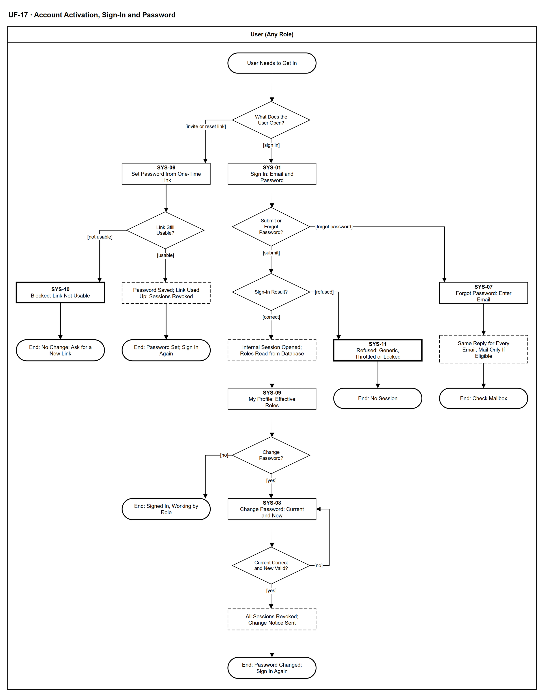

# UF-17 — Account Activation, Sign-In and Password

> **Loại:** User flow (mức màn hình) — mọi người dùng · **Phiên bản:** 1.1 — 09/10/2026 · **Trạng thái:** Vẽ lại theo BRD v3.30 (đồng bộ QĐ-61/QĐ-62) (FR-8.6, FR-8.8, FR-8.9, FR-8.11; QĐ-46, QĐ-47) — nội dung tương đương UF-17 bản v0.13; mã màn hình SYS-xx giữ từ bản cũ và vẫn là đề xuất (QĐ-08)
>
> Sơ đồ là **dẫn xuất** từ quyết định Owner (`QĐ`) và BRD hiện hành; khi khác nhau, `QĐ` → BRD thắng. Quyết định trong sơ đồ là của Owner, **chưa** phải xác nhận của GVHD/hội đồng.

## 1. Mục đích và phạm vi

Hành trình của **mọi người dùng** với tài khoản nội bộ: kích hoạt qua lời mời dùng một lần, đăng nhập, quên mật khẩu và đổi mật khẩu. Sơ đồ trả lời câu hỏi *ai biết mật khẩu* (không ai) và *quên mật khẩu thì sao* (tự phục vụ, phản hồi giống hệt nhau).

**Phạm vi:** Màn hình SYS-01, SYS-06 → SYS-11 và phản hồi hệ thống người dùng nhìn thấy.

**Không nằm trong sơ đồ này:** Super Admin tạo tài khoản, gán vai, gửi lại lời mời, khóa/mở tài khoản (→ UF-13, WF-03); khôi phục thông tin đăng nhập của Super Admin duy nhất và thay email đăng nhập (FR-8.10(d3)); giá trị kỹ thuật như thời hạn lời mời/phiên, chính sách mật khẩu, giới hạn tần suất (thiết kế BE, QĐ-47).

## 2. Tệp

| Tệp | Vai trò |
| --- | --- |
| [UF-17-account-activation-sign-in-and-password.drawio](UF-17-account-activation-sign-in-and-password.drawio) | Nguồn draw.io chỉnh sửa được (sinh từ spec) |
| [UF-17-account-activation-sign-in-and-password.drawio.png](UF-17-account-activation-sign-in-and-password.drawio.png) | Bản xuất PNG, nhúng sẵn nguồn draw.io |
| [UF-17.json](../specs/UF-17.json) | **Nguồn canonical** — sửa ở đây rồi chạy `python tools/flowkit.py build` từ `Docs/Diagrams` |

## 3. Nguồn nghiệp vụ

| Mã | Nội dung dùng trong sơ đồ |
| --- | --- |
| `FR-8.6, QĐ-46a` | Tài khoản nội bộ, kích hoạt qua lời mời dùng một lần, đăng nhập không bao giờ tạo tài khoản hay cấp vai |
| `FR-8.11 (a)–(g)` | Vòng đời mật khẩu: không ai biết mật khẩu, quên mật khẩu phản hồi giống hệt nhau, đặt lại/đổi thu hồi mọi phiên, từ chối tạm thời không khóa vĩnh viễn |
| `FR-8.9` | Tài khoản của nhân viên đã nghỉ việc bị từ chối ngay; vai đọc theo thao tác kế tiếp |
| `FR-8.8` | Người dùng không tự đổi vai/khóa/kích hoạt tài khoản của mình; đặt/quên/đổi mật khẩu là tự phục vụ |
| `QĐ-47` | Giá trị kỹ thuật (thời hạn, chính sách, băm, giới hạn tần suất) thuộc thiết kế BE |

## 4. Tác nhân, kích hoạt, điều kiện

| Làn (tiếng Anh trên hình) | Tác nhân | Trách nhiệm trong sơ đồ |
| --- | --- | --- |
| User (Any Role) | User (Any Role) | Mọi người có tài khoản — Employee, Department Head, IT Admin, Finance, Spending Approver, Super Admin — đều dùng luồng này với tư cách người dùng |

- **Kích hoạt:** Người dùng cần vào hệ thống, hoặc nhận thư lời mời / đặt lại mật khẩu.
- **Tiền điều kiện:** Tài khoản đã được Super Admin tạo từ một hồ sơ nhân viên đã có (WF-03); với nhánh đổi mật khẩu, người dùng đang đăng nhập.
- **Hậu điều kiện:** Một trong các kết cục: mật khẩu đã đặt · đã đăng nhập · mật khẩu đã đổi (mọi phiên bị thu hồi) · bị từ chối không có phiên · đã gửi phản hồi quên mật khẩu.

## 5. Cách đọc ký hiệu

| Ký hiệu | Nghĩa |
| --- | --- |
| Hình chữ nhật bo tròn hai đầu, viền đậm | Điểm bắt đầu hoặc kết cục của hành trình |
| Hình chữ nhật viền liền, dòng đầu in đậm | Màn hình người dùng thao tác; dòng đầu là mã màn hình đề xuất |
| Hình chữ nhật viền nét đứt | Hệ thống tự xử lý; người dùng chỉ thấy kết quả |
| Hình chữ nhật viền rất đậm | Màn hình chặn hoặc trạng thái lỗi |
| Hình thoi | Rẽ nhánh; cạnh ra mang điều kiện `[...]` |
| Dây có cung nhảy | Hai dây giao nhau nhưng **không** nối với nhau |

Đọc từ trên xuống. Hình chữ nhật viền liền là màn hình (dòng đầu là mã đề xuất), viền nét đứt là bước hệ thống, viền rất đậm là màn hình chặn/từ chối.

## 6. Bảng node

| ID | Loại | Nhãn trên hình | Ý nghĩa | Làn / người thực hiện | Quy tắc |
| --- | --- | --- | --- | --- | --- |
| `t_start` | Điểm đầu/cuối | User Needs to Get In | Người dùng (mọi vai, với tư cách nhân viên) cần vào hệ thống, hoặc vừa nhận thư lời mời / đặt lại mật khẩu. | User (Any Role) | — |
| `d_what` | Rẽ nhánh | What Does the User Open? | Người dùng mở liên kết một lần trong thư, hay mở màn hình đăng nhập. | User (Any Role) | — |
| `s_set` | Màn hình | SYS-06 — Set Password from One-Time Link | Đặt mật khẩu từ liên kết dùng một lần — kích hoạt lần đầu (lời mời) hoặc đặt lại. Chính sách mật khẩu kiểm ngay trên màn hình; chưa đạt thì ở lại màn hình. Không ai khác thấy hay đặt mật khẩu hộ. | User (Any Role) | `FR-8.6`, `FR-8.11`, `QĐ-46a` |
| `d_link` | Rẽ nhánh | Link Still Usable? | Liên kết còn dùng được: chưa hết hạn, chưa dùng, chưa bị lời mời/liên kết mới thay thế, tài khoản còn đủ điều kiện. | User (Any Role) | `FR-8.11` |
| `b_link` | Màn hình chặn/lỗi | SYS-10 — Blocked: Link Not Usable | Thông báo chung (không lộ lý do cụ thể). Xin liên kết mới: dùng quên mật khẩu, hoặc nhờ Super Admin gửi lại lời mời (UF-13). | User (Any Role) | `FR-8.11` |
| `t_nolink` | Điểm đầu/cuối | End: No Change; Ask for a New Link | Không đặt được mật khẩu, không đổi dữ liệu; có nhật ký an ninh. | User (Any Role) | — |
| `y_saved` | Hệ thống xử lý | Password Saved; Link Used Up; Sessions Revoked | Lưu mật khẩu dạng băm, vô hiệu liên kết; nếu là đặt lại thì thu hồi mọi phiên cũ. Kích hoạt lần đầu làm tài khoản hoạt động và vai đã lưu bắt đầu có hiệu lực — kích hoạt không bao giờ tự cấp vai; không tự đăng nhập. | User (Any Role) | `FR-8.6`, `FR-8.11` |
| `t_set` | Điểm đầu/cuối | End: Password Set; Sign In Again | Mật khẩu đã đặt; người dùng đăng nhập lại ở SYS-01. | User (Any Role) | — |
| `s_login` | Màn hình | SYS-01 — Sign In: Email and Password | Đăng nhập bằng email đăng nhập và mật khẩu — cơ chế đăng nhập duy nhất, không có nhà cung cấp định danh ngoài; đăng nhập không bao giờ tạo tài khoản hay cấp vai. | User (Any Role) | `FR-8.6`, `QĐ-46a` |
| `d_act` | Rẽ nhánh | Submit or Forgot Password? | Người dùng gửi thông tin đăng nhập, hay chọn liên kết quên mật khẩu. | User (Any Role) | — |
| `s_forgot` | Màn hình | SYS-07 — Forgot Password: Enter Email | Tự phục vụ; nhập email đăng nhập. | User (Any Role) | `FR-8.11` |
| `y_forgot` | Hệ thống xử lý | Same Reply for Every Email; Mail Only If Eligible | Phản hồi giống hệt nhau dù email có hay không; chỉ tài khoản đã kích hoạt, đang hoạt động, nhân viên chưa nghỉ việc mới nhận thư có liên kết đặt lại dùng một lần. | User (Any Role) | `FR-8.11` |
| `t_forgot` | Điểm đầu/cuối | End: Check Mailbox | Người dùng mở thư và quay lại nhánh liên kết (SYS-06). | User (Any Role) | — |
| `d_res` | Rẽ nhánh | Sign-In Result? | Kết quả kiểm thông tin đăng nhập và trạng thái tài khoản. | User (Any Role) | `FR-8.9`, `FR-8.11` |
| `b_ref` | Màn hình chặn/lỗi | SYS-11 — Refused: Generic, Throttled or Locked | Ba trường hợp, cùng một màn hình: (1) sai thông tin, chưa kích hoạt hoặc không có tài khoản — cùng một thông báo chung, không lộ email có tồn tại; (2) nhập sai quá ngưỡng — từ chối tạm thời, không bao giờ khóa vĩnh viễn, đặt lại mật khẩu vẫn dùng được; (3) tài khoản bị khóa hoặc nhân viên đã nghỉ việc — đặt lại mật khẩu không mở lại được. | User (Any Role) | `FR-8.9`, `FR-8.11` |
| `t_ref` | Điểm đầu/cuối | End: No Session | Không có phiên, không đổi dữ liệu; có nhật ký an ninh. | User (Any Role) | — |
| `y_session` | Hệ thống xử lý | Internal Session Opened; Roles Read from Database | Mở phiên/token nội bộ; vai hiệu lực đọc từ cơ sở dữ liệu ở mỗi thao tác, không lấy từ thông tin đăng nhập. | User (Any Role) | `FR-8.9`, `FR-8.11` |
| `s_profile` | Màn hình | SYS-09 — My Profile: Effective Roles | Hồ sơ của tôi: vai đang có hiệu lực; người dùng không tự sửa vai (FR-8.8). | User (Any Role) | `FR-8.8` |
| `d_chg` | Rẽ nhánh | Change Password? | Người dùng có muốn đổi mật khẩu không. | User (Any Role) | — |
| `t_signed` | Điểm đầu/cuối | End: Signed In, Working by Role | Đã đăng nhập, thao tác theo vai hiệu lực. | User (Any Role) | — |
| `s_change` | Màn hình | SYS-08 — Change Password: Current and New | Nhập mật khẩu hiện tại và mật khẩu mới. | User (Any Role) | `FR-8.11` |
| `d_cur` | Rẽ nhánh | Current Correct and New Valid? | Mật khẩu hiện tại đúng và mật khẩu mới đạt chính sách. | User (Any Role) | `FR-8.11` |
| `y_chg` | Hệ thống xử lý | All Sessions Revoked; Change Notice Sent | Đổi mật khẩu, thu hồi mọi phiên kể cả phiên hiện tại; gửi thông báo đã đổi (không chứa mật khẩu). Không đổi vai, trạng thái khóa hay trạng thái nhân viên. | User (Any Role) | `FR-8.11` |
| `t_chg` | Điểm đầu/cuối | End: Password Changed; Sign In Again | Đăng nhập lại ở SYS-01 với mật khẩu mới. | User (Any Role) | — |

## 7. Bảng chuyển tiếp

| Từ → tới | Nhãn điều kiện | Điều kiện | Kết quả |
| --- | --- | --- | --- |
| `t_start` → `d_what` | — | — | Sang What Does the User Open? |
| `d_what` → `s_set` | `[invite or reset link]` | Mở liên kết một lần trong thư | Đặt mật khẩu |
| `d_what` → `s_login` | `[sign in]` | Mở màn hình đăng nhập | Đăng nhập |
| `s_set` → `d_link` | — | — | Sang Link Still Usable? |
| `d_link` → `b_link` | `[not usable]` | Hết hạn, đã dùng, bị thay thế hoặc tài khoản không đủ điều kiện | Chặn, thông báo chung |
| `d_link` → `y_saved` | `[usable]` | Liên kết hợp lệ và mật khẩu đạt chính sách | Lưu mật khẩu |
| `b_link` → `t_nolink` | — | — | Sang End: No Change; Ask for a New Link |
| `y_saved` → `t_set` | — | — | Sang End: Password Set; Sign In Again |
| `s_login` → `d_act` | — | — | Sang Submit or Forgot Password? |
| `d_act` → `d_res` | `[submit]` | Gửi email và mật khẩu | Kiểm đăng nhập |
| `d_act` → `s_forgot` | `[forgot password]` | Chọn quên mật khẩu | Nhập email |
| `s_forgot` → `y_forgot` | — | — | Sang Same Reply for Every Email; Mail Only If Eligible |
| `y_forgot` → `t_forgot` | — | — | Sang End: Check Mailbox |
| `d_res` → `y_session` | `[correct]` | Đúng thông tin, tài khoản hoạt động, nhân viên chưa nghỉ việc | Mở phiên |
| `d_res` → `b_ref` | `[refused]` | Sai thông tin / chưa kích hoạt / không có tài khoản, sai quá ngưỡng, hoặc bị khóa / đã nghỉ việc | Từ chối |
| `b_ref` → `t_ref` | — | — | Sang End: No Session |
| `y_session` → `s_profile` | — | — | Sang SYS-09 — My Profile: Effective Roles |
| `s_profile` → `d_chg` | — | — | Sang Change Password? |
| `d_chg` → `t_signed` | `[no]` | Không đổi mật khẩu | Làm việc bình thường |
| `d_chg` → `s_change` | `[yes]` | Muốn đổi mật khẩu | Mở màn hình đổi |
| `s_change` → `d_cur` | — | — | Sang Current Correct and New Valid? |
| `d_cur` → `s_change` | `[no]` | Mật khẩu hiện tại sai hoặc mật khẩu mới chưa đạt | Nhập lại |
| `d_cur` → `y_chg` | `[yes]` | Đúng và đạt | Đổi mật khẩu |
| `y_chg` → `t_chg` | — | — | Sang End: Password Changed; Sign In Again |

Số đếm: **24 node · 24 cạnh · 6 rẽ nhánh**; giao cắt dây: **0**.

## 8. Happy path

1. `t_start` — User Needs to Get In: Người dùng (mọi vai, với tư cách nhân viên) cần vào hệ thống, hoặc vừa nhận thư lời mời / đặt lại mật khẩu.
2. `d_what` — What Does the User Open?: Người dùng mở liên kết một lần trong thư, hay mở màn hình đăng nhập.
3. `s_login` — SYS-01 — Sign In: Email and Password: Đăng nhập bằng email đăng nhập và mật khẩu — cơ chế đăng nhập duy nhất, không có nhà cung cấp định danh ngoài; đăng nhập không bao giờ tạo tài khoản hay cấp vai.
4. `d_act` — Submit or Forgot Password?: Người dùng gửi thông tin đăng nhập, hay chọn liên kết quên mật khẩu.
5. `d_res` — Sign-In Result?: Kết quả kiểm thông tin đăng nhập và trạng thái tài khoản.
6. `y_session` — Internal Session Opened; Roles Read from Database: Mở phiên/token nội bộ; vai hiệu lực đọc từ cơ sở dữ liệu ở mỗi thao tác, không lấy từ thông tin đăng nhập.
7. `s_profile` — SYS-09 — My Profile: Effective Roles: Hồ sơ của tôi: vai đang có hiệu lực; người dùng không tự sửa vai (FR-8.8).
8. `d_chg` — Change Password?: Người dùng có muốn đổi mật khẩu không.
9. `t_signed` — End: Signed In, Working by Role: Đã đăng nhập, thao tác theo vai hiệu lực.

## 9. Nhánh thay thế / if-else

- **Kích hoạt lần đầu hoặc đặt lại mật khẩu** — `d_what` → `s_set` → `d_link` → `y_saved` → `t_set`. Không tự đăng nhập sau khi đặt; vai đã lưu có hiệu lực từ lúc kích hoạt.
- **Quên mật khẩu** — `d_act` → `s_forgot` → `y_forgot` → `t_forgot`. Không lộ email có tồn tại.
- **Đổi mật khẩu** — `d_chg` → `s_change` → `d_cur` → `y_chg` → `t_chg`. Thu hồi mọi phiên, kể cả phiên hiện tại.

## 10. Nhánh lỗi / từ chối và cách kết thúc

- **Liên kết không dùng được** — `d_link` → `b_link` → `t_nolink`. Xin liên kết mới qua quên mật khẩu hoặc Super Admin gửi lại lời mời.
- **Đăng nhập bị từ chối** — `d_res` → `b_ref` → `t_ref`. Thông báo chung; sai quá ngưỡng chỉ từ chối tạm thời; bị khóa/đã nghỉ việc thì không vào được.
- **Mật khẩu hiện tại sai hoặc mật khẩu mới chưa đạt** — `d_cur` → `s_change`. Ở lại màn hình đổi mật khẩu.

## 11. Liên hệ với sơ đồ khác

- Workflow: `WF-03` (Super Admin tạo tài khoản, gửi lời mời, kích hoạt)
- `UF-13` (Super Admin quản trị tài khoản và cấu hình)
- `MF-5` / `WF-07` (nhân viên chuyển đã nghỉ việc ⟹ đăng nhập bị từ chối)

## 12. Giới hạn và vấn đề còn mở

- (LATER-TECH/UI · DOI-01, QĐ-08) Mã màn hình SYS-xx giữ từ bản cũ, là đề xuất; chưa có UI Spec hiện hành.
- (LATER-TECH/UI · DOI-31) Ba trường hợp từ chối đăng nhập gộp vào một màn hình SYS-11 với nội dung khác nhau — câu chữ chính xác để UI Spec chốt, miễn không lộ email có tồn tại.
