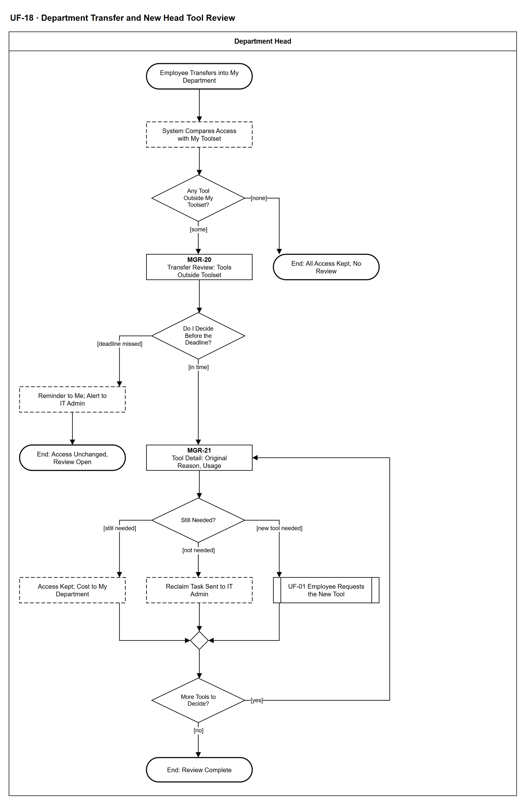

# UF-18 — Department Transfer and New Head Tool Review

> **Loại:** User flow (mức màn hình) — Department Head (trưởng phòng mới) · **Phiên bản:** 1.2 — 10/10/2026 · **Trạng thái:** Vẽ lại theo BRD v3.30 (đồng bộ QĐ-61/QĐ-62), WF-05 v3.0, MF-7 và QĐ-50b, QĐ-56a, QĐ-58d; mã màn hình là đề xuất — UI Spec hoãn tới giai đoạn Figma (QĐ-08)
>
> Sơ đồ là **dẫn xuất** từ quyết định Owner (`QĐ`) và BRD hiện hành; khi khác nhau, `QĐ` → BRD thắng. Quyết định trong sơ đồ là của Owner, **chưa** phải xác nhận của GVHD/hội đồng.

## 1. Mục đích và phạm vi

Hành trình của trưởng phòng mới khi một nhân viên điều chuyển vào phòng: công cụ thuộc bộ chuẩn được giữ tự động; với từng công cụ ngoài bộ chuẩn, trưởng phòng quyết còn cần, không còn cần hoặc cần công cụ mới, trong hạn 5 ngày làm việc. Quá hạn chỉ nhắc, không tự thu hồi.

**Phạm vi:** Màn hình MGR-20 và MGR-21, phản hồi hệ thống mà trưởng phòng mới nhìn thấy, từ ngày hiệu lực tới khi rà soát xong hoặc hết hạn mà vẫn còn mở.

**Không nằm trong sơ đồ này:** Việc IT ghi điều chuyển và biên bản BM-04, chỉ định trưởng phòng mới cho phòng cũ, thay người chịu trách nhiệm tài khoản dùng chung (IT Admin, WF-05); đổi kỳ tổ chức và chia chi phí theo ngày (hệ thống, MF-8); định tuyến lại bước nhu cầu đang chờ (WF-09, FR-3.16); thực hiện thu hồi (→ UF-08, WF-09a).

## 2. Tệp

| Tệp | Vai trò |
| --- | --- |
| [UF-18-department-transfer-and-new-head-tool-review.drawio](UF-18-department-transfer-and-new-head-tool-review.drawio) | Nguồn draw.io chỉnh sửa được (sinh từ spec) |
| [UF-18-department-transfer-and-new-head-tool-review.drawio.png](UF-18-department-transfer-and-new-head-tool-review.drawio.png) | Bản xuất PNG, nhúng sẵn nguồn draw.io |
| [UF-18.json](../specs/UF-18.json) | **Nguồn canonical** — sửa ở đây rồi chạy `python tools/flowkit.py build` từ `Docs/Diagrams` |

## 3. Nguồn nghiệp vụ

| Mã | Nội dung dùng trong sơ đồ |
| --- | --- |
| `FR-3.18, QĐ-56a` | Bộ chuẩn phòng × chức vụ; công cụ trong bộ chuẩn mặc định giữ; ngoài bộ chuẩn: còn cần · không còn cần · cần công cụ mới |
| `FR-3.8, FR-8.2, QĐ-50b` | Hạn 5 ngày làm việc, cấu hình được; quá hạn chỉ nhắc trưởng phòng và cảnh báo IT Admin; không phải một bước phê duyệt |
| `FR-3.7, SoD-2` | Tổng hợp trong phòng; không hợp đồng, không log thô |
| `FR-2.2, ADR-04, INV-20` | Nhân viên thuộc đúng một phòng, có lịch sử |
| `FR-5.3, QĐ-55b` | Chi phí chia theo ngày; không viết lại chi phí đã phát sinh |
| `FR-2.4, FR-4.15` | Thu hồi không tự ghi nhận tiết kiệm |
| `FR-5.14` | Cảnh báo hạn rà soát sau điều chuyển |

## 4. Tác nhân, kích hoạt, điều kiện

| Làn (tiếng Anh trên hình) | Tác nhân | Trách nhiệm trong sơ đồ |
| --- | --- | --- |
| Department Head | Department Head | Trưởng phòng mới của phòng nhận — vai Manager suy ra; thao tác trên MGR-20, MGR-21; bước của IT Admin và hệ thống chỉ hiện dưới dạng trạng thái |

- **Kích hoạt:** Tới ngày hiệu lực điều chuyển của một nhân viên vào phòng của trưởng phòng.
- **Tiền điều kiện:** IT Admin đã ghi điều chuyển kèm ngày hiệu lực (BM-04); phòng nhận có trưởng phòng và bộ công cụ chuẩn đã cấu hình (nếu chưa, mọi công cụ được coi là ngoài bộ chuẩn).
- **Hậu điều kiện:** Mỗi công cụ ngoài bộ chuẩn được giữ, thu hồi hoặc thay bằng yêu cầu mới; hoặc vẫn giữ nguyên quyền khi chưa có quyết định. Không có thu hồi tự động.

## 5. Cách đọc ký hiệu

| Ký hiệu | Nghĩa |
| --- | --- |
| Hình chữ nhật bo tròn hai đầu, viền đậm | Điểm bắt đầu hoặc kết cục của hành trình |
| Hình chữ nhật viền liền, dòng đầu in đậm | Màn hình người dùng thao tác; dòng đầu là mã màn hình đề xuất |
| Hình chữ nhật viền nét đứt | Hệ thống tự xử lý; người dùng chỉ thấy kết quả |
| Hình thoi | Rẽ nhánh; cạnh ra mang điều kiện `[...]` |
| Hình chữ nhật hai vạch đứng | Gọi user flow khác (mã `UF-xx` trong nhãn); có cạnh ra thì hành trình quay lại và đi tiếp, không có cạnh ra thì sơ đồ này dừng tại đó |
| Dây có cung nhảy | Hai dây giao nhau nhưng **không** nối với nhau |

Đọc từ trên xuống. Chữ nhật viền liền là màn hình (dòng đầu là mã màn hình đề xuất), nét đứt là hệ thống tự xử lý, hai vạch đứng là sang user flow khác. Vòng lặp bên phải là lần lượt từng công cụ ngoài bộ chuẩn; nhánh trái là hạn rà soát trôi qua.

## 6. Bảng node

| ID | Loại | Nhãn trên hình | Ý nghĩa | Làn / người thực hiện | Quy tắc |
| --- | --- | --- | --- | --- | --- |
| `t_start` | Điểm đầu/cuối | Employee Transfers into My Department | IT Admin đã ghi điều chuyển; tới ngày hiệu lực nhân viên thuộc phòng của tôi (tôi là trưởng phòng mới của người này). | Department Head | `FR-2.2`, `MF-7` |
| `y_cmp` | Hệ thống xử lý | System Compares Access with My Toolset | Hệ thống so quyền cá nhân và khóa bản quyền nhân viên đang giữ với bộ công cụ chuẩn của (phòng của tôi, chức vụ). Công cụ thuộc bộ chuẩn được giữ tự động, không cần tôi quyết; chi phí vào phòng của tôi từ ngày hiệu lực. Bộ chuẩn không tự cấp hay thu hồi quyền của ai. | Department Head | `FR-3.18`, `QĐ-56a`, `QĐ-52e`, `FR-5.3` |
| `d_out` | Rẽ nhánh | Any Tool Outside My Toolset? | Còn công cụ nào ngoài bộ chuẩn của phòng tôi không. | Department Head | `FR-3.18`, `QĐ-56a` |
| `t_none` | Điểm đầu/cuối | End: All Access Kept, No Review | Mọi quyền đều thuộc bộ chuẩn: giữ nguyên, không có việc rà soát nào được mở cho tôi. | Department Head | — |
| `s_task` | Màn hình | MGR-20 — Transfer Review: Tools Outside Toolset | Việc rà soát sau điều chuyển: danh sách công cụ ngoài bộ chuẩn của nhân viên, trạng thái từng công cụ (chưa quyết / đã quyết) và hạn rà soát (mặc định 5 ngày làm việc kể từ ngày hiệu lực, Super Admin cấu hình). Đây không phải một bước phê duyệt của request. Có cảnh báo hạn rà soát. Phòng mới **chưa có trưởng phòng**: việc rà soát **chờ, không giao ai** (approver dự phòng chỉ thay ở bước nhu cầu); quyền giữ nguyên; IT Admin và Super Admin thấy cảnh báo phòng thiếu trưởng phòng; khi có trưởng phòng mới, việc chuyển sang người đó, hạn không đặt lại (QĐ-62c). | Department Head | `FR-3.8`, `FR-8.2`, `QĐ-50b`, `FR-5.14` |
| `d_act` | Rẽ nhánh | Do I Decide Before the Deadline? | Trưởng phòng mở và quyết trong hạn, hay hạn trôi qua trước khi quyết xong. | Department Head | `QĐ-50b` |
| `y_late` | Hệ thống xử lý | Reminder to Me; Alert to IT Admin | Quá hạn: hệ thống chỉ nhắc tôi và cảnh báo IT Admin. Không tự thu hồi, không giao cho người khác, không tự quyết; quyền giữ nguyên tới khi có quyết định. | Department Head | `FR-3.8`, `QĐ-50b`, `FR-5.14` |
| `t_open` | Điểm đầu/cuối | End: Access Unchanged, Review Open | Công cụ chưa quyết vẫn giữ nguyên quyền; việc rà soát vẫn mở để tôi quay lại quyết. | Department Head | — |
| `s_tool` | Màn hình | MGR-21 — Tool Detail: Original Reason, Usage | Chi tiết từng công cụ ngoài bộ chuẩn: lý do cấp ban đầu và tình trạng sử dụng dạng tổng hợp. Không xem hợp đồng hay log thô. | Department Head | `FR-3.7`, `SoD-2` |
| `d_choice` | Rẽ nhánh | Still Needed? | Quyết định cho từng công cụ: còn cần, không còn cần, hoặc cần công cụ mới. | Department Head | `QĐ-50b`, `QĐ-56a` |
| `y_keep` | Hệ thống xử lý | Access Kept; Cost to My Department | Giữ quyền; chi phí vào phòng của tôi từ ngày hiệu lực, chi phí đã phát sinh ở phòng cũ không bị viết lại. | Department Head | `QĐ-56a`, `FR-5.3`, `QĐ-55b` |
| `y_rec` | Hệ thống xử lý | Reclaim Task Sent to IT Admin | Tạo tác vụ thu hồi cho IT Admin theo kiểu cấp của gói (WF-09a); seat về kho. Thu hồi không tự ghi nhận tiết kiệm. Trưởng phòng chỉ thấy trạng thái. Gói có lưu ý mất dữ liệu: hiện lưu ý và **trưởng phòng mới** (người quyết thu hồi) xác nhận bàn giao trước khi gỡ ở nhà cung cấp; không chặn sau hạn ngắn (QĐ-62f, WF-09a `d_dl`). Nếu WF-09a trả *đóng thất bại* (QĐ-62i): quyền còn hiệu lực, vẫn hiện G2/lãng phí theo điều kiện nguồn, seat chưa về kho và IT mở tác vụ thu hồi mới. | Department Head | `FR-2.4`, `FR-4.15`, `SoD-5` |
| `r_uf21` | Chuyển sang user flow khác | UF-01 Employee Requests the New Tool | Trưởng phòng mới ghi nhu cầu công cụ khác; **nhân viên** tự gửi yêu cầu qua luồng thường (MF-2, UF-01) — FR-3.2 chỉ cho trưởng phòng tạo thay khi onboarding hoặc yêu cầu theo nhóm. Hệ thống hiện bộ công cụ chuẩn của phòng mới trước. | Department Head | → `UF-01` |
| `m_done` | Hợp nhánh | — | — | Department Head | — |
| `d_more` | Rẽ nhánh | More Tools to Decide? | Còn công cụ ngoài bộ chuẩn chưa quyết không. | Department Head | `QĐ-56a` |
| `t_done` | Điểm đầu/cuối | End: Review Complete | Mọi công cụ ngoài bộ chuẩn đã được giữ, thu hồi hoặc thay bằng yêu cầu mới; quyền của nhân viên khớp nhu cầu ở phòng mới. | Department Head | — |

## 7. Bảng chuyển tiếp

| Từ → tới | Nhãn điều kiện | Điều kiện | Kết quả |
| --- | --- | --- | --- |
| `t_start` → `y_cmp` | — | — | Sang System Compares Access with My Toolset |
| `y_cmp` → `d_out` | — | — | Sang Any Tool Outside My Toolset? |
| `d_out` → `t_none` | `[none]` | Mọi công cụ thuộc bộ chuẩn | Giữ toàn bộ, không có rà soát |
| `d_out` → `s_task` | `[some]` | Có ít nhất một công cụ ngoài bộ chuẩn | Mở việc rà soát hạn 5 ngày |
| `s_task` → `d_act` | — | — | Sang Do I Decide Before the Deadline? |
| `d_act` → `y_late` | `[deadline missed]` | Hết hạn mà còn công cụ chưa quyết | Nhắc và cảnh báo, quyền giữ nguyên |
| `d_act` → `s_tool` | `[in time]` | Trưởng phòng mở rà soát trong hạn | Xem từng công cụ |
| `y_late` → `t_open` | — | — | Sang End: Access Unchanged, Review Open |
| `s_tool` → `d_choice` | — | — | Sang Still Needed? |
| `d_choice` → `y_keep` | `[still needed]` | Còn cần cho công việc ở phòng mới | Giữ quyền |
| `d_choice` → `y_rec` | `[not needed]` | Không còn cần | IT thu hồi |
| `d_choice` → `r_uf21` | `[new tool needed]` | Cần một công cụ khác | Tạo yêu cầu mới |
| `y_keep` → `m_done` | — | — | Sang — |
| `y_rec` → `m_done` | — | — | Sang — |
| `r_uf21` → `m_done` | — | — | Sang — |
| `m_done` → `d_more` | — | — | Sang More Tools to Decide? |
| `d_more` → `s_tool` | `[yes]` | Còn công cụ chưa quyết | Xem công cụ kế tiếp |
| `d_more` → `t_done` | `[no]` | Đã quyết hết | Hoàn tất rà soát |

Số đếm: **16 node · 18 cạnh · 4 rẽ nhánh**; giao cắt dây: **0**.

## 8. Happy path

1. `t_start` — Employee Transfers into My Department: IT Admin đã ghi điều chuyển; tới ngày hiệu lực nhân viên thuộc phòng của tôi (tôi là trưởng phòng mới của người này).
2. `y_cmp` — System Compares Access with My Toolset: Hệ thống so quyền cá nhân và khóa bản quyền nhân viên đang giữ với bộ công cụ chuẩn của (phòng của tôi, chức vụ). Công cụ thuộc bộ chuẩn được giữ tự động, không cần tôi quyết; chi phí vào phòng của tôi từ ngày hiệu lực. Bộ chuẩn không tự cấp hay thu hồi quyền của ai.
3. `d_out` — Any Tool Outside My Toolset?: Còn công cụ nào ngoài bộ chuẩn của phòng tôi không.
4. `s_task` — MGR-20 — Transfer Review: Tools Outside Toolset: Việc rà soát sau điều chuyển: danh sách công cụ ngoài bộ chuẩn của nhân viên, trạng thái từng công cụ (chưa quyết / đã quyết) và hạn rà soát (mặc định 5 ngày làm việc kể từ ngày hiệu lực, Super Admin cấu hình). Đây không phải một bước phê duyệt của request. Có cảnh báo hạn rà soát. Phòng mới **chưa có trưởng phòng**: việc rà soát **chờ, không giao ai** (approver dự phòng chỉ thay ở bước nhu cầu); quyền giữ nguyên; IT Admin và Super Admin thấy cảnh báo phòng thiếu trưởng phòng; khi có trưởng phòng mới, việc chuyển sang người đó, hạn không đặt lại (QĐ-62c).
5. `d_act` — Do I Decide Before the Deadline?: Trưởng phòng mở và quyết trong hạn, hay hạn trôi qua trước khi quyết xong.
6. `s_tool` — MGR-21 — Tool Detail: Original Reason, Usage: Chi tiết từng công cụ ngoài bộ chuẩn: lý do cấp ban đầu và tình trạng sử dụng dạng tổng hợp. Không xem hợp đồng hay log thô.
7. `d_choice` — Still Needed?: Quyết định cho từng công cụ: còn cần, không còn cần, hoặc cần công cụ mới.
8. `y_keep` — Access Kept; Cost to My Department: Giữ quyền; chi phí vào phòng của tôi từ ngày hiệu lực, chi phí đã phát sinh ở phòng cũ không bị viết lại.
9. `d_more` — More Tools to Decide?: Còn công cụ ngoài bộ chuẩn chưa quyết không.
10. `t_done` — End: Review Complete: Mọi công cụ ngoài bộ chuẩn đã được giữ, thu hồi hoặc thay bằng yêu cầu mới; quyền của nhân viên khớp nhu cầu ở phòng mới.

## 9. Nhánh thay thế / if-else

- **Không còn cần một công cụ** — `d_choice` → `y_rec` → `m_done`. IT thu hồi qua WF-09a; seat về kho; chưa ghi tiết kiệm.
- **Cần công cụ mới** — `d_choice` → `r_uf21` → `m_done`. Đi yêu cầu thông thường theo MF-2; rà soát tiếp tục.
- **Còn công cụ chưa quyết** — `d_more` → `s_tool`. Lặp cho từng công cụ ngoài bộ chuẩn.
- **Mọi công cụ thuộc bộ chuẩn** — `d_out` → `t_none`. Không có việc rà soát cho trưởng phòng.

## 10. Nhánh lỗi / từ chối và cách kết thúc

- **Quá hạn rà soát** — `d_act` → `y_late` → `t_open`. Chỉ nhắc và cảnh báo; quyền giữ nguyên, việc rà soát vẫn mở.

## 11. Liên hệ với sơ đồ khác

- Workflow: `MF-7`, `WF-05`
- `UF-21` (yêu cầu công cụ thay thế), `UF-08` (IT thực hiện thu hồi), `UF-01` (nhân viên tự xin công cụ)
- `UF-01` — gọi/chuyển tại node `r_uf21`

## 12. Giới hạn và vấn đề còn mở

- (LATER-TECH/UI · DOI-01, QĐ-08) Mã màn hình MGR-xx là đề xuất, chưa có UI Spec hiện hành.
- (ĐÃ CHỐT · DOI-47, QĐ-62c) Phòng nhận chưa có trưởng phòng: việc rà soát chờ, không giao ai; cảnh báo IT Admin và Super Admin — hình vẽ ca đã có trưởng phòng.
- (ĐÃ CÓ NGUỒN · DOI-48) Cần công cụ mới: trưởng phòng ghi nhu cầu, nhân viên tự gửi yêu cầu (UF-01) — FR-3.2 chỉ cho tạo thay khi onboarding hoặc theo nhóm.
- (ĐÃ CHỐT · DOI-43, QĐ-62p) Đổi chức vụ trong cùng phòng không mở rà soát.
