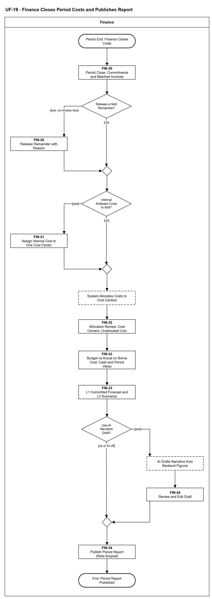

# UF-19 — Finance Closes Period Costs and Publishes Report

> **Loại:** User flow (mức màn hình) — Finance · **Phiên bản:** 1.1 — 09/10/2026 · **Trạng thái:** Vẽ lại theo BRD v3.30 (đồng bộ QĐ-61/QĐ-62) và WF-19 (QĐ-49e, QĐ-49g, QĐ-50c, QĐ-55b, QĐ-60a); mã màn hình FIN-30 → FIN-34 mới, là đề xuất (QĐ-08)
>
> Sơ đồ là **dẫn xuất** từ quyết định Owner (`QĐ`) và BRD hiện hành; khi khác nhau, `QĐ` → BRD thắng. Quyết định trong sơ đồ là của Owner, **chưa** phải xác nhận của GVHD/hội đồng.

## 1. Mục đích và phạm vi

Hành trình của **Finance** khi đóng chi phí phần mềm của kỳ: giải phóng phần dư cam kết, ghi chi phí nội bộ, xem phân bổ theo Cost Center (kể cả dòng Chưa phân bổ), so ngân sách với thực chi trên chi phí thực chịu, dự báo L1/L3, tùy chọn dùng bản nháp AI, rồi phát hành báo cáo kỳ. Đây là phía màn hình của MF-8 / WF-19.

**Phạm vi:** Màn hình FIN-30 → FIN-34 và phản hồi hệ thống.

**Không nằm trong sơ đồ này:** Đối soát sao kê/hóa đơn (UF-12, UF-14); lập ngân sách và khoản cam kết (UF-11, WF-20); quy tắc tính chi tiết (WF-19).

## 2. Tệp

| Tệp | Vai trò |
| --- | --- |
| [UF-19-finance-closes-period-costs-and-publishes-report.drawio](UF-19-finance-closes-period-costs-and-publishes-report.drawio) | Nguồn draw.io chỉnh sửa được (sinh từ spec) |
| [UF-19-finance-closes-period-costs-and-publishes-report.drawio.png](UF-19-finance-closes-period-costs-and-publishes-report.drawio.png) | Bản xuất PNG, nhúng sẵn nguồn draw.io |
| [UF-19.json](../specs/UF-19.json) | **Nguồn canonical** — sửa ở đây rồi chạy `python tools/flowkit.py build` từ `Docs/Diagrams` |

## 3. Nguồn nghiệp vụ

| Mã | Nội dung dùng trong sơ đồ |
| --- | --- |
| `FR-5.8, OI-11a` | Khoản cam kết chuyển thành chi phí theo hóa đơn; giải phóng phần dư có lý do |
| `QĐ-49g, FR-5.2` | Chi phí phần mềm nội bộ gán một Cost Center |
| `FR-5.2, FR-5.3, INV-03, QĐ-52b, QĐ-54d` | Quy tắc phân bổ: tỷ lệ, seat theo ngày, tài khoản dùng chung |
| `QĐ-50c, FR-9.7` | Dòng Chưa phân bổ Cost Center |
| `FR-5.1, FR-5.6, QĐ-55b, QĐ-60a` | Ngân sách trên chi phí thực chịu; hai cơ sở dòng tiền / theo kỳ |
| `FR-5.5, FR-5.7, QĐ-25` | Dự báo L1, kịch bản L3; L2 hoãn |
| `QĐ-49e, BRD 6.4` | AI chỉ diễn giải, Finance duyệt bản nháp |

## 4. Tác nhân, kích hoạt, điều kiện

| Làn (tiếng Anh trên hình) | Tác nhân | Trách nhiệm trong sơ đồ |
| --- | --- | --- |
| Finance | Finance | Thao tác trên màn hình FIN-xx; phân bổ và AI hiện dưới dạng bước hệ thống |

- **Kích hoạt:** Cuối kỳ ngân sách.
- **Tiền điều kiện:** Hóa đơn và sao kê của kỳ đã được đối soát; ngân sách theo Cost Center và kỳ đã có (UF-11).
- **Hậu điều kiện:** Báo cáo kỳ phát hành; chi phí về đúng Cost Center hoặc nằm ở dòng Chưa phân bổ chờ quyết định.

## 5. Cách đọc ký hiệu

| Ký hiệu | Nghĩa |
| --- | --- |
| Hình chữ nhật bo tròn hai đầu, viền đậm | Điểm bắt đầu hoặc kết cục của hành trình |
| Hình chữ nhật viền liền, dòng đầu in đậm | Màn hình người dùng thao tác; dòng đầu là mã màn hình đề xuất |
| Hình chữ nhật viền nét đứt | Hệ thống tự xử lý; người dùng chỉ thấy kết quả |
| Hình thoi | Rẽ nhánh; cạnh ra mang điều kiện `[...]` |
| Dây có cung nhảy | Hai dây giao nhau nhưng **không** nối với nhau |

Đọc từ trên xuống. Hai điểm rẽ đầu là việc Finance có thể phải làm thêm; nhánh phải cuối là bản nháp AI tùy chọn.

## 6. Bảng node

| ID | Loại | Nhãn trên hình | Ý nghĩa | Làn / người thực hiện | Quy tắc |
| --- | --- | --- | --- | --- | --- |
| `t_start` | Điểm đầu/cuối | Period End: Finance Closes Costs | Cuối kỳ, Finance tổng hợp chi phí phần mềm của kỳ sau khi hóa đơn và sao kê đã được đối soát (UF-12, UF-14). | Finance | — |
| `s_close` | Màn hình | FIN-30 — Period Close: Commitments and Matched Invoices | Mỗi hóa đơn đã khớp chuyển đúng số tiền của nó từ khoản cam kết Đang giữ thành chi phí; phần dư vẫn Đang giữ. Màn hình liệt kê khoản cam kết còn phần dư. | Finance | `FR-5.8`, `OI-11a`, `QĐ-50c` |
| `d_rem` | Rẽ nhánh | Release a Held Remainder? | Còn phần dư đang giữ mà không còn hóa đơn nào sẽ đến? | Finance | `FR-5.8`, `OI-11a` |
| `s_rel` | Màn hình | FIN-30 — Release Remainder with Reason | Giải phóng phần dư kèm lý do bắt buộc; ghi Audit Trail. | Finance | `FR-5.8`, `OI-11a` |
| `m_rem` | Hợp nhánh | — | — | Finance | — |
| `d_int` | Rẽ nhánh | Internal Software Costs to Add? | Có khoản chi phí phần mềm nội bộ của kỳ cần ghi không (không cần hóa đơn, thuê bao hay nhà cung cấp). | Finance | `QĐ-49g` |
| `s_int` | Màn hình | FIN-31 — Assign Internal Cost to One Cost Center | Mỗi khoản gán đúng một Cost Center; muốn chia thì ghi nhiều khoản; không áp tỷ lệ phân bổ. | Finance | `QĐ-49g`, `FR-5.2` |
| `m_int` | Hợp nhánh | — | — | Finance | — |
| `y_alloc` | Hệ thống xử lý | System Allocates Costs to Cost Centers | Gói dùng chung theo tỷ lệ Finance khai (tổng 100%); seat cá nhân theo phòng của người giữ seat, chia theo ngày khi điều chuyển; tài khoản dùng chung về Unit của phòng hoặc Company; phần chưa có căn cứ về dòng Chưa phân bổ. | Finance | `FR-5.2`, `FR-5.3`, `INV-03`, `QĐ-50c`, `QĐ-52b`, `QĐ-54d` |
| `s_alloc` | Màn hình | FIN-32 — Allocation Review: Cost Centers, Unallocated Line | Xem chi phí theo Cost Center; dòng Chưa phân bổ Cost Center hiện riêng, không ép vào Cost Center nào, ngoại lệ còn mở tới khi Người duyệt chi quyết. | Finance | `QĐ-50c`, `FR-9.7` |
| `s_bva` | Màn hình | FIN-33 — Budget vs Actual on Borne Cost; Cash and Period Views | Ngân sách · thực chi · cam kết đang giữ · còn lại theo Cost Center và kỳ, trên chi phí thực chịu (thuế chỉ ghi nhận). Hai cơ sở có nhãn: theo dòng tiền và theo kỳ. | Finance | `FR-5.1`, `FR-5.3`, `FR-5.6`, `QĐ-55b`, `QĐ-60a` |
| `s_fc` | Màn hình | FIN-33 — L1 Committed Forecast and L3 Scenarios | L1 tính xác định từ hợp đồng; L3 ba kịch bản từ giả định Finance nhập. L2 (mô hình xu hướng) hoãn. | Finance | `FR-5.5`, `FR-5.7`, `QĐ-25` |
| `d_ai` | Rẽ nhánh | Use AI Narrative Draft? | Finance chọn dùng bản nháp diễn giải do AI soạn hay không; AI tắt hoặc lỗi thì không có lựa chọn này và quy trình vẫn chạy đủ. | Finance | `QĐ-49e(2)` |
| `y_ai` | Hệ thống xử lý | AI Drafts Narrative from Backend Figures | AI chỉ diễn giải số liệu backend đã tính, mỗi con số truy được nguồn; không tính tiền, không kết luận vi phạm. | Finance | `QĐ-49e(2)`, `BRD 6.4` |
| `s_edit` | Màn hình | FIN-34 — Review and Edit Draft | Finance xem và sửa bản nháp trước khi dùng; bản nháp không phải số liệu. | Finance | `QĐ-49e(2)` |
| `m_pub` | Hợp nhánh | — | — | Finance | — |
| `s_pub` | Màn hình | FIN-34 — Publish Period Report (Role-Scoped) | Phát hành báo cáo kỳ; mỗi vai chỉ xem phạm vi của mình (Người duyệt chi, Finance, trưởng phòng, IT Admin). | Finance | `BRD 5.5.3`, `FR-5.9`, `FR-5.10`, `SoD-2`, `SoD-3` |
| `t_end` | Điểm đầu/cuối | End: Period Report Published | Chi phí của kỳ đã về đúng Cost Center; báo cáo phát hành trên chi phí thực chịu. | Finance | — |

## 7. Bảng chuyển tiếp

| Từ → tới | Nhãn điều kiện | Điều kiện | Kết quả |
| --- | --- | --- | --- |
| `t_start` → `s_close` | — | — | Sang FIN-30 — Period Close: Commitments and Matched Invoices |
| `s_close` → `d_rem` | — | — | Sang Release a Held Remainder? |
| `d_rem` → `s_rel` | `[yes, no invoice due]` | Không còn hóa đơn nào sẽ đến | Giải phóng phần dư |
| `d_rem` → `m_rem` | `[no]` | Còn chờ hóa đơn hoặc không có phần dư | Giữ nguyên |
| `s_rel` → `m_rem` | — | — | Sang — |
| `m_rem` → `d_int` | — | — | Sang Internal Software Costs to Add? |
| `d_int` → `s_int` | `[yes]` | Có chi phí phần mềm nội bộ | Gán Cost Center |
| `d_int` → `m_int` | `[no]` | Không có | Đi tiếp |
| `s_int` → `m_int` | — | — | Sang — |
| `m_int` → `y_alloc` | — | — | Sang System Allocates Costs to Cost Centers |
| `y_alloc` → `s_alloc` | — | — | Sang FIN-32 — Allocation Review: Cost Centers, Unallocated Line |
| `s_alloc` → `s_bva` | — | — | Sang FIN-33 — Budget vs Actual on Borne Cost; Cash and Period Views |
| `s_bva` → `s_fc` | — | — | Sang FIN-33 — L1 Committed Forecast and L3 Scenarios |
| `s_fc` → `d_ai` | — | — | Sang Use AI Narrative Draft? |
| `d_ai` → `y_ai` | `[yes]` | Dùng bản nháp AI | AI soạn nháp |
| `d_ai` → `m_pub` | `[no or AI off]` | Không dùng, hoặc AI tắt/lỗi | Viết tay |
| `y_ai` → `s_edit` | — | — | Sang FIN-34 — Review and Edit Draft |
| `s_edit` → `m_pub` | — | — | Sang — |
| `m_pub` → `s_pub` | — | — | Sang FIN-34 — Publish Period Report (Role-Scoped) |
| `s_pub` → `t_end` | — | — | Sang End: Period Report Published |

Số đếm: **18 node · 20 cạnh · 3 rẽ nhánh**; giao cắt dây: **0**.

## 8. Happy path

1. `t_start` — Period End: Finance Closes Costs: Cuối kỳ, Finance tổng hợp chi phí phần mềm của kỳ sau khi hóa đơn và sao kê đã được đối soát (UF-12, UF-14).
2. `s_close` — FIN-30 — Period Close: Commitments and Matched Invoices: Mỗi hóa đơn đã khớp chuyển đúng số tiền của nó từ khoản cam kết Đang giữ thành chi phí; phần dư vẫn Đang giữ. Màn hình liệt kê khoản cam kết còn phần dư.
3. `d_rem` — Release a Held Remainder?: Còn phần dư đang giữ mà không còn hóa đơn nào sẽ đến?
4. `d_int` — Internal Software Costs to Add?: Có khoản chi phí phần mềm nội bộ của kỳ cần ghi không (không cần hóa đơn, thuê bao hay nhà cung cấp).
5. `y_alloc` — System Allocates Costs to Cost Centers: Gói dùng chung theo tỷ lệ Finance khai (tổng 100%); seat cá nhân theo phòng của người giữ seat, chia theo ngày khi điều chuyển; tài khoản dùng chung về Unit của phòng hoặc Company; phần chưa có căn cứ về dòng Chưa phân bổ.
6. `s_alloc` — FIN-32 — Allocation Review: Cost Centers, Unallocated Line: Xem chi phí theo Cost Center; dòng Chưa phân bổ Cost Center hiện riêng, không ép vào Cost Center nào, ngoại lệ còn mở tới khi Người duyệt chi quyết.
7. `s_bva` — FIN-33 — Budget vs Actual on Borne Cost; Cash and Period Views: Ngân sách · thực chi · cam kết đang giữ · còn lại theo Cost Center và kỳ, trên chi phí thực chịu (thuế chỉ ghi nhận). Hai cơ sở có nhãn: theo dòng tiền và theo kỳ.
8. `s_fc` — FIN-33 — L1 Committed Forecast and L3 Scenarios: L1 tính xác định từ hợp đồng; L3 ba kịch bản từ giả định Finance nhập. L2 (mô hình xu hướng) hoãn.
9. `d_ai` — Use AI Narrative Draft?: Finance chọn dùng bản nháp diễn giải do AI soạn hay không; AI tắt hoặc lỗi thì không có lựa chọn này và quy trình vẫn chạy đủ.
10. `s_pub` — FIN-34 — Publish Period Report (Role-Scoped): Phát hành báo cáo kỳ; mỗi vai chỉ xem phạm vi của mình (Người duyệt chi, Finance, trưởng phòng, IT Admin).
11. `t_end` — End: Period Report Published: Chi phí của kỳ đã về đúng Cost Center; báo cáo phát hành trên chi phí thực chịu.

## 9. Nhánh thay thế / if-else

- **Giải phóng phần dư cam kết** — `d_rem` → `s_rel` → `m_rem`. Lý do bắt buộc.
- **Ghi chi phí phần mềm nội bộ** — `d_int` → `s_int` → `m_int`. Một Cost Center mỗi khoản.
- **Dùng bản nháp AI** — `d_ai` → `y_ai` → `s_edit` → `m_pub`. Finance sửa trước khi dùng.

## 10. Nhánh lỗi / từ chối và cách kết thúc

Sơ đồ này không có nhánh lỗi/từ chối riêng; mọi kết cục đã nêu ở mục 8–9.

## 11. Liên hệ với sơ đồ khác

- Main flow: `MF-8`; workflow: `WF-19`, `WF-20`, `WF-17`
- `UF-11` (ngân sách, khoản cam kết), `UF-12` (đối soát khoản chi), `UF-15` (Người duyệt chi quyết dòng chưa phân bổ)

## 12. Giới hạn và vấn đề còn mở

- (LATER-TECH/UI · DOI-01, QĐ-08) Mã FIN-30 → FIN-34 là đề xuất mới.
- (ĐÃ CHỐT · DOI-105, QĐ-62m) Không khóa kỳ: báo cáo đã phát hành là bản chụp bất biến có thời điểm; khoản đến muộn hiện ở báo cáo sau dưới nhãn *điều chỉnh kỳ trước*.
