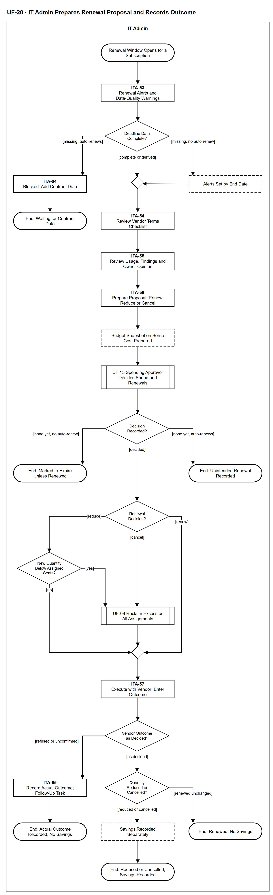

# UF-20 — IT Admin Prepares Renewal Proposal and Records Outcome

> **Loại:** User flow (mức màn hình) — IT Admin · **Phiên bản:** 1.5 — 10/10/2026 · **Trạng thái:** Vẽ lại theo BRD v3.32 (đồng bộ QĐ-61 → QĐ-64), QĐ-49c, QĐ-60a; khớp WF-15 và MF-4; mã màn hình là đề xuất — UI Spec hoãn tới giai đoạn Figma (QĐ-08)
>
> Sơ đồ là **dẫn xuất** từ quyết định Owner (`QĐ`) và BRD hiện hành; khi khác nhau, `QĐ` → BRD thắng. Quyết định trong sơ đồ là của Owner, **chưa** phải xác nhận của GVHD/hội đồng.

## 1. Mục đích và phạm vi

Hành trình của IT Admin trong chu kỳ gia hạn: nhận cảnh báo tính từ hạn chót báo hủy, rà điều khoản và bằng chứng sử dụng, lập đề xuất gia hạn, giảm số lượng hoặc hủy, chuyển Người duyệt chi quyết, rồi thực hiện với nhà cung cấp và ghi kết quả. Tiết kiệm chỉ được ghi khi hợp đồng thực sự giảm, và luôn tách hai con số. Hệ thống chỉ nhắc, không bao giờ tự gia hạn hay tự hủy.

**Phạm vi:** Màn hình ITA-53 → ITA-57 (và ITA-04 khi thiếu dữ liệu hợp đồng) cùng phản hồi hệ thống IT Admin nhìn thấy. Chỉ áp cho thuê bao hoặc khoản mua có thời hạn cần gia hạn.

**Không nằm trong sơ đồ này:** Quyết định gia hạn, giảm hoặc hủy của Người duyệt chi (→ UF-15); thu hồi quyền thực tế (→ UF-08); việc Finance trả lời câu hỏi ngân sách (→ UF-11); license vĩnh viễn và phần mềm nội bộ (QĐ-49c).

## 2. Tệp

| Tệp | Vai trò |
| --- | --- |
| [UF-20-it-admin-prepares-renewal-proposal-and-records-outcome.drawio](UF-20-it-admin-prepares-renewal-proposal-and-records-outcome.drawio) | Nguồn draw.io chỉnh sửa được (sinh từ spec) |
| [UF-20-it-admin-prepares-renewal-proposal-and-records-outcome.drawio.png](UF-20-it-admin-prepares-renewal-proposal-and-records-outcome.drawio.png) | Bản xuất PNG, nhúng sẵn nguồn draw.io |
| [UF-20.json](../specs/UF-20.json) | **Nguồn canonical** — sửa ở đây rồi chạy `python tools/flowkit.py build` từ `Docs/Diagrams` |

## 3. Nguồn nghiệp vụ

| Mã | Nội dung dùng trong sơ đồ |
| --- | --- |
| `FR-1.3, FR-1.4, QĐ-49c` | Hạn chót báo hủy; T-15 và T-7; người nhận; chỉ áp cho khoản có thời hạn |
| `FR-1.10, QĐ-54e` | Checklist sáu điểm điều khoản vendor rà trước kỳ gia hạn |
| `FR-4.15, FR-5.9, FR-2.4` | Hai con số tiết kiệm tách riêng; thu hồi một quyền không tự ghi tiết kiệm |
| `FR-3.13, FR-3.14, QĐ-60a` | Người duyệt chi quyết trên snapshot chi phí thực chịu và số liệu sử dụng; hỏi Finance không dừng SLA |
| `FR-3.8, DQ-07, KPI-4` | Quá SLA chỉ nhắc; quá hạn chót tự gia hạn là sự cố, không tự gia hạn là hết hạn |
| `INV-01, OI-11c, QĐ-35c` | Giảm dưới số Assignment ⟹ thu hồi phần vượt trước; Assignment kỳ mới là dòng mới nối chuỗi |

## 4. Tác nhân, kích hoạt, điều kiện

| Làn (tiếng Anh trên hình) | Tác nhân | Trách nhiệm trong sơ đồ |
| --- | --- | --- |
| IT Admin | IT Admin | Thao tác trên các màn hình ITA-xx; bước của Người duyệt chi là tham chiếu sang UF-15, bước hệ thống chỉ hiện kết quả |

- **Kích hoạt:** Thuê bao có kỳ tới mốc cảnh báo T-15 trước hạn chót báo hủy (đã có hoặc suy ra được); mốc T-7 là lần cảnh báo thứ hai.
- **Tiền điều kiện:** Thuê bao có kỳ, số lượng, đơn giá, cờ tự gia hạn, cờ cho phép giảm giữa kỳ; gói có điều khoản vendor và lưu ý trước khi thu hồi; mỗi mục danh mục có Business Owner.
- **Hậu điều kiện:** Một quyết định được ghi nhận và thực hiện (gia hạn, giảm, hủy) kèm tiết kiệm ghi riêng khi có; hoặc quá hạn chót không có quyết định: sự cố KPI-4 (tự gia hạn) hay đánh dấu hết hạn cuối kỳ, trừ khi gia hạn được thực hiện trước ngày kết thúc (không tự gia hạn); hoặc chờ dữ liệu hợp đồng.

## 5. Cách đọc ký hiệu

| Ký hiệu | Nghĩa |
| --- | --- |
| Hình chữ nhật bo tròn hai đầu, viền đậm | Điểm bắt đầu hoặc kết cục của hành trình |
| Hình chữ nhật viền liền, dòng đầu in đậm | Màn hình người dùng thao tác; dòng đầu là mã màn hình đề xuất |
| Hình chữ nhật viền nét đứt | Hệ thống tự xử lý; người dùng chỉ thấy kết quả |
| Hình chữ nhật viền rất đậm | Màn hình chặn hoặc trạng thái lỗi |
| Hình thoi | Rẽ nhánh; cạnh ra mang điều kiện `[...]` |
| Hình chữ nhật hai vạch đứng | Gọi user flow khác (mã `UF-xx` trong nhãn); có cạnh ra thì hành trình quay lại và đi tiếp, không có cạnh ra thì sơ đồ này dừng tại đó |
| Dây có cung nhảy | Hai dây giao nhau nhưng **không** nối với nhau |

Đọc từ trên xuống. Hình chữ nhật viền liền là màn hình (dòng đầu là mã đề xuất), viền rất đậm là màn hình chặn, nét đứt là bước hệ thống tự xử lý, hai vạch đứng là chuyển sang user flow khác. Nhánh trái-phải của Decision Recorded? là hai kết cục quá hạn chót.

## 6. Bảng node

| ID | Loại | Nhãn trên hình | Ý nghĩa | Làn / người thực hiện | Quy tắc |
| --- | --- | --- | --- | --- | --- |
| `t_start` | Điểm đầu/cuối | Renewal Window Opens for a Subscription | Thuê bao có kỳ (có thời hạn cần gia hạn) tới kỳ quét của hạn chót báo hủy. License vĩnh viễn và phần mềm nội bộ không vào luồng này. | IT Admin | — |
| `s_inbox` | Màn hình | ITA-53 — Renewal Alerts and Data-Quality Warnings | Danh sách cảnh báo tính từ hạn chót báo hủy, không tính từ ngày gia hạn: mốc T-15 báo IT Admin, Finance, Business Owner (nếu còn làm việc) và Người duyệt chi; mốc T-7 báo thêm Super Admin (ngưỡng mặc định, cấu hình được). Mỗi cảnh báo kèm khuyến nghị lãng phí đang mở của chính thuê bao đó. Hạn chót suy ra từ số ngày báo trước được ghi rõ là chưa xác nhận. Hộp cảnh báo cũng hiện cờ **thực hiện trễ** khi tới hạn chót mà quyết định đã ghi nhưng chưa có kết quả thực hiện (QĐ-62k). | IT Admin | `FR-1.4`, `OI-09a`, `OI-09b`, `QĐ-49c`, `FR-3.11` |
| `d_dq` | Rẽ nhánh | Deadline Data Complete? | Dữ liệu hạn chót: có hoặc suy ra được; thiếu cả hai mà thuê bao tự gia hạn; thiếu cả hai mà không tự gia hạn (QĐ-62l). | IT Admin | `FR-1.3`, `FR-1.4` |
| `b_dq` | Màn hình chặn/lỗi | ITA-04 — Blocked: Add Contract Data | Thiếu cả hạn chót lẫn số ngày báo trước mà thuê bao tự gia hạn: hệ thống không suy đoán, chỉ hiện cảnh báo chất lượng dữ liệu để IT Admin bổ sung hợp đồng. | IT Admin | `FR-1.4`, `FR-5.12` |
| `t_dq` | Điểm đầu/cuối | End: Waiting for Contract Data | Chu kỳ gia hạn chưa chạy được cho tới khi IT Admin bổ sung dữ liệu hợp đồng. | IT Admin | — |
| `y_endd` | Hệ thống xử lý | Alerts Set by End Date | Không có hạn chót, không có số ngày báo trước, không tự gia hạn: hệ thống lấy ngày kết thúc làm mốc, cảnh báo ghi rõ “theo ngày kết thúc”. | IT Admin | `QĐ-62l`, `FR-1.4` |
| `m_tm` | Hợp nhánh | — | — | IT Admin | — |
| `s_terms` | Màn hình | ITA-54 — Review Vendor Terms Checklist | IT Admin rà liên kết điều khoản và checklist sáu điểm của gói (chia sẻ tài khoản, dữ liệu huấn luyện AI, nơi lưu trữ, giới hạn cài đặt, mục đích thương mại, hủy/tự gia hạn/hoàn tiền); ghi lại điều đọc được, không diễn giải pháp lý; cập nhật ngày rà soát. | IT Admin | `FR-1.10`, `QĐ-54e` |
| `s_use` | Màn hình | ITA-55 — Review Usage, Findings and Owner Opinion | IT Admin xem số seat đang gán, bằng chứng sử dụng và khuyến nghị G1–G4 đang mở của thuê bao; ghi ý kiến Business Owner (đầu vào, không chặn, không thêm bước hay SLA). | IT Admin | `FR-4.15`, `OI-05a`, `BRD 4.4` |
| `s_prop` | Màn hình | ITA-56 — Prepare Proposal: Renew, Reduce or Cancel | IT Admin lập đề xuất gia hạn nguyên, giảm số lượng (bao nhiêu seat) hoặc hủy, kèm số liệu sử dụng, điều khoản và hai con số tiết kiệm hiển thị tách riêng (tại kỳ gia hạn · thực hiện ngay). Giảm giữa kỳ chỉ đề xuất khi thuê bao bật cờ cho phép giảm giữa kỳ. Đính kèm chứng từ BM-05. | IT Admin | `FR-3.13`, `FR-1.3`, `FR-4.15`, `BM-05` |
| `y_snap` | Hệ thống xử lý | Budget Snapshot on Borne Cost Prepared | Hệ thống lập snapshot ngân sách của Cost Center liên quan theo chi phí thực chịu (ngân sách, thực chi, cam kết đang giữ, còn lại, thời điểm dữ liệu; chưa có ngân sách thì hiện Chưa có ngân sách). Bước quyết định của Người duyệt chi có SLA từ lúc được giao. Finance chỉ trả lời khi được hỏi, không duyệt, không chặn (UF-11). | IT Admin | `FR-3.14`, `QĐ-60a`, `FR-3.8` |
| `r_uf15` | Chuyển sang user flow khác | UF-15 Spending Approver Decides Spend and Renewals | Người duyệt chi quyết gia hạn, giảm số lượng hoặc hủy trên snapshot và số liệu sử dụng; không ủy quyền, không ai quyết thay. Quá SLA chỉ nhắc lại, hệ thống không tự gia hạn hay tự hủy. | IT Admin | `FR-3.13`, `FR-3.8`, `DQ-07`, → `UF-15` |
| `d_made` | Rẽ nhánh | Decision Recorded? | Đã có quyết định của Người duyệt chi chưa. Chưa có khi tới hạn chót: hệ thống đã ghi sự cố KPI-4 (tự gia hạn) hoặc đánh dấu hết hạn (không tự gia hạn). Quyết định đến **sau** hạn chót không bị hủy — IT quay lại luồng này để thực hiện từ thời điểm còn làm được (QĐ-62k). | IT Admin | `DQ-07`, `KPI-4`, `QĐ-62k` |
| `t_exp` | Điểm đầu/cuối | End: Marked to Expire Unless Renewed | Thuê bao được đánh dấu hết hạn cuối kỳ, trừ khi một quyết định gia hạn đến sau và được thực hiện trước ngày kết thúc; không phải sự cố. | IT Admin | `DQ-07`, `KPI-4` |
| `t_inc` | Điểm đầu/cuối | End: Unintended Renewal Recorded | Sự cố gia hạn ngoài ý muốn đã ghi (KPI-4). Quyết định đến sau vẫn được thực hiện từ thời điểm còn làm được; sự cố không bị xóa. | IT Admin | `KPI-4`, `DQ-07`, `FR-3.8` |
| `d_dec` | Rẽ nhánh | Renewal Decision? | Quyết định của Người duyệt chi: gia hạn nguyên số lượng, giảm số lượng hoặc hủy thuê bao. Quyết định ghi sau hạn chót: giảm giữa kỳ chỉ khi gói cho phép (FR-1.3), nếu không thì thực hiện ở kỳ kế tiếp (QĐ-62k). | IT Admin | `FR-3.13` |
| `d_ex` | Rẽ nhánh | New Quantity Below Assigned Seats? | Số lượng mới có nhỏ hơn số Assignment đang chiếm chỗ không (không để vượt sức chứa). | IT Admin | `INV-01`, `OI-11c` |
| `r_recl` | Chuyển sang user flow khác | UF-08 Reclaim Excess or All Assignments | Giảm xuống dưới số đang gán: thu hồi phần vượt trước khi kỳ mới bắt đầu; Người duyệt chi chọn seat vượt từ danh sách xếp sẵn: đã quyết thu hồi → G2 → G3/G4 → hoạt động cuối cũ nhất (`QĐ-66x`). Hủy: thu hồi mọi quyền, bàn giao dữ liệu theo lưu ý trước khi thu hồi của gói, trước khi báo hủy với nhà cung cấp. Thu hồi chạy tại **thời điểm thực hiện** đã xác định (quyết định muộn: giữa kỳ nếu gói cho phép, nếu không thì kỳ kế tiếp) — không thu hồi sớm trong kỳ đã trả tiền (QĐ-62k). Nếu WF-09a trả *đóng thất bại* (QĐ-62i): quyền còn hiệu lực, vẫn hiện G2/lãng phí theo điều kiện nguồn, seat chưa về kho và IT mở tác vụ thu hồi mới. Việc báo giảm/hủy với nhà cung cấp đi sau thu hồi nên chờ tác vụ mới (suy ra từ thứ tự trên). Gói có lưu ý mất dữ liệu: IT Admin ghi xác nhận đã xử lý bàn giao trước khi gỡ ở nhà cung cấp; không chặn sau hạn ngắn (WF-09a `d_dl`, `s_ask`; QĐ-63a). Seat đã có quyết định *Thu hồi* ghost seat của trưởng phòng — ở phần vượt khi giảm cũng như khi hủy toàn bộ: một tác vụ, trưởng phòng đó xác nhận bàn giao, IT Admin không xác nhận thêm (`QĐ-64a`, `QĐ-66u`). | IT Admin | `OI-11c`, `FR-2.4`, `FR-1.9`, `QĐ-63a`, `QĐ-64a`, → `UF-08` |
| `m_exec` | Hợp nhánh | — | — | IT Admin | — |
| `s_exec` | Màn hình | ITA-57 — Execute with Vendor; Enter Outcome | IT thực hiện với nhà cung cấp ngoài hệ thống (gia hạn, giảm, báo hủy) rồi nhập kết quả nhà cung cấp trả về. Tới hạn chót mà chưa nhập kết quả thì hệ thống gắn cờ thực hiện trễ (không tính KPI-4). | IT Admin | `BM-05`, `FR-3.13`, `QĐ-35c`, `QĐ-62k` |
| `d_vout` | Rẽ nhánh | Vendor Outcome as Decided? | Kết quả phía nhà cung cấp có đúng quyết định không; từ chối, khác quyết định hoặc chưa xác nhận đều đi nhánh ghi kết quả thực tế. | IT Admin | `QĐ-62k`, `FR-4.15` |
| `s_act` | Màn hình | ITA-65 — Record Actual Outcome; Follow-Up Task | Nhà cung cấp từ chối, kết quả khác hoặc chưa xác nhận: IT ghi kết quả thực tế (không ghi theo quyết định), không ghi tiết kiệm, mở việc theo dõi với nhà cung cấp. Việc theo dõi đóng bằng cách ghi kết quả đã xác nhận: nếu sau đó nhà cung cấp xác nhận đúng quyết định thì ghi kết quả và kỳ mới, ghi tiết kiệm nếu chi phí giảm (QĐ-62k). | IT Admin | `QĐ-62k`, `FR-4.15` |
| `t_act` | Điểm đầu/cuối | End: Actual Outcome Recorded, No Savings | Kết quả thực tế đã ghi; IT còn việc theo dõi. | IT Admin | — |
| `d_sav` | Rẽ nhánh | Quantity Reduced or Cancelled? | Gia hạn nguyên thì không có tiết kiệm; giảm hoặc hủy thì có tiết kiệm cần ghi. | IT Admin | `FR-4.15` |
| `y_save` | Hệ thống xử lý | Savings Recorded Separately | Tiết kiệm tại kỳ gia hạn ghi riêng; tiết kiệm thực hiện ngay chỉ có khi gói theo tháng hoặc thuê bao cho phép giảm giữa kỳ. Hai con số không bao giờ cộng gộp; tiết kiệm chỉ ghi khi hợp đồng thực sự giảm, thu hồi một quyền không tự ghi tiết kiệm. Chỉ ghi khi chi phí thực sự giảm (FR-4.15, QĐ-62k). | IT Admin | `FR-4.15`, `FR-5.9`, `FR-2.4` |
| `t_saved` | Điểm đầu/cuối | End: Reduced or Cancelled, Savings Recorded | Quyết định đã thực hiện; tiết kiệm tại kỳ gia hạn được ghi riêng. | IT Admin | — |
| `t_renew` | Điểm đầu/cuối | End: Renewed, No Savings | Gia hạn nguyên số lượng đã thực hiện và ghi nhận; không có tiết kiệm. | IT Admin | — |

## 7. Bảng chuyển tiếp

| Từ → tới | Nhãn điều kiện | Điều kiện | Kết quả |
| --- | --- | --- | --- |
| `t_start` → `s_inbox` | — | — | Sang ITA-53 — Renewal Alerts and Data-Quality Warnings |
| `s_inbox` → `d_dq` | — | — | Sang Deadline Data Complete? |
| `d_dq` → `b_dq` | `[missing, auto-renews]` | Thiếu cả hạn chót lẫn số ngày báo trước, thuê bao tự gia hạn | Chặn, bổ sung dữ liệu hợp đồng |
| `d_dq` → `m_tm` | `[complete or derived]` | Có hạn chót hoặc suy ra được | Bắt đầu chuẩn bị đề xuất |
| `d_dq` → `y_endd` | `[missing, no auto-renew]` | Thiếu cả hai, không tự gia hạn | Mốc theo ngày kết thúc |
| `y_endd` → `m_tm` | — | — | Sang — |
| `m_tm` → `s_terms` | — | — | Sang ITA-54 — Review Vendor Terms Checklist |
| `b_dq` → `t_dq` | — | — | Sang End: Waiting for Contract Data |
| `s_terms` → `s_use` | — | — | Sang ITA-55 — Review Usage, Findings and Owner Opinion |
| `s_use` → `s_prop` | — | — | Sang ITA-56 — Prepare Proposal: Renew, Reduce or Cancel |
| `s_prop` → `y_snap` | — | — | Sang Budget Snapshot on Borne Cost Prepared |
| `y_snap` → `r_uf15` | — | — | Sang UF-15 Spending Approver Decides Spend and Renewals |
| `r_uf15` → `d_made` | — | — | Sang Decision Recorded? |
| `d_made` → `t_exp` | `[none yet, no auto-renew]` | Tới hạn chót chưa quyết, không tự gia hạn | Đánh dấu hết hạn cuối kỳ, trừ khi gia hạn trước ngày kết thúc |
| `d_made` → `t_inc` | `[none yet, auto-renews]` | Tới hạn chót chưa quyết, bật tự gia hạn | Ghi sự cố KPI-4 |
| `d_made` → `d_dec` | `[decided]` | Đã có quyết định (kể cả ghi sau hạn chót) | Thực hiện quyết định |
| `d_dec` → `d_ex` | `[reduce]` | Giảm số lượng | Kiểm phần vượt |
| `d_dec` → `r_recl` | `[cancel]` | Hủy thuê bao | Thu hồi mọi quyền trước |
| `d_dec` → `m_exec` | `[renew]` | Gia hạn nguyên số lượng | IT thực hiện |
| `d_ex` → `r_recl` | `[yes]` | Số mới nhỏ hơn số seat đang gán | Thu hồi phần vượt trước |
| `d_ex` → `m_exec` | `[no]` | Đủ chỗ cho các Assignment hiện có | Thực hiện |
| `r_recl` → `m_exec` | — | — | Sang — |
| `m_exec` → `s_exec` | — | — | Sang ITA-57 — Execute with Vendor; Enter Outcome |
| `s_exec` → `d_vout` | — | — | Sang Vendor Outcome as Decided? |
| `d_vout` → `d_sav` | `[as decided]` | Nhà cung cấp thực hiện đúng quyết định | Sang Quantity Reduced or Cancelled? |
| `d_vout` → `s_act` | `[refused or unconfirmed]` | Từ chối, kết quả khác hoặc chưa xác nhận | Sang ITA-65 — Record Actual Outcome; Follow-Up Task |
| `s_act` → `t_act` | — | — | Sang End: Actual Outcome Recorded, No Savings |
| `d_sav` → `y_save` | `[reduced or cancelled]` | Giảm số lượng hoặc hủy | Ghi tiết kiệm riêng |
| `d_sav` → `t_renew` | `[renewed unchanged]` | Gia hạn nguyên số lượng | Không có tiết kiệm |
| `y_save` → `t_saved` | — | — | Sang End: Reduced or Cancelled, Savings Recorded |

Số đếm: **27 node · 30 cạnh · 6 rẽ nhánh**; giao cắt dây: **0**.

## 8. Happy path

1. `t_start` — Renewal Window Opens for a Subscription: Thuê bao có kỳ (có thời hạn cần gia hạn) tới kỳ quét của hạn chót báo hủy. License vĩnh viễn và phần mềm nội bộ không vào luồng này.
2. `s_inbox` — ITA-53 — Renewal Alerts and Data-Quality Warnings: Danh sách cảnh báo tính từ hạn chót báo hủy, không tính từ ngày gia hạn: mốc T-15 báo IT Admin, Finance, Business Owner (nếu còn làm việc) và Người duyệt chi; mốc T-7 báo thêm Super Admin (ngưỡng mặc định, cấu hình được). Mỗi cảnh báo kèm khuyến nghị lãng phí đang mở của chính thuê bao đó. Hạn chót suy ra từ số ngày báo trước được ghi rõ là chưa xác nhận. Hộp cảnh báo cũng hiện cờ **thực hiện trễ** khi tới hạn chót mà quyết định đã ghi nhưng chưa có kết quả thực hiện (QĐ-62k).
3. `d_dq` — Deadline Data Complete?: Dữ liệu hạn chót: có hoặc suy ra được; thiếu cả hai mà thuê bao tự gia hạn; thiếu cả hai mà không tự gia hạn (QĐ-62l).
4. `s_terms` — ITA-54 — Review Vendor Terms Checklist: IT Admin rà liên kết điều khoản và checklist sáu điểm của gói (chia sẻ tài khoản, dữ liệu huấn luyện AI, nơi lưu trữ, giới hạn cài đặt, mục đích thương mại, hủy/tự gia hạn/hoàn tiền); ghi lại điều đọc được, không diễn giải pháp lý; cập nhật ngày rà soát.
5. `s_use` — ITA-55 — Review Usage, Findings and Owner Opinion: IT Admin xem số seat đang gán, bằng chứng sử dụng và khuyến nghị G1–G4 đang mở của thuê bao; ghi ý kiến Business Owner (đầu vào, không chặn, không thêm bước hay SLA).
6. `s_prop` — ITA-56 — Prepare Proposal: Renew, Reduce or Cancel: IT Admin lập đề xuất gia hạn nguyên, giảm số lượng (bao nhiêu seat) hoặc hủy, kèm số liệu sử dụng, điều khoản và hai con số tiết kiệm hiển thị tách riêng (tại kỳ gia hạn · thực hiện ngay). Giảm giữa kỳ chỉ đề xuất khi thuê bao bật cờ cho phép giảm giữa kỳ. Đính kèm chứng từ BM-05.
7. `y_snap` — Budget Snapshot on Borne Cost Prepared: Hệ thống lập snapshot ngân sách của Cost Center liên quan theo chi phí thực chịu (ngân sách, thực chi, cam kết đang giữ, còn lại, thời điểm dữ liệu; chưa có ngân sách thì hiện Chưa có ngân sách). Bước quyết định của Người duyệt chi có SLA từ lúc được giao. Finance chỉ trả lời khi được hỏi, không duyệt, không chặn (UF-11).
8. `r_uf15` — UF-15 Spending Approver Decides Spend and Renewals: Người duyệt chi quyết gia hạn, giảm số lượng hoặc hủy trên snapshot và số liệu sử dụng; không ủy quyền, không ai quyết thay. Quá SLA chỉ nhắc lại, hệ thống không tự gia hạn hay tự hủy.
9. `d_made` — Decision Recorded?: Đã có quyết định của Người duyệt chi chưa. Chưa có khi tới hạn chót: hệ thống đã ghi sự cố KPI-4 (tự gia hạn) hoặc đánh dấu hết hạn (không tự gia hạn). Quyết định đến **sau** hạn chót không bị hủy — IT quay lại luồng này để thực hiện từ thời điểm còn làm được (QĐ-62k).
10. `d_dec` — Renewal Decision?: Quyết định của Người duyệt chi: gia hạn nguyên số lượng, giảm số lượng hoặc hủy thuê bao. Quyết định ghi sau hạn chót: giảm giữa kỳ chỉ khi gói cho phép (FR-1.3), nếu không thì thực hiện ở kỳ kế tiếp (QĐ-62k).
11. `d_ex` — New Quantity Below Assigned Seats?: Số lượng mới có nhỏ hơn số Assignment đang chiếm chỗ không (không để vượt sức chứa).
12. `r_recl` — UF-08 Reclaim Excess or All Assignments: Giảm xuống dưới số đang gán: thu hồi phần vượt trước khi kỳ mới bắt đầu; Người duyệt chi chọn seat vượt từ danh sách xếp sẵn: đã quyết thu hồi → G2 → G3/G4 → hoạt động cuối cũ nhất (`QĐ-66x`). Hủy: thu hồi mọi quyền, bàn giao dữ liệu theo lưu ý trước khi thu hồi của gói, trước khi báo hủy với nhà cung cấp. Thu hồi chạy tại **thời điểm thực hiện** đã xác định (quyết định muộn: giữa kỳ nếu gói cho phép, nếu không thì kỳ kế tiếp) — không thu hồi sớm trong kỳ đã trả tiền (QĐ-62k). Nếu WF-09a trả *đóng thất bại* (QĐ-62i): quyền còn hiệu lực, vẫn hiện G2/lãng phí theo điều kiện nguồn, seat chưa về kho và IT mở tác vụ thu hồi mới. Việc báo giảm/hủy với nhà cung cấp đi sau thu hồi nên chờ tác vụ mới (suy ra từ thứ tự trên). Gói có lưu ý mất dữ liệu: IT Admin ghi xác nhận đã xử lý bàn giao trước khi gỡ ở nhà cung cấp; không chặn sau hạn ngắn (WF-09a `d_dl`, `s_ask`; QĐ-63a). Seat đã có quyết định *Thu hồi* ghost seat của trưởng phòng — ở phần vượt khi giảm cũng như khi hủy toàn bộ: một tác vụ, trưởng phòng đó xác nhận bàn giao, IT Admin không xác nhận thêm (`QĐ-64a`, `QĐ-66u`).
13. `s_exec` — ITA-57 — Execute with Vendor; Enter Outcome: IT thực hiện với nhà cung cấp ngoài hệ thống (gia hạn, giảm, báo hủy) rồi nhập kết quả nhà cung cấp trả về. Tới hạn chót mà chưa nhập kết quả thì hệ thống gắn cờ thực hiện trễ (không tính KPI-4).
14. `d_vout` — Vendor Outcome as Decided?: Kết quả phía nhà cung cấp có đúng quyết định không; từ chối, khác quyết định hoặc chưa xác nhận đều đi nhánh ghi kết quả thực tế.
15. `d_sav` — Quantity Reduced or Cancelled?: Gia hạn nguyên thì không có tiết kiệm; giảm hoặc hủy thì có tiết kiệm cần ghi.
16. `y_save` — Savings Recorded Separately: Tiết kiệm tại kỳ gia hạn ghi riêng; tiết kiệm thực hiện ngay chỉ có khi gói theo tháng hoặc thuê bao cho phép giảm giữa kỳ. Hai con số không bao giờ cộng gộp; tiết kiệm chỉ ghi khi hợp đồng thực sự giảm, thu hồi một quyền không tự ghi tiết kiệm. Chỉ ghi khi chi phí thực sự giảm (FR-4.15, QĐ-62k).
17. `t_saved` — End: Reduced or Cancelled, Savings Recorded: Quyết định đã thực hiện; tiết kiệm tại kỳ gia hạn được ghi riêng.

## 9. Nhánh thay thế / if-else

- **Gia hạn nguyên số lượng** — `d_dec` → `m_exec` → `s_exec` → `d_vout` → `d_sav` → `t_renew`. Không có tiết kiệm.
- **Hủy thuê bao** — `d_dec` → `r_recl` → `m_exec`. Thu hồi mọi quyền và bàn giao dữ liệu trước khi báo hủy với nhà cung cấp.
- **Giảm số lượng, đủ chỗ cho Assignment hiện có** — `d_dec` → `d_ex` → `m_exec`. Không cần thu hồi trước.
- **Không hạn chót, không tự gia hạn** — `d_dq` → `y_endd` → `m_tm` → `s_terms`. Cảnh báo theo ngày kết thúc (QĐ-62l).
- **Quyết định đến sau hạn chót** — `r_uf15` → `d_made` → `d_dec`. Không bị hủy; thực hiện giữa kỳ nếu gói cho phép, nếu không thì kỳ kế tiếp (QĐ-62k).

## 10. Nhánh lỗi / từ chối và cách kết thúc

- **Thiếu dữ liệu hợp đồng, thuê bao tự gia hạn** — `d_dq` → `b_dq` → `t_dq`. Hệ thống không suy đoán, chỉ cảnh báo chất lượng dữ liệu.
- **Tới hạn chót chưa quyết, tự gia hạn** — `d_made` → `t_inc`. Sự cố KPI-4; quyết định đến sau vẫn được thực hiện.
- **Tới hạn chót chưa quyết, không tự gia hạn** — `d_made` → `t_exp`. Đánh dấu hết hạn cuối kỳ trừ khi gia hạn được thực hiện trước ngày kết thúc; không phải sự cố.
- **Nhà cung cấp từ chối hoặc chưa xác nhận** — `s_exec` → `d_vout` → `s_act` → `t_act`. Ghi kết quả thực tế, không tiết kiệm (QĐ-62k).

## 11. Liên hệ với sơ đồ khác

- Workflow: `WF-15`; main flow `MF-4`
- `UF-15` (Người duyệt chi quyết), `UF-08` (thu hồi quyền), `UF-11` (Finance trả lời ngân sách), `UF-10` (khuyến nghị lãng phí là đầu vào)
- `UF-15` — gọi/chuyển tại node `r_uf15`
- `UF-08` — gọi/chuyển tại node `r_recl`

## 12. Giới hạn và vấn đề còn mở

- (LIMIT · DOI-92) Mốc cảnh báo theo BRD FR-1.4 là 15 và 7 ngày trước hạn chót (cấu hình được); các mốc T-90/T-60 của brief cũ không vẽ.
- (ĐÃ CHỐT · DOI-89, QĐ-62t) T-7 được bỏ qua khi quyết định và kết quả thực hiện đều đã ghi; đã quyết mà chưa thực hiện thì vẫn gửi.
- (ĐÃ CÓ NGUỒN · DOI-21) Người duyệt chi không có cấp trên — quá SLA nhắc người được giao và cảnh báo Super Admin (FR-3.8, FR-5.14).
- (DEFERRED/OUT · QĐ-62o, QĐ-49c) Tiết kiệm khi chi phí phần mềm nội bộ giảm nằm ngoài MVP và ngoài luồng gia hạn.
- (LATER-TECH/UI · DOI-01, QĐ-08) Mã màn hình ITA-53 → ITA-57 và ITA-65 là mã mới của bản vẽ này; ITA-04 dùng lại mã cũ (chi tiết thuê bao); UI Spec chưa chốt.
