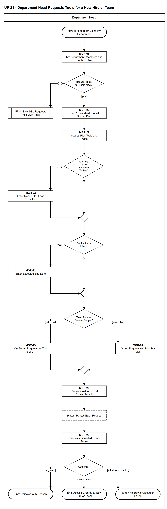

# UF-21 — Department Head Requests Tools for a New Hire or Team

> **Loại:** User flow (mức màn hình) — Department Head (vai Manager suy ra) · **Phiên bản:** 1.1 — 09/10/2026 · **Trạng thái:** Vẽ lại theo BRD v3.30 (đồng bộ QĐ-61/QĐ-62), WF-04 v3.0 và QĐ-52…QĐ-60 (bộ công cụ chuẩn, yêu cầu theo nhóm, SoD-4); mã màn hình là đề xuất — UI Spec hoãn tới giai đoạn Figma (QĐ-08)
>
> Sơ đồ là **dẫn xuất** từ quyết định Owner (`QĐ`) và BRD hiện hành; khi khác nhau, `QĐ` → BRD thắng. Quyết định trong sơ đồ là của Owner, **chưa** phải xác nhận của GVHD/hội đồng.

## 1. Mục đích và phạm vi

Hành trình của trưởng phòng khi xin công cụ thay cho người mới hoặc cho cả nhóm: thấy bộ công cụ chuẩn trước, thêm lý do cho công cụ ngoài bộ chuẩn, rồi tạo phiếu BM-01 thay theo từng công cụ hoặc một yêu cầu theo nhóm kèm danh sách thành viên, xem lại và theo dõi tới kết cục.

**Phạm vi:** Màn hình MGR-05, MGR-22 → MGR-26 và phản hồi hệ thống mà trưởng phòng nhìn thấy.

**Không nằm trong sơ đồ này:** IT Admin nhập hồ sơ nhân sự và sửa dữ liệu bị từ chối (WF-04, FR-9.7); các bước duyệt, duyệt chi, cấp phát (→ UF-04, UF-15, UF-08, WF-09); tài khoản dùng chung (một bộ đăng nhập cho nhiều người — FR-2.11, khác yêu cầu theo nhóm).

## 2. Tệp

| Tệp | Vai trò |
| --- | --- |
| [UF-21-department-head-requests-tools-for-a-new-hire-or-team.drawio](UF-21-department-head-requests-tools-for-a-new-hire-or-team.drawio) | Nguồn draw.io chỉnh sửa được (sinh từ spec) |
| [UF-21-department-head-requests-tools-for-a-new-hire-or-team.drawio.png](UF-21-department-head-requests-tools-for-a-new-hire-or-team.drawio.png) | Bản xuất PNG, nhúng sẵn nguồn draw.io |
| [UF-21.json](../specs/UF-21.json) | **Nguồn canonical** — sửa ở đây rồi chạy `python tools/flowkit.py build` từ `Docs/Diagrams` |

## 3. Nguồn nghiệp vụ

| Mã | Nội dung dùng trong sơ đồ |
| --- | --- |
| `FR-3.2, BM-01` | Trưởng phòng tạo yêu cầu thay khi onboarding và gửi yêu cầu theo nhóm; nội dung phiếu |
| `FR-3.18, QĐ-52e, QĐ-58c` | Bộ công cụ chuẩn hiện trước; ngoài bộ chuẩn phải có lý do và bị gắn cờ; không dùng AI gợi ý |
| `FR-2.11, QĐ-54d` | Yêu cầu theo nhóm cho gói team: mỗi người một Assignment; khác tài khoản dùng chung |
| `FR-2.8, INV-07` | Nhà thầu và thực tập sinh bắt buộc có ngày kết thúc dự kiến |
| `SoD-4, INV-08, FR-3.3, QĐ-52c` | Người yêu cầu không tự duyệt; trưởng phòng tự gửi ⟹ Người duyệt chi đảm nhận bước nhu cầu |
| `FR-3.4, FR-3.8, FR-5.13` | Chuỗi duyệt theo nhánh, SLA và chi phí thực chịu hiện ở bước xem lại |
| `FR-3.11, OI-06` | Theo dõi trạng thái; rút yêu cầu tới khi tác vụ cấp phát còn chờ |

## 4. Tác nhân, kích hoạt, điều kiện

| Làn (tiếng Anh trên hình) | Tác nhân | Trách nhiệm trong sơ đồ |
| --- | --- | --- |
| Department Head | Department Head | Trưởng phòng của phòng người mới — vai Manager suy ra; thao tác trên MGR-05, MGR-22…MGR-26; bước của IT, Người duyệt chi, Finance chỉ hiện dưới dạng trạng thái |

- **Kích hoạt:** Doanh nghiệp tuyển người mới vào phòng, hoặc một nhóm trong phòng cần chung một gói team.
- **Tiền điều kiện:** Người mới đã có hồ sơ với phòng và chức vụ hợp lệ, có email công việc thuộc tên miền công ty (WF-04); bộ công cụ chuẩn của phòng × chức vụ đã cấu hình (nếu chưa, mọi công cụ là ngoài bộ chuẩn).
- **Hậu điều kiện:** Mỗi yêu cầu kết thúc bằng: có quyền · bị từ chối kèm lý do · rút/đóng/cấp phát thất bại (vẫn được báo); hoặc trưởng phòng để người mới tự xin sau (UF-01).

## 5. Cách đọc ký hiệu

| Ký hiệu | Nghĩa |
| --- | --- |
| Hình chữ nhật bo tròn hai đầu, viền đậm | Điểm bắt đầu hoặc kết cục của hành trình |
| Hình chữ nhật viền liền, dòng đầu in đậm | Màn hình người dùng thao tác; dòng đầu là mã màn hình đề xuất |
| Hình chữ nhật viền nét đứt | Hệ thống tự xử lý; người dùng chỉ thấy kết quả |
| Hình thoi | Rẽ nhánh; cạnh ra mang điều kiện `[...]` |
| Hình chữ nhật hai vạch đứng | Gọi user flow khác (mã `UF-xx` trong nhãn); có cạnh ra thì hành trình quay lại và đi tiếp, không có cạnh ra thì sơ đồ này dừng tại đó |
| Dây có cung nhảy | Hai dây giao nhau nhưng **không** nối với nhau |

Đọc từ trên xuống. Chữ nhật viền liền là màn hình (dòng đầu là mã màn hình đề xuất), nét đứt là hệ thống tự xử lý, hai vạch đứng là sang user flow khác. Hai điểm rẽ nhánh đầu (ngoài bộ chuẩn, nhà thầu/thực tập sinh) chỉ thêm một màn nhập rồi nhập lại luồng chính; nhánh cá nhân hoặc nhóm tách ở giữa rồi hợp lại trước khi gửi.

## 6. Bảng node

| ID | Loại | Nhãn trên hình | Ý nghĩa | Làn / người thực hiện | Quy tắc |
| --- | --- | --- | --- | --- | --- |
| `t_start` | Điểm đầu/cuối | New Hire or Team Joins My Department | Người mới đã được IT Admin ghi vào phòng của tôi (phòng và chức vụ bắt buộc); hoặc một nhóm cần chung một gói team. | Department Head | `FR-2.1`, `FR-9.7` |
| `s_dept` | Màn hình | MGR-05 — My Department: Members and Tools in Use | Danh sách thành viên phòng tôi và công cụ đang dùng của phòng (giá trị tổng hợp); từ đây tôi chọn tạo yêu cầu thay cho một thành viên hoặc cho một nhóm. | Department Head | `FR-3.7`, `FR-3.17`, `FR-3.2` |
| `d_want` | Rẽ nhánh | Request Tools for Them Now? | Trưởng phòng có tạo yêu cầu thay hay để người mới tự xin sau. | Department Head | `FR-3.2` |
| `r_uf01` | Chuyển sang user flow khác | UF-01 New Hire Requests Their Own Tools | Không phải lỗi: người mới tự gửi yêu cầu sau khi có tài khoản (MF-2); phạm vi sơ đồ này dừng ở đây. | Department Head | → `UF-01` |
| `s_kit` | Màn hình | MGR-22 — Step 1: Standard Toolset Shown First | Bộ công cụ chuẩn của cặp (phòng, chức vụ) hiện trước. Bộ chuẩn không tự cấp quyền — mọi quyền vẫn đi qua định tuyến duyệt. Không có gợi ý AI. | Department Head | `FR-3.18`, `QĐ-52e`, `QĐ-58c` |
| `s_pick` | Màn hình | MGR-22 — Step 2: Pick Tools and Plans | Chọn công cụ trong bộ chuẩn hoặc trong danh mục; nhãn tình trạng seat hiện ngay. | Department Head | `FR-3.2`, `BM-01` |
| `d_extra` | Rẽ nhánh | Any Tool Outside Standard Toolset? | Có công cụ nào ngoài bộ chuẩn không. | Department Head | `FR-3.18` |
| `s_why` | Màn hình | MGR-22 — Enter Reason for Each Extra Tool | Công cụ ngoài bộ chuẩn bắt buộc có lý do và được gắn cờ cho người duyệt. | Department Head | `FR-3.18`, `QĐ-52e` |
| `m_extra` | Hợp nhánh | — | — | Department Head | — |
| `d_term` | Rẽ nhánh | Contractor or Intern? | Người được cấp là nhà thầu hoặc thực tập sinh không. | Department Head | `FR-2.8`, `INV-07` |
| `s_end` | Màn hình | MGR-22 — Enter Expected End Date | Nhà thầu và thực tập sinh bắt buộc có ngày kết thúc dự kiến. | Department Head | `FR-2.8`, `INV-07` |
| `m_term` | Hợp nhánh | — | — | Department Head | — |
| `d_kind` | Rẽ nhánh | Team Plan for Several People? | Một người dùng tài khoản cá nhân, hay gói team cấp cho nhiều người cùng lúc. | Department Head | `FR-2.11`, `QĐ-54d` |
| `s_onb` | Màn hình | MGR-23 — On-Behalf Request per Tool (BM-01) | Mỗi công cụ một phiếu BM-01: người yêu cầu là tôi, người thụ hưởng là người mới (hai trường riêng); ghi phần mềm/gói, lý do, thời hạn cần dùng, cá nhân hay dùng chung. Gói cấm chia sẻ tài khoản thì không xin được kiểu dùng chung — yêu cầu bị từ chối ở bước đánh giá của IT (FR-2.11); chuyển sang cấp cá nhân là yêu cầu mới, định tuyến lại theo FR-3.4. | Department Head | `FR-3.2`, `BM-01`, `SoD-4` |
| `s_grp` | Màn hình | MGR-24 — Group Request with Member List | Một yêu cầu theo nhóm cho gói team kèm danh sách thành viên; khi được cấp, hệ thống tạo một Assignment cho mỗi người. Khác tài khoản dùng chung (một bộ đăng nhập cho nhiều người). Chỉ thành viên phòng của trưởng phòng (BRD 4.3, FR-3.2). Gói cấm chia sẻ tài khoản thì không xin được kiểu dùng chung — yêu cầu bị từ chối ở bước đánh giá của IT (FR-2.11); chuyển sang cấp cá nhân là yêu cầu mới, định tuyến lại theo FR-3.4. | Department Head | `FR-2.11`, `FR-3.2`, `BM-01`, `QĐ-54d` |
| `m_req` | Hợp nhánh | — | — | Department Head | — |
| `s_submit` | Màn hình | MGR-25 — Review Cost, Approval Chain; Submit | Xem lại trước khi gửi: chi phí ước tính (nếu phải mua thêm), chuỗi người duyệt dự kiến và thời gian dự kiến theo SLA; rồi gửi các phiếu BM-01. | Department Head | `FR-3.4`, `FR-3.8`, `FR-5.13` |
| `y_route` | Hệ thống xử lý | System Routes Each Request | Mỗi yêu cầu đi định tuyến và cấp phát thông thường theo nhánh (a)/(b)/(c). Trưởng phòng là người vốn duyệt nhu cầu của nhân viên phòng mình, nên yêu cầu trưởng phòng tạo thay được ghi nhận là **bước nhu cầu đã xác nhận** (người tạo, người thụ hưởng, thời điểm) rồi đi tiếp nhánh (a)/(b)/(c). Phần mà chính trưởng phòng là người thụ hưởng ⟹ bước nhu cầu theo QĐ-52c (Người duyệt chi; trưởng phòng là Người duyệt chi ⟹ approver dự phòng) — không thể tự duyệt qua việc đổi tên người yêu cầu (QĐ-62a, SoD-4). | Department Head | `FR-3.3`, `FR-3.4`, `INV-08`, `QĐ-52c`, `QĐ-62a`, `SoD-4` |
| `s_track` | Màn hình | MGR-26 — Requests I Created: Track Status | Theo dõi từng yêu cầu (và từng người trong yêu cầu nhóm) cùng mốc thời gian theo tuyến thực tế; rút được tới khi tác vụ cấp phát còn chờ. | Department Head | `FR-3.11`, `OI-06` |
| `d_res` | Rẽ nhánh | Outcome? | Kết cục của yêu cầu. | Department Head | — |
| `t_ok` | Điểm đầu/cuối | End: Access Granted to New Hire or Team | Người mới hoặc từng thành viên của nhóm có quyền trên tài khoản công ty. | Department Head | — |
| `t_rej` | Điểm đầu/cuối | End: Rejected with Reason | Bị từ chối ở bước nhu cầu hoặc bước chi, kèm lý do; tôi được báo. | Department Head | — |
| `t_wd` | Điểm đầu/cuối | End: Withdrawn, Closed or Failed | Tôi rút yêu cầu, IT đóng/từ chối ở cổng đánh giá, hoặc cấp phát thất bại — tôi vẫn được báo. | Department Head | — |

## 7. Bảng chuyển tiếp

| Từ → tới | Nhãn điều kiện | Điều kiện | Kết quả |
| --- | --- | --- | --- |
| `t_start` → `s_dept` | — | — | Sang MGR-05 — My Department: Members and Tools in Use |
| `s_dept` → `d_want` | — | — | Sang Request Tools for Them Now? |
| `d_want` → `r_uf01` | `[no]` | Để người mới tự xin | Sang UF-01 |
| `d_want` → `s_kit` | `[yes]` | Tạo yêu cầu thay | Hiện bộ công cụ chuẩn |
| `s_kit` → `s_pick` | — | — | Sang MGR-22 — Step 2: Pick Tools and Plans |
| `s_pick` → `d_extra` | — | — | Sang Any Tool Outside Standard Toolset? |
| `d_extra` → `s_why` | `[yes]` | Có công cụ ngoài bộ chuẩn | Nhập lý do |
| `d_extra` → `m_extra` | `[no]` | Toàn bộ trong bộ chuẩn | Đi tiếp |
| `s_why` → `m_extra` | — | — | Sang — |
| `m_extra` → `d_term` | — | — | Sang Contractor or Intern? |
| `d_term` → `s_end` | `[yes]` | Nhà thầu hoặc thực tập sinh | Nhập ngày kết thúc |
| `d_term` → `m_term` | `[no]` | Nhân viên thường | Đi tiếp |
| `s_end` → `m_term` | — | — | Sang — |
| `m_term` → `d_kind` | — | — | Sang Team Plan for Several People? |
| `d_kind` → `s_onb` | `[individual]` | Tài khoản cá nhân cho người mới | Yêu cầu thay theo từng công cụ |
| `d_kind` → `s_grp` | `[team plan]` | Gói team cho nhiều người | Yêu cầu theo nhóm |
| `s_onb` → `m_req` | — | — | Sang — |
| `s_grp` → `m_req` | — | — | Sang — |
| `m_req` → `s_submit` | — | — | Sang MGR-25 — Review Cost, Approval Chain; Submit |
| `s_submit` → `y_route` | — | — | Sang System Routes Each Request |
| `y_route` → `s_track` | — | — | Sang MGR-26 — Requests I Created: Track Status |
| `s_track` → `d_res` | — | — | Sang Outcome? |
| `d_res` → `t_ok` | `[access active]` | Cấp phát hoàn tất | Có quyền |
| `d_res` → `t_rej` | `[rejected]` | Bị từ chối | Kết thúc kèm lý do |
| `d_res` → `t_wd` | `[withdrawn or failed]` | Rút, đóng hoặc cấp phát thất bại | Kết thúc, có thông báo |

Số đếm: **23 node · 25 cạnh · 5 rẽ nhánh**; giao cắt dây: **0**.

## 8. Happy path

1. `t_start` — New Hire or Team Joins My Department: Người mới đã được IT Admin ghi vào phòng của tôi (phòng và chức vụ bắt buộc); hoặc một nhóm cần chung một gói team.
2. `s_dept` — MGR-05 — My Department: Members and Tools in Use: Danh sách thành viên phòng tôi và công cụ đang dùng của phòng (giá trị tổng hợp); từ đây tôi chọn tạo yêu cầu thay cho một thành viên hoặc cho một nhóm.
3. `d_want` — Request Tools for Them Now?: Trưởng phòng có tạo yêu cầu thay hay để người mới tự xin sau.
4. `s_kit` — MGR-22 — Step 1: Standard Toolset Shown First: Bộ công cụ chuẩn của cặp (phòng, chức vụ) hiện trước. Bộ chuẩn không tự cấp quyền — mọi quyền vẫn đi qua định tuyến duyệt. Không có gợi ý AI.
5. `s_pick` — MGR-22 — Step 2: Pick Tools and Plans: Chọn công cụ trong bộ chuẩn hoặc trong danh mục; nhãn tình trạng seat hiện ngay.
6. `d_extra` — Any Tool Outside Standard Toolset?: Có công cụ nào ngoài bộ chuẩn không.
7. `d_term` — Contractor or Intern?: Người được cấp là nhà thầu hoặc thực tập sinh không.
8. `d_kind` — Team Plan for Several People?: Một người dùng tài khoản cá nhân, hay gói team cấp cho nhiều người cùng lúc.
9. `s_onb` — MGR-23 — On-Behalf Request per Tool (BM-01): Mỗi công cụ một phiếu BM-01: người yêu cầu là tôi, người thụ hưởng là người mới (hai trường riêng); ghi phần mềm/gói, lý do, thời hạn cần dùng, cá nhân hay dùng chung. Gói cấm chia sẻ tài khoản thì không xin được kiểu dùng chung — yêu cầu bị từ chối ở bước đánh giá của IT (FR-2.11); chuyển sang cấp cá nhân là yêu cầu mới, định tuyến lại theo FR-3.4.
10. `s_submit` — MGR-25 — Review Cost, Approval Chain; Submit: Xem lại trước khi gửi: chi phí ước tính (nếu phải mua thêm), chuỗi người duyệt dự kiến và thời gian dự kiến theo SLA; rồi gửi các phiếu BM-01.
11. `y_route` — System Routes Each Request: Mỗi yêu cầu đi định tuyến và cấp phát thông thường theo nhánh (a)/(b)/(c). Trưởng phòng là người vốn duyệt nhu cầu của nhân viên phòng mình, nên yêu cầu trưởng phòng tạo thay được ghi nhận là **bước nhu cầu đã xác nhận** (người tạo, người thụ hưởng, thời điểm) rồi đi tiếp nhánh (a)/(b)/(c). Phần mà chính trưởng phòng là người thụ hưởng ⟹ bước nhu cầu theo QĐ-52c (Người duyệt chi; trưởng phòng là Người duyệt chi ⟹ approver dự phòng) — không thể tự duyệt qua việc đổi tên người yêu cầu (QĐ-62a, SoD-4).
12. `s_track` — MGR-26 — Requests I Created: Track Status: Theo dõi từng yêu cầu (và từng người trong yêu cầu nhóm) cùng mốc thời gian theo tuyến thực tế; rút được tới khi tác vụ cấp phát còn chờ.
13. `d_res` — Outcome?: Kết cục của yêu cầu.
14. `t_ok` — End: Access Granted to New Hire or Team: Người mới hoặc từng thành viên của nhóm có quyền trên tài khoản công ty.

## 9. Nhánh thay thế / if-else

- **Gói team: yêu cầu theo nhóm** — `d_kind` → `s_grp` → `m_req`. Một yêu cầu kèm danh sách thành viên; mỗi người một Assignment.
- **Công cụ ngoài bộ chuẩn** — `d_extra` → `s_why` → `m_extra`. Lý do bắt buộc; yêu cầu mang cờ.
- **Nhà thầu hoặc thực tập sinh** — `d_term` → `s_end` → `m_term`. Ngày kết thúc dự kiến bắt buộc.
- **Người mới tự xin sau** — `d_want` → `r_uf01`. Không phải lỗi; phạm vi sơ đồ dừng ở đây.

## 10. Nhánh lỗi / từ chối và cách kết thúc

- **Bị từ chối** — `d_res` → `t_rej`. Lý do hiện ở chi tiết yêu cầu.
- **Rút, đóng hoặc cấp phát thất bại** — `d_res` → `t_wd`. Cấp phát lỗi vẫn báo người yêu cầu.

## 11. Liên hệ với sơ đồ khác

- Workflow: `MF-2`, `WF-04`, `WF-09`
- `UF-01` (nhân viên tự xin), `UF-04` (trưởng phòng duyệt yêu cầu của nhân viên khác), `UF-15` (Người duyệt chi), `UF-08` (IT cấp phát), `UF-18` (công cụ thay thế sau điều chuyển)
- `UF-01` — gọi/chuyển tại node `r_uf01`

## 12. Giới hạn và vấn đề còn mở

- (LATER-TECH/UI · DOI-01, QĐ-08) Mã màn hình MGR-xx là đề xuất, chưa có UI Spec hiện hành.
- (ĐÃ CHỐT · DOI-20, QĐ-62a) Yêu cầu trưởng phòng tạo thay = bước nhu cầu đã xác nhận; phần trưởng phòng là người thụ hưởng theo QĐ-52c.
- (LIMIT · DOI-30) Không có cảnh báo *có nhân viên mới trong phòng* (FR-5.14); hình bắt đầu từ việc trưởng phòng tự mở danh sách thành viên.
- (LATER-TECH/UI · DOI-31) Yêu cầu nhóm có kết cục khác nhau theo từng thành viên: hình gộp một điểm kết cục; chi tiết theo người ở MGR-26.
