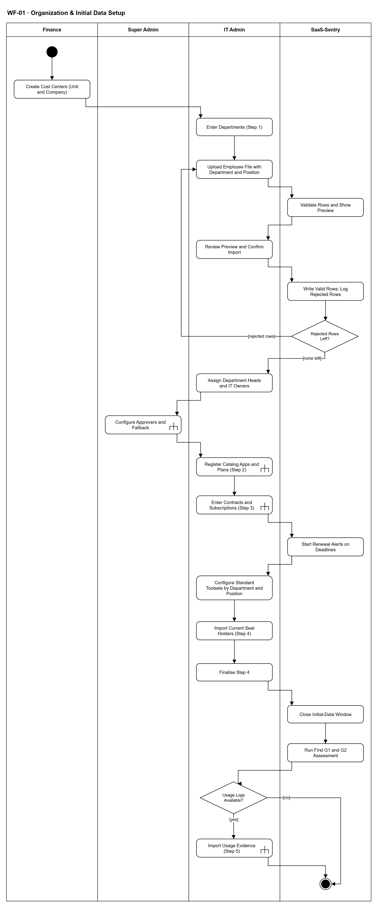

# WF-01 — Organization & Initial Data Setup

> **Loại:** Workflow hỗ trợ (SF-1) — khởi tạo tổ chức và dữ liệu ban đầu · **Phiên bản:** 3.1 — 09/10/2026 · **Trạng thái:** Vẽ lại 08/10/2026 theo FR-9.1–9.7, QĐ-52, QĐ-43e, OI-04, OI-10; chờ Owner/GVHD review
>
> Sơ đồ là **dẫn xuất** từ quyết định Owner (`QĐ`) và BRD hiện hành; khi khác nhau, `QĐ` → BRD thắng. Quyết định trong sơ đồ là của Owner, **chưa** phải xác nhận của GVHD/hội đồng.

## 1. Mục đích và phạm vi

Đưa một tổ chức từ chưa có dữ liệu tới có đủ nền để mọi luồng khác chạy được, theo đúng **năm bước có thứ tự phụ thuộc**: phòng ban và nhân sự → danh mục → hợp đồng/thuê bao (cảnh báo gia hạn bắt đầu) → hiện trạng seat (có G1/G2 ngay) → log sử dụng (tùy chọn).

**Phạm vi:** Cost Center do Finance tạo trước; phòng ban và nhân sự qua khung import 6 bước có xem trước; cấu hình người duyệt; gọi `WF-02` cho bước 2–3; bộ công cụ chuẩn; hiện trạng seat; đóng giai đoạn khởi tạo; đánh giá G1/G2 đầu tiên; bước 5 tùy chọn.

**Không nằm trong sơ đồ này:** Chi tiết khai báo danh mục, gói, thuê bao (→ `WF-02`); chi tiết cấu hình người duyệt và tham số (→ `WF-03`); import log sử dụng (→ `WF-12`). Tài khoản dịch vụ, bot, tài khoản dùng chung không là dòng của file nhân sự (Cost Center ghi trên Assignment).

## 2. Tệp

| Tệp | Vai trò |
| --- | --- |
| [WF-01-organization-initial-data-setup.drawio](WF-01-organization-initial-data-setup.drawio) | Nguồn draw.io chỉnh sửa được (sinh từ spec) |
| [WF-01-organization-initial-data-setup.drawio.png](WF-01-organization-initial-data-setup.drawio.png) | Bản xuất PNG, nhúng sẵn nguồn draw.io |
| [WF-01.json](../specs/WF-01.json) | **Nguồn canonical** — sửa ở đây rồi chạy `python tools/flowkit.py build` từ `Docs/Diagrams` |

## 3. Nguồn nghiệp vụ

| Mã | Nội dung dùng trong sơ đồ |
| --- | --- |
| `FR-9.1, FR-9.2, FR-9.3` | Checklist năm bước, dùng lại khung import 6 bước, file mẫu |
| `FR-3.1, OI-04` | Cost Center do Finance tạo trước; mã chưa có bị từ chối, không tự tạo |
| `FR-9.7, INV-20, INV-14b` | Phòng ban bắt buộc; dòng thiếu hoặc mã chưa có bị từ chối; không có Chưa phân loại |
| `INV-19, QĐ-58a` | Một phòng một trưởng phòng; một người làm trưởng tối đa một phòng |
| `FR-7.2, FR-7.3` | Xem trước bắt buộc; lỗi một dòng không làm hỏng cả file |
| `FR-8.2, FR-3.6, FR-3.13, FR-3.15, OI-17` | Cấu hình Người duyệt chi, người thay thế, approver dự phòng |
| `FR-9.4, OI-10` | Assignment không Request chỉ trong khởi tạo; đóng khi IT chốt bước 4 |
| `FR-9.5` | Đánh giá G1/G2 đầu tiên ngay sau bước 4 |
| `FR-3.18` | Bộ công cụ chuẩn theo phòng × chức vụ |
| `QĐ-43e` | S0: bước 2–3 nhập tay; import tệp làm sau |

## 4. Tác nhân, kích hoạt, điều kiện

| Làn (tiếng Anh trên hình) | Tác nhân | Trách nhiệm trong sơ đồ |
| --- | --- | --- |
| Finance | Finance | Tạo và duy trì danh mục Cost Center trước mọi bước |
| Super Admin | Super Admin | Cấu hình người duyệt (cấu hình, không phê duyệt) |
| IT Admin | IT Admin | Nhập phòng ban, nhân sự, danh mục, thuê bao, hiện trạng seat; chốt bước 4 |
| SaaS-Sentry | SaaS-Sentry | Kiểm dòng, xem trước, ghi, đóng giai đoạn khởi tạo, chạy G1/G2 đầu tiên |

- **Kích hoạt:** Doanh nghiệp bắt đầu đưa hệ thống vào sử dụng (một lần khi triển khai).
- **Tiền điều kiện:** Hệ thống đã khởi tạo cho tổ chức (một Super Admin duy nhất); Finance và IT Admin có tài khoản dùng được.
- **Hậu điều kiện:** Có Cost Center, phòng ban, nhân sự có phòng và chức vụ, danh mục và thuê bao, hiện trạng seat đánh dấu dữ liệu khởi tạo, giai đoạn khởi tạo đã đóng, lần đánh giá G1/G2 đầu tiên đã chạy.

## 5. Cách đọc ký hiệu

| Ký hiệu | Nghĩa |
| --- | --- |
| Hình tròn đặc | Bắt đầu hoạt động (initial node) |
| Hình chữ nhật bo góc | Hành động (action) của tác nhân ở làn chứa nó |
| Hình chữ nhật bo góc có ký hiệu cây đinh ba ở góc | Gọi workflow con (call behavior) — mã workflow ghi trong nhãn |
| Hình thoi có chữ | Rẽ nhánh; mỗi cạnh ra mang điều kiện trong ngoặc vuông `[...]` |
| Vòng tròn kép đặc | Kết thúc toàn bộ hoạt động (activity final) |
| Dây có cung nhảy | Hai dây giao nhau nhưng **không** nối với nhau |

Đọc từ trên xuống theo năm bước. Vòng lặp duy nhất là sửa file nhân sự bị từ chối rồi nạp lại. Hai nút `call` tới `WF-02` ứng với bước 2 và bước 3 (S0 nhập tay, file làm sau — cùng một nghiệp vụ).

## 6. Bảng node

| ID | Loại | Nhãn trên hình | Ý nghĩa | Làn / người thực hiện | Quy tắc |
| --- | --- | --- | --- | --- | --- |
| `st` | Nút bắt đầu | — | — | Finance | — |
| `a_cc` | Hành động | Create Cost Centers (Unit and Company) | Bước đầu tiên và bắt buộc: Finance tạo danh mục Cost Center loại Unit (mỗi phòng một Unit) và Company (công cụ dùng chung toàn công ty, tài khoản dịch vụ). Cost Center phải có trước khi tạo phòng ban; mã chưa có sẽ bị từ chối khi import, không tự tạo. | Finance | `FR-3.1`, `FR-9.7`, `OI-04`, `QĐ-52b` |
| `a_dept` | Hành động | Enter Departments (Step 1) | Bước 1 của năm bước: IT nhập danh sách phòng ban phẳng (mã, tên, chức năng), mỗi phòng một Cost Center Unit; dự án chỉ là mô tả, không phải Cost Center. Trưởng phòng và IT Admin phụ trách được chỉ định sau khi có hồ sơ nhân viên (bước kế tiếp). | IT Admin | `FR-9.1`, `FR-3.1` |
| `a_up` | Hành động | Upload Employee File with Department and Position | IT tải lên file nhân sự (khung import 6 bước dùng chung, có file mẫu với cột bắt buộc: mã nhân viên, họ tên, email công việc, phòng ban, chức vụ). Không có luồng nhập riêng cho khởi tạo. | IT Admin | `FR-9.2`, `FR-9.3`, `FR-7.1`, `FR-2.1`, `FR-9.7` |
| `s_prev` | Hành động | Validate Rows and Show Preview | Hệ thống kiểm từng dòng và hiện xem trước bắt buộc: số dòng hợp lệ, số dòng lỗi kèm lý do, dòng đã tồn tại sẽ bỏ qua. Dòng thiếu phòng ban, mã phòng chưa có hoặc mã Cost Center chưa có bị từ chối; không tự tạo phòng, không tạo phòng hay Cost Center giữ chỗ kiểu Chưa phân loại. | SaaS-Sentry | `FR-7.2`, `FR-9.7`, `INV-20`, `INV-14b` |
| `a_conf` | Hành động | Review Preview and Confirm Import | IT xem xét bản xem trước rồi xác nhận; hệ thống chỉ ghi dữ liệu thật sau khi có xác nhận. | IT Admin | `FR-7.2` |
| `s_write` | Hành động | Write Valid Rows; Log Rejected Rows | Ghi các dòng hợp lệ, ghi riêng dòng lỗi kèm số dòng, cột và mã lỗi (tải về được); lỗi một dòng không làm hỏng cả file. Import lại chỉ tạo nhân viên chưa có; dòng khác dữ liệu hiện hành được báo là khác biệt, không ghi. | SaaS-Sentry | `FR-7.3`, `FR-7.4`, `FR-9.7` |
| `d_rej` | Rẽ nhánh | Rejected Rows Left? | Còn dòng bị từ chối cần sửa file rồi nạp lại không. | SaaS-Sentry | `FR-7.3`, `FR-9.7` |
| `a_heads` | Hành động | Assign Department Heads and IT Owners | Sau khi hồ sơ nhân viên đã nạp: mỗi phòng một trưởng phòng có hiệu lực (một người chỉ làm trưởng tối đa một phòng) và một IT Admin phụ trách; phòng chưa có trưởng phòng ghi tường minh và dùng approver dự phòng ở gốc. | IT Admin | `FR-3.1`, `FR-3.17`, `INV-19`, `QĐ-58a`, `QĐ-58b` |
| `c_cfg` | Gọi workflow con | Configure Approvers and Fallback | Sau khi có nhân viên, Super Admin cấu hình Người duyệt chi, Người duyệt chi thay thế khi xung đột (không được trùng Người duyệt chi) và approver dự phòng ở gốc. Đây là cấu hình, không phải phê duyệt (SoD-1); Super Admin không được là một trong các người này. Super Admin đặt múi giờ tổ chức (FR-7.5, QĐ-47d) và loại kỳ ngân sách một lần, mặc định quý (FR-5.1, OI-11b) trước khi Finance lập ngân sách. | Super Admin | `FR-8.2`, `FR-3.6`, `FR-3.13`, `FR-3.15`, `FR-8.7`, `OI-17`, `SoD-1`, → `WF-03` |
| `c_cat` | Gọi workflow con | Register Catalog Apps and Plans (Step 2) | Bước 2: IT khai báo ứng dụng đang dùng kèm Business Owner đang làm việc và mức nhạy cảm dữ liệu, rồi gói. Ở lát S0 nhập tay; import file danh mục làm ở lát sau (QĐ-43e) — cùng một nghiệp vụ. | IT Admin | `FR-9.1`, `FR-1.1`, `FR-1.7`, `QĐ-43e`, → `WF-02` |
| `c_sub` | Gọi workflow con | Enter Contracts and Subscriptions (Step 3) | Bước 3: IT nhập hợp đồng, thuê bao, số seat đã mua, kỳ hạn, hạn chót báo hủy, cờ tự gia hạn. Ở lát S0 nhập tay; import file làm ở lát sau (QĐ-43e). | IT Admin | `FR-9.1`, `FR-1.3`, `QĐ-43e`, → `WF-02` |
| `s_alert` | Hành động | Start Renewal Alerts on Deadlines | Sau bước 3, cảnh báo gia hạn tính theo hạn chót báo hủy bắt đầu chạy cho các thuê bao đã nhập (chi tiết ở WF-15). | SaaS-Sentry | `FR-1.4`, `FR-9.1` |
| `a_tool` | Hành động | Configure Standard Toolsets by Department and Position | IT cấu hình bộ công cụ chuẩn cho từng cặp phòng ban × chức vụ từ các gói đã có, ghi lý do và Audit Trail, thông báo trưởng phòng. Bộ chuẩn không tự cấp quyền cho ai. | IT Admin | `FR-3.18`, `QĐ-52e` |
| `a_seat` | Hành động | Import Current Seat Holders (Step 4) | Bước 4: IT ghi nhận hiện trạng ai đang giữ seat nào, qua khung import 6 bước có xem trước bắt buộc. Đây là lần duy nhất Assignment được phép không có Request; các Assignment này được đánh dấu là dữ liệu khởi tạo. | IT Admin | `FR-9.4`, `FR-9.2`, `FR-7.2` |
| `a_fin` | Hành động | Finalise Step 4 | IT chốt hoàn tất bước 4; thao tác này đóng giai đoạn khởi tạo và được ghi Audit Trail. | IT Admin | `FR-9.4`, `OI-10` |
| `s_close` | Hành động | Close Initial-Data Window | Từ lúc này mọi Assignment mới phải có Request; chênh lệch với thực tế đi qua đối soát sai lệch. | SaaS-Sentry | `FR-9.4`, `OI-10` |
| `s_g12` | Hành động | Run First G1 and G2 Assessment | Ngay sau bước 4 hệ thống chạy lần đánh giá G1 và G2 đầu tiên và hiện kết quả trên bảng điều khiển, chưa cần log sử dụng. | SaaS-Sentry | `FR-9.5`, `PP-1` |
| `d_log` | Rẽ nhánh | Usage Logs Available? | Có lấy được log sử dụng để làm bước 5 không; bước 5 là tùy chọn. | IT Admin | `FR-9.1` |
| `c_use` | Gọi workflow con | Import Usage Evidence (Step 5) | Bước 5: IT import log sử dụng nếu có, mở thêm G3 và G4 (khi nguồn đủ điều kiện). | IT Admin | `FR-9.1`, `FR-9.2`, → `WF-12` |
| `end` | Kết thúc hoạt động | — | Dữ liệu khởi tạo đã sẵn sàng; hệ thống dùng được với G1 và G2, thêm G3/G4 khi có log. | SaaS-Sentry | — |

## 7. Bảng chuyển tiếp

| Từ → tới | Nhãn điều kiện | Điều kiện | Kết quả |
| --- | --- | --- | --- |
| `st` → `a_cc` | — | — | Sang Create Cost Centers (Unit and Company) |
| `a_cc` → `a_dept` | — | — | Sang Enter Departments (Step 1) |
| `a_dept` → `a_up` | — | — | Sang Upload Employee File with Department and Position |
| `a_up` → `s_prev` | — | — | Sang Validate Rows and Show Preview |
| `s_prev` → `a_conf` | — | — | Sang Review Preview and Confirm Import |
| `a_conf` → `s_write` | — | — | Sang Write Valid Rows; Log Rejected Rows |
| `s_write` → `d_rej` | — | — | Sang Rejected Rows Left? |
| `d_rej` → `a_up` | `[rejected rows]` | Còn dòng bị từ chối | IT sửa file rồi nạp lại |
| `d_rej` → `a_heads` | `[none left]` | Không còn dòng lỗi cần sửa | Cấu hình người duyệt |
| `c_cfg` → `c_cat` | — | — | Sang Register Catalog Apps and Plans (Step 2) |
| `c_cat` → `c_sub` | — | — | Sang Enter Contracts and Subscriptions (Step 3) |
| `c_sub` → `s_alert` | — | — | Sang Start Renewal Alerts on Deadlines |
| `s_alert` → `a_tool` | — | — | Sang Configure Standard Toolsets by Department and Position |
| `a_tool` → `a_seat` | — | — | Sang Import Current Seat Holders (Step 4) |
| `a_seat` → `a_fin` | — | — | Sang Finalise Step 4 |
| `a_fin` → `s_close` | — | — | Sang Close Initial-Data Window |
| `s_close` → `s_g12` | — | — | Sang Run First G1 and G2 Assessment |
| `s_g12` → `d_log` | — | — | Sang Usage Logs Available? |
| `d_log` → `c_use` | `[yes]` | Có log sử dụng | Làm bước 5 |
| `d_log` → `end` | `[no]` | Chưa có log | Bỏ qua bước 5 |
| `c_use` → `end` | — | — | Sang — |
| `a_heads` → `c_cfg` | — | — | Sang Configure Approvers and Fallback |

Số đếm: **21 node · 22 cạnh · 2 rẽ nhánh**; giao cắt dây: **0**.

## 8. Happy path

1. `st` — —
2. `a_cc` — Create Cost Centers (Unit and Company): Bước đầu tiên và bắt buộc: Finance tạo danh mục Cost Center loại Unit (mỗi phòng một Unit) và Company (công cụ dùng chung toàn công ty, tài khoản dịch vụ). Cost Center phải có trước khi tạo phòng ban; mã chưa có sẽ bị từ chối khi import, không tự tạo.
3. `a_dept` — Enter Departments (Step 1): Bước 1 của năm bước: IT nhập danh sách phòng ban phẳng (mã, tên, chức năng), mỗi phòng một Cost Center Unit; dự án chỉ là mô tả, không phải Cost Center. Trưởng phòng và IT Admin phụ trách được chỉ định sau khi có hồ sơ nhân viên (bước kế tiếp).
4. `a_up` — Upload Employee File with Department and Position: IT tải lên file nhân sự (khung import 6 bước dùng chung, có file mẫu với cột bắt buộc: mã nhân viên, họ tên, email công việc, phòng ban, chức vụ). Không có luồng nhập riêng cho khởi tạo.
5. `s_prev` — Validate Rows and Show Preview: Hệ thống kiểm từng dòng và hiện xem trước bắt buộc: số dòng hợp lệ, số dòng lỗi kèm lý do, dòng đã tồn tại sẽ bỏ qua. Dòng thiếu phòng ban, mã phòng chưa có hoặc mã Cost Center chưa có bị từ chối; không tự tạo phòng, không tạo phòng hay Cost Center giữ chỗ kiểu Chưa phân loại.
6. `a_conf` — Review Preview and Confirm Import: IT xem xét bản xem trước rồi xác nhận; hệ thống chỉ ghi dữ liệu thật sau khi có xác nhận.
7. `s_write` — Write Valid Rows; Log Rejected Rows: Ghi các dòng hợp lệ, ghi riêng dòng lỗi kèm số dòng, cột và mã lỗi (tải về được); lỗi một dòng không làm hỏng cả file. Import lại chỉ tạo nhân viên chưa có; dòng khác dữ liệu hiện hành được báo là khác biệt, không ghi.
8. `d_rej` — Rejected Rows Left?: Còn dòng bị từ chối cần sửa file rồi nạp lại không.
9. `a_heads` — Assign Department Heads and IT Owners: Sau khi hồ sơ nhân viên đã nạp: mỗi phòng một trưởng phòng có hiệu lực (một người chỉ làm trưởng tối đa một phòng) và một IT Admin phụ trách; phòng chưa có trưởng phòng ghi tường minh và dùng approver dự phòng ở gốc.
10. `c_cfg` — Configure Approvers and Fallback: Sau khi có nhân viên, Super Admin cấu hình Người duyệt chi, Người duyệt chi thay thế khi xung đột (không được trùng Người duyệt chi) và approver dự phòng ở gốc. Đây là cấu hình, không phải phê duyệt (SoD-1); Super Admin không được là một trong các người này. Super Admin đặt múi giờ tổ chức (FR-7.5, QĐ-47d) và loại kỳ ngân sách một lần, mặc định quý (FR-5.1, OI-11b) trước khi Finance lập ngân sách.
11. `c_cat` — Register Catalog Apps and Plans (Step 2): Bước 2: IT khai báo ứng dụng đang dùng kèm Business Owner đang làm việc và mức nhạy cảm dữ liệu, rồi gói. Ở lát S0 nhập tay; import file danh mục làm ở lát sau (QĐ-43e) — cùng một nghiệp vụ.
12. `c_sub` — Enter Contracts and Subscriptions (Step 3): Bước 3: IT nhập hợp đồng, thuê bao, số seat đã mua, kỳ hạn, hạn chót báo hủy, cờ tự gia hạn. Ở lát S0 nhập tay; import file làm ở lát sau (QĐ-43e).
13. `s_alert` — Start Renewal Alerts on Deadlines: Sau bước 3, cảnh báo gia hạn tính theo hạn chót báo hủy bắt đầu chạy cho các thuê bao đã nhập (chi tiết ở WF-15).
14. `a_tool` — Configure Standard Toolsets by Department and Position: IT cấu hình bộ công cụ chuẩn cho từng cặp phòng ban × chức vụ từ các gói đã có, ghi lý do và Audit Trail, thông báo trưởng phòng. Bộ chuẩn không tự cấp quyền cho ai.
15. `a_seat` — Import Current Seat Holders (Step 4): Bước 4: IT ghi nhận hiện trạng ai đang giữ seat nào, qua khung import 6 bước có xem trước bắt buộc. Đây là lần duy nhất Assignment được phép không có Request; các Assignment này được đánh dấu là dữ liệu khởi tạo.
16. `a_fin` — Finalise Step 4: IT chốt hoàn tất bước 4; thao tác này đóng giai đoạn khởi tạo và được ghi Audit Trail.
17. `s_close` — Close Initial-Data Window: Từ lúc này mọi Assignment mới phải có Request; chênh lệch với thực tế đi qua đối soát sai lệch.
18. `s_g12` — Run First G1 and G2 Assessment: Ngay sau bước 4 hệ thống chạy lần đánh giá G1 và G2 đầu tiên và hiện kết quả trên bảng điều khiển, chưa cần log sử dụng.
19. `d_log` — Usage Logs Available?: Có lấy được log sử dụng để làm bước 5 không; bước 5 là tùy chọn.
20. `end` — —: Dữ liệu khởi tạo đã sẵn sàng; hệ thống dùng được với G1 và G2, thêm G3/G4 khi có log.

## 9. Nhánh thay thế / if-else

- **Sửa file nhân sự rồi nạp lại** — `d_rej` → `a_up` → `s_prev`. Dòng thiếu phòng ban hoặc mã phòng/Cost Center chưa có bị từ chối; IT sửa file, không tự tạo phòng.
- **Có log sử dụng** — `d_log` → `c_use` → `end`. Bước 5 mở thêm G3 và G4.

## 10. Nhánh lỗi / từ chối và cách kết thúc

- **Dòng nhân sự bị từ chối** — `s_prev` → `a_conf` → `s_write` → `d_rej` → `a_up`. Lỗi theo dòng; phần hợp lệ vẫn được ghi, phần lỗi tải về sửa.

## 11. Liên hệ với sơ đồ khác

- `WF-02` — bước 2 và bước 3 (danh mục, gói, thuê bao)
- `WF-03` — cấu hình người duyệt và tham số
- `WF-12` — bước 5 import log sử dụng
- `WF-15` — cảnh báo gia hạn bắt đầu chạy sau bước 3
- Nhóm SF-1; Context và FDD: khởi tạo dữ liệu ban đầu
- `WF-03` — gọi/chuyển tại node `c_cfg`
- `WF-02` — gọi/chuyển tại node `c_cat`
- `WF-02` — gọi/chuyển tại node `c_sub`
- `WF-12` — gọi/chuyển tại node `c_use`

## 12. Giới hạn và vấn đề còn mở

- (ĐÃ CÓ NGUỒN · DOI-79) Phòng ban nhập trước nhân sự: FR-9.7 — mã phòng trong tệp nhân sự phải đã có, mã chưa có bị từ chối theo dòng; trưởng phòng chỉ định sau khi có hồ sơ nhân viên, phòng tạm chưa có trưởng phòng theo FR-3.6.
- (LATER-TECH/UI · DOI-80) Tài khoản Finance/IT Admin đầu tiên: tài khoản chỉ tạo từ hồ sơ nhân viên đã có (FR-8.6) — bước khởi tạo hạ tầng ghi ở hướng dẫn triển khai BE.
- (LATER-TECH/UI · DOI-81) Vị trí cấu hình bộ công cụ chuẩn (FR-3.18) trong thứ tự năm bước: đặt sau bước 3 vì cần có gói — chỉ là thứ tự màn hình.
