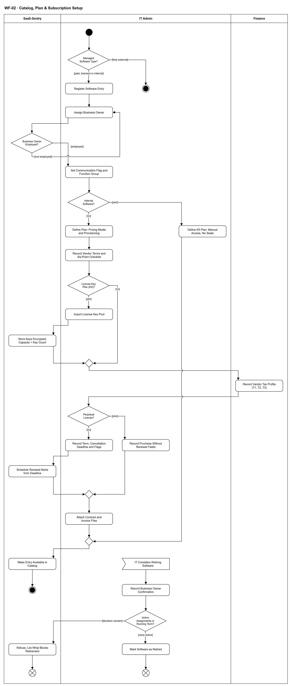

# WF-02 — Catalog, Plan & Subscription Setup

> **Loại:** Workflow hỗ trợ (SF-1) — khai báo danh mục, gói và thuê bao · **Phiên bản:** 3.2 — 10/10/2026 · **Trạng thái:** Vẽ lại 08/10/2026 theo QĐ-49a/b/c/h, QĐ-50a, FR-1.1–1.10, FR-2.10, FR-5.13, OI-05b; chờ Owner/GVHD review
>
> Sơ đồ là **dẫn xuất** từ quyết định Owner (`QĐ`) và BRD hiện hành; khi khác nhau, `QĐ` → BRD thắng. Quyết định trong sơ đồ là của Owner, **chưa** phải xác nhận của GVHD/hội đồng.

## 1. Mục đích và phạm vi

Đưa một phần mềm vào danh mục quản lý với đủ dữ liệu để các luồng sau chạy: Business Owner đang làm việc, gói có kiểu cấp và điều khoản, thuê bao có hạn chót báo hủy (để cảnh báo gia hạn) hoặc khoản mua vĩnh viễn không có kỳ; hồ sơ thuế của nhà cung cấp do Finance giữ.

**Phạm vi:** Ba loại đối tượng quản lý (loại bỏ phần mềm miễn phí bên ngoài); Business Owner; cờ liên lạc và nhóm chức năng; gói với mô hình giá, kiểu cấp K1–K5, điều khoản sáu điểm; kho khóa K4; hồ sơ thuế; thuê bao có kỳ hoặc khoản mua vĩnh viễn; tệp đính kèm; luồng phụ ngừng sử dụng ứng dụng.

**Không nằm trong sơ đồ này:** Quyết định có chi tiền và đưa phần mềm mới vào danh mục (→ `WF-10`, `MF-2`); hợp thức hóa phần mềm ngoài danh mục (→ `WF-17`); chi tiết cảnh báo gia hạn (→ `WF-15`); cấp seat và thu hồi (→ `WF-09a`). Import tệp danh mục làm ở lát sau S0 (QĐ-43e); nghiệp vụ không đổi.

## 2. Tệp

| Tệp | Vai trò |
| --- | --- |
| [WF-02-catalog-plan-subscription-setup.drawio](WF-02-catalog-plan-subscription-setup.drawio) | Nguồn draw.io chỉnh sửa được (sinh từ spec) |
| [WF-02-catalog-plan-subscription-setup.drawio.png](WF-02-catalog-plan-subscription-setup.drawio.png) | Bản xuất PNG, nhúng sẵn nguồn draw.io |
| [WF-02.json](../specs/WF-02.json) | **Nguồn canonical** — sửa ở đây rồi chạy `python tools/flowkit.py build` từ `Docs/Diagrams` |

## 3. Nguồn nghiệp vụ

| Mã | Nội dung dùng trong sơ đồ |
| --- | --- |
| `QĐ-49a, QĐ-49h, BRD 3.3` | Ba loại đối tượng; phần mềm miễn phí bên ngoài không thêm |
| `FR-1.1, QĐ-50a` | Khai báo mục danh mục; phần mềm nội bộ không bắt buộc nhà cung cấp, hợp đồng, thuê bao, hóa đơn |
| `FR-1.7, INV-06, OI-05c` | Business Owner đang làm việc, không để trống |
| `FR-1.8, OI-14e, ADR-10` | Cờ dịch vụ liên lạc; nhóm chức năng |
| `FR-1.2, FR-1.9, QĐ-54a` | Mô hình giá; kiểu cấp K1–K5, mức kiểm soát, lưu ý trước khi thu hồi |
| `FR-1.10, QĐ-54e` | Điều khoản và checklist sáu điểm |
| `FR-1.3, QĐ-49c, FR-1.4` | Trường thuê bao; license vĩnh viễn không có trường gia hạn; cảnh báo theo hạn chót |
| `FR-2.10, INV-01` | Kho khóa K4: mã hóa, che bớt, ghi audit mỗi lần xem; số khóa là sức chứa |
| `FR-1.5` | Tệp gốc qua signed URL |
| `FR-5.13` | Hồ sơ thuế nhà cung cấp do Finance khai |
| `OI-05b` | Ngừng sử dụng: IT ghi xác nhận của Business Owner |

## 4. Tác nhân, kích hoạt, điều kiện

| Làn (tiếng Anh trên hình) | Tác nhân | Trách nhiệm trong sơ đồ |
| --- | --- | --- |
| SaaS-Sentry | SaaS-Sentry | Kiểm Business Owner đang làm việc, lưu khóa mã hóa, đặt mốc cảnh báo, đưa mục vào danh mục |
| IT Admin | IT Admin | Khai báo mục danh mục, Business Owner, gói, điều khoản, thuê bao, kho khóa, tệp đính kèm; ghi xác nhận khi ngừng sử dụng |
| Finance | Finance | Giữ hồ sơ thuế của nhà cung cấp (T1/T2/T3) |

- **Kích hoạt:** IT Admin khai báo một phần mềm mới vào danh mục (hoặc cân nhắc ngừng sử dụng một phần mềm đã có — luồng phụ).
- **Tiền điều kiện:** Đã có dữ liệu nhân sự (để chỉ định Business Owner đang làm việc); với SaaS/phần mềm có bản quyền mới thì quyết định đưa vào danh mục đã có.
- **Hậu điều kiện:** Mục danh mục có Business Owner đang làm việc, cờ liên lạc, nhóm chức năng; với loại có trả phí còn có gói (kiểu cấp, điều khoản), hồ sơ thuế nhà cung cấp, thuê bao (hoặc khoản mua vĩnh viễn) và tệp đính kèm.

## 5. Cách đọc ký hiệu

| Ký hiệu | Nghĩa |
| --- | --- |
| Hình tròn đặc | Bắt đầu hoạt động (initial node) |
| Hình chữ nhật bo góc | Hành động (action) của tác nhân ở làn chứa nó |
| Hình thoi có chữ | Rẽ nhánh; mỗi cạnh ra mang điều kiện trong ngoặc vuông `[...]` |
| Hình thoi nhỏ không chữ | Hợp nhánh (merge) |
| Hình năm cạnh lõm | Chờ một sự kiện từ bên ngoài luồng (accept event) |
| Vòng tròn kép đặc | Kết thúc toàn bộ hoạt động (activity final) |
| Vòng tròn có dấu nhân | Kết thúc riêng nhánh đó, các nhánh khác vẫn chạy (flow final) |
| Dây có cung nhảy | Hai dây giao nhau nhưng **không** nối với nhau |

Phần mềm nội bộ rẽ ra sớm (không có gói, thuê bao, hóa đơn). Nhánh K4 thêm kho khóa. Nhánh vĩnh viễn bỏ các trường gia hạn và không đặt cảnh báo. Luồng phụ ngừng sử dụng có điểm khởi đầu riêng. Ngoại lệ biểu diễn: luồng phụ bắt đầu bằng sự kiện không có cạnh vào là một lần xử lý độc lập, kết thúc nhánh chính không hủy chúng — cách đọc nội bộ đã ghi ở [tools/README.md mục 7](../tools/README.md#7-ngoại-lệ-biểu-diễn-đã-chấp-nhận-ghi-10102026), không phải bằng chứng hình tuân thủ đầy đủ UML 2.5.

## 6. Bảng node

| ID | Loại | Nhãn trên hình | Ý nghĩa | Làn / người thực hiện | Quy tắc |
| --- | --- | --- | --- | --- | --- |
| `st` | Nút bắt đầu | — | — | IT Admin | — |
| `d_type` | Rẽ nhánh | Managed Software Type? | Loại đối tượng quản lý: SaaS có trả phí, phần mềm thương mại có bản quyền (có thể là license vĩnh viễn), phần mềm/dịch vụ nội bộ — hay phần mềm/SaaS miễn phí bên ngoài, loại này không phải đối tượng quản lý. | IT Admin | `QĐ-49a`, `QĐ-49h`, `FR-1.1`, `BRD 3.3` |
| `end_free` | Kết thúc hoạt động | — | Phần mềm/SaaS miễn phí bên ngoài không được thêm vào danh mục. | IT Admin | — |
| `a_reg` | Hành động | Register Software Entry | IT khai tên phần mềm, tên miền liên quan, mức nhạy cảm dữ liệu, trạng thái phê duyệt và nhà cung cấp. Với phần mềm nội bộ, nhà cung cấp, hợp đồng, thuê bao, hóa đơn không bắt buộc và không có bước Người duyệt chi; với SaaS/phần mềm có bản quyền, đưa vào danh mục là việc đã được Người duyệt chi quyết ở luồng yêu cầu hoặc hợp thức hóa. | IT Admin | `FR-1.1`, `QĐ-50a`, `QĐ-49b`, `ADR-05`, `FR-6.1` |
| `a_bo` | Hành động | Assign Business Owner | Mỗi mục danh mục (kể cả phần mềm nội bộ) bắt buộc có một Business Owner; đây là thuộc tính của ứng dụng, không phải vai trò đăng nhập và không có quyền cấp hay thu hồi seat. | IT Admin | `FR-1.7`, `BRD 4.4`, `QĐ-49b` |
| `d_bo` | Rẽ nhánh | Business Owner Employed? | Hệ thống kiểm người được chỉ định là nhân viên đang làm việc; không được để trống. | SaaS-Sentry | `FR-1.7`, `INV-06` |
| `a_flag` | Hành động | Set Communication Flag and Function Group | IT đặt cờ nhóm dịch vụ liên lạc (nhắn tin, họp, thư điện tử — xử lý dữ liệu chặt hơn theo ADR-10) và chọn nhóm chức năng từ danh sách IT duy trì, dùng để hiện công cụ tương tự và kiểm trùng chức năng. | IT Admin | `FR-1.8`, `FR-1.1`, `OI-14e`, `ADR-10` |
| `d_int` | Rẽ nhánh | Internal Software? | Phần mềm/dịch vụ nội bộ đi nhánh gói K5 (`a_k5`) rồi vào danh mục: không có gói trả phí, thuê bao, hóa đơn hay kiểm sức chứa seat; cấp quyền thủ công ngoài hệ thống kèm bằng chứng (QĐ-49b, QĐ-50a). Usage, G2–G4 và tiết kiệm cho phần mềm nội bộ ngoài MVP (QĐ-62o). | IT Admin | `QĐ-50a`, `FR-1.9`, `FR-2.3` |
| `a_k5` | Hành động | Define K5 Plan: Manual Access, No Seats | Phần mềm nội bộ vẫn có gói kiểu cấp K5 (cấp thủ công, ngoài hệ thống, có bằng chứng): không có mô hình giá, thuê bao, hóa đơn, thuế, kỳ gia hạn hay kiểm sức chứa seat; không có Người duyệt chi. | IT Admin | `QĐ-54a`, `QĐ-49b`, `QĐ-50a` |
| `a_plan` | Hành động | Define Plan: Pricing Model and Provisioning | IT khai gói: mô hình giá (per_seat, flat_rate, concurrent, consumption, per_host), kiểu cấp K1–K4, mức kiểm soát mặc định và lưu ý trước khi thu hồi (dữ liệu nào mất, cần chuyển gì). Kiểu cấp và điều khoản là thuộc tính của gói, không phải của ứng dụng. | IT Admin | `FR-1.2`, `FR-1.9`, `QĐ-54a`, `QĐ-53c` |
| `a_terms` | Hành động | Record Vendor Terms and Six-Point Checklist | IT lưu liên kết điều khoản, ngày rà soát gần nhất và checklist sáu điểm: chia sẻ tài khoản, dữ liệu huấn luyện AI, nơi lưu trữ, giới hạn cài đặt, mục đích thương mại, hủy/tự gia hạn/hoàn tiền. IT ghi điều đọc được, không diễn giải pháp lý. | IT Admin | `FR-1.10`, `QĐ-54e` |
| `d_k4` | Rẽ nhánh | License Key Plan (K4)? | Gói kiểu K4 cần kho khóa bản quyền; các kiểu khác không. | IT Admin | `FR-1.9`, `FR-2.10` |
| `a_keys` | Hành động | Import License Key Pool | IT import lô khóa của khoản mua; chỉ IT Admin xem đầy đủ khi cấp. | IT Admin | `FR-2.10`, `QĐ-54b` |
| `s_keys` | Hành động | Store Keys Encrypted; Capacity = Key Count | Khóa lưu mã hóa, hiển thị che bớt, mỗi lần xem đầy đủ ghi Audit Trail; số khóa trong kho là sức chứa của khoản mua. | SaaS-Sentry | `FR-2.10`, `INV-01`, `QĐ-54b` |
| `m_k` | Hợp nhánh | — | — | IT Admin | — |
| `a_tax` | Hành động | Record Vendor Tax Profile (T1, T2, T3) | Finance khai hồ sơ thuế của nhà cung cấp theo ai nộp thuế: T1 trong nước, T2 nước ngoài doanh nghiệp nộp thay (mặc định), T3 nước ngoài đã thu trên chứng từ; kèm tỷ lệ thuế ước tính và cờ được khấu trừ mặc định. Hệ thống ghi nhận thuế, không tính thuế. | Finance | `FR-5.13`, `QĐ-55a`, `QĐ-60a` |
| `d_perp` | Rẽ nhánh | Perpetual License? | License vĩnh viễn là khoản mua không có kỳ gia hạn. | IT Admin | `FR-1.3`, `QĐ-49c` |
| `a_perp` | Hành động | Record Purchase Without Renewal Fields | IT ghi số lượng đã mua, đơn giá, ngày mua. Ngày kết thúc, ngày gia hạn, hạn chót báo hủy và cờ tự gia hạn không áp dụng; không có cảnh báo gia hạn. | IT Admin | `FR-1.3`, `QĐ-49c` |
| `a_term` | Hành động | Record Term, Cancellation Deadline and Flags | IT ghi số seat đã mua, đơn giá, chu kỳ thanh toán, ngày bắt đầu và kết thúc, ngày gia hạn, hạn chót báo hủy, cờ tự động gia hạn và cờ cho phép giảm số lượng giữa kỳ. Ngày gia hạn thuộc thuê bao, không thuộc hợp đồng. | IT Admin | `FR-1.3`, `FR-1.6`, `ADR-06` |
| `s_alert` | Hành động | Schedule Renewal Alerts from Deadline | Hệ thống đặt mốc cảnh báo T-15 và T-7 tính từ hạn chót báo hủy. Thiếu hạn chót nhưng có số ngày báo trước thì suy ra và ghi chưa xác nhận; thiếu cả hai mà tự gia hạn thì cảnh báo chất lượng dữ liệu, không suy đoán (chi tiết ở WF-15). | SaaS-Sentry | `FR-1.4` |
| `m_s` | Hợp nhánh | — | — | IT Admin | — |
| `a_doc` | Hành động | Attach Contract and Invoice Files | IT đính kèm hợp đồng, hóa đơn gốc (PDF, ảnh); tệp không truy cập công khai, hệ thống phát signed URL có thời hạn; IT, Finance và Người duyệt chi (chỉ hồ sơ được giao quyết) được mở. | IT Admin | `FR-1.5`, `OI-08a`, `BM-05` |
| `m_pub` | Hợp nhánh | — | — | IT Admin | — |
| `s_pub` | Hành động | Make Entry Available in Catalog | Mục danh mục và gói có mặt để nhân viên chọn khi gửi yêu cầu; số seat trống là giá trị tính ra, gói không theo đầu người thì bộ đếm seat hiện n/a. | SaaS-Sentry | `FR-1.1`, `FR-1.2`, `ADR-02` |
| `end` | Kết thúc hoạt động | — | Mục danh mục, gói và thuê bao đã sẵn sàng. | SaaS-Sentry | — |
| `e_ret` | Chờ sự kiện | IT Considers Retiring Software | IT cân nhắc chuyển một ứng dụng sang trạng thái ngừng sử dụng (luồng phụ). | IT Admin | `OI-05b` |
| `a_ret` | Hành động | Record Business Owner Confirmation | IT ghi xác nhận của Business Owner khi chuyển trạng thái; Business Owner chỉ xác nhận, không thu hồi seat. | IT Admin | `OI-05b`, `BRD 4.4`, `SoD-5` |
| `d_blk` | Rẽ nhánh | Active Assignments or Running Term? | Ứng dụng còn Assignment đang hiệu lực, hoặc thuê bao chưa hủy/chưa hết hạn không. | IT Admin | `FR-1.1`, `QĐ-62n` |
| `s_blk` | Hành động | Refuse; List What Blocks Retirement | Chưa cho ngừng dùng (có thể ghi *đang ngừng*): hệ thống liệt kê Assignment còn hiệu lực và thuê bao còn kỳ để IT thu hồi (WF-09a) hoặc hủy/để hết hạn trước. Không tự tạo việc thu hồi (QĐ-62n). | SaaS-Sentry | `QĐ-62n` |
| `ff_blk` | Kết thúc nhánh (flow final) | — | Ứng dụng chưa được ngừng; IT quay lại khi đã dọn xong. | SaaS-Sentry | — |
| `a_stat` | Hành động | Mark Software as Retired | IT chuyển trạng thái ứng dụng sang ngừng sử dụng khi đã có xác nhận và không còn quyền hay thuê bao nào đang chạy. | IT Admin | `FR-1.1`, `OI-05b`, `QĐ-62n` |
| `ff_ret` | Kết thúc nhánh (flow final) | — | Nhánh ngừng sử dụng kết thúc. | IT Admin | — |

## 7. Bảng chuyển tiếp

| Từ → tới | Nhãn điều kiện | Điều kiện | Kết quả |
| --- | --- | --- | --- |
| `st` → `d_type` | — | — | Sang Managed Software Type? |
| `d_type` → `end_free` | `[free external]` | Phần mềm/SaaS miễn phí bên ngoài | Không thêm vào danh mục |
| `d_type` → `a_reg` | `[paid, licensed or internal]` | SaaS có trả phí, phần mềm có bản quyền hoặc phần mềm nội bộ | Khai báo mục danh mục |
| `a_reg` → `a_bo` | — | — | Sang Assign Business Owner |
| `a_bo` → `d_bo` | — | — | Sang Business Owner Employed? |
| `d_bo` → `a_flag` | `[employed]` | Người được chỉ định đang làm việc | Tiếp tục |
| `d_bo` → `a_bo` | `[not employed]` | Người được chỉ định đã nghỉ hoặc để trống | Chỉ định lại |
| `a_flag` → `d_int` | — | — | Sang Internal Software? |
| `d_int` → `a_k5` | `[yes]` | Phần mềm nội bộ | Khai gói K5, bỏ qua giá/thuế/gia hạn |
| `d_int` → `a_plan` | `[no]` | SaaS có trả phí hoặc phần mềm có bản quyền | Khai báo gói |
| `a_plan` → `a_terms` | — | — | Sang Record Vendor Terms and Six-Point Checklist |
| `a_terms` → `d_k4` | — | — | Sang License Key Plan (K4)? |
| `d_k4` → `a_keys` | `[yes]` | Gói kiểu K4 | Import kho khóa |
| `d_k4` → `m_k` | `[no]` | Kiểu cấp khác | Tiếp tục |
| `a_keys` → `s_keys` | — | — | Sang Store Keys Encrypted; Capacity = Key Count |
| `s_keys` → `m_k` | — | — | Sang — |
| `m_k` → `a_tax` | — | — | Sang Record Vendor Tax Profile (T1, T2, T3) |
| `a_tax` → `d_perp` | — | — | Sang Perpetual License? |
| `d_perp` → `a_perp` | `[yes]` | License vĩnh viễn | Không có trường gia hạn |
| `d_perp` → `a_term` | `[no]` | Khoản mua có kỳ | Ghi kỳ và hạn chót báo hủy |
| `a_term` → `s_alert` | — | — | Sang Schedule Renewal Alerts from Deadline |
| `s_alert` → `m_s` | — | — | Sang — |
| `a_perp` → `m_s` | — | — | Sang — |
| `m_s` → `a_doc` | — | — | Sang Attach Contract and Invoice Files |
| `a_doc` → `m_pub` | — | — | Sang — |
| `s_pub` → `end` | — | — | Sang — |
| `e_ret` → `a_ret` | — | — | Sang Record Business Owner Confirmation |
| `a_ret` → `d_blk` | — | — | Sang Active Assignments or Running Term? |
| `d_blk` → `a_stat` | `[none active]` | Không còn Assignment hiệu lực, thuê bao đã hủy hoặc hết hạn | Sang Mark Software as Retired |
| `d_blk` → `s_blk` | `[blockers remain]` | Còn Assignment hoặc thuê bao đang chạy | Từ chối, liệt kê thứ đang chặn |
| `s_blk` → `ff_blk` | — | — | Sang — |
| `a_stat` → `ff_ret` | — | — | Sang — |
| `a_k5` → `m_pub` | — | — | Sang — |
| `m_pub` → `s_pub` | — | — | Sang Make Entry Available in Catalog |

Số đếm: **32 node · 34 cạnh · 6 rẽ nhánh**; giao cắt dây: **3**.

## 8. Happy path

1. `st` — —
2. `d_type` — Managed Software Type?: Loại đối tượng quản lý: SaaS có trả phí, phần mềm thương mại có bản quyền (có thể là license vĩnh viễn), phần mềm/dịch vụ nội bộ — hay phần mềm/SaaS miễn phí bên ngoài, loại này không phải đối tượng quản lý.
3. `a_reg` — Register Software Entry: IT khai tên phần mềm, tên miền liên quan, mức nhạy cảm dữ liệu, trạng thái phê duyệt và nhà cung cấp. Với phần mềm nội bộ, nhà cung cấp, hợp đồng, thuê bao, hóa đơn không bắt buộc và không có bước Người duyệt chi; với SaaS/phần mềm có bản quyền, đưa vào danh mục là việc đã được Người duyệt chi quyết ở luồng yêu cầu hoặc hợp thức hóa.
4. `a_bo` — Assign Business Owner: Mỗi mục danh mục (kể cả phần mềm nội bộ) bắt buộc có một Business Owner; đây là thuộc tính của ứng dụng, không phải vai trò đăng nhập và không có quyền cấp hay thu hồi seat.
5. `d_bo` — Business Owner Employed?: Hệ thống kiểm người được chỉ định là nhân viên đang làm việc; không được để trống.
6. `a_flag` — Set Communication Flag and Function Group: IT đặt cờ nhóm dịch vụ liên lạc (nhắn tin, họp, thư điện tử — xử lý dữ liệu chặt hơn theo ADR-10) và chọn nhóm chức năng từ danh sách IT duy trì, dùng để hiện công cụ tương tự và kiểm trùng chức năng.
7. `d_int` — Internal Software?: Phần mềm/dịch vụ nội bộ đi nhánh gói K5 (`a_k5`) rồi vào danh mục: không có gói trả phí, thuê bao, hóa đơn hay kiểm sức chứa seat; cấp quyền thủ công ngoài hệ thống kèm bằng chứng (QĐ-49b, QĐ-50a). Usage, G2–G4 và tiết kiệm cho phần mềm nội bộ ngoài MVP (QĐ-62o).
8. `a_plan` — Define Plan: Pricing Model and Provisioning: IT khai gói: mô hình giá (per_seat, flat_rate, concurrent, consumption, per_host), kiểu cấp K1–K4, mức kiểm soát mặc định và lưu ý trước khi thu hồi (dữ liệu nào mất, cần chuyển gì). Kiểu cấp và điều khoản là thuộc tính của gói, không phải của ứng dụng.
9. `a_terms` — Record Vendor Terms and Six-Point Checklist: IT lưu liên kết điều khoản, ngày rà soát gần nhất và checklist sáu điểm: chia sẻ tài khoản, dữ liệu huấn luyện AI, nơi lưu trữ, giới hạn cài đặt, mục đích thương mại, hủy/tự gia hạn/hoàn tiền. IT ghi điều đọc được, không diễn giải pháp lý.
10. `d_k4` — License Key Plan (K4)?: Gói kiểu K4 cần kho khóa bản quyền; các kiểu khác không.
11. `a_tax` — Record Vendor Tax Profile (T1, T2, T3): Finance khai hồ sơ thuế của nhà cung cấp theo ai nộp thuế: T1 trong nước, T2 nước ngoài doanh nghiệp nộp thay (mặc định), T3 nước ngoài đã thu trên chứng từ; kèm tỷ lệ thuế ước tính và cờ được khấu trừ mặc định. Hệ thống ghi nhận thuế, không tính thuế.
12. `d_perp` — Perpetual License?: License vĩnh viễn là khoản mua không có kỳ gia hạn.
13. `a_term` — Record Term, Cancellation Deadline and Flags: IT ghi số seat đã mua, đơn giá, chu kỳ thanh toán, ngày bắt đầu và kết thúc, ngày gia hạn, hạn chót báo hủy, cờ tự động gia hạn và cờ cho phép giảm số lượng giữa kỳ. Ngày gia hạn thuộc thuê bao, không thuộc hợp đồng.
14. `s_alert` — Schedule Renewal Alerts from Deadline: Hệ thống đặt mốc cảnh báo T-15 và T-7 tính từ hạn chót báo hủy. Thiếu hạn chót nhưng có số ngày báo trước thì suy ra và ghi chưa xác nhận; thiếu cả hai mà tự gia hạn thì cảnh báo chất lượng dữ liệu, không suy đoán (chi tiết ở WF-15).
15. `a_doc` — Attach Contract and Invoice Files: IT đính kèm hợp đồng, hóa đơn gốc (PDF, ảnh); tệp không truy cập công khai, hệ thống phát signed URL có thời hạn; IT, Finance và Người duyệt chi (chỉ hồ sơ được giao quyết) được mở.
16. `s_pub` — Make Entry Available in Catalog: Mục danh mục và gói có mặt để nhân viên chọn khi gửi yêu cầu; số seat trống là giá trị tính ra, gói không theo đầu người thì bộ đếm seat hiện n/a.
17. `end` — —: Mục danh mục, gói và thuê bao đã sẵn sàng.

## 9. Nhánh thay thế / if-else

- **Phần mềm nội bộ** — `d_int` → `a_k5` → `m_pub` → `s_pub`. Gói K5 cấp thủ công; không có thuê bao, hóa đơn, thuế, gia hạn hay kiểm sức chứa seat; vẫn có mặt trong danh mục.
- **Gói K4 có kho khóa** — `d_k4` → `a_keys` → `s_keys` → `m_k`. Khóa lưu mã hóa; số khóa là sức chứa.
- **License vĩnh viễn** — `d_perp` → `a_perp` → `m_s`. Không có trường gia hạn và không có cảnh báo gia hạn.
- **Ngừng sử dụng ứng dụng** — `e_ret` → `a_ret` → `d_blk` → `a_stat` → `ff_ret`. Luồng phụ: IT ghi xác nhận của Business Owner.
- **Ngừng dùng bị chặn** — `e_ret` → `a_ret` → `d_blk` → `s_blk` → `ff_blk`. Còn quyền hoặc thuê bao đang chạy: hệ thống liệt kê thứ đang chặn (QĐ-62n).

## 10. Nhánh lỗi / từ chối và cách kết thúc

- **Phần mềm miễn phí bên ngoài** — `d_type` → `end_free`. Không phải đối tượng quản lý.
- **Business Owner đã nghỉ hoặc để trống** — `d_bo` → `a_bo`. Quay lại chỉ định người đang làm việc.

## 11. Liên hệ với sơ đồ khác

- Được gọi từ `WF-01` (bước 2 và 3 của khởi tạo); `WF-10` và `WF-17` khi đưa phần mềm mới hoặc hợp thức hóa vào danh mục
- `WF-15` — cảnh báo gia hạn dùng hạn chót báo hủy và cờ tự gia hạn đã nhập
- `WF-09a` — cấp và thu hồi seat dùng kiểu cấp và lưu ý của gói
- Nhóm SF-1; User flow liên quan: `UF-20`

## 12. Giới hạn và vấn đề còn mở

- (LATER-TECH/UI · DOI-83) Hồ sơ thuế nhà cung cấp do Finance khai (FR-5.13); chưa có hồ sơ thì dùng mặc định theo QĐ-60b, đánh dấu *ước tính* — thứ tự nhập so với thuê bao chốt ở thiết kế.
- (ĐÃ CHỐT · DOI-85, QĐ-62n) Ngừng dùng ứng dụng bị chặn tới khi mọi Assignment đã thu hồi và thuê bao đã hủy/hết hạn; hệ thống liệt kê thứ đang chặn.
- (LIMIT · DOI-86, ADR-10, FR-1.8) Chế độ xử lý dữ liệu và việc bật thu thập usage cho nhóm ứng dụng liên lạc không vẽ ở đây ngoài cờ liên lạc.
