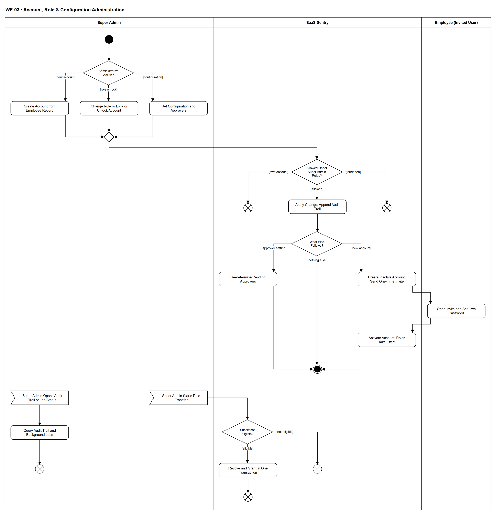

# WF-03 — Account, Role & Configuration Administration

> **Loại:** Workflow hỗ trợ (SF-2) — quản trị tài khoản, vai trò và cấu hình · **Phiên bản:** 3.2 — 10/10/2026 · **Trạng thái:** Vẽ lại 08/10/2026 theo FR-8.1–8.11, QĐ-39, QĐ-44, QĐ-46, QĐ-47, OI-08c, OI-11b, OI-17; chờ Owner/GVHD review
>
> Sơ đồ là **dẫn xuất** từ quyết định Owner (`QĐ`) và BRD hiện hành; khi khác nhau, `QĐ` → BRD thắng. Quyết định trong sơ đồ là của Owner, **chưa** phải xác nhận của GVHD/hội đồng.

## 1. Mục đích và phạm vi

Mô tả cách Super Admin quản lý tài khoản, vai trò và tham số hệ thống **mà vẫn không có đường vượt SoD**: tài khoản chỉ tạo từ hồ sơ nhân viên và kích hoạt qua lời mời dùng một lần (người dùng tự đặt mật khẩu), mọi thay đổi qua cổng quy tắc và ghi Audit Trail chỉ-ghi-thêm, cấu hình không phải phê duyệt.

**Phạm vi:** Tạo tài khoản và kích hoạt; đổi vai, khóa/mở khóa; cấu hình tham số và người duyệt kèm xác định lại bước đang chờ; chuyển giao vai Super Admin; tra cứu Audit Trail và trạng thái tác vụ nền.

**Không nằm trong sơ đồ này:** Quên/đặt lại/đổi mật khẩu (tự phục vụ của người dùng, `FR-8.11`). Khôi phục ngoài ứng dụng do người vận hành hạ tầng thực hiện theo phiếu phê duyệt bằng văn bản (`FR-8.10(d)`) — nằm ngoài ứng dụng nên không vẽ thành nút; chỉ ghi chú ở đây. Gán seat, duyệt yêu cầu (không thuộc Super Admin, `SoD-1`).

## 2. Tệp

| Tệp | Vai trò |
| --- | --- |
| [WF-03-account-role-configuration-administration.drawio](WF-03-account-role-configuration-administration.drawio) | Nguồn draw.io chỉnh sửa được (sinh từ spec) |
| [WF-03-account-role-configuration-administration.drawio.png](WF-03-account-role-configuration-administration.drawio.png) | Bản xuất PNG, nhúng sẵn nguồn draw.io |
| [WF-03.json](../specs/WF-03.json) | **Nguồn canonical** — sửa ở đây rồi chạy `python tools/flowkit.py build` từ `Docs/Diagrams` |

## 3. Nguồn nghiệp vụ

| Mã | Nội dung dùng trong sơ đồ |
| --- | --- |
| `FR-8.1, QĐ-47c` | Quản lý tài khoản và vai; không có vai trực tiếp vẫn hợp lệ; vai hiệu lực = trực tiếp ∪ suy ra |
| `FR-8.2, OI-11b, FR-3.16` | Tham số cấu hình; đổi người duyệt kích hoạt xác định lại; kỳ ngân sách đặt một lần |
| `FR-8.3, OI-08c, FR-8.4` | Audit Trail chỉ ghi thêm, chỉ Super Admin tra cứu; trạng thái tác vụ nền |
| `FR-8.6, FR-8.11, QĐ-46, QĐ-47` | Tạo từ hồ sơ nhân viên; kích hoạt qua lời mời dùng một lần; không ai thấy mật khẩu; vai chưa hiệu lực tới khi kích hoạt |
| `FR-8.7, SoD-1` | Super Admin không kiêm vai nghiệp vụ, không làm trưởng phòng hay người duyệt |
| `FR-8.8, QĐ-39c` | Không ai tự đổi vai, khóa/mở hay kích hoạt tài khoản của mình |
| `FR-8.10, QĐ-44` | Đúng một Super Admin; đổi người giữ vai chỉ qua chuyển giao một giao dịch |
| `FR-3.15, OI-17` | Người thay thế không trùng Người duyệt chi |

## 4. Tác nhân, kích hoạt, điều kiện

| Làn (tiếng Anh trên hình) | Tác nhân | Trách nhiệm trong sơ đồ |
| --- | --- | --- |
| Super Admin | Super Admin | Chọn việc quản trị, cấu hình, chuyển giao vai, tra cứu Audit Trail |
| SaaS-Sentry | SaaS-Sentry | Kiểm quy tắc SoD, ghi thay đổi và Audit Trail, gửi lời mời, kích hoạt, xác định lại người duyệt |
| Employee (Invited User) | Người dùng được mời | Mở lời mời và tự đặt mật khẩu của mình |

- **Kích hoạt:** Super Admin cần tạo tài khoản, đổi vai/khóa, cấu hình hoặc xem nhật ký (liên tục theo nhu cầu).
- **Tiền điều kiện:** Người thao tác giữ vai Super Admin dùng được (đúng một Super Admin cho mỗi tổ chức); hồ sơ nhân viên đã có khi tạo tài khoản.
- **Hậu điều kiện:** Thay đổi đã áp dụng và có dòng Audit Trail; hoặc thao tác bị từ chối do tài khoản của chính mình hay vi phạm ranh giới vai; tài khoản mới chỉ dùng được sau khi kích hoạt.

## 5. Cách đọc ký hiệu

| Ký hiệu | Nghĩa |
| --- | --- |
| Hình tròn đặc | Bắt đầu hoạt động (initial node) |
| Hình chữ nhật bo góc | Hành động (action) của tác nhân ở làn chứa nó |
| Hình thoi có chữ | Rẽ nhánh; mỗi cạnh ra mang điều kiện trong ngoặc vuông `[...]` |
| Hình thoi nhỏ không chữ | Hợp nhánh (merge) |
| Hình năm cạnh lõm | Chờ một sự kiện từ bên ngoài luồng (accept event) |
| Vòng tròn kép đặc | Kết thúc toàn bộ hoạt động (activity final) |
| Vòng tròn có dấu nhân | Kết thúc riêng nhánh đó, các nhánh khác vẫn chạy (flow final) |
| Dây có cung nhảy | Hai dây giao nhau nhưng **không** nối với nhau |

Ba việc quản trị hội tụ vào cổng quy tắc duy nhất. Qua cổng, hệ thống ghi thay đổi cùng Audit Trail rồi mới rẽ theo hệ quả (lời mời, xác định lại người duyệt). Hai luồng phụ có khởi đầu riêng: chuyển giao vai Super Admin trong một giao dịch và tra cứu Audit Trail. Khôi phục ngoài ứng dụng: xem mục Ngoài sơ đồ. Ngoại lệ biểu diễn: luồng phụ bắt đầu bằng sự kiện không có cạnh vào là một lần xử lý độc lập, kết thúc nhánh chính không hủy chúng — cách đọc nội bộ đã ghi ở [tools/README.md mục 7](../tools/README.md#7-ngoại-lệ-biểu-diễn-đã-chấp-nhận-ghi-10102026), không phải bằng chứng hình tuân thủ đầy đủ UML 2.5.

## 6. Bảng node

| ID | Loại | Nhãn trên hình | Ý nghĩa | Làn / người thực hiện | Quy tắc |
| --- | --- | --- | --- | --- | --- |
| `st` | Nút bắt đầu | — | — | Super Admin | — |
| `d_act` | Rẽ nhánh | Administrative Action? | Super Admin chọn việc: tạo tài khoản, đổi vai/khóa-mở tài khoản, hoặc cấu hình tham số. Cả ba là đường hợp lệ ngang nhau; cấu hình không phải phê duyệt (SoD-1). | Super Admin | `FR-8.1`, `FR-8.2`, `SoD-1` |
| `a_acct` | Hành động | Create Account from Employee Record | Tài khoản chỉ tạo được từ một hồ sơ nhân viên đã có; không tự đăng ký công khai, không tạo tài khoản khi đăng nhập, không lấy vai từ email hay tên miền. Super Admin không đặt mật khẩu và không thấy mật khẩu. | Super Admin | `FR-8.6`, `FR-8.11`, `QĐ-46`, `QĐ-47` |
| `a_role` | Hành động | Change Role or Lock or Unlock Account | Gán/thu hồi vai trực tiếp (tài khoản được phép không có vai nào, hệ thống không tự thêm vai), khóa/mở khóa tài khoản, hoặc gửi lại lời mời. Vai hiệu lực = vai trực tiếp cộng vai suy ra hợp lệ (Manager từ trưởng phòng, Người duyệt chi). | Super Admin | `FR-8.1`, `QĐ-47c`, `FR-8.9` |
| `a_cfg` | Hành động | Set Configuration and Approvers | Cấu hình ngưỡng cảnh báo, ngưỡng phát hiện, SLA phê duyệt, chính sách lưu giữ, kỳ ngân sách (đặt một lần), Người duyệt chi, người thay thế khi xung đột, approver dự phòng ở gốc, ngưỡng backlog, nội dung thông báo theo dõi có phiên bản, số ngày hạn rà soát sau điều chuyển. | Super Admin | `FR-8.2`, `OI-11b`, `FR-3.6`, `FR-3.13`, `FR-3.15` |
| `m_req` | Hợp nhánh | — | — | Super Admin | — |
| `d_gate` | Rẽ nhánh | Allowed Under Super Admin Rules? | Cổng SoD của hệ thống: không ai đổi vai, khóa/mở hay kích hoạt tài khoản của chính mình; Super Admin không giữ IT_ADMIN, FINANCE hay vai duyệt, không làm trưởng phòng, không là Người duyệt chi/người thay thế/approver dự phòng; người thay thế không trùng Người duyệt chi; vai Super Admin thứ hai bị từ chối. | SaaS-Sentry | `FR-8.7`, `FR-8.8`, `FR-8.10`, `FR-3.15`, `OI-17`, `SoD-1` |
| `ff_self` | Kết thúc nhánh (flow final) | — | Thao tác trên tài khoản của chính mình bị từ chối; hệ thống vẫn chạy bình thường. | SaaS-Sentry | — |
| `ff_sod` | Kết thúc nhánh (flow final) | — | Thao tác vi phạm ranh giới vai trò bị từ chối. | SaaS-Sentry | — |
| `s_apply` | Hành động | Apply Change; Append Audit Trail | Ghi thay đổi và một dòng Audit Trail (người thực hiện, vai, hành động, đối tượng, giá trị trước/sau); nhật ký chỉ ghi thêm, không sửa, không xóa. Cấu hình mới áp cho yêu cầu tạo từ lúc này, không hồi tố; không bao giờ ghi mật khẩu hay mã lời mời. | SaaS-Sentry | `FR-8.3`, `FR-8.6`, `OI-08c` |
| `d_post` | Rẽ nhánh | What Else Follows? | Hệ quả đi kèm: tài khoản mới cần lời mời kích hoạt; đổi người duyệt phải xác định lại bước đang chờ; các thay đổi khác kết thúc tại đây. | SaaS-Sentry | `FR-8.6`, `FR-3.16` |
| `s_redet` | Hành động | Re-determine Pending Approvers | Chạy lại quy tắc định tuyến cho các bước đang chờ khi đổi Người duyệt chi, người thay thế hoặc approver dự phòng; chỉ người cụ thể giữ bước đổi, nhánh và chuỗi bước đã chốt giữ nguyên; đồng hồ SLA không đặt lại; Audit Trail ghi người cũ, người mới. | SaaS-Sentry | `FR-3.16`, `FR-8.2`, `QĐ-28d` |
| `s_inv` | Hành động | Create Inactive Account; Send One-Time Invite | Tài khoản ở trạng thái chưa kích hoạt; vai gán được lưu nhưng chưa có hiệu lực; lời mời dùng một lần gửi tới email đăng nhập, gửi lại làm vô hiệu lời mời cũ. | SaaS-Sentry | `FR-8.6`, `FR-8.11`, `FR-3.11` |
| `a_set` | Hành động | Open Invite and Set Own Password | Người dùng nhận lời mời và tự đặt mật khẩu của mình; không ai (kể cả Super Admin, IT Admin, người vận hành) thấy hay biết mật khẩu; hệ thống chỉ lưu dạng băm. | Employee (Invited User) | `FR-8.11`, `FR-8.6`, `QĐ-46a` |
| `s_act` | Hành động | Activate Account; Roles Take Effect | Hệ thống kích hoạt tài khoản và ghi Audit Trail; từ lúc này các vai đã lưu mới có hiệu lực. Kích hoạt bằng lời mời không bao giờ tự cấp vai. | SaaS-Sentry | `FR-8.6`, `FR-8.11` |
| `end` | Kết thúc hoạt động | — | Thay đổi quản trị đã được ghi vết và áp dụng. | SaaS-Sentry | — |
| `e_xf` | Chờ sự kiện | Super Admin Starts Role Transfer | Super Admin đang giữ vai và dùng được chọn một người kế nhiệm; đây là cách duy nhất đổi người giữ vai trong ứng dụng. | Super Admin | `FR-8.10`, `QĐ-44a` |
| `d_succ` | Rẽ nhánh | Successor Eligible? | Người kế nhiệm phải có tài khoản hoạt động và đã kích hoạt, nhân viên đang làm việc, nguồn xác minh email hợp lệ, không giữ IT_ADMIN, FINANCE hay vai duyệt. | SaaS-Sentry | `FR-8.10`, `FR-8.7` |
| `ff_rej` | Kết thúc nhánh (flow final) | — | Chuyển giao bị từ chối; người đang giữ vai vẫn giữ nguyên. | SaaS-Sentry | — |
| `s_xf` | Hành động | Revoke and Grant in One Transaction | Thu hồi vai người cũ và cấp vai người mới trong một giao dịch; lỗi thì hoàn tác toàn bộ; quyền người cũ đánh giá lại ở thao tác kế tiếp; Audit Trail ghi cả hai tài khoản. Đây là ngoại lệ có kiểm soát duy nhất của quy tắc không tự đổi vai của mình. | SaaS-Sentry | `FR-8.10`, `FR-8.8`, `QĐ-44e` |
| `ff_xf` | Kết thúc nhánh (flow final) | — | Chuyển giao hoàn tất; vẫn đúng một Super Admin. | SaaS-Sentry | — |
| `e_aud` | Chờ sự kiện | Super Admin Opens Audit Trail or Job Status | Chỉ Super Admin tra cứu Audit Trail; vai khác chỉ thấy lịch sử đối tượng trong phạm vi của mình. | Super Admin | `FR-8.3`, `FR-8.4`, `OI-08c` |
| `a_aud` | Hành động | Query Audit Trail and Background Jobs | Super Admin xem Audit Trail chỉ ghi thêm và trạng thái tác vụ nền (lần chạy gần nhất, kết quả, số bản ghi, lỗi); việc xem không thay đổi dữ liệu nghiệp vụ. | Super Admin | `FR-8.3`, `FR-8.4` |
| `ff_aud` | Kết thúc nhánh (flow final) | — | Tra cứu kết thúc; không thay đổi dữ liệu. | Super Admin | — |

## 7. Bảng chuyển tiếp

| Từ → tới | Nhãn điều kiện | Điều kiện | Kết quả |
| --- | --- | --- | --- |
| `st` → `d_act` | — | — | Sang Administrative Action? |
| `d_act` → `a_acct` | `[new account]` | Tạo tài khoản từ hồ sơ nhân viên | Tạo tài khoản |
| `d_act` → `a_role` | `[role or lock]` | Đổi vai hoặc khóa/mở khóa | Đổi vai hoặc khóa |
| `d_act` → `a_cfg` | `[configuration]` | Cấu hình tham số hoặc người duyệt | Cấu hình |
| `a_acct` → `m_req` | — | — | Sang — |
| `a_role` → `m_req` | — | — | Sang — |
| `a_cfg` → `m_req` | — | — | Sang — |
| `m_req` → `d_gate` | — | — | Sang Allowed Under Super Admin Rules? |
| `d_gate` → `ff_self` | `[own account]` | Tài khoản của chính người thao tác | Từ chối |
| `d_gate` → `s_apply` | `[allowed]` | Trong phạm vi Super Admin | Ghi thay đổi và Audit Trail |
| `d_gate` → `ff_sod` | `[forbidden]` | Vi phạm ranh giới vai trò hoặc cấu hình không hợp lệ | Từ chối |
| `s_apply` → `d_post` | — | — | Sang What Else Follows? |
| `d_post` → `s_redet` | `[approver setting]` | Đổi người duyệt, người thay thế hoặc approver dự phòng | Xác định lại bước đang chờ |
| `d_post` → `s_inv` | `[new account]` | Tài khoản vừa tạo | Gửi lời mời |
| `d_post` → `end` | `[nothing else]` | Không có hệ quả đi kèm | Kết thúc |
| `s_redet` → `end` | — | — | Sang — |
| `s_inv` → `a_set` | — | — | Sang Open Invite and Set Own Password |
| `a_set` → `s_act` | — | — | Sang Activate Account; Roles Take Effect |
| `s_act` → `end` | — | — | Sang — |
| `e_xf` → `d_succ` | — | — | Sang Successor Eligible? |
| `d_succ` → `s_xf` | `[eligible]` | Đủ điều kiện kế nhiệm | Chuyển giao |
| `d_succ` → `ff_rej` | `[not eligible]` | Không đủ điều kiện | Từ chối |
| `s_xf` → `ff_xf` | — | — | Sang — |
| `e_aud` → `a_aud` | — | — | Sang Query Audit Trail and Background Jobs |
| `a_aud` → `ff_aud` | — | — | Sang — |

Số đếm: **24 node · 25 cạnh · 4 rẽ nhánh**; giao cắt dây: **0**.

## 8. Happy path

1. `st` — —
2. `d_act` — Administrative Action?: Super Admin chọn việc: tạo tài khoản, đổi vai/khóa-mở tài khoản, hoặc cấu hình tham số. Cả ba là đường hợp lệ ngang nhau; cấu hình không phải phê duyệt (SoD-1).
3. `a_acct` — Create Account from Employee Record: Tài khoản chỉ tạo được từ một hồ sơ nhân viên đã có; không tự đăng ký công khai, không tạo tài khoản khi đăng nhập, không lấy vai từ email hay tên miền. Super Admin không đặt mật khẩu và không thấy mật khẩu.
4. `d_gate` — Allowed Under Super Admin Rules?: Cổng SoD của hệ thống: không ai đổi vai, khóa/mở hay kích hoạt tài khoản của chính mình; Super Admin không giữ IT_ADMIN, FINANCE hay vai duyệt, không làm trưởng phòng, không là Người duyệt chi/người thay thế/approver dự phòng; người thay thế không trùng Người duyệt chi; vai Super Admin thứ hai bị từ chối.
5. `s_apply` — Apply Change; Append Audit Trail: Ghi thay đổi và một dòng Audit Trail (người thực hiện, vai, hành động, đối tượng, giá trị trước/sau); nhật ký chỉ ghi thêm, không sửa, không xóa. Cấu hình mới áp cho yêu cầu tạo từ lúc này, không hồi tố; không bao giờ ghi mật khẩu hay mã lời mời.
6. `d_post` — What Else Follows?: Hệ quả đi kèm: tài khoản mới cần lời mời kích hoạt; đổi người duyệt phải xác định lại bước đang chờ; các thay đổi khác kết thúc tại đây.
7. `s_inv` — Create Inactive Account; Send One-Time Invite: Tài khoản ở trạng thái chưa kích hoạt; vai gán được lưu nhưng chưa có hiệu lực; lời mời dùng một lần gửi tới email đăng nhập, gửi lại làm vô hiệu lời mời cũ.
8. `a_set` — Open Invite and Set Own Password: Người dùng nhận lời mời và tự đặt mật khẩu của mình; không ai (kể cả Super Admin, IT Admin, người vận hành) thấy hay biết mật khẩu; hệ thống chỉ lưu dạng băm.
9. `s_act` — Activate Account; Roles Take Effect: Hệ thống kích hoạt tài khoản và ghi Audit Trail; từ lúc này các vai đã lưu mới có hiệu lực. Kích hoạt bằng lời mời không bao giờ tự cấp vai.
10. `end` — —: Thay đổi quản trị đã được ghi vết và áp dụng.

## 9. Nhánh thay thế / if-else

- **Đổi vai hoặc khóa/mở khóa** — `d_act` → `a_role` → `m_req` → `d_gate` → `s_apply` → `d_post` → `end`. Vai chỉ có hiệu lực khi tài khoản đã kích hoạt.
- **Cấu hình tham số và người duyệt** — `d_act` → `a_cfg` → `m_req` → `d_gate` → `s_apply` → `d_post` → `s_redet` → `end`. Đổi người duyệt xác định lại bước đang chờ; cấu hình không phải phê duyệt.
- **Chuyển giao vai Super Admin** — `e_xf` → `d_succ` → `s_xf` → `ff_xf`. Một giao dịch; vẫn đúng một Super Admin.
- **Tra cứu Audit Trail** — `e_aud` → `a_aud` → `ff_aud`. Chỉ Super Admin; không đổi dữ liệu.

## 10. Nhánh lỗi / từ chối và cách kết thúc

- **Tác động lên tài khoản của chính mình** — `d_gate` → `ff_self`. Bị từ chối.
- **Vi phạm ranh giới vai trò** — `d_gate` → `ff_sod`. Ví dụ giữ IT_ADMIN/FINANCE, vai Super Admin thứ hai, người thay thế trùng Người duyệt chi.
- **Người kế nhiệm không đủ điều kiện** — `d_succ` → `ff_rej`. Giữ nguyên người đang giữ vai.

## 11. Liên hệ với sơ đồ khác

- Được gọi từ `WF-01` (cấu hình người duyệt khi khởi tạo)
- `WF-09` — bước duyệt được gán theo người duyệt đã cấu hình; `WF-15` — người nhận cảnh báo gia hạn
- Nhóm SF-2; User flow: `UF-13`, `UF-17`

## 12. Giới hạn và vấn đề còn mở

- (LIMIT · DOI-87, FR-8.10(d), QĐ-47a) Khôi phục ngoài ứng dụng do người vận hành hạ tầng thực hiện theo phiếu phê duyệt bằng văn bản (mở khóa, chuyển lại vai, khôi phục thông tin đăng nhập); không có đường HTTP nên không vẽ thành nút.
- (LATER-TECH/UI · DOI-88) *Gửi lại lời mời* không vẽ thành bước riêng — FR-8.8/FR-8.11 đã quy định; gộp vào nhánh đổi vai/khóa.
- (LATER-TECH/UI · DOI-88) Cổng quy tắc vẽ chung cho ba việc; nội dung thông báo từ chối cho Super Admin chốt ở UI Spec.
