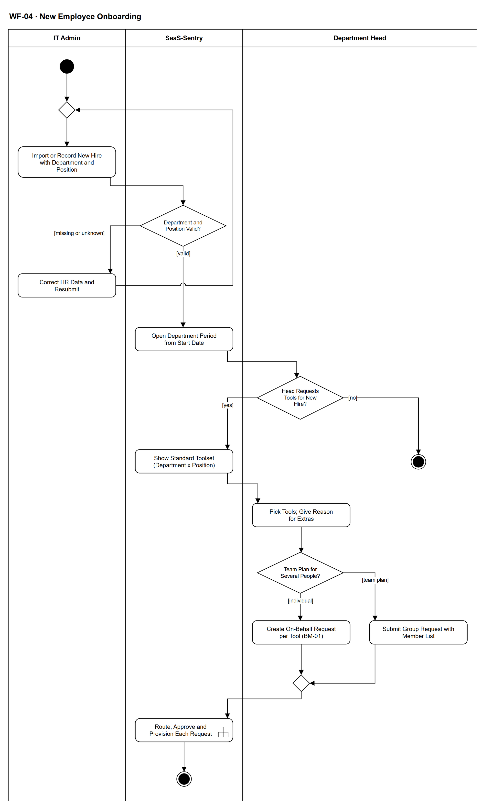

# WF-04 — New Employee Onboarding

> **Loại:** Workflow hỗ trợ của MF-2 — điểm vào cho nhân viên mới · **Phiên bản:** 3.1 — 09/10/2026 · **Trạng thái:** Vẽ lại theo mô hình phòng ban (QĐ-52) và BRD v3.30 (đồng bộ QĐ-61/QĐ-62) (FR-2.1, FR-2.2, FR-2.11, FR-3.2, FR-3.18, FR-9.7); chờ Owner/GVHD review
>
> Sơ đồ là **dẫn xuất** từ quyết định Owner (`QĐ`) và BRD hiện hành; khi khác nhau, `QĐ` → BRD thắng. Quyết định trong sơ đồ là của Owner, **chưa** phải xác nhận của GVHD/hội đồng.

## 1. Mục đích và phạm vi

Mô tả cách một **nhân viên mới** vào hệ thống với đúng phòng ban và chức vụ, rồi được trưởng phòng xin sẵn bộ công cụ chuẩn của vị trí đó. Bộ công cụ chuẩn chỉ giúp xin nhanh và đồng nhất; mọi quyền vẫn đi qua phê duyệt thông thường, không có đường cấp tự động.

**Phạm vi:** Ghi/import nhân viên mới bắt buộc phòng ban và chức vụ; từ chối bản ghi thiếu phòng; mở kỳ quan hệ nhân viên–phòng từ ngày vào; trưởng phòng (tùy chọn) tạo yêu cầu thay theo bộ công cụ chuẩn phòng × chức vụ hoặc yêu cầu theo nhóm cho gói team; mỗi yêu cầu đi WF-09.

**Không nằm trong sơ đồ này:** Định tuyến, phê duyệt và cấp phát từng yêu cầu (→ WF-09, WF-09a); cấu hình bộ công cụ chuẩn (→ WF-02/WF-03); khởi tạo dữ liệu tổ chức lần đầu (→ WF-01); tạo tài khoản email công ty phía Google Workspace/Microsoft 365 (ngoài hệ thống, mô phỏng trong demo). Không có AI ở workflow này.

## 2. Tệp

| Tệp | Vai trò |
| --- | --- |
| [WF-04-new-employee-onboarding.drawio](WF-04-new-employee-onboarding.drawio) | Nguồn draw.io chỉnh sửa được (sinh từ spec) |
| [WF-04-new-employee-onboarding.drawio.png](WF-04-new-employee-onboarding.drawio.png) | Bản xuất PNG, nhúng sẵn nguồn draw.io |
| [WF-04.json](../specs/WF-04.json) | **Nguồn canonical** — sửa ở đây rồi chạy `python tools/flowkit.py build` từ `Docs/Diagrams` |

## 3. Nguồn nghiệp vụ

| Mã | Nội dung dùng trong sơ đồ |
| --- | --- |
| `FR-2.1, FR-9.7` | Danh sách nhân viên; phòng ban và chức vụ bắt buộc trong file nhân sự, thiếu thì bị từ chối |
| `FR-2.2, ADR-04, INV-20` | Quan hệ nhân viên–phòng có hiệu lực theo thời gian; đúng một phòng |
| `FR-3.1, QĐ-52a, QĐ-52b` | Công ty → Phòng ban → Chức vụ → Nhân sự; Cost Center Unit 1–1 với phòng |
| `FR-3.2, FR-3.18, QĐ-52e, QĐ-58c` | Trưởng phòng tạo yêu cầu thay khi onboarding theo bộ công cụ chuẩn; ngoài bộ chuẩn phải có lý do |
| `FR-2.11, QĐ-54d` | Yêu cầu theo nhóm cho gói team — mỗi người một Assignment |
| `FR-2.8, INV-07` | Nhà thầu/thực tập sinh bắt buộc có ngày kết thúc dự kiến |
| `FR-2.9, QĐ-54c` | Chỉ cấp quyền trả phí trên tài khoản công ty |
| `BRD 4.6` | Ma trận trách nhiệm dòng nhánh (a): trưởng phòng tạo thay khi onboarding hoặc gửi yêu cầu theo nhóm |

## 4. Tác nhân, kích hoạt, điều kiện

| Làn (tiếng Anh trên hình) | Tác nhân | Trách nhiệm trong sơ đồ |
| --- | --- | --- |
| IT Admin | IT Admin phụ trách phòng | Import/ghi nhân viên mới, sửa dữ liệu bị từ chối |
| SaaS-Sentry | SaaS-Sentry | Kiểm phòng ban/chức vụ, mở kỳ tổ chức, hiện bộ công cụ chuẩn, chuyển yêu cầu sang WF-09 |
| Department Head | Trưởng phòng của phòng người mới (vai Manager suy ra) | Chọn công cụ, tạo yêu cầu thay hoặc yêu cầu theo nhóm |

- **Kích hoạt:** Doanh nghiệp tuyển một người mới (nhân viên chính thức, nhà thầu, freelancer hoặc thực tập sinh); IT Admin import file nhân sự hoặc ghi tay.
- **Tiền điều kiện:** Phòng ban đã có, kèm trưởng phòng, Cost Center `Unit` và IT Admin phụ trách (WF-01); bộ công cụ chuẩn của phòng × chức vụ đã cấu hình (nếu chưa, trưởng phòng chọn ngoài bộ chuẩn kèm lý do); người mới có email công việc thuộc tên miền công ty.
- **Hậu điều kiện:** Người mới thuộc đúng một phòng từ ngày vào, Cost Center suy ra từ phòng; các yêu cầu công cụ cho người mới (nếu có) đã qua WF-09 với kết quả được ghi; hoặc người mới sẽ tự xin công cụ sau.

## 5. Cách đọc ký hiệu

| Ký hiệu | Nghĩa |
| --- | --- |
| Hình tròn đặc | Bắt đầu hoạt động (initial node) |
| Hình chữ nhật bo góc | Hành động (action) của tác nhân ở làn chứa nó |
| Hình chữ nhật bo góc có ký hiệu cây đinh ba ở góc | Gọi workflow con (call behavior) — mã workflow ghi trong nhãn |
| Hình thoi có chữ | Rẽ nhánh; mỗi cạnh ra mang điều kiện trong ngoặc vuông `[...]` |
| Hình thoi nhỏ không chữ | Hợp nhánh (merge) |
| Vòng tròn kép đặc | Kết thúc toàn bộ hoạt động (activity final) |
| Dây có cung nhảy | Hai dây giao nhau nhưng **không** nối với nhau |

Đọc từ trên xuống. Vòng lặp ở đầu là việc sửa dữ liệu nhân sự bị từ chối. Từ hình thoi *Head Requests Tools for New Hire?* trở xuống là phần của trưởng phòng; nhánh *no* không phải lỗi — người mới vẫn tự xin công cụ qua MF-2.

## 6. Bảng node

| ID | Loại | Nhãn trên hình | Ý nghĩa | Làn / người thực hiện | Quy tắc |
| --- | --- | --- | --- | --- | --- |
| `st` | Nút bắt đầu | — | — | IT Admin | — |
| `m_imp` | Hợp nhánh | — | — | IT Admin | — |
| `a_rec` | Hành động | Import or Record New Hire with Department and Position | Nhân viên mới đến từ file nhân sự (import) hoặc do IT Admin ghi tay: mã nhân viên, họ tên, email công việc thuộc tên miền công ty, trạng thái, ngày vào; **phòng ban và chức vụ là trường bắt buộc**. Nhà thầu/thực tập sinh vẫn là Employee thuộc phòng họ làm việc. | IT Admin | `FR-2.1`, `FR-9.7`, `FR-2.9`, `BRD 4.5`, `QĐ-52a` |
| `d_valid` | Rẽ nhánh | Department and Position Valid? | Ở bước xem trước của khung import, bản ghi thiếu phòng ban/chức vụ hoặc mang mã phòng chưa có bị từ chối theo dòng, kèm thông báo đúng dòng và cột; hệ thống không tạo nhân viên không có phòng và không tự tạo phòng. | SaaS-Sentry | `FR-9.7`, `FR-7.1`, `INV-20` |
| `a_fix` | Hành động | Correct HR Data and Resubmit | IT Admin sửa dữ liệu nhân sự (hoặc tạo phòng/Cost Center trước theo đúng quy trình — Cost Center do Finance quản lý) rồi gửi lại. | IT Admin | `FR-9.7`, `FR-3.1`, `OI-04` |
| `s_org` | Hành động | Open Department Period from Start Date | Hệ thống tạo quan hệ nhân viên–phòng có hiệu lực từ ngày vào (không ghi đè lịch sử); Cost Center của nhân viên suy ra từ Cost Center `Unit` của phòng; nhân viên thuộc đúng một phòng. | SaaS-Sentry | `FR-2.2`, `ADR-04`, `INV-20`, `QĐ-52b` |
| `d_head` | Rẽ nhánh | Head Requests Tools for New Hire? | Trưởng phòng **có thể** tạo yêu cầu thay cho người mới; nếu không, người mới tự gửi yêu cầu sau khi có tài khoản (MF-2). | Department Head | `FR-3.2`, `FR-3.18` |
| `end_self` | Kết thúc hoạt động | — | Người mới tự gửi yêu cầu theo MF-2 khi cần. | Department Head | — |
| `s_kit` | Hành động | Show Standard Toolset (Department x Position) | Hệ thống hiện trước bộ công cụ chuẩn của cặp (phòng, chức vụ) do IT Admin cấu hình. Bộ chuẩn không tự cấp quyền — mọi quyền vẫn đi qua FR-3.4. Không dùng AI để gợi ý. | SaaS-Sentry | `FR-3.18`, `QĐ-52e`, `QĐ-58c` |
| `a_pick` | Hành động | Pick Tools; Give Reason for Extras | Trưởng phòng chọn công cụ trong bộ chuẩn; công cụ ngoài bộ chuẩn bắt buộc có lý do và được gắn cờ. Với nhà thầu/thực tập sinh, yêu cầu phải có ngày kết thúc dự kiến. | Department Head | `FR-3.18`, `FR-2.8`, `INV-07`, `BM-01` |
| `d_kind` | Rẽ nhánh | Team Plan for Several People? | Tài khoản cá nhân cho người mới, hay gói team cấp cho nhiều người cùng lúc (ví dụ cả nhóm mới vào). | Department Head | `FR-2.11`, `QĐ-54d` |
| `a_onb` | Hành động | Create On-Behalf Request per Tool (BM-01) | Trưởng phòng tạo yêu cầu thay người mới; người yêu cầu và người thụ hưởng là hai trường riêng. Mỗi phiếu BM-01 ghi phần mềm/gói, lý do, thời hạn cần dùng. Gói cấm chia sẻ tài khoản thì không xin được kiểu dùng chung — yêu cầu bị từ chối ở bước đánh giá của IT (FR-2.11); chuyển sang cấp cá nhân là yêu cầu mới, định tuyến lại theo FR-3.4. | Department Head | `FR-3.2`, `BM-01`, `SoD-4` |
| `a_grp` | Hành động | Submit Group Request with Member List | Một yêu cầu theo nhóm kèm danh sách người cho gói team; hệ thống tạo **một Assignment cho mỗi người** khi được cấp. Khác tài khoản dùng chung (một bộ đăng nhập cho nhiều người). Chỉ thành viên phòng của trưởng phòng (BRD 4.3, FR-3.2). Gói cấm chia sẻ tài khoản thì không xin được kiểu dùng chung — yêu cầu bị từ chối ở bước đánh giá của IT (FR-2.11); chuyển sang cấp cá nhân là yêu cầu mới, định tuyến lại theo FR-3.4. | Department Head | `FR-2.11`, `FR-3.2`, `BM-01`, `QĐ-54d` |
| `m_req` | Hợp nhánh | — | — | Department Head | — |
| `c_req` | Gọi workflow con | Route, Approve and Provision Each Request | Mỗi yêu cầu đi định tuyến và cấp phát thông thường theo nhánh (a)/(b)/(c). Trưởng phòng là người vốn duyệt nhu cầu của nhân viên phòng mình, nên yêu cầu trưởng phòng tạo thay được ghi nhận là **bước nhu cầu đã xác nhận** (người tạo, người thụ hưởng, thời điểm) rồi đi tiếp nhánh (a)/(b)/(c). Phần mà chính trưởng phòng là người thụ hưởng ⟹ bước nhu cầu theo QĐ-52c (Người duyệt chi; trưởng phòng là Người duyệt chi ⟹ approver dự phòng) — không thể tự duyệt qua việc đổi tên người yêu cầu (QĐ-62a, SoD-4). | SaaS-Sentry | `FR-3.3`, `FR-3.4`, `MF-2`, `QĐ-62a`, `SoD-4`, → `WF-09` |
| `end_req` | Kết thúc hoạt động | — | Các yêu cầu cho người mới đã có kết quả theo WF-09. | SaaS-Sentry | — |

## 7. Bảng chuyển tiếp

| Từ → tới | Nhãn điều kiện | Điều kiện | Kết quả |
| --- | --- | --- | --- |
| `st` → `m_imp` | — | — | Sang — |
| `m_imp` → `a_rec` | — | — | Sang Import or Record New Hire with Department and Position |
| `a_rec` → `d_valid` | — | — | Sang Department and Position Valid? |
| `d_valid` → `a_fix` | `[missing or unknown]` | Thiếu phòng ban/chức vụ hoặc mã phòng chưa có | Từ chối dòng, IT sửa dữ liệu |
| `d_valid` → `s_org` | `[valid]` | Đủ phòng ban và chức vụ hợp lệ | Tạo nhân viên và kỳ tổ chức |
| `a_fix` → `m_imp` | — | — | Sang — |
| `s_org` → `d_head` | — | — | Sang Head Requests Tools for New Hire? |
| `d_head` → `end_self` | `[no]` | Trưởng phòng không tạo yêu cầu thay | Người mới tự gửi yêu cầu sau |
| `d_head` → `s_kit` | `[yes]` | Trưởng phòng tạo yêu cầu cho người mới | Hiện bộ công cụ chuẩn |
| `s_kit` → `a_pick` | — | — | Sang Pick Tools; Give Reason for Extras |
| `a_pick` → `d_kind` | — | — | Sang Team Plan for Several People? |
| `d_kind` → `a_onb` | `[individual]` | Tài khoản cá nhân cho người mới | Yêu cầu thay theo từng công cụ |
| `d_kind` → `a_grp` | `[team plan]` | Gói team cho nhiều người | Yêu cầu theo nhóm |
| `a_onb` → `m_req` | — | — | Sang — |
| `a_grp` → `m_req` | — | — | Sang — |
| `m_req` → `c_req` | — | — | Sang Route, Approve and Provision Each Request |
| `c_req` → `end_req` | — | — | Sang — |

Số đếm: **16 node · 17 cạnh · 3 rẽ nhánh**; giao cắt dây: **1**.

## 8. Happy path

1. `st` — —
2. `a_rec` — Import or Record New Hire with Department and Position: Nhân viên mới đến từ file nhân sự (import) hoặc do IT Admin ghi tay: mã nhân viên, họ tên, email công việc thuộc tên miền công ty, trạng thái, ngày vào; **phòng ban và chức vụ là trường bắt buộc**. Nhà thầu/thực tập sinh vẫn là Employee thuộc phòng họ làm việc.
3. `d_valid` — Department and Position Valid?: Ở bước xem trước của khung import, bản ghi thiếu phòng ban/chức vụ hoặc mang mã phòng chưa có bị từ chối theo dòng, kèm thông báo đúng dòng và cột; hệ thống không tạo nhân viên không có phòng và không tự tạo phòng.
4. `s_org` — Open Department Period from Start Date: Hệ thống tạo quan hệ nhân viên–phòng có hiệu lực từ ngày vào (không ghi đè lịch sử); Cost Center của nhân viên suy ra từ Cost Center `Unit` của phòng; nhân viên thuộc đúng một phòng.
5. `d_head` — Head Requests Tools for New Hire?: Trưởng phòng **có thể** tạo yêu cầu thay cho người mới; nếu không, người mới tự gửi yêu cầu sau khi có tài khoản (MF-2).
6. `s_kit` — Show Standard Toolset (Department x Position): Hệ thống hiện trước bộ công cụ chuẩn của cặp (phòng, chức vụ) do IT Admin cấu hình. Bộ chuẩn không tự cấp quyền — mọi quyền vẫn đi qua FR-3.4. Không dùng AI để gợi ý.
7. `a_pick` — Pick Tools; Give Reason for Extras: Trưởng phòng chọn công cụ trong bộ chuẩn; công cụ ngoài bộ chuẩn bắt buộc có lý do và được gắn cờ. Với nhà thầu/thực tập sinh, yêu cầu phải có ngày kết thúc dự kiến.
8. `d_kind` — Team Plan for Several People?: Tài khoản cá nhân cho người mới, hay gói team cấp cho nhiều người cùng lúc (ví dụ cả nhóm mới vào).
9. `a_onb` — Create On-Behalf Request per Tool (BM-01): Trưởng phòng tạo yêu cầu thay người mới; người yêu cầu và người thụ hưởng là hai trường riêng. Mỗi phiếu BM-01 ghi phần mềm/gói, lý do, thời hạn cần dùng. Gói cấm chia sẻ tài khoản thì không xin được kiểu dùng chung — yêu cầu bị từ chối ở bước đánh giá của IT (FR-2.11); chuyển sang cấp cá nhân là yêu cầu mới, định tuyến lại theo FR-3.4.
10. `c_req` — Route, Approve and Provision Each Request: Mỗi yêu cầu đi định tuyến và cấp phát thông thường theo nhánh (a)/(b)/(c). Trưởng phòng là người vốn duyệt nhu cầu của nhân viên phòng mình, nên yêu cầu trưởng phòng tạo thay được ghi nhận là **bước nhu cầu đã xác nhận** (người tạo, người thụ hưởng, thời điểm) rồi đi tiếp nhánh (a)/(b)/(c). Phần mà chính trưởng phòng là người thụ hưởng ⟹ bước nhu cầu theo QĐ-52c (Người duyệt chi; trưởng phòng là Người duyệt chi ⟹ approver dự phòng) — không thể tự duyệt qua việc đổi tên người yêu cầu (QĐ-62a, SoD-4).
11. `end_req` — —: Các yêu cầu cho người mới đã có kết quả theo WF-09.

## 9. Nhánh thay thế / if-else

- **Gói team cho nhiều người** — `d_kind` → `a_grp` → `m_req` → `c_req`. Một yêu cầu theo nhóm, mỗi người một Assignment.
- **Trưởng phòng không tạo yêu cầu thay** — `d_head` → `end_self`. Người mới tự gửi yêu cầu theo MF-2.

## 10. Nhánh lỗi / từ chối và cách kết thúc

- **Bản ghi nhân sự thiếu phòng ban/chức vụ** — `d_valid` → `a_fix` → `m_imp` → `a_rec`. Từ chối theo dòng; không tạo nhân viên không có phòng.

## 11. Liên hệ với sơ đồ khác

- Cấp trên: `MF-2` (điểm vào onboarding); nền: `WF-01` (khởi tạo tổ chức), `WF-02` (danh mục, gói, bộ công cụ chuẩn)
- `WF-09` — mỗi yêu cầu đi định tuyến và phê duyệt thông thường
- `WF-08` — quyền của nhà thầu/thực tập sinh hết hạn
- User flow: `UF-21` (trưởng phòng xin công cụ cho người mới hoặc cho nhóm)
- `WF-09` — gọi/chuyển tại node `c_req`

## 12. Giới hạn và vấn đề còn mở

- (ĐÃ CHỐT · DOI-20, QĐ-62a) Yêu cầu trưởng phòng tạo thay nhân viên phòng mình = bước nhu cầu đã xác nhận; phần trưởng phòng là người thụ hưởng theo QĐ-52c.
- (LIMIT · DOI-30) Không có cảnh báo *có nhân viên mới trong phòng* cho trưởng phòng (FR-5.14) — trưởng phòng tự chủ động.
- (LIMIT · DOI-04, RB-4, QĐ-54c) Tạo tài khoản email công ty ở hệ thống của doanh nghiệp nằm ngoài hệ thống và được mô phỏng trong demo.
