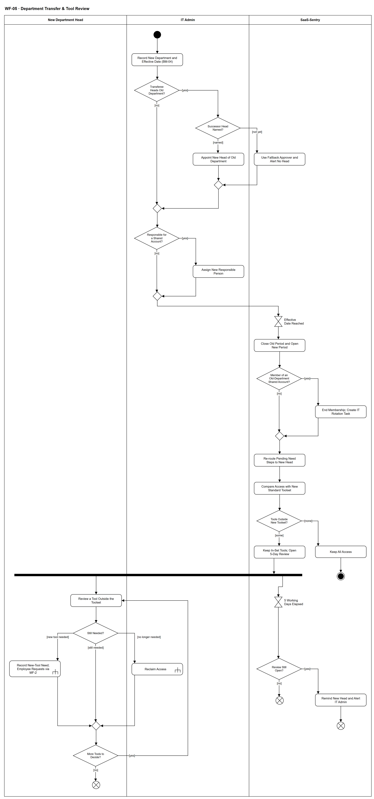

# WF-05 — Department Transfer & Tool Review

> **Loại:** Workflow chi tiết của `MF-7` · **Phiên bản:** 3.2 — 10/10/2026 · **Trạng thái:** Vẽ lại theo mô hình phòng ban (QĐ-52) và QĐ-50b, QĐ-55b, QĐ-56a, QĐ-58a/d; thay bản cũ dựa trên cây `manager_id`; chờ Owner/GVHD review
>
> Sơ đồ là **dẫn xuất** từ quyết định Owner (`QĐ`) và BRD hiện hành; khi khác nhau, `QĐ` → BRD thắng. Quyết định trong sơ đồ là của Owner, **chưa** phải xác nhận của GVHD/hội đồng.

## 1. Mục đích và phạm vi

Chi tiết hóa `MF-7`: nhân viên **chuyển phòng ban** mà không mất lịch sử, chi phí sang phòng mới đúng ngày, tài khoản dùng chung có người chịu trách nhiệm mới, và trưởng phòng mới quyết những công cụ nằm ngoài bộ chuẩn. Bổ sung so với `MF-7`: ca **người được điều chuyển là trưởng phòng cũ** (chỉ định trưởng phòng mới hoặc approver dự phòng kèm cảnh báo), và quy tắc chi tiết ở từng bước. **Điều chuyển không phải thu hồi** — hệ thống không tự thu hồi quyền nào.

**Phạm vi:** Ghi điều chuyển có ngày hiệu lực (BM-04), thay trưởng phòng cũ khi người rời là trưởng phòng, người chịu trách nhiệm tài khoản dùng chung, đổi kỳ tổ chức và Cost Center, xác định lại bước nhu cầu đang chờ, so bộ công cụ chuẩn phòng × chức vụ, rà soát 5 ngày làm việc có nhắc/cảnh báo, thu hồi (WF-09a) hoặc yêu cầu công cụ mới (MF-2).

**Không nằm trong sơ đồ này:** Chi tiết thu hồi theo kiểu cấp (→ WF-09a); yêu cầu công cụ mới (→ MF-2, WF-09); chi phí chia theo ngày khi lập báo cáo kỳ (→ MF-8, WF-19); tách/gộp/giải thể phòng (xem mục mở); đổi chức vụ trong cùng phòng (xem mục mở).

## 2. Tệp

| Tệp | Vai trò |
| --- | --- |
| [WF-05-department-transfer-tool-review.drawio](WF-05-department-transfer-tool-review.drawio) | Nguồn draw.io chỉnh sửa được (sinh từ spec) |
| [WF-05-department-transfer-tool-review.drawio.png](WF-05-department-transfer-tool-review.drawio.png) | Bản xuất PNG, nhúng sẵn nguồn draw.io |
| [WF-05.json](../specs/WF-05.json) | **Nguồn canonical** — sửa ở đây rồi chạy `python tools/flowkit.py build` từ `Docs/Diagrams` |

## 3. Nguồn nghiệp vụ

| Mã | Nội dung dùng trong sơ đồ |
| --- | --- |
| `FR-2.2, ADR-04, INV-20` | Quan hệ nhân viên–phòng có lịch sử, không ghi đè; đúng một phòng mỗi thời điểm |
| `FR-3.1, INV-19, QĐ-58a, QĐ-52a` | Phòng phẳng; mỗi phòng đúng một trưởng phòng; một người làm trưởng tối đa một phòng; đổi trưởng phòng không đổi thành viên |
| `FR-3.3, FR-3.6, QĐ-52c` | Phòng chưa có trưởng phòng ⟹ bước nhu cầu tới approver dự phòng ở gốc |
| `FR-3.16, QĐ-28d` | Chỉ xác định lại bước nhu cầu đang chờ khi phòng của người yêu cầu hoặc trưởng phòng đổi; SLA không đặt lại |
| `FR-3.8 (hạn rà soát sau điều chuyển), FR-8.2, QĐ-50b` | Hạn 5 ngày làm việc, cấu hình được; quá hạn chỉ nhắc trưởng phòng và cảnh báo IT Admin |
| `FR-3.18, QĐ-56a` | Bộ công cụ chuẩn phòng × chức vụ; công cụ trong bộ chuẩn mặc định giữ |
| `FR-2.12, QĐ-58d` | Người chịu trách nhiệm tài khoản dùng chung phải được thay trước ngày hiệu lực |
| `FR-5.3, QĐ-55b` | Chi phí theo kỳ chia theo ngày; không viết lại chi phí đã phát sinh |
| `FR-5.14` | Cảnh báo: hạn rà soát sau điều chuyển; phòng thiếu trưởng phòng; người chịu trách nhiệm tài khoản dùng chung sắp rời |
| `FR-2.4, FR-4.15` | Thu hồi không tự ghi nhận tiết kiệm; phần mềm nội bộ thu hồi ngoài hệ thống kèm bằng chứng |
| `BM-04; BRD 4.6, 5.10 dòng Điều chuyển phòng` | Biên bản bàn giao; ma trận trách nhiệm và luồng |

## 4. Tác nhân, kích hoạt, điều kiện

| Làn (tiếng Anh trên hình) | Tác nhân | Trách nhiệm trong sơ đồ |
| --- | --- | --- |
| New Department Head | Trưởng phòng của phòng mới (vai Manager suy ra) | Quyết từng công cụ ngoài bộ chuẩn |
| IT Admin | IT Admin phụ trách phòng | Ghi điều chuyển, chỉ định trưởng phòng/người chịu trách nhiệm, thu hồi |
| SaaS-Sentry | SaaS-Sentry | Approver dự phòng, đổi kỳ tổ chức, định tuyến lại, so bộ chuẩn, theo dõi hạn |

- **Kích hoạt:** Doanh nghiệp quyết định chuyển một nhân viên sang phòng khác; IT Admin ghi nhận kèm ngày hiệu lực.
- **Tiền điều kiện:** Phòng mới đã có Cost Center Unit; phòng mới có trưởng phòng (nếu chưa: bước nhu cầu tới approver dự phòng (FR-3.6); việc rà soát chờ, không giao ai, và chuyển cho trưởng phòng mới khi được bổ nhiệm (QĐ-62c)); bộ công cụ chuẩn của phòng mới đã cấu hình (nếu chưa, mọi công cụ được coi là ngoài bộ chuẩn).
- **Hậu điều kiện:** Nhân viên thuộc đúng một phòng mới từ ngày hiệu lực; chi phí từ ngày đó vào Cost Center mới, quá khứ giữ nguyên; phòng cũ có trưởng phòng mới hoặc đang ở ca approver dự phòng có cảnh báo; tài khoản dùng chung có người chịu trách nhiệm mới; mỗi công cụ ngoài bộ chuẩn đã được giữ, thu hồi, hoặc thay bằng yêu cầu mới — hoặc vẫn giữ nguyên khi chưa có quyết định.

## 5. Cách đọc ký hiệu

| Ký hiệu | Nghĩa |
| --- | --- |
| Hình tròn đặc | Bắt đầu hoạt động (initial node) |
| Hình chữ nhật bo góc | Hành động (action) của tác nhân ở làn chứa nó |
| Hình chữ nhật bo góc có ký hiệu cây đinh ba ở góc | Gọi workflow con (call behavior) — mã workflow ghi trong nhãn |
| Hình thoi có chữ | Rẽ nhánh; mỗi cạnh ra mang điều kiện trong ngoặc vuông `[...]` |
| Hình thoi nhỏ không chữ | Hợp nhánh (merge) |
| Thanh đen ngang | Tách hoặc gộp các nhánh chạy song song (fork/join) |
| Đồng hồ cát | Chờ một mốc thời gian (time event) |
| Vòng tròn kép đặc | Kết thúc toàn bộ hoạt động (activity final) |
| Vòng tròn có dấu nhân | Kết thúc riêng nhánh đó, các nhánh khác vẫn chạy (flow final) |
| Dây có cung nhảy | Hai dây giao nhau nhưng **không** nối với nhau |

Phần trên (làn IT Admin) là việc phải xong **trước** ngày hiệu lực: thay trưởng phòng cũ nếu cần, thay người chịu trách nhiệm tài khoản dùng chung. Từ mốc ngày hiệu lực, hệ thống đổi kỳ, định tuyến lại và so bộ chuẩn. Sau thanh tách, nhánh trái là trưởng phòng mới quyết từng công cụ (vòng lặp), nhánh phải chỉ theo dõi hạn 5 ngày làm việc và **chỉ nhắc/cảnh báo** — không có cạnh nào từ nhánh hạn tới thu hồi (QĐ-50b).

## 6. Bảng node

| ID | Loại | Nhãn trên hình | Ý nghĩa | Làn / người thực hiện | Quy tắc |
| --- | --- | --- | --- | --- | --- |
| `st` | Nút bắt đầu | — | — | IT Admin | — |
| `a_rec` | Hành động | Record New Department and Effective Date (BM-04) | IT Admin ghi phòng mới, chức vụ mới nếu đổi, và ngày hiệu lực; lập biên bản BM-04 với danh sách quyền đang giữ và tài khoản dùng chung phải chuyển người chịu trách nhiệm. Không ghi đè: quan hệ cũ được đóng, quan hệ mới được mở từ ngày hiệu lực. Kiêm nhiệm không ghi phòng thứ hai. | IT Admin | `FR-2.2`, `ADR-04`, `INV-20`, `BM-04`, `QĐ-52a` |
| `d_head` | Rẽ nhánh | Transferee Heads Old Department? | Người được điều chuyển có đang là trưởng phòng có hiệu lực của phòng cũ không. Có ⟹ phải chỉ định trưởng phòng mới hoặc ghi *chưa có* — mỗi phòng một trưởng phòng có hiệu lực, một người làm trưởng tối đa một phòng và chỉ thuộc một phòng (FR-3.1, QĐ-52a, INV-19, INV-20). | IT Admin | `FR-3.1`, `INV-19`, `INV-20`, `QĐ-52a` |
| `d_succ` | Rẽ nhánh | Successor Head Named? | Doanh nghiệp đã chọn được người làm trưởng phòng cũ từ ngày hiệu lực hay chưa. | IT Admin | `FR-3.6`, `QĐ-58a` |
| `a_appoint` | Hành động | Appoint New Head of Old Department | IT Admin ghi trưởng phòng mới có hiệu lực từ ngày điều chuyển. Người này không được đang làm trưởng phòng khác và không mang vai Super Admin. Thành viên phòng không đổi; bước duyệt nhu cầu đang chờ của phòng cũ được xác định lại cho trưởng phòng mới, SLA không đặt lại. | IT Admin | `INV-19`, `QĐ-58a`, `QĐ-51`, `QĐ-52a`, `FR-3.16`, `FR-8.7` |
| `s_nohead` | Hành động | Use Fallback Approver and Alert No Head | Phòng cũ chưa có trưởng phòng từ ngày hiệu lực: **bước nhu cầu** của nhân viên phòng đó tới approver dự phòng (FR-3.6, QĐ-52c); các việc khác vốn giao trưởng phòng **chờ, không giao ai**; IT Admin và Super Admin thấy cảnh báo phòng thiếu trưởng phòng (QĐ-62c). | SaaS-Sentry | `FR-3.3`, `FR-3.6`, `FR-5.14`, `QĐ-52c`, `QĐ-62c` |
| `m_succ` | Hợp nhánh | — | — | IT Admin | — |
| `m_head` | Hợp nhánh | — | — | IT Admin | — |
| `d_shared` | Rẽ nhánh | Responsible for a Shared Account? | Người được điều chuyển có đang là người chịu trách nhiệm một tài khoản dùng chung của phòng cũ không. | IT Admin | `FR-2.12`, `QĐ-56a`, `QĐ-58d` |
| `a_resp` | Hành động | Assign New Responsible Person | Chỉ định người chịu trách nhiệm mới trước ngày hiệu lực — mặc định trưởng phòng của phòng sở hữu tài khoản (trưởng phòng mới nếu người rời là trưởng phòng). Tới khi xong, trưởng phòng và IT Admin thấy cảnh báo *người chịu trách nhiệm tài khoản dùng chung sắp rời*. Chi phí tài khoản vẫn ở Cost Center của phòng sở hữu. | IT Admin | `FR-2.12`, `FR-2.11`, `QĐ-58d`, `FR-5.14`, `QĐ-54d` |
| `m_sh` | Hợp nhánh | — | — | IT Admin | — |
| `t_eff` | Chờ mốc thời gian | Effective Date Reached | Chờ tới ngày hiệu lực của điều chuyển. | SaaS-Sentry | `FR-2.2`, `ADR-04` |
| `s_period` | Hành động | Close Old Period and Open New Period | Đóng kỳ quan hệ nhân viên–phòng cũ, mở kỳ mới; Cost Center Unit của phòng mới áp từ ngày hiệu lực. Chi phí theo kỳ chia theo ngày (ví dụ hiệu lực 16/10: 1–15/10 phòng cũ, 16–31/10 phòng mới); chi phí đã phát sinh và hóa đơn theo dòng tiền không bị viết lại. | SaaS-Sentry | `FR-2.2`, `FR-5.3`, `INV-20`, `QĐ-55b` |
| `d_member` | Rẽ nhánh | Member of an Old-Department Shared Account? | Người được điều chuyển có đang là **thành viên** (không phải người chịu trách nhiệm) một tài khoản dùng chung của phòng cũ không. | SaaS-Sentry | `FR-2.11`, `QĐ-54d`, `QĐ-62g` |
| `s_mem` | Hành động | End Membership; Create IT Rotation Task | Tư cách thành viên kết thúc tại ngày hiệu lực; tạo việc cho IT đổi mật khẩu/thiết bị xác thực và cập nhật danh sách (tác vụ riêng có cảnh báo). Còn cần thì nhân viên xin lại theo luồng thường (QĐ-62g, QĐ-62p). | SaaS-Sentry | `QĐ-62g`, `FR-2.11`, `QĐ-54d` |
| `m_mem` | Hợp nhánh | — | — | SaaS-Sentry | — |
| `s_reroute` | Hành động | Re-route Pending Need Steps to New Head | Chỉ các bước duyệt nhu cầu đang chờ của người được điều chuyển được xác định lại cho trưởng phòng mới; SLA không đặt lại; nhánh và chuỗi bước đã chốt khi gửi giữ nguyên. Bước duyệt chi và bước thực thi giữ người xử lý. Audit Trail ghi sự kiện nguồn, người cũ, người mới. | SaaS-Sentry | `FR-3.16`, `QĐ-28d` |
| `s_compare` | Hành động | Compare Access with New Standard Toolset | So quyền cá nhân và khóa bản quyền đang giữ với bộ công cụ chuẩn của cặp (phòng mới, chức vụ). Bộ chuẩn không tự cấp hay thu hồi quyền của ai. Đổi **chức vụ trong cùng phòng** không mở rà soát: quyền đang có giữ nguyên, bộ chuẩn mới áp cho yêu cầu mới (QĐ-62p). | SaaS-Sentry | `FR-3.18`, `QĐ-56a`, `QĐ-52e` |
| `d_out` | Rẽ nhánh | Tools Outside New Toolset? | Còn công cụ nào ngoài bộ chuẩn của phòng mới không. | SaaS-Sentry | `FR-3.18`, `QĐ-56a` |
| `s_keepall` | Hành động | Keep All Access | Mọi công cụ thuộc bộ chuẩn: giữ nguyên, không cần trưởng phòng quyết; chi phí vào phòng mới từ ngày hiệu lực. | SaaS-Sentry | `QĐ-56a` |
| `end_keep` | Kết thúc hoạt động | — | Điều chuyển hoàn tất, không có quyền nào phải rà soát. | SaaS-Sentry | — |
| `s_task` | Hành động | Keep In-Set Tools; Open 5-Day Review | Công cụ thuộc bộ chuẩn giữ tự động. Với công cụ ngoài bộ chuẩn, tạo việc rà soát cho trưởng phòng mới, hạn 5 ngày làm việc kể từ ngày hiệu lực theo lịch làm việc của tổ chức (Super Admin cấu hình được). Đây không phải một bước phê duyệt của request. Phòng mới **chưa có trưởng phòng**: việc rà soát **chờ, không giao ai** (approver dự phòng chỉ thay ở bước nhu cầu); quyền giữ nguyên; IT Admin và Super Admin thấy cảnh báo phòng thiếu trưởng phòng; khi có trưởng phòng mới, việc chuyển sang người đó, hạn không đặt lại (QĐ-62c). | SaaS-Sentry | `FR-3.8`, `FR-8.2`, `QĐ-50b`, `QĐ-56a`, `QĐ-62c` |
| `f_rev` | Tách song song | — | — | SaaS-Sentry | — |
| `a_review` | Hành động | Review a Tool Outside the Toolset | Trưởng phòng mới xem từng công cụ ngoài bộ chuẩn cùng lý do cấp ban đầu và tình trạng sử dụng dạng tổng hợp; không xem hợp đồng hay log thô. | New Department Head | `FR-3.7`, `SoD-2` |
| `t_due` | Chờ mốc thời gian | 5 Working Days Elapsed | Hết hạn 5 ngày làm việc kể từ ngày hiệu lực. | SaaS-Sentry | `QĐ-50b` |
| `d_choice` | Rẽ nhánh | Still Needed? | Quyết định cho từng công cụ: còn cần · không còn cần · cần công cụ mới. | New Department Head | `QĐ-50b`, `QĐ-56a` |
| `d_open` | Rẽ nhánh | Review Still Open? | Còn công cụ chưa có quyết định khi hết hạn không. | SaaS-Sentry | `QĐ-50b` |
| `c_revoke` | Gọi workflow con | Reclaim Access | IT Admin thu hồi theo kiểu cấp của gói (gỡ khỏi workspace, hủy gia hạn gói cá nhân, thu khóa về kho; phần mềm nội bộ: ngoài hệ thống kèm bằng chứng); seat về kho. Thu hồi không tự ghi nhận tiết kiệm. Gói có lưu ý mất dữ liệu: hiện lưu ý và **trưởng phòng mới** (người quyết thu hồi) xác nhận bàn giao trước khi gỡ ở nhà cung cấp; không chặn sau hạn ngắn (QĐ-62f, WF-09a `d_dl`). Nếu WF-09a trả *đóng thất bại* (QĐ-62i): quyền còn hiệu lực, vẫn hiện G2/lãng phí theo điều kiện nguồn, seat chưa về kho và IT mở tác vụ thu hồi mới. | IT Admin | `FR-1.9`, `FR-2.4`, `FR-4.15`, `QĐ-62f`, `SoD-5`, → `WF-09a` |
| `c_req` | Gọi workflow con | Record New-Tool Need; Employee Requests via MF-2 | Trưởng phòng mới ghi nhu cầu công cụ khác; **nhân viên** tự gửi yêu cầu qua luồng thường (MF-2, UF-01) — FR-3.2 chỉ cho trưởng phòng tạo thay khi onboarding hoặc yêu cầu theo nhóm. Hệ thống hiện bộ công cụ chuẩn của phòng mới trước. | New Department Head | `FR-3.18`, `FR-3.2`, → `MF-2` |
| `s_remind` | Hành động | Remind New Head and Alert IT Admin | Quá hạn: chỉ nhắc trưởng phòng mới và cảnh báo IT Admin. Không tự thu hồi, không giao người khác, không tự quyết; quyền giữ nguyên tới khi có quyết định. Phòng thiếu trưởng phòng: chỉ cảnh báo IT Admin và Super Admin (QĐ-62c). | SaaS-Sentry | `FR-3.8`, `QĐ-50b`, `FR-5.14` |
| `ff_t1` | Kết thúc nhánh (flow final) | — | Nhánh hạn kết thúc — mọi công cụ đã có quyết định. | SaaS-Sentry | — |
| `ff_t2` | Kết thúc nhánh (flow final) | — | Nhánh hạn kết thúc sau khi nhắc; việc rà soát vẫn mở ở nhánh trưởng phòng. | SaaS-Sentry | — |
| `m_done` | Hợp nhánh | — | — | New Department Head | — |
| `d_more` | Rẽ nhánh | More Tools to Decide? | Còn công cụ ngoài bộ chuẩn chưa quyết không. | New Department Head | `QĐ-56a` |
| `ff_rev` | Kết thúc nhánh (flow final) | — | Rà soát xong — quyền của nhân viên khớp nhu cầu ở phòng mới. | New Department Head | — |

## 7. Bảng chuyển tiếp

| Từ → tới | Nhãn điều kiện | Điều kiện | Kết quả |
| --- | --- | --- | --- |
| `st` → `a_rec` | — | — | Sang Record New Department and Effective Date (BM-04) |
| `a_rec` → `d_head` | — | — | Sang Transferee Heads Old Department? |
| `d_head` → `d_succ` | `[yes]` | Người được điều chuyển đang là trưởng phòng cũ | Xét người kế nhiệm trưởng phòng |
| `d_head` → `m_head` | `[no]` | Không phải trưởng phòng | Đi tiếp |
| `d_succ` → `a_appoint` | `[named]` | Đã có người làm trưởng phòng cũ | Chỉ định trưởng phòng mới |
| `d_succ` → `s_nohead` | `[not yet]` | Chưa có người | Approver dự phòng và cảnh báo phòng thiếu trưởng phòng |
| `a_appoint` → `m_succ` | — | — | Sang — |
| `s_nohead` → `m_succ` | — | — | Sang — |
| `m_succ` → `m_head` | — | — | Sang — |
| `m_head` → `d_shared` | — | — | Sang Responsible for a Shared Account? |
| `d_shared` → `a_resp` | `[yes]` | Đang chịu trách nhiệm tài khoản dùng chung của phòng cũ | Chỉ định người mới trước ngày hiệu lực |
| `d_shared` → `m_sh` | `[no]` | Không giữ trách nhiệm tài khoản dùng chung | Chờ ngày hiệu lực |
| `a_resp` → `m_sh` | — | — | Sang — |
| `m_sh` → `t_eff` | — | — | Sang Effective Date Reached |
| `t_eff` → `s_period` | — | — | Sang Close Old Period and Open New Period |
| `s_period` → `d_member` | — | — | Sang Member of an Old-Department Shared Account? |
| `d_member` → `s_mem` | `[yes]` | Là thành viên tài khoản dùng chung của phòng cũ | Kết thúc tư cách thành viên, IT đổi mật khẩu |
| `d_member` → `m_mem` | `[no]` | Không phải thành viên tài khoản dùng chung | Sang — |
| `s_mem` → `m_mem` | — | — | Sang — |
| `m_mem` → `s_reroute` | — | — | Sang Re-route Pending Need Steps to New Head |
| `s_reroute` → `s_compare` | — | — | Sang Compare Access with New Standard Toolset |
| `s_compare` → `d_out` | — | — | Sang Tools Outside New Toolset? |
| `d_out` → `s_keepall` | `[none]` | Mọi quyền đều thuộc bộ chuẩn của phòng mới | Giữ toàn bộ |
| `d_out` → `s_task` | `[some]` | Có ít nhất một công cụ ngoài bộ chuẩn | Giữ phần trong bộ chuẩn, mở việc rà soát 5 ngày |
| `s_keepall` → `end_keep` | — | — | Sang — |
| `s_task` → `f_rev` | — | — | Sang — |
| `f_rev` → `a_review` | — | — | Nhánh rà soát của trưởng phòng mới |
| `f_rev` → `t_due` | — | — | Nhánh theo dõi hạn |
| `a_review` → `d_choice` | — | — | Sang Still Needed? |
| `d_choice` → `m_done` | `[still needed]` | Còn cần cho công việc ở phòng mới | Giữ quyền; chi phí vào phòng mới từ ngày hiệu lực |
| `d_choice` → `c_revoke` | `[no longer needed]` | Không còn cần | IT thu hồi |
| `d_choice` → `c_req` | `[new tool needed]` | Cần một công cụ khác cho công việc mới | Tạo yêu cầu mới theo MF-2 |
| `c_revoke` → `m_done` | — | — | Sang — |
| `c_req` → `m_done` | — | — | Sang — |
| `m_done` → `d_more` | — | — | Sang More Tools to Decide? |
| `d_more` → `a_review` | `[yes]` | Còn công cụ chưa quyết | Rà công cụ kế tiếp |
| `d_more` → `ff_rev` | `[no]` | Đã quyết hết | Kết thúc nhánh rà soát |
| `t_due` → `d_open` | — | — | Sang Review Still Open? |
| `d_open` → `ff_t1` | `[no]` | Mọi công cụ đã có quyết định trước hạn | Kết thúc nhánh hạn |
| `d_open` → `s_remind` | `[yes]` | Còn công cụ chưa quyết khi hết hạn | Nhắc và cảnh báo |
| `s_remind` → `ff_t2` | — | — | Sang — |

Số đếm: **35 node · 41 cạnh · 8 rẽ nhánh**; giao cắt dây: **0**.

## 8. Happy path

1. `st` — —
2. `a_rec` — Record New Department and Effective Date (BM-04): IT Admin ghi phòng mới, chức vụ mới nếu đổi, và ngày hiệu lực; lập biên bản BM-04 với danh sách quyền đang giữ và tài khoản dùng chung phải chuyển người chịu trách nhiệm. Không ghi đè: quan hệ cũ được đóng, quan hệ mới được mở từ ngày hiệu lực. Kiêm nhiệm không ghi phòng thứ hai.
3. `d_head` — Transferee Heads Old Department?: Người được điều chuyển có đang là trưởng phòng có hiệu lực của phòng cũ không. Có ⟹ phải chỉ định trưởng phòng mới hoặc ghi *chưa có* — mỗi phòng một trưởng phòng có hiệu lực, một người làm trưởng tối đa một phòng và chỉ thuộc một phòng (FR-3.1, QĐ-52a, INV-19, INV-20).
4. `d_shared` — Responsible for a Shared Account?: Người được điều chuyển có đang là người chịu trách nhiệm một tài khoản dùng chung của phòng cũ không.
5. `t_eff` — Effective Date Reached: Chờ tới ngày hiệu lực của điều chuyển.
6. `s_period` — Close Old Period and Open New Period: Đóng kỳ quan hệ nhân viên–phòng cũ, mở kỳ mới; Cost Center Unit của phòng mới áp từ ngày hiệu lực. Chi phí theo kỳ chia theo ngày (ví dụ hiệu lực 16/10: 1–15/10 phòng cũ, 16–31/10 phòng mới); chi phí đã phát sinh và hóa đơn theo dòng tiền không bị viết lại.
7. `d_member` — Member of an Old-Department Shared Account?: Người được điều chuyển có đang là **thành viên** (không phải người chịu trách nhiệm) một tài khoản dùng chung của phòng cũ không.
8. `s_reroute` — Re-route Pending Need Steps to New Head: Chỉ các bước duyệt nhu cầu đang chờ của người được điều chuyển được xác định lại cho trưởng phòng mới; SLA không đặt lại; nhánh và chuỗi bước đã chốt khi gửi giữ nguyên. Bước duyệt chi và bước thực thi giữ người xử lý. Audit Trail ghi sự kiện nguồn, người cũ, người mới.
9. `s_compare` — Compare Access with New Standard Toolset: So quyền cá nhân và khóa bản quyền đang giữ với bộ công cụ chuẩn của cặp (phòng mới, chức vụ). Bộ chuẩn không tự cấp hay thu hồi quyền của ai. Đổi **chức vụ trong cùng phòng** không mở rà soát: quyền đang có giữ nguyên, bộ chuẩn mới áp cho yêu cầu mới (QĐ-62p).
10. `d_out` — Tools Outside New Toolset?: Còn công cụ nào ngoài bộ chuẩn của phòng mới không.
11. `s_task` — Keep In-Set Tools; Open 5-Day Review: Công cụ thuộc bộ chuẩn giữ tự động. Với công cụ ngoài bộ chuẩn, tạo việc rà soát cho trưởng phòng mới, hạn 5 ngày làm việc kể từ ngày hiệu lực theo lịch làm việc của tổ chức (Super Admin cấu hình được). Đây không phải một bước phê duyệt của request. Phòng mới **chưa có trưởng phòng**: việc rà soát **chờ, không giao ai** (approver dự phòng chỉ thay ở bước nhu cầu); quyền giữ nguyên; IT Admin và Super Admin thấy cảnh báo phòng thiếu trưởng phòng; khi có trưởng phòng mới, việc chuyển sang người đó, hạn không đặt lại (QĐ-62c).
12. `f_rev` — —
13. `a_review` — Review a Tool Outside the Toolset: Trưởng phòng mới xem từng công cụ ngoài bộ chuẩn cùng lý do cấp ban đầu và tình trạng sử dụng dạng tổng hợp; không xem hợp đồng hay log thô.
14. `d_choice` — Still Needed?: Quyết định cho từng công cụ: còn cần · không còn cần · cần công cụ mới.
15. `d_more` — More Tools to Decide?: Còn công cụ ngoài bộ chuẩn chưa quyết không.
16. `ff_rev` — —: Rà soát xong — quyền của nhân viên khớp nhu cầu ở phòng mới.

## 9. Nhánh thay thế / if-else

- **Người được điều chuyển là trưởng phòng cũ — đã có người kế nhiệm** — `d_head` → `d_succ` → `a_appoint` → `m_succ` → `m_head`. Trưởng phòng mới của phòng cũ có hiệu lực từ ngày điều chuyển; bước nhu cầu đang chờ của phòng cũ chuyển sang người này.
- **Người được điều chuyển giữ tài khoản dùng chung** — `d_shared` → `a_resp` → `m_sh`. Phải xong trước ngày hiệu lực; có cảnh báo trưởng phòng và IT Admin tới khi xong.
- **Mọi công cụ thuộc bộ chuẩn** — `d_out` → `s_keepall` → `end_keep`. Không mở việc rà soát.
- **Không còn cần một công cụ** — `d_choice` → `c_revoke` → `m_done`. Thu hồi qua WF-09a; seat về kho.
- **Cần công cụ mới** — `d_choice` → `c_req` → `m_done`. Đi MF-2 như mọi yêu cầu khác.
- **Lặp qua từng công cụ** — `d_more` → `a_review`. Mỗi công cụ ngoài bộ chuẩn một quyết định.
- **Thành viên tài khoản dùng chung của phòng cũ** — `d_member` → `s_mem` → `m_mem`. Tư cách thành viên kết thúc tại ngày hiệu lực; IT đổi mật khẩu (QĐ-62g).

## 10. Nhánh lỗi / từ chối và cách kết thúc

- **Phòng cũ chưa có trưởng phòng mới** — `d_head` → `d_succ` → `s_nohead` → `m_succ` → `m_head`. Approver dự phòng ở gốc nhận bước nhu cầu của phòng cũ; IT Admin và Super Admin thấy cảnh báo cho tới khi chỉ định.
- **Quá hạn 5 ngày làm việc** — `t_due` → `d_open` → `s_remind` → `ff_t2`. Chỉ nhắc trưởng phòng mới và cảnh báo IT Admin; quyền giữ nguyên; nhánh rà soát vẫn mở.

## 11. Liên hệ với sơ đồ khác

- Cấp trên: `MF-7` — Department Transfer & Access Adjustment
- `WF-09a` — thu hồi theo kiểu cấp; `MF-2` — yêu cầu công cụ mới
- `MF-8` / `WF-19` — chi phí theo kỳ chia theo ngày khi lập báo cáo
- `WF-07` — cùng quy tắc thay trưởng phòng và người chịu trách nhiệm tài khoản dùng chung khi nghỉ việc
- User flow: `UF-18`
- `WF-09a` — gọi/chuyển tại node `c_revoke`
- `MF-2` — gọi/chuyển tại node `c_req`

## 12. Giới hạn và vấn đề còn mở

- (ĐÃ CÓ NGUỒN · DOI-42) Trưởng phòng cũ là người được điều chuyển: chỉ định trưởng phòng mới hoặc ghi *chưa có* — FR-3.1, QĐ-52a, INV-19, INV-20 (một phòng một trưởng phòng; người điều chuyển chỉ thuộc phòng mới).
- (ĐÃ CHỐT · DOI-43, QĐ-62p) Đổi chức vụ trong cùng phòng không mở rà soát; bộ chuẩn mới áp cho yêu cầu mới; công cụ không dùng lộ qua ghost seat.
- (LIMIT · DOI-44, QĐ-56c, FR-3.1) Phòng giải thể hoặc gộp: không có luồng điều chuyển hàng loạt; tài khoản dùng chung chuyển sang phòng nhận hoặc đóng; Cost Center mới, cũ ngừng dùng.
- (ĐÃ CHỐT · DOI-45, QĐ-62g) Thành viên tài khoản dùng chung của phòng cũ: tư cách thành viên kết thúc tại ngày hiệu lực, IT đổi mật khẩu — vẽ ở `d_member`.
- (ĐÃ CHỐT · DOI-46, QĐ-62f) Thu hồi sau điều chuyển: trưởng phòng **mới** xác nhận bàn giao trước khi gỡ (bản nhẹ, không chặn sau hạn ngắn); BM-04 do trưởng phòng mới xác nhận.
- (ĐÃ CHỐT · DOI-47, QĐ-62c) Phòng mới chưa có trưởng phòng: việc rà soát chờ, không giao ai; cảnh báo IT Admin và Super Admin.
- (DEFERRED/OUT · DOI-05) Module tổ chức ở BE vẫn dựa trên `manager_id` (`QĐ-51`) — thiết kế chuyển đổi sau ERD (QĐ-59e).
