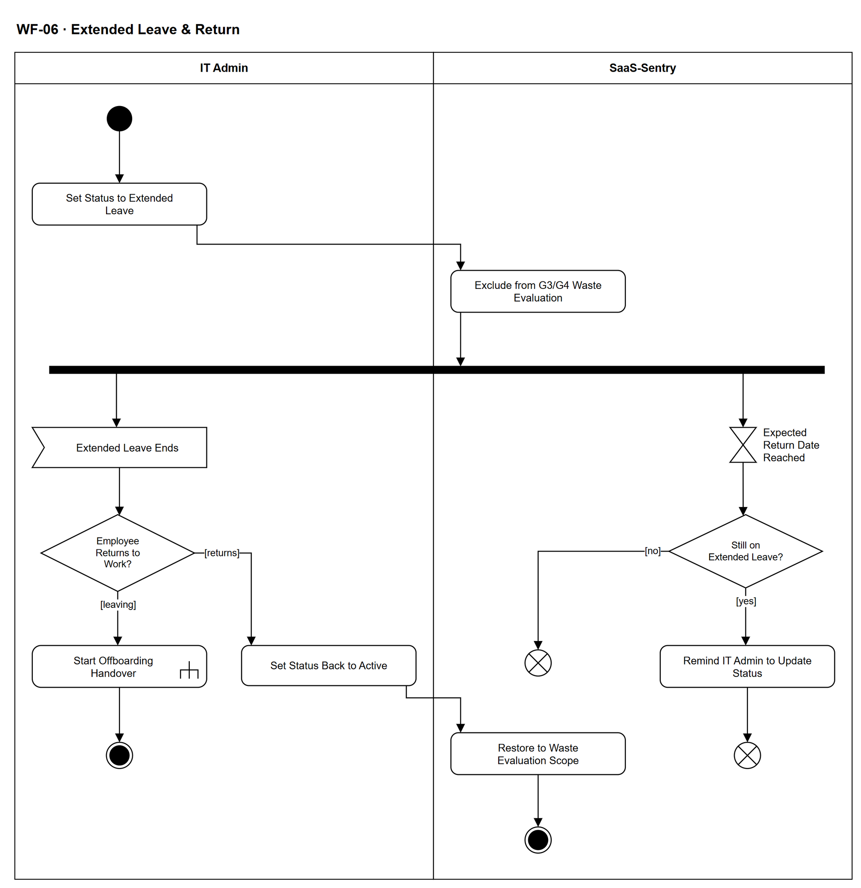

# WF-06 — Extended Leave & Return

> **Loại:** Workflow hỗ trợ (SF-3 — Các sự kiện vòng đời nhân sự khác) · **Phiên bản:** 2.1 — 09/10/2026 · **Trạng thái:** Vẽ lại theo BRD v3.30 (đồng bộ QĐ-61/QĐ-62) (FR-4.9, FR-8.9, 5.12.3) và catalog 08/10/2026; chờ Owner/GVHD review
>
> Sơ đồ là **dẫn xuất** từ quyết định Owner (`QĐ`) và BRD hiện hành; khi khác nhau, `QĐ` → BRD thắng. Quyết định trong sơ đồ là của Owner, **chưa** phải xác nhận của GVHD/hội đồng.

## 1. Mục đích và phạm vi

Mô tả việc **ghi nhận nghỉ dài và quay lại** để hệ thống không sinh khuyến nghị thu hồi sai cho người đang nghỉ phép dài. Nghỉ dài **không** phải nghỉ việc: tài khoản và mọi quyền giữ nguyên; thay đổi duy nhất là nhân viên ra khỏi phạm vi đánh giá G3/G4 trong thời gian nghỉ.

**Phạm vi:** IT Admin cập nhật tay trạng thái nghỉ dài và ngày dự kiến quay lại, cổng loại trừ số 3 của FR-4.9, nhắc IT khi quá ngày dự kiến, đổi về đang làm việc hoặc chuyển sang nghỉ việc.

**Không nằm trong sơ đồ này:** Cách rule G3/G4 chạy và các cổng loại trừ khác (→ WF-13a, WF-13); quy trình nghỉ việc (→ WF-07); nguồn dữ liệu nghỉ phép tự động (ngoài phạm vi — không tích hợp HRM).

## 2. Tệp

| Tệp | Vai trò |
| --- | --- |
| [WF-06-extended-leave-return.drawio](WF-06-extended-leave-return.drawio) | Nguồn draw.io chỉnh sửa được (sinh từ spec) |
| [WF-06-extended-leave-return.drawio.png](WF-06-extended-leave-return.drawio.png) | Bản xuất PNG, nhúng sẵn nguồn draw.io |
| [WF-06.json](../specs/WF-06.json) | **Nguồn canonical** — sửa ở đây rồi chạy `python tools/flowkit.py build` từ `Docs/Diagrams` |

## 3. Nguồn nghiệp vụ

| Mã | Nội dung dùng trong sơ đồ |
| --- | --- |
| `FR-4.9 điều kiện 3` | Loại nhân viên đang nghỉ phép dài hoặc đang bàn giao khỏi đánh giá; chỉ áp G3, G4 (OI-12a) |
| `OQ-04, GĐ-7, BRD 3.2` | Trạng thái nghỉ dài do IT Admin cập nhật tay; không tích hợp HRM |
| `FR-8.9` | Nghỉ dài không ảnh hưởng tài khoản đăng nhập |
| `BRD 5.12.3 (Employee)` | Vòng đời: đang làm → nghỉ dài → đang bàn giao → đã nghỉ việc |
| `FR-3.16, BRD 5.3` | Nghỉ phép không phải sự kiện xác định lại người duyệt; người duyệt nghỉ phép không bị thay |
| `BR-04.1, BR-04.3, US-03-03` | Không tính khoảng nghỉ vào số ngày không hoạt động; quá ngày dự kiến chỉ nhắc IT, không tự đổi trạng thái |

## 4. Tác nhân, kích hoạt, điều kiện

| Làn (tiếng Anh trên hình) | Tác nhân | Trách nhiệm trong sơ đồ |
| --- | --- | --- |
| IT Admin | IT Admin | Cập nhật tay trạng thái nghỉ dài, quay lại hoặc chuyển nghỉ việc |
| SaaS-Sentry | SaaS-Sentry | Áp cổng loại trừ số 3, theo dõi ngày dự kiến quay lại, nhắc IT |

- **Kích hoạt:** IT Admin được biết một nhân viên bắt đầu kỳ nghỉ dài (thông tin ngoài hệ thống).
- **Tiền điều kiện:** Nhân viên đang làm việc.
- **Hậu điều kiện:** Nhân viên quay lại ở trạng thái đang làm việc và vào lại phạm vi đánh giá; hoặc chuyển sang luồng nghỉ việc. Không có quyền nào bị thay đổi bởi workflow này.

## 5. Cách đọc ký hiệu

| Ký hiệu | Nghĩa |
| --- | --- |
| Hình tròn đặc | Bắt đầu hoạt động (initial node) |
| Hình chữ nhật bo góc | Hành động (action) của tác nhân ở làn chứa nó |
| Hình chữ nhật bo góc có ký hiệu cây đinh ba ở góc | Gọi workflow con (call behavior) — mã workflow ghi trong nhãn |
| Hình thoi có chữ | Rẽ nhánh; mỗi cạnh ra mang điều kiện trong ngoặc vuông `[...]` |
| Thanh đen ngang | Tách hoặc gộp các nhánh chạy song song (fork/join) |
| Hình năm cạnh lõm | Chờ một sự kiện từ bên ngoài luồng (accept event) |
| Đồng hồ cát | Chờ một mốc thời gian (time event) |
| Vòng tròn kép đặc | Kết thúc toàn bộ hoạt động (activity final) |
| Vòng tròn có dấu nhân | Kết thúc riêng nhánh đó, các nhánh khác vẫn chạy (flow final) |
| Dây có cung nhảy | Hai dây giao nhau nhưng **không** nối với nhau |

Đọc từ trên xuống. Sau thanh tách có hai nhánh song song: bên trái IT chờ kỳ nghỉ kết thúc rồi cập nhật trạng thái; bên phải hệ thống theo dõi ngày dự kiến quay lại và **chỉ nhắc** IT. Hệ thống không có cạnh nào tự đổi trạng thái. Kết thúc nhánh trái là activity final vì khi trạng thái đã đổi, nhánh theo dõi không còn ý nghĩa.

## 6. Bảng node

| ID | Loại | Nhãn trên hình | Ý nghĩa | Làn / người thực hiện | Quy tắc |
| --- | --- | --- | --- | --- | --- |
| `st` | Nút bắt đầu | — | — | IT Admin | — |
| `a_leave` | Hành động | Set Status to Extended Leave | IT Admin cập nhật tay trạng thái nhân viên sang nghỉ dài, kèm ngày dự kiến quay lại. Không có tích hợp hệ thống nhân sự, không có bước phê duyệt; hệ thống không lưu lý do nghỉ. Tài khoản đăng nhập vẫn dùng được, mọi quyền giữ nguyên. | IT Admin | `OQ-04`, `GĐ-7`, `BRD 3.2`, `FR-8.9`, `BRD 5.12.3`, `US-03-03` |
| `s_excl` | Hành động | Exclude from G3/G4 Waste Evaluation | Trong thời gian nghỉ dài, nhân viên bị loại khỏi phạm vi đánh giá ghost seat theo điều kiện loại trừ số 3 — chỉ áp cho G3, G4; G1, G2 không áp điều kiện này. Mục đích: tránh báo động giả với người đang nghỉ. | SaaS-Sentry | `FR-4.9`, `OI-12a`, `TC-2` |
| `f_wait` | Tách song song | — | — | SaaS-Sentry | — |
| `ev_end` | Chờ sự kiện | Extended Leave Ends | IT Admin được biết kỳ nghỉ dài đã kết thúc (thông tin từ ngoài hệ thống, vì không có HRM). | IT Admin | `OQ-04`, `GĐ-7` |
| `d_ret` | Rẽ nhánh | Employee Returns to Work? | Nhân viên quay lại làm việc, hay chuyển sang nghỉ việc ngay sau kỳ nghỉ (vòng đời Employee: đang làm → nghỉ dài → đang bàn giao → đã nghỉ việc). | IT Admin | `BRD 5.12.3` |
| `a_active` | Hành động | Set Status Back to Active | IT Admin đổi trạng thái về đang làm việc. Hệ thống không bao giờ tự đổi trạng thái. | IT Admin | `OQ-04`, `GĐ-7`, `BR-04.3` |
| `s_incl` | Hành động | Restore to Waste Evaluation Scope | Nhân viên vào lại phạm vi đánh giá G3/G4. Khoảng nghỉ dài không được tính vào số ngày không hoạt động — nếu không, người vừa nghỉ ba tháng quay lại sẽ bị báo ngay. | SaaS-Sentry | `FR-4.9`, `BR-04.1`, `US-03-03` |
| `end_ok` | Kết thúc hoạt động | — | Nhân viên đã quay lại; mọi quyền vẫn như trước kỳ nghỉ. | SaaS-Sentry | — |
| `c_off` | Gọi workflow con | Start Offboarding Handover | Nhân viên không quay lại mà nghỉ việc: IT Admin ghi bàn giao theo WF-07. Từ đây áp các quy tắc nghỉ việc. | IT Admin | `BRD 5.12.3`, `FR-2.12`, → `WF-07` |
| `end_off` | Kết thúc hoạt động | — | Kỳ nghỉ dài kết thúc bằng việc chuyển sang luồng nghỉ việc. | IT Admin | — |
| `t_due` | Chờ mốc thời gian | Expected Return Date Reached | Chờ tới ngày dự kiến quay lại đã ghi. | SaaS-Sentry | `BR-04.3`, `US-03-03` |
| `d_still` | Rẽ nhánh | Still on Extended Leave? | Tới ngày dự kiến mà trạng thái vẫn là nghỉ dài (IT chưa cập nhật). | SaaS-Sentry | `BR-04.3` |
| `s_remind` | Hành động | Remind IT Admin to Update Status | Hệ thống chỉ nhắc IT Admin cập nhật trạng thái — không tự đổi trạng thái, không đưa nhân viên trở lại phạm vi đánh giá. | SaaS-Sentry | `BR-04.3`, `US-03-03` |
| `ff_rem` | Kết thúc nhánh (flow final) | — | Nhánh theo dõi ngày dự kiến kết thúc sau khi nhắc; nhân viên vẫn ở trạng thái nghỉ dài cho tới khi IT cập nhật. | SaaS-Sentry | — |
| `ff_ok` | Kết thúc nhánh (flow final) | — | Trạng thái đã được cập nhật trước ngày dự kiến; không cần nhắc. | SaaS-Sentry | — |

## 7. Bảng chuyển tiếp

| Từ → tới | Nhãn điều kiện | Điều kiện | Kết quả |
| --- | --- | --- | --- |
| `st` → `a_leave` | — | — | Sang Set Status to Extended Leave |
| `a_leave` → `s_excl` | — | — | Sang Exclude from G3/G4 Waste Evaluation |
| `s_excl` → `f_wait` | — | — | Sang — |
| `f_wait` → `ev_end` | — | — | Nhánh chờ nhân viên kết thúc kỳ nghỉ |
| `f_wait` → `t_due` | — | — | Nhánh theo dõi ngày dự kiến quay lại |
| `ev_end` → `d_ret` | — | — | Sang Employee Returns to Work? |
| `d_ret` → `a_active` | `[returns]` | Nhân viên quay lại làm việc | Đổi về đang làm việc |
| `d_ret` → `c_off` | `[leaving]` | Nhân viên nghỉ việc sau kỳ nghỉ | Chuyển sang luồng nghỉ việc WF-07 |
| `a_active` → `s_incl` | — | — | Sang Restore to Waste Evaluation Scope |
| `s_incl` → `end_ok` | — | — | Sang — |
| `c_off` → `end_off` | — | — | Sang — |
| `t_due` → `d_still` | — | — | Sang Still on Extended Leave? |
| `d_still` → `s_remind` | `[yes]` | Trạng thái vẫn là nghỉ dài | Nhắc IT Admin |
| `d_still` → `ff_ok` | `[no]` | IT đã cập nhật trạng thái | Kết thúc nhánh theo dõi |
| `s_remind` → `ff_rem` | — | — | Sang — |

Số đếm: **16 node · 15 cạnh · 2 rẽ nhánh**; giao cắt dây: **0**.

## 8. Happy path

1. `st` — —
2. `a_leave` — Set Status to Extended Leave: IT Admin cập nhật tay trạng thái nhân viên sang nghỉ dài, kèm ngày dự kiến quay lại. Không có tích hợp hệ thống nhân sự, không có bước phê duyệt; hệ thống không lưu lý do nghỉ. Tài khoản đăng nhập vẫn dùng được, mọi quyền giữ nguyên.
3. `s_excl` — Exclude from G3/G4 Waste Evaluation: Trong thời gian nghỉ dài, nhân viên bị loại khỏi phạm vi đánh giá ghost seat theo điều kiện loại trừ số 3 — chỉ áp cho G3, G4; G1, G2 không áp điều kiện này. Mục đích: tránh báo động giả với người đang nghỉ.
4. `f_wait` — —
5. `ev_end` — Extended Leave Ends: IT Admin được biết kỳ nghỉ dài đã kết thúc (thông tin từ ngoài hệ thống, vì không có HRM).
6. `d_ret` — Employee Returns to Work?: Nhân viên quay lại làm việc, hay chuyển sang nghỉ việc ngay sau kỳ nghỉ (vòng đời Employee: đang làm → nghỉ dài → đang bàn giao → đã nghỉ việc).
7. `a_active` — Set Status Back to Active: IT Admin đổi trạng thái về đang làm việc. Hệ thống không bao giờ tự đổi trạng thái.
8. `s_incl` — Restore to Waste Evaluation Scope: Nhân viên vào lại phạm vi đánh giá G3/G4. Khoảng nghỉ dài không được tính vào số ngày không hoạt động — nếu không, người vừa nghỉ ba tháng quay lại sẽ bị báo ngay.
9. `end_ok` — —: Nhân viên đã quay lại; mọi quyền vẫn như trước kỳ nghỉ.

## 9. Nhánh thay thế / if-else

- **Không quay lại mà nghỉ việc** — `d_ret` → `c_off` → `end_off`. Chuyển sang WF-07; nhân viên vẫn bị loại khỏi G3/G4 khi đang bàn giao (FR-4.9 điều kiện 3).
- **Trạng thái đã cập nhật trước ngày dự kiến** — `t_due` → `d_still` → `ff_ok`. Không nhắc.

## 10. Nhánh lỗi / từ chối và cách kết thúc

- **Quá ngày dự kiến mà chưa cập nhật** — `t_due` → `d_still` → `s_remind` → `ff_rem`. Chỉ nhắc IT Admin; nhân viên vẫn bị loại khỏi đánh giá cho tới khi IT cập nhật. Nếu IT không bao giờ cập nhật, nhân viên ở ngoài phạm vi G3/G4 vô thời hạn — rủi ro đã nêu ở GĐ-7.

## 11. Liên hệ với sơ đồ khác

- Cấp trên: SF-3 (Các sự kiện vòng đời nhân sự khác)
- `WF-13a` — cổng loại trừ số 3 dùng trạng thái này
- `WF-07` — khi nhân viên nghỉ việc sau kỳ nghỉ
- Nếu người nghỉ dài là trưởng phòng: bước duyệt nhu cầu **không** được chuyển người (FR-3.16); chỉ nhắc và cảnh báo nghẽn theo FR-3.8
- `WF-07` — gọi/chuyển tại node `c_off`

## 12. Giới hạn và vấn đề còn mở

- (DEFERRED/OUT · DOI-50, QĐ-59e) *Ngày dự kiến quay lại* và *nhắc khi quá ngày* lấy từ User Flows `BR-04.3`, `US-03-03`; BRD không nhắc — giữ vẽ, chốt lại khi thiết kế lại User Stories.
- (DEFERRED/OUT · DOI-50) Khuyến nghị đang mở *tạm dừng* trong kỳ nghỉ (`US-03-03`) không vẽ thành bước riêng; cổng 3 của FR-4.9 đã chặn khuyến nghị G3/G4 mới.
- (LATER-TECH/UI · DOI-51) Bảng chuyển trạng thái Employee đầy đủ thuộc thiết kế kỹ thuật (BRD 5.12); nhánh *nghỉ dài → nghỉ việc* suy ra từ thứ tự trạng thái.
- (LATER-TECH/UI · DOI-51) Đổi ngày dự kiến quay lại khi kỳ nghỉ kéo dài: IT cập nhật lại trường ngày, không có bước duyệt.
