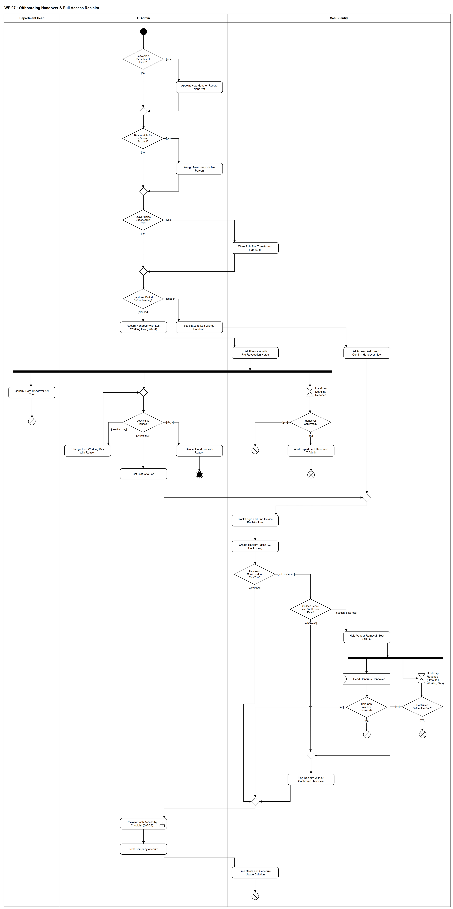

# WF-07 — Offboarding Handover & Full Access Reclaim

> **Loại:** Workflow chi tiết của `MF-5` · **Phiên bản:** 3.2 — 10/10/2026 · **Trạng thái:** Vẽ lại theo QĐ-56b/c, QĐ-58d, QĐ-48a–c, QĐ-41a, QĐ-47b, mô hình phòng ban và QĐ-62c/e/p (09/10/2026: giữ gỡ ở nhà cung cấp khi nghỉ đột ngột, phòng thiếu trưởng phòng, tác vụ đổi mật khẩu riêng); thay bản cũ dựa trên cây `manager_id`; chờ Owner/GVHD review
>
> Sơ đồ là **dẫn xuất** từ quyết định Owner (`QĐ`) và BRD hiện hành; khi khác nhau, `QĐ` → BRD thắng. Quyết định trong sơ đồ là của Owner, **chưa** phải xác nhận của GVHD/hội đồng.

## 1. Mục đích và phạm vi

Chi tiết hóa `MF-5`: **thu hồi toàn bộ quyền khi nhân viên nghỉ việc** mà không làm mất dữ liệu công ty và không để lại lỗ hổng truy cập. Bổ sung so với `MF-5`: nghỉ đột ngột không qua bàn giao, đổi ngày làm việc cuối, cảnh báo người giữ vai Super Admin, việc đổi mật khẩu tài khoản dùng chung, và quy tắc chi tiết ở từng bước.

**Phạm vi:** Thay trưởng phòng và người chịu trách nhiệm tài khoản dùng chung, cảnh báo vai Super Admin, ghi bàn giao (BM-04) hoặc nghỉ đột ngột, liệt kê quyền kèm lưu ý trước khi thu hồi, xác nhận bàn giao dữ liệu có hạn, giữ việc gỡ ở nhà cung cấp có hạn khi nghỉ đột ngột (gói mất dữ liệu), đổi ngày làm việc cuối, hủy bàn giao, chuyển đã nghỉ việc, chặn tài khoản, thu hồi theo BM-08, khóa tài khoản công ty, xóa dữ liệu hoạt động trong 30 ngày.

**Không nằm trong sơ đồ này:** Chi tiết thu hồi từng kiểu cấp (→ WF-09a); chuyển giao vai Super Admin và khôi phục ngoài ứng dụng (→ WF-03, FR-8.10); seat của người đã nghỉ trong đánh giá lãng phí (→ WF-13, G2).

## 2. Tệp

| Tệp | Vai trò |
| --- | --- |
| [WF-07-offboarding-handover-full-access-reclaim.drawio](WF-07-offboarding-handover-full-access-reclaim.drawio) | Nguồn draw.io chỉnh sửa được (sinh từ spec) |
| [WF-07-offboarding-handover-full-access-reclaim.drawio.png](WF-07-offboarding-handover-full-access-reclaim.drawio.png) | Bản xuất PNG, nhúng sẵn nguồn draw.io |
| [WF-07.json](../specs/WF-07.json) | **Nguồn canonical** — sửa ở đây rồi chạy `python tools/flowkit.py build` từ `Docs/Diagrams` |

## 3. Nguồn nghiệp vụ

| Mã | Nội dung dùng trong sơ đồ |
| --- | --- |
| `FR-2.12, QĐ-56b, BM-08` | Bàn giao dữ liệu trước khi thu hồi; không kế nhiệm license; checklist bốn bước |
| `QĐ-56c, QĐ-58d, FR-2.11` | Tài khoản dùng chung: người chịu trách nhiệm được thay trước; thành viên rời ⟹ đổi mật khẩu/thiết bị xác thực |
| `FR-3.6, QĐ-52a, QĐ-52c, QĐ-58a, INV-19` | Trưởng phòng nghỉ ⟹ trưởng phòng mới hoặc approver dự phòng; một người làm trưởng tối đa một phòng |
| `QĐ-40a` | Chỉ định thay thế là điều kiện của thao tác bàn giao; nghỉ đột ngột chỉ định trong cùng thao tác (cách diễn đạt theo cây quản lý cũ, áp lại cho trưởng phòng) |
| `FR-1.9` | Lưu ý trước khi thu hồi theo gói |
| `FR-8.9, QĐ-41a, QĐ-39d` | Chặn tài khoản theo trạng thái đã nghỉ việc, không theo ngày; đang bàn giao vẫn truy cập được |
| `FR-8.10(e), QĐ-47b` | Người giữ vai Super Admin bàn giao/nghỉ: cảnh báo, audit có cờ, không chặn |
| `QĐ-48a → QĐ-48c` | Đổi ngày làm việc cuối (chưa qua ngày cuối) và hủy bàn giao (trước đã nghỉ việc), lý do bắt buộc |
| `OI-14c` | Hạn bàn giao 1 ngày làm việc trước ngày cuối, không chặn thu hồi |
| `FR-4.18, FR-10.6` | Đăng ký thiết bị hết hiệu lực; xóa dữ liệu hoạt động chi tiết trong 30 ngày |
| `FR-2.4, FR-4.15, FR-2.9` | Thu hồi không tự ghi tiết kiệm; khóa tài khoản công ty không tự dừng tính tiền |
| `BRD 4.6, 5.10 dòng Nhân viên nghỉ việc, 5.12.3` | Ma trận trách nhiệm, luồng và vòng đời Employee |
| `FR-2.12, BM-08` | Thứ tự: (1) bàn giao dữ liệu → (2) gỡ người dùng; bàn giao không chặn thu hồi quá hạn |
| `QĐ-62e` | Nghỉ đột ngột: chặn đăng nhập ngay; chỉ gói có lưu ý mất dữ liệu mới giữ việc gỡ ở nhà cung cấp chờ xác nhận hoặc tới hạn (mặc định 1 ngày làm việc); seat vẫn tính phí, hiện G2; phòng thiếu trưởng phòng ⟹ hết hạn thì gỡ |
| `QĐ-62c` | Phòng thiếu trưởng phòng: xác nhận bàn giao chờ, không giao ai; cảnh báo IT Admin, Super Admin; trưởng phòng mới nhận việc, hạn giữ nguyên |
| `QĐ-62p(2)` | Đổi mật khẩu/thiết bị xác thực tài khoản dùng chung là tác vụ IT riêng có cảnh báo; hồ sơ xong khi tác vụ đã được tạo |
| `BRD 5.10 dòng MF-5, QĐ-52a` | Người nghỉ là trưởng phòng ⟹ chỉ định trưởng phòng mới (chưa có ⟹ FR-3.6) |

## 4. Tác nhân, kích hoạt, điều kiện

| Làn (tiếng Anh trên hình) | Tác nhân | Trách nhiệm trong sơ đồ |
| --- | --- | --- |
| Department Head | Trưởng phòng của người nghỉ (trưởng phòng mới nếu chính người nghỉ là trưởng phòng; phòng thiếu trưởng phòng thì việc chờ, không giao ai — QĐ-62c) | Xác nhận bàn giao dữ liệu từng công cụ |
| IT Admin | IT Admin phụ trách phòng | Chỉ định người thay, ghi bàn giao/nghỉ việc, đổi ngày, hủy, thu hồi, khóa tài khoản công ty |
| SaaS-Sentry | SaaS-Sentry | Cảnh báo, liệt kê quyền, theo dõi hạn, chặn tài khoản, tạo tác vụ, xóa dữ liệu hoạt động |

- **Kích hoạt:** Doanh nghiệp xác định nhân viên nghỉ việc (có kế hoạch hoặc đột ngột); IT Admin xử lý.
- **Tiền điều kiện:** Nhân viên đang làm việc hoặc nghỉ dài, thuộc một phòng có hiệu lực; mỗi gói có lưu ý trước khi thu hồi (FR-1.9).
- **Hậu điều kiện:** Nhân viên ở trạng thái đã nghỉ việc; tài khoản đăng nhập bị chặn; mọi quyền đã thu hồi và seat về kho — hoặc, nếu tác vụ thu hồi của một quyền bị IT đóng là thất bại, quyền đó còn hiệu lực, vẫn hiện G2 chờ tác vụ mới (QĐ-62i); dữ liệu được bàn giao hoặc ghi rõ không cần, hoặc thu hồi có cờ *chưa xác nhận bàn giao*; phòng có trưởng phòng mới hoặc ở ca approver dự phòng; tài khoản dùng chung có người chịu trách nhiệm mới và **đã có tác vụ đổi mật khẩu/thiết bị xác thực cho IT** (tác vụ riêng có cảnh báo, QĐ-62p); dữ liệu hoạt động chi tiết được xóa trong 30 ngày. Hoặc: bàn giao bị hủy, không có thay đổi quyền.

## 5. Cách đọc ký hiệu

| Ký hiệu | Nghĩa |
| --- | --- |
| Hình tròn đặc | Bắt đầu hoạt động (initial node) |
| Hình chữ nhật bo góc | Hành động (action) của tác nhân ở làn chứa nó |
| Hình chữ nhật bo góc có ký hiệu cây đinh ba ở góc | Gọi workflow con (call behavior) — mã workflow ghi trong nhãn |
| Hình thoi có chữ | Rẽ nhánh; mỗi cạnh ra mang điều kiện trong ngoặc vuông `[...]` |
| Hình thoi nhỏ không chữ | Hợp nhánh (merge) |
| Thanh đen ngang | Tách hoặc gộp các nhánh chạy song song (fork/join) |
| Hình năm cạnh lõm | Chờ một sự kiện từ bên ngoài luồng (accept event) |
| Đồng hồ cát | Chờ một mốc thời gian (time event) |
| Vòng tròn kép đặc | Kết thúc toàn bộ hoạt động (activity final) |
| Vòng tròn có dấu nhân | Kết thúc riêng nhánh đó, các nhánh khác vẫn chạy (flow final) |
| Dây có cung nhảy | Hai dây giao nhau nhưng **không** nối với nhau |

Phần trên là các điều kiện của chính thao tác ghi bàn giao (`QĐ-40a`; trưởng phòng nghỉ thì chỉ định người mới hoặc ghi *chưa có người*), nên được vẽ trước; `MF-5` vẽ cùng thứ tự. Nhánh *sudden* đi thẳng tới điểm hợp trước bước chặn tài khoản. Sau thanh tách có ba nhánh song song: trưởng phòng xác nhận bàn giao dữ liệu (trái), IT xử lý chính với vòng đổi ngày làm việc cuối (giữa), hệ thống theo dõi hạn bàn giao và **chỉ cảnh báo** (phải). Ở phần thu hồi, công cụ chưa xác nhận bàn giao rẽ ở `d_hold`: chỉ ca nghỉ đột ngột với gói mất dữ liệu mới vào vùng chờ có hạn — thanh tách `f_hold` mở hai nhánh chờ (xác nhận của trưởng phòng · hết hạn giữ); nhánh tới trước dẫn tới gỡ, nhánh tới sau kết thúc bằng flow final. Kết thúc nhánh chính là flow final (để nhánh giữ có hạn của từng công cụ tự kết thúc); nhánh hủy là activity final. Phần thu hồi xét **từng công cụ**. **Ngoại lệ biểu diễn:** token của từng công cụ đang giữ có hạn chỉ thực hiện bước 2 của BM-08 (gỡ ở nhà cung cấp) cho công cụ đó rồi đi chung qua `a_lock` và `s_close` để kết thúc ở flow final; hai bước này là bước 3–4 của **hồ sơ** và chỉ thực hiện một lần, không lặp theo từng công cụ.

## 6. Bảng node

| ID | Loại | Nhãn trên hình | Ý nghĩa | Làn / người thực hiện | Quy tắc |
| --- | --- | --- | --- | --- | --- |
| `st` | Nút bắt đầu | — | — | IT Admin | — |
| `d_head` | Rẽ nhánh | Leaver Is a Department Head? | Người nghỉ có đang là trưởng phòng có hiệu lực không. Nếu có, chính thao tác ghi bàn giao (hoặc ghi nghỉ việc đột ngột) phải xử lý vị trí trưởng phòng: chỉ định người mới hoặc ghi tường minh *chưa có trưởng phòng* (a_newhead) — không để trống ngầm; chưa có người kế nhiệm không chặn thao tác. | IT Admin | `FR-3.1`, `INV-19`, `QĐ-40a` |
| `a_newhead` | Hành động | Appoint New Head or Record None Yet | IT chỉ định trưởng phòng mới, hiệu lực từ ngày sau ngày làm việc cuối; người này không được đang làm trưởng phòng khác (INV-19). Chưa có người ⟹ ghi tường minh *chưa có trưởng phòng*: bước nhu cầu của phòng tới approver dự phòng ở gốc (FR-3.6, QĐ-52c), IT Admin và Super Admin thấy cảnh báo phòng thiếu trưởng phòng. Thành viên phòng không đổi; bước nhu cầu đang chờ được xác định lại, SLA không đặt lại (FR-3.16). Phòng thiếu trưởng phòng: việc vốn giao trưởng phòng ngoài bước nhu cầu — ở luồng này là xác nhận bàn giao dữ liệu — **chờ, không giao ai** (approver dự phòng không nhận); khi có trưởng phòng mới, việc đang mở chuyển sang người đó, hạn không đặt lại (QĐ-62c). | IT Admin | `FR-3.6`, `FR-3.16`, `QĐ-52a`, `QĐ-52c`, `QĐ-58a`, `FR-5.14`, `QĐ-62c` |
| `m_head` | Hợp nhánh | — | — | IT Admin | — |
| `d_shared` | Rẽ nhánh | Responsible for a Shared Account? | Người nghỉ có đang là người chịu trách nhiệm một tài khoản dùng chung hoặc tài khoản dịch vụ không. | IT Admin | `FR-2.12`, `QĐ-56c`, `QĐ-40d` |
| `a_resp` | Hành động | Assign New Responsible Person | Chỉ định người chịu trách nhiệm mới **trước ngày hiệu lực** (lúc chuyển *đã nghỉ việc*); ghi bàn giao không bị chặn, chỉ nhắc; tới ngày đó chưa có thì cảnh báo và hồ sơ nghỉ việc không đóng được (`QĐ-66i`) — mặc định trưởng phòng; trưởng phòng nghỉ thì trưởng phòng mới. Trong thời gian đang bàn giao, trưởng phòng và IT Admin thấy cảnh báo cho tới khi xong. Owner workspace phía nhà cung cấp luôn là tài khoản IT nên không phải chuyển. | IT Admin | `FR-2.12`, `FR-2.9`, `QĐ-56c`, `QĐ-58d`, `QĐ-43a`, `FR-5.14` |
| `m_resp` | Hợp nhánh | — | — | IT Admin | — |
| `d_sa` | Rẽ nhánh | Leaver Holds Super Admin Role? | Người nghỉ có đang giữ vai Super Admin duy nhất của tổ chức không. | IT Admin | `FR-8.10`, `QĐ-44`, `QĐ-47b` |
| `s_sawarn` | Hành động | Warn Role Not Transferred; Flag Audit | Hệ thống cảnh báo IT Admin (không chặn) rằng vai Super Admin chưa được chuyển giao và ghi audit có cờ; người giữ vai cũng thấy cảnh báo trong thời gian đang bàn giao. Nghỉ có kế hoạch: Super Admin chuyển giao vai trước (WF-03). Nghỉ khẩn cấp: khôi phục ngoài ứng dụng kiểu chuyển lại vai. | SaaS-Sentry | `FR-8.10`, `QĐ-47b`, `QĐ-44c` |
| `m_sa` | Hợp nhánh | — | — | IT Admin | — |
| `d_notice` | Rẽ nhánh | Handover Period Before Leaving? | Nghỉ có kế hoạch (có thời gian bàn giao trước ngày làm việc cuối) hay nghỉ đột ngột (IT ghi thẳng đã nghỉ việc). | IT Admin | `QĐ-40a`, `FR-8.10` |
| `a_hand` | Hành động | Record Handover with Last Working Day (BM-04) | IT Admin ghi bàn giao kèm ngày làm việc cuối và lập biên bản BM-04; nhân viên chuyển trạng thái đang bàn giao. Tài khoản đăng nhập vẫn dùng được; nhân viên bị loại khỏi đánh giá G3/G4 trong giai đoạn này. | IT Admin | `BM-04`, `FR-8.9`, `QĐ-41a`, `FR-4.9` |
| `a_sudden` | Hành động | Set Status to Left Without Handover | Nghỉ đột ngột: IT chuyển thẳng sang đã nghỉ việc; các chỉ định thay thế ở trên được ghi trong cùng thao tác. Đăng nhập SaaS-Sentry bị chặn ngay theo trạng thái (FR-8.9). Không có thời gian bàn giao trước ngày cuối, nhưng bàn giao dữ liệu vẫn được yêu cầu ngay; gói mà lưu ý trước khi thu hồi nói dữ liệu sẽ mất thì việc gỡ ở nhà cung cấp được giữ chờ (QĐ-62e, xem `d_hold`). | IT Admin | `FR-8.10`, `FR-8.9`, `FR-2.12`, `QĐ-62e` |
| `s_ask` | Hành động | List Access; Ask Head to Confirm Handover Now | Liệt kê mọi quyền kèm lưu ý trước khi thu hồi và đề nghị trưởng phòng xác nhận bàn giao dữ liệu từng công cụ ngay. Hạn OI-14c đã qua (ngày cuối là hôm nay) nên xác nhận không chặn thu hồi, trừ phần giữ có hạn của QĐ-62e cho gói mất dữ liệu. Phòng thiếu trưởng phòng (ghi *chưa có người*) ⟹ việc xác nhận chờ, không giao ai; IT Admin và Super Admin thấy cảnh báo phòng thiếu trưởng phòng (QĐ-62c). | SaaS-Sentry | `FR-2.12`, `BM-08`, `OI-14c`, `QĐ-62e`, `QĐ-62c` |
| `s_list` | Hành động | List All Access with Pre-Revocation Notes | Hệ thống liệt kê mọi quyền đang giữ (cá nhân, khóa bản quyền, tài khoản dùng chung là thành viên) kèm lưu ý trước khi thu hồi của từng gói: dữ liệu nào mất khi gỡ người dùng, cần chuyển gì trước. | SaaS-Sentry | `FR-1.9`, `FR-2.12`, `BM-08` |
| `f_par` | Tách song song | — | — | SaaS-Sentry | — |
| `a_data` | Hành động | Confirm Data Handover per Tool | Trưởng phòng xác nhận từng công cụ: đã bàn giao dữ liệu hoặc không cần — bước 1 của checklist BM-08. Không có người kế nhiệm license. Phòng thiếu trưởng phòng (trưởng phòng nghỉ và ghi *chưa có người*): việc xác nhận chờ, không giao ai, quyền không đổi; có trưởng phòng mới thì việc chuyển sang người đó, hạn không đặt lại; bàn giao chưa xác nhận không chặn thu hồi quá hạn (QĐ-62c). | Department Head | `FR-2.12`, `BM-08`, `QĐ-56b`, `QĐ-62c` |
| `ff_data` | Kết thúc nhánh (flow final) | — | Nhánh bàn giao dữ liệu kết thúc. | Department Head | — |
| `m_wait` | Hợp nhánh | — | — | IT Admin | — |
| `d_it` | Rẽ nhánh | Leaving as Planned? | Trước khi chuyển đã nghỉ việc: nhân viên nghỉ đúng ngày đã ghi, cần đổi ngày làm việc cuối, hay ở lại (hủy bàn giao). | IT Admin | `QĐ-48a` |
| `a_change` | Hành động | Change Last Working Day with Reason | Chỉ khi hôm nay ≤ ngày làm việc cuối hiện tại; ngày mới ≥ max(hôm nay, ngày vào), sớm hay muộn đều được. Lý do bắt buộc, Audit Trail ghi giá trị trước/sau. Chỉ định thay thế đã ghi được mang sang ngày mới và kiểm lại; hạn bàn giao tính lại theo ngày mới. | IT Admin | `QĐ-48a`, `QĐ-48b`, `QĐ-48c`, `OI-14c` |
| `a_cancel` | Hành động | Cancel Handover with Reason | Được bất kỳ lúc nào trước đã nghỉ việc (kể cả sau ngày làm việc cuối). Nhân viên trở lại đang làm việc, không thu hồi quyền; thay đổi đã có hiệu lực (ví dụ trưởng phòng mới) giữ nguyên làm lịch sử. Lý do bắt buộc. | IT Admin | `QĐ-48a`, `QĐ-48c` |
| `end_cancel` | Kết thúc hoạt động | — | Bàn giao bị hủy — không có thu hồi. | IT Admin | — |
| `t_due` | Chờ mốc thời gian | Handover Deadline Reached | Mốc 1 ngày làm việc trước ngày làm việc cuối. | SaaS-Sentry | `OI-14c` |
| `d_conf` | Rẽ nhánh | Handover Confirmed? | Trưởng phòng đã xác nhận bàn giao dữ liệu cho mọi công cụ chưa. | SaaS-Sentry | `OI-14c`, `FR-2.12` |
| `ff_conf` | Kết thúc nhánh (flow final) | — | Đã xác nhận đúng hạn. | SaaS-Sentry | — |
| `s_alert` | Hành động | Alert Department Head and IT Admin | Cảnh báo bàn giao dữ liệu chưa xác nhận. Chỉ cảnh báo — không chặn việc chuyển đã nghỉ việc và thu hồi. | SaaS-Sentry | `FR-2.12`, `FR-5.14`, `OI-14c`, `QĐ-56b` |
| `ff_alert` | Kết thúc nhánh (flow final) | — | Nhánh hạn kết thúc sau cảnh báo. | SaaS-Sentry | — |
| `a_left` | Hành động | Set Status to Left | IT chuyển nhân viên sang đã nghỉ việc (S0 làm tay; tự động khi tới ngày cuối là lát sau). Người đang bàn giao đã qua ngày cuối mà chưa chuyển vẫn truy cập được và nằm trong danh sách cần xử lý của IT Admin. | IT Admin | `FR-8.9`, `QĐ-41a`, `FR-8.10` |
| `m_left` | Hợp nhánh | — | — | SaaS-Sentry | — |
| `s_block` | Hành động | Block Login and End Device Registrations | Mọi thao tác của tài khoản liên kết bị từ chối ngay, kể cả khi phiên chưa hết hạn và kể cả ca nghỉ đột ngột (QĐ-62e); hệ thống nhắc Super Admin khóa tài khoản chính thức. Đăng ký thiết bị hết hiệu lực nên không nhận thêm dữ liệu từ thiết bị đó. | SaaS-Sentry | `FR-8.9`, `QĐ-39d`, `FR-4.18`, `QĐ-62e` |
| `s_tasks` | Hành động | Create Reclaim Tasks (G2 Until Done) | Tạo tác vụ thu hồi cho IT Admin phụ trách phòng (IT Admin khác xử lý thay được, có Audit Trail). Với tài khoản dùng chung mà người nghỉ là thành viên, tạo **tác vụ IT riêng** đổi mật khẩu/thiết bị xác thực, có cảnh báo riêng; hồ sơ nghỉ việc không chờ tác vụ này xong (QĐ-62p). Seat còn gán cho người đã nghỉ là lãng phí G2 cho tới khi thu hồi xong. | SaaS-Sentry | `BRD 5.12.3`, `FR-2.11`, `FR-3.17`, `BRD 5.4.1`, `QĐ-62p` |
| `d_hc` | Rẽ nhánh | Handover Confirmed for This Tool? | Xét **từng công cụ** trước bước 2 của BM-08 (gỡ khỏi workspace, hủy gia hạn, thu khóa): trưởng phòng đã xác nhận *đã bàn giao* hoặc *không cần* chưa. Bàn giao đi trước thu hồi; bàn giao quá hạn **không** chặn thu hồi (OI-14c), trừ phần giữ có hạn của ca nghỉ đột ngột (QĐ-62e). | SaaS-Sentry | `FR-2.12`, `BM-08`, `QĐ-56b`, `OI-14c`, `QĐ-62e` |
| `d_hold` | Rẽ nhánh | Sudden Leave and Tool Loses Data? | Chỉ giữ khi **cả hai**: người nghỉ đột ngột (chuyển thẳng đã nghỉ việc) **và** lưu ý trước khi thu hồi của gói nói dữ liệu sẽ mất khi gỡ người dùng. Nghỉ có kế hoạch đã qua hạn OI-14c, hoặc gói không mất dữ liệu ⟹ gỡ ngay kèm cờ. | SaaS-Sentry | `QĐ-62e`, `FR-1.9`, `FR-2.12`, `OI-14c` |
| `s_hold` | Hành động | Hold Vendor Removal; Seat Still G2 | Chỉ giữ bước gỡ người dùng ở nhà cung cấp của công cụ đó; đăng nhập SaaS-Sentry đã bị chặn và các công cụ khác vẫn gỡ ngay. Trong lúc giữ, seat vẫn tính phí và hiện là G2; trưởng phòng và IT Admin thấy công cụ đang giữ chờ xác nhận. Hạn giữ cấu hình được, mặc định 1 ngày làm việc kể từ khi chuyển đã nghỉ việc. | SaaS-Sentry | `QĐ-62e`, `BRD 5.4.1`, `FR-8.2` |
| `f_hold` | Tách song song | — | — | SaaS-Sentry | — |
| `e_conf` | Chờ sự kiện | Head Confirms Handover | Trưởng phòng xác nhận *đã bàn giao* hoặc *không cần* cho công cụ đang giữ. Phòng thiếu trưởng phòng ⟹ sự kiện này chưa thể xảy ra (việc chờ, không giao ai, QĐ-62c) nên hết hạn giữ thì gỡ. | SaaS-Sentry | `QĐ-62e`, `QĐ-62c`, `BM-08` |
| `t_cap` | Chờ mốc thời gian | Hold Cap Reached (Default 1 Working Day) | Hết hạn giữ cấu hình được (mặc định 1 ngày làm việc). | SaaS-Sentry | `QĐ-62e`, `FR-8.2` |
| `d_late` | Rẽ nhánh | Hold Cap Already Reached? | Xác nhận tới sau khi hết hạn giữ thì việc gỡ đã chạy theo nhánh hạn; xác nhận chỉ được ghi lại. | SaaS-Sentry | `QĐ-62e` |
| `ff_late` | Kết thúc nhánh (flow final) | — | Xác nhận muộn được ghi lại; việc gỡ đã chạy theo nhánh hạn giữ. | SaaS-Sentry | — |
| `d_capc` | Rẽ nhánh | Confirmed Before the Cap? | Tới hạn giữ: trưởng phòng đã xác nhận cho công cụ này chưa. | SaaS-Sentry | `QĐ-62e` |
| `ff_cap` | Kết thúc nhánh (flow final) | — | Đã xác nhận trước hạn; việc gỡ đã chạy theo nhánh xác nhận. | SaaS-Sentry | — |
| `m_over` | Hợp nhánh | — | — | SaaS-Sentry | — |
| `s_over` | Hành động | Flag Reclaim Without Confirmed Handover | Chưa có xác nhận bàn giao — nghỉ có kế hoạch đã qua hạn OI-14c, gói không mất dữ liệu, hoặc hết hạn giữ của ca nghỉ đột ngột: thu hồi vẫn tiếp tục; Audit Trail ghi cờ *thu hồi khi chưa xác nhận bàn giao* và trưởng phòng, IT Admin thấy trong danh sách cần xử lý. | SaaS-Sentry | `FR-2.12`, `OI-14c`, `FR-5.14`, `QĐ-62e` |
| `m_hc` | Hợp nhánh | — | — | SaaS-Sentry | — |
| `c_reclaim` | Gọi workflow con | Reclaim Each Access by Checklist (BM-08) | Bước 2 của BM-08 cho từng quyền: gỡ khỏi workspace (K2), hủy gia hạn gói cá nhân — dùng tới hết kỳ (K1), gỡ kích hoạt và thu khóa về kho (K4), phần mềm nội bộ thu hồi ngoài hệ thống kèm bằng chứng (K5). Đổi mật khẩu/thiết bị xác thực tài khoản dùng chung là tác vụ IT riêng đã tạo ở `s_tasks`, không phải điều kiện đóng hồ sơ (QĐ-62p). Không chuyển license cho người kế nhiệm. Nếu một tác vụ bị IT đóng là thất bại (WF-09a, QĐ-62i), quyền đó vẫn hiện là G2 trên danh sách cần xử lý và IT mở tác vụ mới; khóa tài khoản công ty không chờ tác vụ đó. | IT Admin | `FR-2.4`, `FR-2.10`, `FR-2.11`, `FR-2.12`, `BM-08`, `SoD-5`, `QĐ-62p`, → `WF-09a` |
| `a_lock` | Hành động | Lock Company Account | Bước 3 của BM-08: khóa tài khoản email công ty (Google Workspace/Microsoft 365). Khóa tài khoản không tự dừng tính tiền — vì vậy bước 2 phải gỡ seat ở từng nhà cung cấp. | IT Admin | `FR-2.9`, `BM-08`, `QĐ-54c` |
| `s_close` | Hành động | Free Seats and Schedule Usage Deletion | Bước 4: seat trống về kho; tiết kiệm chỉ ghi khi hợp đồng/khoản chi thực sự giảm. Xóa bản ghi hoạt động chi tiết trong 30 ngày kể từ ngày làm việc cuối; giữ dữ liệu tổng hợp phi định danh và Audit Trail; tác vụ xóa ghi số bản ghi và thời điểm. | SaaS-Sentry | `FR-4.15`, `FR-2.4`, `FR-10.6`, `BM-08` |
| `end_ok` | Kết thúc nhánh (flow final) | — | Nghỉ việc hoàn tất: tài khoản đăng nhập đã bị chặn và các quyền đã được xử lý — quyền có tác vụ thu hồi bị đóng thất bại vẫn còn, hiện G2 chờ tác vụ mới (QĐ-62i); tác vụ đổi mật khẩu/thiết bị xác thực tài khoản dùng chung (nếu có) đã được tạo và có cảnh báo riêng (QĐ-62p). Là flow final: các nhánh chờ giữ có hạn (`e_conf`, `t_cap`) của từng công cụ vẫn kết thúc riêng ở `ff_late`/`ff_cap`. | SaaS-Sentry | — |

## 7. Bảng chuyển tiếp

| Từ → tới | Nhãn điều kiện | Điều kiện | Kết quả |
| --- | --- | --- | --- |
| `st` → `d_head` | — | — | Sang Leaver Is a Department Head? |
| `d_head` → `a_newhead` | `[yes]` | Người nghỉ đang là trưởng phòng | Chỉ định trưởng phòng mới hoặc ghi phòng thiếu trưởng phòng |
| `d_head` → `m_head` | `[no]` | Không phải trưởng phòng | Đi tiếp |
| `a_newhead` → `m_head` | — | — | Sang — |
| `m_head` → `d_shared` | — | — | Sang Responsible for a Shared Account? |
| `d_shared` → `a_resp` | `[yes]` | Đang chịu trách nhiệm tài khoản dùng chung/dịch vụ | Chỉ định người mới |
| `d_shared` → `m_resp` | `[no]` | Không | Đi tiếp |
| `a_resp` → `m_resp` | — | — | Sang — |
| `m_resp` → `d_sa` | — | — | Sang Leaver Holds Super Admin Role? |
| `d_sa` → `s_sawarn` | `[yes]` | Người nghỉ giữ vai Super Admin | Cảnh báo, ghi audit có cờ, không chặn |
| `d_sa` → `m_sa` | `[no]` | Không giữ vai | Đi tiếp |
| `s_sawarn` → `m_sa` | — | — | Sang — |
| `m_sa` → `d_notice` | — | — | Sang Handover Period Before Leaving? |
| `d_notice` → `a_hand` | `[planned]` | Có thời gian bàn giao trước ngày làm việc cuối | Ghi bàn giao |
| `d_notice` → `a_sudden` | `[sudden]` | Nghỉ đột ngột | Chuyển thẳng đã nghỉ việc |
| `a_hand` → `s_list` | — | — | Sang List All Access with Pre-Revocation Notes |
| `s_list` → `f_par` | — | — | Sang — |
| `f_par` → `a_data` | — | — | Nhánh bàn giao dữ liệu |
| `f_par` → `m_wait` | — | — | Nhánh chính của IT |
| `f_par` → `t_due` | — | — | Nhánh theo dõi hạn bàn giao |
| `a_data` → `ff_data` | — | — | Sang — |
| `m_wait` → `d_it` | — | — | Sang Leaving as Planned? |
| `d_it` → `a_left` | `[as planned]` | Nghỉ đúng ngày đã ghi; ngày cuối đã tới | Chuyển đã nghỉ việc |
| `d_it` → `a_change` | `[new last day]` | Cần đổi ngày làm việc cuối và hôm nay chưa qua ngày cuối | Đổi ngày, quay lại chờ |
| `d_it` → `a_cancel` | `[stays]` | Nhân viên ở lại | Hủy bàn giao |
| `a_change` → `m_wait` | — | — | Sang — |
| `a_cancel` → `end_cancel` | — | — | Sang — |
| `t_due` → `d_conf` | — | — | Sang Handover Confirmed? |
| `d_conf` → `ff_conf` | `[yes]` | Đã xác nhận mọi công cụ | Kết thúc nhánh hạn |
| `d_conf` → `s_alert` | `[no]` | Còn công cụ chưa xác nhận bàn giao | Cảnh báo |
| `s_alert` → `ff_alert` | — | — | Sang — |
| `a_left` → `m_left` | — | — | Sang — |
| `a_sudden` → `s_ask` | — | — | Sang List Access; Ask Head to Confirm Handover Now |
| `m_left` → `s_block` | — | — | Sang Block Login and End Device Registrations |
| `s_block` → `s_tasks` | — | — | Sang Create Reclaim Tasks (G2 Until Done) |
| `s_tasks` → `d_hc` | — | — | Sang Handover Confirmed for This Tool? |
| `c_reclaim` → `a_lock` | — | — | Sang Lock Company Account |
| `a_lock` → `s_close` | — | — | Sang Free Seats and Schedule Usage Deletion |
| `s_close` → `end_ok` | — | — | Sang — |
| `d_hc` → `m_hc` | `[confirmed]` | Trưởng phòng đã xác nhận bàn giao hoặc không cần | Thu hồi theo checklist |
| `d_hc` → `d_hold` | `[not confirmed]` | Công cụ chưa có xác nhận bàn giao | Xét có giữ việc gỡ ở nhà cung cấp không |
| `d_hold` → `s_hold` | `[sudden, data loss]` | Nghỉ đột ngột và gói mất dữ liệu khi gỡ | Giữ việc gỡ ở nhà cung cấp tới khi xác nhận hoặc hết hạn giữ |
| `d_hold` → `m_over` | `[otherwise]` | Nghỉ có kế hoạch đã qua hạn bàn giao, hoặc gói không mất dữ liệu | Gỡ ngay, ghi cờ |
| `s_hold` → `f_hold` | — | — | Sang — |
| `f_hold` → `e_conf` | — | — | Chờ trưởng phòng xác nhận |
| `f_hold` → `t_cap` | — | — | Chờ hết hạn giữ |
| `e_conf` → `d_late` | — | — | Sang Hold Cap Already Reached? |
| `d_late` → `m_hc` | `[no]` | Xác nhận trong hạn giữ | Gỡ ngay, không gắn cờ |
| `d_late` → `ff_late` | `[yes]` | Đã quá hạn giữ, việc gỡ đã chạy | Chỉ ghi lại xác nhận |
| `t_cap` → `d_capc` | — | — | Sang Confirmed Before the Cap? |
| `d_capc` → `ff_cap` | `[yes]` | Đã xác nhận trước hạn | Kết thúc nhánh hạn |
| `d_capc` → `m_over` | `[no]` | Hết hạn giữ mà chưa xác nhận (kể cả phòng thiếu trưởng phòng) | Gỡ, ghi cờ |
| `m_over` → `s_over` | — | — | Sang Flag Reclaim Without Confirmed Handover |
| `s_over` → `m_hc` | — | — | Sang — |
| `m_hc` → `c_reclaim` | — | — | Sang Reclaim Each Access by Checklist (BM-08) |
| `s_ask` → `m_left` | — | — | Sang — |

Số đếm: **49 node · 56 cạnh · 10 rẽ nhánh**; giao cắt dây: **1**.

## 8. Happy path

1. `st` — —
2. `d_head` — Leaver Is a Department Head?: Người nghỉ có đang là trưởng phòng có hiệu lực không. Nếu có, chính thao tác ghi bàn giao (hoặc ghi nghỉ việc đột ngột) phải xử lý vị trí trưởng phòng: chỉ định người mới hoặc ghi tường minh *chưa có trưởng phòng* (a_newhead) — không để trống ngầm; chưa có người kế nhiệm không chặn thao tác.
3. `d_shared` — Responsible for a Shared Account?: Người nghỉ có đang là người chịu trách nhiệm một tài khoản dùng chung hoặc tài khoản dịch vụ không.
4. `d_sa` — Leaver Holds Super Admin Role?: Người nghỉ có đang giữ vai Super Admin duy nhất của tổ chức không.
5. `d_notice` — Handover Period Before Leaving?: Nghỉ có kế hoạch (có thời gian bàn giao trước ngày làm việc cuối) hay nghỉ đột ngột (IT ghi thẳng đã nghỉ việc).
6. `a_hand` — Record Handover with Last Working Day (BM-04): IT Admin ghi bàn giao kèm ngày làm việc cuối và lập biên bản BM-04; nhân viên chuyển trạng thái đang bàn giao. Tài khoản đăng nhập vẫn dùng được; nhân viên bị loại khỏi đánh giá G3/G4 trong giai đoạn này.
7. `s_list` — List All Access with Pre-Revocation Notes: Hệ thống liệt kê mọi quyền đang giữ (cá nhân, khóa bản quyền, tài khoản dùng chung là thành viên) kèm lưu ý trước khi thu hồi của từng gói: dữ liệu nào mất khi gỡ người dùng, cần chuyển gì trước.
8. `f_par` — —
9. `d_it` — Leaving as Planned?: Trước khi chuyển đã nghỉ việc: nhân viên nghỉ đúng ngày đã ghi, cần đổi ngày làm việc cuối, hay ở lại (hủy bàn giao).
10. `a_left` — Set Status to Left: IT chuyển nhân viên sang đã nghỉ việc (S0 làm tay; tự động khi tới ngày cuối là lát sau). Người đang bàn giao đã qua ngày cuối mà chưa chuyển vẫn truy cập được và nằm trong danh sách cần xử lý của IT Admin.
11. `s_block` — Block Login and End Device Registrations: Mọi thao tác của tài khoản liên kết bị từ chối ngay, kể cả khi phiên chưa hết hạn và kể cả ca nghỉ đột ngột (QĐ-62e); hệ thống nhắc Super Admin khóa tài khoản chính thức. Đăng ký thiết bị hết hiệu lực nên không nhận thêm dữ liệu từ thiết bị đó.
12. `s_tasks` — Create Reclaim Tasks (G2 Until Done): Tạo tác vụ thu hồi cho IT Admin phụ trách phòng (IT Admin khác xử lý thay được, có Audit Trail). Với tài khoản dùng chung mà người nghỉ là thành viên, tạo **tác vụ IT riêng** đổi mật khẩu/thiết bị xác thực, có cảnh báo riêng; hồ sơ nghỉ việc không chờ tác vụ này xong (QĐ-62p). Seat còn gán cho người đã nghỉ là lãng phí G2 cho tới khi thu hồi xong.
13. `d_hc` — Handover Confirmed for This Tool?: Xét **từng công cụ** trước bước 2 của BM-08 (gỡ khỏi workspace, hủy gia hạn, thu khóa): trưởng phòng đã xác nhận *đã bàn giao* hoặc *không cần* chưa. Bàn giao đi trước thu hồi; bàn giao quá hạn **không** chặn thu hồi (OI-14c), trừ phần giữ có hạn của ca nghỉ đột ngột (QĐ-62e).
14. `c_reclaim` — Reclaim Each Access by Checklist (BM-08): Bước 2 của BM-08 cho từng quyền: gỡ khỏi workspace (K2), hủy gia hạn gói cá nhân — dùng tới hết kỳ (K1), gỡ kích hoạt và thu khóa về kho (K4), phần mềm nội bộ thu hồi ngoài hệ thống kèm bằng chứng (K5). Đổi mật khẩu/thiết bị xác thực tài khoản dùng chung là tác vụ IT riêng đã tạo ở `s_tasks`, không phải điều kiện đóng hồ sơ (QĐ-62p). Không chuyển license cho người kế nhiệm. Nếu một tác vụ bị IT đóng là thất bại (WF-09a, QĐ-62i), quyền đó vẫn hiện là G2 trên danh sách cần xử lý và IT mở tác vụ mới; khóa tài khoản công ty không chờ tác vụ đó.
15. `a_lock` — Lock Company Account: Bước 3 của BM-08: khóa tài khoản email công ty (Google Workspace/Microsoft 365). Khóa tài khoản không tự dừng tính tiền — vì vậy bước 2 phải gỡ seat ở từng nhà cung cấp.
16. `s_close` — Free Seats and Schedule Usage Deletion: Bước 4: seat trống về kho; tiết kiệm chỉ ghi khi hợp đồng/khoản chi thực sự giảm. Xóa bản ghi hoạt động chi tiết trong 30 ngày kể từ ngày làm việc cuối; giữ dữ liệu tổng hợp phi định danh và Audit Trail; tác vụ xóa ghi số bản ghi và thời điểm.
17. `end_ok` — —: Nghỉ việc hoàn tất: tài khoản đăng nhập đã bị chặn và các quyền đã được xử lý — quyền có tác vụ thu hồi bị đóng thất bại vẫn còn, hiện G2 chờ tác vụ mới (QĐ-62i); tác vụ đổi mật khẩu/thiết bị xác thực tài khoản dùng chung (nếu có) đã được tạo và có cảnh báo riêng (QĐ-62p). Là flow final: các nhánh chờ giữ có hạn (`e_conf`, `t_cap`) của từng công cụ vẫn kết thúc riêng ở `ff_late`/`ff_cap`.

## 9. Nhánh thay thế / if-else

- **Người nghỉ là trưởng phòng** — `d_head` → `a_newhead` → `m_head`. Thành viên phòng giữ nguyên; chưa có người thì approver dự phòng kèm cảnh báo.
- **Người nghỉ chịu trách nhiệm tài khoản dùng chung** — `d_shared` → `a_resp` → `m_resp`. Phải xong trước khi đóng hồ sơ.
- **Người nghỉ giữ vai Super Admin** — `d_sa` → `s_sawarn` → `m_sa`. Chỉ cảnh báo; nghỉ có kế hoạch nên chuyển giao vai trước (WF-03).
- **Nghỉ đột ngột** — `d_notice` → `a_sudden` → `s_ask` → `m_left` → `s_block`. Không có giai đoạn bàn giao trước ngày cuối; đăng nhập bị chặn ngay; trưởng phòng vẫn được đề nghị xác nhận bàn giao ngay (QĐ-62e).
- **Đổi ngày làm việc cuối** — `d_it` → `a_change` → `m_wait` → `d_it`. Chỉ khi chưa qua ngày cuối; lý do bắt buộc.
- **Xác nhận bàn giao dữ liệu** — `f_par` → `a_data` → `ff_data`. Song song với nhánh chính.
- **Bàn giao xác nhận đúng hạn** — `t_due` → `d_conf` → `ff_conf`. Không có cảnh báo.
- **Nghỉ đột ngột — trưởng phòng xác nhận trong hạn giữ** — `d_hc` → `d_hold` → `s_hold` → `f_hold` → `e_conf` → `d_late` → `m_hc` → `c_reclaim`. Gói mất dữ liệu: gỡ ở nhà cung cấp ngay sau xác nhận, không gắn cờ; nhánh hạn giữ kết thúc ở `ff_cap`.

## 10. Nhánh lỗi / từ chối và cách kết thúc

- **Nhân viên ở lại** — `d_it` → `a_cancel` → `end_cancel`. Hủy bàn giao kèm lý do; kết thúc toàn hoạt động, không thu hồi quyền.
- **Chưa xác nhận bàn giao tới hạn** — `t_due` → `d_conf` → `s_alert` → `ff_alert`. Cảnh báo trưởng phòng và IT; thu hồi vẫn tiếp tục khi nhân viên đã nghỉ.
- **Thu hồi khi bàn giao chưa được xác nhận** — `d_hc` → `d_hold` → `m_over` → `s_over` → `m_hc`. Nghỉ có kế hoạch đã qua hạn hoặc gói không mất dữ liệu: bàn giao quá hạn không chặn thu hồi (FR-2.12, OI-14c); có cờ audit.
- **Nghỉ đột ngột — hết hạn giữ mà chưa xác nhận** — `s_hold` → `f_hold` → `t_cap` → `d_capc` → `m_over` → `s_over` → `m_hc`. Gỡ sau hạn giữ (mặc định 1 ngày làm việc), có cờ; cũng là ca phòng thiếu trưởng phòng (QĐ-62c, QĐ-62e). Xác nhận tới muộn chỉ được ghi lại (`ff_late`).

## 11. Liên hệ với sơ đồ khác

- Cấp trên: `MF-5` — Offboarding & Access Reclaim
- `WF-09a` — thu hồi từng kiểu cấp; `WF-03` — chuyển giao vai Super Admin
- `WF-06` — nghỉ dài chuyển sang nghỉ việc; `WF-08` — người làm có thời hạn nghỉ hẳn
- `WF-13` — seat chưa thu hồi của người đã nghỉ là nhóm G2
- User flow: `UF-09`
- `WF-09a` — gọi/chuyển tại node `c_reclaim`

## 12. Giới hạn và vấn đề còn mở

- (DEFERRED/OUT · DOI-39, QĐ-59e) Nguồn hiện hành của việc thay trưởng phòng: BRD 5.10 dòng MF-5 và QĐ-52a (chỉ định trưởng phòng mới hoặc ghi chưa có người). Câu chữ `QĐ-40a`/User Stories còn theo cây `manager_id` cũ (*chỉ định quản lý mới cho từng cấp dưới*) — đồng bộ ở giai đoạn User Stories.
- (DEFERRED/OUT · DOI-06, QĐ-41a) Tự động chuyển đã nghỉ việc khi tới ngày cuối là lát sau; ở S0 IT làm tay. Không vẽ mốc *ngày làm việc cuối* thành nút thời gian vì trạng thái, không phải ngày, quyết định việc chặn.
- (LIMIT · DOI-04) Khóa tài khoản email công ty diễn ra ở hệ thống của doanh nghiệp — hệ thống chỉ ghi nhận; demo mô phỏng vì không có tenant công ty (`RB-4`).
- (LIMIT · DOI-40) Business Owner của một ứng dụng nghỉ việc: giữ người cũ kèm cờ *cần thay thế* và cảnh báo IT (`FR-1.7`, `OI-05c`) — không vẽ thành bước riêng.
