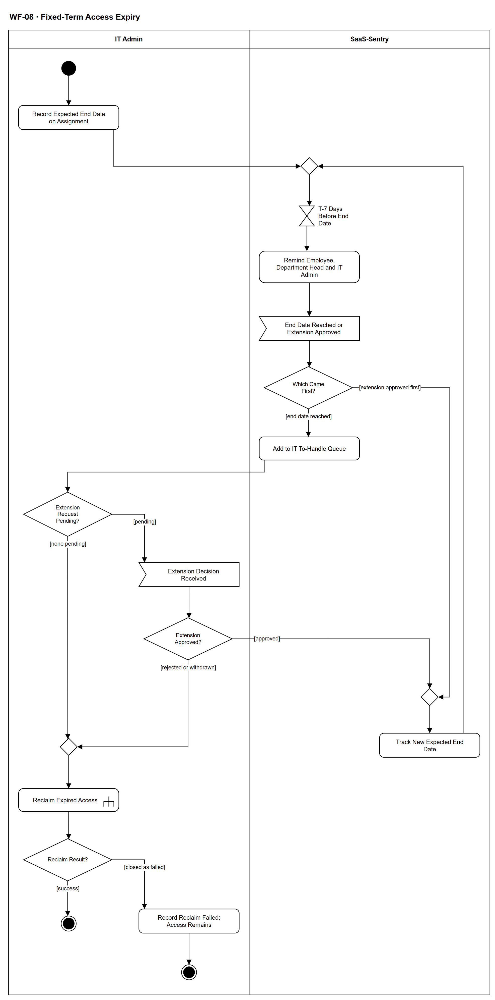

# WF-08 — Fixed-Term Access Expiry

> **Loại:** Workflow hỗ trợ (SF-3 — Các sự kiện vòng đời nhân sự khác) · **Phiên bản:** 2.5 — 10/10/2026 · **Trạng thái:** Vẽ lại theo BRD v3.31 (đồng bộ QĐ-61 → QĐ-63) (FR-2.8, FR-5.14, INV-07) và catalog 08/10/2026; chờ Owner/GVHD review
>
> Sơ đồ là **dẫn xuất** từ quyết định Owner (`QĐ`) và BRD hiện hành; khi khác nhau, `QĐ` → BRD thắng. Quyết định trong sơ đồ là của Owner, **chưa** phải xác nhận của GVHD/hội đồng.

## 1. Mục đích và phạm vi

Bảo đảm quyền của **nhà thầu, freelancer, thực tập sinh** không tồn tại quá ngày kết thúc dự kiến mà không ai xử lý: nhắc trước 7 ngày, đưa vào hàng đợi khi tới hạn, rồi hoặc gia hạn qua yêu cầu có duyệt, hoặc thu hồi. Hệ thống không bao giờ tự thu hồi chỉ vì đã tới hạn.

**Phạm vi:** Ngày kết thúc dự kiến bắt buộc trên Assignment, nhắc T-7, hàng đợi cần xử lý khi tới/quá hạn, gia hạn qua WF-11 (được duyệt ⟹ theo dõi ngày mới), thu hồi qua WF-09a.

**Không nằm trong sơ đồ này:** Chi tiết yêu cầu gia hạn và duyệt (→ WF-11, WF-09); chi tiết thu hồi theo kiểu cấp (→ WF-09a); người làm có thời hạn nghỉ hẳn khỏi công ty (→ WF-07).

## 2. Tệp

| Tệp | Vai trò |
| --- | --- |
| [WF-08-fixed-term-access-expiry.drawio](WF-08-fixed-term-access-expiry.drawio) | Nguồn draw.io chỉnh sửa được (sinh từ spec) |
| [WF-08-fixed-term-access-expiry.drawio.png](WF-08-fixed-term-access-expiry.drawio.png) | Bản xuất PNG, nhúng sẵn nguồn draw.io |
| [WF-08.json](../specs/WF-08.json) | **Nguồn canonical** — sửa ở đây rồi chạy `python tools/flowkit.py build` từ `Docs/Diagrams` |

## 3. Nguồn nghiệp vụ

| Mã | Nội dung dùng trong sơ đồ |
| --- | --- |
| `FR-2.8, INV-07` | Ngày kết thúc dự kiến bắt buộc; nhắc IT Admin và trưởng phòng trước 7 ngày; hàng đợi cần xử lý khi quá hạn |
| `BRD 4.5` | Nhà thầu, freelancer, thực tập sinh: bắt buộc ngày kết thúc; thực tập sinh được nhắc trước 7 ngày |
| `FR-5.14, QĐ-57a` | Cảnh báo *quyền có thời hạn sắp hết* gửi Employee, trưởng phòng, IT Admin tại T-7 |
| `BRD 3.2, SoD-6` | Không tự động thu hồi chỉ vì cảnh báo; Automation Service không tự cấp/thu hồi seat |
| `FR-3.2, BM-01` | Gia hạn có thời hạn là một loại yêu cầu của Employee |
| `FR-2.4, FR-4.15, SoD-5` | Thu hồi do IT Admin; không tự ghi nhận tiết kiệm |

## 4. Tác nhân, kích hoạt, điều kiện

| Làn (tiếng Anh trên hình) | Tác nhân | Trách nhiệm trong sơ đồ |
| --- | --- | --- |
| IT Admin | IT Admin phụ trách phòng | Ghi ngày kết thúc, xử lý hàng đợi, thu hồi |
| SaaS-Sentry | SaaS-Sentry | Nhắc T-7, theo dõi ngày kết thúc, xếp hàng cần xử lý |

- **Kích hoạt:** IT Admin tạo Assignment cho nhà thầu, freelancer hoặc thực tập sinh.
- **Tiền điều kiện:** Người được cấp thuộc nhóm làm việc có thời hạn (BRD 4.5), được quản lý như Employee thuộc phòng họ làm việc; quyền đã được duyệt theo MF-2.
- **Hậu điều kiện:** Mỗi Assignment có thời hạn hoặc được gia hạn qua yêu cầu có duyệt (ngày kết thúc mới được theo dõi tiếp), hoặc bị thu hồi — hoặc tác vụ thu hồi bị IT đóng là thất bại, khi đó quyền còn hiệu lực, vẫn hiện G2 và chờ tác vụ mới (QĐ-62i). Không có Assignment quá hạn nằm ngoài hàng đợi xử lý.

## 5. Cách đọc ký hiệu

| Ký hiệu | Nghĩa |
| --- | --- |
| Hình tròn đặc | Bắt đầu hoạt động (initial node) |
| Hình chữ nhật bo góc | Hành động (action) của tác nhân ở làn chứa nó |
| Hình chữ nhật bo góc có ký hiệu cây đinh ba ở góc | Gọi workflow con (call behavior) — mã workflow ghi trong nhãn |
| Hình thoi có chữ | Rẽ nhánh; mỗi cạnh ra mang điều kiện trong ngoặc vuông `[...]` |
| Hình thoi nhỏ không chữ | Hợp nhánh (merge) |
| Hình năm cạnh lõm | Chờ một sự kiện từ bên ngoài luồng (accept event) |
| Đồng hồ cát | Chờ một mốc thời gian (time event) |
| Vòng tròn kép đặc | Kết thúc toàn bộ hoạt động (activity final) |
| Dây có cung nhảy | Hai dây giao nhau nhưng **không** nối với nhau |

Đọc từ trên xuống. Hai mốc thời gian (T-7 và ngày kết thúc) do hệ thống theo dõi nhưng **chỉ nhắc và xếp hàng**; mọi thay đổi quyền do con người quyết: gia hạn đi qua WF-11, thu hồi do IT Admin thực hiện qua WF-09a. Gia hạn được duyệt quay lên điểm hợp để theo dõi ngày kết thúc mới. Không có cạnh nào tự thu hồi khi chỉ có cảnh báo (BRD 3.2).

## 6. Bảng node

| ID | Loại | Nhãn trên hình | Ý nghĩa | Làn / người thực hiện | Quy tắc |
| --- | --- | --- | --- | --- | --- |
| `st` | Nút bắt đầu | — | — | IT Admin | — |
| `a_rec` | Hành động | Record Expected End Date on Assignment | Khi cấp quyền cho nhà thầu, freelancer hoặc thực tập sinh, IT Admin bắt buộc ghi ngày kết thúc dự kiến trên Assignment. Thiếu ngày thì bản ghi không hợp lệ (ràng buộc dữ liệu), không có ngoại lệ. | IT Admin | `FR-2.8`, `INV-07`, `BRD 4.5` |
| `m_track` | Hợp nhánh | — | — | SaaS-Sentry | — |
| `t_rem` | Chờ mốc thời gian | T-7 Days Before End Date | Chờ mốc 7 ngày trước ngày kết thúc dự kiến đang hiệu lực. Áp cho cả nhà thầu, freelancer và thực tập sinh (FR-2.8; FR-5.14 dòng *Quyền có thời hạn sắp hết*: Employee, trưởng phòng, IT Admin — T-7). | SaaS-Sentry | `FR-2.8`, `BRD 4.5` |
| `s_notify` | Hành động | Remind Employee, Department Head and IT Admin | Gửi cảnh báo *quyền có thời hạn sắp hết* tới chính nhân viên, trưởng phòng và IT Admin phụ trách (FR-2.8 nêu IT Admin và trưởng phòng; danh mục cảnh báo FR-5.14 thêm Employee). Chỉ nhắc — không đổi quyền. Nhân viên còn cần quyền thì gửi yêu cầu gia hạn trước ngày kết thúc (WF-11). | SaaS-Sentry | `FR-2.8`, `FR-5.14`, `QĐ-57a` |
| `e_first` | Chờ sự kiện | End Date Reached or Extension Approved | Sau lời nhắc T-7, hệ thống chờ sự kiện xảy ra trước: (a) yêu cầu gia hạn (WF-11) được duyệt trước ngày kết thúc dự kiến đang hiệu lực, hoặc (b) tới ngày kết thúc mà ngày đó chưa được thay. Yêu cầu gia hạn bị từ chối hoặc rút trước hạn không đổi gì — vẫn chờ ngày kết thúc. | SaaS-Sentry | `FR-2.8`, `INV-07` |
| `d_first` | Rẽ nhánh | Which Came First? | Phân biệt gia hạn được duyệt trước hạn (Assignment mang ngày mới, mốc cũ không xảy ra) với tới ngày kết thúc khi chưa có ngày mới. | SaaS-Sentry | `FR-2.8` |
| `s_queue` | Hành động | Add to IT To-Handle Queue | Assignment quá hạn vào hàng đợi cần xử lý của IT Admin phụ trách phòng. Chỉ xếp hàng — không tự thu hồi, không tự gia hạn; quyền giữ nguyên cho tới khi có người xử lý. | SaaS-Sentry | `FR-2.8`, `BRD 3.2`, `SoD-6`, `FR-3.17` |
| `d_pend` | Rẽ nhánh | Extension Request Pending? | IT Admin xử lý mục quá hạn: có yêu cầu gia hạn (WF-11) đã gửi trước hạn và còn chờ quyết định không. Quy tắc chốt ở QĐ-62h: gửi trước ngày kết thúc mà chưa quyết ⟹ quyền giữ nguyên tới khi có quyết định; gửi sau ngày kết thúc là yêu cầu mới, không dừng thu hồi. Nếu yêu cầu gửi trước hạn được duyệt trước khi IT xử lý mục này thì ngày kết thúc mới đã được ghi (WF-11) và mục rời hàng đợi — không đi thu hồi. | IT Admin | `FR-2.8`, `QĐ-62h` |
| `e_dec` | Chờ sự kiện | Extension Decision Received | Chờ kết quả yêu cầu gia hạn của WF-11; trong lúc chờ quyền giữ nguyên (QĐ-62h); bước đang chờ chạy nhắc SLA và cảnh báo Super Admin (FR-3.8). | IT Admin | `FR-2.8` |
| `d_dec` | Rẽ nhánh | Extension Approved? | Kết quả do người duyệt của WF-11 / WF-09 quyết; IT chỉ đọc kết quả. | IT Admin | — |
| `m_upd` | Hợp nhánh | — | — | SaaS-Sentry | — |
| `s_upd` | Hành động | Track New Expected End Date | Gia hạn được duyệt (trước hạn, hoặc sau hạn khi yêu cầu đã gửi trước hạn) ⟹ Assignment mang ngày kết thúc dự kiến mới (vẫn bắt buộc theo INV-07); hệ thống theo dõi lại từ mốc T-7 của ngày mới. Mốc kết thúc cũ không còn hiệu lực. | SaaS-Sentry | `INV-07`, `FR-2.8` |
| `m_rec` | Hợp nhánh | — | — | IT Admin | — |
| `c_rec` | Gọi workflow con | Reclaim Expired Access | IT Admin thu hồi quyền hết hạn theo kiểu cấp của gói (phần mềm nội bộ: thu hồi ngoài hệ thống kèm bằng chứng); seat về kho. Thu hồi không tự ghi nhận tiết kiệm. WF-09a chỉ trả về *thu hồi xong* hoặc *đã đóng thất bại* — thử lại và làm tay nằm trong WF-09a. Gói có lưu ý mất dữ liệu: IT Admin ghi xác nhận đã xử lý bàn giao trước khi gỡ ở nhà cung cấp; không chặn sau hạn ngắn (WF-09a `d_dl`, `s_ask`; QĐ-63a). | IT Admin | `FR-2.4`, `FR-4.15`, `SoD-5`, `QĐ-63a`, → `WF-09a` |
| `end_rec` | Kết thúc hoạt động | — | Quyền hết hạn đã được thu hồi; seat về kho. | IT Admin | — |
| `d_rres` | Rẽ nhánh | Reclaim Result? | Kết quả WF-09a trả về cho quyền hết hạn. | IT Admin | `FR-2.4`, `QĐ-62i` |
| `a_rfail` | Hành động | Record Reclaim Failed; Access Remains | Tác vụ thu hồi đã bị IT Admin đóng là thất bại có lý do ở WF-09a (QĐ-62i). Assignment chưa đóng, seat chưa về kho; quyền quá hạn vẫn còn nên tiếp tục hiện là lãng phí/G2 theo điều kiện nguồn trên hàng đợi cần xử lý. Muốn thu hồi lại thì IT mở tác vụ thu hồi mới. | IT Admin | `FR-2.4`, `QĐ-62i` |
| `end_rfail` | Kết thúc hoạt động | — | Thu hồi quyền hết hạn kết thúc thất bại: tác vụ đã bị đóng thất bại có lý do; quyền còn hiệu lực, chưa giải phóng seat (QĐ-62i). | IT Admin | — |

## 7. Bảng chuyển tiếp

| Từ → tới | Nhãn điều kiện | Điều kiện | Kết quả |
| --- | --- | --- | --- |
| `st` → `a_rec` | — | — | Sang Record Expected End Date on Assignment |
| `a_rec` → `m_track` | — | — | Sang — |
| `m_track` → `t_rem` | — | — | Sang T-7 Days Before End Date |
| `t_rem` → `s_notify` | — | — | Sang Remind Employee, Department Head and IT Admin |
| `s_notify` → `e_first` | — | — | Sang End Date Reached or Extension Approved |
| `e_first` → `d_first` | — | — | Sang Which Came First? |
| `d_first` → `m_upd` | `[extension approved first]` | Gia hạn được duyệt trước ngày kết thúc | Sang — |
| `d_first` → `s_queue` | `[end date reached]` | Tới ngày kết thúc mà ngày đó chưa được thay | Sang Add to IT To-Handle Queue |
| `s_queue` → `d_pend` | — | — | Sang Extension Request Pending? |
| `d_pend` → `m_rec` | `[none pending]` | Không có yêu cầu gia hạn gửi trước ngày kết thúc còn chờ (yêu cầu bị từ chối/rút, hoặc gửi sau ngày kết thúc, không dừng thu hồi — QĐ-62h) | Thu hồi |
| `d_pend` → `e_dec` | `[pending]` | Yêu cầu gia hạn gửi trước hạn còn chờ | Chờ quyết định, giữ quyền |
| `e_dec` → `d_dec` | — | — | Sang Extension Approved? |
| `d_dec` → `m_upd` | `[approved]` | Gia hạn được duyệt | Theo dõi ngày mới |
| `m_upd` → `s_upd` | — | — | Sang Track New Expected End Date |
| `d_dec` → `m_rec` | `[rejected or withdrawn]` | Bị từ chối hoặc rút | Thu hồi |
| `s_upd` → `m_track` | — | — | Sang — |
| `m_rec` → `c_rec` | — | — | Sang Reclaim Expired Access |
| `c_rec` → `d_rres` | — | — | Sang Reclaim Result? |
| `d_rres` → `end_rec` | `[success]` | WF-09a thu hồi xong | Seat về kho |
| `d_rres` → `a_rfail` | `[closed as failed]` | WF-09a trả về thất bại: tác vụ đã được IT Admin đóng là thất bại có lý do | Ghi nhận thất bại; quyền còn hiệu lực |
| `a_rfail` → `end_rfail` | — | — | Sang — |

Số đếm: **19 node · 21 cạnh · 4 rẽ nhánh**; giao cắt dây: **0**.

## 8. Happy path

1. `st` — —
2. `a_rec` — Record Expected End Date on Assignment: Khi cấp quyền cho nhà thầu, freelancer hoặc thực tập sinh, IT Admin bắt buộc ghi ngày kết thúc dự kiến trên Assignment. Thiếu ngày thì bản ghi không hợp lệ (ràng buộc dữ liệu), không có ngoại lệ.
3. `t_rem` — T-7 Days Before End Date: Chờ mốc 7 ngày trước ngày kết thúc dự kiến đang hiệu lực. Áp cho cả nhà thầu, freelancer và thực tập sinh (FR-2.8; FR-5.14 dòng *Quyền có thời hạn sắp hết*: Employee, trưởng phòng, IT Admin — T-7).
4. `s_notify` — Remind Employee, Department Head and IT Admin: Gửi cảnh báo *quyền có thời hạn sắp hết* tới chính nhân viên, trưởng phòng và IT Admin phụ trách (FR-2.8 nêu IT Admin và trưởng phòng; danh mục cảnh báo FR-5.14 thêm Employee). Chỉ nhắc — không đổi quyền. Nhân viên còn cần quyền thì gửi yêu cầu gia hạn trước ngày kết thúc (WF-11).
5. `e_first` — End Date Reached or Extension Approved: Sau lời nhắc T-7, hệ thống chờ sự kiện xảy ra trước: (a) yêu cầu gia hạn (WF-11) được duyệt trước ngày kết thúc dự kiến đang hiệu lực, hoặc (b) tới ngày kết thúc mà ngày đó chưa được thay. Yêu cầu gia hạn bị từ chối hoặc rút trước hạn không đổi gì — vẫn chờ ngày kết thúc.
6. `d_first` — Which Came First?: Phân biệt gia hạn được duyệt trước hạn (Assignment mang ngày mới, mốc cũ không xảy ra) với tới ngày kết thúc khi chưa có ngày mới.
7. `s_queue` — Add to IT To-Handle Queue: Assignment quá hạn vào hàng đợi cần xử lý của IT Admin phụ trách phòng. Chỉ xếp hàng — không tự thu hồi, không tự gia hạn; quyền giữ nguyên cho tới khi có người xử lý.
8. `d_pend` — Extension Request Pending?: IT Admin xử lý mục quá hạn: có yêu cầu gia hạn (WF-11) đã gửi trước hạn và còn chờ quyết định không. Quy tắc chốt ở QĐ-62h: gửi trước ngày kết thúc mà chưa quyết ⟹ quyền giữ nguyên tới khi có quyết định; gửi sau ngày kết thúc là yêu cầu mới, không dừng thu hồi. Nếu yêu cầu gửi trước hạn được duyệt trước khi IT xử lý mục này thì ngày kết thúc mới đã được ghi (WF-11) và mục rời hàng đợi — không đi thu hồi.
9. `c_rec` — Reclaim Expired Access: IT Admin thu hồi quyền hết hạn theo kiểu cấp của gói (phần mềm nội bộ: thu hồi ngoài hệ thống kèm bằng chứng); seat về kho. Thu hồi không tự ghi nhận tiết kiệm. WF-09a chỉ trả về *thu hồi xong* hoặc *đã đóng thất bại* — thử lại và làm tay nằm trong WF-09a. Gói có lưu ý mất dữ liệu: IT Admin ghi xác nhận đã xử lý bàn giao trước khi gỡ ở nhà cung cấp; không chặn sau hạn ngắn (WF-09a `d_dl`, `s_ask`; QĐ-63a).
10. `d_rres` — Reclaim Result?: Kết quả WF-09a trả về cho quyền hết hạn.
11. `end_rec` — —: Quyền hết hạn đã được thu hồi; seat về kho.

## 9. Nhánh thay thế / if-else

- **Gia hạn được duyệt trước ngày kết thúc** — `s_notify` → `e_first` → `d_first` → `m_upd` → `s_upd` → `m_track`. Mốc kết thúc cũ không xảy ra; theo dõi lại từ T-7 của ngày mới.
- **Gia hạn còn chờ khi tới hạn — được duyệt** — `d_pend` → `e_dec` → `d_dec` → `m_upd` → `s_upd` → `m_track` → `t_rem`. Quyền giữ nguyên trong lúc chờ; theo dõi lại từ T-7 của ngày mới. Gia hạn được duyệt trước hạn thì mốc hết hạn không xảy ra.

## 10. Nhánh lỗi / từ chối và cách kết thúc

- **Gia hạn bị từ chối hoặc rút** — `d_dec` → `m_rec` → `c_rec` → `d_rres` → `end_rec`. IT Admin thu hồi như khi không có yêu cầu.
- **Thu hồi quyền hết hạn thất bại** — `c_rec` → `d_rres` → `a_rfail` → `end_rfail`. Tác vụ đã bị IT đóng thất bại (QĐ-62i): quyền còn, vẫn hiện G2; thu lại bằng tác vụ mới.

## 11. Liên hệ với sơ đồ khác

- Cấp trên: SF-3; Context (G08, G12)
- `WF-11` — yêu cầu gia hạn có thời hạn, gửi trước ngày kết thúc; workflow này chỉ đọc kết quả, không gọi WF-11
- `WF-09a` — thu hồi theo kiểu cấp
- `WF-07` — nếu người làm có thời hạn nghỉ hẳn thì đi luồng nghỉ việc
- `WF-09a` — gọi/chuyển tại node `c_rec`

## 12. Giới hạn và vấn đề còn mở

- (ĐÃ CHỐT · DOI-52, DOI-53, QĐ-62h) IT Admin phụ trách xử lý mục quá hạn (FR-2.8, FR-3.17), không cần trưởng phòng xác nhận vì thời hạn đã được duyệt ở bước nhu cầu; yêu cầu gia hạn gửi trước ngày kết thúc mà chưa quyết ⟹ quyền giữ nguyên tới khi có quyết định.
- (LIMIT · DOI-54, OI-07a) Không có giới hạn tổng thời gian gia hạn; thời hạn quá 12 tháng chỉ cần trưởng phòng xác nhận tường minh ở bước nhu cầu.
