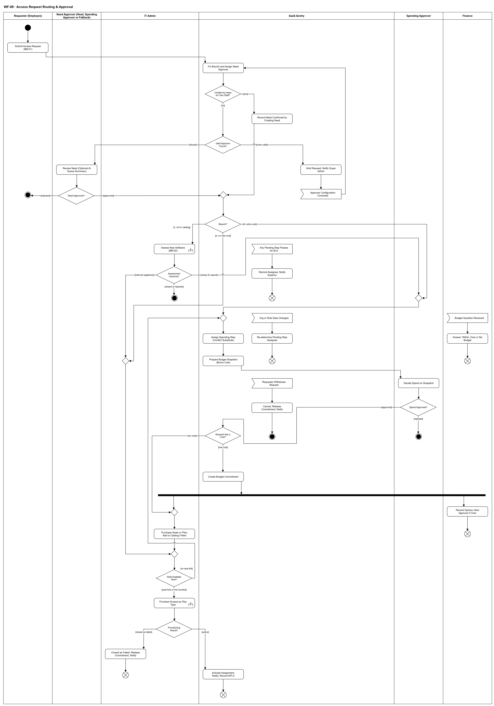

# WF-09 — Access Request Routing & Approval

> **Loại:** Workflow chi tiết của MF-2 · **Phiên bản:** 3.2 — 10/10/2026 · **Trạng thái:** Vẽ lại theo BRD v3.30 (đồng bộ QĐ-61/QĐ-62) (FR-3.3 → FR-3.16, QĐ-52c, QĐ-60a); chờ Owner/GVHD review
>
> Sơ đồ là **dẫn xuất** từ quyết định Owner (`QĐ`) và BRD hiện hành; khi khác nhau, `QĐ` → BRD thắng. Quyết định trong sơ đồ là của Owner, **chưa** phải xác nhận của GVHD/hội đồng.

## 1. Mục đích và phạm vi

Chi tiết **định tuyến và phê duyệt** của một yêu cầu cấp quyền: ai giữ từng bước, khi nào cần Người duyệt chi, xử lý quá hạn, hết người duyệt hợp lệ, xác định lại người duyệt khi dữ liệu đổi, rút yêu cầu và hết seat lúc thực hiện — tất cả **không** dùng ủy quyền.

**Phạm vi:** Từ lúc gửi BM-01 tới khi quyền được kích hoạt, bị từ chối, bị đóng, bị rút hoặc cấp phát thất bại.

**Không nằm trong sơ đồ này:** Đánh giá phần mềm mới (→ WF-10); thực thi theo kiểu cấp, thử lại, thu hồi (→ WF-09a); hoàn trả và gia hạn quyền có thời hạn (→ WF-11); tạo yêu cầu khi onboarding/theo nhóm (→ WF-04).

## 2. Tệp

| Tệp | Vai trò |
| --- | --- |
| [WF-09-access-request-routing-approval.drawio](WF-09-access-request-routing-approval.drawio) | Nguồn draw.io chỉnh sửa được (sinh từ spec) |
| [WF-09-access-request-routing-approval.drawio.png](WF-09-access-request-routing-approval.drawio.png) | Bản xuất PNG, nhúng sẵn nguồn draw.io |
| [WF-09.json](../specs/WF-09.json) | **Nguồn canonical** — sửa ở đây rồi chạy `python tools/flowkit.py build` từ `Docs/Diagrams` |

## 3. Nguồn nghiệp vụ

| Mã | Nội dung dùng trong sơ đồ |
| --- | --- |
| `FR-3.3, FR-3.6, QĐ-52c` | Người duyệt bước nhu cầu theo trưởng phòng; trưởng phòng tự gửi; approver dự phòng |
| `FR-3.4, QĐ-29a` | Ba nhánh; nhánh (a) không qua Người duyệt chi |
| `FR-3.5, QĐ-27` | Không ủy quyền duyệt |
| `FR-3.8, QĐ-28d, OI-14a` | SLA 2 ngày làm việc, escalate chỉ là thông báo, cảnh báo nghẽn |
| `FR-3.12, QĐ-13` | Chờ có kiểm soát khi hết người duyệt hợp lệ |
| `FR-3.13 → FR-3.16, QĐ-28c, OI-17` | Người duyệt chi, snapshot, hỏi Finance, người thay thế khi xung đột, xác định lại khi dữ liệu đổi |
| `FR-5.8, FR-5.8a, FR-5.13, QĐ-60a` | Khoản cam kết, chưa có ngân sách, chi phí thực chịu |
| `Bảng ngoại lệ sau FR-3.19, OI-06` | Rút yêu cầu, hết seat lúc IT thực hiện, cấp phát thất bại |
| `QĐ-29b, QĐ-30a, SoD-3, SoD-8` | Finance không nằm trên đường duyệt; hỏi Finance là luồng phụ |
| `QĐ-49e` | Tóm tắt AI cho trưởng phòng — chỉ hỗ trợ |

## 4. Tác nhân, kích hoạt, điều kiện

| Làn (tiếng Anh trên hình) | Tác nhân | Trách nhiệm trong sơ đồ |
| --- | --- | --- |
| Requester (Employee) | Employee (hoặc trưởng phòng tạo thay) | Gửi và rút yêu cầu |
| Need Approver (Head, Spending Approver or Fallback) | Trưởng phòng; Người duyệt chi khi trưởng phòng tự gửi; approver dự phòng ở gốc khi phòng chưa có trưởng phòng hoặc khi trưởng phòng tự gửi mà chính là Người duyệt chi | Duyệt nhu cầu |
| IT Admin | IT Admin phụ trách phòng (IT khác được xử lý thay, có Audit Trail) | Đánh giá, mua, cấp phát |
| SaaS-Sentry | SaaS-Sentry | Định tuyến, chờ có kiểm soát, nhắc, xác định lại, snapshot, khoản cam kết, kích hoạt |
| Spending Approver | Người duyệt chi hoặc người thay thế khi xung đột | Quyết định chi |
| Finance | Finance | Trả lời khi được hỏi; ghi nhận sau duyệt — không nằm trên đường duyệt |

- **Kích hoạt:** Phiếu BM-01 được gửi.
- **Tiền điều kiện:** Người yêu cầu thuộc một phòng có hiệu lực; chính sách duyệt, Người duyệt chi, người thay thế, approver dự phòng đã cấu hình (WF-03).
- **Hậu điều kiện:** Một kết cục: quyền hoạt động · từ chối (nhu cầu/chi) · đóng hoặc IT từ chối (WF-10) · rút · cấp phát thất bại. Mọi bước có bản ghi phê duyệt điện tử, Audit Trail và số đo KPI-2 theo từng bước.

## 5. Cách đọc ký hiệu

| Ký hiệu | Nghĩa |
| --- | --- |
| Hình tròn đặc | Bắt đầu hoạt động (initial node) |
| Hình chữ nhật bo góc | Hành động (action) của tác nhân ở làn chứa nó |
| Hình chữ nhật bo góc có ký hiệu cây đinh ba ở góc | Gọi workflow con (call behavior) — mã workflow ghi trong nhãn |
| Hình thoi có chữ | Rẽ nhánh; mỗi cạnh ra mang điều kiện trong ngoặc vuông `[...]` |
| Hình thoi nhỏ không chữ | Hợp nhánh (merge) |
| Thanh đen ngang | Tách hoặc gộp các nhánh chạy song song (fork/join) |
| Hình năm cạnh lõm | Chờ một sự kiện từ bên ngoài luồng (accept event) |
| Vòng tròn kép đặc | Kết thúc toàn bộ hoạt động (activity final) |
| Vòng tròn có dấu nhân | Kết thúc riêng nhánh đó, các nhánh khác vẫn chạy (flow final) |
| Dây có cung nhảy | Hai dây giao nhau nhưng **không** nối với nhau |

Luồng chính đi từ trên xuống. Bốn **luồng phụ** bắt đầu bằng ký hiệu chờ sự kiện không có cạnh vào (cột phải của làn hệ thống và làn Finance): quá SLA, dữ liệu tổ chức/vai trò đổi, rút yêu cầu, hỏi Finance — chúng có thể xảy ra bất cứ lúc nào trong khi yêu cầu đang chờ. Không có cạnh nào đổi người duyệt vì vắng mặt hay quá hạn. Sau thanh tách, kết cục là flow final để không hủy nhánh ghi nhận của Finance. Ngoại lệ biểu diễn: luồng phụ bắt đầu bằng sự kiện không có cạnh vào là một lần xử lý độc lập, kết thúc nhánh chính không hủy chúng — cách đọc nội bộ đã ghi ở [tools/README.md mục 7](../tools/README.md#7-ngoại-lệ-biểu-diễn-đã-chấp-nhận-ghi-10102026), không phải bằng chứng hình tuân thủ đầy đủ UML 2.5.

## 6. Bảng node

| ID | Loại | Nhãn trên hình | Ý nghĩa | Làn / người thực hiện | Quy tắc |
| --- | --- | --- | --- | --- | --- |
| `st` | Nút bắt đầu | — | — | Requester (Employee) | — |
| `a_sub` | Hành động | Submit Access Request (BM-01) | Employee (hoặc trưởng phòng tạo thay / yêu cầu theo nhóm — WF-04) gửi phiếu BM-01. Gói cấm chia sẻ tài khoản thì không xin được tài khoản dùng chung — bị từ chối ở bước đánh giá của IT (FR-2.11); chuyển sang cấp cá nhân là yêu cầu mới, định tuyến lại theo FR-3.4. Employee cũng gửi/rút yêu cầu đơn giản trên ứng dụng mobile (QĐ-61b). | Requester (Employee) | `FR-3.2`, `BM-01` |
| `s_need` | Hành động | Fix Branch and Assign Need Approver | Khi gửi, hệ thống chốt nhánh (a)/(b)/(c) và chuỗi loại bước theo chính sách hiện hành; người duyệt bước nhu cầu = trưởng phòng của người yêu cầu; trưởng phòng tự gửi ⟹ Người duyệt chi; trưởng phòng đó chính là Người duyệt chi hoặc phòng chưa có trưởng phòng ⟹ approver dự phòng ở gốc. Người yêu cầu không bao giờ tự duyệt. | SaaS-Sentry | `FR-3.3`, `FR-3.4`, `FR-3.6`, `FR-3.16`, `QĐ-52c`, `SoD-4`, `INV-08` |
| `d_beh` | Rẽ nhánh | Created by Head for Own Staff? | Yêu cầu do **trưởng phòng tạo thay** nhân viên phòng mình (onboarding hoặc yêu cầu theo nhóm — FR-3.2): trưởng phòng là người vốn duyệt nhu cầu của những người này, nên việc tạo thay được ghi nhận là **bước nhu cầu đã xác nhận** (người tạo, người thụ hưởng, thời điểm). Người thụ hưởng phải thuộc phòng của trưởng phòng. Phần mà chính trưởng phòng là người thụ hưởng ⟹ bước nhu cầu theo QĐ-52c (Người duyệt chi; nếu trưởng phòng là Người duyệt chi ⟹ approver dự phòng). Yêu cầu theo nhóm được xét theo **từng người thụ hưởng**: mục của chính trưởng phòng đi nhánh [no]. | SaaS-Sentry | `FR-3.2`, `QĐ-62a`, `QĐ-52c`, `SoD-4` |
| `s_conf` | Hành động | Record Need Confirmed by Creating Head | Ghi bản ghi phê duyệt nhu cầu với người xác nhận là trưởng phòng đã tạo thay; không có bước chờ riêng (QĐ-62a). | SaaS-Sentry | `QĐ-62a`, `QĐ-53a` |
| `m_nd` | Hợp nhánh | — | — | SaaS-Sentry | — |
| `d_valid` | Rẽ nhánh | Valid Approver Found? | Còn ai hợp lệ cho bước này không (không trùng người yêu cầu, có tồn tại). | SaaS-Sentry | `FR-3.12` |
| `a_need` | Hành động | Review Need (Optional AI Queue Summary) | Người duyệt bước nhu cầu xem lý do, cờ ngoài bộ chuẩn, thời hạn (quá 12 tháng phải xác nhận tường minh); có thể dùng tóm tắt AI các yêu cầu đang chờ chính mình — AI không quyết. Không ủy quyền. Trên ứng dụng mobile, bước này dùng cùng quy tắc và phân quyền (QĐ-61b). | Need Approver (Head, Spending Approver or Fallback) | `FR-3.5`, `FR-3.7`, `FR-3.18`, `QĐ-49e(1)`, `OI-07a` |
| `s_wait` | Hành động | Hold Request; Notify Super Admin | Không còn người duyệt hợp lệ: giữ yêu cầu ở trạng thái chờ có kiểm soát, gắn cờ, tiếp tục nhắc, báo Super Admin cấu hình lại approver dự phòng. Không tự duyệt, không tự từ chối, không giao Super Admin/IT duyệt. | SaaS-Sentry | `FR-3.12`, `QĐ-13`, `SoD-1` |
| `d_need` | Rẽ nhánh | Need Approved? | Quyết định nhu cầu, lưu thành bản ghi phê duyệt điện tử. | Need Approver (Head, Spending Approver or Fallback) | `QĐ-53a` |
| `e_cfg` | Chờ sự kiện | Approver Configuration Corrected | Super Admin sửa cấu hình người duyệt — sự kiện dữ liệu kích hoạt xác định lại. | SaaS-Sentry | `FR-3.12`, `FR-3.16` |
| `end_need` | Kết thúc hoạt động | — | Bị từ chối ở bước nhu cầu; người yêu cầu được báo kèm lý do. | Requester (Employee) | — |
| `d_br` | Rẽ nhánh | Branch? | Nhánh đã chốt khi gửi: (a) có trong danh mục, không phát sinh chi phí; (b) cần mua thêm/nâng gói/vượt ngân sách; (c) chưa có trong danh mục. | SaaS-Sentry | `FR-3.4`, `QĐ-29a` |
| `e_sla` | Chờ sự kiện | Any Pending Step Passes Its SLA | Một bước bất kỳ (nhu cầu, đánh giá IT, duyệt chi) quá SLA — mặc định 2 ngày làm việc theo giờ làm việc. | SaaS-Sentry | `FR-3.8`, `OI-14a` |
| `c_assess` | Gọi workflow con | Assess New Software (BM-02) | IT Admin đánh giá phần mềm chưa có trong danh mục. | IT Admin | `FR-3.19`, `BM-02`, → `WF-10` |
| `s_remind` | Hành động | Remind Assignee; Notify Superior | Nhắc người được giao, thông báo cấp trên (nhân viên → trưởng phòng; trưởng phòng → Người duyệt chi); vượt ngưỡng backlog ⟹ cảnh báo Super Admin. Escalate chỉ là thông báo: không đổi người, không tự duyệt/từ chối, SLA không dừng. Người duyệt chi không có cấp trên: chỉ nhắc người được giao; bước quá SLA hoặc backlog vượt ngưỡng thì cảnh báo Super Admin (FR-3.8, FR-5.14). | SaaS-Sentry | `FR-3.8`, `QĐ-27`, `QĐ-28d`, `FR-5.11` |
| `d_ass` | Rẽ nhánh | Assessment Outcome? | Kết quả trả về từ WF-10. | IT Admin | — |
| `ff_sla` | Kết thúc nhánh (flow final) | — | Nhánh nhắc kết thúc; bước vẫn thuộc người cũ. | SaaS-Sentry | — |
| `end_c` | Kết thúc hoạt động | — | Yêu cầu đóng (công cụ miễn phí bên ngoài) hoặc bị IT từ chối (không kiểm soát được) — người yêu cầu và trưởng phòng được báo. | IT Admin | — |
| `e_data` | Chờ sự kiện | Org or Role Data Changed | Sự kiện dữ liệu thật: phòng của người yêu cầu đổi, trưởng phòng đổi, người được giao chuyển đã nghỉ việc, Super Admin đổi Người duyệt chi/người thay thế/approver dự phòng. Nghỉ phép, vắng, backlog **không** phải sự kiện. | SaaS-Sentry | `FR-3.16`, `QĐ-28d` |
| `m_sa` | Hợp nhánh | — | — | Spending Approver | — |
| `e_ask` | Chờ sự kiện | Budget Question Received | Người duyệt chi gửi yêu cầu thông tin ngân sách (tùy chọn). | Finance | `FR-3.14`, `QĐ-30a` |
| `s_redet` | Hành động | Re-determine Pending Step Assignee | Chạy lại quy tắc định tuyến cho bước đang chờ; chỉ đổi người, nhánh và chuỗi loại bước giữ nguyên; SLA không đặt lại; Audit Trail ghi sự kiện nguồn, người cũ, người mới. | SaaS-Sentry | `FR-3.16` |
| `m_loop` | Hợp nhánh | — | — | SaaS-Sentry | — |
| `s_sa` | Hành động | Assign Spending Step (Conflict Substitute) | Gán bước duyệt chi cho Người duyệt chi; nếu người đó là người yêu cầu/thụ hưởng ⟹ tạo thẳng cho người thay thế khi xung đột đã cấu hình trước. Chưa cấu hình hoặc người thay thế cũng xung đột ⟹ chờ có kiểm soát như FR-3.12. | SaaS-Sentry | `FR-3.13`, `FR-3.15`, `SoD-7`, `OI-17` |
| `a_ans` | Hành động | Answer: Within, Over or No Budget | Finance trả lời kèm ghi chú; câu trả lời không duyệt, không chặn; Người duyệt chi quyết được cả khi chưa có trả lời. Người trả lời không được là người quyết của cùng yêu cầu. | Finance | `FR-3.14`, `SoD-3`, `SoD-8` |
| `ff_data` | Kết thúc nhánh (flow final) | — | Đã xác định lại người giữ bước. | SaaS-Sentry | — |
| `s_snap` | Hành động | Prepare Budget Snapshot (Borne Cost) | Ngân sách · thực chi · cam kết đang giữ · còn lại · tổng yêu cầu có chi phí đang chờ cùng Cost Center và kỳ; theo chi phí thực chịu, GTGT được khấu trừ hiện riêng; chưa có ngân sách hiện “Chưa có ngân sách”, không hiện 0. Snapshot được chụp lại lúc quyết. | SaaS-Sentry | `FR-3.14`, `FR-5.13`, `OI-11d`, `QĐ-60a` |
| `ff_ask` | Kết thúc nhánh (flow final) | — | Luồng phụ hỏi Finance kết thúc; câu trả lời hiện trên màn hình quyết của Người duyệt chi. | Finance | — |
| `a_dec` | Hành động | Decide Spend on Snapshot | Người duyệt chi xem nhu cầu đã xác nhận, mức kiểm soát/rủi ro (nhánh c), snapshot; tùy chọn hỏi Finance — đồng hồ SLA không dừng. Cùng người giữ bước nhu cầu ⟹ vẫn hai bước riêng, gắn cờ cùng người. Trên ứng dụng mobile, bước này dùng cùng quy tắc và phân quyền (QĐ-61b). | Spending Approver | `FR-3.13`, `FR-3.14`, `SoD-7`, `BRD 4.2` |
| `d_sa` | Rẽ nhánh | Spend Approved? | Quyết định chi — bản ghi phê duyệt điện tử kèm snapshot. | Spending Approver | `QĐ-53a` |
| `d_cost` | Rẽ nhánh | Request Has a Cost? | Yêu cầu có chi phí không. Phần mềm có bản quyền hoặc SaaS mới **không tốn tiền** vẫn qua Người duyệt chi để vào danh mục (FR-3.4c) nhưng **không** tạo khoản cam kết — khoản cam kết chỉ có khi có chi phí (FR-5.8). | SaaS-Sentry | `FR-3.4`, `FR-5.8` |
| `end_sa` | Kết thúc hoạt động | — | Khoản chi bị từ chối, không tạo khoản cam kết; người yêu cầu được báo. | Spending Approver | — |
| `s_com` | Hành động | Create Budget Commitment | Đúng một khoản cam kết cho yêu cầu, ghi chi phí ước tính; chưa có ngân sách thì vẫn tạo, mang lý do “Chưa có ngân sách”. | SaaS-Sentry | `FR-5.8`, `FR-5.8a`, `INV-16`, `INV-18` |
| `e_wd` | Chờ sự kiện | Requester Withdraws Request | Người yêu cầu rút yêu cầu — được phép tới khi tác vụ cấp phát còn chờ thực thi. | SaaS-Sentry | `OI-06` |
| `s_cancel` | Hành động | Cancel; Release Commitment; Notify | Trạng thái Cancelled; yêu cầu thông tin ngân sách đang mở đóng theo; khoản cam kết (nếu có) giải phóng ngay, báo Finance và IT. Tác vụ đã đang thực thi thì không rút — dùng hoàn trả (WF-11). | SaaS-Sentry | `OI-06`, `FR-5.8` |
| `end_wd` | Kết thúc hoạt động | — | Yêu cầu bị rút — kết thúc toàn hoạt động. | SaaS-Sentry | — |
| `f_par` | Tách song song | — | — | SaaS-Sentry | — |
| `a_rec` | Hành động | Record Opinion; Alert Approver if Over | Finance ghi ý kiến chính thức trên khoản cam kết; Vượt hạn mức/Chưa có ngân sách ⟹ thông báo Người duyệt chi; không hoàn tác quyết định, không dừng cấp phát. Bước có SLA riêng, không nằm trên đường chờ. | Finance | `FR-3.14`, `QĐ-29b` |
| `a_buy` | Hành động | Purchase Seats or Plan; Add to Catalog if New | IT mua thêm seat/nâng gói (b) hoặc thêm phần mềm mới vào danh mục và mua (c); lưu BM-05. | IT Admin | `BM-05`, `SoD-5` |
| `m_buy` | Hợp nhánh | — | — | IT Admin | — |
| `m_free` | Hợp nhánh | — | — | IT Admin | — |
| `ff_rec` | Kết thúc nhánh (flow final) | — | Nhánh ghi nhận của Finance kết thúc độc lập. | Finance | — |
| `m_exec` | Hợp nhánh | — | — | IT Admin | — |
| `d_seat` | Rẽ nhánh | Seat Available Now? | Lúc thực hiện, còn seat/khóa trống không (gói per-seat, K4). Phần mềm nội bộ không kiểm sức chứa. | IT Admin | `INV-01`, `FR-2.3` |
| `c_prov` | Gọi workflow con | Provision Access by Plan Type | Thực thi theo kiểu cấp K1–K5, chỉ tài khoản email công ty. | IT Admin | `FR-2.5`, `FR-2.9`, `FR-1.9`, → `WF-09a` |
| `d_res` | Rẽ nhánh | Provisioning Result? | Kết quả trả về từ WF-09a: thành công (kể cả lời mời đã được chấp nhận), hoặc thất bại sau khi IT Admin đóng tác vụ (thử lại, làm tay, lời mời treo đều xử lý trong WF-09a). | IT Admin | — |
| `s_fail` | Hành động | Closed as Failed: Release Commitment, Notify | Chỉ sau khi IT Admin **đóng tác vụ là thất bại** kèm lý do ở WF-09a (thử lại, làm tay đều không được): Request/Assignment thất bại, khoản cam kết (nếu có) được giải phóng (FR-5.8), người yêu cầu được báo (QĐ-62i). | IT Admin | `FR-2.5`, `FR-5.8`, `QĐ-62i` |
| `ff_fail` | Kết thúc nhánh (flow final) | — | Kết cục: không cấp được, không mất dấu vết. | IT Admin | — |
| `s_act` | Hành động | Activate Assignment; Notify; Record KPI-2 | Assignment hoạt động, thông báo người yêu cầu và người duyệt liên quan, ghi Audit Trail; KPI-2 đo từ lúc gửi tới đây, tách theo từng bước. Ứng dụng đang được theo dõi mức sử dụng ⟹ gửi thông báo FR-10.4 cho người vừa được cấp trước khi dữ liệu của họ được ghi (QĐ-01). | SaaS-Sentry | `FR-3.9`, `FR-3.11`, `KPI-2`, `FR-0.2` |
| `ff_ok` | Kết thúc nhánh (flow final) | — | Kết cục: có quyền truy cập. | SaaS-Sentry | — |

## 7. Bảng chuyển tiếp

| Từ → tới | Nhãn điều kiện | Điều kiện | Kết quả |
| --- | --- | --- | --- |
| `st` → `a_sub` | — | — | Sang Submit Access Request (BM-01) |
| `a_sub` → `s_need` | — | — | Sang Fix Branch and Assign Need Approver |
| `s_need` → `d_beh` | — | — | Sang Created by Head for Own Staff? |
| `d_beh` → `d_valid` | `[no]` | Nhân viên tự gửi, hoặc phần trưởng phòng là người thụ hưởng | Sang Valid Approver Found? |
| `d_beh` → `s_conf` | `[yes]` | Trưởng phòng tạo thay nhân viên phòng mình | Sang Record Need Confirmed by Creating Head |
| `s_conf` → `m_nd` | — | — | Sang — |
| `d_valid` → `a_need` | `[found]` | Có người duyệt hợp lệ | Giao bước nhu cầu |
| `d_valid` → `s_wait` | `[none valid]` | Người duyệt theo quy tắc và approver dự phòng đều trùng người yêu cầu hoặc không tồn tại | Chờ có kiểm soát |
| `s_wait` → `e_cfg` | — | — | Sang Approver Configuration Corrected |
| `e_cfg` → `s_need` | — | — | Sang Fix Branch and Assign Need Approver |
| `a_need` → `d_need` | — | — | Sang Need Approved? |
| `d_need` → `end_need` | `[rejected]` | Từ chối nhu cầu kèm lý do | Kết thúc |
| `d_need` → `m_nd` | `[approved]` | Nhu cầu được xác nhận | Theo nhánh |
| `m_nd` → `d_br` | — | — | Sang Branch? |
| `d_br` → `c_assess` | `[c: not in catalog]` | Phần mềm chưa có trong danh mục | IT đánh giá |
| `d_br` → `m_sa` | `[b: extra cost]` | Mua thêm seat, nâng gói hoặc vượt ngân sách | Tới bước duyệt chi |
| `d_br` → `m_free` | `[a: no new cost]` | Có trong danh mục, còn seat; hoặc phần mềm nội bộ không phí | Thẳng tới thực hiện |
| `c_assess` → `d_ass` | — | — | Sang Assessment Outcome? |
| `d_ass` → `end_c` | `[closed or rejected]` | Công cụ miễn phí bên ngoài (đóng) hoặc không kiểm soát được (IT từ chối) | Kết thúc, không tới Người duyệt chi |
| `d_ass` → `m_free` | `[internal registered]` | IT đã đăng ký phần mềm nội bộ cùng Business Owner | Đường không phí |
| `d_ass` → `m_sa` | `[ready for spend]` | Phần mềm trả phí/có bản quyền, kiểm soát Đầy đủ hoặc Một phần | Tới bước duyệt chi |
| `e_sla` → `s_remind` | — | — | Sang Remind Assignee; Notify Superior |
| `s_remind` → `ff_sla` | — | — | Sang — |
| `e_data` → `s_redet` | — | — | Sang Re-determine Pending Step Assignee |
| `s_redet` → `ff_data` | — | — | Sang — |
| `e_ask` → `a_ans` | — | — | Sang Answer: Within, Over or No Budget |
| `a_ans` → `ff_ask` | — | — | Sang — |
| `m_sa` → `m_loop` | — | — | Sang — |
| `s_sa` → `s_snap` | — | — | Sang Prepare Budget Snapshot (Borne Cost) |
| `s_snap` → `a_dec` | — | — | Sang Decide Spend on Snapshot |
| `a_dec` → `d_sa` | — | — | Sang Spend Approved? |
| `d_sa` → `d_cost` | `[approved]` | Người duyệt chi duyệt | Sang Request Has a Cost? |
| `d_cost` → `s_com` | `[has cost]` | Có chi phí | Sang Create Budget Commitment |
| `d_cost` → `m_buy` | `[no cost]` | Không có chi phí: chỉ đưa vào danh mục | Không tạo khoản cam kết |
| `d_sa` → `end_sa` | `[rejected]` | Người duyệt chi từ chối | Kết thúc |
| `e_wd` → `s_cancel` | — | — | Sang Cancel; Release Commitment; Notify |
| `s_cancel` → `end_wd` | — | — | Sang — |
| `s_com` → `f_par` | — | — | Sang — |
| `f_par` → `m_buy` | — | — | Sang — |
| `m_buy` → `a_buy` | — | — | Sang Purchase Seats or Plan; Add to Catalog if New |
| `f_par` → `a_rec` | — | — | Sang Record Opinion; Alert Approver if Over |
| `a_rec` → `ff_rec` | — | — | Sang — |
| `a_buy` → `m_exec` | — | — | Sang — |
| `m_free` → `m_exec` | — | — | Sang — |
| `m_exec` → `d_seat` | — | — | Sang Seat Available Now? |
| `d_seat` → `c_prov` | `[seat free or not counted]` | Còn chỗ (hoặc không đếm seat) | Thực hiện |
| `d_seat` → `m_loop` | `[no seat left]` | Đã duyệt nhưng tới bước IT thì hết seat trống | Quay về nhánh (b) — thêm bước duyệt chi, không tự từ chối |
| `c_prov` → `d_res` | — | — | Sang Provisioning Result? |
| `d_res` → `s_act` | `[active]` | Tài khoản sẵn sàng (kể cả lời mời đã được chấp nhận — WF-09a xử lý chờ lời mời) | Sang Activate Assignment; Notify; Record KPI-2 |
| `d_res` → `s_fail` | `[closed as failed]` | IT Admin đóng tác vụ là thất bại kèm lý do (QĐ-62i) | Giải phóng cam kết, báo người yêu cầu |
| `s_fail` → `ff_fail` | — | — | Sang — |
| `s_act` → `ff_ok` | — | — | Sang — |
| `m_loop` → `s_sa` | — | — | Sang Assign Spending Step (Conflict Substitute) |

Số đếm: **51 node · 53 cạnh · 9 rẽ nhánh**; giao cắt dây: **3**.

## 8. Happy path

1. `st` — —
2. `a_sub` — Submit Access Request (BM-01): Employee (hoặc trưởng phòng tạo thay / yêu cầu theo nhóm — WF-04) gửi phiếu BM-01. Gói cấm chia sẻ tài khoản thì không xin được tài khoản dùng chung — bị từ chối ở bước đánh giá của IT (FR-2.11); chuyển sang cấp cá nhân là yêu cầu mới, định tuyến lại theo FR-3.4. Employee cũng gửi/rút yêu cầu đơn giản trên ứng dụng mobile (QĐ-61b).
3. `s_need` — Fix Branch and Assign Need Approver: Khi gửi, hệ thống chốt nhánh (a)/(b)/(c) và chuỗi loại bước theo chính sách hiện hành; người duyệt bước nhu cầu = trưởng phòng của người yêu cầu; trưởng phòng tự gửi ⟹ Người duyệt chi; trưởng phòng đó chính là Người duyệt chi hoặc phòng chưa có trưởng phòng ⟹ approver dự phòng ở gốc. Người yêu cầu không bao giờ tự duyệt.
4. `d_beh` — Created by Head for Own Staff?: Yêu cầu do **trưởng phòng tạo thay** nhân viên phòng mình (onboarding hoặc yêu cầu theo nhóm — FR-3.2): trưởng phòng là người vốn duyệt nhu cầu của những người này, nên việc tạo thay được ghi nhận là **bước nhu cầu đã xác nhận** (người tạo, người thụ hưởng, thời điểm). Người thụ hưởng phải thuộc phòng của trưởng phòng. Phần mà chính trưởng phòng là người thụ hưởng ⟹ bước nhu cầu theo QĐ-52c (Người duyệt chi; nếu trưởng phòng là Người duyệt chi ⟹ approver dự phòng). Yêu cầu theo nhóm được xét theo **từng người thụ hưởng**: mục của chính trưởng phòng đi nhánh [no].
5. `d_valid` — Valid Approver Found?: Còn ai hợp lệ cho bước này không (không trùng người yêu cầu, có tồn tại).
6. `a_need` — Review Need (Optional AI Queue Summary): Người duyệt bước nhu cầu xem lý do, cờ ngoài bộ chuẩn, thời hạn (quá 12 tháng phải xác nhận tường minh); có thể dùng tóm tắt AI các yêu cầu đang chờ chính mình — AI không quyết. Không ủy quyền. Trên ứng dụng mobile, bước này dùng cùng quy tắc và phân quyền (QĐ-61b).
7. `d_need` — Need Approved?: Quyết định nhu cầu, lưu thành bản ghi phê duyệt điện tử.
8. `d_br` — Branch?: Nhánh đã chốt khi gửi: (a) có trong danh mục, không phát sinh chi phí; (b) cần mua thêm/nâng gói/vượt ngân sách; (c) chưa có trong danh mục.
9. `s_sa` — Assign Spending Step (Conflict Substitute): Gán bước duyệt chi cho Người duyệt chi; nếu người đó là người yêu cầu/thụ hưởng ⟹ tạo thẳng cho người thay thế khi xung đột đã cấu hình trước. Chưa cấu hình hoặc người thay thế cũng xung đột ⟹ chờ có kiểm soát như FR-3.12.
10. `s_snap` — Prepare Budget Snapshot (Borne Cost): Ngân sách · thực chi · cam kết đang giữ · còn lại · tổng yêu cầu có chi phí đang chờ cùng Cost Center và kỳ; theo chi phí thực chịu, GTGT được khấu trừ hiện riêng; chưa có ngân sách hiện “Chưa có ngân sách”, không hiện 0. Snapshot được chụp lại lúc quyết.
11. `a_dec` — Decide Spend on Snapshot: Người duyệt chi xem nhu cầu đã xác nhận, mức kiểm soát/rủi ro (nhánh c), snapshot; tùy chọn hỏi Finance — đồng hồ SLA không dừng. Cùng người giữ bước nhu cầu ⟹ vẫn hai bước riêng, gắn cờ cùng người. Trên ứng dụng mobile, bước này dùng cùng quy tắc và phân quyền (QĐ-61b).
12. `d_sa` — Spend Approved?: Quyết định chi — bản ghi phê duyệt điện tử kèm snapshot.
13. `d_cost` — Request Has a Cost?: Yêu cầu có chi phí không. Phần mềm có bản quyền hoặc SaaS mới **không tốn tiền** vẫn qua Người duyệt chi để vào danh mục (FR-3.4c) nhưng **không** tạo khoản cam kết — khoản cam kết chỉ có khi có chi phí (FR-5.8).
14. `s_com` — Create Budget Commitment: Đúng một khoản cam kết cho yêu cầu, ghi chi phí ước tính; chưa có ngân sách thì vẫn tạo, mang lý do “Chưa có ngân sách”.
15. `f_par` — —
16. `a_buy` — Purchase Seats or Plan; Add to Catalog if New: IT mua thêm seat/nâng gói (b) hoặc thêm phần mềm mới vào danh mục và mua (c); lưu BM-05.
17. `d_seat` — Seat Available Now?: Lúc thực hiện, còn seat/khóa trống không (gói per-seat, K4). Phần mềm nội bộ không kiểm sức chứa.
18. `c_prov` — Provision Access by Plan Type: Thực thi theo kiểu cấp K1–K5, chỉ tài khoản email công ty.
19. `d_res` — Provisioning Result?: Kết quả trả về từ WF-09a: thành công (kể cả lời mời đã được chấp nhận), hoặc thất bại sau khi IT Admin đóng tác vụ (thử lại, làm tay, lời mời treo đều xử lý trong WF-09a).
20. `s_act` — Activate Assignment; Notify; Record KPI-2: Assignment hoạt động, thông báo người yêu cầu và người duyệt liên quan, ghi Audit Trail; KPI-2 đo từ lúc gửi tới đây, tách theo từng bước. Ứng dụng đang được theo dõi mức sử dụng ⟹ gửi thông báo FR-10.4 cho người vừa được cấp trước khi dữ liệu của họ được ghi (QĐ-01).
21. `ff_ok` — —: Kết cục: có quyền truy cập.

## 9. Nhánh thay thế / if-else

- **Nhánh (a)** — `d_br` → `m_free` → `m_exec` → `d_seat` → `c_prov`. Không qua Người duyệt chi.
- **Nhánh (c) — phần mềm trả phí kiểm soát được** — `d_br` → `c_assess` → `d_ass` → `m_sa`. Sau đó như nhánh (b).
- **Nhánh (c) — phần mềm nội bộ** — `d_ass` → `m_free`. Đường không phí.
- **Ghi nhận của Finance** — `f_par` → `a_rec` → `ff_rec`. Song song, không chặn.
- **Hỏi Finance** — `e_ask` → `a_ans` → `ff_ask`. Tùy chọn, SLA không dừng.
- **Xác định lại người duyệt** — `e_data` → `s_redet` → `ff_data`. Chỉ khi dữ liệu thật thay đổi.
- **Trưởng phòng tạo thay nhân viên phòng mình** — `s_need` → `d_beh` → `s_conf` → `m_nd` → `d_br`. Bước nhu cầu ghi nhận đã xác nhận bởi người tạo (QĐ-62a).
- **Phần mềm không tốn tiền vào danh mục** — `d_sa` → `d_cost` → `m_buy` → `a_buy`. Không tạo khoản cam kết (FR-5.8).

## 10. Nhánh lỗi / từ chối và cách kết thúc

- **Hết người duyệt hợp lệ** — `d_valid` → `s_wait` → `e_cfg` → `s_need`. Chờ tới khi Super Admin sửa cấu hình rồi định tuyến lại.
- **Quá SLA** — `e_sla` → `s_remind` → `ff_sla`. Chỉ nhắc và thông báo.
- **Từ chối nhu cầu** — `d_need` → `end_need`. Kèm lý do.
- **Đóng hoặc IT từ chối** — `d_ass` → `end_c`. Không tới Người duyệt chi.
- **Từ chối chi** — `d_sa` → `end_sa`. Không tạo khoản cam kết.
- **Hết seat lúc thực hiện** — `d_seat` → `m_loop` → `s_sa`. Quay về bước duyệt chi, không tự từ chối.
- **Rút yêu cầu** — `e_wd` → `s_cancel` → `end_wd`. Giải phóng khoản cam kết ngay.
- **Cấp phát thất bại** — `d_res` → `s_fail` → `ff_fail`. Không mất dấu vết.

## 11. Liên hệ với sơ đồ khác

- Cấp trên: `MF-2`
- Gọi: `WF-10`, `WF-09a`; được gọi từ `WF-04`, `WF-11`
- User flow: `UF-01`, `UF-02`, `UF-04`, `UF-08`, `UF-11`, `UF-15`
- `WF-10` — gọi/chuyển tại node `c_assess`
- `WF-09a` — gọi/chuyển tại node `c_prov`

## 12. Giới hạn và vấn đề còn mở

- (ĐÃ CÓ NGUỒN · DOI-21) Người duyệt chi không có cấp trên: FR-3.8 chỉ thông báo cấp trên *nếu có*; quá SLA ⟹ nhắc người được giao và cảnh báo Super Admin (bảng theo dõi nghẽn, FR-5.14).
- (DEFERRED/OUT · DOI-02, QĐ-59e) Mã màn hình và User Stories chưa đồng bộ QĐ-52 → QĐ-62 — bàn giao ở `handoff-erd-us-2026-10-09.md`.
