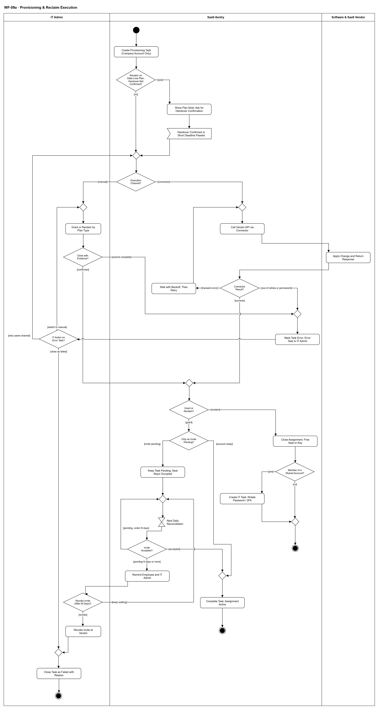

# WF-09a — Provisioning & Reclaim Execution

> **Loại:** Workflow con (subflow) của MF-2 — thực thi cấp/thu hồi · **Phiên bản:** 3.6 — 10/10/2026 · **Trạng thái:** Vẽ lại theo BRD v3.32 (FR-1.9, FR-2.3 → FR-2.12, 5.12.3, 6.2), QĐ-54 và QĐ-62f/62i/62j, QĐ-63a/63b, QĐ-64a/64b (10/10/2026); chờ Owner/GVHD review
>
> Sơ đồ là **dẫn xuất** từ quyết định Owner (`QĐ`) và BRD hiện hành; khi khác nhau, `QĐ` → BRD thắng. Quyết định trong sơ đồ là của Owner, **chưa** phải xác nhận của GVHD/hội đồng.

## 1. Mục đích và phạm vi

Mô tả **phần thực thi kỹ thuật** dùng chung cho mọi luồng cấp và thu hồi quyền: tách ý định nghiệp vụ (Assignment) khỏi việc tạo/xóa tài khoản thật (Provisioning Task), hỏi xác nhận bàn giao bản nhẹ trước khi gỡ gói có lưu ý mất dữ liệu, chọn kênh Connector hay Manual theo kiểu cấp của gói, thử lại khi lỗi tạm thời, để IT Admin chọn thử lại / làm tay / đóng thất bại khi tác vụ lỗi, và theo dõi lời mời đang chờ chấp nhận tới khi vào hoặc bị thu lại — không bao giờ giả thành công.

**Phạm vi:** Tạo Provisioning Task; xác nhận bàn giao bản nhẹ khi thu hồi gói có lưu ý mất dữ liệu (QĐ-62f); hai kênh Connector/Manual; kiểu cấp K1/K2/K4/K5 (K3 chỉ đặc tả); chỉ tài khoản công ty; thử lại có giãn cách; tác vụ lỗi và ba lựa chọn của IT (QĐ-62i); lời mời chờ chấp nhận, nhắc sau N ngày, thu lại sau M ngày (QĐ-62j); thu hồi trả seat hoặc khóa về kho; việc đổi mật khẩu/2FA khi thành viên tài khoản dùng chung rời.

**Không nằm trong sơ đồ này:** Quyết định có cấp/thu hồi hay không (bên gọi: WF-09, WF-11, WF-07, WF-08, MF-7…); bàn giao dữ liệu và thời gian giữ khi nghỉ việc (→ WF-07, QĐ-62e); giải phóng khoản cam kết và báo người yêu cầu khi cấp thất bại (bên gọi WF-09); ghi nhận tiết kiệm (FR-4.15, MF-4); giá trị N, M và số lần thử (tham số cấu hình).

## 2. Tệp

| Tệp | Vai trò |
| --- | --- |
| [WF-09a-provisioning-reclaim-execution.drawio](WF-09a-provisioning-reclaim-execution.drawio) | Nguồn draw.io chỉnh sửa được (sinh từ spec) |
| [WF-09a-provisioning-reclaim-execution.drawio.png](WF-09a-provisioning-reclaim-execution.drawio.png) | Bản xuất PNG, nhúng sẵn nguồn draw.io |
| [WF-09a.json](../specs/WF-09a.json) | **Nguồn canonical** — sửa ở đây rồi chạy `python tools/flowkit.py build` từ `Docs/Diagrams` |

## 3. Nguồn nghiệp vụ

| Mã | Nội dung dùng trong sơ đồ |
| --- | --- |
| `FR-2.3, FR-2.5, ADR-07` | Assignment tách khỏi Provisioning Task; kênh Connector/Manual; số lần thử, lỗi gần nhất |
| `BRD 6.2` | Provisioning Port: connector adapter và manual adapter; chống gọi trùng, thử lại có giãn cách, giới hạn tần suất |
| `BRD 5.12.3` | Vòng đời Provisioning Task, trạng thái *chờ chấp nhận* |
| `FR-1.9, QĐ-54a` | Kiểu cấp K1–K5 là thuộc tính của gói; K3 chỉ đặc tả |
| `FR-2.9, QĐ-54c` | Chỉ tài khoản công ty; owner workspace luôn là tài khoản IT |
| `FR-2.10, QĐ-54b` | Kho khóa bản quyền: mã hóa, che bớt, Audit Trail khi xem; khóa về kho nếu điều khoản cho chuyển máy |
| `FR-2.11, QĐ-54d, QĐ-56c` | Thành viên tài khoản dùng chung rời ⟹ việc cho IT đổi mật khẩu/2FA |
| `FR-2.4, FR-4.15` | Thu hồi đưa seat về trống; không tự ghi nhận tiết kiệm |
| `QĐ-49b, QĐ-50a` | Phần mềm nội bộ: cấp/thu hồi ngoài hệ thống, xác nhận kèm bằng chứng |
| `BRD 5.3 bảng ngoại lệ` | Provisioning thất bại ⟹ Assignment lỗi, tác vụ cho IT, không mất dấu vết |
| `QĐ-62f, FR-2.12` | Bàn giao dữ liệu bản nhẹ cho thu hồi ngoài nghỉ việc: người kích hoạt xác nhận trước khi gỡ, không chặn sau hạn ngắn |
| `QĐ-63a, QĐ-63b` | Bốn ca do IT thực hiện (hết hạn, giảm/hủy thuê bao, không hợp thức hóa, thực thi lại): IT Admin ghi xác nhận bàn giao; chỉ ghi nhận, không phải chủ sở hữu dữ liệu hay người duyệt; không chặn sau hạn ngắn |
| `QĐ-64a, QĐ-64b` | Seat vừa quyết Thu hồi ghost seat vừa nằm trong phần vượt khi giảm thuê bao: một tác vụ thu hồi, trưởng phòng đó xác nhận bàn giao; chỉ phạm vi đã hỏi |
| `QĐ-62i` | Tác vụ lỗi: thử lại, chuyển làm tay kèm bằng chứng, đóng thất bại có lý do; chỉ đóng mới là kết cục cuối |
| `QĐ-62j, FR-2.6` | Lời mời không được chấp nhận: seat vẫn bị chiếm, đối soát hằng ngày, nhắc sau N ngày, IT được thu lại sau M ngày |
| `FR-10.4, QĐ-01` | Thông báo theo dõi trước khi ghi dữ liệu của người vừa được cấp |

## 4. Tác nhân, kích hoạt, điều kiện

| Làn (tiếng Anh trên hình) | Tác nhân | Trách nhiệm trong sơ đồ |
| --- | --- | --- |
| IT Admin | IT Admin phụ trách phòng (IT Admin khác xử lý thay được, có Audit Trail) | Thực hiện kênh thủ công và xác nhận kèm bằng chứng |
| SaaS-Sentry | SaaS-Sentry | Tạo tác vụ, gọi connector, thử lại, ghi trạng thái Assignment/Provisioning Task, tạo tác vụ cho IT |
| Software & SaaS Vendor | Nhà cung cấp phần mềm/SaaS (qua API) | Tạo/gỡ tài khoản hoặc lời mời, trả kết quả |

- **Kích hoạt:** Một luồng gọi tới: yêu cầu đã đủ phê duyệt (cấp) hoặc quyết định thu hồi đã được ghi (hoàn trả, nghỉ việc, điều chuyển, hết hạn quyền có thời hạn, ghost seat, giảm/hủy thuê bao hoặc thuê bao hết hạn không gia hạn (`QĐ-66v`), không hợp thức hóa, thực thi lại sau sai lệch).
- **Tiền điều kiện:** Gói đã khai kiểu cấp, mức kiểm soát, lưu ý trước khi thu hồi và chính sách chia sẻ (FR-1.9, FR-1.10); người được cấp có email công việc thuộc tên miền công ty; với cấp, bên gọi đã kiểm sức chứa (K4: kho còn khóa — FR-2.10).
- **Hậu điều kiện:** Lượt gọi kết thúc với một trong hai kết quả cuối: *hoàn tất* (`[success]` — Assignment hoạt động, hoặc đã đóng khi thu hồi) hoặc *thất bại* (`[failed]` — chỉ khi IT Admin đóng tác vụ là thất bại kèm lý do, kể cả lời mời bị thu lại sau M ngày). Tác vụ lỗi hay lời mời đang chờ **chưa** phải kết quả cuối. Mọi bước có Audit Trail.

## 5. Cách đọc ký hiệu

| Ký hiệu | Nghĩa |
| --- | --- |
| Hình tròn đặc | Bắt đầu hoạt động (initial node) |
| Hình chữ nhật bo góc | Hành động (action) của tác nhân ở làn chứa nó |
| Hình thoi có chữ | Rẽ nhánh; mỗi cạnh ra mang điều kiện trong ngoặc vuông `[...]` |
| Hình thoi nhỏ không chữ | Hợp nhánh (merge) |
| Hình năm cạnh lõm | Chờ một sự kiện từ bên ngoài luồng (accept event) |
| Đồng hồ cát | Chờ một mốc thời gian (time event) |
| Vòng tròn kép đặc | Kết thúc toàn bộ hoạt động (activity final) |
| Dây có cung nhảy | Hai dây giao nhau nhưng **không** nối với nhau |

Đọc từ trên xuống. Đầu luồng là bước hỏi xác nhận bàn giao (chỉ cho thu hồi gói có lưu ý mất dữ liệu). Hình thoi *Execution Channel?* chia hai kênh: bên trái IT làm tay, bên phải hệ thống gọi API của nhà cung cấp; hai kênh gặp nhau ở chỗ ghi kết quả. Tác vụ lỗi rẽ sang hình thoi của IT Admin với ba lựa chọn — hai cạnh quay lên là thử lại và chuyển làm tay. Lời mời chờ chấp nhận đi vòng đối soát hằng ngày ở góc trái dưới. Mỗi vòng tròn kép là **một kết quả trả về cho bên gọi**: `[success]` (cấp), `[success]` (thu hồi) hoặc `[failed]`; bên gọi rẽ nhánh theo kết quả này.

## 6. Bảng node

| ID | Loại | Nhãn trên hình | Ý nghĩa | Làn / người thực hiện | Quy tắc |
| --- | --- | --- | --- | --- | --- |
| `st` | Nút bắt đầu | — | — | SaaS-Sentry | — |
| `s_task` | Hành động | Create Provisioning Task (Company Account Only) | Workflow được gọi khi một yêu cầu đã đủ phê duyệt (cấp) hoặc khi có quyết định thu hồi (bên gọi đã kiểm sức chứa trước khi cấp). Assignment ghi ý định của tổ chức; hệ thống sinh Provisioning Task riêng ở trạng thái *chờ thực thi*. Quyền trả phí chỉ cấp vào tài khoản gắn email công việc thuộc tên miền công ty — hệ thống không ghi nhận Assignment trả phí cho tài khoản cá nhân. | SaaS-Sentry | `FR-2.3`, `FR-2.5`, `FR-2.9`, `ADR-07`, `QĐ-54c` |
| `d_dl` | Rẽ nhánh | Reclaim on Data-Loss Plan, Handover Not Confirmed? | Thao tác thu hồi trên gói có *lưu ý trước khi thu hồi* nói dữ liệu sẽ mất, mà bên gọi chưa ghi xác nhận bàn giao của người kích hoạt thu hồi (Employee tự trả, trưởng phòng quyết, trưởng phòng mới sau điều chuyển, trưởng phòng chọn Reclaim ghost seat) **hoặc IT Admin ở bốn ca hết hạn quyền có thời hạn (WF-08), hủy/giảm thuê bao hoặc thuê bao hết hạn không gia hạn (MF-4/WF-15, QĐ-66v), không hợp thức hóa (WF-17) và thực thi lại sau sai lệch (WF-16) — QĐ-63a**. Riêng seat đã có quyết định *Thu hồi* ghost seat của trưởng phòng và nằm trong phần vượt khi giảm thuê bao: người xác nhận là trưởng phòng đó, không phải IT Admin (QĐ-64a). Thu hồi khi **nghỉ việc** do WF-07 xử lý bàn giao (kể cả giữ có hạn khi nghỉ đột ngột) nên đi [no]. Ở bốn ca của `QĐ-62f` chỉ gói có lưu ý mất dữ liệu mới cần xác nhận (`QĐ-66p`); nghỉ việc xác nhận mọi công cụ. Ca chồng lấn ghost seat *Thu hồi* × giảm/hủy toàn bộ/hết hạn quyền/thực thi lại: một tác vụ, trưởng phòng đã quyết xác nhận (`QĐ-64a`, `QĐ-66u`). | SaaS-Sentry | `FR-1.10`, `FR-2.12`, `QĐ-62f`, `QĐ-63a`, `QĐ-64a` |
| `s_ask` | Hành động | Show Plan Note; Ask for Handover Confirmation | Hệ thống hiện *lưu ý trước khi thu hồi* của gói và yêu cầu **người kích hoạt thu hồi** xác nhận đã bàn giao dữ liệu trước khi gỡ ở nhà cung cấp: nhân viên tự trả; trưởng phòng quyết (ca điều chuyển là trưởng phòng **mới**; ghost seat là trưởng phòng đã chọn Thu hồi). Các ca còn lại — hết hạn quyền có thời hạn (WF-08), hủy/giảm thuê bao hoặc thuê bao hết hạn không gia hạn (MF-4/WF-15, QĐ-66v), không hợp thức hóa (WF-17), thực thi lại (WF-16) — do **IT Admin** ghi xác nhận (QĐ-63a), trừ seat đã quyết *Thu hồi* ghost seat nằm trong phần vượt khi giảm thuê bao: do trưởng phòng đó xác nhận, IT Admin không xác nhận thêm (QĐ-64a). Bàn giao bản nhẹ (QĐ-62f). IT Admin chỉ ghi nhận việc bàn giao đã được xử lý — không là chủ sở hữu dữ liệu, không duyệt nhu cầu hay chi phí; xác nhận này không phải kết quả thu hồi (QĐ-63b, QĐ-62i). | SaaS-Sentry | `FR-1.10`, `FR-2.12`, `QĐ-62f`, `QĐ-62c`, `QĐ-63a`, `QĐ-64a` |
| `e_hc` | Chờ sự kiện | Handover Confirmed or Short Deadline Passed | Người kích hoạt thu hồi (hoặc IT Admin ở bốn ca của QĐ-63a, trừ seat đã quyết Thu hồi ghost seat nằm trong phần vượt khi giảm thuê bao — QĐ-64a) xác nhận, hoặc tới hạn ngắn cấu hình được thì đi tiếp và gắn cờ *chưa xác nhận bàn giao* — **không** chặn thu hồi sau hạn, như FR-2.12. Phòng chưa có trưởng phòng: việc xác nhận chờ, tới hạn thì đi tiếp (QĐ-62c). | SaaS-Sentry | `FR-2.12`, `QĐ-62f`, `QĐ-62c`, `QĐ-63a`, `QĐ-64a` |
| `m_ch` | Hợp nhánh | — | — | SaaS-Sentry | — |
| `d_ch` | Rẽ nhánh | Execution Channel? | Kiểu cấp của gói (K1–K5) quyết định adapter: Connector khi nhà cung cấp có API được hỗ trợ; Manual cho phần còn lại (K1 gói cá nhân, K4 khóa bản quyền, K5 phần mềm nội bộ, K2 không có connector). K3 SSO/SCIM chỉ đặc tả, không hiện thực. | SaaS-Sentry | `FR-1.9`, `FR-2.5`, `BRD 6.2`, `QĐ-54a`, `RB-4` |
| `m_man` | Hợp nhánh | — | — | IT Admin | — |
| `a_man` | Hành động | Grant or Reclaim by Plan Type | IT Admin thực hiện ngoài hệ thống theo kiểu cấp. Cấp: K1 mua gói trên tài khoản công ty của nhân viên · K2 IT (owner workspace) thêm email công ty vào workspace · K4 gán khóa từ kho cho người và thiết bị công ty — khóa lưu mã hóa, hiển thị che bớt, mỗi lần xem đầy đủ ghi Audit Trail · K5 cấp thủ công trong phần mềm nội bộ. Thu hồi: K1 hủy gia hạn (dùng tới hết kỳ) và khóa tài khoản công ty · K2 gỡ thành viên · K4 gỡ kích hoạt · K5 thu hồi thủ công. K4: số khóa trong kho là sức chứa của khoản mua (FR-2.10, INV-01) — kho hết khóa là hết seat, bên gọi đã kiểm ở WF-09 `d_seat` và quay về nhánh (b), không phải lỗi thực thi. | IT Admin | `FR-1.9`, `FR-2.9`, `FR-2.10`, `QĐ-54a`, `QĐ-54b`, `QĐ-49b`, `SoD-5` |
| `d_man` | Rẽ nhánh | Done with Evidence? | Kênh thủ công không bao giờ tự chuyển sang hoàn tất: IT Admin phải xác nhận kèm bằng chứng, hoặc ghi lại là không làm được. | IT Admin | `FR-2.3`, `FR-2.5`, `QĐ-49b` |
| `m_api` | Hợp nhánh | — | — | SaaS-Sentry | — |
| `s_api` | Hành động | Call Vendor API via Connector | Hệ thống gọi cấp/thu hồi qua Provisioning Port với khóa chống gọi trùng và giới hạn tần suất; ghi số lần thử và lỗi gần nhất trên Provisioning Task. | SaaS-Sentry | `FR-2.5`, `BRD 6.2` |
| `v_resp` | Hành động | Apply Change and Return Response | Nhà cung cấp tạo tài khoản/lời mời hoặc gỡ thành viên rồi trả kết quả. Có nhà cung cấp chỉ tạo **lời mời đang chờ** chứ chưa thêm thành viên. | Software & SaaS Vendor | `BRD 6.2`, `BRD 5.12.3` |
| `d_api` | Rẽ nhánh | Connector Result? | Phân loại kết quả gọi API. | SaaS-Sentry | `FR-2.5`, `BRD 6.2` |
| `s_retry` | Hành động | Wait with Backoff, Then Retry | Lỗi tạm thời: thử lại có giãn cách, tăng số lần thử trên Provisioning Task; số lần thử tối đa là tham số cấu hình (thiết kế kỹ thuật). Lỗi vĩnh viễn không thử lại. | SaaS-Sentry | `FR-2.5`, `BRD 6.2` |
| `m_ok` | Hợp nhánh | — | — | SaaS-Sentry | — |
| `m_fail` | Hợp nhánh | — | — | SaaS-Sentry | — |
| `d_op` | Rẽ nhánh | Grant or Reclaim? | Thao tác được yêu cầu khi gọi workflow này. | SaaS-Sentry | — |
| `s_err` | Hành động | Mark Task Error; Error Task to IT Admin | Provisioning Task chuyển *lỗi*, Assignment ở trạng thái lỗi, sinh tác vụ lỗi cho IT Admin phụ trách phòng (IT Admin khác xử lý thay được, có Audit Trail), kèm số lần thử và lỗi gần nhất. Chưa phải kết cục cuối: chưa trả kết quả cho bên gọi, khoản cam kết chưa giải phóng (QĐ-62i). | SaaS-Sentry | `FR-2.5`, `BRD 5.3 bảng ngoại lệ`, `QĐ-58b`, `QĐ-62i` |
| `d_fix` | Rẽ nhánh | IT Action on Error Task? | IT Admin chọn một trong ba: **thử lại** cùng kênh · **chuyển làm tay** kèm bằng chứng · **đóng là thất bại** với lý do bắt buộc. Chỉ đóng mới là kết cục cuối (QĐ-62i). Với thu hồi, lãng phí/G2 vẫn hiện tới khi thu hồi xong. | IT Admin | `FR-2.5`, `FR-2.3`, `QĐ-62i` |
| `end_fail` | Kết thúc hoạt động | — | Kết quả trả về bên gọi: [failed] — chỉ sau khi IT Admin đóng tác vụ là thất bại kèm lý do (QĐ-62i). | IT Admin | — |
| `d_pend` | Rẽ nhánh | Only an Invite Pending? | Nhà cung cấp mới chỉ tạo lời mời `pending` (thành viên chưa chấp nhận) hay tài khoản đã có/đã được IT xác nhận. | SaaS-Sentry | `BRD 5.12.3` |
| `m_act` | Hợp nhánh | — | — | SaaS-Sentry | — |
| `s_pend` | Hành động | Keep Task Pending; Seat Stays Occupied | Provisioning Task ở trạng thái *chờ chấp nhận*, **không** chuyển *hoàn tất* chỉ vì API trả thành công; trong lúc chờ seat vẫn bị chiếm (Assignment tồn tại, INV-01). | SaaS-Sentry | `BRD 5.12.3`, `FR-2.6`, `INV-01`, `QĐ-62j` |
| `m_pw` | Hợp nhánh | — | — | SaaS-Sentry | — |
| `t_day` | Chờ mốc thời gian | Next Daily Reconciliation | Đối soát hằng ngày với danh sách thành viên phía nhà cung cấp (FR-2.6) tiếp tục kiểm lời mời. | SaaS-Sentry | `FR-2.6`, `QĐ-62j` |
| `d_acc` | Rẽ nhánh | Invite Accepted? | Đối soát thấy thành viên đã vào chưa, và lời mời đã chờ bao lâu. | SaaS-Sentry | `FR-2.6`, `BRD 5.12.3`, `QĐ-62j` |
| `s_rem` | Hành động | Remind Employee and IT Admin | Lời mời chưa được chấp nhận sau **N** ngày: nhắc nhân viên và IT Admin phụ trách. N, M là tham số cấu hình (thiết kế kỹ thuật). | SaaS-Sentry | `QĐ-62j`, `FR-3.11` |
| `d_rev` | Rẽ nhánh | Revoke Invite (After M Days)? | Sau **M** ngày IT Admin **được** thu lại lời mời và đóng tác vụ thất bại có lý do; chưa tới M ngày hoặc IT chọn chờ thêm thì lời mời tiếp tục được đối soát hằng ngày. Không tự hủy (QĐ-62j). | IT Admin | `QĐ-62j` |
| `a_rev` | Hành động | Revoke Invite at Vendor | IT Admin thu lại lời mời phía nhà cung cấp (qua connector hoặc làm tay) để seat không bị giữ mãi. | IT Admin | `QĐ-62j` |
| `m_close` | Hợp nhánh | — | — | IT Admin | — |
| `a_close` | Hành động | Close Task as Failed with Reason | IT Admin đóng tác vụ là thất bại, lý do bắt buộc; Audit Trail. Bên gọi nhận [failed]: với cấp ⟹ Request/Assignment thất bại, khoản cam kết được giải phóng (FR-5.8), người yêu cầu được báo (WF-09); với thu hồi ⟹ Assignment chưa đóng, lãng phí/G2 vẫn hiện tới khi thu hồi xong. | IT Admin | `QĐ-62i`, `QĐ-62j`, `FR-5.8`, `FR-3.11` |
| `s_act` | Hành động | Complete Task; Assignment Active | Provisioning Task *hoàn tất*, Assignment hoạt động, ghi Audit Trail. Với K4: khóa gắn đúng một Assignment đang hiệu lực kèm thiết bị công ty. Ứng dụng đang được theo dõi usage ⟹ gửi thông báo FR-10.4 cho người vừa được cấp trước khi dữ liệu của họ được ghi (QĐ-01). | SaaS-Sentry | `FR-2.3`, `FR-2.10`, `INV-01`, `FR-10.4`, `QĐ-01` |
| `end_ok` | Kết thúc hoạt động | — | Kết quả trả về bên gọi: [success] cho thao tác cấp (kể cả lời mời đã được chấp nhận). | SaaS-Sentry | — |
| `s_free` | Hành động | Close Assignment; Free Seat or Key | Assignment kết thúc; seat về trạng thái trống (K2). K4: khóa về kho **chỉ khi** điều khoản cho chuyển máy, nếu không thì *ngừng dùng*. K1: hết kỳ đã trả thì thôi gia hạn. K5: không có seat. **Thu hồi không tự ghi nhận tiền tiết kiệm** — tiết kiệm chỉ ghi khi hợp đồng/khoản chi thực sự giảm. | SaaS-Sentry | `FR-2.4`, `FR-2.10`, `FR-1.10`, `FR-4.15`, `QĐ-54b` |
| `d_shr` | Rẽ nhánh | Member of a Shared Account? | Người bị thu hồi có đang là thành viên một tài khoản dùng chung (một bộ đăng nhập cho nhiều người) không. | SaaS-Sentry | `FR-2.11`, `QĐ-54d` |
| `s_rot` | Hành động | Create IT Task: Rotate Password / 2FA | Hệ thống tạo việc cho IT Admin phụ trách đổi mật khẩu/thiết bị xác thực hai lớp và cập nhật danh sách người dùng. Hệ thống không lưu mật khẩu dùng chung. | SaaS-Sentry | `FR-2.11`, `FR-5.14`, `QĐ-54d`, `QĐ-56c` |
| `m_rec` | Hợp nhánh | — | — | SaaS-Sentry | — |
| `end_rec` | Kết thúc hoạt động | — | Kết quả trả về bên gọi: [success] cho thao tác thu hồi. | SaaS-Sentry | — |

## 7. Bảng chuyển tiếp

| Từ → tới | Nhãn điều kiện | Điều kiện | Kết quả |
| --- | --- | --- | --- |
| `st` → `s_task` | — | — | Sang Create Provisioning Task (Company Account Only) |
| `s_task` → `d_dl` | — | — | Sang Reclaim on Data-Loss Plan, Handover Not Confirmed? |
| `d_dl` → `s_ask` | `[yes]` | Thu hồi gói có lưu ý mất dữ liệu, bên gọi chưa ghi xác nhận bàn giao | Hỏi người kích hoạt xác nhận |
| `d_dl` → `m_ch` | `[no]` | Thao tác cấp; gói không mất dữ liệu; bàn giao đã xác nhận ở bên gọi; hoặc thu hồi khi nghỉ việc (bàn giao xử lý ở WF-07) | Thực thi ngay |
| `s_ask` → `e_hc` | — | — | Sang Handover Confirmed or Short Deadline Passed |
| `e_hc` → `m_ch` | — | — | Sang — |
| `m_ch` → `d_ch` | — | — | Sang Execution Channel? |
| `d_ch` → `m_man` | `[manual]` | Gói không có connector (K1, K4, K5, K2 không API) | IT Admin làm tay |
| `m_man` → `a_man` | — | — | Sang Grant or Reclaim by Plan Type |
| `d_ch` → `m_api` | `[connector]` | Nhà cung cấp có API được hỗ trợ | Hệ thống gọi API |
| `a_man` → `d_man` | — | — | Sang Done with Evidence? |
| `d_man` → `m_ok` | `[confirmed]` | IT xác nhận hoàn tất kèm bằng chứng | Ghi kết quả |
| `d_man` → `m_fail` | `[cannot complete]` | IT không thực hiện được | Tác vụ lỗi cho IT |
| `m_api` → `s_api` | — | — | Sang Call Vendor API via Connector |
| `s_api` → `v_resp` | — | — | Sang Apply Change and Return Response |
| `v_resp` → `d_api` | — | — | Sang Connector Result? |
| `d_api` → `m_ok` | `[success]` | API trả thành công | Ghi kết quả |
| `d_api` → `s_retry` | `[transient error]` | Lỗi tạm thời, còn lượt thử theo cấu hình | Chờ rồi thử lại |
| `d_api` → `m_fail` | `[out of retries or permanent]` | Lỗi vĩnh viễn/xác thực, hoặc đã hết lượt thử theo cấu hình | Tác vụ lỗi cho IT |
| `s_retry` → `m_api` | — | — | Sang — |
| `m_fail` → `s_err` | — | — | Sang Mark Task Error; Error Task to IT Admin |
| `s_err` → `d_fix` | — | — | Sang IT Action on Error Task? |
| `d_fix` → `m_ch` | `[retry same channel]` | IT thử lại trên cùng kênh | Thực thi lại |
| `d_fix` → `m_man` | `[switch to manual]` | IT chuyển sang làm tay, xác nhận kèm bằng chứng | Làm tay |
| `d_fix` → `m_close` | `[close as failed]` | IT đóng tác vụ là thất bại, lý do bắt buộc | Kết cục cuối |
| `m_close` → `a_close` | — | — | Sang Close Task as Failed with Reason |
| `a_close` → `end_fail` | — | — | Sang — |
| `m_ok` → `d_op` | — | — | Sang Grant or Reclaim? |
| `d_op` → `d_pend` | `[grant]` | Thao tác cấp quyền | Kiểm lời mời đang chờ |
| `d_op` → `s_free` | `[reclaim]` | Thao tác thu hồi | Đóng Assignment |
| `d_pend` → `s_pend` | `[invite pending]` | Nhà cung cấp mới chỉ tạo lời mời | Giữ chờ chấp nhận |
| `d_pend` → `m_act` | `[account ready]` | Tài khoản đã có, hoặc IT đã xác nhận kèm bằng chứng | Hoàn tất |
| `s_pend` → `m_pw` | — | — | Sang — |
| `m_pw` → `t_day` | — | — | Sang Next Daily Reconciliation |
| `t_day` → `d_acc` | — | — | Sang Invite Accepted? |
| `d_acc` → `m_act` | `[accepted]` | Đối soát thấy thành viên đã vào | Hoàn tất |
| `d_acc` → `m_pw` | `[pending, under N days]` | Chưa chấp nhận, chưa tới N ngày | Chờ lượt đối soát sau |
| `d_acc` → `s_rem` | `[pending N days or more]` | Chưa chấp nhận sau N ngày | Nhắc nhân viên và IT Admin |
| `s_rem` → `d_rev` | — | — | Sang Revoke Invite (After M Days)? |
| `d_rev` → `m_pw` | `[keep waiting]` | Chưa tới M ngày, hoặc IT chọn chờ thêm | Tiếp tục đối soát |
| `d_rev` → `a_rev` | `[revoke]` | Đã qua M ngày, IT thu lại lời mời | Đóng tác vụ thất bại |
| `a_rev` → `m_close` | — | — | Sang — |
| `m_act` → `s_act` | — | — | Sang Complete Task; Assignment Active |
| `s_act` → `end_ok` | — | — | Sang — |
| `s_free` → `d_shr` | — | — | Sang Member of a Shared Account? |
| `d_shr` → `s_rot` | `[yes]` | Là thành viên tài khoản dùng chung | Tạo việc đổi mật khẩu/2FA |
| `d_shr` → `m_rec` | `[no]` | Không phải thành viên tài khoản dùng chung | Kết thúc thu hồi |
| `s_rot` → `m_rec` | — | — | Sang — |
| `m_rec` → `end_rec` | — | — | Sang — |

Số đếm: **39 node · 49 cạnh · 10 rẽ nhánh**; giao cắt dây: **4**.

## 8. Happy path

1. `st` — —
2. `s_task` — Create Provisioning Task (Company Account Only): Workflow được gọi khi một yêu cầu đã đủ phê duyệt (cấp) hoặc khi có quyết định thu hồi (bên gọi đã kiểm sức chứa trước khi cấp). Assignment ghi ý định của tổ chức; hệ thống sinh Provisioning Task riêng ở trạng thái *chờ thực thi*. Quyền trả phí chỉ cấp vào tài khoản gắn email công việc thuộc tên miền công ty — hệ thống không ghi nhận Assignment trả phí cho tài khoản cá nhân.
3. `d_dl` — Reclaim on Data-Loss Plan, Handover Not Confirmed?: Thao tác thu hồi trên gói có *lưu ý trước khi thu hồi* nói dữ liệu sẽ mất, mà bên gọi chưa ghi xác nhận bàn giao của người kích hoạt thu hồi (Employee tự trả, trưởng phòng quyết, trưởng phòng mới sau điều chuyển, trưởng phòng chọn Reclaim ghost seat) **hoặc IT Admin ở bốn ca hết hạn quyền có thời hạn (WF-08), hủy/giảm thuê bao hoặc thuê bao hết hạn không gia hạn (MF-4/WF-15, QĐ-66v), không hợp thức hóa (WF-17) và thực thi lại sau sai lệch (WF-16) — QĐ-63a**. Riêng seat đã có quyết định *Thu hồi* ghost seat của trưởng phòng và nằm trong phần vượt khi giảm thuê bao: người xác nhận là trưởng phòng đó, không phải IT Admin (QĐ-64a). Thu hồi khi **nghỉ việc** do WF-07 xử lý bàn giao (kể cả giữ có hạn khi nghỉ đột ngột) nên đi [no]. Ở bốn ca của `QĐ-62f` chỉ gói có lưu ý mất dữ liệu mới cần xác nhận (`QĐ-66p`); nghỉ việc xác nhận mọi công cụ. Ca chồng lấn ghost seat *Thu hồi* × giảm/hủy toàn bộ/hết hạn quyền/thực thi lại: một tác vụ, trưởng phòng đã quyết xác nhận (`QĐ-64a`, `QĐ-66u`).
4. `d_ch` — Execution Channel?: Kiểu cấp của gói (K1–K5) quyết định adapter: Connector khi nhà cung cấp có API được hỗ trợ; Manual cho phần còn lại (K1 gói cá nhân, K4 khóa bản quyền, K5 phần mềm nội bộ, K2 không có connector). K3 SSO/SCIM chỉ đặc tả, không hiện thực.
5. `s_api` — Call Vendor API via Connector: Hệ thống gọi cấp/thu hồi qua Provisioning Port với khóa chống gọi trùng và giới hạn tần suất; ghi số lần thử và lỗi gần nhất trên Provisioning Task.
6. `v_resp` — Apply Change and Return Response: Nhà cung cấp tạo tài khoản/lời mời hoặc gỡ thành viên rồi trả kết quả. Có nhà cung cấp chỉ tạo **lời mời đang chờ** chứ chưa thêm thành viên.
7. `d_api` — Connector Result?: Phân loại kết quả gọi API.
8. `d_op` — Grant or Reclaim?: Thao tác được yêu cầu khi gọi workflow này.
9. `d_pend` — Only an Invite Pending?: Nhà cung cấp mới chỉ tạo lời mời `pending` (thành viên chưa chấp nhận) hay tài khoản đã có/đã được IT xác nhận.
10. `s_act` — Complete Task; Assignment Active: Provisioning Task *hoàn tất*, Assignment hoạt động, ghi Audit Trail. Với K4: khóa gắn đúng một Assignment đang hiệu lực kèm thiết bị công ty. Ứng dụng đang được theo dõi usage ⟹ gửi thông báo FR-10.4 cho người vừa được cấp trước khi dữ liệu của họ được ghi (QĐ-01).
11. `end_ok` — —: Kết quả trả về bên gọi: [success] cho thao tác cấp (kể cả lời mời đã được chấp nhận).

## 9. Nhánh thay thế / if-else

- **Kênh thủ công (K1, K4, K5, K2 không API)** — `d_ch` → `m_man` → `a_man` → `d_man` → `m_ok` → `d_op`. IT làm ngoài hệ thống rồi xác nhận kèm bằng chứng.
- **Lỗi tạm thời — thử lại** — `d_api` → `s_retry` → `m_api` → `s_api`. Thử lại có giãn cách; lỗi vĩnh viễn không thử lại.
- **Thu hồi gói có lưu ý mất dữ liệu** — `d_dl` → `s_ask` → `e_hc` → `m_ch` → `d_ch`. Người kích hoạt thu hồi xác nhận bàn giao (QĐ-62f) — hoặc IT Admin ở bốn ca do IT thực hiện (QĐ-63a), trừ seat đã quyết Thu hồi ghost seat nằm trong phần vượt khi giảm thuê bao thì trưởng phòng đó (QĐ-64a); tới hạn ngắn thì đi tiếp có cờ.
- **Lời mời đang chờ chấp nhận** — `d_pend` → `s_pend` → `m_pw` → `t_day` → `d_acc` → `m_act` → `s_act`. Seat vẫn bị chiếm; đối soát hằng ngày xác nhận khi thành viên đã vào.
- **Lời mời chờ quá N ngày** — `d_acc` → `s_rem` → `d_rev` → `m_pw`. Nhắc nhân viên và IT Admin; IT chọn chờ thêm.
- **IT thử lại hoặc chuyển làm tay** — `s_err` → `d_fix` → `m_man` → `a_man`. Thử lại cùng kênh quay về `m_ch`; chuyển làm tay cần bằng chứng (QĐ-62i).
- **Thu hồi** — `d_op` → `s_free` → `d_shr` → `m_rec` → `end_rec`. Seat trống hoặc khóa về kho nếu điều khoản cho phép; không ghi tiết kiệm.
- **Thu hồi thành viên tài khoản dùng chung** — `d_shr` → `s_rot` → `m_rec`. Tạo việc riêng cho IT đổi mật khẩu/thiết bị xác thực; thu hồi xong khi việc đã được tạo (QĐ-62p).

## 10. Nhánh lỗi / từ chối và cách kết thúc

- **Connector lỗi vĩnh viễn hoặc hết lượt thử** — `d_api` → `m_fail` → `s_err` → `d_fix`. Assignment lỗi, tác vụ lỗi cho IT; chưa trả kết quả cho bên gọi.
- **IT không thực hiện được thủ công** — `d_man` → `m_fail` → `s_err` → `d_fix`. Cùng xử lý như trên.
- **IT đóng tác vụ là thất bại** — `d_fix` → `m_close` → `a_close` → `end_fail`. Lý do bắt buộc; bên gọi nhận [failed] (QĐ-62i).
- **Lời mời bị thu lại sau M ngày** — `d_rev` → `a_rev` → `m_close` → `a_close` → `end_fail`. Đóng tác vụ thất bại có lý do (QĐ-62j).

## 11. Liên hệ với sơ đồ khác

- Cấp trên: `MF-2` (cấp quyền), `MF-5`/`MF-7` (thu hồi); FDD Feature 5
- Bên gọi: `WF-09` (cấp sau phê duyệt), `WF-11` (hoàn trả), `WF-07` (nghỉ việc), `WF-08` (hết hạn quyền có thời hạn của một người), `WF-05` (điều chuyển), `WF-13` (ghost seat), `MF-4`/`WF-15` (giảm/hủy thuê bao và **thuê bao hết hạn không gia hạn** — `c_exp`, `QĐ-66v`, xử lý như hủy toàn bộ), `WF-17` (không hợp thức hóa), `WF-16` (thực thi lại sau sai lệch) — kết quả `[failed]` nay chỉ có sau khi IT đóng tác vụ (QĐ-62i)
- `WF-16` / đối soát nhà cung cấp `FR-2.6` — vòng đối soát hằng ngày xác nhận lời mời đã được chấp nhận
- User flow: `UF-08` (IT Admin xử lý hàng đợi cấp phát)

## 12. Giới hạn và vấn đề còn mở

- (LATER-TECH/UI · DOI-32) Số lần thử lại tối đa của connector và số ngày N (nhắc) / M (được thu lại lời mời), hạn ngắn chờ xác nhận bàn giao là tham số cấu hình ở thiết kế kỹ thuật (FR-2.5 chỉ yêu cầu ghi số lần thử và lỗi gần nhất; QĐ-62 để tham số kỹ thuật cho thiết kế kỹ thuật).
- (LIMIT · DOI-04) Tài khoản công ty và workspace do IT làm owner được **mô phỏng** trong demo (RB-4, QĐ-54c); K3 SSO/SCIM chỉ đặc tả.
- (ĐÃ CHỐT · HO-136, DOI-46, FR-2.12, QĐ-63a) Ai xác nhận bàn giao dữ liệu khi thu hồi gói mất dữ liệu ở bốn ca hết hạn quyền có thời hạn, hủy/giảm thuê bao (kể cả thuê bao hết hạn không gia hạn — QĐ-66v), không hợp thức hóa, thực thi lại: IT Admin ghi xác nhận (QĐ-63a), không chặn sau hạn ngắn; không đổi người xác nhận ở các ca khác (QĐ-63b). Còn lại cho giai đoạn sau: AC của các Story chứa bốn ca (tối thiểu `US-03-05`, `US-11-02`, `US-11-03`, `US-13-06`, `US-07-05`, `US-07-07`), chỗ lưu người và thời điểm xác nhận ở ERD (HO-136), giá trị hạn ngắn ở thiết kế kỹ thuật.
- (ĐÃ CHỐT · HO-136, DOI-46, FR-2.12, QĐ-64a) Seat vừa quyết Thu hồi ghost seat (QĐ-62f) vừa nằm trong phần vượt khi giảm thuê bao (MF-4 c_excess, WF-15 c_rec): một tác vụ thu hồi; trưởng phòng đã quyết Thu hồi xác nhận bàn giao, IT Admin không xác nhận thêm; đã có xác nhận hợp lệ thì dùng lại. (ĐÃ CHỐT · QĐ-66u) Cùng quy tắc áp cho hủy toàn bộ thuê bao, hết hạn quyền có thời hạn, thực thi lại.
