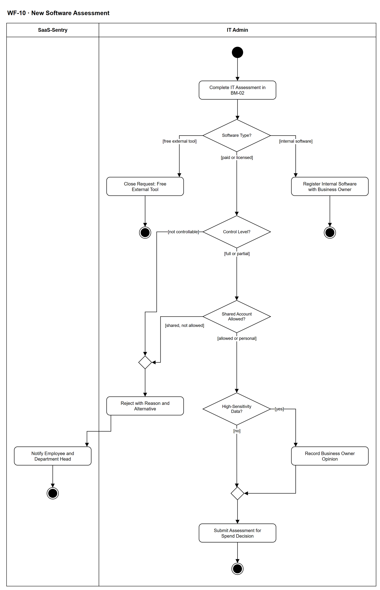

# WF-10 — New Software Assessment

> **Loại:** Workflow con (subflow) của MF-2 — nhánh (c) phần mềm chưa có trong danh mục · **Phiên bản:** 3.1 — 09/10/2026 · **Trạng thái:** Vẽ lại theo BRD v3.30 (đồng bộ QĐ-61/QĐ-62) (FR-3.4, FR-3.19, BM-02, 4.4) và QĐ-49h, QĐ-50a, QĐ-53c; chờ Owner/GVHD review
>
> Sơ đồ là **dẫn xuất** từ quyết định Owner (`QĐ`) và BRD hiện hành; khi khác nhau, `QĐ` → BRD thắng. Quyết định trong sơ đồ là của Owner, **chưa** phải xác nhận của GVHD/hội đồng.

## 1. Mục đích và phạm vi

Mô tả bước **IT Admin đánh giá phần mềm chưa có trong danh mục** trước khi tới Người duyệt chi: phân loại đối tượng (miễn phí bên ngoài / nội bộ / trả phí–có bản quyền), cổng mức kiểm soát, chính sách chia sẻ tài khoản, và ý kiến không chặn của Business Owner khi dữ liệu nhạy cảm. Cổng này chặn sớm những phần mềm công ty không quản trị được, nên Người duyệt chi chỉ phải quyết những đề xuất kiểm soát được.

**Phạm vi:** Hoàn thiện BM-02; đóng yêu cầu công cụ miễn phí bên ngoài; đăng ký phần mềm nội bộ cùng Business Owner; cổng mức kiểm soát Đầy đủ / Một phần / Không kiểm soát được; từ chối khi gói cấm chia sẻ mà yêu cầu là tài khoản dùng chung; ghi ý kiến Business Owner cho dữ liệu nhạy cảm cao; bàn giao sang bước duyệt chi.

**Không nằm trong sơ đồ này:** Bước nhu cầu của trưởng phòng và bước duyệt chi (→ WF-09); mua, thêm vào danh mục và cấp quyền sau khi duyệt (→ WF-09, WF-09a); hợp thức hóa phần mềm ngoài danh mục phát hiện từ sao kê — ở đó mức kiểm soát chỉ là đầu vào, không có cổng từ chối (→ WF-17, FR-3.4c-1).

## 2. Tệp

| Tệp | Vai trò |
| --- | --- |
| [WF-10-new-software-assessment.drawio](WF-10-new-software-assessment.drawio) | Nguồn draw.io chỉnh sửa được (sinh từ spec) |
| [WF-10-new-software-assessment.drawio.png](WF-10-new-software-assessment.drawio.png) | Bản xuất PNG, nhúng sẵn nguồn draw.io |
| [WF-10.json](../specs/WF-10.json) | **Nguồn canonical** — sửa ở đây rồi chạy `python tools/flowkit.py build` từ `Docs/Diagrams` |

## 3. Nguồn nghiệp vụ

| Mã | Nội dung dùng trong sơ đồ |
| --- | --- |
| `FR-3.4 (c), các đường đặc biệt 1–4` | Nhánh phần mềm chưa có trong danh mục; công cụ miễn phí; phần mềm nội bộ; cổng mức kiểm soát; tài khoản dùng chung |
| `FR-3.19, QĐ-53c, QĐ-58d` | Cổng mức kiểm soát; từ chối kèm lý do và phương án thay thế; không áp cho hợp thức hóa |
| `QĐ-49a, QĐ-49h` | Đối tượng quản lý; IT đóng yêu cầu công cụ miễn phí bên ngoài |
| `QĐ-50a, FR-1.1, FR-1.7` | Phần mềm nội bộ đăng ký cùng Business Owner, không qua Người duyệt chi |
| `FR-1.9, FR-1.10, QĐ-54a, QĐ-54e` | Kiểu cấp, mức kiểm soát mặc định, điều khoản và chính sách chia sẻ của gói |
| `FR-2.11, QĐ-54d` | Tài khoản dùng chung chỉ khi chính sách chia sẻ cho phép, nếu không thì bị từ chối ở bước đánh giá của IT |
| `BRD 4.4, OI-05a` | Ý kiến Business Owner cho SaaS mới nhạy cảm cao: đầu vào không chặn do IT ghi |
| `BM-02, FR-5.13, QĐ-60a` | Trường của đề xuất mua phần mềm mới; chi phí ước tính theo chi phí thực chịu |
| `BRD 4.6` | Ma trận trách nhiệm dòng nhánh (c) và phần mềm nội bộ |

## 4. Tác nhân, kích hoạt, điều kiện

| Làn (tiếng Anh trên hình) | Tác nhân | Trách nhiệm trong sơ đồ |
| --- | --- | --- |
| SaaS-Sentry | SaaS-Sentry | Thông báo kết quả từ chối, ghi Audit Trail |
| IT Admin | IT Admin phụ trách phòng của người yêu cầu (IT Admin khác xử lý thay được, có Audit Trail) | Đánh giá, phân loại, cổng mức kiểm soát, ghi ý kiến Business Owner |

- **Kích hoạt:** WF-09 gọi khi yêu cầu thuộc nhánh (c) — phần mềm chưa có trong danh mục — và trưởng phòng đã xác nhận nhu cầu.
- **Tiền điều kiện:** Yêu cầu BM-01/BM-02 đã gửi và bước nhu cầu đã được duyệt; IT Admin có quyền quản lý danh mục.
- **Hậu điều kiện:** Một trong bốn kết quả trả về WF-09: `[closed]` (công cụ miễn phí bên ngoài) · `[no cost]` (phần mềm nội bộ đã đăng ký, đi đường không phí) · `[rejected]` (không kiểm soát được hoặc gói cấm chia sẻ — Employee và trưởng phòng đã được báo) · `[to spend approval]` (BM-02 hoàn chỉnh kèm mức kiểm soát và rủi ro).

## 5. Cách đọc ký hiệu

| Ký hiệu | Nghĩa |
| --- | --- |
| Hình tròn đặc | Bắt đầu hoạt động (initial node) |
| Hình chữ nhật bo góc | Hành động (action) của tác nhân ở làn chứa nó |
| Hình thoi có chữ | Rẽ nhánh; mỗi cạnh ra mang điều kiện trong ngoặc vuông `[...]` |
| Hình thoi nhỏ không chữ | Hợp nhánh (merge) |
| Vòng tròn kép đặc | Kết thúc toàn bộ hoạt động (activity final) |
| Dây có cung nhảy | Hai dây giao nhau nhưng **không** nối với nhau |

Đọc từ trên xuống. Hình thoi *Software Type?* tách ba loại đối tượng; chỉ nhánh giữa (trả phí/có bản quyền) đi tiếp qua hai cổng kỹ thuật. Mỗi vòng tròn kép là **một kết quả trả về WF-09**, không phải kết thúc của cả yêu cầu. Ý kiến Business Owner nằm trên một nhánh phụ rồi nhập lại — không có lối ra từ chối, đúng nghĩa *không chặn*.

## 6. Bảng node

| ID | Loại | Nhãn trên hình | Ý nghĩa | Làn / người thực hiện | Quy tắc |
| --- | --- | --- | --- | --- | --- |
| `st` | Nút bắt đầu | — | — | IT Admin | — |
| `a_bm02` | Hành động | Complete IT Assessment in BM-02 | Workflow được WF-09 gọi ở nhánh (c), sau khi trưởng phòng đã xác nhận nhu cầu. Employee đã khai nhu cầu trong BM-02; IT Admin hoàn thiện phần đánh giá: nhà cung cấp, gói định mua, mô hình giá, số người dùng, giá trước thuế, hồ sơ thuế, thuế ước tính và chi phí ước tính (chi phí thực chịu); kiểu cấp, trang quản trị, xuất danh sách thành viên, SSO, chính sách chia sẻ và điều khoản (checklist sáu điểm), loại dữ liệu sẽ đưa vào, công cụ trùng chức năng đã có (theo nhóm chức năng). Khuyến nghị không chặn: từ 3 người dùng thì ưu tiên K2. Bước đánh giá IT có SLA theo FR-3.8 (loại bước *đánh giá IT*, BRD 5.12.1 C4), nhắc quá hạn ở WF-09 `e_sla`. *Công cụ trùng chức năng đã có* chỉ là đầu vào và gợi ý phương án thay thế, không phải cổng từ chối (BM-02, FR-1.1). | IT Admin | `FR-3.19`, `BM-02`, `FR-1.1`, `FR-1.9`, `FR-1.10`, `FR-5.13`, `QĐ-54a`, `QĐ-60a` |
| `d_type` | Rẽ nhánh | Software Type? | IT phân loại theo đối tượng hệ thống quản lý: phần mềm/SaaS miễn phí bên ngoài (không quản lý) · phần mềm do công ty tự xây dựng · SaaS trả phí hoặc phần mềm thương mại có bản quyền. | IT Admin | `QĐ-49a`, `QĐ-49h`, `QĐ-50a` |
| `a_close` | Hành động | Close Request: Free External Tool | IT đóng yêu cầu với lý do *phần mềm miễn phí bên ngoài — ngoài phạm vi quản lý* kèm hướng dẫn theo chính sách công ty. Không qua Người duyệt chi, không thêm vào danh mục. Đây là đóng yêu cầu, không phải từ chối nghiệp vụ. | IT Admin | `QĐ-49h`, `FR-1.1`, `FR-3.4` |
| `end_closed` | Kết thúc hoạt động | — | Trả về WF-09: [closed] — yêu cầu đóng, ngoài phạm vi quản lý. | IT Admin | — |
| `a_reg` | Hành động | Register Internal Software with Business Owner | Phần mềm do công ty tự xây dựng: IT Admin đăng ký vào danh mục cùng Business Owner đang làm việc; không cần nhà cung cấp, hợp đồng, thuê bao hay hóa đơn; không có bước Người duyệt chi. | IT Admin | `QĐ-50a`, `FR-1.1`, `FR-1.7`, `QĐ-49b` |
| `end_int` | Kết thúc hoạt động | — | Trả về WF-09: [no cost] — yêu cầu đi tiếp đường không phí (K5 cấp thủ công kèm bằng chứng; không kiểm seat, không khoản cam kết). | IT Admin | — |
| `d_ctrl` | Rẽ nhánh | Control Level? | Cổng mức kiểm soát của gói định mua: *Đầy đủ* (vd K2 xuất được danh sách thành viên) · *Một phần* (vd K1 không có trang quản trị chung) · *Không kiểm soát được*. Cổng kỹ thuật, không trao thẩm quyền chi cho IT. | IT Admin | `FR-3.19`, `FR-1.9`, `QĐ-53c`, `QĐ-58d` |
| `d_share` | Rẽ nhánh | Shared Account Allowed? | Nếu yêu cầu là tài khoản dùng chung (một bộ đăng nhập cho nhiều người), chính sách chia sẻ của gói phải cho phép; yêu cầu tài khoản cá nhân hoặc gói team đi tiếp. | IT Admin | `FR-2.11`, `FR-1.10`, `QĐ-54d` |
| `m_rej` | Hợp nhánh | — | — | IT Admin | — |
| `a_rej` | Hành động | Reject with Reason and Alternative | IT Admin từ chối ngay ở bước đánh giá, **lý do bắt buộc**, kèm gợi ý phương án thay thế (gói kiểm soát được, gói cho phép chia sẻ, hoặc công cụ có trong danh mục). Yêu cầu không tới Người duyệt chi; Employee gửi yêu cầu mới nếu chọn phương án thay thế. | IT Admin | `FR-3.19`, `FR-2.11`, `QĐ-53c` |
| `s_nrej` | Hành động | Notify Employee and Department Head | Hệ thống thông báo trong ứng dụng cho Employee và trưởng phòng kèm lý do và phương án thay thế; ghi Audit Trail. | SaaS-Sentry | `FR-3.19`, `FR-3.11` |
| `end_rej` | Kết thúc hoạt động | — | Trả về WF-09: [rejected] — IT từ chối ở cổng đánh giá. | SaaS-Sentry | — |
| `d_sens` | Rẽ nhánh | High-Sensitivity Data? | SaaS mới có chạm dữ liệu nhạy cảm cao không (theo loại dữ liệu khai ở BM-02 và mức nhạy cảm dữ liệu của FR-1.1). | IT Admin | `BRD 4.4`, `OI-05a`, `FR-1.1` |
| `a_bo` | Hành động | Record Business Owner Opinion | IT ghi ý kiến của Business Owner ứng dụng tương đương (nếu có) hoặc của trưởng phòng người yêu cầu, trước bước duyệt chi. Ý kiến là **đầu vào không chặn** — không thêm bước, SLA hay người duyệt. | IT Admin | `BRD 4.4`, `OI-05a` |
| `m_sens` | Hợp nhánh | — | — | IT Admin | — |
| `a_hand` | Hành động | Submit Assessment for Spend Decision | IT chốt kết luận BM-02 với mức kiểm soát (*Đầy đủ* hoặc *Một phần*) và rủi ro; Người duyệt chi sẽ thấy mức kiểm soát, rủi ro và chi phí ước tính khi quyết. Đưa phần mềm trả phí/có bản quyền vào danh mục luôn cần Người duyệt chi. Phần mềm có bản quyền/SaaS **không tốn tiền** vẫn qua Người duyệt chi để vào danh mục nhưng không tạo khoản cam kết (FR-5.8; WF-09 `d_cost`). | IT Admin | `FR-3.4`, `FR-3.13`, `FR-3.19`, `QĐ-22` |
| `end_spend` | Kết thúc hoạt động | — | Trả về WF-09: [to spend approval] — tiếp bước duyệt chi của nhánh (c). | IT Admin | — |

## 7. Bảng chuyển tiếp

| Từ → tới | Nhãn điều kiện | Điều kiện | Kết quả |
| --- | --- | --- | --- |
| `st` → `a_bm02` | — | — | Sang Complete IT Assessment in BM-02 |
| `a_bm02` → `d_type` | — | — | Sang Software Type? |
| `d_type` → `a_close` | `[free external tool]` | Phần mềm/SaaS miễn phí bên ngoài | IT đóng yêu cầu |
| `d_type` → `a_reg` | `[internal software]` | Phần mềm do công ty tự xây dựng | Đăng ký vào danh mục, đi đường không phí |
| `d_type` → `d_ctrl` | `[paid or licensed]` | SaaS trả phí hoặc phần mềm thương mại có bản quyền | Qua cổng mức kiểm soát |
| `a_close` → `end_closed` | — | — | Sang — |
| `a_reg` → `end_int` | — | — | Sang — |
| `d_ctrl` → `m_rej` | `[not controllable]` | Mức kiểm soát = Không kiểm soát được | IT từ chối ngay |
| `d_ctrl` → `d_share` | `[full or partial]` | Mức kiểm soát Đầy đủ hoặc Một phần | Kiểm chính sách chia sẻ |
| `d_share` → `m_rej` | `[shared, not allowed]` | Yêu cầu tài khoản dùng chung nhưng gói cấm chia sẻ | IT từ chối |
| `d_share` → `d_sens` | `[allowed or personal]` | Tài khoản cá nhân/gói team, hoặc gói cho phép chia sẻ | Kiểm dữ liệu nhạy cảm |
| `m_rej` → `a_rej` | — | — | Sang Reject with Reason and Alternative |
| `a_rej` → `s_nrej` | — | — | Sang Notify Employee and Department Head |
| `s_nrej` → `end_rej` | — | — | Sang — |
| `d_sens` → `a_bo` | `[yes]` | Chạm dữ liệu nhạy cảm cao | Ghi ý kiến Business Owner (không chặn) |
| `d_sens` → `m_sens` | `[no]` | Không chạm dữ liệu nhạy cảm cao | Chốt đánh giá |
| `a_bo` → `m_sens` | — | — | Sang — |
| `m_sens` → `a_hand` | — | — | Sang Submit Assessment for Spend Decision |
| `a_hand` → `end_spend` | — | — | Sang — |

Số đếm: **18 node · 19 cạnh · 4 rẽ nhánh**; giao cắt dây: **0**.

## 8. Happy path

1. `st` — —
2. `a_bm02` — Complete IT Assessment in BM-02: Workflow được WF-09 gọi ở nhánh (c), sau khi trưởng phòng đã xác nhận nhu cầu. Employee đã khai nhu cầu trong BM-02; IT Admin hoàn thiện phần đánh giá: nhà cung cấp, gói định mua, mô hình giá, số người dùng, giá trước thuế, hồ sơ thuế, thuế ước tính và chi phí ước tính (chi phí thực chịu); kiểu cấp, trang quản trị, xuất danh sách thành viên, SSO, chính sách chia sẻ và điều khoản (checklist sáu điểm), loại dữ liệu sẽ đưa vào, công cụ trùng chức năng đã có (theo nhóm chức năng). Khuyến nghị không chặn: từ 3 người dùng thì ưu tiên K2. Bước đánh giá IT có SLA theo FR-3.8 (loại bước *đánh giá IT*, BRD 5.12.1 C4), nhắc quá hạn ở WF-09 `e_sla`. *Công cụ trùng chức năng đã có* chỉ là đầu vào và gợi ý phương án thay thế, không phải cổng từ chối (BM-02, FR-1.1).
3. `d_type` — Software Type?: IT phân loại theo đối tượng hệ thống quản lý: phần mềm/SaaS miễn phí bên ngoài (không quản lý) · phần mềm do công ty tự xây dựng · SaaS trả phí hoặc phần mềm thương mại có bản quyền.
4. `d_ctrl` — Control Level?: Cổng mức kiểm soát của gói định mua: *Đầy đủ* (vd K2 xuất được danh sách thành viên) · *Một phần* (vd K1 không có trang quản trị chung) · *Không kiểm soát được*. Cổng kỹ thuật, không trao thẩm quyền chi cho IT.
5. `d_share` — Shared Account Allowed?: Nếu yêu cầu là tài khoản dùng chung (một bộ đăng nhập cho nhiều người), chính sách chia sẻ của gói phải cho phép; yêu cầu tài khoản cá nhân hoặc gói team đi tiếp.
6. `d_sens` — High-Sensitivity Data?: SaaS mới có chạm dữ liệu nhạy cảm cao không (theo loại dữ liệu khai ở BM-02 và mức nhạy cảm dữ liệu của FR-1.1).
7. `a_hand` — Submit Assessment for Spend Decision: IT chốt kết luận BM-02 với mức kiểm soát (*Đầy đủ* hoặc *Một phần*) và rủi ro; Người duyệt chi sẽ thấy mức kiểm soát, rủi ro và chi phí ước tính khi quyết. Đưa phần mềm trả phí/có bản quyền vào danh mục luôn cần Người duyệt chi. Phần mềm có bản quyền/SaaS **không tốn tiền** vẫn qua Người duyệt chi để vào danh mục nhưng không tạo khoản cam kết (FR-5.8; WF-09 `d_cost`).
8. `end_spend` — —: Trả về WF-09: [to spend approval] — tiếp bước duyệt chi của nhánh (c).

## 9. Nhánh thay thế / if-else

- **Phần mềm nội bộ** — `d_type` → `a_reg` → `end_int`. Đăng ký cùng Business Owner; WF-09 đi tiếp đường không phí.
- **Dữ liệu nhạy cảm cao** — `d_sens` → `a_bo` → `m_sens` → `a_hand`. Ý kiến Business Owner (hoặc trưởng phòng) chỉ là đầu vào cho Người duyệt chi.

## 10. Nhánh lỗi / từ chối và cách kết thúc

- **Công cụ miễn phí bên ngoài** — `d_type` → `a_close` → `end_closed`. Đóng yêu cầu, ngoài phạm vi quản lý.
- **Không kiểm soát được** — `d_ctrl` → `m_rej` → `a_rej` → `s_nrej` → `end_rej`. Từ chối ngay, không tới Người duyệt chi.
- **Tài khoản dùng chung trên gói cấm chia sẻ** — `d_share` → `m_rej` → `a_rej` → `s_nrej` → `end_rej`. Từ chối ở bước đánh giá của IT, gợi ý tài khoản cá nhân hoặc gói khác.

## 11. Liên hệ với sơ đồ khác

- Cấp trên: `MF-2` (node *Assess New Software*); bên gọi: `WF-09` nhánh (c)
- `WF-17` — hợp thức hóa phần mềm ngoài danh mục: dùng lại phần đánh giá kỹ thuật nhưng **không** có cổng từ chối
- User flow: `UF-02` (Employee yêu cầu phần mềm chưa có trong danh mục)

## 12. Giới hạn và vấn đề còn mở

- (ĐÃ CÓ NGUỒN · DOI-23) Phần mềm có bản quyền không tốn tiền: vẫn qua Người duyệt chi để vào danh mục (FR-3.4c), không tạo khoản cam kết — vẽ ở WF-09/MF-2 `d_cost`.
- (ĐÃ CÓ NGUỒN · DOI-25) *Công cụ trùng chức năng* là trường của BM-02 và gợi ý thay thế, không phải cổng từ chối.
- (ĐÃ CÓ NGUỒN · DOI-22) Bước đánh giá IT có SLA (loại bước *đánh giá IT*, BRD 5.12.1 C4; FR-3.8 *mỗi loại bước*); nhắc quá hạn ở WF-09.
- (ĐÃ CÓ NGUỒN · DOI-24) Nhánh [shared, not allowed]: FR-2.11 — gói không cho chia sẻ thì yêu cầu dùng chung bị từ chối ở bước đánh giá của IT; chuyển sang cấp cá nhân là yêu cầu mới (FR-3.19), định tuyến lại theo FR-3.4.
