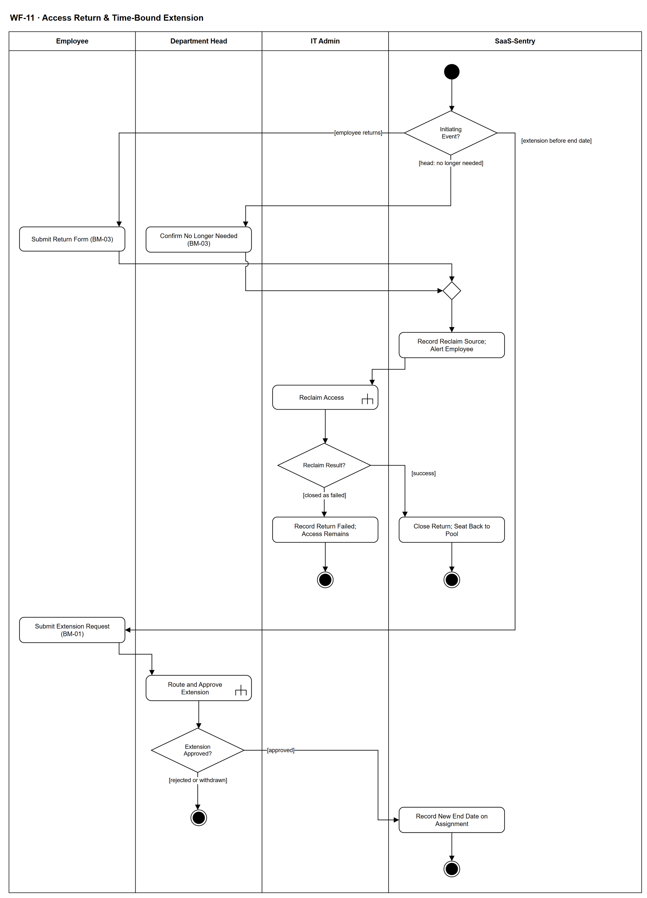

# WF-11 — Access Return & Time-Bound Extension

> **Loại:** Workflow hỗ trợ của MF-2 — kết thúc hoặc kéo dài một quyền đang có · **Phiên bản:** 3.2 — 10/10/2026 · **Trạng thái:** Vẽ lại theo BRD v3.30 (đồng bộ QĐ-61/QĐ-62) (FR-2.4, FR-2.8, FR-3.2, FR-5.14, BM-03, 4.6, 5.10) và mô hình phòng ban QĐ-52; chờ Owner/GVHD review
>
> Sơ đồ là **dẫn xuất** từ quyết định Owner (`QĐ`) và BRD hiện hành; khi khác nhau, `QĐ` → BRD thắng. Quyết định trong sơ đồ là của Owner, **chưa** phải xác nhận của GVHD/hội đồng.

## 1. Mục đích và phạm vi

Mô tả hai việc quanh một quyền **đang có**: (1) **hoàn trả** — Employee tự trả hoặc trưởng phòng xác nhận không còn cần, IT Admin thu hồi và seat quay về kho; (2) **gia hạn quyền có thời hạn** — hệ thống nhắc trước 7 ngày, Employee gửi yêu cầu gia hạn và yêu cầu này đi qua phê duyệt thông thường. Không có đường tắt: gia hạn là một yêu cầu, không phải sửa ngày.

**Phạm vi:** Phiếu hoàn trả BM-03 của Employee hoặc trưởng phòng; ghi nguồn quyết định và cảnh báo Employee; thu hồi qua WF-09a; seat về kho không ghi tiết kiệm; yêu cầu gia hạn có thời hạn (gửi trước ngày kết thúc) qua WF-09. Nhắc T-7 và xử lý hết hạn thuộc WF-08.

**Không nằm trong sơ đồ này:** Đổi gói (nâng/hạ gói) — là yêu cầu thông thường qua MF-2/WF-09; thu hồi khi nghỉ việc (→ WF-07), khi điều chuyển (→ MF-7/WF-05), thu hồi ghost seat (→ WF-13); hàng đợi quá hạn và thu hồi khi hết hạn (→ WF-08); chi tiết kiểu cấp khi thu hồi (→ WF-09a).

## 2. Tệp

| Tệp | Vai trò |
| --- | --- |
| [WF-11-access-return-time-bound-extension.drawio](WF-11-access-return-time-bound-extension.drawio) | Nguồn draw.io chỉnh sửa được (sinh từ spec) |
| [WF-11-access-return-time-bound-extension.drawio.png](WF-11-access-return-time-bound-extension.drawio.png) | Bản xuất PNG, nhúng sẵn nguồn draw.io |
| [WF-11.json](../specs/WF-11.json) | **Nguồn canonical** — sửa ở đây rồi chạy `python tools/flowkit.py build` từ `Docs/Diagrams` |

## 3. Nguồn nghiệp vụ

| Mã | Nội dung dùng trong sơ đồ |
| --- | --- |
| `FR-3.2` | Employee tạo yêu cầu gia hạn có thời hạn hoặc hoàn trả seat |
| `FR-2.4, FR-4.15, FR-5.9` | Thu hồi đưa seat về trống; không tự ghi nhận tiết kiệm |
| `FR-2.8, INV-07, BRD 4.5` | Ngày kết thúc dự kiến bắt buộc với nhà thầu/thực tập sinh; nhắc trước 7 ngày; hàng đợi khi quá hạn |
| `FR-5.14` | Danh mục cảnh báo: quyền có thời hạn sắp hết (Employee, trưởng phòng, IT Admin, T-7); quyết định thu hồi sắp được thực hiện (Employee) |
| `BRD 4.6` | Ma trận trách nhiệm dòng *Hoàn trả / thu hồi theo nhu cầu*: Employee hoặc trưởng phòng tạo, IT Admin thực hiện, BM-03 |
| `BRD 5.10` | Luồng *Hoàn trả / thu hồi* |
| `BM-01, BM-03` | Phiếu yêu cầu (gồm gia hạn có thời hạn); phiếu hoàn trả/thu hồi |
| `OI-07a` | Thời hạn trên 12 tháng: trưởng phòng xác nhận tường minh trong bước nhu cầu |
| `SoD-2, SoD-5` | Trưởng phòng không tự thu hồi; chỉ IT Admin thay đổi seat |

## 4. Tác nhân, kích hoạt, điều kiện

| Làn (tiếng Anh trên hình) | Tác nhân | Trách nhiệm trong sơ đồ |
| --- | --- | --- |
| Employee | Employee (người đang giữ quyền) | Tự hoàn trả; quyết có xin gia hạn không; gửi yêu cầu gia hạn |
| Department Head | Trưởng phòng của nhân viên (vai Manager suy ra) | Xác nhận không còn nhu cầu; duyệt bước nhu cầu của yêu cầu gia hạn (qua WF-09) |
| IT Admin | IT Admin phụ trách phòng (IT Admin khác xử lý thay được, có Audit Trail) | Thu hồi theo kiểu cấp |
| SaaS-Sentry | SaaS-Sentry | Ghi nguồn quyết định, cảnh báo, theo dõi ngày kết thúc, ghi ngày kết thúc mới |

- **Kích hoạt:** Employee nộp phiếu hoàn trả, trưởng phòng xác nhận không còn nhu cầu, hoặc một quyền có thời hạn sắp tới ngày kết thúc.
- **Tiền điều kiện:** Employee đang có Assignment hiệu lực; quyền có thời hạn mang ngày kết thúc dự kiến (bắt buộc với nhà thầu, freelancer, thực tập sinh — INV-07).
- **Hậu điều kiện:** Quyền đã đóng và seat trống (tiết kiệm không tự ghi) · hoặc tác vụ thu hồi đã bị IT đóng là thất bại có lý do, Assignment chưa đóng, quyền còn hiệu lực và vẫn hiện G2 theo điều kiện nguồn (thu lại bằng tác vụ mới — QĐ-62i) · hoặc quyền có ngày kết thúc mới sau khi yêu cầu gia hạn được duyệt · hoặc quyền đi vào xử lý hết hạn của WF-08.

## 5. Cách đọc ký hiệu

| Ký hiệu | Nghĩa |
| --- | --- |
| Hình tròn đặc | Bắt đầu hoạt động (initial node) |
| Hình chữ nhật bo góc | Hành động (action) của tác nhân ở làn chứa nó |
| Hình chữ nhật bo góc có ký hiệu cây đinh ba ở góc | Gọi workflow con (call behavior) — mã workflow ghi trong nhãn |
| Hình thoi có chữ | Rẽ nhánh; mỗi cạnh ra mang điều kiện trong ngoặc vuông `[...]` |
| Hình thoi nhỏ không chữ | Hợp nhánh (merge) |
| Vòng tròn kép đặc | Kết thúc toàn bộ hoạt động (activity final) |
| Dây có cung nhảy | Hai dây giao nhau nhưng **không** nối với nhau |

Đọc từ trên xuống. Hình thoi đầu tiên tách ba sự kiện khởi đầu. Hai nhánh hoàn trả nhập lại rồi đi chung tới thu hồi (WF-09a); kết quả trả về chỉ có *thu hồi xong* hoặc *đã đóng thất bại*, vì thử lại và làm tay nằm trong WF-09a. Nhánh quyền có thời hạn bắt đầu từ lúc Employee còn cần quyền sau nhắc T-7 của WF-08 (nhắc và hết hạn không vẽ ở đây): gửi yêu cầu gia hạn **trước ngày kết thúc**, được vẽ là **lời gọi WF-09** để thấy rõ nó đi đúng phê duyệt như mọi yêu cầu.

## 6. Bảng node

| ID | Loại | Nhãn trên hình | Ý nghĩa | Làn / người thực hiện | Quy tắc |
| --- | --- | --- | --- | --- | --- |
| `st` | Nút bắt đầu | — | — | SaaS-Sentry | — |
| `d_start` | Rẽ nhánh | Initiating Event? | Ba cách workflow bắt đầu: Employee tự hoàn trả quyền · trưởng phòng xác nhận nhân viên không còn cần · quyền có thời hạn sắp tới ngày kết thúc. | SaaS-Sentry | `FR-3.2`, `FR-2.4`, `FR-2.8`, `BRD 5.10` |
| `a_ret` | Hành động | Submit Return Form (BM-03) | Employee nộp phiếu hoàn trả BM-03: quyền cần trả, lý do, ngày. | Employee | `FR-3.2`, `BM-03`, `BRD 4.6` |
| `a_dh` | Hành động | Confirm No Longer Needed (BM-03) | Trưởng phòng của nhân viên xác nhận nhân viên không còn nhu cầu (thu hồi theo quyết định của phòng) và nộp BM-03. Trưởng phòng không tự thu hồi (SoD-2). | Department Head | `BRD 4.6`, `BM-03`, `SoD-2`, `QĐ-52c` |
| `m_ret` | Hợp nhánh | — | — | SaaS-Sentry | — |
| `s_rec` | Hành động | Record Reclaim Source; Alert Employee | Hệ thống ghi nguồn quyết định thu hồi (phiếu BM-03 của ai, lý do) vào Audit Trail và gửi cảnh báo *quyết định thu hồi sắp được thực hiện* cho Employee; tạo tác vụ cho IT Admin phụ trách phòng. Gói có lưu ý mất dữ liệu: hiện lưu ý và **người kích hoạt thu hồi** xác nhận bàn giao trước khi gỡ ở nhà cung cấp — Employee ở nhánh tự hoàn trả, **trưởng phòng** ở nhánh trưởng phòng báo không cần; không chặn sau hạn ngắn (QĐ-62f, WF-09a `d_dl`). | SaaS-Sentry | `FR-11.2`, `FR-3.11`, `FR-5.14`, `QĐ-62f` |
| `c_rec` | Gọi workflow con | Reclaim Access | IT Admin thu hồi theo kiểu cấp của gói (K2 gỡ thành viên, K1 hủy gia hạn, K4 gỡ kích hoạt — khóa về kho nếu điều khoản cho phép, K5 thu hồi ngoài hệ thống kèm bằng chứng). | IT Admin | `FR-2.4`, `SoD-5`, `QĐ-49b`, → `WF-09a` |
| `d_res` | Rẽ nhánh | Reclaim Result? | Kết quả WF-09a trả về. | IT Admin | — |
| `s_done` | Hành động | Close Return; Seat Back to Pool | Assignment đóng, seat về trạng thái trống để tái phân bổ hoặc giảm số lượng khi gia hạn. **Không** tự ghi nhận tiền tiết kiệm — tiết kiệm chỉ ghi khi hợp đồng/khoản chi thực sự giảm; license vĩnh viễn chỉ đưa seat về kho. | SaaS-Sentry | `FR-2.4`, `FR-4.15`, `FR-5.9`, `BRD 5.10` |
| `end_ok` | Kết thúc hoạt động | — | Quyền đã được hoàn trả/thu hồi. | SaaS-Sentry | — |
| `a_fail` | Hành động | Record Return Failed; Access Remains | WF-09a chỉ trả về *thất bại* sau khi IT Admin đã thử lại hoặc chuyển làm tay mà không được rồi **đóng tác vụ là thất bại** có lý do (QĐ-62i); thử lại và làm tay thuộc WF-09a, không vẽ lại ở đây. Hoàn trả kết thúc ở trạng thái thất bại: Assignment **chưa đóng**, seat **chưa** về kho, quyền còn hiệu lực nên tiếp tục hiện là lãng phí/G2 theo điều kiện nguồn trên danh sách cần xử lý. Muốn thu hồi lại thì IT mở tác vụ thu hồi mới. | IT Admin | `FR-2.4`, `QĐ-62i` |
| `end_fail` | Kết thúc hoạt động | — | Hoàn trả kết thúc thất bại: tác vụ thu hồi đã bị IT Admin đóng là thất bại có lý do; quyền còn hiệu lực, chưa giải phóng seat (QĐ-62i). | IT Admin | — |
| `a_ext` | Hành động | Submit Extension Request (BM-01) | Sau nhắc T-7 của WF-08 (hoặc bất kỳ lúc nào trước ngày kết thúc), nhân viên còn cần quyền thì gửi yêu cầu gia hạn có thời hạn (phiếu BM-01, ghi thời hạn mới). Gia hạn phải được gửi trước ngày kết thúc; sau ngày đó quyền đã vào hàng đợi hết hạn của WF-08. Gửi trước ngày kết thúc mà chưa quyết ⟹ quyền giữ nguyên tới khi có quyết định (QĐ-62h, WF-08). | Employee | `FR-3.2`, `BM-01`, `FR-2.8`, `INV-07` |
| `c_appr` | Gọi workflow con | Route and Approve Extension | Yêu cầu gia hạn đi đúng định tuyến và phê duyệt thông thường: bước nhu cầu của trưởng phòng (hoặc người thay theo FR-3.3/FR-3.6), bước duyệt chi nếu gia hạn phát sinh chi phí. Thời hạn trên 12 tháng cần trưởng phòng xác nhận tường minh kèm lý do trong bước nhu cầu. | Department Head | `FR-3.3`, `FR-3.4`, `OI-07a`, `MF-2`, → `WF-09` |
| `d_ext` | Rẽ nhánh | Extension Approved? | Kết quả của yêu cầu gia hạn sau WF-09. | Department Head | — |
| `s_newend` | Hành động | Record New End Date on Assignment | Hệ thống ghi ngày kết thúc mới cho quyền, có Audit Trail; quyền tiếp tục không gián đoạn. | SaaS-Sentry | `FR-2.8`, `FR-3.11`, `ADR-04` |
| `end_ext` | Kết thúc hoạt động | — | Quyền được gia hạn tới ngày kết thúc mới. | SaaS-Sentry | — |
| `end_keep` | Kết thúc hoạt động | — | Gia hạn bị từ chối hoặc bị rút: ngày kết thúc cũ giữ nguyên; tới hạn thì WF-08 xử lý hết hạn. | Department Head | — |

## 7. Bảng chuyển tiếp

| Từ → tới | Nhãn điều kiện | Điều kiện | Kết quả |
| --- | --- | --- | --- |
| `st` → `d_start` | — | — | Sang Initiating Event? |
| `d_start` → `a_ret` | `[employee returns]` | Employee không cần dùng nữa và tự hoàn trả | Nộp BM-03 |
| `d_start` → `a_dh` | `[head: no longer needed]` | Trưởng phòng xác nhận nhân viên không còn nhu cầu | Trưởng phòng nộp BM-03 |
| `a_ret` → `m_ret` | — | — | Sang — |
| `a_dh` → `m_ret` | — | — | Sang — |
| `m_ret` → `s_rec` | — | — | Sang Record Reclaim Source; Alert Employee |
| `s_rec` → `c_rec` | — | — | Sang Reclaim Access |
| `c_rec` → `d_res` | — | — | Sang Reclaim Result? |
| `d_res` → `s_done` | `[success]` | WF-09a thu hồi xong | Đóng hoàn trả |
| `d_res` → `a_fail` | `[closed as failed]` | WF-09a trả về thất bại: tác vụ đã được IT Admin đóng là thất bại có lý do | Ghi nhận thất bại; quyền còn hiệu lực |
| `s_done` → `end_ok` | — | — | Sang — |
| `a_ext` → `c_appr` | — | — | Sang Route and Approve Extension |
| `c_appr` → `d_ext` | — | — | Sang Extension Approved? |
| `d_ext` → `s_newend` | `[approved]` | Yêu cầu gia hạn được duyệt (và cấp nếu cần) | Ghi ngày kết thúc mới |
| `s_newend` → `end_ext` | — | — | Sang — |
| `a_fail` → `end_fail` | — | — | Sang — |
| `d_start` → `a_ext` | `[extension before end date]` | Nhân viên có quyền có thời hạn còn cần dùng sau ngày kết thúc | Gửi yêu cầu gia hạn |
| `d_ext` → `end_keep` | `[rejected or withdrawn]` | Không được duyệt hoặc người yêu cầu rút | Ngày cũ giữ nguyên |

Số đếm: **18 node · 18 cạnh · 3 rẽ nhánh**; giao cắt dây: **1**.

## 8. Happy path

1. `st` — —
2. `d_start` — Initiating Event?: Ba cách workflow bắt đầu: Employee tự hoàn trả quyền · trưởng phòng xác nhận nhân viên không còn cần · quyền có thời hạn sắp tới ngày kết thúc.
3. `a_ret` — Submit Return Form (BM-03): Employee nộp phiếu hoàn trả BM-03: quyền cần trả, lý do, ngày.
4. `s_rec` — Record Reclaim Source; Alert Employee: Hệ thống ghi nguồn quyết định thu hồi (phiếu BM-03 của ai, lý do) vào Audit Trail và gửi cảnh báo *quyết định thu hồi sắp được thực hiện* cho Employee; tạo tác vụ cho IT Admin phụ trách phòng. Gói có lưu ý mất dữ liệu: hiện lưu ý và **người kích hoạt thu hồi** xác nhận bàn giao trước khi gỡ ở nhà cung cấp — Employee ở nhánh tự hoàn trả, **trưởng phòng** ở nhánh trưởng phòng báo không cần; không chặn sau hạn ngắn (QĐ-62f, WF-09a `d_dl`).
5. `c_rec` — Reclaim Access: IT Admin thu hồi theo kiểu cấp của gói (K2 gỡ thành viên, K1 hủy gia hạn, K4 gỡ kích hoạt — khóa về kho nếu điều khoản cho phép, K5 thu hồi ngoài hệ thống kèm bằng chứng).
6. `d_res` — Reclaim Result?: Kết quả WF-09a trả về.
7. `s_done` — Close Return; Seat Back to Pool: Assignment đóng, seat về trạng thái trống để tái phân bổ hoặc giảm số lượng khi gia hạn. **Không** tự ghi nhận tiền tiết kiệm — tiết kiệm chỉ ghi khi hợp đồng/khoản chi thực sự giảm; license vĩnh viễn chỉ đưa seat về kho.
8. `end_ok` — —: Quyền đã được hoàn trả/thu hồi.

## 9. Nhánh thay thế / if-else

- **Trưởng phòng xác nhận không còn nhu cầu** — `d_start` → `a_dh` → `m_ret` → `s_rec`. Employee nhận cảnh báo quyết định thu hồi sắp được thực hiện.
- **Gia hạn quyền có thời hạn** — `d_start` → `a_ext` → `c_appr` → `d_ext` → `s_newend` → `end_ext`. Gửi trước ngày kết thúc; đi qua WF-09 như mọi yêu cầu. Nhắc T-7 và hết hạn thuộc WF-08.

## 10. Nhánh lỗi / từ chối và cách kết thúc

- **Thu hồi thất bại** — `d_res` → `a_fail` → `end_fail`. Tác vụ thu hồi đóng thất bại có lý do; mở tác vụ mới nếu cần.
- **Yêu cầu gia hạn bị từ chối hoặc bị rút** — `d_ext` → `end_keep`. Ngày kết thúc cũ giữ nguyên; WF-08 xử lý khi tới hạn.

## 11. Liên hệ với sơ đồ khác

- Cấp trên: `MF-2` (dòng *Hoàn trả / thu hồi* của BRD 5.10)
- `WF-09` — yêu cầu gia hạn đi qua định tuyến và phê duyệt thông thường
- `WF-09a` — thu hồi theo kiểu cấp
- `WF-08` — sở hữu nhắc T-7 và xử lý hết hạn; nếu tới ngày kết thúc mà yêu cầu gia hạn còn chờ, WF-08 đợi kết quả của workflow này
- User flow: `UF-01` (gửi yêu cầu), `UF-08` (IT xử lý hàng đợi)
- `WF-09a` — gọi/chuyển tại node `c_rec`
- `WF-09` — gọi/chuyển tại node `c_appr`

## 12. Giới hạn và vấn đề còn mở

- (ĐÃ CÓ NGUỒN · DOI-57) Hoàn trả tự nguyện không có bước duyệt nhu cầu (BRD 4.6 dòng *Hoàn trả / thu hồi*: trưởng phòng chỉ khi thu hồi theo quyết định của phòng); cảnh báo FR-5.14 đã sửa thành *khi Employee tự hoàn trả* (BRD v3.30).
- (ĐÃ CHỐT · DOI-46, QĐ-62f) Bàn giao dữ liệu bản nhẹ: người kích hoạt thu hồi (Employee tự trả, hoặc trưởng phòng báo không cần) xác nhận trước khi gỡ, không chặn sau hạn ngắn.
- (DEFERRED/OUT · DOI-58, QĐ-59e) Thời hạn mới khi gia hạn ghi thế nào trong lịch sử Assignment (sửa ngày hay mở khoảng hiệu lực mới) — để ERD quyết; hình ghi *ngày kết thúc mới* có Audit Trail.
