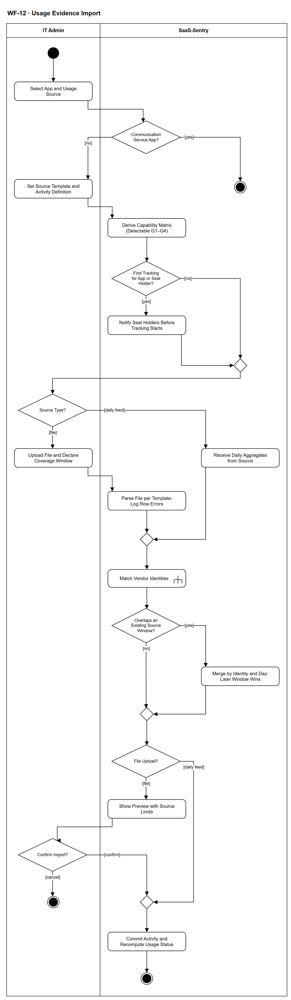

# WF-12 — Usage Evidence Import

> **Loại:** Workflow hỗ trợ (cấp chi tiết) — nhóm SF-4 (bằng chứng sử dụng và tối ưu seat không dùng) · **Phiên bản:** 3.1 — 09/10/2026 · **Trạng thái:** Vẽ lại ở mức nghiệp vụ theo QĐ-59a và QĐ-57d; cách thu dữ liệu (loại bộ thu thập, ma trận nhà cung cấp) đang được nghiên cứu lại và chốt ở giai đoạn Tools; chờ Owner/GVHD review
>
> Sơ đồ là **dẫn xuất** từ quyết định Owner (`QĐ`) và BRD hiện hành; khi khác nhau, `QĐ` → BRD thắng. Quyết định trong sơ đồ là của Owner, **chưa** phải xác nhận của GVHD/hội đồng.

## 1. Mục đích và phạm vi

Mô tả cách **đưa bằng chứng sử dụng vào hệ thống một cách có kiểm soát**: mỗi nguồn có mẫu cấu hình, cửa sổ bao phủ, định nghĩa hoạt động và ma trận năng lực, để các bước sau biết nguồn này đủ sức kết luận nhóm lãng phí nào. Nhân viên được thông báo trước khi ứng dụng bắt đầu được theo dõi, và không dòng dữ liệu thật nào được ghi trước khi IT Admin xác nhận bản xem trước.

**Phạm vi:** Chọn ứng dụng và nguồn, chặn ứng dụng nhóm dịch vụ liên lạc, khai mẫu cấu hình và định nghĩa hoạt động, suy ra ma trận năng lực, thông báo trước cho người giữ seat, import file (tải lên, khai cửa sổ bao phủ, phân tích) hoặc nhận tổng hợp theo ngày, khớp danh tính (gọi WF-12a), hợp nhất cửa sổ chồng lấn, xem trước, xác nhận, ghi và tổng hợp lại.

**Không nằm trong sơ đồ này:** Chi tiết khớp danh tính (→ WF-12a); phát hiện lãng phí và Department Head xác nhận (→ WF-13); đăng ký thiết bị và xác nhận chính sách (→ WF-18); loại bộ thu thập cụ thể, ma trận nhà cung cấp và kịch bản nguồn demo (tệp nghiên cứu tool & vendor, giai đoạn Tools — QĐ-59a); bật thu thập có chủ đích cho ứng dụng liên lạc (Super Admin, ADR-10); báo cáo hiệu quả sử dụng và cảnh báo Employee dựa trên usage (chờ QĐ-57d).

## 2. Tệp

| Tệp | Vai trò |
| --- | --- |
| [WF-12-usage-evidence-import.drawio](WF-12-usage-evidence-import.drawio) | Nguồn draw.io chỉnh sửa được (sinh từ spec) |
| [WF-12-usage-evidence-import.drawio.png](WF-12-usage-evidence-import.drawio.png) | Bản xuất PNG, nhúng sẵn nguồn draw.io |
| [WF-12.json](../specs/WF-12.json) | **Nguồn canonical** — sửa ở đây rồi chạy `python tools/flowkit.py build` từ `Docs/Diagrams` |

## 3. Nguồn nghiệp vụ

| Mã | Nội dung dùng trong sơ đồ |
| --- | --- |
| `FR-4.1` | Hai dạng file; nguồn kết nối và bộ thu thập; mỗi ứng dụng nhiều nguồn |
| `FR-4.2, FR-4.16, INV-11` | Mẫu cấu hình nguồn, định nghĩa hoạt động bắt buộc |
| `FR-4.3, INV-10` | Cửa sổ bao phủ bắt buộc |
| `FR-4.4` | Ma trận năng lực suy ra nhóm lãng phí phát hiện được |
| `FR-7.1 → FR-7.7` | Khung import 6 bước, xem trước bắt buộc, lỗi từng dòng, mã băm, múi giờ, quy tắc nguồn mâu thuẫn |
| `FR-10.4, QĐ-01` | Thông báo trước cho người giữ seat, mọi ứng dụng |
| `FR-1.8, ADR-10, ĐK-06` | Ứng dụng liên lạc mặc định không thu dữ liệu hoạt động |
| `QĐ-59a, QĐ-57d` | Chỉ vẽ nguồn usage ở mức nghiệp vụ |

## 4. Tác nhân, kích hoạt, điều kiện

| Làn (tiếng Anh trên hình) | Tác nhân | Trách nhiệm trong sơ đồ |
| --- | --- | --- |
| IT Admin | IT Admin | Chọn nguồn, khai mẫu cấu hình và cửa sổ bao phủ, tải file, xác nhận hoặc hủy bản xem trước |
| SaaS-Sentry | SaaS-Sentry | Chặn nhóm liên lạc, suy ra năng lực nguồn, thông báo, phân tích, khớp danh tính, hợp nhất, xem trước, ghi và tổng hợp lại |

- **Kích hoạt:** IT Admin muốn bắt đầu hoặc cập nhật bằng chứng sử dụng cho một ứng dụng trong danh mục.
- **Tiền điều kiện:** Ứng dụng đã có trong danh mục; nhân viên đang giữ seat đã có trong hệ thống để khớp danh tính.
- **Hậu điều kiện:** Hoặc: dữ liệu sử dụng đã được ghi, gắn đúng Assignment, mỗi nguồn có cửa sổ bao phủ, định nghĩa hoạt động và ma trận năng lực, trạng thái sử dụng của seat được tính lại. Hoặc: ứng dụng liên lạc không bị thu dữ liệu, hoặc IT hủy và không dòng nào được ghi.

## 5. Cách đọc ký hiệu

| Ký hiệu | Nghĩa |
| --- | --- |
| Hình tròn đặc | Bắt đầu hoạt động (initial node) |
| Hình chữ nhật bo góc | Hành động (action) của tác nhân ở làn chứa nó |
| Hình chữ nhật bo góc có ký hiệu cây đinh ba ở góc | Gọi workflow con (call behavior) — mã workflow ghi trong nhãn |
| Hình thoi có chữ | Rẽ nhánh; mỗi cạnh ra mang điều kiện trong ngoặc vuông `[...]` |
| Hình thoi nhỏ không chữ | Hợp nhánh (merge) |
| Vòng tròn kép đặc | Kết thúc toàn bộ hoạt động (activity final) |
| Dây có cung nhảy | Hai dây giao nhau nhưng **không** nối với nhau |

Đọc từ trên xuống. Cổng đầu tiên là cổng quyền riêng tư (ứng dụng liên lạc dừng ngay). Sau khi nguồn có mẫu cấu hình, hệ thống suy ra năng lực và thông báo cho người giữ seat nếu đây là lần theo dõi đầu. Hai đường vào (file và tổng hợp theo ngày) gặp nhau ở bước khớp danh tính; sau đó chỉ có một đường xem trước – xác nhận – ghi. Hủy ở bản xem trước không ghi gì.

## 6. Bảng node

| ID | Loại | Nhãn trên hình | Ý nghĩa | Làn / người thực hiện | Quy tắc |
| --- | --- | --- | --- | --- | --- |
| `st` | Nút bắt đầu | — | — | IT Admin | — |
| `a_pick` | Hành động | Select App and Usage Source | IT Admin chọn ứng dụng cần có bằng chứng sử dụng và nguồn dữ liệu: file xuất từ nhà cung cấp, kết nối nhà cung cấp, hoặc bộ thu thập trên thiết bị công ty. Một ứng dụng được có nhiều nguồn; nguồn chỉ cho bằng chứng dương không được dùng để kết luận không hoạt động. Loại bộ thu thập cụ thể do giai đoạn Tools chốt (QĐ-59a), sơ đồ này chỉ vẽ ở mức nghiệp vụ. | IT Admin | `FR-4.1`, `QĐ-59a` |
| `d_comm` | Rẽ nhánh | Communication Service App? | Ứng dụng có mang cờ nhóm dịch vụ liên lạc (nhắn tin, họp trực tuyến, thư điện tử) không. Ứng dụng nhóm này mặc định không thu dữ liệu hoạt động, chỉ dùng danh sách thành viên cho G1/G2. | SaaS-Sentry | `FR-1.8`, `ADR-10`, `ĐK-06` |
| `end_comm` | Kết thúc hoạt động | — | Không thu dữ liệu hoạt động của ứng dụng liên lạc ở chế độ mặc định (chặn có chủ ý). Việc bật thu thập có chủ đích do Super Admin xác nhận và ghi nhật ký nằm ngoài sơ đồ này. | SaaS-Sentry | — |
| `a_tpl` | Hành động | Set Source Template and Activity Definition | IT khai báo mẫu cấu hình nguồn: ánh xạ cột, loại định danh trong cột actor (email / username / ID), định dạng ngày, múi giờ nguồn, bảng phân loại loại sự kiện (sự kiện tạo giá trị, thụ động, chỉ xác thực). Bắt buộc khai nguồn này hiểu hoạt động là gì; giá trị này hiển thị kèm mọi khuyến nghị và được tính vào mức tin cậy. Thêm nhà cung cấp mới là thêm bản ghi cấu hình, không viết mã. | IT Admin | `FR-4.2`, `FR-4.16`, `INV-11`, `FR-4.11` |
| `s_cap` | Hành động | Derive Capability Matrix (Detectable G1–G4) | Hệ thống tự suy ra nhóm lãng phí nào phát hiện được từ năng lực của nguồn: chỉ có danh sách thành viên ⟹ G1, G2; thêm ngày hoạt động cuối ⟹ G1–G4. Giao diện hiển thị giới hạn này cho từng ứng dụng, để người dùng biết vì sao chưa đánh giá được mức sử dụng. | SaaS-Sentry | `FR-4.4`, `BRD 3.3` |
| `d_first` | Rẽ nhánh | First Tracking for App or Seat Holder? | Ứng dụng bắt đầu được theo dõi lần đầu, hoặc có người mới được cấp seat của ứng dụng đang được theo dõi, mà chưa nhận thông báo. | SaaS-Sentry | `FR-10.4`, `QĐ-01` |
| `s_notify` | Hành động | Notify Seat Holders Before Tracking Starts | Thông báo cho mọi nhân viên đang giữ seat của ứng dụng: loại dữ liệu thu thập và mục đích (phát hiện license không dùng, không đánh giá năng suất). Bắt buộc cho mọi ứng dụng, không riêng nhóm liên lạc; gửi trước khi thu dữ liệu. Mẫu ở Phụ lục D.1. Người **mới được cấp seat** của một ứng dụng đang được theo dõi cũng nhận thông báo FR-10.4 trước khi dữ liệu của họ được ghi (QĐ-01). | SaaS-Sentry | `FR-10.4`, `QĐ-01`, `ND-3` |
| `m_first` | Hợp nhánh | — | — | SaaS-Sentry | — |
| `d_type` | Rẽ nhánh | Source Type? | Nguồn là file do IT tải lên, hay nguồn tự đẩy tổng hợp theo ngày (kết nối nhà cung cấp hoặc bộ thu thập trên thiết bị công ty). | IT Admin | `FR-4.1` |
| `a_up` | Hành động | Upload File and Declare Coverage Window | IT tải lên file ở dạng tổng hợp (mỗi người một dòng, thường có ngày hoạt động cuối) hoặc dạng sự kiện (mỗi dòng một sự kiện, hệ thống tự tổng hợp). Bắt buộc khai cửa sổ dữ liệu bao phủ (từ ngày – đến ngày): khai tay khi file không tự chứa, hoặc suy ra từ dữ liệu khi có thể. Thiếu cửa sổ bao phủ thì mọi người ngoài cửa sổ bị kết luận nhầm là chưa từng hoạt động. | IT Admin | `FR-4.1`, `FR-4.3`, `INV-10` |
| `s_parse` | Hành động | Parse File per Template; Log Row Errors | Phân tích file theo mẫu; chuẩn hóa múi giờ về múi giờ tổ chức trước khi cắt theo ngày; loại sự kiện chỉ xác thực khỏi hoạt động. Lỗi một dòng không làm hỏng cả file: ghi riêng số dòng, cột, mã lỗi để tải về. Tính mã băm file và cảnh báo khi file đã được import trước đó. | SaaS-Sentry | `FR-7.1`, `FR-7.3`, `FR-7.4`, `FR-7.5`, `FR-4.11` |
| `s_feed` | Hành động | Receive Daily Aggregates from Source | Kết nối nhà cung cấp hoặc bộ thu thập trên thiết bị công ty gửi tổng hợp theo ngày đã lọc tại nguồn. Ngày nguồn không chạy là ngày ngoài cửa sổ bao phủ, không phải ngày không sử dụng. Dữ liệu từ thiết bị chỉ được nhận khi thiết bị đã đăng ký và nhân viên đã xác nhận chủ động (xem WF-18). | SaaS-Sentry | `FR-4.1`, `FR-4.3a`, `INV-17`, `ADR-13`, `DQ-04` |
| `m_in` | Hợp nhánh | — | — | SaaS-Sentry | — |
| `c_match` | Gọi workflow con | Match Vendor Identities | Ánh xạ định danh phía nhà cung cấp tới nhân viên, gắn hoạt động vào Assignment đúng thời điểm; bản ghi chưa khớp vào hàng đợi và không dùng để kết luận; hoạt động không có Assignment thành sai lệch. | SaaS-Sentry | `FR-4.5`, `FR-4.6`, `FR-4.7`, `FR-4.8`, `INV-12`, → `WF-12a` |
| `d_ovl` | Rẽ nhánh | Overlaps an Existing Source Window? | Có file hoặc nguồn khác của cùng ứng dụng mà cửa sổ dữ liệu chồng lấn không. | SaaS-Sentry | `FR-7.7` |
| `s_merge` | Hành động | Merge by Identity and Day; Later Window Wins | Hợp nhất theo khóa (danh tính, ngày): nguồn có cửa sổ kết thúc muộn hơn thắng; ghi nhận nguồn đã dùng cho từng dòng. Không để nguồn nào tự ghi đè im lặng. | SaaS-Sentry | `FR-7.7` |
| `m_ovl` | Hợp nhánh | — | — | SaaS-Sentry | — |
| `d_src2` | Rẽ nhánh | File Upload? | Dữ liệu đến từ tệp IT tải lên (cần xem trước và xác nhận) hay từ nguồn tự đẩy theo ngày (tự ghi). | SaaS-Sentry | `FR-7.1`, `FR-4.1` |
| `s_prev` | Hành động | Show Preview with Source Limits | Xem trước bắt buộc, chưa ghi dữ liệu thật: số dòng hợp lệ, số dòng lỗi kèm lý do, số dòng đã tồn tại sẽ bỏ qua, số định danh chưa khớp, cửa sổ dữ liệu, số bản ghi bị ảnh hưởng; kèm giới hạn của nguồn (nhóm lãng phí phát hiện được, định nghĩa hoạt động). | SaaS-Sentry | `FR-7.2`, `FR-4.4`, `FR-4.16` |
| `d_conf` | Rẽ nhánh | Confirm Import? | IT Admin xác nhận ghi dữ liệu hay hủy sau khi xem bản xem trước. | IT Admin | `FR-7.2` |
| `m_cm` | Hợp nhánh | — | — | SaaS-Sentry | — |
| `s_commit` | Hành động | Commit Activity and Recompute Usage Status | Ghi dữ liệu và tổng hợp lại: hoạt động gắn vào Assignment đúng thời điểm sự kiện, không gắn trực tiếp vào nhân viên; trạng thái sử dụng của từng seat được tính lại, phân biệt đang hoạt động, không hoạt động, không có dữ liệu, chưa khớp danh tính. Việc phát hiện lãng phí chạy ở WF-13. Nguồn tự đẩy tổng hợp theo ngày (kết nối nhà cung cấp, bộ thu thập trên thiết bị) **không** qua xem trước và xác nhận thủ công từng đợt: hệ thống tự ghi, vẫn ghi lỗi theo dòng (FR-7.3), độ mới và bao phủ (FR-4.3a, cổng 6 của FR-4.9) và báo cáo chất lượng (FR-5.12); thiết bị chưa xác nhận thì không nhận (INV-17). IT chỉ cấu hình nguồn một lần (`a_tpl`). *Suy ra* từ FR-7.1 (khung tải tệp) và FR-4.1 (nguồn ngoài tệp). | SaaS-Sentry | `FR-4.1`, `FR-4.7`, `FR-5.10`, `FR-5.12`, `FR-7.1`, `FR-7.3` |
| `end_ok` | Kết thúc hoạt động | — | Dữ liệu đã ghi; trạng thái sử dụng đã tính lại. | SaaS-Sentry | — |
| `end_cancel` | Kết thúc hoạt động | — | IT hủy ở bước xem trước: không dòng nào được ghi. | IT Admin | — |

## 7. Bảng chuyển tiếp

| Từ → tới | Nhãn điều kiện | Điều kiện | Kết quả |
| --- | --- | --- | --- |
| `st` → `a_pick` | — | — | Sang Select App and Usage Source |
| `a_pick` → `d_comm` | — | — | Sang Communication Service App? |
| `d_comm` → `end_comm` | `[yes]` | Ứng dụng nhóm dịch vụ liên lạc | Không thu dữ liệu hoạt động |
| `d_comm` → `a_tpl` | `[no]` | Ứng dụng thông thường | Khai báo mẫu cấu hình |
| `a_tpl` → `s_cap` | — | — | Sang Derive Capability Matrix (Detectable G1–G4) |
| `s_cap` → `d_first` | — | — | Sang First Tracking for App or Seat Holder? |
| `d_first` → `s_notify` | `[yes]` | Lần đầu theo dõi ứng dụng này | Thông báo trước |
| `d_first` → `m_first` | `[no]` | Đã thông báo trước đó | Đi tiếp |
| `s_notify` → `m_first` | — | — | Sang — |
| `m_first` → `d_type` | — | — | Sang Source Type? |
| `d_type` → `a_up` | `[file]` | IT tải file lên | Đường import file |
| `d_type` → `s_feed` | `[daily feed]` | Kết nối nhà cung cấp hoặc bộ thu thập đẩy tổng hợp theo ngày | Nhận tổng hợp theo ngày |
| `a_up` → `s_parse` | — | — | Sang Parse File per Template; Log Row Errors |
| `s_parse` → `m_in` | — | — | Sang — |
| `s_feed` → `m_in` | — | — | Sang — |
| `m_in` → `c_match` | — | — | Sang Match Vendor Identities |
| `c_match` → `d_ovl` | — | — | Sang Overlaps an Existing Source Window? |
| `d_ovl` → `s_merge` | `[yes]` | Cửa sổ chồng lấn với nguồn đã có | Hợp nhất theo quy tắc |
| `d_ovl` → `m_ovl` | `[no]` | Không chồng lấn | Đi tiếp |
| `s_merge` → `m_ovl` | — | — | Sang — |
| `m_ovl` → `d_src2` | — | — | Sang File Upload? |
| `d_src2` → `s_prev` | `[file]` | Tệp IT tải lên | Sang Show Preview with Source Limits |
| `d_src2` → `m_cm` | `[daily feed]` | Nguồn tự đẩy theo ngày | Tự ghi, không xác nhận từng đợt |
| `s_prev` → `d_conf` | — | — | Sang Confirm Import? |
| `d_conf` → `m_cm` | `[confirm]` | IT xác nhận ghi dữ liệu | Ghi và tổng hợp lại |
| `d_conf` → `end_cancel` | `[cancel]` | IT hủy | Không ghi gì |
| `m_cm` → `s_commit` | — | — | Sang Commit Activity and Recompute Usage Status |
| `s_commit` → `end_ok` | — | — | Sang — |

Số đếm: **25 node · 28 cạnh · 6 rẽ nhánh**; giao cắt dây: **0**.

## 8. Happy path

1. `st` — —
2. `a_pick` — Select App and Usage Source: IT Admin chọn ứng dụng cần có bằng chứng sử dụng và nguồn dữ liệu: file xuất từ nhà cung cấp, kết nối nhà cung cấp, hoặc bộ thu thập trên thiết bị công ty. Một ứng dụng được có nhiều nguồn; nguồn chỉ cho bằng chứng dương không được dùng để kết luận không hoạt động. Loại bộ thu thập cụ thể do giai đoạn Tools chốt (QĐ-59a), sơ đồ này chỉ vẽ ở mức nghiệp vụ.
3. `d_comm` — Communication Service App?: Ứng dụng có mang cờ nhóm dịch vụ liên lạc (nhắn tin, họp trực tuyến, thư điện tử) không. Ứng dụng nhóm này mặc định không thu dữ liệu hoạt động, chỉ dùng danh sách thành viên cho G1/G2.
4. `a_tpl` — Set Source Template and Activity Definition: IT khai báo mẫu cấu hình nguồn: ánh xạ cột, loại định danh trong cột actor (email / username / ID), định dạng ngày, múi giờ nguồn, bảng phân loại loại sự kiện (sự kiện tạo giá trị, thụ động, chỉ xác thực). Bắt buộc khai nguồn này hiểu hoạt động là gì; giá trị này hiển thị kèm mọi khuyến nghị và được tính vào mức tin cậy. Thêm nhà cung cấp mới là thêm bản ghi cấu hình, không viết mã.
5. `s_cap` — Derive Capability Matrix (Detectable G1–G4): Hệ thống tự suy ra nhóm lãng phí nào phát hiện được từ năng lực của nguồn: chỉ có danh sách thành viên ⟹ G1, G2; thêm ngày hoạt động cuối ⟹ G1–G4. Giao diện hiển thị giới hạn này cho từng ứng dụng, để người dùng biết vì sao chưa đánh giá được mức sử dụng.
6. `d_first` — First Tracking for App or Seat Holder?: Ứng dụng bắt đầu được theo dõi lần đầu, hoặc có người mới được cấp seat của ứng dụng đang được theo dõi, mà chưa nhận thông báo.
7. `s_notify` — Notify Seat Holders Before Tracking Starts: Thông báo cho mọi nhân viên đang giữ seat của ứng dụng: loại dữ liệu thu thập và mục đích (phát hiện license không dùng, không đánh giá năng suất). Bắt buộc cho mọi ứng dụng, không riêng nhóm liên lạc; gửi trước khi thu dữ liệu. Mẫu ở Phụ lục D.1. Người **mới được cấp seat** của một ứng dụng đang được theo dõi cũng nhận thông báo FR-10.4 trước khi dữ liệu của họ được ghi (QĐ-01).
8. `d_type` — Source Type?: Nguồn là file do IT tải lên, hay nguồn tự đẩy tổng hợp theo ngày (kết nối nhà cung cấp hoặc bộ thu thập trên thiết bị công ty).
9. `a_up` — Upload File and Declare Coverage Window: IT tải lên file ở dạng tổng hợp (mỗi người một dòng, thường có ngày hoạt động cuối) hoặc dạng sự kiện (mỗi dòng một sự kiện, hệ thống tự tổng hợp). Bắt buộc khai cửa sổ dữ liệu bao phủ (từ ngày – đến ngày): khai tay khi file không tự chứa, hoặc suy ra từ dữ liệu khi có thể. Thiếu cửa sổ bao phủ thì mọi người ngoài cửa sổ bị kết luận nhầm là chưa từng hoạt động.
10. `s_parse` — Parse File per Template; Log Row Errors: Phân tích file theo mẫu; chuẩn hóa múi giờ về múi giờ tổ chức trước khi cắt theo ngày; loại sự kiện chỉ xác thực khỏi hoạt động. Lỗi một dòng không làm hỏng cả file: ghi riêng số dòng, cột, mã lỗi để tải về. Tính mã băm file và cảnh báo khi file đã được import trước đó.
11. `c_match` — Match Vendor Identities: Ánh xạ định danh phía nhà cung cấp tới nhân viên, gắn hoạt động vào Assignment đúng thời điểm; bản ghi chưa khớp vào hàng đợi và không dùng để kết luận; hoạt động không có Assignment thành sai lệch.
12. `d_ovl` — Overlaps an Existing Source Window?: Có file hoặc nguồn khác của cùng ứng dụng mà cửa sổ dữ liệu chồng lấn không.
13. `d_src2` — File Upload?: Dữ liệu đến từ tệp IT tải lên (cần xem trước và xác nhận) hay từ nguồn tự đẩy theo ngày (tự ghi).
14. `s_prev` — Show Preview with Source Limits: Xem trước bắt buộc, chưa ghi dữ liệu thật: số dòng hợp lệ, số dòng lỗi kèm lý do, số dòng đã tồn tại sẽ bỏ qua, số định danh chưa khớp, cửa sổ dữ liệu, số bản ghi bị ảnh hưởng; kèm giới hạn của nguồn (nhóm lãng phí phát hiện được, định nghĩa hoạt động).
15. `d_conf` — Confirm Import?: IT Admin xác nhận ghi dữ liệu hay hủy sau khi xem bản xem trước.
16. `s_commit` — Commit Activity and Recompute Usage Status: Ghi dữ liệu và tổng hợp lại: hoạt động gắn vào Assignment đúng thời điểm sự kiện, không gắn trực tiếp vào nhân viên; trạng thái sử dụng của từng seat được tính lại, phân biệt đang hoạt động, không hoạt động, không có dữ liệu, chưa khớp danh tính. Việc phát hiện lãng phí chạy ở WF-13. Nguồn tự đẩy tổng hợp theo ngày (kết nối nhà cung cấp, bộ thu thập trên thiết bị) **không** qua xem trước và xác nhận thủ công từng đợt: hệ thống tự ghi, vẫn ghi lỗi theo dòng (FR-7.3), độ mới và bao phủ (FR-4.3a, cổng 6 của FR-4.9) và báo cáo chất lượng (FR-5.12); thiết bị chưa xác nhận thì không nhận (INV-17). IT chỉ cấu hình nguồn một lần (`a_tpl`). *Suy ra* từ FR-7.1 (khung tải tệp) và FR-4.1 (nguồn ngoài tệp).
17. `end_ok` — —: Dữ liệu đã ghi; trạng thái sử dụng đã tính lại.

## 9. Nhánh thay thế / if-else

- **Nguồn tự đẩy tổng hợp theo ngày** — `d_type` → `s_feed` → `m_in`. Kết nối nhà cung cấp hoặc bộ thu thập; sau đó đi chung đường khớp danh tính.
- **Đã thông báo trước đó** — `d_first` → `m_first`. Bỏ qua thông báo vì ứng dụng đã được thông báo lần đầu.
- **Cửa sổ chồng lấn** — `d_ovl` → `s_merge` → `m_ovl`. Hợp nhất theo (danh tính, ngày), nguồn kết thúc muộn hơn thắng.
- **Nguồn tự đẩy theo ngày — tự ghi** — `d_type` → `s_feed` → `m_in` → `c_match` → `d_ovl` → `m_ovl` → `d_src2` → `m_cm` → `s_commit`. Không xem trước/xác nhận từng đợt; lỗi dòng, độ mới, bao phủ và báo cáo chất lượng vẫn ghi.

## 10. Nhánh lỗi / từ chối và cách kết thúc

- **Ứng dụng nhóm dịch vụ liên lạc** — `d_comm` → `end_comm`. Không thu dữ liệu hoạt động ở chế độ mặc định.
- **IT hủy ở bản xem trước** — `d_conf` → `end_cancel`. Không dòng nào được ghi.

## 11. Liên hệ với sơ đồ khác

- Cấp trên: nhóm SF-4 (trước đây MF-3); Context (luồng dữ liệu usage), FDD Feature 4
- `WF-12a` — khớp danh tính (node gọi)
- `WF-13` — dùng kết quả import để phát hiện lãng phí
- `WF-18` — điều kiện để nhận dữ liệu từ bộ thu thập trên thiết bị công ty
- User flow: `UF-06`, `UF-07`
- `WF-12a` — gọi/chuyển tại node `c_match`

## 12. Giới hạn và vấn đề còn mở

- (ĐÃ CÓ NGUỒN · DOI-59, suy ra) Khung xem trước và xác nhận của FR-7.1 áp cho tệp tải lên; nguồn tự đẩy theo ngày (FR-4.1, FR-2.6) tự ghi, không xác nhận thủ công từng đợt — vẽ ở `d_src2`.
- (ĐÃ CÓ NGUỒN · DOI-60, QĐ-01) Người mới được cấp seat của ứng dụng đang được theo dõi nhận thông báo FR-10.4 trước khi dữ liệu của họ được ghi — `d_first`; WF-09a `s_act` cũng ghi.
- (DEFERRED/OUT · DOI-09, QĐ-59a, QĐ-57d) Loại bộ thu thập, cách báo bao phủ và quy tắc hợp nhất nhiều bộ thu thập do giai đoạn Tools chốt.
- (DEFERRED/OUT · DOI-17, QĐ-62o) Nguồn usage, G2–G4 và tiết kiệm cho phần mềm nội bộ ngoài MVP.
