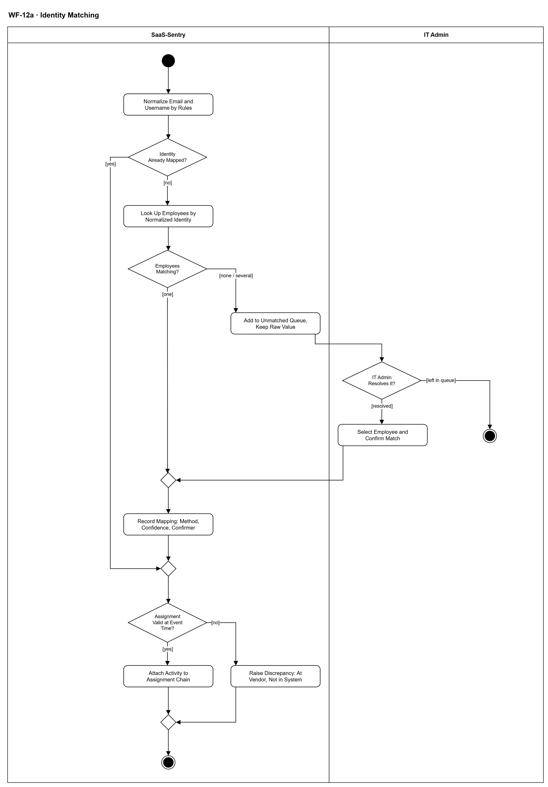

# WF-12a — Identity Matching

> **Loại:** Workflow con (cấp chi tiết) — nhóm SF-4 · **Phiên bản:** 3.1 — 09/10/2026 · **Trạng thái:** Vẽ lại theo QĐ-59a (mức nghiệp vụ); chờ Owner/GVHD review
>
> Sơ đồ là **dẫn xuất** từ quyết định Owner (`QĐ`) và BRD hiện hành; khi khác nhau, `QĐ` → BRD thắng. Quyết định trong sơ đồ là của Owner, **chưa** phải xác nhận của GVHD/hội đồng.

## 1. Mục đích và phạm vi

Biến một định danh thô phía nhà cung cấp thành một nhân viên cụ thể và gắn hoạt động vào đúng Assignment — **hoặc** thừa nhận chưa khớp được và **không kết luận gì**. Đây là lớp giữ cho tiêu chí không báo động giả (TC-2) đạt được: bản ghi chưa khớp không bao giờ trở thành căn cứ khuyến nghị.

**Phạm vi:** Chuẩn hóa email/username, dùng ánh xạ đã có, tra cứu nhân viên, xử lý không khớp hoặc khớp hai người (hàng đợi, IT khớp thủ công), ghi ánh xạ kèm phương pháp, tin cậy, người xác nhận, gắn hoạt động vào Assignment đúng thời điểm, ghi sai lệch khi không có Assignment.

**Không nằm trong sơ đồ này:** Đọc và xem trước file, hợp nhất cửa sổ (→ WF-12); phát hiện lãng phí (→ WF-13); ngưỡng khớp của tầng ánh xạ danh tính (giai đoạn Tools, QĐ-59c).

## 2. Tệp

| Tệp | Vai trò |
| --- | --- |
| [WF-12a-identity-matching.drawio](WF-12a-identity-matching.drawio) | Nguồn draw.io chỉnh sửa được (sinh từ spec) |
| [WF-12a-identity-matching.drawio.png](WF-12a-identity-matching.drawio.png) | Bản xuất PNG, nhúng sẵn nguồn draw.io |
| [WF-12a.json](../specs/WF-12a.json) | **Nguồn canonical** — sửa ở đây rồi chạy `python tools/flowkit.py build` từ `Docs/Diagrams` |

## 3. Nguồn nghiệp vụ

| Mã | Nội dung dùng trong sơ đồ |
| --- | --- |
| `FR-7.6` | Chuẩn hóa email theo quy tắc cấu hình, dùng nhất quán |
| `FR-4.5` | Bảng ánh xạ: nhà cung cấp, khóa ngoài, phương pháp, tin cậy, người xác nhận |
| `FR-4.6, INV-12` | Chưa khớp vào hàng đợi, không dùng để kết luận |
| `FR-7.7` | Một định danh khớp hai nhân viên: không nguồn nào thắng, vào hàng đợi |
| `FR-4.7, QĐ-35c` | Gắn vào Assignment tại thời điểm sự kiện; gia hạn nối chuỗi, cấp lại thì không |
| `FR-4.8, FR-2.6` | Hoạt động không có Assignment ⟹ sai lệch |
| `FR-4.10` | Chưa khớp danh tính là trạng thái không kết luận |

## 4. Tác nhân, kích hoạt, điều kiện

| Làn (tiếng Anh trên hình) | Tác nhân | Trách nhiệm trong sơ đồ |
| --- | --- | --- |
| SaaS-Sentry | SaaS-Sentry | Chuẩn hóa, tra cứu, ghi ánh xạ, gắn Assignment, ghi sai lệch, giữ hàng đợi |
| IT Admin | IT Admin | Xử lý hàng đợi chưa khớp bằng khớp thủ công |

- **Kích hoạt:** Được gọi từ WF-12 cho mỗi lô dữ liệu sử dụng đã đọc xong theo mẫu cấu hình.
- **Tiền điều kiện:** Có lô định danh từ nguồn usage; danh sách nhân viên và Assignment có trong hệ thống.
- **Hậu điều kiện:** Mỗi định danh hoặc đã có ánh xạ (kèm phương pháp, tin cậy, người xác nhận) và hoạt động gắn vào Assignment, hoặc có sai lệch, hoặc nằm trong hàng đợi chưa khớp (không dùng để kết luận).

## 5. Cách đọc ký hiệu

| Ký hiệu | Nghĩa |
| --- | --- |
| Hình tròn đặc | Bắt đầu hoạt động (initial node) |
| Hình chữ nhật bo góc | Hành động (action) của tác nhân ở làn chứa nó |
| Hình thoi có chữ | Rẽ nhánh; mỗi cạnh ra mang điều kiện trong ngoặc vuông `[...]` |
| Hình thoi nhỏ không chữ | Hợp nhánh (merge) |
| Vòng tròn kép đặc | Kết thúc toàn bộ hoạt động (activity final) |
| Dây có cung nhảy | Hai dây giao nhau nhưng **không** nối với nhau |

Luồng chạy cho từng định danh. Nhánh chưa khớp đi sang IT Admin; nếu IT chưa xử lý, mục ở lại hàng đợi và kết thúc mà không sinh kết luận nào. Khi đã khớp, bước cuối tìm Assignment hiệu lực tại thời điểm sự kiện.

## 6. Bảng node

| ID | Loại | Nhãn trên hình | Ý nghĩa | Làn / người thực hiện | Quy tắc |
| --- | --- | --- | --- | --- | --- |
| `st` | Nút bắt đầu | — | — | SaaS-Sentry | — |
| `s_norm` | Hành động | Normalize Email and Username by Rules | Chuẩn hóa định danh phía nhà cung cấp theo quy tắc cấu hình được (chuyển chữ thường, xử lý phần sau dấu cộng...). Cùng một hàm chuẩn hóa dùng khi tạo ánh xạ và khi đối chiếu, để hai bên luôn so sánh cùng một dạng. | SaaS-Sentry | `FR-7.6`, `FR-4.2` |
| `d_map` | Rẽ nhánh | Identity Already Mapped? | Khóa định danh bên ngoài của nhà cung cấp đã có trong bảng ánh xạ chưa. | SaaS-Sentry | `FR-4.5` |
| `s_look` | Hành động | Look Up Employees by Normalized Identity | Tìm nhân viên khớp với định danh đã chuẩn hóa theo các luật đối chiếu cấu hình. Luật bí danh (alias) là một yếu tố hạ mức tin cậy ở khâu khuyến nghị. | SaaS-Sentry | `FR-4.5`, `QĐ-35b` |
| `d_cand` | Rẽ nhánh | Employees Matching? | Có đúng một nhân viên khớp, không có ai, hay khớp hai nhân viên trở lên. | SaaS-Sentry | `FR-4.6`, `FR-7.7`, `INV-12` |
| `s_queue` | Hành động | Add to Unmatched Queue, Keep Raw Value | Bản ghi không khớp hoặc khớp mơ hồ vào hàng đợi chờ xử lý, giữ nguyên giá trị thô. Không bị bỏ qua im lặng và không được dùng làm căn cứ cho bất kỳ khuyến nghị nào (hệ thống không tự chọn một trong hai người). | SaaS-Sentry | `FR-4.6`, `INV-12`, `FR-7.7`, `FR-4.10` |
| `d_res` | Rẽ nhánh | IT Admin Resolves It? | IT Admin xử lý được mục trong hàng đợi (xem giá trị thô và chọn đúng nhân viên) hay để lại trong hàng đợi. | IT Admin | `FR-4.5`, `FR-4.6` |
| `a_man` | Hành động | Select Employee and Confirm Match | IT xem giá trị thô và chọn đúng nhân viên; hệ thống ghi phương pháp khớp là thủ công và tên người xác nhận. Một định danh không được gán cho hai nhân viên. | IT Admin | `FR-4.5`, `FR-7.7` |
| `end_q` | Kết thúc hoạt động | — | Mục ở lại hàng đợi; không dùng để kết luận. Hàng đợi giảm dần sau mỗi lần import. | IT Admin | — |
| `m_rec` | Hợp nhánh | — | — | SaaS-Sentry | — |
| `s_rec` | Hành động | Record Mapping: Method, Confidence, Confirmer | Lưu ánh xạ: nhà cung cấp, khóa định danh bên ngoài, phương pháp khớp, mức độ tin cậy, người xác nhận. Lưu cả giá trị thô lẫn giá trị chuẩn hóa để giải thích được vì sao một định danh trỏ tới một nhân viên. | SaaS-Sentry | `FR-4.5` |
| `m_ok` | Hợp nhánh | — | — | SaaS-Sentry | — |
| `d_asg` | Rẽ nhánh | Assignment Valid at Event Time? | Có Assignment của nhân viên đó đang hiệu lực tại thời điểm sự kiện xảy ra không (gia hạn kỳ thuê bao nối chuỗi Assignment). | SaaS-Sentry | `FR-4.7`, `QĐ-35c` |
| `s_attach` | Hành động | Attach Activity to Assignment Chain | Gắn hoạt động vào Assignment tại thời điểm sự kiện, không gắn trực tiếp vào nhân viên. Ngày hoạt động cuối đọc cả chuỗi Assignment nối do gia hạn; cấp lại sau thu hồi là Assignment mới, không nối chuỗi, nên không thừa hưởng lịch sử cũ. | SaaS-Sentry | `FR-4.7`, `QĐ-35c` |
| `s_disc` | Hành động | Raise Discrepancy: At Vendor, Not in System | Có hoạt động nhưng không có Assignment tương ứng: ghi sai lệch loại có ở nhà cung cấp nhưng không có trong hệ thống — dấu hiệu seat được cấp ngoài quy trình. Hệ thống không tự tạo Assignment. | SaaS-Sentry | `FR-4.8`, `FR-2.6`, `FR-7.7` |
| `m_end` | Hợp nhánh | — | — | SaaS-Sentry | — |
| `end_ok` | Kết thúc hoạt động | — | Định danh đã khớp và hoạt động đã gắn vào Assignment, hoặc đã ghi sai lệch. | SaaS-Sentry | — |

## 7. Bảng chuyển tiếp

| Từ → tới | Nhãn điều kiện | Điều kiện | Kết quả |
| --- | --- | --- | --- |
| `st` → `s_norm` | — | — | Sang Normalize Email and Username by Rules |
| `s_norm` → `d_map` | — | — | Sang Identity Already Mapped? |
| `d_map` → `m_ok` | `[yes]` | Ánh xạ đã có | Dùng ánh xạ đã lưu |
| `d_map` → `s_look` | `[no]` | Chưa có ánh xạ | Tra cứu nhân viên |
| `s_look` → `d_cand` | — | — | Sang Employees Matching? |
| `d_cand` → `m_rec` | `[one]` | Đúng một nhân viên khớp | Ghi ánh xạ |
| `d_cand` → `s_queue` | `[none / several]` | Không có nhân viên nào khớp, hoặc một định danh khớp hai nhân viên trở lên | Vào hàng đợi, không tự chọn |
| `s_queue` → `d_res` | — | — | Sang IT Admin Resolves It? |
| `d_res` → `a_man` | `[resolved]` | IT chọn được nhân viên đúng | Khớp thủ công |
| `d_res` → `end_q` | `[left in queue]` | IT chưa xử lý | Ở lại hàng đợi |
| `a_man` → `m_rec` | — | — | Sang — |
| `m_rec` → `s_rec` | — | — | Sang Record Mapping: Method, Confidence, Confirmer |
| `s_rec` → `m_ok` | — | — | Sang — |
| `m_ok` → `d_asg` | — | — | Sang Assignment Valid at Event Time? |
| `d_asg` → `s_attach` | `[yes]` | Có Assignment hiệu lực | Gắn hoạt động |
| `d_asg` → `s_disc` | `[no]` | Không có Assignment tương ứng | Ghi sai lệch |
| `s_attach` → `m_end` | — | — | Sang — |
| `s_disc` → `m_end` | — | — | Sang — |
| `m_end` → `end_ok` | — | — | Sang — |

Số đếm: **17 node · 19 cạnh · 4 rẽ nhánh**; giao cắt dây: **0**.

## 8. Happy path

1. `st` — —
2. `s_norm` — Normalize Email and Username by Rules: Chuẩn hóa định danh phía nhà cung cấp theo quy tắc cấu hình được (chuyển chữ thường, xử lý phần sau dấu cộng...). Cùng một hàm chuẩn hóa dùng khi tạo ánh xạ và khi đối chiếu, để hai bên luôn so sánh cùng một dạng.
3. `d_map` — Identity Already Mapped?: Khóa định danh bên ngoài của nhà cung cấp đã có trong bảng ánh xạ chưa.
4. `s_look` — Look Up Employees by Normalized Identity: Tìm nhân viên khớp với định danh đã chuẩn hóa theo các luật đối chiếu cấu hình. Luật bí danh (alias) là một yếu tố hạ mức tin cậy ở khâu khuyến nghị.
5. `d_cand` — Employees Matching?: Có đúng một nhân viên khớp, không có ai, hay khớp hai nhân viên trở lên.
6. `s_rec` — Record Mapping: Method, Confidence, Confirmer: Lưu ánh xạ: nhà cung cấp, khóa định danh bên ngoài, phương pháp khớp, mức độ tin cậy, người xác nhận. Lưu cả giá trị thô lẫn giá trị chuẩn hóa để giải thích được vì sao một định danh trỏ tới một nhân viên.
7. `d_asg` — Assignment Valid at Event Time?: Có Assignment của nhân viên đó đang hiệu lực tại thời điểm sự kiện xảy ra không (gia hạn kỳ thuê bao nối chuỗi Assignment).
8. `s_attach` — Attach Activity to Assignment Chain: Gắn hoạt động vào Assignment tại thời điểm sự kiện, không gắn trực tiếp vào nhân viên. Ngày hoạt động cuối đọc cả chuỗi Assignment nối do gia hạn; cấp lại sau thu hồi là Assignment mới, không nối chuỗi, nên không thừa hưởng lịch sử cũ.
9. `end_ok` — —: Định danh đã khớp và hoạt động đã gắn vào Assignment, hoặc đã ghi sai lệch.

## 9. Nhánh thay thế / if-else

- **Ánh xạ đã có** — `d_map` → `m_ok` → `d_asg`. Dùng ánh xạ đã lưu, đi thẳng tới bước gắn Assignment.
- **Khớp thủ công bởi IT** — `d_cand` → `s_queue` → `d_res` → `a_man` → `m_rec` → `s_rec`. Ghi phương pháp thủ công và tên người xác nhận.
- **Không có Assignment** — `d_asg` → `s_disc` → `m_end` → `end_ok`. Sai lệch có ở nhà cung cấp nhưng không có trong hệ thống; không tự tạo Assignment.

## 10. Nhánh lỗi / từ chối và cách kết thúc

- **Chưa khớp, IT chưa xử lý** — `d_cand` → `s_queue` → `d_res` → `end_q`. Ở lại hàng đợi, không dùng để kết luận (INV-12).
- **Một định danh khớp hai nhân viên** — `d_cand` → `s_queue`. Không tự chọn; chuyển hàng đợi để IT quyết.

## 11. Liên hệ với sơ đồ khác

- Cấp trên: nhóm SF-4; Context (ánh xạ danh tính), FDD Feature 4
- `WF-12` — gọi workflow này ở bước khớp danh tính
- `WF-13` — chỉ dùng hoạt động đã khớp để kết luận
- User flow: `UF-07`

## 12. Giới hạn và vấn đề còn mở

- (LATER-TECH/UI · DOI-61) Người xác nhận của phép khớp tự động ghi là hệ thống/mã luật (trường người xác nhận của FR-4.5); khớp thủ công ghi tên IT Admin.
- (LATER-TECH/UI · DOI-61) Thời điểm tổng hợp lại trạng thái sử dụng sau khi IT khớp thủ công (ngay hay ở lần import kế) chốt ở thiết kế kỹ thuật.
- (DEFERRED/OUT · DOI-10, QĐ-59c) Luật bí danh và ngưỡng khớp của tầng ánh xạ chốt ở giai đoạn Tools.
