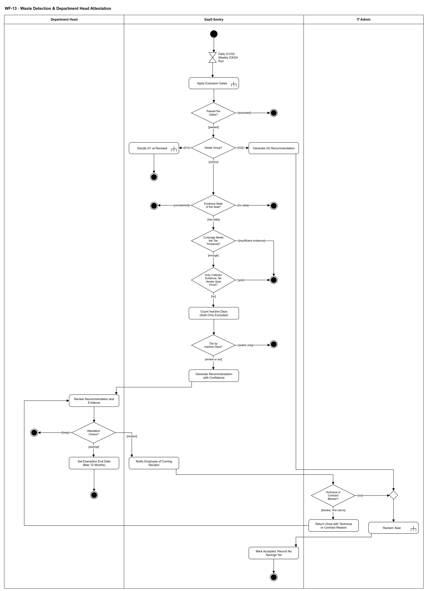

# WF-13 — Waste Detection & Department Head Attestation

> **Loại:** Workflow hỗ trợ (cấp chi tiết) — nhóm SF-4 (bằng chứng sử dụng và tối ưu seat không dùng) · **Phiên bản:** 3.3 — 10/10/2026 · **Trạng thái:** Vẽ lại theo QĐ-52a (Department Head), QĐ-09, QĐ-35b, OI-02, OI-12a/b và FR-4.14a/DQ-03/DQ-04; nguồn usage vẽ ở mức nghiệp vụ theo QĐ-59a; QĐ-64a (seat chồng lấn với phần vượt khi giảm thuê bao) ngày 10/10/2026; chờ Owner/GVHD review
>
> Sơ đồ là **dẫn xuất** từ quyết định Owner (`QĐ`) và BRD hiện hành; khi khác nhau, `QĐ` → BRD thắng. Quyết định trong sơ đồ là của Owner, **chưa** phải xác nhận của GVHD/hội đồng.

## 1. Mục đích và phạm vi

Mô tả cách **phát hiện seat lãng phí và để Department Head xác nhận có kiểm soát**: mọi khuyến nghị chỉ sinh ra khi qua các cổng, đủ bằng chứng và đủ bao phủ; không có đường nào tự thu hồi từ một khuyến nghị. G2 (seat của người đã nghỉ) đi thẳng tới thu hồi; G1 chờ kỳ gia hạn; G3/G4 cần Department Head quyết Keep, Reclaim hay Exempt. Đây là phần xử lý PP-1 (ghost seat) và là nguồn của KPI-3, KPI-5.

**Phạm vi:** Chạy rule theo lịch, gọi tám cổng loại trừ, phân nhóm G1–G4, ba trạng thái không có ngày hoạt động, kiểm bao phủ và bằng chứng có điều kiện của bộ thu thập, tính số ngày và tầng, sinh khuyến nghị kèm mức tin cậy, Department Head xác nhận Keep/Reclaim/Exempt, thông báo nhân viên, IT trả lại tối đa một lần, thu hồi qua WF-09a, chấp nhận khuyến nghị và không ghi tiết kiệm tự động.

**Không nằm trong sơ đồ này:** Nhập và khớp dữ liệu usage (→ WF-12, WF-12a); chi tiết tám cổng (→ WF-13a); chi tiết thu hồi (→ WF-09a); quyết định giảm số lượng ở kỳ gia hạn cho G1 (→ MF-4); trạng thái bị dữ liệu mới phủ định (superseded) và việc báo cáo KPI; G5 (ngoài phạm vi); cảnh báo cho Employee dựa trên usage (chờ QĐ-57d); cách thu dữ liệu và loại bộ thu thập (giai đoạn Tools, QĐ-59a).

## 2. Tệp

| Tệp | Vai trò |
| --- | --- |
| [WF-13-waste-detection-department-head-attestation.drawio](WF-13-waste-detection-department-head-attestation.drawio) | Nguồn draw.io chỉnh sửa được (sinh từ spec) |
| [WF-13-waste-detection-department-head-attestation.drawio.png](WF-13-waste-detection-department-head-attestation.drawio.png) | Bản xuất PNG, nhúng sẵn nguồn draw.io |
| [WF-13.json](../specs/WF-13.json) | **Nguồn canonical** — sửa ở đây rồi chạy `python tools/flowkit.py build` từ `Docs/Diagrams` |

## 3. Nguồn nghiệp vụ

| Mã | Nội dung dùng trong sơ đồ |
| --- | --- |
| `BRD 5.4.1` | Năm nhóm lãng phí; G5 ngoài phạm vi; G1 nhắm thuê bao |
| `FR-4.9, OI-12a/b` | Tám cổng; G1/G2 chỉ cổng 1 và 8 |
| `FR-4.10, INV-12` | Ba trạng thái không có ngày hoạt động; chưa khớp không dùng để kết luận |
| `FR-4.11` | Sự kiện chỉ xác thực không tính là hoạt động |
| `FR-4.12, FR-4.12b, QĐ-09` | Ba tầng; Theo dõi chỉ IT Admin thấy; G1/G2 hằng ngày, G3/G4 hằng tuần |
| `FR-4.13` | Ngưỡng: ứng dụng > tổ chức > mặc định |
| `FR-4.14, QĐ-35b` | Cổng trước, mức Cao/Trung bình/Thấp, không phần trăm |
| `FR-4.14a, DQ-03, DQ-04` | Bộ thu thập là bằng chứng có điều kiện; INSUFFICIENT EVIDENCE; không có dữ liệu không phải không sử dụng |
| `FR-3.7, SoD-2` | Department Head chỉ thấy số liệu tổng hợp trong phòng |
| `FR-3.10, INV-09` | Keep/Reclaim/Exempt kèm lý do; Exempt tối đa 12 tháng rồi quay lại hàng đợi |
| `OI-02` | G2 đi thẳng thu hồi; IT trả lại tối đa một lần; Department Head quyết cuối |
| `FR-5.14, QĐ-57a` | Cảnh báo khuyến nghị mới cho Department Head; cảnh báo thu hồi sắp thực hiện cho Employee |
| `FR-4.15` | Hai con số tiết kiệm; thu hồi không tự ghi tiết kiệm |
| `KPI-5, BRD 5.12.3` | Vòng đời khuyến nghị: sinh ra, chờ xác nhận, chấp nhận / bác bỏ / bị phủ định |

## 4. Tác nhân, kích hoạt, điều kiện

| Làn (tiếng Anh trên hình) | Tác nhân | Trách nhiệm trong sơ đồ |
| --- | --- | --- |
| Department Head | Department Head (trưởng phòng của nhân viên trong phạm vi) | Xem khuyến nghị với số liệu tổng hợp, chọn Keep / Reclaim / Exempt kèm lý do |
| SaaS-Sentry | SaaS-Sentry | Chạy rule theo lịch, cổng loại trừ, phân tầng, sinh khuyến nghị, thông báo, ghi trạng thái |
| IT Admin | IT Admin | Kiểm lý do kỹ thuật/hợp đồng, trả lại tối đa một lần, thực hiện thu hồi |

- **Kích hoạt:** Tác vụ nền theo lịch: G1/G2 hằng ngày, G3/G4 hằng tuần.
- **Tiền điều kiện:** Có Assignment đang hiệu lực (hoặc thuê bao có số lượng đã mua với G1); với G3/G4 có nguồn usage có cửa sổ bao phủ và định nghĩa hoạt động (WF-12); danh tính đã khớp (WF-12a).
- **Hậu điều kiện:** Một trong các kết cục: seat bị loại (không khuyến nghị); không kết luận (không có dữ liệu, chưa khớp danh tính); INSUFFICIENT EVIDENCE; chỉ theo dõi (IT Admin); Keep (khuyến nghị bị bác bỏ); Exempt có hạn; Reclaim đã thực hiện (khuyến nghị đã chấp nhận, chưa ghi tiết kiệm); G1 chuyển sang gia hạn.

## 5. Cách đọc ký hiệu

| Ký hiệu | Nghĩa |
| --- | --- |
| Hình tròn đặc | Bắt đầu hoạt động (initial node) |
| Hình chữ nhật bo góc | Hành động (action) của tác nhân ở làn chứa nó |
| Hình chữ nhật bo góc có ký hiệu cây đinh ba ở góc | Gọi workflow con (call behavior) — mã workflow ghi trong nhãn |
| Hình thoi có chữ | Rẽ nhánh; mỗi cạnh ra mang điều kiện trong ngoặc vuông `[...]` |
| Hình thoi nhỏ không chữ | Hợp nhánh (merge) |
| Đồng hồ cát | Chờ một mốc thời gian (time event) |
| Vòng tròn kép đặc | Kết thúc toàn bộ hoạt động (activity final) |
| Dây có cung nhảy | Hai dây giao nhau nhưng **không** nối với nhau |

Từ trên xuống là chuỗi lọc: cổng, nhóm, trạng thái dữ liệu, bao phủ, nguồn bằng chứng, tầng. Mọi lối rẽ ra bên phải là *không kết luận* hoặc *chỉ theo dõi* và không có cạnh nào sang làn Department Head. Chỉ tầng Cần xem xét trở lên sinh khuyến nghị và gửi sang làn Department Head. Khi chọn Reclaim, nhân viên được báo, IT kiểm tra một lần rồi thu hồi; IT trả lại thì quay về Department Head quyết cuối.

## 6. Bảng node

| ID | Loại | Nhãn trên hình | Ý nghĩa | Làn / người thực hiện | Quy tắc |
| --- | --- | --- | --- | --- | --- |
| `st` | Nút bắt đầu | — | — | SaaS-Sentry | — |
| `t_sched` | Chờ mốc thời gian | Daily G1/G2 · Weekly G3/G4 Run | Tác vụ nền theo lịch: G1 và G2 chạy hằng ngày (chỉ dùng dữ liệu nội bộ); G3 và G4 chạy hằng tuần (dữ liệu usage nhập theo đợt). Lịch cấu hình được. | SaaS-Sentry | `FR-4.12b`, `QĐ-09`, `FR-8.2` |
| `c_gates` | Gọi workflow con | Apply Exclusion Gates | Áp tám cổng loại trừ cho từng seat (G1/G2 chỉ cổng 1 và 8). Trượt cổng thì không có khuyến nghị; dữ liệu quá 7 ngày thì không chạy rule mà hiển thị cảnh báo lỗi thời. | SaaS-Sentry | `FR-4.9`, `OI-12a`, `OI-12b`, `TC-2`, `TC-4`, → `WF-13a` |
| `d_pass` | Rẽ nhánh | Passed the Gates? | Seat có qua mọi cổng áp dụng và đủ điều kiện được đánh giá không. | SaaS-Sentry | `FR-4.9`, `INV-12` |
| `end_gate` | Kết thúc hoạt động | — | Seat bị loại khỏi đánh giá (lý do đã ghi ở WF-13a): không có khuyến nghị. | SaaS-Sentry | — |
| `d_grp` | Rẽ nhánh | Waste Group? | G1 (seat mua chưa gán), G2 (seat của người đã nghỉ việc) hay G3/G4 (đã gán nhưng chưa từng dùng hoặc đã ngừng; cần bằng chứng sử dụng). | SaaS-Sentry | `BRD 5.4.1` |
| `c_mf4` | Gọi workflow con | Decide G1 at Renewal | G1 nhắm vào thuê bao, không nhắm vào người: giảm số lượng chỉ có tiền thật khi gia hạn, nên khuyến nghị G1 đi vào chu kỳ gia hạn để Spending Approver quyết. Không qua xác nhận của Department Head. | SaaS-Sentry | `FR-4.15`, `FR-3.13`, `BRD 5.4.1`, → `MF-4` |
| `end_g1` | Kết thúc hoạt động | — | G1 được chuyển cho chu kỳ gia hạn quyết định. | SaaS-Sentry | — |
| `s_g2` | Hành động | Generate G2 Recommendation | Seat còn gán cho người đã nghỉ việc: xác định từ dữ liệu nội bộ, hiển thị *Xác định từ dữ liệu nội bộ*, không xếp mức tin cậy, bỏ qua mọi ngưỡng ngày. G2 đi thẳng tới thu hồi, không cần Department Head xác nhận; vừa là lãng phí vừa là lỗ hổng bảo mật. G2 ở tầng *Cần xử lý*: khuyến nghị kèm thông báo IT Admin (FR-4.12), nối với tác vụ thu hồi của hồ sơ nghỉ việc (WF-07 `s_tasks`) — không qua bước trưởng phòng. | SaaS-Sentry | `FR-4.14`, `OI-02`, `QĐ-35b`, `TC-1` |
| `d_state` | Rẽ nhánh | Evidence State of the Seat? | Phân biệt ba trạng thái: có dữ liệu bao phủ (kết luận được); chưa import dữ liệu cho ứng dụng; có hoạt động nhưng chưa khớp danh tính. Hai trạng thái sau không được kết luận. | SaaS-Sentry | `FR-4.10`, `INV-12`, `FR-5.10` |
| `end_nd` | Kết thúc hoạt động | — | Không có dữ liệu usage cho ứng dụng: không kết luận, seat hiển thị là không có dữ liệu (không phải không hoạt động, không phải 0). | SaaS-Sentry | — |
| `end_um` | Kết thúc hoạt động | — | Chưa khớp danh tính: không kết luận, bản ghi nằm trong hàng đợi của WF-12a. | SaaS-Sentry | — |
| `d_cov` | Rẽ nhánh | Coverage Meets the Tier Threshold? | Cửa sổ bao phủ có đủ ngưỡng của tầng (kể từ ngày bắt đầu Assignment) không. Ngày ngoài cửa sổ bao phủ không được đếm là ngày không hoạt động. | SaaS-Sentry | `FR-4.12`, `FR-4.3`, `FR-4.14a`, `DQ-04`, `OI-12b` |
| `end_ins` | Kết thúc hoạt động | — | INSUFFICIENT EVIDENCE kèm lý do: không hiển thị con số trông như đã đánh giá xong và không sinh khuyến nghị thu hồi (bao phủ không đủ, hoặc bằng chứng chỉ từ bộ thu thập mà thiếu bằng chứng seat của nhà cung cấp). | SaaS-Sentry | — |
| `d_col` | Rẽ nhánh | Only Collector Evidence, No Vendor Seat Proof? | Bằng chứng không dùng chỉ đến từ bộ thu thập trên thiết bị công ty, không kèm bằng chứng seat của nhà cung cấp xác nhận đúng người đó giữ seat của đúng ứng dụng. Bộ thu thập một mình chỉ chứng minh một tên miền/ứng dụng được quan sát trên máy công ty, không xác định tài khoản SaaS nào. | SaaS-Sentry | `FR-4.14a`, `DQ-03`, `FR-4.16` |
| `s_days` | Hành động | Count Inactive Days (Auth-Only Excluded) | Tính số ngày không hoạt động trên toàn chuỗi Assignment, theo ngưỡng ưu tiên: theo ứng dụng > toàn tổ chức > mặc định. Sự kiện chỉ xác thực (đăng nhập, SSO) không tính là hoạt động. Chưa từng hoạt động (có bao phủ mà không xuất hiện) là kết luận được cho G3. | SaaS-Sentry | `FR-4.11`, `FR-4.7`, `FR-4.13`, `FR-4.10` |
| `d_tier` | Rẽ nhánh | Tier by Inactive Days? | Theo dõi (30–59 ngày): chỉ hiển thị cho IT Admin, không gửi thông báo, không bao giờ tới Department Head. Cần xem xét (từ 60 ngày): sinh khuyến nghị gửi Department Head. Cần xử lý (từ 90 ngày, hoặc chưa từng hoạt động, hoặc đã nghỉ việc): khuyến nghị và thông báo cả IT Admin. Dưới 30 ngày: không tầng nào. | SaaS-Sentry | `FR-4.12`, `QĐ-09`, `SoD-2` |
| `end_watch` | Kết thúc hoạt động | — | Tầng Theo dõi (30–59 ngày) chỉ hiện trên màn hình IT Admin, không gửi thông báo, không sinh khuyến nghị; dưới 30 ngày không có tầng và không hiển thị (FR-4.12). | SaaS-Sentry | — |
| `s_gen` | Hành động | Generate Recommendation with Confidence | Sinh khuyến nghị (trạng thái chờ xác nhận) kèm bản chụp căn cứ: số ngày, nguồn, cửa sổ bao phủ, phương pháp khớp, định nghĩa hoạt động của nguồn. Mức tin cậy: các cổng là điều kiện cần; G3/G4 bắt đầu Cao rồi hạ một bậc cho mỗi yếu tố (khớp bằng luật bí danh, định nghĩa lỏng, chỉ bộ thu thập, bao phủ dưới 80 %, dữ liệu cũ 4–7 ngày, sát ngưỡng, tín hiệu mâu thuẫn); không hiển thị phần trăm. Bằng chứng từ bộ thu thập mang nhãn Quan sát trên thiết bị công ty — không xác định tài khoản SaaS. Từ tầng Cần xem xét, Department Head nhận cảnh báo; tầng Cần xử lý cũng báo IT Admin. Phòng **chưa có trưởng phòng**: việc xác nhận chờ, không giao ai (approver dự phòng chỉ thay ở bước nhu cầu); IT Admin và Super Admin thấy cảnh báo; trưởng phòng mới nhận việc (QĐ-62c). | SaaS-Sentry | `FR-4.12`, `FR-4.14`, `FR-4.14a`, `FR-5.14`, `KPI-5`, `QĐ-35b`, `QĐ-62c`, `TC-3` |
| `a_view` | Hành động | Review Recommendation and Evidence | Department Head xem khuyến nghị về nhân viên trong phòng mình, chỉ với số liệu tổng hợp (có hoạt động hay không, số ngày), kèm đủ căn cứ và giới hạn dữ liệu để quyết ngay; không xem raw activity log. Nếu IT đã trả lại kèm lý do kỹ thuật hoặc hợp đồng thì xem lý do đó và quyết lần cuối. | Department Head | `FR-3.7`, `SoD-2`, `FR-4.14`, `OI-02`, `ĐK-09` |
| `d_att` | Rẽ nhánh | Attestation Choice? | Department Head chọn Keep, Reclaim hoặc Exempt, kèm lý do. Khuyến nghị chỉ là đề xuất, không có đường nào tự động thu hồi. | Department Head | `FR-3.10`, `INV-09`, `FR-4.14a` |
| `end_keep` | Kết thúc hoạt động | — | Keep: khuyến nghị chuyển sang bị bác bỏ (Dismissed), tính vào KPI-5; lần chạy sau vẫn có thể sinh khuyến nghị mới. Nếu trước đó trưởng phòng đã chọn Reclaim (nhân viên đã được báo) và IT trả lại, đổi sang Keep/Exempt ⟹ báo nhân viên *thu hồi đã hủy* (QĐ-62p). | Department Head | — |
| `a_ex` | Hành động | Set Exemption End Date (Max 12 Months) | Exempt bắt buộc có ngày hết hạn, tối đa 12 tháng, kèm lý do; không có miễn trừ vô thời hạn. Hết hạn thì seat tự quay lại hàng đợi review. Nếu trước đó trưởng phòng đã chọn Reclaim (nhân viên đã được báo) và IT trả lại, đổi sang Keep/Exempt ⟹ báo nhân viên *thu hồi đã hủy* (QĐ-62p). | Department Head | `FR-3.10`, `FR-4.9`, `INV-09`, `QĐ-62p` |
| `end_ex` | Kết thúc hoạt động | — | Miễn trừ đã ghi: cổng 7 của WF-13a loại seat cho tới ngày hết hạn, sau đó quay lại hàng đợi. | Department Head | — |
| `s_notify` | Hành động | Notify Employee of Coming Reclaim | Khi Department Head chọn Reclaim, nhân viên giữ seat được thông báo rằng quyền sắp bị thu hồi. | SaaS-Sentry | `FR-5.14`, `QĐ-57a`, `FR-3.10` |
| `d_it` | Rẽ nhánh | Technical or Contract Blocker? | IT Admin kiểm tra có lý do kỹ thuật hoặc hợp đồng chặn việc thu hồi không. IT được trả lại tối đa một lần; sau lần trả đó Department Head quyết cuối, IT không phủ quyết lần hai (sơ đồ không thể hiện bộ đếm, xem mục mở). | IT Admin | `OI-02`, `SoD-5` |
| `a_ret` | Hành động | Return Once with Technical or Contract Reason | IT trả quyết định lại cho Department Head kèm lý do kỹ thuật hoặc hợp đồng bắt buộc; Department Head xem lại và quyết cuối. | IT Admin | `OI-02` |
| `m_rec` | Hợp nhánh | — | — | IT Admin | — |
| `c_reclaim` | Gọi workflow con | Reclaim Seat | IT Admin thực hiện thu hồi qua luồng cấp/thu hồi (SoD-5). Lỗi thực thi do WF-09a xử lý, không biến thành vòng phủ quyết. Gói có lưu ý mất dữ liệu: hiện lưu ý và trưởng phòng — người quyết Reclaim — xác nhận bàn giao trước khi gỡ ở nhà cung cấp; không chặn sau hạn ngắn (QĐ-62f, WF-09a `d_dl`). Seat này có thể đồng thời nằm trong phần vượt khi giảm thuê bao (MF-4/WF-15): vẫn một tác vụ thu hồi và trưởng phòng đó xác nhận, IT Admin không xác nhận thêm (QĐ-64a). Nếu WF-09a trả *đóng thất bại* (QĐ-62i): quyền còn hiệu lực, vẫn hiện G2/lãng phí theo điều kiện nguồn, seat chưa về kho và IT mở tác vụ thu hồi mới. | IT Admin | `FR-2.4`, `OI-02`, `QĐ-62f`, `SoD-5`, `QĐ-64a`, → `WF-09a` |
| `s_acc` | Hành động | Mark Accepted; Record No Savings Yet | Khuyến nghị chuyển sang được chấp nhận. Thu hồi một quyền không tự ghi nhận tiền tiết kiệm: hệ thống chỉ hiển thị hai con số ước tính tách riêng (tiết kiệm có thể thực hiện ngay; tiết kiệm tại kỳ gia hạn kế tiếp) và tiết kiệm chỉ ghi khi hợp đồng hoặc khoản chi thực sự giảm. | SaaS-Sentry | `FR-4.15`, `KPI-5`, `FR-5.9` |
| `end_ok` | Kết thúc hoạt động | — | Khuyến nghị đã chấp nhận và tác vụ thu hồi đã thực hiện qua WF-09a: seat về kho; nếu tác vụ bị đóng thất bại thì quyền còn, vẫn hiện G2 và IT mở tác vụ mới (QĐ-62i). Chưa ghi tiết kiệm. | SaaS-Sentry | — |

## 7. Bảng chuyển tiếp

| Từ → tới | Nhãn điều kiện | Điều kiện | Kết quả |
| --- | --- | --- | --- |
| `st` → `t_sched` | — | — | Sang Daily G1/G2 · Weekly G3/G4 Run |
| `t_sched` → `c_gates` | — | — | Sang Apply Exclusion Gates |
| `c_gates` → `d_pass` | — | — | Sang Passed the Gates? |
| `d_pass` → `d_grp` | `[passed]` | Qua mọi cổng áp dụng | Phân nhóm |
| `d_pass` → `end_gate` | `[excluded]` | Trượt một cổng hoặc dữ liệu lỗi thời | Không có khuyến nghị |
| `d_grp` → `c_mf4` | `[G1]` | Seat mua chưa gán | Quyết ở kỳ gia hạn |
| `d_grp` → `s_g2` | `[G2]` | Seat của người đã nghỉ việc | Đi thẳng tới thu hồi |
| `d_grp` → `d_state` | `[G3/G4]` | Cần bằng chứng sử dụng | Kiểm trạng thái dữ liệu |
| `c_mf4` → `end_g1` | — | — | Sang — |
| `s_g2` → `m_rec` | — | — | Sang — |
| `d_state` → `d_cov` | `[has data]` | Có dữ liệu bao phủ | Kiểm bao phủ |
| `d_state` → `end_nd` | `[no data]` | Chưa import dữ liệu cho ứng dụng | Không kết luận |
| `d_state` → `end_um` | `[unmatched]` | Có hoạt động nhưng chưa khớp danh tính | Không kết luận |
| `d_cov` → `d_col` | `[enough]` | Bao phủ đủ ngưỡng | Kiểm nguồn bằng chứng |
| `d_cov` → `end_ins` | `[insufficient evidence]` | Bao phủ không đủ ngưỡng của tầng | INSUFFICIENT EVIDENCE |
| `d_col` → `end_ins` | `[yes]` | Chỉ có bằng chứng từ bộ thu thập, không có bằng chứng seat của nhà cung cấp | INSUFFICIENT EVIDENCE |
| `d_col` → `s_days` | `[no]` | Có nguồn nhà cung cấp, hoặc bộ thu thập kèm bằng chứng seat | Tính số ngày |
| `s_days` → `d_tier` | — | — | Sang Tier by Inactive Days? |
| `d_tier` → `end_watch` | `[watch only]` | Dưới 60 ngày: 30–59 ngày là tầng Theo dõi (chỉ IT Admin thấy); dưới 30 ngày không có tầng, không hiển thị | Chỉ IT Admin thấy |
| `d_tier` → `s_gen` | `[review or act]` | Từ 60 ngày, hoặc chưa từng hoạt động, hoặc đã nghỉ việc | Sinh khuyến nghị |
| `s_gen` → `a_view` | — | — | Sang Review Recommendation and Evidence |
| `a_view` → `d_att` | — | — | Sang Attestation Choice? |
| `d_att` → `end_keep` | `[keep]` | Giữ lại, kèm lý do | Khuyến nghị bị bác bỏ |
| `d_att` → `a_ex` | `[exempt]` | Miễn trừ có thời hạn, kèm lý do | Đặt ngày hết hạn |
| `d_att` → `s_notify` | `[reclaim]` | Thu hồi | Thông báo nhân viên |
| `a_ex` → `end_ex` | — | — | Sang — |
| `s_notify` → `d_it` | — | — | Sang Technical or Contract Blocker? |
| `d_it` → `m_rec` | `[no]` | Không có lý do kỹ thuật hoặc hợp đồng chặn | Thu hồi |
| `d_it` → `a_ret` | `[blocker, first return]` | Có lý do chặn; chỉ được trả lại một lần | Trả lại Department Head |
| `a_ret` → `a_view` | — | Department Head xem lại và quyết cuối | Sang Review Recommendation and Evidence |
| `m_rec` → `c_reclaim` | — | — | Sang Reclaim Seat |
| `c_reclaim` → `s_acc` | — | — | Sang Mark Accepted; Record No Savings Yet |
| `s_acc` → `end_ok` | — | — | Sang — |

Số đếm: **31 node · 33 cạnh · 8 rẽ nhánh**; giao cắt dây: **0**.

## 8. Happy path

1. `st` — —
2. `t_sched` — Daily G1/G2 · Weekly G3/G4 Run: Tác vụ nền theo lịch: G1 và G2 chạy hằng ngày (chỉ dùng dữ liệu nội bộ); G3 và G4 chạy hằng tuần (dữ liệu usage nhập theo đợt). Lịch cấu hình được.
3. `c_gates` — Apply Exclusion Gates: Áp tám cổng loại trừ cho từng seat (G1/G2 chỉ cổng 1 và 8). Trượt cổng thì không có khuyến nghị; dữ liệu quá 7 ngày thì không chạy rule mà hiển thị cảnh báo lỗi thời.
4. `d_pass` — Passed the Gates?: Seat có qua mọi cổng áp dụng và đủ điều kiện được đánh giá không.
5. `d_grp` — Waste Group?: G1 (seat mua chưa gán), G2 (seat của người đã nghỉ việc) hay G3/G4 (đã gán nhưng chưa từng dùng hoặc đã ngừng; cần bằng chứng sử dụng).
6. `d_state` — Evidence State of the Seat?: Phân biệt ba trạng thái: có dữ liệu bao phủ (kết luận được); chưa import dữ liệu cho ứng dụng; có hoạt động nhưng chưa khớp danh tính. Hai trạng thái sau không được kết luận.
7. `d_cov` — Coverage Meets the Tier Threshold?: Cửa sổ bao phủ có đủ ngưỡng của tầng (kể từ ngày bắt đầu Assignment) không. Ngày ngoài cửa sổ bao phủ không được đếm là ngày không hoạt động.
8. `d_col` — Only Collector Evidence, No Vendor Seat Proof?: Bằng chứng không dùng chỉ đến từ bộ thu thập trên thiết bị công ty, không kèm bằng chứng seat của nhà cung cấp xác nhận đúng người đó giữ seat của đúng ứng dụng. Bộ thu thập một mình chỉ chứng minh một tên miền/ứng dụng được quan sát trên máy công ty, không xác định tài khoản SaaS nào.
9. `s_days` — Count Inactive Days (Auth-Only Excluded): Tính số ngày không hoạt động trên toàn chuỗi Assignment, theo ngưỡng ưu tiên: theo ứng dụng > toàn tổ chức > mặc định. Sự kiện chỉ xác thực (đăng nhập, SSO) không tính là hoạt động. Chưa từng hoạt động (có bao phủ mà không xuất hiện) là kết luận được cho G3.
10. `d_tier` — Tier by Inactive Days?: Theo dõi (30–59 ngày): chỉ hiển thị cho IT Admin, không gửi thông báo, không bao giờ tới Department Head. Cần xem xét (từ 60 ngày): sinh khuyến nghị gửi Department Head. Cần xử lý (từ 90 ngày, hoặc chưa từng hoạt động, hoặc đã nghỉ việc): khuyến nghị và thông báo cả IT Admin. Dưới 30 ngày: không tầng nào.
11. `s_gen` — Generate Recommendation with Confidence: Sinh khuyến nghị (trạng thái chờ xác nhận) kèm bản chụp căn cứ: số ngày, nguồn, cửa sổ bao phủ, phương pháp khớp, định nghĩa hoạt động của nguồn. Mức tin cậy: các cổng là điều kiện cần; G3/G4 bắt đầu Cao rồi hạ một bậc cho mỗi yếu tố (khớp bằng luật bí danh, định nghĩa lỏng, chỉ bộ thu thập, bao phủ dưới 80 %, dữ liệu cũ 4–7 ngày, sát ngưỡng, tín hiệu mâu thuẫn); không hiển thị phần trăm. Bằng chứng từ bộ thu thập mang nhãn Quan sát trên thiết bị công ty — không xác định tài khoản SaaS. Từ tầng Cần xem xét, Department Head nhận cảnh báo; tầng Cần xử lý cũng báo IT Admin. Phòng **chưa có trưởng phòng**: việc xác nhận chờ, không giao ai (approver dự phòng chỉ thay ở bước nhu cầu); IT Admin và Super Admin thấy cảnh báo; trưởng phòng mới nhận việc (QĐ-62c).
12. `a_view` — Review Recommendation and Evidence: Department Head xem khuyến nghị về nhân viên trong phòng mình, chỉ với số liệu tổng hợp (có hoạt động hay không, số ngày), kèm đủ căn cứ và giới hạn dữ liệu để quyết ngay; không xem raw activity log. Nếu IT đã trả lại kèm lý do kỹ thuật hoặc hợp đồng thì xem lý do đó và quyết lần cuối.
13. `d_att` — Attestation Choice?: Department Head chọn Keep, Reclaim hoặc Exempt, kèm lý do. Khuyến nghị chỉ là đề xuất, không có đường nào tự động thu hồi.
14. `s_notify` — Notify Employee of Coming Reclaim: Khi Department Head chọn Reclaim, nhân viên giữ seat được thông báo rằng quyền sắp bị thu hồi.
15. `d_it` — Technical or Contract Blocker?: IT Admin kiểm tra có lý do kỹ thuật hoặc hợp đồng chặn việc thu hồi không. IT được trả lại tối đa một lần; sau lần trả đó Department Head quyết cuối, IT không phủ quyết lần hai (sơ đồ không thể hiện bộ đếm, xem mục mở).
16. `c_reclaim` — Reclaim Seat: IT Admin thực hiện thu hồi qua luồng cấp/thu hồi (SoD-5). Lỗi thực thi do WF-09a xử lý, không biến thành vòng phủ quyết. Gói có lưu ý mất dữ liệu: hiện lưu ý và trưởng phòng — người quyết Reclaim — xác nhận bàn giao trước khi gỡ ở nhà cung cấp; không chặn sau hạn ngắn (QĐ-62f, WF-09a `d_dl`). Seat này có thể đồng thời nằm trong phần vượt khi giảm thuê bao (MF-4/WF-15): vẫn một tác vụ thu hồi và trưởng phòng đó xác nhận, IT Admin không xác nhận thêm (QĐ-64a). Nếu WF-09a trả *đóng thất bại* (QĐ-62i): quyền còn hiệu lực, vẫn hiện G2/lãng phí theo điều kiện nguồn, seat chưa về kho và IT mở tác vụ thu hồi mới.
17. `s_acc` — Mark Accepted; Record No Savings Yet: Khuyến nghị chuyển sang được chấp nhận. Thu hồi một quyền không tự ghi nhận tiền tiết kiệm: hệ thống chỉ hiển thị hai con số ước tính tách riêng (tiết kiệm có thể thực hiện ngay; tiết kiệm tại kỳ gia hạn kế tiếp) và tiết kiệm chỉ ghi khi hợp đồng hoặc khoản chi thực sự giảm.
18. `end_ok` — —: Khuyến nghị đã chấp nhận và tác vụ thu hồi đã thực hiện qua WF-09a: seat về kho; nếu tác vụ bị đóng thất bại thì quyền còn, vẫn hiện G2 và IT mở tác vụ mới (QĐ-62i). Chưa ghi tiết kiệm.

## 9. Nhánh thay thế / if-else

- **G2: seat của người đã nghỉ việc** — `d_grp` → `s_g2` → `m_rec` → `c_reclaim` → `s_acc` → `end_ok`. Không cần Department Head xác nhận; không thông báo trước vì người đã nghỉ.
- **G1: seat mua chưa gán** — `d_grp` → `c_mf4` → `end_g1`. Chuyển cho chu kỳ gia hạn; Spending Approver quyết.
- **Department Head chọn Exempt** — `d_att` → `a_ex` → `end_ex`. Miễn trừ tối đa 12 tháng, sau đó quay lại hàng đợi.
- **Department Head chọn Keep** — `d_att` → `end_keep`. Khuyến nghị bị bác bỏ, tính vào KPI-5.
- **IT trả lại một lần** — `d_it` → `a_ret` → `a_view` → `d_att`. Department Head xem lý do và quyết cuối.

## 10. Nhánh lỗi / từ chối và cách kết thúc

- **Trượt cổng loại trừ** — `d_pass` → `end_gate`. Không khuyến nghị; lý do ghi ở WF-13a.
- **Không có dữ liệu usage** — `d_state` → `end_nd`. Không kết luận.
- **Chưa khớp danh tính** — `d_state` → `end_um`. Không kết luận; vào hàng đợi.
- **Bao phủ không đủ** — `d_cov` → `end_ins`. INSUFFICIENT EVIDENCE.
- **Chỉ có bằng chứng bộ thu thập** — `d_col` → `end_ins`. Không kết luận G3/G4, không thu hồi.
- **Tầng Theo dõi** — `d_tier` → `end_watch`. Chỉ IT Admin thấy.

## 11. Liên hệ với sơ đồ khác

- Cấp trên: nhóm SF-4 (trước đây MF-3); Context (rule engine, khuyến nghị, attestation), FDD Feature 4
- `WF-13a` — tám cổng loại trừ (node gọi)
- `WF-12` / `WF-12a` — cung cấp dữ liệu usage đã khớp
- `WF-09a` — thực hiện thu hồi (node gọi)
- `MF-4` — G1 được quyết ở kỳ gia hạn (node gọi); `MF-5` — seat của người nghỉ việc là G2
- User flow: `UF-05`, `UF-10`
- `WF-13a` — gọi/chuyển tại node `c_gates`
- `MF-4` — gọi/chuyển tại node `c_mf4`
- `WF-09a` — gọi/chuyển tại node `c_reclaim`

## 12. Giới hạn và vấn đề còn mở

- (LIMIT · DOI-63, OI-02) IT chỉ được trả lại một lần: hình vẽ bằng cạnh quay lại, không biểu diễn bộ đếm — lần trả thứ hai phải bị từ chối bằng test.
- (ĐÃ CHỐT · DOI-64, QĐ-62p) Trưởng phòng đổi Reclaim thành Keep/Exempt sau khi IT trả lại ⟹ báo nhân viên *thu hồi đã hủy*.
- (LIMIT · DOI-66) Trạng thái khuyến nghị bị dữ liệu mới phủ định (superseded, tính vào KPI-5) không vẽ thành cạnh — xem máy trạng thái BRD 5.12.3.
- (DEFERRED/OUT · DOI-17, QĐ-62o) Nguồn usage, G2–G4 và tiết kiệm cho phần mềm nội bộ ngoài MVP.
- (DEFERRED/OUT · DOI-09, QĐ-59a) Hợp nhất bằng chứng khi một ứng dụng có nhiều nguồn (kể cả nhiều bộ thu thập) thuộc giai đoạn Tools.
