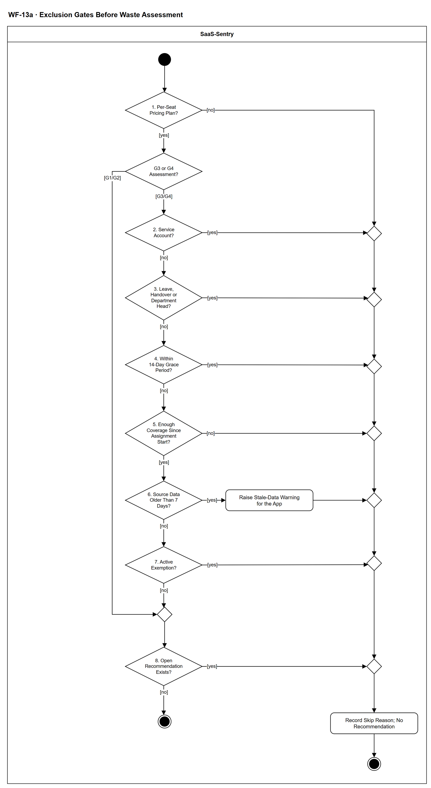

# WF-13a — Exclusion Gates Before Waste Assessment

> **Loại:** Workflow con (cấp chi tiết) — nhóm SF-4 · **Phiên bản:** 3.1 — 09/10/2026 · **Trạng thái:** Vẽ lại theo FR-4.9 hiện hành, OI-12a (G1/G2 chỉ cổng 1 và 8) và OI-12b (cổng 5 đọc theo ngày bao phủ từ ngày bắt đầu Assignment); chờ Owner/GVHD review
>
> Sơ đồ là **dẫn xuất** từ quyết định Owner (`QĐ`) và BRD hiện hành; khi khác nhau, `QĐ` → BRD thắng. Quyết định trong sơ đồ là của Owner, **chưa** phải xác nhận của GVHD/hội đồng.

## 1. Mục đích và phạm vi

**Chứng minh hệ thống không báo động giả.** Tám cổng chạy trước mọi đánh giá: trượt một cổng thì không có khuyến nghị (kèm lý do), không yếu tố nào bù được; dữ liệu quá cũ thì không chạy rule mà hiển thị cảnh báo. Đây là cơ sở của tiêu chí TC-2 (báo động giả bằng 0) và TC-4.

**Phạm vi:** Tám cổng theo thứ tự cho một seat (hoặc thuê bao với G1): gói theo seat, tài khoản dịch vụ, nghỉ dài hoặc bàn giao, ân hạn 14 ngày, đủ bao phủ từ ngày bắt đầu Assignment, dữ liệu quá 7 ngày, miễn trừ đang hiệu lực, khuyến nghị đang mở; ghi lý do khi loại.

**Không nằm trong sơ đồ này:** Ba trạng thái *không có ngày hoạt động*, tầng, mức tin cậy và bằng chứng có điều kiện (→ WF-13); khớp danh tính (→ WF-12a); ngưỡng cấu hình theo ứng dụng (FR-4.13).

## 2. Tệp

| Tệp | Vai trò |
| --- | --- |
| [WF-13a-exclusion-gates-before-waste-assessment.drawio](WF-13a-exclusion-gates-before-waste-assessment.drawio) | Nguồn draw.io chỉnh sửa được (sinh từ spec) |
| [WF-13a-exclusion-gates-before-waste-assessment.drawio.png](WF-13a-exclusion-gates-before-waste-assessment.drawio.png) | Bản xuất PNG, nhúng sẵn nguồn draw.io |
| [WF-13a.json](../specs/WF-13a.json) | **Nguồn canonical** — sửa ở đây rồi chạy `python tools/flowkit.py build` từ `Docs/Diagrams` |

## 3. Nguồn nghiệp vụ

| Mã | Nội dung dùng trong sơ đồ |
| --- | --- |
| `FR-4.9` | Tám điều kiện loại trừ trước khi đánh giá |
| `OI-12a` | G1/G2 chỉ áp cổng 1 và 8 |
| `OI-12b` | Cổng 5: chỉ dùng ngày bao phủ từ ngày bắt đầu Assignment |
| `FR-4.14, QĐ-35b` | Cổng trượt thì không có khuyến nghị; không yếu tố nào bù |
| `FR-3.10, INV-09` | Miễn trừ có hạn, hết hạn quay lại hàng đợi |
| `TC-2, TC-4` | Không báo động giả; không sinh khuyến nghị khi dữ liệu quá hạn hoặc chưa khớp |

## 4. Tác nhân, kích hoạt, điều kiện

| Làn (tiếng Anh trên hình) | Tác nhân | Trách nhiệm trong sơ đồ |
| --- | --- | --- |
| SaaS-Sentry | SaaS-Sentry | Toàn bộ là tác vụ nền: đánh giá tám cổng và ghi lý do loại |

- **Kích hoạt:** Được gọi từ WF-13 cho từng seat (hoặc thuê bao với G1) khi chạy rule theo lịch.
- **Tiền điều kiện:** Một seat đã được đưa vào danh sách cần đánh giá, cùng nhóm lãng phí dự kiến (G1–G4).
- **Hậu điều kiện:** Seat đủ điều kiện được đánh giá; hoặc bị loại kèm lý do và không có khuyến nghị; với dữ liệu quá cũ thì có cảnh báo dữ liệu lỗi thời thay cho việc chạy rule.

## 5. Cách đọc ký hiệu

| Ký hiệu | Nghĩa |
| --- | --- |
| Hình tròn đặc | Bắt đầu hoạt động (initial node) |
| Hình chữ nhật bo góc | Hành động (action) của tác nhân ở làn chứa nó |
| Hình thoi có chữ | Rẽ nhánh; mỗi cạnh ra mang điều kiện trong ngoặc vuông `[...]` |
| Hình thoi nhỏ không chữ | Hợp nhánh (merge) |
| Vòng tròn kép đặc | Kết thúc toàn bộ hoạt động (activity final) |
| Dây có cung nhảy | Hai dây giao nhau nhưng **không** nối với nhau |

Đọc từ trên xuống. Cổng 1 áp cho mọi nhóm; sau đó G1/G2 nhảy thẳng tới cổng 8 còn G3/G4 đi hết cổng 2–7. Mọi lối *loại* đi sang cột bên phải (một đường gom): đường gom ghi lý do rồi kết thúc, và riêng cổng 6 phát cảnh báo dữ liệu lỗi thời trước khi vào đường gom. Chỉ lối ra ở đáy cột chính (cổng 8 trả lời *không*) mới là đủ điều kiện.

## 6. Bảng node

| ID | Loại | Nhãn trên hình | Ý nghĩa | Làn / người thực hiện | Quy tắc |
| --- | --- | --- | --- | --- | --- |
| `st` | Nút bắt đầu | — | — | SaaS-Sentry | — |
| `g1` | Rẽ nhánh | 1. Per-Seat Pricing Plan? | Cổng 1: gói tính theo seat không. Gói flat-rate hoặc theo mức tiêu thụ không có khái niệm ghost seat. Cổng này áp cho cả G1/G2/G3/G4. | SaaS-Sentry | `FR-4.9`, `OI-12a`, `KPI-3` |
| `d_grp` | Rẽ nhánh | G3 or G4 Assessment? | Nhóm cần đánh giá là G3/G4 (cần bằng chứng sử dụng) hay G1/G2 (chỉ dùng dữ liệu nội bộ). G1/G2 chỉ áp cổng 1 và cổng 8; các cổng 2–7 là điều kiện về bằng chứng sử dụng và người dùng, chỉ áp cho G3/G4. | SaaS-Sentry | `FR-4.9`, `OI-12a` |
| `g2` | Rẽ nhánh | 2. Service Account? | Cổng 2: tài khoản dịch vụ (bot, CI, integration) không bao giờ đăng nhập theo cách thông thường nên loại khỏi đánh giá. | SaaS-Sentry | `FR-4.9` |
| `g3` | Rẽ nhánh | 3. Leave, Handover or Department Head? | Cổng 3: nhân viên đang nghỉ phép dài hoặc đang bàn giao thì loại để tránh báo động giả. Mở rộng 11/10/2026: seat của người **đang là trưởng phòng** cũng bị loại khỏi G3/G4 — trưởng phòng ít dùng là bình thường (`QĐ-66s`). | SaaS-Sentry | `FR-4.9`, `TC-2` |
| `g4` | Rẽ nhánh | 4. Within 14-Day Grace Period? | Cổng 4: Assignment mới tạo dưới ngưỡng ân hạn (mặc định 14 ngày, cấu hình được) thì vừa cấp seat, chưa kịp dùng. | SaaS-Sentry | `FR-4.9`, `TC-2` |
| `g5` | Rẽ nhánh | 5. Enough Coverage Since Assignment Start? | Cổng 5 đọc theo OI-12b: chỉ dùng các ngày bao phủ từ ngày bắt đầu Assignment; đủ ngưỡng của tầng thì được đánh giá, thiếu thì loại kèm lý do cổng 5 (không đủ dữ liệu để kết luận). | SaaS-Sentry | `FR-4.9`, `OI-12b`, `FR-4.12` |
| `g6` | Rẽ nhánh | 6. Source Data Older Than 7 Days? | Cổng 6: dữ liệu nguồn quá 7 ngày kể từ ngày bao phủ cuối thì không chạy rule, thay vào đó hiển thị cảnh báo dữ liệu lỗi thời. Không bao giờ âm thầm chạy với dữ liệu cũ. | SaaS-Sentry | `FR-4.9`, `TC-4` |
| `s_warn` | Hành động | Raise Stale-Data Warning for the App | Cảnh báo chất lượng dữ liệu cho ứng dụng (dữ liệu lỗi thời) để IT import dữ liệu mới; thay cho việc chạy rule. Seat này không có khuyến nghị. | SaaS-Sentry | `FR-4.9`, `TC-4` |
| `g7` | Rẽ nhánh | 7. Active Exemption? | Cổng 7: seat đang trong thời hạn miễn trừ do Department Head xác nhận thì tôn trọng quyết định đã có; hết hạn miễn trừ seat quay lại hàng đợi. | SaaS-Sentry | `FR-4.9`, `FR-3.10`, `INV-09` |
| `m_pre` | Hợp nhánh | — | — | SaaS-Sentry | — |
| `g8` | Rẽ nhánh | 8. Open Recommendation Exists? | Cổng 8: Assignment (hoặc thuê bao với G1) đã có khuyến nghị đang mở thì không sinh trùng. | SaaS-Sentry | `FR-4.9`, `OI-12a` |
| `end_ok` | Kết thúc hoạt động | — | Qua mọi cổng áp dụng: seat đủ điều kiện được đánh giá. | SaaS-Sentry | — |
| `m_a` | Hợp nhánh | — | — | SaaS-Sentry | — |
| `m_b` | Hợp nhánh | — | — | SaaS-Sentry | — |
| `m_c` | Hợp nhánh | — | — | SaaS-Sentry | — |
| `m_d` | Hợp nhánh | — | — | SaaS-Sentry | — |
| `m_e` | Hợp nhánh | — | — | SaaS-Sentry | — |
| `m_f` | Hợp nhánh | — | — | SaaS-Sentry | — |
| `m_g` | Hợp nhánh | — | — | SaaS-Sentry | — |
| `s_reason` | Hành động | Record Skip Reason; No Recommendation | Trượt cổng thì không sinh khuyến nghị và không yếu tố nào bù được; ghi lý do cổng nào để truy vết và để chứng minh không báo động giả. Không bao giờ âm thầm bỏ. | SaaS-Sentry | `QĐ-35b`, `FR-4.14`, `TC-2`, `TC-4` |
| `end_skip` | Kết thúc hoạt động | — | Seat bị loại khỏi đánh giá, đã ghi lý do; không có khuyến nghị. | SaaS-Sentry | — |

## 7. Bảng chuyển tiếp

| Từ → tới | Nhãn điều kiện | Điều kiện | Kết quả |
| --- | --- | --- | --- |
| `st` → `g1` | — | — | Sang 1. Per-Seat Pricing Plan? |
| `g1` → `d_grp` | `[yes]` | Gói theo seat | Đi tiếp |
| `g1` → `m_a` | `[no]` | Gói không theo seat: không có ghost seat | Loại, ghi lý do |
| `d_grp` → `g2` | `[G3/G4]` | Cần bằng chứng sử dụng | Áp các cổng 2–7 |
| `d_grp` → `m_pre` | `[G1/G2]` | Chỉ dùng dữ liệu nội bộ | Chỉ áp cổng 8 |
| `g2` → `g3` | `[no]` | Không phải tài khoản dịch vụ | Đi tiếp |
| `g2` → `m_a` | `[yes]` | Tài khoản dịch vụ | Loại, ghi lý do |
| `m_a` → `m_b` | — | — | Sang — |
| `g3` → `g4` | `[no]` | Không nghỉ dài, không bàn giao | Đi tiếp |
| `g3` → `m_b` | `[yes]` | Đang nghỉ dài hoặc bàn giao | Loại, ghi lý do |
| `m_b` → `m_c` | — | — | Sang — |
| `g4` → `g5` | `[no]` | Đã qua ân hạn | Đi tiếp |
| `g4` → `m_c` | `[yes]` | Còn trong ân hạn | Loại, ghi lý do |
| `m_c` → `m_d` | — | — | Sang — |
| `g5` → `g6` | `[yes]` | Đủ ngày bao phủ từ ngày bắt đầu Assignment | Đi tiếp |
| `g5` → `m_d` | `[no]` | Thiếu ngày bao phủ kể từ ngày bắt đầu Assignment | Loại, ghi lý do cổng 5 |
| `m_d` → `m_e` | — | — | Sang — |
| `g6` → `g7` | `[no]` | Dữ liệu còn mới | Đi tiếp |
| `g6` → `s_warn` | `[yes]` | Quá 7 ngày kể từ ngày bao phủ cuối | Cảnh báo dữ liệu lỗi thời |
| `s_warn` → `m_e` | — | — | Sang — |
| `m_e` → `m_f` | — | — | Sang — |
| `g7` → `m_pre` | `[no]` | Không có miễn trừ hiệu lực | Đi tiếp |
| `g7` → `m_f` | `[yes]` | Đang trong thời hạn miễn trừ | Loại, ghi lý do |
| `m_f` → `m_g` | — | — | Sang — |
| `m_pre` → `g8` | — | — | Sang 8. Open Recommendation Exists? |
| `g8` → `end_ok` | `[no]` | Chưa có khuyến nghị mở | Đủ điều kiện đánh giá |
| `g8` → `m_g` | `[yes]` | Đã có khuyến nghị đang mở | Loại, ghi lý do |
| `m_g` → `s_reason` | — | — | Sang Record Skip Reason; No Recommendation |
| `s_reason` → `end_skip` | — | — | Sang — |

Số đếm: **22 node · 29 cạnh · 9 rẽ nhánh**; giao cắt dây: **0**.

## 8. Happy path

1. `st` — —
2. `g1` — 1. Per-Seat Pricing Plan?: Cổng 1: gói tính theo seat không. Gói flat-rate hoặc theo mức tiêu thụ không có khái niệm ghost seat. Cổng này áp cho cả G1/G2/G3/G4.
3. `d_grp` — G3 or G4 Assessment?: Nhóm cần đánh giá là G3/G4 (cần bằng chứng sử dụng) hay G1/G2 (chỉ dùng dữ liệu nội bộ). G1/G2 chỉ áp cổng 1 và cổng 8; các cổng 2–7 là điều kiện về bằng chứng sử dụng và người dùng, chỉ áp cho G3/G4.
4. `g2` — 2. Service Account?: Cổng 2: tài khoản dịch vụ (bot, CI, integration) không bao giờ đăng nhập theo cách thông thường nên loại khỏi đánh giá.
5. `g3` — 3. Leave, Handover or Department Head?: Cổng 3: nhân viên đang nghỉ phép dài hoặc đang bàn giao thì loại để tránh báo động giả. Mở rộng 11/10/2026: seat của người **đang là trưởng phòng** cũng bị loại khỏi G3/G4 — trưởng phòng ít dùng là bình thường (`QĐ-66s`).
6. `g4` — 4. Within 14-Day Grace Period?: Cổng 4: Assignment mới tạo dưới ngưỡng ân hạn (mặc định 14 ngày, cấu hình được) thì vừa cấp seat, chưa kịp dùng.
7. `g5` — 5. Enough Coverage Since Assignment Start?: Cổng 5 đọc theo OI-12b: chỉ dùng các ngày bao phủ từ ngày bắt đầu Assignment; đủ ngưỡng của tầng thì được đánh giá, thiếu thì loại kèm lý do cổng 5 (không đủ dữ liệu để kết luận).
8. `g6` — 6. Source Data Older Than 7 Days?: Cổng 6: dữ liệu nguồn quá 7 ngày kể từ ngày bao phủ cuối thì không chạy rule, thay vào đó hiển thị cảnh báo dữ liệu lỗi thời. Không bao giờ âm thầm chạy với dữ liệu cũ.
9. `g7` — 7. Active Exemption?: Cổng 7: seat đang trong thời hạn miễn trừ do Department Head xác nhận thì tôn trọng quyết định đã có; hết hạn miễn trừ seat quay lại hàng đợi.
10. `g8` — 8. Open Recommendation Exists?: Cổng 8: Assignment (hoặc thuê bao với G1) đã có khuyến nghị đang mở thì không sinh trùng.
11. `end_ok` — —: Qua mọi cổng áp dụng: seat đủ điều kiện được đánh giá.

## 9. Nhánh thay thế / if-else

- **G1 hoặc G2: chỉ cổng 1 và 8** — `g1` → `d_grp` → `m_pre` → `g8` → `end_ok`. Không áp cổng 2–7 vì đó là điều kiện về bằng chứng sử dụng và người dùng.

## 10. Nhánh lỗi / từ chối và cách kết thúc

- **Gói không theo seat** — `g1` → `m_a` → `m_b` → `m_c` → `m_d` → `m_e` → `m_f` → `m_g` → `s_reason` → `end_skip`. Không có ghost seat; ghi lý do.
- **Còn trong ân hạn** — `g4` → `m_c` → `m_d` → `m_e` → `m_f` → `m_g` → `s_reason` → `end_skip`. Cấp seat chưa lâu; ghi lý do.
- **Dữ liệu quá 7 ngày** — `g6` → `s_warn` → `m_e` → `m_f` → `m_g` → `s_reason` → `end_skip`. Cảnh báo dữ liệu lỗi thời thay cho việc chạy rule.
- **Đã có khuyến nghị mở** — `g8` → `m_g` → `s_reason` → `end_skip`. Không sinh trùng.

## 11. Liên hệ với sơ đồ khác

- Cấp trên: nhóm SF-4; Context (rule engine), FDD Feature 4
- `WF-13` — gọi workflow này cho từng seat
- `WF-12a` — ba trạng thái *không có dữ liệu / chưa khớp* nằm ở WF-13, không phải cổng ở đây
- User flow: `UF-10`

## 12. Giới hạn và vấn đề còn mở

- (ĐÃ CÓ NGUỒN · DOI-70, QĐ-52a) Cổng 7 *miễn trừ do Manager xác nhận*: Manager là trưởng phòng có hiệu lực — sơ đồ dùng Department Head.
- (ĐÃ CÓ NGUỒN · DOI-71) Cảnh báo dữ liệu lỗi thời (cổng 6) hiện trong báo cáo chất lượng dữ liệu cho IT Admin và Super Admin (FR-5.12, FR-4.9).
- (LATER-TECH/UI · DOI-72, OI-12a) Với G1 (đối tượng là thuê bao) cổng 1 và cổng 8 được hiểu theo thuê bao — khóa của rule engine chốt ở thiết kế BE.
