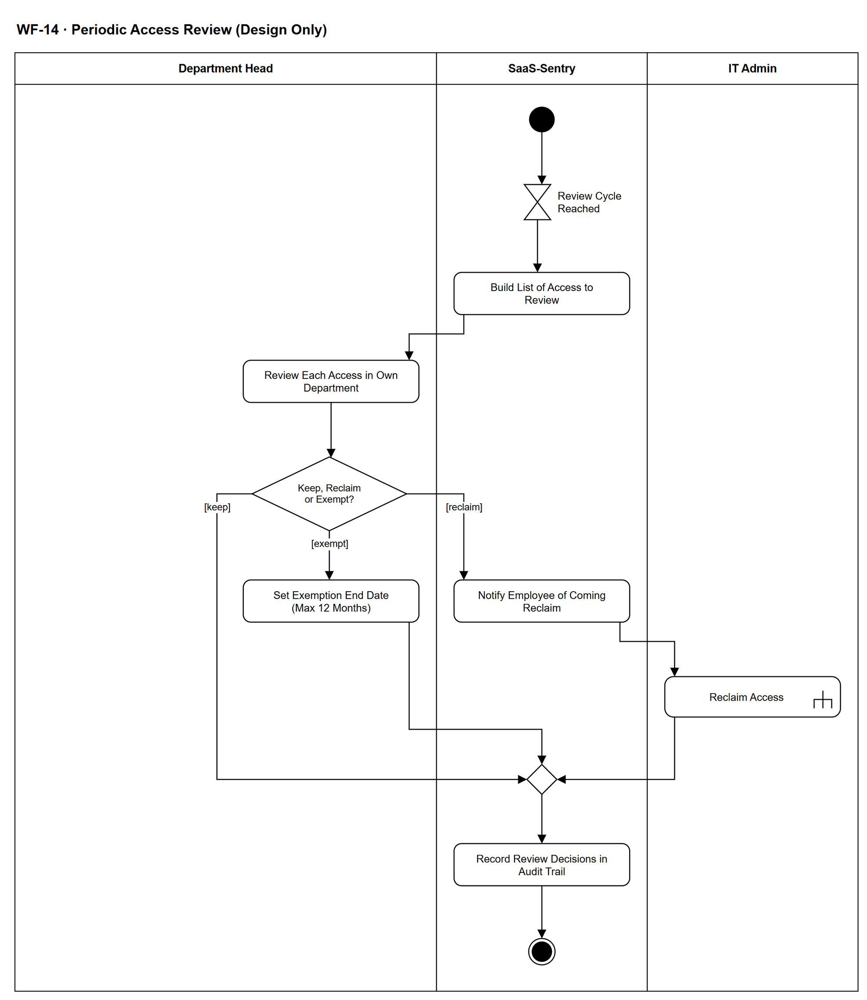

# WF-14 — Periodic Access Review (Design Only)

> **Loại:** Workflow hỗ trợ (cấp chi tiết) — nhóm SF-4 · **Phiên bản:** 3.1 — 09/10/2026 · **Trạng thái:** CHỈ ĐẶC TẢ THIẾT KẾ — không hiện thực trong dự án (luồng F-24). Phải nói rõ khi trình bày để không bị hiểu là tính năng đã có. Vẽ lại theo FR-3.10 và QĐ-52a (Department Head); chờ Owner/GVHD review
>
> Sơ đồ là **dẫn xuất** từ quyết định Owner (`QĐ`) và BRD hiện hành; khi khác nhau, `QĐ` → BRD thắng. Quyết định trong sơ đồ là của Owner, **chưa** phải xác nhận của GVHD/hội đồng.

## 1. Mục đích và phạm vi

Mô tả **rà soát quyền truy cập định kỳ** theo thiết kế: Department Head xác nhận từng quyền của nhân viên trong phòng mình là còn cần hay không bằng Keep / Reclaim / Exempt kèm lý do, và mọi quyết định được lưu làm bằng chứng kiểm toán. Dùng cùng ba lựa chọn với xác nhận ghost seat (WF-13).

**Phạm vi:** Tới kỳ rà soát, lập danh sách quyền, Department Head chọn Keep / Reclaim / Exempt, thông báo nhân viên khi Reclaim, IT thu hồi qua WF-09a, miễn trừ có hạn tối đa 12 tháng, ghi quyết định vào Audit Trail.

**Không nằm trong sơ đồ này:** Mọi chi tiết hiện thực (đây là luồng chỉ đặc tả); chu kỳ và phạm vi rà soát (chưa được quy định); rà soát quyền sau điều chuyển phòng (→ WF-05, MF-7); xác nhận ghost seat dựa trên usage (→ WF-13); chi tiết thu hồi (→ WF-09a).

## 2. Tệp

| Tệp | Vai trò |
| --- | --- |
| [WF-14-periodic-access-review-design-only.drawio](WF-14-periodic-access-review-design-only.drawio) | Nguồn draw.io chỉnh sửa được (sinh từ spec) |
| [WF-14-periodic-access-review-design-only.drawio.png](WF-14-periodic-access-review-design-only.drawio.png) | Bản xuất PNG, nhúng sẵn nguồn draw.io |
| [WF-14.json](../specs/WF-14.json) | **Nguồn canonical** — sửa ở đây rồi chạy `python tools/flowkit.py build` từ `Docs/Diagrams` |

## 3. Nguồn nghiệp vụ

| Mã | Nội dung dùng trong sơ đồ |
| --- | --- |
| `FR-3.10, INV-09` | Trong đợt access review, Manager chọn Keep / Reclaim / Exempt kèm lý do; Exempt bắt buộc có hạn tối đa 12 tháng rồi quay lại hàng đợi |
| `FR-3.7, SoD-2` | Department Head chỉ thấy số liệu tổng hợp trong phòng |
| `FR-5.14` | Thông báo cho Employee khi quyết định thu hồi sắp được thực hiện |
| `SoD-5` | IT Admin là bên duy nhất thay đổi seat |
| `FR-8.3, INV-05` | Audit Trail chỉ ghi thêm |
| `F-24` | Luồng chỉ đặc tả thiết kế, không code |

## 4. Tác nhân, kích hoạt, điều kiện

| Làn (tiếng Anh trên hình) | Tác nhân | Trách nhiệm trong sơ đồ |
| --- | --- | --- |
| Department Head | Department Head | Rà từng quyền trong phòng, chọn Keep / Reclaim / Exempt kèm lý do |
| SaaS-Sentry | SaaS-Sentry | Tới kỳ, lập danh sách, thông báo nhân viên, ghi quyết định vào Audit Trail |
| IT Admin | IT Admin | Thực hiện thu hồi quyền (SoD-5) |

- **Kích hoạt:** Tới kỳ rà soát đã cấu hình (theo lịch).
- **Tiền điều kiện:** Đã cấu hình kỳ rà soát (chưa được quy định trong BRD); có Assignment đang hiệu lực trong phòng.
- **Hậu điều kiện:** Mỗi quyền trong phạm vi có một quyết định của Department Head (giữ, thu hồi hoặc miễn trừ có hạn) được ghi vào Audit Trail; quyền bị Reclaim được IT thu hồi; quyền Exempt tự quay lại hàng đợi khi hết hạn.

## 5. Cách đọc ký hiệu

| Ký hiệu | Nghĩa |
| --- | --- |
| Hình tròn đặc | Bắt đầu hoạt động (initial node) |
| Hình chữ nhật bo góc | Hành động (action) của tác nhân ở làn chứa nó |
| Hình chữ nhật bo góc có ký hiệu cây đinh ba ở góc | Gọi workflow con (call behavior) — mã workflow ghi trong nhãn |
| Hình thoi có chữ | Rẽ nhánh; mỗi cạnh ra mang điều kiện trong ngoặc vuông `[...]` |
| Hình thoi nhỏ không chữ | Hợp nhánh (merge) |
| Đồng hồ cát | Chờ một mốc thời gian (time event) |
| Vòng tròn kép đặc | Kết thúc toàn bộ hoạt động (activity final) |
| Dây có cung nhảy | Hai dây giao nhau nhưng **không** nối với nhau |

Luồng thẳng từ kỳ rà soát tới quyết định ba hướng, sau đó cả ba hướng gặp nhau ở bước ghi quyết định. Reclaim là nhánh duy nhất đi qua IT Admin; Keep và Exempt chỉ ghi nhận. Sơ đồ ở mức thiết kế, không có chi tiết lỗi thu hồi (xem WF-09a).

## 6. Bảng node

| ID | Loại | Nhãn trên hình | Ý nghĩa | Làn / người thực hiện | Quy tắc |
| --- | --- | --- | --- | --- | --- |
| `st` | Nút bắt đầu | — | — | SaaS-Sentry | — |
| `t_cycle` | Chờ mốc thời gian | Review Cycle Reached | Tới kỳ rà soát. BRD chưa quy định chu kỳ hay cách cấu hình kỳ rà soát (xem mục mở). | SaaS-Sentry | `FR-3.10`, `F-24` |
| `s_list` | Hành động | Build List of Access to Review | Hệ thống lập danh sách quyền (Assignment) của nhân viên trong phòng thuộc phạm vi rà soát, kèm số liệu sử dụng tổng hợp nếu có. Phạm vi cụ thể của đợt rà soát chưa được quy định. | SaaS-Sentry | `FR-3.10`, `FR-3.7`, `FR-3.17` |
| `a_rev` | Hành động | Review Each Access in Own Department | Department Head rà từng quyền của nhân viên trong phòng mình. Chỉ thấy số liệu tổng hợp, không thấy raw activity log, hợp đồng hay dữ liệu tài chính toàn công ty. | Department Head | `FR-3.10`, `FR-3.7`, `SoD-2` |
| `d_ch` | Rẽ nhánh | Keep, Reclaim or Exempt? | Department Head chọn Keep, Reclaim hoặc Exempt kèm lý do bắt buộc. Exempt bắt buộc có thời hạn, tối đa 12 tháng. | Department Head | `FR-3.10`, `INV-09` |
| `a_ex` | Hành động | Set Exemption End Date (Max 12 Months) | Đặt ngày hết hạn miễn trừ, tối đa 12 tháng. Hết hạn thì quyền tự động quay lại hàng đợi review; không có miễn trừ vô thời hạn. | Department Head | `FR-3.10`, `INV-09` |
| `s_notify` | Hành động | Notify Employee of Coming Reclaim | Khi Department Head chọn Reclaim, nhân viên giữ quyền được thông báo quyền sắp bị thu hồi. | SaaS-Sentry | `FR-5.14`, `FR-3.10` |
| `c_reclaim` | Gọi workflow con | Reclaim Access | IT Admin thực hiện thu hồi quyền qua luồng cấp/thu hồi (SoD-5). Thu hồi một quyền không tự ghi nhận tiền tiết kiệm. | IT Admin | `SoD-5`, `FR-2.4`, `FR-4.15`, → `WF-09a` |
| `m_ev` | Hợp nhánh | — | — | SaaS-Sentry | — |
| `s_audit` | Hành động | Record Review Decisions in Audit Trail | Mỗi quyết định (Keep, Reclaim, Exempt) lưu thành bản ghi phê duyệt điện tử: người quyết, vai, thời điểm, quyết định, lý do; Audit Trail chỉ ghi thêm. Mọi quyền được rà soát đều có một bản ghi xác nhận của người chịu trách nhiệm. | SaaS-Sentry | `FR-3.10`, `FR-8.3`, `INV-05`, `BRD 4.6` |
| `end_ok` | Kết thúc hoạt động | — | Mọi quyền trong phạm vi rà soát đã có quyết định được ghi. | SaaS-Sentry | — |

## 7. Bảng chuyển tiếp

| Từ → tới | Nhãn điều kiện | Điều kiện | Kết quả |
| --- | --- | --- | --- |
| `st` → `t_cycle` | — | — | Sang Review Cycle Reached |
| `t_cycle` → `s_list` | — | — | Sang Build List of Access to Review |
| `s_list` → `a_rev` | — | — | Sang Review Each Access in Own Department |
| `a_rev` → `d_ch` | — | — | Sang Keep, Reclaim or Exempt? |
| `d_ch` → `s_notify` | `[reclaim]` | Không còn cần quyền này | Thông báo nhân viên |
| `d_ch` → `a_ex` | `[exempt]` | Tạm miễn trừ có thời hạn | Đặt ngày hết hạn |
| `d_ch` → `m_ev` | `[keep]` | Vẫn cần quyền này, kèm lý do | Ghi quyết định |
| `s_notify` → `c_reclaim` | — | — | Sang Reclaim Access |
| `c_reclaim` → `m_ev` | — | — | Sang — |
| `a_ex` → `m_ev` | — | — | Sang — |
| `m_ev` → `s_audit` | — | — | Sang Record Review Decisions in Audit Trail |
| `s_audit` → `end_ok` | — | — | Sang — |

Số đếm: **11 node · 12 cạnh · 1 rẽ nhánh**; giao cắt dây: **0**.

## 8. Happy path

1. `st` — —
2. `t_cycle` — Review Cycle Reached: Tới kỳ rà soát. BRD chưa quy định chu kỳ hay cách cấu hình kỳ rà soát (xem mục mở).
3. `s_list` — Build List of Access to Review: Hệ thống lập danh sách quyền (Assignment) của nhân viên trong phòng thuộc phạm vi rà soát, kèm số liệu sử dụng tổng hợp nếu có. Phạm vi cụ thể của đợt rà soát chưa được quy định.
4. `a_rev` — Review Each Access in Own Department: Department Head rà từng quyền của nhân viên trong phòng mình. Chỉ thấy số liệu tổng hợp, không thấy raw activity log, hợp đồng hay dữ liệu tài chính toàn công ty.
5. `d_ch` — Keep, Reclaim or Exempt?: Department Head chọn Keep, Reclaim hoặc Exempt kèm lý do bắt buộc. Exempt bắt buộc có thời hạn, tối đa 12 tháng.
6. `s_notify` — Notify Employee of Coming Reclaim: Khi Department Head chọn Reclaim, nhân viên giữ quyền được thông báo quyền sắp bị thu hồi.
7. `c_reclaim` — Reclaim Access: IT Admin thực hiện thu hồi quyền qua luồng cấp/thu hồi (SoD-5). Thu hồi một quyền không tự ghi nhận tiền tiết kiệm.
8. `s_audit` — Record Review Decisions in Audit Trail: Mỗi quyết định (Keep, Reclaim, Exempt) lưu thành bản ghi phê duyệt điện tử: người quyết, vai, thời điểm, quyết định, lý do; Audit Trail chỉ ghi thêm. Mọi quyền được rà soát đều có một bản ghi xác nhận của người chịu trách nhiệm.
9. `end_ok` — —: Mọi quyền trong phạm vi rà soát đã có quyết định được ghi.

## 9. Nhánh thay thế / if-else

- **Giữ lại (Keep)** — `d_ch` → `m_ev` → `s_audit`. Ghi quyết định kèm lý do; quyền không đổi.
- **Miễn trừ có hạn (Exempt)** — `d_ch` → `a_ex` → `m_ev`. Tối đa 12 tháng; hết hạn thì quay lại hàng đợi review.

## 10. Nhánh lỗi / từ chối và cách kết thúc

Sơ đồ này không có nhánh lỗi/từ chối riêng; mọi kết cục đã nêu ở mục 8–9.

## 11. Liên hệ với sơ đồ khác

- Cấp trên: nhóm SF-4; Context (bằng chứng rà soát), FDD Feature 6
- `WF-13` — cùng ba lựa chọn Keep / Reclaim / Exempt cho ghost seat
- `WF-09a` — thực hiện thu hồi (node gọi)
- User flow: không có (luồng chỉ đặc tả)
- `WF-09a` — gọi/chuyển tại node `c_reclaim`

## 12. Giới hạn và vấn đề còn mở

- (DEFERRED/OUT · DOI-18) Rà soát quyền định kỳ (`F-24`) chỉ đặc tả thiết kế, không code (Định nghĩa Phạm vi 5.2): chu kỳ, cách cấu hình kỳ và phạm vi chưa đặt.
- (DEFERRED/OUT · DOI-18) Quá hạn khi trưởng phòng không phản hồi: chưa vẽ; áp nhắc và cảnh báo nghẽn như FR-3.8 nếu `F-24` được hiện thực. Phòng thiếu trưởng phòng ⟹ việc chờ (QĐ-62c).
- (DEFERRED/OUT · DOI-18) Quy tắc IT trả lại tối đa một lần (OI-02) chưa áp cho access review.
- (DEFERRED/OUT · DOI-18) Thu hồi thất bại do WF-09a xử lý (QĐ-62i); cách ghi bằng chứng rà soát khi thu hồi thất bại chốt khi `F-24` được hiện thực.
