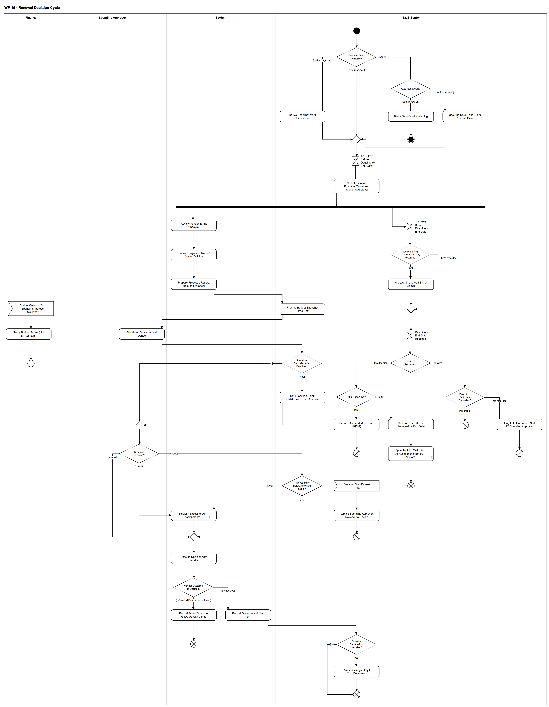

# WF-15 — Renewal Decision Cycle

> **Loại:** Workflow chi tiết (WF) của `MF-4` — chu kỳ quyết định gia hạn · **Phiên bản:** 3.6 — 12/10/2026 · **Trạng thái:** Vẽ lại 08/10/2026 theo QĐ-49c, QĐ-54e, QĐ-60a, FR-1.4, FR-1.10, FR-3.8, FR-3.13, FR-3.14, FR-4.15, DQ-07; bổ sung QĐ-62k, QĐ-62l ngày 09/10/2026; QĐ-63a (người xác nhận bàn giao khi giảm/hủy) và QĐ-64a (seat đã quyết thu hồi ghost seat) ngày 10/10/2026; QĐ-66v (nhánh thu hồi khi thuê bao hết hạn không gia hạn — DOI-106) ngày 12/10/2026; chờ Owner/GVHD review
>
> Sơ đồ là **dẫn xuất** từ quyết định Owner (`QĐ`) và BRD hiện hành; khi khác nhau, `QĐ` → BRD thắng. Quyết định trong sơ đồ là của Owner, **chưa** phải xác nhận của GVHD/hội đồng.

## 1. Mục đích và phạm vi

Chi tiết hóa `MF-4`: từ lúc hệ thống cảnh báo theo **hạn chót báo hủy** tới khi Người duyệt chi quyết gia hạn, giảm số lượng hoặc hủy và IT thực hiện — hoặc, nếu quá hạn chót mà không có quyết định, ghi nhận đúng kết cục (sự cố KPI-4 khi tự gia hạn, đánh dấu hết hạn cuối kỳ và mở tác vụ thu hồi như hủy toàn bộ khi không tự gia hạn). Hệ thống chỉ nhắc, không bao giờ tự gia hạn hay tự hủy.

**Phạm vi:** Kiểm dữ liệu hạn chót (có / suy ra / theo ngày kết thúc / thiếu); cảnh báo T-15 và T-7; IT rà điều khoản sáu điểm, sử dụng và ý kiến Business Owner; đề xuất; snapshot theo chi phí thực chịu; quyết định của Người duyệt chi (kể cả ghi sau hạn chót); luồng phụ hỏi Finance; nhắc quá SLA; thu hồi phần vượt hoặc toàn bộ; thực hiện với nhà cung cấp và kiểm kết quả; ghi tiết kiệm khi chi phí thực sự giảm; nhánh theo dõi hạn chót với bốn kết cục.

**Không nằm trong sơ đồ này:** Thuê bao không có kỳ cần gia hạn: license vĩnh viễn và phần mềm nội bộ (`QĐ-49c`). Chi tiết thu hồi quyền (→ `WF-09a`). Quyết định gia hạn không tạo khoản cam kết ngân sách (QĐ-62s, FR-5.8); chi phí kỳ gia hạn nằm ở dự báo L1 (FR-5.5). Thanh toán, mua và hủy thật ở nhà cung cấp nằm ngoài hệ thống (BRD 3.2).

## 2. Tệp

| Tệp | Vai trò |
| --- | --- |
| [WF-15-renewal-decision-cycle.drawio](WF-15-renewal-decision-cycle.drawio) | Nguồn draw.io chỉnh sửa được (sinh từ spec) |
| [WF-15-renewal-decision-cycle.drawio.png](WF-15-renewal-decision-cycle.drawio.png) | Bản xuất PNG, nhúng sẵn nguồn draw.io |
| [WF-15.json](../specs/WF-15.json) | **Nguồn canonical** — sửa ở đây rồi chạy `python tools/flowkit.py build` từ `Docs/Diagrams` |

## 3. Nguồn nghiệp vụ

| Mã | Nội dung dùng trong sơ đồ |
| --- | --- |
| `FR-1.3, FR-1.4, OI-09a, OI-09b, OI-05c` | Hạn chót báo hủy; T-15 và T-7; người nhận; kênh; không báo người đã nghỉ |
| `FR-1.10, QĐ-54e` | Checklist sáu điểm điều khoản vendor rà trước kỳ gia hạn |
| `OI-05a, BRD 4.4` | Ý kiến Business Owner do IT ghi, không chặn |
| `FR-3.13, FR-3.14, QĐ-60a, QĐ-30a` | Người duyệt chi quyết trên snapshot chi phí thực chịu; hỏi Finance không dừng SLA |
| `FR-3.8, DQ-07, KPI-4` | Quá SLA chỉ nhắc; quá hạn chót: tự gia hạn là sự cố, không tự gia hạn là hết hạn |
| `OI-11c, INV-01` | Giảm xuống dưới số Assignment ⟹ thu hồi phần vượt trước kỳ mới |
| `FR-1.3, FR-4.15, FR-5.9` | Cờ giảm giữa kỳ; hai con số tiết kiệm không cộng gộp |
| `QĐ-35c` | Assignment kỳ mới là dòng mới nối chuỗi dòng cũ |
| `QĐ-49c` | Chỉ áp cho khoản có thời hạn cần gia hạn |
| `QĐ-62k, QĐ-62l` | Quyết định muộn không bị hủy; cờ thực hiện trễ (không KPI-4); kết quả thực tế; mốc theo ngày kết thúc khi không hạn chót và không tự gia hạn |
| `QĐ-66v, QĐ-63a, QĐ-64a, QĐ-66u` | Thuê bao hết hạn không gia hạn xử lý như hủy toàn bộ: IT thu hồi trước ngày kết thúc; người xác nhận bàn giao theo ca |

## 4. Tác nhân, kích hoạt, điều kiện

| Làn (tiếng Anh trên hình) | Tác nhân | Trách nhiệm trong sơ đồ |
| --- | --- | --- |
| Finance | Finance | Chỉ trả lời yêu cầu thông tin ngân sách khi được hỏi; không duyệt, không chặn |
| Spending Approver | Người duyệt chi | Quyết gia hạn, giảm số lượng hoặc hủy trên snapshot và số liệu sử dụng |
| IT Admin | IT Admin | Rà điều khoản và sử dụng, lập đề xuất, thu hồi quyền, thực hiện với nhà cung cấp và ghi kết quả |
| SaaS-Sentry | SaaS-Sentry | Kiểm dữ liệu, cảnh báo, snapshot, nhắc SLA, theo dõi hạn chót, ghi sự cố và tiết kiệm |

- **Kích hoạt:** Thuê bao có kỳ tới mốc T-15 trước hạn chót báo hủy (đã có hoặc suy ra được).
- **Tiền điều kiện:** Thuê bao có kỳ, số lượng, đơn giá, cờ tự gia hạn, cờ giảm giữa kỳ; gói có điều khoản vendor và lưu ý trước khi thu hồi; mỗi mục danh mục có Business Owner.
- **Hậu điều kiện:** Quyết định được ghi và thực hiện (gia hạn, giảm, hủy), tiết kiệm ghi riêng chỉ khi chi phí thực sự giảm; hoặc kết quả thực tế khác quyết định được ghi kèm việc theo dõi. Tại hạn chót nhánh hạn ghi đúng một kết cục: không gì thêm (đã quyết, đã ghi kết quả) · cờ thực hiện trễ (đã quyết, chưa ghi kết quả) · sự cố KPI-4 (chưa quyết, tự gia hạn) · đánh dấu hết hạn trừ khi gia hạn được thực hiện trước ngày kết thúc, kèm mở tác vụ thu hồi mọi quyền trước ngày kết thúc như hủy toàn bộ (chưa quyết, không tự gia hạn — `QĐ-66v`; chưa chốt khi một quyết định gia hạn xen vào — xem mục mở). Không bao giờ tự gia hạn hoặc tự hủy do hệ thống quyết.

## 5. Cách đọc ký hiệu

| Ký hiệu | Nghĩa |
| --- | --- |
| Hình tròn đặc | Bắt đầu hoạt động (initial node) |
| Hình chữ nhật bo góc | Hành động (action) của tác nhân ở làn chứa nó |
| Hình chữ nhật bo góc có ký hiệu cây đinh ba ở góc | Gọi workflow con (call behavior) — mã workflow ghi trong nhãn |
| Hình thoi có chữ | Rẽ nhánh; mỗi cạnh ra mang điều kiện trong ngoặc vuông `[...]` |
| Hình thoi nhỏ không chữ | Hợp nhánh (merge) |
| Thanh đen ngang | Tách hoặc gộp các nhánh chạy song song (fork/join) |
| Hình năm cạnh lõm | Chờ một sự kiện từ bên ngoài luồng (accept event) |
| Đồng hồ cát | Chờ một mốc thời gian (time event) |
| Vòng tròn kép đặc | Kết thúc toàn bộ hoạt động (activity final) |
| Vòng tròn có dấu nhân | Kết thúc riêng nhánh đó, các nhánh khác vẫn chạy (flow final) |
| Dây có cung nhảy | Hai dây giao nhau nhưng **không** nối với nhau |

Đọc từ trên xuống: kiểm dữ liệu → T-15 → thanh tách. Nhánh trái (IT → Người duyệt chi → thực hiện) là chuẩn bị, quyết định và thực hiện; nhánh phải chỉ theo dõi T-7 và hạn chót. Hai nhánh không mâu thuẫn (`QĐ-62k`): nhánh hạn chỉ **ghi nhận** trạng thái tại hạn chót, không hủy quyết định; quyết định ghi sau hạn chót đi `d_late [yes] → s_next`. Hai luồng phụ có điểm khởi đầu riêng: hỏi Finance (không dừng SLA) và nhắc quá SLA (chỉ nhắc). Ngoại lệ biểu diễn: luồng phụ bắt đầu bằng sự kiện không có cạnh vào là một lần xử lý độc lập, kết thúc nhánh chính không hủy chúng — cách đọc nội bộ đã ghi ở [tools/README.md mục 7](../tools/README.md#7-ngoại-lệ-biểu-diễn-đã-chấp-nhận-ghi-10102026), không phải bằng chứng hình tuân thủ đầy đủ UML 2.5.

## 6. Bảng node

| ID | Loại | Nhãn trên hình | Ý nghĩa | Làn / người thực hiện | Quy tắc |
| --- | --- | --- | --- | --- | --- |
| `st` | Nút bắt đầu | — | — | SaaS-Sentry | — |
| `d_dl` | Rẽ nhánh | Deadline Data Available? | Thuê bao có thời hạn đã đến kỳ quét: hạn chót báo hủy có ghi nhận, chỉ có số ngày báo trước, hay thiếu cả hai. Chỉ thuê bao/khoản mua có thời hạn mới vào luồng này (QĐ-49c). | SaaS-Sentry | `FR-1.3`, `FR-1.4`, `QĐ-49c` |
| `d_ar` | Rẽ nhánh | Auto-Renew On? | Thiếu cả hạn chót lẫn số ngày báo trước: thuê bao có bật tự gia hạn không. | SaaS-Sentry | `FR-1.4`, `QĐ-62l` |
| `s_dq` | Hành động | Raise Data-Quality Warning | Thiếu cả hạn chót lẫn số ngày báo trước mà thuê bao tự gia hạn: hệ thống không suy đoán, chỉ hiển thị cảnh báo chất lượng dữ liệu để IT bổ sung. | SaaS-Sentry | `FR-1.4`, `FR-5.12` |
| `end_dq` | Kết thúc hoạt động | — | Chưa chạy được chu kỳ gia hạn cho tới khi IT bổ sung dữ liệu hợp đồng. | SaaS-Sentry | — |
| `s_endd` | Hành động | Use End Date; Label Alerts 'By End Date' | Không có hạn chót, không có số ngày báo trước và không tự gia hạn: lấy ngày kết thúc làm mốc; cảnh báo T-15/T-7 tính trước ngày kết thúc, ghi rõ “theo ngày kết thúc”. | SaaS-Sentry | `QĐ-62l`, `FR-1.4` |
| `s_der` | Hành động | Derive Deadline; Mark Unconfirmed | Không có hạn chót nhưng hợp đồng có số ngày báo trước: hệ thống suy ra hạn chót và ghi rõ đây là giá trị suy ra, chưa xác nhận. | SaaS-Sentry | `FR-1.4` |
| `m_al` | Hợp nhánh | — | — | SaaS-Sentry | — |
| `t15` | Chờ mốc thời gian | T-15 Days Before Deadline (or End Date) | Mốc cảnh báo đầu tiên tính từ hạn chót báo hủy, không tính từ ngày gia hạn; thuê bao theo ngày kết thúc (QĐ-62l) thì tính từ ngày kết thúc; ngưỡng mặc định, cấu hình được. | SaaS-Sentry | `FR-1.4`, `FR-8.2` |
| `s_a15` | Hành động | Alert IT, Finance, Business Owner and Spending Approver | Cảnh báo trong ứng dụng, thêm thư điện tử khi được cấu hình (lỗi gửi thư không tính là đã báo). Business Owner chỉ nhận nếu còn làm việc. Cảnh báo kèm khuyến nghị lãng phí đang mở của chính thuê bao. | SaaS-Sentry | `FR-1.4`, `FR-1.7`, `FR-3.11`, `OI-05c`, `OI-09a`, `OI-09b` |
| `f1` | Tách song song | — | — | SaaS-Sentry | — |
| `a_terms` | Hành động | Review Vendor Terms Checklist | IT rà liên kết điều khoản và checklist sáu điểm của gói (chia sẻ tài khoản, dữ liệu huấn luyện AI, nơi lưu trữ, giới hạn cài đặt, mục đích thương mại, hủy/tự gia hạn/hoàn tiền); ghi lại điều đọc được, không diễn giải pháp lý, cập nhật ngày rà soát. | IT Admin | `FR-1.10`, `QĐ-54e` |
| `a_use` | Hành động | Review Usage and Record Owner Opinion | IT xem số seat đang gán, bằng chứng sử dụng và khuyến nghị G1–G4 đang mở của thuê bao; ghi ý kiến Business Owner (đầu vào không chặn, không thêm bước hay SLA). | IT Admin | `FR-4.15`, `OI-05a`, `BRD 4.4` |
| `a_prop` | Hành động | Prepare Proposal: Renew, Reduce or Cancel | IT lập đề xuất gia hạn nguyên, giảm số lượng (bao nhiêu seat) hoặc hủy, kèm số liệu sử dụng, điều khoản và hai con số tiết kiệm tách riêng. Giảm giữa kỳ chỉ đề xuất khi thuê bao bật cờ cho phép giảm giữa kỳ. | IT Admin | `FR-3.13`, `FR-1.3`, `FR-4.15`, `BM-05` |
| `s_snap` | Hành động | Prepare Budget Snapshot (Borne Cost) | Snapshot ngân sách của Cost Center liên quan theo chi phí thực chịu: ngân sách, thực chi, cam kết đang giữ, còn lại, kèm thời điểm dữ liệu; chưa có ngân sách thì hiện Chưa có ngân sách, không hiện 0. Bước quyết định bắt đầu có SLA từ lúc được giao. | SaaS-Sentry | `FR-3.14`, `FR-5.1`, `QĐ-60a` |
| `a_dec` | Hành động | Decide on Snapshot and Usage | Người duyệt chi quyết trên snapshot và số liệu sử dụng; có thể hỏi Finance bất cứ lúc nào nhưng SLA không dừng và không phải chờ trả lời. Không ủy quyền; không ai khác quyết thay. Quyết định có thể được ghi cả sau hạn chót; khi đó không bị hủy (QĐ-62k). | Spending Approver | `FR-3.13`, `FR-3.14`, `FR-3.5`, `SoD-3` |
| `d_late` | Rẽ nhánh | Decision Recorded After Deadline? | Quyết định ghi sau hạn chót **không** bị hủy. Nhánh hạn đã ghi kết cục của hạn chót (sự cố KPI-4 hoặc đánh dấu hết hạn); quyết định vẫn được thực hiện từ thời điểm còn làm được. | SaaS-Sentry | `QĐ-62k` |
| `s_next` | Hành động | Set Execution Point: Mid-Term or Next Renewal | Quyết định muộn thực hiện từ thời điểm còn làm được: giữa kỳ chỉ khi thuê bao bật cờ cho phép giảm giữa kỳ (FR-1.3); không có cờ thì ở kỳ gia hạn kế tiếp. Gia hạn một thuê bao đang được đánh dấu hết hạn thì thực hiện trước ngày kết thúc. Sự cố KPI-4 đã ghi không bị xóa. | SaaS-Sentry | `QĐ-62k`, `FR-1.3` |
| `m_dec` | Hợp nhánh | — | — | Spending Approver | — |
| `d_dec` | Rẽ nhánh | Renewal Decision? | Gia hạn nguyên số lượng, giảm số lượng hoặc hủy thuê bao. | Spending Approver | `FR-3.13` |
| `d_excess` | Rẽ nhánh | New Quantity Below Assigned Seats? | Số lượng mới có nhỏ hơn số Assignment đang chiếm chỗ không (không để vượt sức chứa). | SaaS-Sentry | `OI-11c`, `INV-01` |
| `c_rec` | Gọi workflow con | Reclaim Excess or All Assignments | Giảm xuống dưới số đang gán: thu hồi phần vượt trước khi kỳ mới bắt đầu. Hủy: thu hồi mọi quyền, bàn giao dữ liệu theo lưu ý trước khi thu hồi của gói, trước khi báo hủy với nhà cung cấp. Thu hồi chạy tại **thời điểm thực hiện** đã xác định (quyết định muộn: giữa kỳ nếu gói cho phép, nếu không thì kỳ kế tiếp) — không thu hồi sớm trong kỳ đã trả tiền. Nếu WF-09a trả *đóng thất bại* (QĐ-62i): quyền còn hiệu lực, vẫn hiện G2/lãng phí theo điều kiện nguồn, seat chưa về kho và IT mở tác vụ thu hồi mới. Việc báo giảm/hủy với nhà cung cấp đi sau thu hồi nên chờ tác vụ mới (suy ra từ thứ tự trên). Gói có lưu ý mất dữ liệu: IT Admin ghi xác nhận đã xử lý bàn giao trước khi gỡ ở nhà cung cấp; không chặn sau hạn ngắn (WF-09a `d_dl`, `s_ask`; QĐ-63a). Seat đã có quyết định *Thu hồi* ghost seat của trưởng phòng — ở phần vượt khi giảm cũng như khi hủy toàn bộ: một tác vụ, trưởng phòng đó xác nhận bàn giao, IT Admin không xác nhận thêm (`QĐ-64a`, `QĐ-66u`). Người duyệt chi chọn seat vượt khi quyết giảm, từ danh sách xếp sẵn: đã quyết thu hồi → G2 → G3/G4 → hoạt động cuối cũ nhất (`QĐ-66x`). | IT Admin | `OI-11c`, `FR-2.4`, `FR-1.9`, `QĐ-63a`, `QĐ-64a`, → `WF-09a` |
| `m_exec` | Hợp nhánh | — | — | IT Admin | — |
| `a_exec` | Hành động | Execute Decision with Vendor | IT thực hiện với nhà cung cấp ngoài hệ thống (gia hạn, giảm số lượng hoặc báo hủy) tại thời điểm đã xác định; hệ thống không tự mua hay tự hủy. Tới hạn chót mà chưa ghi kết quả thì nhánh hạn gắn cờ thực hiện trễ (QĐ-62k). | IT Admin | `BM-05`, `BRD 3.2`, `FR-3.13`, `QĐ-35c`, `QĐ-62k` |
| `d_vout` | Rẽ nhánh | Vendor Outcome as Decided? | Kết quả phía nhà cung cấp có đúng quyết định không: nhà cung cấp từ chối (ví dụ đã quá hạn báo hủy), kết quả khác quyết định, hoặc chưa xác nhận được. Chưa xác nhận không tính là đã ghi kết quả. | IT Admin | `QĐ-62k`, `FR-4.15` |
| `a_term` | Hành động | Record Outcome and New Term | IT ghi kết quả và kỳ mới; Assignment kỳ mới là dòng mới nối chuỗi với dòng cũ (QĐ-35c); lưu chứng từ BM-05. | IT Admin | `FR-3.13`, `QĐ-35c`, `BM-05` |
| `a_act` | Hành động | Record Actual Outcome; Follow Up with Vendor | Nhà cung cấp từ chối, kết quả khác quyết định hoặc chưa xác nhận: IT ghi **kết quả thực tế** (không ghi theo quyết định), không ghi tiết kiệm, mở việc theo dõi với nhà cung cấp. Việc theo dõi đóng bằng cách ghi kết quả đã xác nhận: nếu sau đó nhà cung cấp xác nhận đúng quyết định thì ghi kết quả và kỳ mới, ghi tiết kiệm nếu chi phí giảm (QĐ-62k). | IT Admin | `QĐ-62k`, `FR-4.15` |
| `ff_act` | Kết thúc nhánh (flow final) | — | Kết quả thực tế đã ghi, không có tiết kiệm; IT còn việc theo dõi với nhà cung cấp. | IT Admin | — |
| `d_sav` | Rẽ nhánh | Quantity Reduced or Cancelled? | Gia hạn nguyên thì không có tiết kiệm; giảm hoặc hủy thì có tiết kiệm cần ghi. | SaaS-Sentry | `FR-4.15` |
| `s_save` | Hành động | Record Savings Only If Cost Decreased | Tiết kiệm tại kỳ gia hạn ghi riêng; tiết kiệm có thể thực hiện ngay chỉ có khi gói theo tháng hoặc thuê bao cho phép giảm giữa kỳ (cờ FR-1.3). Hai con số không bao giờ cộng gộp. | SaaS-Sentry | `FR-1.3`, `FR-4.15`, `FR-5.9`, `QĐ-62k` |
| `ff_main` | Kết thúc nhánh (flow final) | — | Chu kỳ gia hạn đã có quyết định và được thực hiện. | SaaS-Sentry | — |
| `e_ask` | Chờ sự kiện | Budget Question from Spending Approver (Optional) | Người duyệt chi tùy chọn gửi yêu cầu thông tin ngân sách cho Finance; bước duyệt chi vẫn thuộc Người duyệt chi, SLA không dừng. | Finance | `FR-3.14`, `QĐ-30a` |
| `a_reply` | Hành động | Reply Budget Status (Not an Approval) | Finance trả lời Trong hạn mức, Vượt hạn mức hoặc Chưa có ngân sách kèm ghi chú; câu trả lời không duyệt và không chặn. Finance không quyết chi (SoD-3). | Finance | `FR-3.14`, `SoD-3`, `SoD-8` |
| `ff_reply` | Kết thúc nhánh (flow final) | — | Luồng phụ hỏi Finance kết thúc; câu trả lời hiện trên màn hình quyết định của Người duyệt chi, không phải một bước chặn (QĐ-30a). | Finance | — |
| `e_sla` | Chờ sự kiện | Decision Step Passes Its SLA | Bước quyết định có SLA tính theo giờ làm việc, mặc định 2 ngày làm việc; quá hạn là một sự kiện tách khỏi hạn chót báo hủy. | SaaS-Sentry | `FR-3.8`, `FR-8.2` |
| `s_rem` | Hành động | Remind Spending Approver; Never Auto-Decide | Quá SLA chỉ nhắc lại người được giao (và thông báo cấp trên nếu có); không đổi người, không tự gia hạn, không tự hủy. Đây không phải sự cố KPI-4. Bước quá SLA hoặc backlog vượt ngưỡng thì cảnh báo Super Admin (bảng theo dõi nghẽn, FR-3.8, FR-5.14). | SaaS-Sentry | `FR-3.8`, `DQ-07`, `QĐ-28d` |
| `ff_sla` | Kết thúc nhánh (flow final) | — | Nhánh nhắc SLA kết thúc; quyết định vẫn cần có. | SaaS-Sentry | — |
| `t7` | Chờ mốc thời gian | T-7 Days Before Deadline (or End Date) | Mốc cảnh báo thứ hai tính từ hạn chót báo hủy. | SaaS-Sentry | `FR-1.4` |
| `d_t7` | Rẽ nhánh | Decision and Outcome Already Recorded? | Tới mốc T-7: quyết định gia hạn và kết quả thực hiện đều đã ghi chưa. Cả hai đã ghi ⟹ bỏ cảnh báo T-7; đã quyết mà chưa thực hiện, hoặc chưa quyết ⟹ vẫn gửi (QĐ-62t). | SaaS-Sentry | `QĐ-62t`, `FR-1.4` |
| `s_a7` | Hành động | Alert Again and Add Super Admin | Cảnh báo lần hai tới IT Admin, Finance, Business Owner (nếu còn làm việc), Người duyệt chi; thêm Super Admin ở mốc này. | SaaS-Sentry | `FR-1.4`, `OI-09a`, `OI-05c` |
| `m_t7` | Hợp nhánh | — | — | SaaS-Sentry | — |
| `t_dead` | Chờ mốc thời gian | Deadline (or End Date) Reached | Tới hạn chót báo hủy (hoặc ngày kết thúc với thuê bao theo ngày kết thúc, QĐ-62l). | SaaS-Sentry | `FR-1.4` |
| `d_end` | Rẽ nhánh | Decision Recorded? | Tại hạn chót: đã có quyết định được ghi nhận chưa. Có ⟹ xét đã ghi kết quả thực hiện chưa; chưa ⟹ xét cờ tự gia hạn. | SaaS-Sentry | `DQ-07`, `KPI-4`, `QĐ-62k` |
| `d_auto` | Rẽ nhánh | Auto-Renew On? | Chưa có quyết định: thuê bao có bật tự gia hạn không (DQ-07). | SaaS-Sentry | `DQ-07`, `KPI-4` |
| `d_out` | Rẽ nhánh | Execution Outcome Recorded? | Đã quyết: IT đã ghi kết quả thực hiện với nhà cung cấp chưa (QĐ-62k). | SaaS-Sentry | `QĐ-62k` |
| `s_late` | Hành động | Flag Late Execution; Alert IT, Spending Approver | Đã quyết nhưng tới hạn chót chưa ghi kết quả: cảnh báo IT Admin và Người duyệt chi, ghi cờ **thực hiện trễ** riêng — không tính KPI-4 (DQ-07). Nhánh quyết định vẫn chạy tiếp tới khi IT ghi kết quả. | SaaS-Sentry | `QĐ-62k`, `FR-1.4` |
| `ff_late` | Kết thúc nhánh (flow final) | — | Nhánh hạn kết thúc sau khi gắn cờ thực hiện trễ; quyết định không bị hủy. | SaaS-Sentry | — |
| `s_inc` | Hành động | Record Unintended Renewal (KPI-4) | Quá hạn chót, chưa có quyết định, thuê bao tự gia hạn: ghi một sự cố gia hạn ngoài ý muốn, đếm vào KPI-4. Hệ thống không tự quyết và không tự hủy. Quyết định ghi sau đó vẫn được thực hiện từ thời điểm còn làm được (QĐ-62k). | SaaS-Sentry | `KPI-4`, `DQ-07`, `FR-3.8` |
| `s_exp` | Hành động | Mark to Expire Unless Renewed by End Date | Quá hạn chót, chưa có quyết định, không tự gia hạn: đánh dấu thuê bao hết hạn ở cuối kỳ, **trừ khi** một quyết định gia hạn được thực hiện trước ngày kết thúc; không phải sự cố, không tính KPI-4. Nhánh đi tiếp sang `c_exp`: các quyền đang hiệu lực được thu hồi **như hủy toàn bộ** trước ngày kết thúc (`QĐ-66v`). | SaaS-Sentry | `DQ-07`, `KPI-4`, `QĐ-66v` |
| `c_exp` | Gọi workflow con | Open Reclaim Tasks for All Assignments Before End Date | Thuê bao hết hạn vì không tự gia hạn và không có quyết định được xử lý **như hủy toàn bộ** (`QĐ-66v`): hệ thống mở tác vụ thu hồi cho mọi Assignment đang hiệu lực với hạn **trước ngày kết thúc** — quyền **không** tự kết thúc mà không có tác vụ. Gọi `WF-09a` như nhánh hủy: gói có *lưu ý trước khi thu hồi* nói dữ liệu sẽ mất thì **IT Admin** ghi xác nhận đã xử lý bàn giao trước khi gỡ ở nhà cung cấp, không chặn sau hạn ngắn (`QĐ-63a`); seat đã có quyết định *Thu hồi* ghost seat của trưởng phòng thì chỉ **một** tác vụ, trưởng phòng đó xác nhận (`QĐ-64a`, `QĐ-66u`). Không sự cố, `KPI-4` không đổi (`US-11-04` AC-11). Kết quả `[success]`/`[failed]` theo hợp đồng chung của `WF-09a` (`QĐ-62i`). *Hết hạn thuê bao* (nhánh này) khác *hết hạn quyền có thời hạn của một người* (`WF-08`: nhà thầu, freelancer, thực tập sinh — không tự thu hồi). | SaaS-Sentry | `QĐ-66v`, `QĐ-63a`, `QĐ-64a`, `QĐ-66u`, `FR-2.12`, → `WF-09a` |
| `ff_ok` | Kết thúc nhánh (flow final) | — | Đã quyết và đã ghi kết quả thực hiện trước hạn chót; nhánh theo dõi hạn kết thúc. | SaaS-Sentry | — |
| `ff_inc` | Kết thúc nhánh (flow final) | — | Nhánh theo dõi hạn chót kết thúc sau khi ghi sự cố. | SaaS-Sentry | — |
| `ff_exp` | Kết thúc nhánh (flow final) | — | Nhánh theo dõi hạn chót kết thúc; thuê bao được đánh dấu hết hạn cuối kỳ và tác vụ thu hồi đã mở, trừ khi gia hạn được thực hiện trước ngày kết thúc. | SaaS-Sentry | — |

## 7. Bảng chuyển tiếp

| Từ → tới | Nhãn điều kiện | Điều kiện | Kết quả |
| --- | --- | --- | --- |
| `st` → `d_dl` | — | — | Sang Deadline Data Available? |
| `d_dl` → `m_al` | `[date recorded]` | Có hạn chót báo hủy đã ghi nhận | Chờ mốc T-15 |
| `d_dl` → `s_der` | `[notice days only]` | Không có hạn chót nhưng có số ngày báo trước | Suy ra hạn chót, ghi chưa xác nhận |
| `d_dl` → `d_ar` | `[none]` | Thiếu cả hạn chót lẫn số ngày báo trước | Cảnh báo chất lượng dữ liệu |
| `d_ar` → `s_dq` | `[auto-renew on]` | Thuê bao tự gia hạn | Cảnh báo chất lượng dữ liệu |
| `d_ar` → `s_endd` | `[auto-renew off]` | Không tự gia hạn | Mốc theo ngày kết thúc (QĐ-62l) |
| `s_endd` → `m_al` | — | — | Sang — |
| `m_al` → `t15` | — | — | Sang T-15 Days Before Deadline (or End Date) |
| `s_dq` → `end_dq` | — | — | Sang — |
| `s_der` → `m_al` | — | — | Sang — |
| `t15` → `s_a15` | — | — | Sang Alert IT, Finance, Business Owner and Spending Approver |
| `s_a15` → `f1` | — | — | Sang — |
| `f1` → `a_terms` | — | — | Nhánh chuẩn bị và quyết định |
| `f1` → `t7` | — | — | Nhánh theo dõi hạn chót |
| `t7` → `d_t7` | — | — | Sang Decision and Outcome Already Recorded? |
| `d_t7` → `s_a7` | `[no]` | Chưa quyết, hoặc đã quyết mà chưa có kết quả thực hiện | Sang Alert Again and Add Super Admin |
| `d_t7` → `m_t7` | `[both recorded]` | Đã quyết và đã ghi kết quả | Bỏ cảnh báo T-7 |
| `s_a7` → `m_t7` | — | — | Sang — |
| `m_t7` → `t_dead` | — | — | Sang Deadline (or End Date) Reached |
| `a_terms` → `a_use` | — | — | Sang Review Usage and Record Owner Opinion |
| `a_use` → `a_prop` | — | — | Sang Prepare Proposal: Renew, Reduce or Cancel |
| `a_prop` → `s_snap` | — | — | Sang Prepare Budget Snapshot (Borne Cost) |
| `s_snap` → `a_dec` | — | — | Sang Decide on Snapshot and Usage |
| `a_dec` → `d_late` | — | — | Sang Decision Recorded After Deadline? |
| `d_late` → `m_dec` | `[no]` | Quyết định ghi trước hạn chót | Thực hiện theo kế hoạch |
| `d_late` → `s_next` | `[yes]` | Quyết định ghi sau hạn chót | Không hủy; xác định thời điểm thực hiện |
| `s_next` → `m_dec` | — | — | Sang — |
| `m_dec` → `d_dec` | — | — | Sang Renewal Decision? |
| `e_ask` → `a_reply` | — | — | Sang Reply Budget Status (Not an Approval) |
| `d_dec` → `m_exec` | `[renew]` | Gia hạn nguyên số lượng | IT thực hiện |
| `d_dec` → `d_excess` | `[reduce]` | Giảm số lượng | Kiểm phần vượt |
| `d_dec` → `c_rec` | `[cancel]` | Hủy thuê bao | Thu hồi mọi quyền |
| `d_excess` → `c_rec` | `[yes]` | Số mới nhỏ hơn số seat đang gán | Thu hồi phần vượt trước |
| `d_excess` → `m_exec` | `[no]` | Đủ chỗ cho các Assignment hiện có | Thực hiện |
| `c_rec` → `m_exec` | — | — | Sang — |
| `m_exec` → `a_exec` | — | — | Sang Execute Decision with Vendor |
| `a_exec` → `d_vout` | — | — | Sang Vendor Outcome as Decided? |
| `d_vout` → `a_term` | `[as decided]` | Nhà cung cấp thực hiện đúng quyết định | Ghi kết quả và kỳ mới |
| `d_vout` → `a_act` | `[refused, differs or unconfirmed]` | Nhà cung cấp từ chối, kết quả khác hoặc chưa xác nhận | Ghi kết quả thực tế, không tiết kiệm |
| `a_term` → `d_sav` | — | — | Sang Quantity Reduced or Cancelled? |
| `a_act` → `ff_act` | — | — | Sang — |
| `d_sav` → `s_save` | `[yes]` | Giảm số lượng hoặc hủy | Ghi tiết kiệm riêng |
| `d_sav` → `ff_main` | `[no]` | Gia hạn nguyên số lượng | Không có tiết kiệm |
| `s_save` → `ff_main` | — | — | Sang — |
| `e_sla` → `s_rem` | — | — | Sang Remind Spending Approver; Never Auto-Decide |
| `s_rem` → `ff_sla` | — | — | Sang — |
| `t_dead` → `d_end` | — | — | Sang Decision Recorded? |
| `d_end` → `d_auto` | `[no decision]` | Chưa có quyết định nào được ghi nhận | Sang Auto-Renew On? |
| `d_end` → `d_out` | `[decided]` | Đã có quyết định trước hạn chót | Sang Execution Outcome Recorded? |
| `d_auto` → `s_inc` | `[on]` | Thuê bao bật tự gia hạn | Sự cố KPI-4 |
| `d_auto` → `s_exp` | `[off]` | Không tự gia hạn | Đánh dấu hết hạn, trừ khi gia hạn được thực hiện trước ngày kết thúc |
| `d_out` → `ff_ok` | `[recorded]` | Đã ghi kết quả thực hiện | Sang — |
| `d_out` → `s_late` | `[not recorded]` | Chưa ghi kết quả thực hiện | Cờ thực hiện trễ, không tính KPI-4 |
| `s_late` → `ff_late` | — | — | Sang — |
| `s_inc` → `ff_inc` | — | — | Sang — |
| `s_exp` → `c_exp` | — | Không tự gia hạn, không có quyết định: xử lý như hủy toàn bộ | Mở tác vụ thu hồi trước ngày kết thúc |
| `c_exp` → `ff_exp` | — | — | Sang — |
| `a_reply` → `ff_reply` | — | — | Sang — |

Số đếm: **53 node · 58 cạnh · 11 rẽ nhánh**; giao cắt dây: **0**.

## 8. Happy path

1. `st` — —
2. `d_dl` — Deadline Data Available?: Thuê bao có thời hạn đã đến kỳ quét: hạn chót báo hủy có ghi nhận, chỉ có số ngày báo trước, hay thiếu cả hai. Chỉ thuê bao/khoản mua có thời hạn mới vào luồng này (QĐ-49c).
3. `t15` — T-15 Days Before Deadline (or End Date): Mốc cảnh báo đầu tiên tính từ hạn chót báo hủy, không tính từ ngày gia hạn; thuê bao theo ngày kết thúc (QĐ-62l) thì tính từ ngày kết thúc; ngưỡng mặc định, cấu hình được.
4. `s_a15` — Alert IT, Finance, Business Owner and Spending Approver: Cảnh báo trong ứng dụng, thêm thư điện tử khi được cấu hình (lỗi gửi thư không tính là đã báo). Business Owner chỉ nhận nếu còn làm việc. Cảnh báo kèm khuyến nghị lãng phí đang mở của chính thuê bao.
5. `f1` — —
6. `a_terms` — Review Vendor Terms Checklist: IT rà liên kết điều khoản và checklist sáu điểm của gói (chia sẻ tài khoản, dữ liệu huấn luyện AI, nơi lưu trữ, giới hạn cài đặt, mục đích thương mại, hủy/tự gia hạn/hoàn tiền); ghi lại điều đọc được, không diễn giải pháp lý, cập nhật ngày rà soát.
7. `a_use` — Review Usage and Record Owner Opinion: IT xem số seat đang gán, bằng chứng sử dụng và khuyến nghị G1–G4 đang mở của thuê bao; ghi ý kiến Business Owner (đầu vào không chặn, không thêm bước hay SLA).
8. `a_prop` — Prepare Proposal: Renew, Reduce or Cancel: IT lập đề xuất gia hạn nguyên, giảm số lượng (bao nhiêu seat) hoặc hủy, kèm số liệu sử dụng, điều khoản và hai con số tiết kiệm tách riêng. Giảm giữa kỳ chỉ đề xuất khi thuê bao bật cờ cho phép giảm giữa kỳ.
9. `s_snap` — Prepare Budget Snapshot (Borne Cost): Snapshot ngân sách của Cost Center liên quan theo chi phí thực chịu: ngân sách, thực chi, cam kết đang giữ, còn lại, kèm thời điểm dữ liệu; chưa có ngân sách thì hiện Chưa có ngân sách, không hiện 0. Bước quyết định bắt đầu có SLA từ lúc được giao.
10. `a_dec` — Decide on Snapshot and Usage: Người duyệt chi quyết trên snapshot và số liệu sử dụng; có thể hỏi Finance bất cứ lúc nào nhưng SLA không dừng và không phải chờ trả lời. Không ủy quyền; không ai khác quyết thay. Quyết định có thể được ghi cả sau hạn chót; khi đó không bị hủy (QĐ-62k).
11. `d_late` — Decision Recorded After Deadline?: Quyết định ghi sau hạn chót **không** bị hủy. Nhánh hạn đã ghi kết cục của hạn chót (sự cố KPI-4 hoặc đánh dấu hết hạn); quyết định vẫn được thực hiện từ thời điểm còn làm được.
12. `d_dec` — Renewal Decision?: Gia hạn nguyên số lượng, giảm số lượng hoặc hủy thuê bao.
13. `d_excess` — New Quantity Below Assigned Seats?: Số lượng mới có nhỏ hơn số Assignment đang chiếm chỗ không (không để vượt sức chứa).
14. `c_rec` — Reclaim Excess or All Assignments: Giảm xuống dưới số đang gán: thu hồi phần vượt trước khi kỳ mới bắt đầu. Hủy: thu hồi mọi quyền, bàn giao dữ liệu theo lưu ý trước khi thu hồi của gói, trước khi báo hủy với nhà cung cấp. Thu hồi chạy tại **thời điểm thực hiện** đã xác định (quyết định muộn: giữa kỳ nếu gói cho phép, nếu không thì kỳ kế tiếp) — không thu hồi sớm trong kỳ đã trả tiền. Nếu WF-09a trả *đóng thất bại* (QĐ-62i): quyền còn hiệu lực, vẫn hiện G2/lãng phí theo điều kiện nguồn, seat chưa về kho và IT mở tác vụ thu hồi mới. Việc báo giảm/hủy với nhà cung cấp đi sau thu hồi nên chờ tác vụ mới (suy ra từ thứ tự trên). Gói có lưu ý mất dữ liệu: IT Admin ghi xác nhận đã xử lý bàn giao trước khi gỡ ở nhà cung cấp; không chặn sau hạn ngắn (WF-09a `d_dl`, `s_ask`; QĐ-63a). Seat đã có quyết định *Thu hồi* ghost seat của trưởng phòng — ở phần vượt khi giảm cũng như khi hủy toàn bộ: một tác vụ, trưởng phòng đó xác nhận bàn giao, IT Admin không xác nhận thêm (`QĐ-64a`, `QĐ-66u`). Người duyệt chi chọn seat vượt khi quyết giảm, từ danh sách xếp sẵn: đã quyết thu hồi → G2 → G3/G4 → hoạt động cuối cũ nhất (`QĐ-66x`).
15. `a_exec` — Execute Decision with Vendor: IT thực hiện với nhà cung cấp ngoài hệ thống (gia hạn, giảm số lượng hoặc báo hủy) tại thời điểm đã xác định; hệ thống không tự mua hay tự hủy. Tới hạn chót mà chưa ghi kết quả thì nhánh hạn gắn cờ thực hiện trễ (QĐ-62k).
16. `d_vout` — Vendor Outcome as Decided?: Kết quả phía nhà cung cấp có đúng quyết định không: nhà cung cấp từ chối (ví dụ đã quá hạn báo hủy), kết quả khác quyết định, hoặc chưa xác nhận được. Chưa xác nhận không tính là đã ghi kết quả.
17. `a_term` — Record Outcome and New Term: IT ghi kết quả và kỳ mới; Assignment kỳ mới là dòng mới nối chuỗi với dòng cũ (QĐ-35c); lưu chứng từ BM-05.
18. `d_sav` — Quantity Reduced or Cancelled?: Gia hạn nguyên thì không có tiết kiệm; giảm hoặc hủy thì có tiết kiệm cần ghi.
19. `s_save` — Record Savings Only If Cost Decreased: Tiết kiệm tại kỳ gia hạn ghi riêng; tiết kiệm có thể thực hiện ngay chỉ có khi gói theo tháng hoặc thuê bao cho phép giảm giữa kỳ (cờ FR-1.3). Hai con số không bao giờ cộng gộp.
20. `ff_main` — —: Chu kỳ gia hạn đã có quyết định và được thực hiện.

## 9. Nhánh thay thế / if-else

- **Hạn chót suy ra từ số ngày báo trước** — `d_dl` → `s_der` → `m_al` → `t15`. Giá trị suy ra được ghi rõ là chưa xác nhận.
- **Gia hạn nguyên** — `d_dec` → `m_exec` → `a_exec` → `d_vout` → `a_term` → `d_sav` → `ff_main`. Không có tiết kiệm.
- **Giảm dưới số seat đang gán** — `d_dec` → `d_excess` → `c_rec` → `m_exec` → `a_exec` → `d_vout` → `a_term` → `d_sav` → `s_save` → `ff_main`. Thu hồi phần vượt trước khi kỳ mới bắt đầu.
- **Hủy thuê bao** — `d_dec` → `c_rec` → `m_exec` → `a_exec` → `d_vout` → `a_term` → `d_sav` → `s_save` → `ff_main`. Thu hồi mọi quyền, bàn giao dữ liệu theo lưu ý của gói, rồi IT báo hủy với nhà cung cấp.
- **Hỏi Finance (luồng phụ)** — `e_ask` → `a_reply` → `ff_reply`. Nét đứt: thông tin cho Người duyệt chi; SLA không dừng, câu trả lời không duyệt và không chặn.
- **Mốc theo ngày kết thúc (không hạn chót, không tự gia hạn)** — `d_dl` → `d_ar` → `s_endd` → `m_al` → `t15`. QĐ-62l: cảnh báo T-15/T-7 trước ngày kết thúc, ghi “theo ngày kết thúc”.
- **(1) Đã quyết và đã thực hiện trước hạn chót** — `t_dead` → `d_end` → `d_out` → `ff_ok`. Nhánh quyết định đi đường chính tới `a_term → d_sav`; tại hạn chót nhánh hạn thấy đủ quyết định và kết quả.
- **(4) Quyết định ghi sau hạn chót** — `a_dec` → `d_late` → `s_next` → `m_dec` → `d_dec`. Nhánh hạn đã ghi (2). Quyết định không bị hủy: thực hiện giữa kỳ nếu cờ FR-1.3 cho phép, nếu không thì kỳ gia hạn kế tiếp; sự cố KPI-4 đã ghi giữ nguyên.
- **Bỏ cảnh báo T-7 khi đã quyết và đã thực hiện** — `t7` → `d_t7` → `m_t7` → `t_dead`. QĐ-62t.

## 10. Nhánh lỗi / từ chối và cách kết thúc

- **Thiếu dữ liệu hạn chót, thuê bao tự gia hạn** — `d_dl` → `d_ar` → `s_dq` → `end_dq`. Không suy đoán; cảnh báo chất lượng dữ liệu.
- **(2) Tới hạn chót chưa có quyết định, tự gia hạn** — `t_dead` → `d_end` → `d_auto` → `s_inc` → `ff_inc`. Sự cố KPI-4. Nhánh quyết định vẫn chờ ở `a_dec` (nhắc SLA); quyết định đến sau đi (4).
- **(2) Tới hạn chót chưa có quyết định, không tự gia hạn** — `d_end` → `d_auto` → `s_exp` → `c_exp` → `ff_exp`. Đánh dấu hết hạn cuối kỳ, trừ khi gia hạn được thực hiện trước ngày kết thúc; không phải sự cố. Mở tác vụ thu hồi mọi quyền trước ngày kết thúc như hủy toàn bộ (`WF-09a`; `QĐ-66v`, `QĐ-63a`, `QĐ-66u`).
- **(3) Đã quyết trước hạn chót, IT thực hiện sau hạn chót** — `d_end` → `d_out` → `s_late` → `ff_late`. Cảnh báo IT Admin và Người duyệt chi, cờ thực hiện trễ (không KPI-4); nhánh quyết định tiếp tục `a_exec → d_vout`; nếu nhà cung cấp đã tự gia hạn thì ghi kết quả thực tế (5).
- **(5) Nhà cung cấp từ chối hoặc chưa xác nhận** — `a_exec` → `d_vout` → `a_act` → `ff_act`. Ghi kết quả thực tế, không ghi tiết kiệm, IT theo dõi tiếp.

## 11. Liên hệ với sơ đồ khác

- Cấp trên: `MF-4` (Subscription Renewal, Reduction or Cancellation)
- `WF-09a` — thu hồi phần vượt hoặc toàn bộ quyền trước khi thực hiện; cả nhánh thuê bao hết hạn không gia hạn (`c_exp`)
- `WF-13` — khuyến nghị G1–G4 làm đầu vào của đề xuất
- `WF-02` — tạo thuê bao với hạn chót báo hủy, cờ tự gia hạn, cờ giảm giữa kỳ
- User flow: `UF-20`, `UF-15`, `UF-11`
- `WF-09a` — gọi/chuyển tại node `c_rec`
- `WF-09a` — gọi/chuyển tại node `c_exp`

## 12. Giới hạn và vấn đề còn mở

- (ĐÃ CHỐT · DOI-89, QĐ-62t) T-7 được bỏ qua khi cả quyết định lẫn kết quả thực hiện đã ghi trước mốc đó — vẽ ở `d_t7`.
- (LIMIT · DOI-91) Giảm số lượng giữa kỳ chỉ khi cờ FR-1.3 cho phép; không vẽ thành bước riêng — cờ thể hiện ở đề xuất, ở `s_next` (quyết định muộn) và ở bước ghi tiết kiệm (FR-4.15).
- (ĐÃ CHỐT · DOI-19, QĐ-62s) Quyết định gia hạn không tạo khoản cam kết ngân sách; chi phí kỳ gia hạn chỉ hiện ở dự báo L1 (FR-5.5).
- (ĐÃ CÓ NGUỒN · DOI-21) Người duyệt chi không có cấp trên: FR-3.8 chỉ thông báo cấp trên “nếu có”; quá SLA ⟹ nhắc người được giao và cảnh báo Super Admin (bảng theo dõi nghẽn, FR-5.14).
- (CHƯA CHỐT · DOI-106, QĐ-66v) Đã vẽ nhánh mở tác vụ thu hồi khi thuê bao hết hạn không gia hạn (`c_exp`). Còn lại: nếu sau khi tác vụ thu hồi đã mở mà một quyết định gia hạn được **ghi sau hạn chót** hoặc gia hạn được **thực hiện trước ngày kết thúc** (mệnh đề *trừ khi* ở `s_exp`; nhánh *quyết định ghi sau hạn chót* `d_late → s_next`), QĐ-66v và `US-11-04` AC-11 chỉ nêu ca không có quyết định gia hạn — số phận các tác vụ thu hồi đã mở **chưa được quyết** và hình không vẽ nhánh này.
