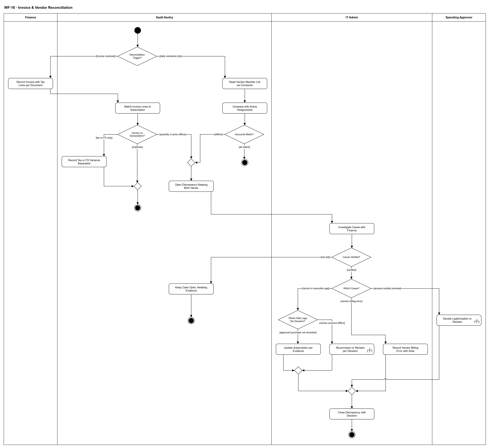

# WF-16 — Invoice & Vendor Reconciliation

> **Loại:** Workflow chi tiết (detail) của MF-8 · **Phiên bản:** 3.6 — 10/10/2026 · **Trạng thái:** Vẽ lại theo QĐ-34a/b, QĐ-49f, QĐ-55a, QĐ-60a/b và BRD v3.31 (đồng bộ QĐ-61 → QĐ-63) FR-2.6, FR-5.4, FR-5.13, FR-7.7; chờ Owner/GVHD review
>
> Sơ đồ là **dẫn xuất** từ quyết định Owner (`QĐ`) và BRD hiện hành; khi khác nhau, `QĐ` → BRD thắng. Quyết định trong sơ đồ là của Owner, **chưa** phải xác nhận của GVHD/hội đồng.

## 1. Mục đích và phạm vi

Đối soát **hai nguồn sự thật**: dữ liệu nhà cung cấp (thực tế) với dữ liệu nội bộ đã qua phê duyệt (ý định). Hai nơi xuất hiện: job đối soát tài khoản qua connector và đối chiếu hóa đơn với thuê bao. Khác biệt thành **hồ sơ sai lệch giữ cả hai giá trị** để người xử lý — hệ thống không tự đồng bộ cho khớp vì như vậy xóa chính bằng chứng.

**Phạm vi:** Ghi hóa đơn kèm dòng thuế theo chứng từ; ghép hóa đơn với thuê bao và ba kết quả so; job connector hằng ngày và hai loại sai lệch tài khoản; điều tra cùng Finance; bốn hướng xử lý (nhà cung cấp tính sai, quyền ngoài quy trình, thuê bao chưa ghi, tài khoản chưa đúng quyết định); đóng hồ sơ bằng quyết định.

**Không nằm trong sơ đồ này:** Ngoại lệ của từng khoản chi trên sao kê và hợp thức hóa (→ WF-17; không phải Discrepancy, QĐ-34a). Chuyển cam kết thành chi phí, phân bổ và báo cáo (→ WF-19). Thực thi cấp/thu hồi (→ WF-09a). Không có thanh toán, tranh chấp, hoàn tiền, sổ cái, kết nối ngân hàng; thuế chỉ ghi nhận, không tính/kê khai (QĐ-34, QĐ-55a).

## 2. Tệp

| Tệp | Vai trò |
| --- | --- |
| [WF-16-invoice-vendor-reconciliation.drawio](WF-16-invoice-vendor-reconciliation.drawio) | Nguồn draw.io chỉnh sửa được (sinh từ spec) |
| [WF-16-invoice-vendor-reconciliation.drawio.png](WF-16-invoice-vendor-reconciliation.drawio.png) | Bản xuất PNG, nhúng sẵn nguồn draw.io |
| [WF-16.json](../specs/WF-16.json) | **Nguồn canonical** — sửa ở đây rồi chạy `python tools/flowkit.py build` từ `Docs/Diagrams` |

## 3. Nguồn nghiệp vụ

| Mã | Nội dung dùng trong sơ đồ |
| --- | --- |
| `FR-2.6, OI-14h` | Job đối soát hằng ngày cho app có connector; hai loại sai lệch; loại *có ở nhà cung cấp* là dấu hiệu cấp quyền ngoài quy trình |
| `FR-7.7 (bảng 5.7.1)` | Không nguồn nào tự ghi đè; không tự tạo Assignment; không tự sửa thuê bao |
| `FR-5.4, QĐ-34b` | Hóa đơn là khoản chi đã ghi nhận; seat chưa gán không phải sai lệch hóa đơn |
| `QĐ-49f` | Nhà cung cấp tính sai: hóa đơn giữ như đã nhận, đóng kèm ghi chú bắt buộc, điều chỉnh bằng hóa đơn mới |
| `FR-5.13, QĐ-55a, QĐ-60a, QĐ-60b` | Dòng thuế đúng chứng từ, cờ được khấu trừ, hồ sơ T1/T2/T3; chênh lệch thuế/tỷ giá không mở Discrepancy |
| `QĐ-34a` | Ngoại lệ khoản chi sao kê tách khỏi Discrepancy |
| `QĐ-15` | Discrepancy ở mức hồ sơ (case-level) |
| `FR-3.4c-1, DQ-06` | Chỉ Người duyệt chi quyết hợp thức hóa |
| `BRD 5.10 dòng *Đối soát nhà cung cấp*, dòng MF-8` | Diễn tiến luồng |

## 4. Tác nhân, kích hoạt, điều kiện

| Làn (tiếng Anh trên hình) | Tác nhân | Trách nhiệm trong sơ đồ |
| --- | --- | --- |
| Finance | Finance (một người) | Ghi hóa đơn và dòng thuế theo chứng từ, đính chứng từ/căn cứ cho việc cập nhật thuê bao, cung cấp chứng từ khi điều tra |
| SaaS-Sentry | SaaS-Sentry | Job đối soát connector, ghép hóa đơn, so, mở hồ sơ sai lệch giữ cả hai giá trị |
| IT Admin | IT Admin | Điều tra cùng Finance, cập nhật thuê bao theo căn cứ (QĐ-62b), ghi nhà cung cấp tính sai, thực thi lại cấp/thu hồi, đóng hồ sơ |
| Spending Approver | Người duyệt chi | Quyết hợp thức hóa khi có quyền cấp ngoài quy trình |

- **Kích hoạt:** Finance nhận hóa đơn của nhà cung cấp, hoặc tới lịch job đối soát với nhà cung cấp (mặc định hằng ngày, cấu hình được — OI-14h).
- **Tiền điều kiện:** Thuê bao và Assignment đã ghi; hồ sơ thuế nhà cung cấp đã khai (FR-5.13); ứng dụng có connector mới tham gia job tài khoản.
- **Hậu điều kiện:** Hóa đơn là thực chi như đã nhận; chênh lệch thuế/tỷ giá được tách riêng; mọi khác biệt còn lại nằm trong hồ sơ sai lệch mở hoặc đã đóng bằng quyết định, cả hai giá trị gốc được giữ.

## 5. Cách đọc ký hiệu

| Ký hiệu | Nghĩa |
| --- | --- |
| Hình tròn đặc | Bắt đầu hoạt động (initial node) |
| Hình chữ nhật bo góc | Hành động (action) của tác nhân ở làn chứa nó |
| Hình chữ nhật bo góc có ký hiệu cây đinh ba ở góc | Gọi workflow con (call behavior) — mã workflow ghi trong nhãn |
| Hình thoi có chữ | Rẽ nhánh; mỗi cạnh ra mang điều kiện trong ngoặc vuông `[...]` |
| Hình thoi nhỏ không chữ | Hợp nhánh (merge) |
| Vòng tròn kép đặc | Kết thúc toàn bộ hoạt động (activity final) |
| Dây có cung nhảy | Hai dây giao nhau nhưng **không** nối với nhau |

Hai cột vào từ quyết định đầu: trái là hóa đơn (Finance → ghép → so), phải là job connector. Hai nguồn gặp nhau ở hình thoi nhỏ trước *Open Discrepancy Keeping Both Values*, rồi đi sang làn IT Admin. Nhánh *record or execution gap* tách tiếp theo phía cần sửa. Mọi đường xử lý hội tụ ở bước đóng hồ sơ bằng quyết định.

## 6. Bảng node

| ID | Loại | Nhãn trên hình | Ý nghĩa | Làn / người thực hiện | Quy tắc |
| --- | --- | --- | --- | --- | --- |
| `st` | Nút bắt đầu | — | — | SaaS-Sentry | — |
| `d_src` | Rẽ nhánh | Reconciliation Trigger? | Hai nguồn khởi động: Finance nhận hóa đơn của nhà cung cấp, hoặc tới lịch job đối soát với nhà cung cấp (mặc định hằng ngày, cấu hình được) cho các ứng dụng có connector. | SaaS-Sentry | `FR-2.6`, `FR-5.4`, `OI-14h` |
| `a_inv` | Hành động | Record Invoice with Tax Lines per Document | Finance nhập hoặc import hóa đơn (số hóa đơn, ngày, nhà cung cấp, số tiền, tiền tệ, tỷ giá tại ngày giao dịch) và ghi từng dòng thuế đúng như chứng từ: loại thuế, tỷ lệ, số tiền, nhà cung cấp thu hay doanh nghiệp nộp thay, được khấu trừ có/không. Cờ mặc định theo hồ sơ thuế của nhà cung cấp (T1 trong nước · T2 nước ngoài, doanh nghiệp nộp thay — mặc định · T3 nước ngoài, thuế đã thu trên chứng từ); Finance sửa theo chứng từ. Hệ thống chỉ ghi nhận, không tính hay kê khai thuế. Chứng từ lưu theo BM-05. | Finance | `FR-5.4`, `FR-5.13`, `FR-5.6`, `QĐ-55a`, `QĐ-60a`, `QĐ-60b`, `BM-05` |
| `a_conn` | Hành động | Read Vendor Member List via Connector | Job đọc danh sách thành viên/tài khoản phía nhà cung cấp qua connector. Ứng dụng không có connector không đi qua job này nên không bao giờ sinh sai lệch giả. | SaaS-Sentry | `FR-2.6`, `OI-14h` |
| `s_match` | Hành động | Match Invoice Lines to Subscription | Ghép từng dòng hóa đơn với thuê bao/phần mềm và kỳ; so số lượng, đơn giá và tổng tiền phải trả ước tính của bản ghi mua. Thuê bao 100 seat so với 80 Assignment là seat chưa gán (G1), không phải sai lệch hóa đơn. | SaaS-Sentry | `FR-5.4`, `ADR-06` |
| `s_cmp` | Hành động | Compare with Active Assignments | So danh sách phía nhà cung cấp với Assignment đang hiệu lực. Lời mời đang chờ chấp nhận chưa phải thành viên đã kích hoạt. | SaaS-Sentry | `FR-2.6`, `FR-7.7`, `QĐ-03` |
| `d_var` | Rẽ nhánh | Invoice vs Subscription? | Kết quả so hóa đơn với thuê bao: khớp · chỉ lệch do thuế, tỷ giá hoặc phí · lệch số lượng hoặc đơn giá. | SaaS-Sentry | `FR-5.4`, `FR-5.13` |
| `d_diff` | Rẽ nhánh | Accounts Match? | Hai loại khác biệt: có trong hệ thống nhưng không có ở nhà cung cấp; có ở nhà cung cấp nhưng không có trong hệ thống (dấu hiệu quyền được cấp ngoài quy trình). | SaaS-Sentry | `FR-2.6`, `FR-7.7` |
| `s_tax` | Hành động | Record Tax or FX Variance Separately | Chênh lệch chỉ do thuế, tỷ giá hoặc phí thẻ: ghi nhận hóa đơn bình thường, tách phần chênh vào chênh lệch thuế/tỷ giá của báo cáo; không mở hồ sơ sai lệch. | SaaS-Sentry | `FR-5.13`, `FR-5.4`, `QĐ-55a` |
| `m_open` | Hợp nhánh | — | — | SaaS-Sentry | — |
| `end_job` | Kết thúc hoạt động | — | Job đối soát không thấy khác biệt; không tạo bản ghi nào. | SaaS-Sentry | — |
| `m_ok` | Hợp nhánh | — | — | SaaS-Sentry | — |
| `s_open` | Hành động | Open Discrepancy Keeping Both Values | Mở hồ sơ sai lệch (case-level) ghi đúng loại: in system not at vendor · at vendor not in system · lệch số lượng/đơn giá hóa đơn. Giữ nguyên cả hai giá trị, không nguồn nào tự ghi đè: không tự tạo/sửa Assignment, không tự sửa thuê bao hay hóa đơn. Hóa đơn lệch vẫn nằm trong thực chi như đã nhận. Ngoại lệ của một khoản chi trên sao kê không phải và không tự sinh Discrepancy (→ WF-17). | SaaS-Sentry | `FR-2.6`, `FR-7.7`, `FR-4.8`, `QĐ-15`, `QĐ-34a`, `QĐ-34b` |
| `end_ok` | Kết thúc hoạt động | — | Hóa đơn là thực chi đã ghi nhận của kỳ, sẵn sàng cho chuyển cam kết và phân bổ (WF-19). | SaaS-Sentry | — |
| `a_invs` | Hành động | Investigate Cause with Finance | IT Admin điều tra nguyên nhân cùng Finance (Finance cung cấp chứng từ, căn cứ mua). Hồ sơ chỉ đóng bằng quyết định, không tự đóng theo thời gian. | IT Admin | `FR-7.7`, `FR-5.4`, `SoD-3` |
| `d_ver` | Rẽ nhánh | Cause Verified? | Đã xác minh được nguyên nhân bằng chứng từ/dữ liệu chưa. Chưa xác minh thì không ép chọn một nguyên nhân: hồ sơ vẫn mở, giữ cả hai giá trị (đồng bộ với UF-14). | IT Admin | `FR-7.7`, `FR-2.6`, `QĐ-15` |
| `s_keep` | Hành động | Keep Case Open, Awaiting Evidence | Chưa xác minh được nguyên nhân: hồ sơ sai lệch vẫn mở, giữ cả hai giá trị, ghi điều đã kiểm và chứng từ còn thiếu. Không tự phân loại nguyên nhân, không tự sửa thuê bao/hóa đơn/Assignment, không tự đóng theo thời gian. Hóa đơn lệch vẫn là thực chi như đã nhận. Khi có chứng từ mới, IT Admin điều tra lại (bắt đầu lại từ bước điều tra). | SaaS-Sentry | `FR-7.7`, `FR-2.6`, `QĐ-34b` |
| `end_open` | Kết thúc hoạt động | — | Hồ sơ còn mở, chờ bằng chứng; không phải kết quả đóng. Hồ sơ chỉ đóng bằng quyết định của người thật. | SaaS-Sentry | — |
| `d_cause` | Rẽ nhánh | Which Cause? | Nguyên nhân đã xác minh thuộc một trong ba nhóm: nhà cung cấp tính sai (chỉ ca hóa đơn) · quyền được cấp ngoài quy trình · bản ghi nội bộ hoặc việc thực thi chưa theo kịp quyết định. | IT Admin | `FR-5.4`, `FR-7.7`, `QĐ-49f` |
| `d_gap` | Rẽ nhánh | Which Side Lags the Decision? | Phân biệt: mua đã duyệt nhưng thuê bao chưa ghi theo căn cứ, hay tài khoản phía nhà cung cấp chưa đúng với Assignment đã quyết (chưa cấp xong hoặc đã mất). | IT Admin | `FR-5.4`, `FR-2.5` |
| `a_berr` | Hành động | Record Vendor Billing Error with Note | Nhà cung cấp tính sai (Finance xác minh và ghi chú): quyết định “nhà cung cấp tính sai” kèm ghi chú xác minh bắt buộc. Hóa đơn vẫn tính như đã nhận; điều chỉnh (nếu có) đến sau bằng hóa đơn mới. Không có quy trình tranh chấp, hoàn tiền hay thanh toán. | IT Admin | `QĐ-49f`, `FR-5.4`, `QĐ-34` |
| `c_leg` | Gọi workflow con | Decide Legitimization or Reclaim | Có tài khoản/quyền ngoài quy trình: chỉ Người duyệt chi quyết hợp thức hóa (hồ sơ BM-07, không duyệt chi lần hai); không duyệt thì IT thu hồi hoặc chuyển người dùng (WF-09a). | Spending Approver | `FR-3.4c-1`, `DQ-06`, `BM-07`, → `WF-17` |
| `a_upd` | Hành động | Update Subscription per Evidence | Mua đã duyệt nhưng thuê bao chưa ghi: **IT Admin** cập nhật thuê bao theo căn cứ (quyết định duyệt chi, chứng từ Finance đính kèm); Finance giữ hóa đơn, dòng thuế và cờ được khấu trừ. Hệ thống không tự sửa (QĐ-62b). | IT Admin | `FR-5.4`, `FR-7.7`, `QĐ-62b` |
| `c_exec` | Gọi workflow con | Re-provision or Reclaim per Decision | Tài khoản phía nhà cung cấp chưa đúng với Assignment đã quyết: IT thực thi lại cấp phát hoặc thu hồi theo quyết định đã có, qua connector hoặc thủ công. Nếu WF-09a trả *đóng thất bại* (QĐ-62i): sai lệch chưa được giải quyết; hồ sơ không tự đóng (chỉ đóng bằng quyết định) và IT mở tác vụ mới. Gói có lưu ý mất dữ liệu: IT Admin ghi xác nhận đã xử lý bàn giao trước khi gỡ ở nhà cung cấp; không chặn sau hạn ngắn (WF-09a `d_dl`, `s_ask`; QĐ-63a). | IT Admin | `FR-2.5`, `FR-2.4`, `QĐ-63a`, → `WF-09a` |
| `m_gap` | Hợp nhánh | — | — | IT Admin | — |
| `m_res` | Hợp nhánh | — | — | IT Admin | — |
| `a_close` | Hành động | Close Discrepancy with Decision | IT Admin đóng hồ sơ sai lệch kèm quyết định và căn cứ; ghi Audit Trail. Không có đóng tự động theo thời gian. Áp cho mọi loại hồ sơ, kể cả sai lệch hóa đơn (QĐ-62b). | IT Admin | `FR-7.7`, `FR-8.3` |
| `end_dis` | Kết thúc hoạt động | — | Sai lệch đã đóng bằng quyết định; cả hai giá trị gốc vẫn được giữ làm bằng chứng. | IT Admin | — |

## 7. Bảng chuyển tiếp

| Từ → tới | Nhãn điều kiện | Điều kiện | Kết quả |
| --- | --- | --- | --- |
| `st` → `d_src` | — | — | Sang Reconciliation Trigger? |
| `d_src` → `a_inv` | `[invoice received]` | Finance nhận hóa đơn của kỳ | Ghi hóa đơn và dòng thuế |
| `d_src` → `a_conn` | `[daily connector job]` | Tới lịch job đối soát (mặc định hằng ngày) | Đọc danh sách phía nhà cung cấp |
| `a_inv` → `s_match` | — | — | Sang Match Invoice Lines to Subscription |
| `a_conn` → `s_cmp` | — | — | Sang Compare with Active Assignments |
| `s_match` → `d_var` | — | — | Sang Invoice vs Subscription? |
| `s_cmp` → `d_diff` | — | — | Sang Accounts Match? |
| `d_var` → `s_tax` | `[tax or FX only]` | Chỉ lệch do thuế, tỷ giá hoặc phí | Ghi nhận, tách chênh lệch |
| `d_var` → `m_ok` | `[matches]` | Hóa đơn khớp thuê bao | Ghi nhận thực chi |
| `d_var` → `m_open` | `[quantity or price differs]` | Lệch số lượng hoặc đơn giá | Mở hồ sơ sai lệch; hóa đơn vẫn là thực chi |
| `d_diff` → `m_open` | `[differs]` | Có tài khoản chỉ ở một phía | Mở hồ sơ sai lệch theo loại |
| `d_diff` → `end_job` | `[all match]` | Hai phía khớp | Không tạo bản ghi |
| `s_tax` → `m_ok` | — | — | Sang — |
| `m_ok` → `end_ok` | — | — | Sang — |
| `m_open` → `s_open` | — | — | Sang Open Discrepancy Keeping Both Values |
| `s_open` → `a_invs` | — | — | Sang Investigate Cause with Finance |
| `a_invs` → `d_ver` | — | — | Sang Cause Verified? |
| `d_ver` → `s_keep` | `[not yet]` | Chưa xác minh được nguyên nhân | Sang Keep Case Open, Awaiting Evidence |
| `d_ver` → `d_cause` | `[verified]` | Đã xác minh nguyên nhân | Sang Which Cause? |
| `s_keep` → `end_open` | — | — | Sang — |
| `d_cause` → `a_berr` | `[vendor billing error]` | Xác minh cho thấy nhà cung cấp tính sai | Ghi quyết định kèm ghi chú bắt buộc |
| `d_cause` → `c_leg` | `[access outside process]` | Có tài khoản ở nhà cung cấp mà không có quyết định cấp | Người duyệt chi quyết hợp thức hóa hoặc IT thu hồi |
| `d_cause` → `d_gap` | `[record or execution gap]` | Bản ghi nội bộ hoặc việc thực thi chưa theo kịp quyết định | Xác định phía cần sửa |
| `d_gap` → `a_upd` | `[approved purchase not recorded]` | Mua đã duyệt nhưng thuê bao chưa ghi | IT Admin cập nhật thuê bao theo căn cứ; Finance đính chứng từ (QĐ-62b) |
| `d_gap` → `c_exec` | `[vendor account differs]` | Tài khoản phía nhà cung cấp khác Assignment đã quyết | IT thực thi lại cấp phát/thu hồi |
| `a_upd` → `m_gap` | — | — | Sang — |
| `c_exec` → `m_gap` | — | — | Sang — |
| `m_gap` → `m_res` | — | — | Sang — |
| `a_berr` → `m_res` | — | — | Sang — |
| `c_leg` → `m_res` | — | — | Sang — |
| `m_res` → `a_close` | — | — | Sang Close Discrepancy with Decision |
| `a_close` → `end_dis` | — | — | Sang — |

Số đếm: **28 node · 32 cạnh · 6 rẽ nhánh**; giao cắt dây: **1**.

## 8. Happy path

1. `st` — —
2. `d_src` — Reconciliation Trigger?: Hai nguồn khởi động: Finance nhận hóa đơn của nhà cung cấp, hoặc tới lịch job đối soát với nhà cung cấp (mặc định hằng ngày, cấu hình được) cho các ứng dụng có connector.
3. `a_inv` — Record Invoice with Tax Lines per Document: Finance nhập hoặc import hóa đơn (số hóa đơn, ngày, nhà cung cấp, số tiền, tiền tệ, tỷ giá tại ngày giao dịch) và ghi từng dòng thuế đúng như chứng từ: loại thuế, tỷ lệ, số tiền, nhà cung cấp thu hay doanh nghiệp nộp thay, được khấu trừ có/không. Cờ mặc định theo hồ sơ thuế của nhà cung cấp (T1 trong nước · T2 nước ngoài, doanh nghiệp nộp thay — mặc định · T3 nước ngoài, thuế đã thu trên chứng từ); Finance sửa theo chứng từ. Hệ thống chỉ ghi nhận, không tính hay kê khai thuế. Chứng từ lưu theo BM-05.
4. `s_match` — Match Invoice Lines to Subscription: Ghép từng dòng hóa đơn với thuê bao/phần mềm và kỳ; so số lượng, đơn giá và tổng tiền phải trả ước tính của bản ghi mua. Thuê bao 100 seat so với 80 Assignment là seat chưa gán (G1), không phải sai lệch hóa đơn.
5. `d_var` — Invoice vs Subscription?: Kết quả so hóa đơn với thuê bao: khớp · chỉ lệch do thuế, tỷ giá hoặc phí · lệch số lượng hoặc đơn giá.
6. `end_ok` — —: Hóa đơn là thực chi đã ghi nhận của kỳ, sẵn sàng cho chuyển cam kết và phân bổ (WF-19).

## 9. Nhánh thay thế / if-else

- **Chỉ lệch do thuế/tỷ giá/phí** — `d_var` → `s_tax` → `m_ok` → `end_ok`. Ghi nhận bình thường, chênh lệch tách riêng; không mở hồ sơ.
- **Job connector không thấy khác biệt** — `st` → `d_src` → `a_conn` → `s_cmp` → `d_diff` → `end_job`. Không tạo bản ghi.

## 10. Nhánh lỗi / từ chối và cách kết thúc

- **Hóa đơn lệch — nhà cung cấp tính sai** — `d_var` → `m_open` → `s_open` → `a_invs` → `d_ver` → `d_cause` → `a_berr` → `m_res` → `a_close` → `end_dis`. Hóa đơn vẫn là thực chi như đã nhận; ghi chú xác minh bắt buộc.
- **Tài khoản có ở nhà cung cấp nhưng không có trong hệ thống** — `d_diff` → `m_open` → `s_open` → `a_invs` → `d_ver` → `d_cause` → `c_leg` → `m_res` → `a_close`. Người duyệt chi quyết hợp thức hóa; không duyệt thì IT thu hồi.
- **Mua đã duyệt nhưng thuê bao chưa ghi** — `d_ver` → `d_cause` → `d_gap` → `a_upd` → `m_gap` → `m_res` → `a_close`. IT Admin cập nhật thuê bao theo căn cứ; Finance đính chứng từ (QĐ-62b).
- **Tài khoản phía nhà cung cấp khác Assignment đã quyết** — `d_ver` → `d_cause` → `d_gap` → `c_exec` → `m_gap` → `m_res` → `a_close`. IT thực thi lại cấp phát hoặc thu hồi qua WF-09a.
- **Chưa xác minh được nguyên nhân** — `s_open` → `a_invs` → `d_ver` → `s_keep` → `end_open`. Hồ sơ vẫn mở, chờ chứng từ; không ép phân loại, không tự sửa hay tự đóng. Có chứng từ mới thì điều tra lại.

## 11. Liên hệ với sơ đồ khác

- Cấp trên: `MF-8` (bước *Investigate Discrepancy with Finance*)
- `WF-17` — hợp thức hóa hoặc thu hồi khi quyền cấp ngoài quy trình; ngoại lệ khoản chi sao kê
- `WF-09a` — thực thi lại cấp phát/thu hồi
- `WF-19` — hóa đơn đã ghi nhận đi vào chuyển cam kết, phân bổ, báo cáo
- User flow: `UF-14`, `UF-19`
- `WF-17` — gọi/chuyển tại node `c_leg`
- `WF-09a` — gọi/chuyển tại node `c_exec`

## 12. Giới hạn và vấn đề còn mở

- (ĐÃ CÓ NGUỒN · DOI-93, QĐ-62b) IT Admin đóng hồ sơ sai lệch kèm quyết định và căn cứ — BRD 5.10 dòng *Đối soát nhà cung cấp* (*IT Admin xử lý*); ca *nhà cung cấp tính sai* kèm ghi chú xác minh của Finance.
- (ĐÃ CÓ NGUỒN · DOI-95) Phân biệt *phía nào chưa theo kịp quyết định* theo nguyên tắc BRD 5.7.1: dữ liệu nội bộ là nguồn về ý định đã được duyệt, nhà cung cấp là nguồn về thực tế quan sát được; sai lệch được xử lý theo quyết định đã có, không nguồn nào tự ghi đè nguồn kia (FR-7.7).
- (DEFERRED/OUT · DOI-07, QĐ-59e) ERD chưa có hồ sơ thuế và dòng thuế có cờ được khấu trừ (`QĐ-60`).
- (DEFERRED/OUT · DOI-11, QĐ-59c) Quyền ghi `Members` của connector GitHub chưa kiểm (`TE-11b`) — job đọc chạy được, thực thi lại cấp phát qua connector chưa kiểm.
