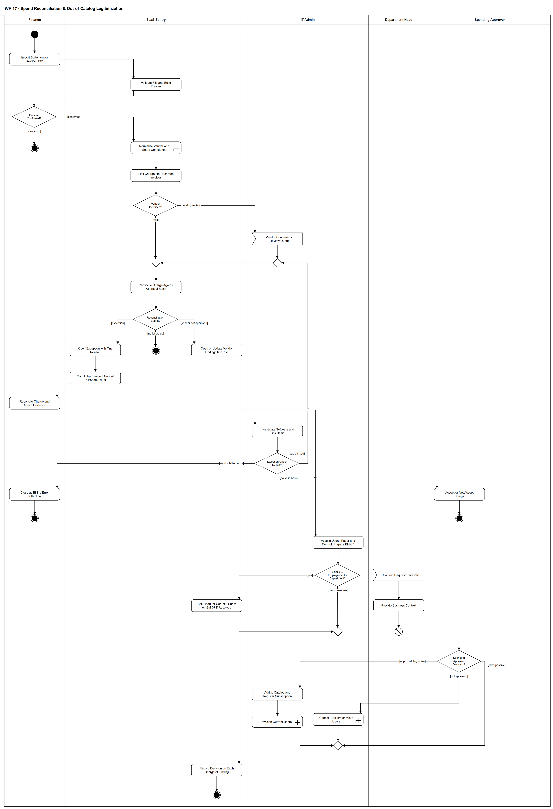

# WF-17 — Spend Reconciliation & Out-of-Catalog Legitimization

> **Loại:** Subflow (luồng con) của MF-8 — tính năng bổ sung *Đối soát chi phí phần mềm* (MF-6 cũ) · **Phiên bản:** 3.4 — 10/10/2026 · **Trạng thái:** Vẽ lại theo QĐ-31a, QĐ-33a/b/c, QĐ-34a/b, QĐ-35a, QĐ-50c, QĐ-58d và BRD v3.31 (đồng bộ QĐ-61 → QĐ-63) FR-6.1→6.9, FR-3.4c-1; chờ Owner/GVHD review
>
> Sơ đồ là **dẫn xuất** từ quyết định Owner (`QĐ`) và BRD hiện hành; khi khác nhau, `QĐ` → BRD thắng. Quyết định trong sơ đồ là của Owner, **chưa** phải xác nhận của GVHD/hội đồng.

## 1. Mục đích và phạm vi

Đối soát **từng khoản chi** trên sao kê/thẻ với hóa đơn đã ghi nhận và căn cứ phê duyệt, để người có thẩm quyền kiểm tra khoản chi chưa có căn cứ, và đưa phần mềm trả phí ngoài danh mục qua quyết định hợp thức hóa của Người duyệt chi. Tên hiển thị: *Đối soát chi phí phần mềm* — tính năng bổ sung (QĐ-33a).

**Phạm vi:** Import CSV có xem trước bắt buộc; chuẩn hóa nhà cung cấp (WF-17a); liên kết hóa đơn đã nhập; trạng thái đối soát từng khoản chi; ngoại lệ do Finance/IT kiểm và chỉ Người duyệt chi chấp nhận; phần chưa có căn cứ vào dòng *Chưa phân bổ Cost Center*; bản ghi phát hiện theo nhà cung cấp, đánh giá, quyết định ba kết cục và thực thi.

**Không nằm trong sơ đồ này:** Nguồn export IdP và bộ thu thập cho phát hiện ngoài danh mục (giai đoạn sau, QĐ-31a — chỉ đặc tả). Log web/proxy/CASB đầy đủ (FR-6.10, mục 5.6.1). Discrepancy của hóa đơn/connector (→ WF-16). Phân bổ và báo cáo kỳ (→ WF-19). Không thanh toán, kết nối ngân hàng, sổ cái; không cam kết phát hiện toàn bộ Shadow IT, công cụ miễn phí hay khoản nhân viên tự trả; không kết luận một người vi phạm.

## 2. Tệp

| Tệp | Vai trò |
| --- | --- |
| [WF-17-spend-reconciliation-out-of-catalog-legitimization.drawio](WF-17-spend-reconciliation-out-of-catalog-legitimization.drawio) | Nguồn draw.io chỉnh sửa được (sinh từ spec) |
| [WF-17-spend-reconciliation-out-of-catalog-legitimization.drawio.png](WF-17-spend-reconciliation-out-of-catalog-legitimization.drawio.png) | Bản xuất PNG, nhúng sẵn nguồn draw.io |
| [WF-17.json](../specs/WF-17.json) | **Nguồn canonical** — sửa ở đây rồi chạy `python tools/flowkit.py build` từ `Docs/Diagrams` |

## 3. Nguồn nghiệp vụ

| Mã | Nội dung dùng trong sơ đồ |
| --- | --- |
| `FR-6.3, QĐ-31a` | Chỉ hiện thực nguồn CSV sao kê/hóa đơn; IdP và bộ thu thập giai đoạn sau |
| `FR-7.1→7.4, QĐ-32c` | Xem trước bắt buộc, lỗi theo dòng, băm tệp; mã hóa và định dạng được nhận |
| `FR-6.3, FR-5.4, QĐ-34b` | Liên kết hóa đơn đã nhập bằng phân bổ số tiền; tự động hoặc hàng đợi review |
| `FR-6.4, QĐ-33b` | Trạng thái đối soát từng khoản chi; ngoại lệ là cần kiểm tra; chỉ Người duyệt chi chấp nhận |
| `QĐ-34a` | Ngoại lệ không phải Discrepancy; lỗi tính tiền đóng kèm ghi chú, không có bước Người duyệt chi |
| `QĐ-35a, FR-3.8` | SLA bước quyết định khoản chi chưa có căn cứ |
| `QĐ-50c, FR-5.2` | Phần chưa có căn cứ ở dòng *Chưa phân bổ Cost Center*, ngoại lệ vẫn mở |
| `FR-6.6→6.9, INV-13, OI-14f, OI-14g, QĐ-33c` | Bản ghi phát hiện theo vendor, mở lại, mức rủi ro là ưu tiên, ba kết cục, lý do bắt buộc, ghi vào từng khoản chi |
| `FR-3.4c-1, DQ-06, QĐ-58d, BM-07` | Hợp thức hóa là quyết định nhánh (c) của Người duyệt chi; mức kiểm soát chỉ là đầu vào; WF-09 chỉ cấp quyền |
| `BRD 5.10 dòng *Shadow IT*` | Diễn tiến luồng |

## 4. Tác nhân, kích hoạt, điều kiện

| Làn (tiếng Anh trên hình) | Tác nhân | Trách nhiệm trong sơ đồ |
| --- | --- | --- |
| Finance | Finance (một người) | Import CSV, xác nhận xem trước, đối soát và đính kèm chứng từ, đóng mục lỗi tính tiền |
| SaaS-Sentry | SaaS-Sentry | Kiểm tệp, liên kết hóa đơn, đối soát với căn cứ, mở ngoại lệ, tính phần chưa giải thích, mở/cập nhật bản ghi phát hiện, ghi quyết định vào từng khoản chi |
| IT Admin | IT Admin | Xác nhận nhà cung cấp, điều tra phần mềm và liên kết căn cứ, đánh giá và lập BM-07, thực thi kết quả |
| Department Head | Trưởng phòng | Cung cấp bối cảnh nghiệp vụ, không quyết |
| Spending Approver | Người duyệt chi | Chấp nhận/không chấp nhận khoản chi; quyết báo nhầm / không duyệt / hợp thức hóa |

- **Kích hoạt:** Finance có tệp CSV sao kê/thẻ hoặc danh sách hóa đơn chi phí của kỳ (gọi từ MF-8, bước *Reconcile Statement Charges*).
- **Tiền điều kiện:** Danh mục, subscription/hợp đồng, yêu cầu đã duyệt và khoản cam kết, hóa đơn Finance đã nhập; từ điển nhà cung cấp dùng chung.
- **Hậu điều kiện:** Mỗi khoản chi có đúng một trạng thái đối soát; ngoại lệ đang mở hoặc đã có quyết định của Người duyệt chi; phần chưa có căn cứ nằm ở dòng *Chưa phân bổ Cost Center*; mỗi nhà cung cấp chưa duyệt có tối đa một bản ghi phát hiện đang mở hoặc đã đóng bằng quyết định.

## 5. Cách đọc ký hiệu

| Ký hiệu | Nghĩa |
| --- | --- |
| Hình tròn đặc | Bắt đầu hoạt động (initial node) |
| Hình chữ nhật bo góc | Hành động (action) của tác nhân ở làn chứa nó |
| Hình chữ nhật bo góc có ký hiệu cây đinh ba ở góc | Gọi workflow con (call behavior) — mã workflow ghi trong nhãn |
| Hình thoi có chữ | Rẽ nhánh; mỗi cạnh ra mang điều kiện trong ngoặc vuông `[...]` |
| Hình thoi nhỏ không chữ | Hợp nhánh (merge) |
| Hình năm cạnh lõm | Chờ một sự kiện từ bên ngoài luồng (accept event) |
| Vòng tròn kép đặc | Kết thúc toàn bộ hoạt động (activity final) |
| Vòng tròn có dấu nhân | Kết thúc riêng nhánh đó, các nhánh khác vẫn chạy (flow final) |
| Dây có cung nhảy | Hai dây giao nhau nhưng **không** nối với nhau |

Phần trên là nhập và đối soát từng khoản chi. Sau *Reconciliation Status?* có ba nhánh: trái — ngoại lệ (Finance, IT, Người duyệt chi); giữa — không cần xử lý; phải — bản ghi phát hiện, tách song song cho IT đánh giá và trưởng phòng cung cấp bối cảnh, rồi Người duyệt chi quyết. Hai vòng quay về *Reconcile Charge Against Approval Basis*: khi IT xác nhận nhà cung cấp trong hàng đợi review, và khi đã liên kết được căn cứ — cả hai chỉ đối soát lại đúng khoản chi đó. Ngoại lệ biểu diễn: luồng phụ bắt đầu bằng sự kiện không có cạnh vào là một lần xử lý độc lập, kết thúc nhánh chính không hủy chúng — cách đọc nội bộ đã ghi ở [tools/README.md mục 7](../tools/README.md#7-ngoại-lệ-biểu-diễn-đã-chấp-nhận-ghi-10102026), không phải bằng chứng hình tuân thủ đầy đủ UML 2.5.

## 6. Bảng node

| ID | Loại | Nhãn trên hình | Ý nghĩa | Làn / người thực hiện | Quy tắc |
| --- | --- | --- | --- | --- | --- |
| `st` | Nút bắt đầu | — | — | Finance | — |
| `a_imp` | Hành động | Import Statement or Invoice CSV | Finance tải tệp CSV sao kê/thẻ hoặc danh sách hóa đơn chi phí — nguồn bằng chứng duy nhất được hiện thực đợt này. Mẫu CSV chuẩn SaaS-Sentry hoặc mẫu cấu hình theo ngân hàng; UTF-8 hoặc UTF-16 có BOM. Export IdP và bộ thu thập cho phát hiện ngoài danh mục chỉ giữ đặc tả, giai đoạn sau. | Finance | `FR-6.3`, `QĐ-31a`, `QĐ-32c`, `QĐ-33a`, `FR-7.1` |
| `s_prev` | Hành động | Validate File and Build Preview | Kiểm tệp: mã hóa khác, XLSX, PDF bị từ chối cả tệp, không đoán; băm nội dung để cảnh báo tệp đã import. Xem trước bắt buộc: số dòng hợp lệ, dòng lỗi kèm lý do (lỗi một dòng không hỏng cả tệp), dòng đã có sẽ bỏ qua. Tái nhập cùng dữ liệu không thêm dòng, không mở ngoại lệ mới. | SaaS-Sentry | `FR-7.2`, `FR-7.3`, `FR-7.4`, `FR-6.3`, `QĐ-33b` |
| `d_prev` | Rẽ nhánh | Preview Confirmed? | Finance xem bản xem trước và xác nhận ghi, hoặc hủy lô. | Finance | `FR-7.2` |
| `end_cancel` | Kết thúc hoạt động | — | Lô bị hủy ở bước xem trước; không ghi dữ liệu nào. | Finance | — |
| `c_norm` | Gọi workflow con | Normalize Vendor and Score Confidence | Chuẩn hóa mô tả giao dịch thành dòng dịch vụ của nhà cung cấp, mức tin cậy theo phương pháp khớp; ca mơ hồ vào hàng đợi review của IT Admin. | SaaS-Sentry | `FR-6.4`, `FR-6.5`, `QĐ-31d`, → `WF-17a` |
| `s_link` | Hành động | Link Charges to Recorded Invoices | Đối chiếu với hóa đơn Finance đã nhập bằng phân bổ số tiền: tự động khi số tham chiếu là số hóa đơn, hoặc cùng nhà cung cấp + tiền tệ + số tiền còn lại của hóa đơn + ngày lệch ≤ 3 và duy nhất; nhiều hóa đơn cùng có thể khớp ⟹ hàng đợi review, không chọn giúp. Khác tiền tệ chỉ liên kết tay toàn hóa đơn kèm ghi chú. Không tạo khoản chi thứ hai, không đếm tiền hai lần. | SaaS-Sentry | `FR-6.3`, `FR-5.4`, `QĐ-34b` |
| `d_id` | Rẽ nhánh | Vendor Identified? | Dòng đã có nhà cung cấp chuẩn hóa, hay còn nằm trong hàng đợi review (trạng thái *chưa nhận diện vendor*). | SaaS-Sentry | `QĐ-33b`, `FR-6.6` |
| `e_conf` | Chờ sự kiện | Vendor Confirmed in Review Queue | Chờ IT Admin xác nhận nhà cung cấp trong hàng đợi review (WF-17a); khi đó hệ thống đối soát lại chỉ dòng đó. Trong lúc chờ — hoặc nếu IT đóng mục là không nhận diện được — khoản chi vẫn nằm trong mẫu số KPI-1 như chi chưa phân loại. | IT Admin | `QĐ-33b`, `FR-6.6`, `KPI-1` |
| `m_it` | Hợp nhánh | — | — | IT Admin | — |
| `m_rec` | Hợp nhánh | — | — | SaaS-Sentry | — |
| `s_rec` | Hành động | Reconcile Charge Against Approval Basis | So khoản chi với căn cứ phê duyệt (subscription/hợp đồng: số tiền theo kỳ, thời hạn · yêu cầu đã duyệt có khoản cam kết · quyết định chi của Người duyệt chi), lũy kế trong kỳ, so với tổng tiền phải trả ước tính; chênh do thuế, tỷ giá, phí tách riêng. Không suy *vendor đã duyệt ⟹ mọi khoản được phép*, *đã duyệt ⟹ đã thanh toán*, *không thấy căn cứ ⟹ chi trái phép*, *người giữ thẻ ⟹ người mua/người dùng*. | SaaS-Sentry | `FR-6.4`, `QĐ-33b`, `FR-5.13` |
| `d_stat` | Rẽ nhánh | Reconciliation Status? | Mỗi khoản chi nhận đúng một trạng thái: khớp căn cứ · đã ghi nhận · hoàn tiền/điều chỉnh · không phải phần mềm (không cần xử lý) · ngoại lệ · vendor chưa được duyệt. | SaaS-Sentry | `FR-6.4`, `QĐ-33b`, `QĐ-33c` |
| `s_exc` | Hành động | Open Exception with One Reason | Ngoại lệ là *cần kiểm tra*, không phải vi phạm. Lý do: không có căn cứ · ngoài thời hạn · vượt số tiền được duyệt (lũy kế trong kỳ, gồm trùng tính tiền) · nhiều căn cứ cùng khớp (liệt kê, không chọn giúp) · khác tiền tệ (không quy đổi) · căn cứ thiếu dữ liệu. Ngoại lệ không phải và không tự sinh Discrepancy; nếu khoản chi gắn hóa đơn đang có Discrepancy mở thì chỉ hiển thị hồ sơ đó. | SaaS-Sentry | `FR-6.4`, `QĐ-33b`, `QĐ-34a` |
| `end_ok` | Kết thúc hoạt động | — | Khoản chi đã có trạng thái không cần xử lý: khớp căn cứ, đã ghi nhận (liên kết hóa đơn), hoặc hoàn tiền/không phải phần mềm — hoàn tiền (số âm) chỉ là bối cảnh. | SaaS-Sentry | — |
| `s_find` | Hành động | Open or Update Vendor Finding; Tier Risk | Mỗi nhà cung cấp chỉ có một bản ghi phát hiện đang mở, chỉ gom các khoản *vendor chưa được duyệt*; xuất hiện lại thì cập nhật lần thấy gần nhất và số lần. Đã đóng *báo nhầm* mà xuất hiện lại ⟹ mở lại; đã đóng *không duyệt* mà bằng chứng xuất hiện lại ⟹ mở lại chính bản ghi đó với cờ tái xuất hiện và nâng mức rủi ro; đã *hợp thức hóa* không mở lại. Mức rủi ro (nhạy cảm dữ liệu, số nhân viên, SSO — lấy từ hồ sơ IT ghi) chỉ là mức ưu tiên xem xét, không phải bằng chứng vi phạm. | SaaS-Sentry | `FR-6.6`, `FR-6.7`, `FR-6.8`, `INV-13`, `OI-14f`, `QĐ-33c` |
| `s_unal` | Hành động | Count Unexplained Amount in Period Actual | Phần khoản chi không được hóa đơn nào giải thích vẫn là thực chi của kỳ, không đếm hai lần. Có căn cứ ⟹ theo căn cứ; chưa có căn cứ ⟹ dòng *Chưa phân bổ Cost Center* trong thực chi của kỳ (WF-19), không ép vào Cost Center nào; ngoại lệ vẫn mở. | SaaS-Sentry | `QĐ-50c`, `FR-5.2`, `FR-5.4` |
| `a_fin` | Hành động | Reconcile Charge and Attach Evidence | Finance đối soát khoản chi, đính kèm chứng từ; có thể đánh dấu *lỗi tính tiền của nhà cung cấp*. Finance không quyết chấp nhận khoản chi. | Finance | `QĐ-33b`, `SoD-3`, `BM-05` |
| `a_itx` | Hành động | Investigate Software and Link Basis | IT Admin điều tra phần mềm đứng sau khoản chi và liên kết căn cứ nếu tìm thấy. Liên kết căn cứ không che được phần vượt số tiền được duyệt. | IT Admin | `QĐ-33b`, `FR-6.9` |
| `d_exr` | Rẽ nhánh | Exception Check Result? | Kết quả kiểm tra chung của Finance và IT: đã liên kết căn cứ (đối soát lại) · nhà cung cấp tính sai · vẫn không có căn cứ hợp lệ, chuyển Người duyệt chi. | IT Admin | `QĐ-33b`, `QĐ-34a` |
| `a_berr` | Hành động | Close as Billing Error with Note | Finance đóng mục ngoại lệ *lỗi tính tiền* với ghi chú bắt buộc và tự theo dõi với nhà cung cấp; không tạo Discrepancy, không có bước quyết của Người duyệt chi. | Finance | `QĐ-34a`, `FR-2.6` |
| `a_sach` | Hành động | Accept or Not Accept Charge | Chỉ Người duyệt chi chấp nhận hoặc không chấp nhận khoản chi. SLA như bước duyệt chi (mặc định 2 ngày làm việc), đồng hồ bắt đầu khi mục được chuyển, không dừng khi hỏi Finance, không tự quyết khi quá hạn. Người duyệt chi là người giữ thẻ/người thụ hưởng ⟹ người thay thế cấu hình trước. Kết cục chỉ tạo nhiệm vụ cho người — không tự thu hồi, không tự đăng ký subscription, không tự đòi tiền. | Spending Approver | `FR-3.4c-1`, `FR-3.8`, `QĐ-35a`, `SoD-7`, `QĐ-33b` |
| `end_ber` | Kết thúc hoạt động | — | Mục ngoại lệ đóng *lỗi tính tiền*; điều chỉnh (nếu có) đến sau bằng chứng từ mới. | Finance | — |
| `end_ch` | Kết thúc hoạt động | — | Khoản chi có quyết định của Người duyệt chi, ghi Audit Trail; nhiệm vụ tiếp theo (nếu có) giao cho người. | Spending Approver | — |
| `a_it` | Hành động | Assess Users, Payer and Control; Prepare BM-07 | IT Admin xem bằng chứng, xác minh ai dùng và ai trả, gán người chịu trách nhiệm, đánh giá kỹ thuật, rủi ro và mức kiểm soát — chỉ là đầu vào; cổng *không kiểm soát được* không áp cho hợp thức hóa. Lập hồ sơ BM-07 (bằng chứng, người dùng, người trả, đánh giá, ý kiến Business Owner nếu trùng chức năng, chứng từ khoản đã chi). | IT Admin | `FR-6.9`, `FR-3.4c-1`, `QĐ-58d`, `BM-07` |
| `d_dept` | Rẽ nhánh | Linked to Employees of a Department? | Khoản chi gắn được với nhân viên của một phòng không (không suy *người giữ thẻ ⟹ người dùng*, FR-6.4). Có ⟹ hỏi bối cảnh; nếu phòng đó chưa có trưởng phòng thì yêu cầu bối cảnh **treo, không giao ai** và chuyển cho trưởng phòng mới khi được bổ nhiệm (QĐ-62c). Không gắn được phòng ⟹ không hỏi ai. | IT Admin | `FR-6.9`, `FR-6.4`, `QĐ-62d`, `QĐ-62c` |
| `s_ask` | Hành động | Ask Head for Context; Show on BM-07 if Received | Hệ thống gửi yêu cầu bối cảnh cho trưởng phòng và nhắc; phòng chưa có trưởng phòng thì yêu cầu treo, chuyển cho trưởng phòng mới (QĐ-62c). Câu trả lời (nếu có) hiện trên BM-07. **Không chặn**: Người duyệt chi quyết được khi chưa có (QĐ-62d). | SaaS-Sentry | `FR-6.9`, `QĐ-62d` |
| `m_ctx` | Hợp nhánh | — | — | IT Admin | — |
| `e_ctx` | Chờ sự kiện | Context Request Received | Luồng phụ: trưởng phòng nhận yêu cầu bối cảnh của một bản ghi phát hiện liên quan tới nhân viên phòng mình. | Department Head | `FR-6.9` |
| `a_dh` | Hành động | Provide Business Context | Trưởng phòng cho biết nhu cầu nghiệp vụ đứng sau công cụ; câu trả lời hiện trên BM-07. Không quyết định và không chặn bước quyết định (QĐ-62d). | Department Head | `FR-6.9`, `QĐ-62d` |
| `ff_ctx` | Kết thúc nhánh (flow final) | — | Luồng phụ kết thúc; bối cảnh đã gắn vào hồ sơ — nếu đến sau quyết định thì chỉ lưu kèm. | Department Head | — |
| `d_out` | Rẽ nhánh | Spending Approver Decision? | Chỉ Người duyệt chi quyết một trong ba kết cục trên hồ sơ BM-07: báo nhầm · không duyệt · duyệt hợp thức hóa. Báo nhầm và không duyệt bắt buộc có lý do. Hợp thức hóa là kết cục bình thường, tích cực. Finance và Super Admin không là người duyệt ở đường này. Quyết được khi chưa có bối cảnh của trưởng phòng (QĐ-62d). | Spending Approver | `FR-3.4c-1`, `FR-6.9`, `OI-14g`, `DQ-06`, `BM-07` |
| `a_cat` | Hành động | Add to Catalog and Register Subscription | Duyệt hợp thức hóa: IT Admin đưa ứng dụng vào danh mục (chỉ sau quyết định) và ghi thuê bao theo chứng từ đã có. Người duyệt chi nêu số seat khi hợp thức hóa; ít hơn số người đang dùng thì chọn người được giữ, người còn lại đi đường không duyệt (`QĐ-66af`). | IT Admin | `DQ-06`, `LR-02`, `BM-07` |
| `c_prov` | Gọi workflow con | Provision Current Users | Gọi WF-09 chỉ phần cấp quyền cho người đang dùng — không duyệt chi lần thứ hai. | IT Admin | `FR-3.4c-1`, `DQ-06`, → `WF-09` |
| `c_recl` | Gọi workflow con | Cancel, Reclaim or Move Users | Không duyệt: IT hủy gói, thu hồi quyền, hoặc chuyển người dùng sang công cụ đã có trong danh mục. Nếu một tác vụ thu hồi bị IT đóng là thất bại (WF-09a, QĐ-62i): quyền còn hiệu lực, vẫn hiện G2 và IT mở tác vụ mới; quyết định *không duyệt* của Người duyệt chi vẫn giữ nguyên. Gói có lưu ý mất dữ liệu: IT Admin ghi xác nhận đã xử lý bàn giao trước khi gỡ ở nhà cung cấp; không chặn sau hạn ngắn (WF-09a `d_dl`, `s_ask`; QĐ-63a). IT Admin ghi *lưu ý trước khi thu hồi* trong phần đánh giá của BM-07 để dùng cho xác nhận bàn giao (`QĐ-66ah`); *chuyển sang công cụ đã có* là biến thể của *không duyệt* (`QĐ-66ai`). | IT Admin | `FR-3.4c-1`, `BM-07`, `FR-6.9`, `QĐ-63a`, → `WF-09a` |
| `m_out` | Hợp nhánh | — | — | IT Admin | — |
| `s_drec` | Hành động | Record Decision on Each Charge of Finding | Quyết định trên bản ghi nhà cung cấp được ghi vào từng khoản chi của bản ghi; không khoản nào bị gộp mất hay đóng hàng loạt. Ghi Audit Trail. Báo nhầm/không duyệt có thể mở lại theo FR-6.7. | SaaS-Sentry | `QĐ-33c`, `FR-6.7`, `FR-6.9` |
| `end_find` | Kết thúc hoạt động | — | Bản ghi phát hiện đã đóng bằng quyết định của Người duyệt chi; IT đã thực thi kết quả. | SaaS-Sentry | — |

## 7. Bảng chuyển tiếp

| Từ → tới | Nhãn điều kiện | Điều kiện | Kết quả |
| --- | --- | --- | --- |
| `st` → `a_imp` | — | — | Sang Import Statement or Invoice CSV |
| `a_imp` → `s_prev` | — | — | Sang Validate File and Build Preview |
| `s_prev` → `d_prev` | — | — | Sang Preview Confirmed? |
| `d_prev` → `end_cancel` | `[cancelled]` | Finance hủy lô | Không ghi gì |
| `d_prev` → `c_norm` | `[confirmed]` | Finance xác nhận ghi | Ghi lô và chuẩn hóa nhà cung cấp |
| `c_norm` → `s_link` | — | — | Sang Link Charges to Recorded Invoices |
| `s_link` → `d_id` | — | — | Sang Vendor Identified? |
| `d_id` → `m_rec` | `[yes]` | Có nhà cung cấp chuẩn hóa | Đối soát với căn cứ |
| `d_id` → `e_conf` | `[pending review]` | Còn trong hàng đợi review | Chờ IT xác nhận |
| `e_conf` → `m_it` | — | — | Sang — |
| `m_it` → `m_rec` | — | — | Sang — |
| `m_rec` → `s_rec` | — | — | Sang Reconcile Charge Against Approval Basis |
| `s_rec` → `d_stat` | — | — | Sang Reconciliation Status? |
| `d_stat` → `end_ok` | `[no follow-up]` | Khớp căn cứ, đã ghi nhận, hoàn tiền/điều chỉnh hoặc không phải phần mềm | Ghi trạng thái, không tạo việc |
| `d_stat` → `s_exc` | `[exception]` | Vendor đã duyệt nhưng khoản chi không khớp căn cứ | Mở mục ngoại lệ |
| `d_stat` → `s_find` | `[vendor not approved]` | Vendor ngoài danh mục, không có căn cứ nào | Bản ghi phát hiện theo vendor |
| `s_find` → `a_it` | — | — | Sang Assess Users, Payer and Control; Prepare BM-07 |
| `a_it` → `d_dept` | — | — | Sang Linked to Employees of a Department? |
| `d_dept` → `s_ask` | `[yes]` | Gắn được với nhân viên của một phòng | Hỏi bối cảnh (phòng chưa có trưởng phòng thì yêu cầu treo), không chờ |
| `d_dept` → `m_ctx` | `[no or unknown]` | Không gắn được với phòng nào | Không hỏi ai |
| `s_ask` → `m_ctx` | — | — | Sang — |
| `m_ctx` → `d_out` | — | — | Sang Spending Approver Decision? |
| `e_ctx` → `a_dh` | — | — | Sang Provide Business Context |
| `a_dh` → `ff_ctx` | — | — | Sang — |
| `s_exc` → `s_unal` | — | — | Sang Count Unexplained Amount in Period Actual |
| `s_unal` → `a_fin` | — | — | Sang Reconcile Charge and Attach Evidence |
| `a_fin` → `a_itx` | — | — | Sang Investigate Software and Link Basis |
| `a_itx` → `d_exr` | — | — | Sang Exception Check Result? |
| `d_exr` → `m_it` | `[basis linked]` | IT/Finance liên kết được căn cứ | Đối soát lại chỉ khoản chi đó |
| `d_exr` → `a_berr` | `[vendor billing error]` | Finance xác định nhà cung cấp tính sai | Đóng mục kèm ghi chú bắt buộc |
| `d_exr` → `a_sach` | `[no valid basis]` | Vẫn chưa có căn cứ hợp lệ | Chuyển Người duyệt chi; đồng hồ SLA bắt đầu |
| `a_berr` → `end_ber` | — | — | Sang — |
| `a_sach` → `end_ch` | — | — | Sang — |
| `d_out` → `a_cat` | `[approved, legitimize]` | Duyệt hợp thức hóa | Đưa vào danh mục, cấp quyền người đang dùng |
| `d_out` → `c_recl` | `[not approved]` | Không duyệt, có lý do | IT hủy gói, thu hồi hoặc chuyển người dùng |
| `d_out` → `m_out` | `[false positive]` | Báo nhầm, có lý do | Đóng; mở lại nếu xuất hiện lại |
| `a_cat` → `c_prov` | — | — | Sang Provision Current Users |
| `c_prov` → `m_out` | — | — | Sang — |
| `c_recl` → `m_out` | — | — | Sang — |
| `m_out` → `s_drec` | — | — | Sang Record Decision on Each Charge of Finding |
| `s_drec` → `end_find` | — | — | Sang — |

Số đếm: **38 node · 41 cạnh · 6 rẽ nhánh**; giao cắt dây: **2**.

## 8. Happy path

1. `st` — —
2. `a_imp` — Import Statement or Invoice CSV: Finance tải tệp CSV sao kê/thẻ hoặc danh sách hóa đơn chi phí — nguồn bằng chứng duy nhất được hiện thực đợt này. Mẫu CSV chuẩn SaaS-Sentry hoặc mẫu cấu hình theo ngân hàng; UTF-8 hoặc UTF-16 có BOM. Export IdP và bộ thu thập cho phát hiện ngoài danh mục chỉ giữ đặc tả, giai đoạn sau.
3. `s_prev` — Validate File and Build Preview: Kiểm tệp: mã hóa khác, XLSX, PDF bị từ chối cả tệp, không đoán; băm nội dung để cảnh báo tệp đã import. Xem trước bắt buộc: số dòng hợp lệ, dòng lỗi kèm lý do (lỗi một dòng không hỏng cả tệp), dòng đã có sẽ bỏ qua. Tái nhập cùng dữ liệu không thêm dòng, không mở ngoại lệ mới.
4. `d_prev` — Preview Confirmed?: Finance xem bản xem trước và xác nhận ghi, hoặc hủy lô.
5. `c_norm` — Normalize Vendor and Score Confidence: Chuẩn hóa mô tả giao dịch thành dòng dịch vụ của nhà cung cấp, mức tin cậy theo phương pháp khớp; ca mơ hồ vào hàng đợi review của IT Admin.
6. `s_link` — Link Charges to Recorded Invoices: Đối chiếu với hóa đơn Finance đã nhập bằng phân bổ số tiền: tự động khi số tham chiếu là số hóa đơn, hoặc cùng nhà cung cấp + tiền tệ + số tiền còn lại của hóa đơn + ngày lệch ≤ 3 và duy nhất; nhiều hóa đơn cùng có thể khớp ⟹ hàng đợi review, không chọn giúp. Khác tiền tệ chỉ liên kết tay toàn hóa đơn kèm ghi chú. Không tạo khoản chi thứ hai, không đếm tiền hai lần.
7. `d_id` — Vendor Identified?: Dòng đã có nhà cung cấp chuẩn hóa, hay còn nằm trong hàng đợi review (trạng thái *chưa nhận diện vendor*).
8. `s_rec` — Reconcile Charge Against Approval Basis: So khoản chi với căn cứ phê duyệt (subscription/hợp đồng: số tiền theo kỳ, thời hạn · yêu cầu đã duyệt có khoản cam kết · quyết định chi của Người duyệt chi), lũy kế trong kỳ, so với tổng tiền phải trả ước tính; chênh do thuế, tỷ giá, phí tách riêng. Không suy *vendor đã duyệt ⟹ mọi khoản được phép*, *đã duyệt ⟹ đã thanh toán*, *không thấy căn cứ ⟹ chi trái phép*, *người giữ thẻ ⟹ người mua/người dùng*.
9. `d_stat` — Reconciliation Status?: Mỗi khoản chi nhận đúng một trạng thái: khớp căn cứ · đã ghi nhận · hoàn tiền/điều chỉnh · không phải phần mềm (không cần xử lý) · ngoại lệ · vendor chưa được duyệt.
10. `end_ok` — —: Khoản chi đã có trạng thái không cần xử lý: khớp căn cứ, đã ghi nhận (liên kết hóa đơn), hoặc hoàn tiền/không phải phần mềm — hoàn tiền (số âm) chỉ là bối cảnh.

## 9. Nhánh thay thế / if-else

- **Nhà cung cấp còn trong hàng đợi review** — `d_id` → `e_conf` → `m_it` → `m_rec` → `s_rec`. Đối soát lại chỉ dòng đó sau khi IT xác nhận.
- **Vendor chưa duyệt — hợp thức hóa** — `d_stat` → `s_find` → `a_it` → `d_dept` → `s_ask` → `m_ctx` → `d_out` → `a_cat` → `c_prov` → `m_out` → `s_drec` → `end_find`. Không duyệt chi lần hai; WF-09 chỉ cấp quyền.
- **Vendor chưa duyệt — báo nhầm** — `d_out` → `m_out` → `s_drec` → `end_find`. Lý do bắt buộc; mở lại nếu xuất hiện lại.
- **Khoản chi không gắn được với phòng nào** — `a_it` → `d_dept` → `m_ctx` → `d_out`. Không hỏi trưởng phòng; Người duyệt chi quyết trên hồ sơ BM-07 (QĐ-62d).
- **Luồng phụ: trưởng phòng gửi bối cảnh** — `e_ctx` → `a_dh` → `ff_ctx`. Không chặn quyết định; có thì hiện trên BM-07.

## 10. Nhánh lỗi / từ chối và cách kết thúc

- **Ngoại lệ — liên kết được căn cứ** — `d_stat` → `s_exc` → `s_unal` → `a_fin` → `a_itx` → `d_exr` → `m_it` → `m_rec` → `s_rec`. Liên kết căn cứ không che được phần vượt.
- **Ngoại lệ — nhà cung cấp tính sai** — `d_exr` → `a_berr` → `end_ber`. Không tạo Discrepancy, không có bước Người duyệt chi.
- **Ngoại lệ — chuyển Người duyệt chi** — `d_exr` → `a_sach` → `end_ch`. Chỉ Người duyệt chi chấp nhận/không chấp nhận; trong lúc mở, phần chưa căn cứ ở dòng Chưa phân bổ Cost Center.
- **Vendor chưa duyệt — không duyệt** — `d_out` → `c_recl` → `m_out` → `s_drec` → `end_find`. Lý do bắt buộc; bằng chứng xuất hiện lại thì mở lại có cờ.
- **Hủy lô ở bước xem trước** — `d_prev` → `end_cancel`. Không ghi dữ liệu.

## 11. Liên hệ với sơ đồ khác

- Cấp trên: `MF-8` (bước *Reconcile Statement Charges*); `WF-16` gọi khi có quyền cấp ngoài quy trình
- `WF-17a` — chuẩn hóa nhà cung cấp và hàng đợi review
- `WF-09` — chỉ phần cấp quyền sau hợp thức hóa; `WF-09a` — thu hồi/chuyển hướng
- `WF-19` — dòng *Chưa phân bổ Cost Center* trong thực chi của kỳ
- User flow: `UF-12`, `UF-15`
- `WF-17a` — gọi/chuyển tại node `c_norm`
- `WF-09` — gọi/chuyển tại node `c_prov`
- `WF-09a` — gọi/chuyển tại node `c_recl`

## 12. Giới hạn và vấn đề còn mở

- (ĐÃ CHỐT · DOI-97, DOI-98, QĐ-62d, QĐ-62c) Bối cảnh của trưởng phòng chỉ hỏi khi khoản chi gắn được với nhân viên một phòng (FR-6.9) và không chặn quyết định; phòng chưa có trưởng phòng thì yêu cầu treo, chuyển cho trưởng phòng mới.
- (LATER-TECH/UI · DOI-99) Thực thi *đăng ký thuê bao* sau hợp thức hóa: BM-07 ghi *tạo thuê bao*; bản vẽ để IT Admin ghi trong cùng bước, chi tiết màn hình chốt ở giai đoạn UI.
- (LIMIT · DOI-08, QĐ-32c) Không có dữ liệu ngân hàng thật để kiểm mẫu CSV theo ngân hàng.
