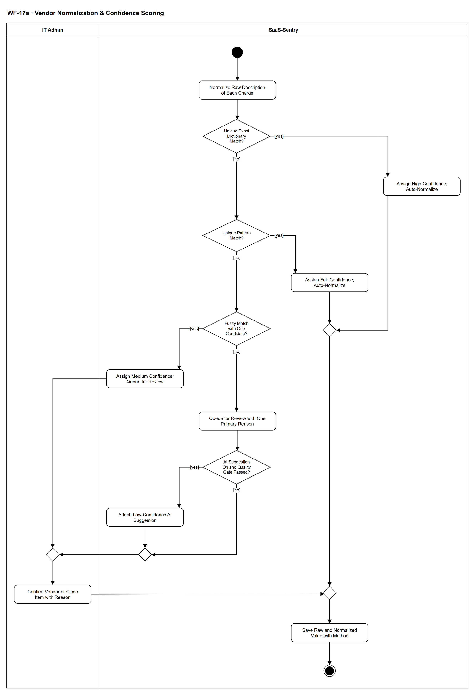

# WF-17a — Vendor Normalization & Confidence Scoring

> **Loại:** Subflow (luồng con) của MF-8 — gọi từ WF-17 (tính năng bổ sung *Đối soát chi phí phần mềm*) · **Phiên bản:** 1.2 — 09/10/2026 · **Trạng thái:** Vẽ lại theo QĐ-31d, QĐ-32a/b/c, QĐ-37, QĐ-38 và BRD v3.30 (đồng bộ QĐ-61/QĐ-62) FR-6.2/6.4/6.5/6.6; chờ Owner/GVHD review
>
> Sơ đồ là **dẫn xuất** từ quyết định Owner (`QĐ`) và BRD hiện hành; khi khác nhau, `QĐ` → BRD thắng. Quyết định trong sơ đồ là của Owner, **chưa** phải xác nhận của GVHD/hội đồng.

## 1. Mục đích và phạm vi

Chuẩn hóa mô tả giao dịch thô trên sao kê thành **một dòng dịch vụ** của nhà cung cấp, gán mức tin cậy **suy ra từ phương pháp khớp** (không lấy điểm số model tự khai) và đưa ca mơ hồ vào hàng đợi review do IT Admin xác nhận.

**Phạm vi:** Một dòng giao dịch sao kê CSV: bốn phương pháp khớp (từ điển chính xác, mẫu, mờ, gợi ý AI), hàng đợi review với một lý do chính, bước người xác nhận, lưu giá trị thô và chuẩn hóa.

**Không nằm trong sơ đồ này:** Liên kết hóa đơn, trạng thái đối soát từng khoản chi, bản ghi phát hiện và hợp thức hóa (→ WF-17). Hoàn tiền (số âm) chỉ là bối cảnh, không tạo bản ghi phát hiện. Nguồn export IdP và bộ thu thập cho phát hiện ngoài danh mục thuộc giai đoạn sau (QĐ-31a). AI không tự chuẩn hóa, không tính tiền.

## 2. Tệp

| Tệp | Vai trò |
| --- | --- |
| [WF-17a-vendor-normalization-confidence-scoring.drawio](WF-17a-vendor-normalization-confidence-scoring.drawio) | Nguồn draw.io chỉnh sửa được (sinh từ spec) |
| [WF-17a-vendor-normalization-confidence-scoring.drawio.png](WF-17a-vendor-normalization-confidence-scoring.drawio.png) | Bản xuất PNG, nhúng sẵn nguồn draw.io |
| [WF-17a.json](../specs/WF-17a.json) | **Nguồn canonical** — sửa ở đây rồi chạy `python tools/flowkit.py build` từ `Docs/Diagrams` |

## 3. Nguồn nghiệp vụ

| Mã | Nội dung dùng trong sơ đồ |
| --- | --- |
| `FR-6.4` | Chuỗi thô → chuẩn hóa → khớp; lưu cả giá trị thô lẫn chuẩn hóa, phương pháp và mức tin cậy |
| `FR-6.5` | Bảng phương pháp — mức tin cậy — xử lý; ca mơ hồ vào hàng đợi review |
| `FR-6.6, QĐ-32c` | Tám lý do, một lý do chính, mục review không bị xóa, KPI-1 giữ khoản chưa phân loại |
| `QĐ-31d` | Sáu loại ca mơ hồ không tự chuẩn hóa; mô tả là dữ liệu, không thực thi |
| `QĐ-32a, QĐ-32b, QĐ-37` | Gợi ý AI chỉ cho mục không có ứng viên duy nhất, gắn vào mục review, chỉ hiện khi qua cổng chất lượng; hàng đợi thủ công chạy đủ khi AI tắt |
| `FR-6.2, QĐ-38` | Một mục từ điển bằng một dòng dịch vụ tính tiền riêng; chỉ thấy thương hiệu ⟹ review với các dòng làm ứng viên |
| `QĐ-33b` | Sau khi IT xác nhận vendor, đối soát lại chỉ dòng đó |

## 4. Tác nhân, kích hoạt, điều kiện

| Làn (tiếng Anh trên hình) | Tác nhân | Trách nhiệm trong sơ đồ |
| --- | --- | --- |
| IT Admin | IT Admin | Xác nhận nhà cung cấp hoặc đóng mục review theo lý do chính |
| SaaS-Sentry | SaaS-Sentry | Khớp theo ba quy tắc, gán mức tin cậy, xếp hàng review, gắn gợi ý AI (nếu được phép), lưu kết quả |

- **Kích hoạt:** WF-17 gọi sau khi lô sao kê đã qua bước xem trước và được ghi.
- **Tiền điều kiện:** Lô giao dịch đã import; từ điển nhà cung cấp dùng chung có sẵn, tách khỏi danh mục của tổ chức (ADR-05; một mục = một dòng dịch vụ tính tiền riêng, QĐ-38).
- **Hậu điều kiện:** Mỗi dòng có tên chuẩn hóa hoặc mục review đã được IT xử lý với đúng một lý do chính; giá trị thô và chuẩn hóa được lưu cùng phương pháp khớp và mức tin cậy.

## 5. Cách đọc ký hiệu

| Ký hiệu | Nghĩa |
| --- | --- |
| Hình tròn đặc | Bắt đầu hoạt động (initial node) |
| Hình chữ nhật bo góc | Hành động (action) của tác nhân ở làn chứa nó |
| Hình thoi có chữ | Rẽ nhánh; mỗi cạnh ra mang điều kiện trong ngoặc vuông `[...]` |
| Hình thoi nhỏ không chữ | Hợp nhánh (merge) |
| Vòng tròn kép đặc | Kết thúc toàn bộ hoạt động (activity final) |
| Dây có cung nhảy | Hai dây giao nhau nhưng **không** nối với nhau |

Ba quy tắc chạy theo thứ tự chính xác → mẫu → mờ (cột giữa). Hai kết quả tự động (Cao, Khá) đi bên phải xuống bước lưu. Mọi đường chưa tự chuẩn hóa đi sang làn IT Admin để người xác nhận. Gợi ý AI chỉ được xét cho mục **không có ứng viên duy nhất**; hiện cổng chất lượng chưa qua nên nhánh **no** của *AI Suggestion On and Quality Gate Passed?* là trạng thái hiện hành.

## 6. Bảng node

| ID | Loại | Nhãn trên hình | Ý nghĩa | Làn / người thực hiện | Quy tắc |
| --- | --- | --- | --- | --- | --- |
| `st` | Nút bắt đầu | — | — | SaaS-Sentry | — |
| `a_norm` | Hành động | Normalize Raw Description of Each Charge | Hệ thống lấy mô tả giao dịch thô của từng dòng sao kê đã import và chuẩn bị khớp nhà cung cấp. Mô tả giao dịch chỉ là dữ liệu, kể cả khi trông giống chỉ dẫn; không bao giờ được thực thi. | SaaS-Sentry | `FR-6.4`, `FR-6.5`, `QĐ-31d` |
| `d1` | Rẽ nhánh | Unique Exact Dictionary Match? | Mô tả khớp chính xác đúng một mục từ điển dùng chung (một mục = một dòng dịch vụ được tính tiền riêng, ví dụ Microsoft 365 khác Azure). Chỉ thấy thương hiệu/pháp nhân/mã thanh toán chung của nhà cung cấp nhiều dòng, khớp nhiều nhà cung cấp, hoặc alias trùng từ thông dụng mà không có tên miền thì không thuộc nhánh yes. | SaaS-Sentry | `FR-6.2`, `FR-6.5`, `QĐ-38`, `QĐ-31d` |
| `a_high` | Hành động | Assign High Confidence; Auto-Normalize | Khớp chính xác từ điển: mức tin cậy Cao, tự động chuẩn hóa, không cần người xác nhận. | SaaS-Sentry | `FR-6.5` |
| `d2` | Rẽ nhánh | Unique Pattern Match? | Mô tả khớp đúng một mẫu (regex): cổng thanh toán trung gian có merchant nhận diện được (PAYPAL*CANVA ⟹ Canva), tên miền phụ cùng nhà cung cấp (figma.com, www.figma.com). | SaaS-Sentry | `FR-6.5`, `QĐ-31d` |
| `a_fair` | Hành động | Assign Fair Confidence; Auto-Normalize | Khớp theo mẫu: mức tin cậy Khá, tự động chuẩn hóa nhưng IT Admin có thể xem lại. | SaaS-Sentry | `FR-6.5` |
| `m_auto` | Hợp nhánh | — | — | SaaS-Sentry | — |
| `d3` | Rẽ nhánh | Fuzzy Match with One Candidate? | Khớp mờ ra đúng một ứng viên nhà cung cấp. Không có ứng viên duy nhất (nhiều ứng viên, cổng thanh toán không rõ merchant, mô tả chung chung, văn bản giống chỉ dẫn, không nhận diện được) đi nhánh no. | SaaS-Sentry | `FR-6.5`, `QĐ-31d` |
| `a_med` | Hành động | Assign Medium Confidence; Queue for Review | Khớp mờ: mức tin cậy Trung bình, không tự chuẩn hóa; tạo mục review với lý do chính là khớp mờ và ứng viên duy nhất làm gợi ý. Mục này không đi qua gợi ý AI vì đã có ứng viên duy nhất. | SaaS-Sentry | `FR-6.5`, `FR-6.6`, `QĐ-32a` |
| `a_noc` | Hành động | Queue for Review with One Primary Reason | Không có ứng viên duy nhất: tạo mục review với đúng một lý do chính trong tám lý do (nhiều nhà cung cấp cùng khớp · văn bản giống chỉ dẫn · alias trùng từ thông dụng · khớp mờ · cổng thanh toán không rõ merchant · mô tả chung chung · không nhận diện được nhà cung cấp · có thể trùng một khoản chi nội bộ) kèm tín hiệu phụ. Chỉ thấy thương hiệu của nhà cung cấp nhiều dòng ⟹ lý do không nhận diện được, các dòng của nhà cung cấp đó là ứng viên. Mục review không bao giờ bị xóa. | SaaS-Sentry | `FR-6.5`, `FR-6.6`, `QĐ-31d`, `QĐ-32c`, `QĐ-38` |
| `d_ai` | Rẽ nhánh | AI Suggestion On and Quality Gate Passed? | Gợi ý AI chỉ gắn khi AI bật và cấu hình model đã qua cổng chất lượng (PASS cả hai tập giữ lại). Hiện chưa cấu hình nào qua cổng nên nhánh no là trạng thái hiện hành; gợi ý chỉ chạy ẩn để đo, hàng đợi thủ công chạy đầy đủ. | SaaS-Sentry | `QĐ-32a`, `QĐ-32b`, `QĐ-37`, `FR-6.5` |
| `a_ai` | Hành động | Attach Low-Confidence AI Suggestion | Gợi ý nhà cung cấp của AI (US-15-01) chỉ gắn vào mục review như gợi ý mức tin cậy Thấp, kèm đoạn chữ làm căn cứ lấy nguyên văn từ mô tả; vendor phải có trong từ điển. Không tự chuẩn hóa, không tạo hay đóng bản ghi phát hiện. | SaaS-Sentry | `QĐ-32a`, `FR-6.5`, `US-15-01` |
| `m_ai` | Hợp nhánh | — | — | SaaS-Sentry | — |
| `m_q` | Hợp nhánh | — | — | IT Admin | — |
| `a_rev` | Hành động | Confirm Vendor or Close Item with Reason | IT Admin xem mục review, chọn nhà cung cấp đúng (bắt buộc người xác nhận, kể cả khi có gợi ý AI) hoặc đóng mục theo lý do chính. Không nhận diện được thì khoản chi vẫn nằm trong mẫu số KPI-1 như chi chưa phân loại; sau khi xác nhận, WF-17 đối soát lại chỉ dòng đó. | IT Admin | `FR-6.5`, `FR-6.6`, `FR-6.9`, `QĐ-32c`, `QĐ-33b`, `KPI-1` |
| `m_done` | Hợp nhánh | — | — | SaaS-Sentry | — |
| `a_save` | Hành động | Save Raw and Normalized Value with Method | Lưu cả giá trị thô lẫn giá trị chuẩn hóa kèm phương pháp khớp và mức tin cậy (suy từ phương pháp, không lấy điểm số model tự khai); giá trị thô không bao giờ bị ghi đè. | SaaS-Sentry | `FR-6.4`, `FR-6.5`, `QĐ-38` |
| `end` | Kết thúc hoạt động | — | Mỗi dòng giao dịch có tên chuẩn hóa (hoặc đã đóng mục review với lý do), mức tin cậy và phương pháp khớp giải trình được; trả về WF-17. | SaaS-Sentry | — |

## 7. Bảng chuyển tiếp

| Từ → tới | Nhãn điều kiện | Điều kiện | Kết quả |
| --- | --- | --- | --- |
| `st` → `a_norm` | — | — | Sang Normalize Raw Description of Each Charge |
| `a_norm` → `d1` | — | — | Sang Unique Exact Dictionary Match? |
| `d1` → `a_high` | `[yes]` | Khớp chính xác đúng một mục từ điển | Tự động chuẩn hóa, tin cậy Cao |
| `d1` → `d2` | `[no]` | Không có khớp chính xác duy nhất | Thử khớp theo mẫu |
| `d2` → `a_fair` | `[yes]` | Khớp đúng một mẫu | Tự động chuẩn hóa, tin cậy Khá |
| `d2` → `d3` | `[no]` | Không có khớp mẫu duy nhất | Thử khớp mờ |
| `a_high` → `m_auto` | — | — | Sang — |
| `a_fair` → `m_auto` | — | — | Sang — |
| `d3` → `a_med` | `[yes]` | Khớp mờ ra đúng một ứng viên | Vào hàng đợi review, tin cậy Trung bình |
| `d3` → `a_noc` | `[no]` | Không có ứng viên duy nhất | Vào hàng đợi review với một lý do chính |
| `a_noc` → `d_ai` | — | — | Sang AI Suggestion On and Quality Gate Passed? |
| `d_ai` → `a_ai` | `[yes]` | AI bật và cấu hình model đã qua cổng chất lượng | Gắn gợi ý mức Thấp vào mục review |
| `d_ai` → `m_ai` | `[no]` | AI tắt, lỗi hoặc chưa qua cổng (hiện hành) | Hàng đợi thủ công chạy đủ |
| `a_ai` → `m_ai` | — | — | Sang — |
| `m_ai` → `m_q` | — | — | Sang — |
| `a_med` → `m_q` | — | — | Sang — |
| `m_q` → `a_rev` | — | — | Sang Confirm Vendor or Close Item with Reason |
| `a_rev` → `m_done` | — | — | Sang — |
| `m_auto` → `m_done` | — | — | Sang — |
| `m_done` → `a_save` | — | — | Sang Save Raw and Normalized Value with Method |
| `a_save` → `end` | — | — | Sang — |

Số đếm: **18 node · 21 cạnh · 4 rẽ nhánh**; giao cắt dây: **0**.

## 8. Happy path

1. `st` — —
2. `a_norm` — Normalize Raw Description of Each Charge: Hệ thống lấy mô tả giao dịch thô của từng dòng sao kê đã import và chuẩn bị khớp nhà cung cấp. Mô tả giao dịch chỉ là dữ liệu, kể cả khi trông giống chỉ dẫn; không bao giờ được thực thi.
3. `d1` — Unique Exact Dictionary Match?: Mô tả khớp chính xác đúng một mục từ điển dùng chung (một mục = một dòng dịch vụ được tính tiền riêng, ví dụ Microsoft 365 khác Azure). Chỉ thấy thương hiệu/pháp nhân/mã thanh toán chung của nhà cung cấp nhiều dòng, khớp nhiều nhà cung cấp, hoặc alias trùng từ thông dụng mà không có tên miền thì không thuộc nhánh yes.
4. `a_high` — Assign High Confidence; Auto-Normalize: Khớp chính xác từ điển: mức tin cậy Cao, tự động chuẩn hóa, không cần người xác nhận.
5. `a_save` — Save Raw and Normalized Value with Method: Lưu cả giá trị thô lẫn giá trị chuẩn hóa kèm phương pháp khớp và mức tin cậy (suy từ phương pháp, không lấy điểm số model tự khai); giá trị thô không bao giờ bị ghi đè.
6. `end` — —: Mỗi dòng giao dịch có tên chuẩn hóa (hoặc đã đóng mục review với lý do), mức tin cậy và phương pháp khớp giải trình được; trả về WF-17.

## 9. Nhánh thay thế / if-else

- **Khớp theo mẫu** — `d1` → `d2` → `a_fair` → `m_auto` → `m_done`. Tự động, tin cậy Khá, có thể xem lại.
- **Khớp mờ một ứng viên** — `d2` → `d3` → `a_med` → `m_q` → `a_rev` → `m_done`. Người xác nhận trước khi chuẩn hóa.

## 10. Nhánh lỗi / từ chối và cách kết thúc

- **Không có ứng viên duy nhất, AI tắt hoặc chưa qua cổng (hiện hành)** — `d3` → `a_noc` → `d_ai` → `m_ai` → `m_q` → `a_rev` → `m_done`. Hàng đợi thủ công chạy đủ; IT xác nhận hoặc đóng mục với lý do.
- **Không có ứng viên duy nhất, có gợi ý AI** — `d_ai` → `a_ai` → `m_ai` → `m_q` → `a_rev`. Gợi ý mức Thấp, vẫn bắt buộc người xác nhận.

## 11. Liên hệ với sơ đồ khác

- Cấp trên: `WF-17` (Đối soát chi phí phần mềm), main flow `MF-8`
- `WF-17` — liên kết hóa đơn, trạng thái đối soát, bản ghi phát hiện và hợp thức hóa
- User flow: `UF-12`

## 12. Giới hạn và vấn đề còn mở

- (DEFERRED/OUT · DOI-12, QĐ-37, QĐ-59c) Cổng chất lượng model gợi ý nhà cung cấp chưa qua, nên nhánh gắn gợi ý AI hiện bị ẩn với người dùng; `US-15-01` không phải một trong hai tính năng AI cam kết (QĐ-61e).
- (DEFERRED/OUT · DOI-12, QĐ-37) F60 còn mở: khớp mờ có thể đưa ứng viên sai cho IT Admin với mô tả chứa văn bản giống chỉ dẫn; chưa có quyết định xử lý — không vẽ.
- (DEFERRED/OUT · DOI-12) Tính năng AI gợi ý nhà cung cấp chưa hiện thực.
